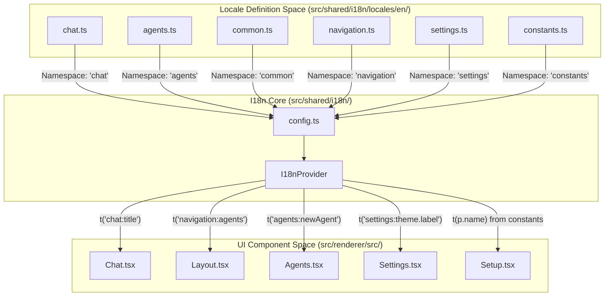
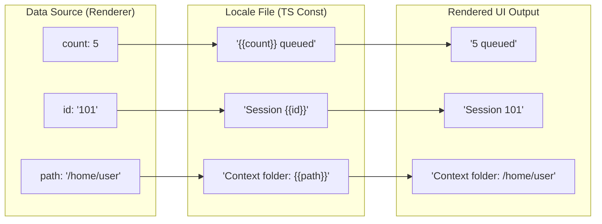

<!-- source: DeepWiki mcp.deepwiki.com · repo fathah/hermes-desktop · page 6.2 Locale Strings Reference · fetched 2026-10-30 -->

# Locale Strings Reference

Relevant source files

The following files were used as context for generating this wiki page:

- [src/renderer/src/constants.ts](src/renderer/src/constants.ts)
- [src/shared/i18n/locales/ar/office.ts](src/shared/i18n/locales/ar/office.ts)
- [src/shared/i18n/locales/en/chat.ts](src/shared/i18n/locales/en/chat.ts)
- [src/shared/i18n/locales/en/constants.ts](src/shared/i18n/locales/en/constants.ts)
- [src/shared/i18n/locales/es/agents.ts](src/shared/i18n/locales/es/agents.ts)
- [src/shared/i18n/locales/es/chat.ts](src/shared/i18n/locales/es/chat.ts)
- [src/shared/i18n/locales/es/constants.ts](src/shared/i18n/locales/es/constants.ts)
- [src/shared/i18n/locales/es/navigation.ts](src/shared/i18n/locales/es/navigation.ts)
- [src/shared/i18n/locales/es/office.ts](src/shared/i18n/locales/es/office.ts)
- [src/shared/i18n/locales/es/sessions.ts](src/shared/i18n/locales/es/sessions.ts)
- [src/shared/i18n/locales/es/settings.ts](src/shared/i18n/locales/es/settings.ts)
- [src/shared/i18n/locales/he/agents.ts](src/shared/i18n/locales/he/agents.ts)
- [src/shared/i18n/locales/he/office.ts](src/shared/i18n/locales/he/office.ts)
- [src/shared/i18n/locales/id/agents.ts](src/shared/i18n/locales/id/agents.ts)
- [src/shared/i18n/locales/id/chat.ts](src/shared/i18n/locales/id/chat.ts)
- [src/shared/i18n/locales/id/constants.ts](src/shared/i18n/locales/id/constants.ts)
- [src/shared/i18n/locales/id/navigation.ts](src/shared/i18n/locales/id/navigation.ts)
- [src/shared/i18n/locales/id/office.ts](src/shared/i18n/locales/id/office.ts)
- [src/shared/i18n/locales/id/sessions.ts](src/shared/i18n/locales/id/sessions.ts)
- [src/shared/i18n/locales/id/settings.ts](src/shared/i18n/locales/id/settings.ts)
- [src/shared/i18n/locales/ja/agents.ts](src/shared/i18n/locales/ja/agents.ts)
- [src/shared/i18n/locales/ja/chat.ts](src/shared/i18n/locales/ja/chat.ts)
- [src/shared/i18n/locales/ja/constants.ts](src/shared/i18n/locales/ja/constants.ts)
- [src/shared/i18n/locales/ja/navigation.ts](src/shared/i18n/locales/ja/navigation.ts)
- [src/shared/i18n/locales/ja/office.ts](src/shared/i18n/locales/ja/office.ts)
- [src/shared/i18n/locales/ja/sessions.ts](src/shared/i18n/locales/ja/sessions.ts)
- [src/shared/i18n/locales/ja/settings.ts](src/shared/i18n/locales/ja/settings.ts)
- [src/shared/i18n/locales/pl/agents.ts](src/shared/i18n/locales/pl/agents.ts)
- [src/shared/i18n/locales/pl/chat.ts](src/shared/i18n/locales/pl/chat.ts)
- [src/shared/i18n/locales/pl/constants.ts](src/shared/i18n/locales/pl/constants.ts)
- [src/shared/i18n/locales/pl/navigation.ts](src/shared/i18n/locales/pl/navigation.ts)
- [src/shared/i18n/locales/pl/office.ts](src/shared/i18n/locales/pl/office.ts)
- [src/shared/i18n/locales/pl/sessions.ts](src/shared/i18n/locales/pl/sessions.ts)
- [src/shared/i18n/locales/pt-BR/agents.ts](src/shared/i18n/locales/pt-BR/agents.ts)
- [src/shared/i18n/locales/pt-BR/chat.ts](src/shared/i18n/locales/pt-BR/chat.ts)
- [src/shared/i18n/locales/pt-BR/constants.ts](src/shared/i18n/locales/pt-BR/constants.ts)
- [src/shared/i18n/locales/pt-BR/navigation.ts](src/shared/i18n/locales/pt-BR/navigation.ts)
- [src/shared/i18n/locales/pt-BR/office.ts](src/shared/i18n/locales/pt-BR/office.ts)
- [src/shared/i18n/locales/pt-BR/sessions.ts](src/shared/i18n/locales/pt-BR/sessions.ts)
- [src/shared/i18n/locales/pt-BR/settings.ts](src/shared/i18n/locales/pt-BR/settings.ts)
- [src/shared/i18n/locales/pt-PT/agents.ts](src/shared/i18n/locales/pt-PT/agents.ts)
- [src/shared/i18n/locales/pt-PT/chat.ts](src/shared/i18n/locales/pt-PT/chat.ts)
- [src/shared/i18n/locales/pt-PT/common.ts](src/shared/i18n/locales/pt-PT/common.ts)
- [src/shared/i18n/locales/pt-PT/constants.ts](src/shared/i18n/locales/pt-PT/constants.ts)
- [src/shared/i18n/locales/pt-PT/diagnose.ts](src/shared/i18n/locales/pt-PT/diagnose.ts)
- [src/shared/i18n/locales/pt-PT/memory.ts](src/shared/i18n/locales/pt-PT/memory.ts)
- [src/shared/i18n/locales/pt-PT/models.ts](src/shared/i18n/locales/pt-PT/models.ts)
- [src/shared/i18n/locales/pt-PT/navigation.ts](src/shared/i18n/locales/pt-PT/navigation.ts)
- [src/shared/i18n/locales/pt-PT/office.ts](src/shared/i18n/locales/pt-PT/office.ts)
- [src/shared/i18n/locales/pt-PT/schedules.ts](src/shared/i18n/locales/pt-PT/schedules.ts)
- [src/shared/i18n/locales/pt-PT/sessions.ts](src/shared/i18n/locales/pt-PT/sessions.ts)
- [src/shared/i18n/locales/pt-PT/settings.ts](src/shared/i18n/locales/pt-PT/settings.ts)
- [src/shared/i18n/locales/pt-PT/skills.ts](src/shared/i18n/locales/pt-PT/skills.ts)
- [src/shared/i18n/locales/pt-PT/tools.ts](src/shared/i18n/locales/pt-PT/tools.ts)
- [src/shared/i18n/locales/tr/agents.ts](src/shared/i18n/locales/tr/agents.ts)
- [src/shared/i18n/locales/tr/chat.ts](src/shared/i18n/locales/tr/chat.ts)
- [src/shared/i18n/locales/tr/constants.ts](src/shared/i18n/locales/tr/constants.ts)
- [src/shared/i18n/locales/tr/discover.ts](src/shared/i18n/locales/tr/discover.ts)
- [src/shared/i18n/locales/tr/gateway.ts](src/shared/i18n/locales/tr/gateway.ts)
- [src/shared/i18n/locales/tr/install.ts](src/shared/i18n/locales/tr/install.ts)
- [src/shared/i18n/locales/tr/kanban.ts](src/shared/i18n/locales/tr/kanban.ts)
- [src/shared/i18n/locales/tr/memory.ts](src/shared/i18n/locales/tr/memory.ts)
- [src/shared/i18n/locales/tr/navigation.ts](src/shared/i18n/locales/tr/navigation.ts)
- [src/shared/i18n/locales/tr/office.ts](src/shared/i18n/locales/tr/office.ts)
- [src/shared/i18n/locales/tr/providers.ts](src/shared/i18n/locales/tr/providers.ts)
- [src/shared/i18n/locales/tr/sessions.ts](src/shared/i18n/locales/tr/sessions.ts)
- [src/shared/i18n/locales/tr/settings.ts](src/shared/i18n/locales/tr/settings.ts)
- [src/shared/i18n/locales/tr/setup.ts](src/shared/i18n/locales/tr/setup.ts)
- [src/shared/i18n/locales/tr/skills.ts](src/shared/i18n/locales/tr/skills.ts)
- [src/shared/i18n/locales/tr/soul.ts](src/shared/i18n/locales/tr/soul.ts)
- [src/shared/i18n/locales/tr/tools.ts](src/shared/i18n/locales/tr/tools.ts)
- [src/shared/i18n/locales/zh-CN/agents.ts](src/shared/i18n/locales/zh-CN/agents.ts)
- [src/shared/i18n/locales/zh-CN/chat.ts](src/shared/i18n/locales/zh-CN/chat.ts)
- [src/shared/i18n/locales/zh-CN/constants.ts](src/shared/i18n/locales/zh-CN/constants.ts)
- [src/shared/i18n/locales/zh-CN/navigation.ts](src/shared/i18n/locales/zh-CN/navigation.ts)
- [src/shared/i18n/locales/zh-CN/office.ts](src/shared/i18n/locales/zh-CN/office.ts)
- [src/shared/i18n/locales/zh-CN/sessions.ts](src/shared/i18n/locales/zh-CN/sessions.ts)
- [src/shared/i18n/locales/zh-CN/settings.ts](src/shared/i18n/locales/zh-CN/settings.ts)
- [src/shared/i18n/locales/zh-TW/agents.ts](src/shared/i18n/locales/zh-TW/agents.ts)
- [src/shared/i18n/locales/zh-TW/chat.ts](src/shared/i18n/locales/zh-TW/chat.ts)
- [src/shared/i18n/locales/zh-TW/constants.ts](src/shared/i18n/locales/zh-TW/constants.ts)
- [src/shared/i18n/locales/zh-TW/navigation.ts](src/shared/i18n/locales/zh-TW/navigation.ts)
- [src/shared/i18n/locales/zh-TW/sessions.ts](src/shared/i18n/locales/zh-TW/sessions.ts)
- [src/shared/i18n/locales/zh-TW/settings.ts](src/shared/i18n/locales/zh-TW/settings.ts)

This page documents the internationalization (i18n) string architecture in Hermes Desktop. The system utilizes `i18next` to manage translations across the application, organized into feature-specific namespaces.

## Architecture Overview

The localization system is structured into namespaces that correspond to major UI modules. Each namespace is defined as a TypeScript object exported with `as const` to ensure type safety when using the `useI18n` hook or `t()` function in the renderer.

### Translation Data Flow

The following diagram illustrates how natural language strings are mapped from static definition files to the UI components.

**Natural Language to Code Mapping**

**Sources:** [src/shared/i18n/locales/en/chat.ts:1-174](), [src/shared/i18n/locales/en/constants.ts:1-278](), [src/renderer/src/constants.ts:1-178]()

## Namespace Reference

The following table summarizes the primary English (`en`) locale files and their functional roles within the application.

| Namespace | File Path | Primary Purpose |
| :--- | :--- | :--- |
| `common` | `src/shared/i18n/locales/en/common.ts` | Global UI verbs (Save, Cancel, Delete), loading states, and app-wide labels. |
| `chat` | `src/shared/i18n/locales/en/chat.ts` | Main interaction screen, slash commands, message streaming, reasoning levels, and worktree explorer. |
| `agents` | `src/shared/i18n/locales/en/agents.ts` | Profile management, creation, and isolation workspace labels. |
| `navigation` | `src/shared/i18n/locales/en/navigation.ts` | Sidebar labels and application routing titles. |
| `settings` | `src/shared/i18n/locales/en/settings.ts` | App configuration including theme, language, and data migration. |
| `constants` | `src/shared/i18n/locales/en/constants.ts` | Provider names, model descriptions, and static category labels used in setup/settings. |
| `tools` | `src/shared/i18n/locales/en/tools.ts` | Descriptions for built-in toolsets (Web, Browser, Terminal, MCP). |
| `models` | `src/shared/i18n/locales/en/models.ts` | Model library management, custom provider hints, and API key mapping. |
| `office` | `src/shared/i18n/locales/en/office.ts` | 3D Office environment strings, representative interactions, and setup logs. |
| `gateway` | `src/shared/i18n/locales/en/gateway.ts` | Messaging platform connection status (Telegram, Discord, Slack, etc.). |
| `kanban` | `src/shared/i18n/locales/en/kanban.ts` | Task management board strings, task CRUD, and status columns. |

**Sources:** [src/shared/i18n/locales/en/chat.ts:1-174](), [src/shared/i18n/locales/en/constants.ts:1-278](), [src/renderer/src/constants.ts:37-87]()

## Key String Implementations

### Chat and Commands
The `chat` namespace contains a nested `commands` object that maps slash commands to their descriptions displayed in the command palette.

*   **Slash Command Descriptions**: [src/shared/i18n/locales/en/chat.ts:113-137]()
*   **Reasoning Levels**: Supports `minimal`, `low`, `medium`, `high`, and `xhigh` reasoning depths for O1-style models [src/shared/i18n/locales/en/chat.ts:17-36]().
*   **Dynamic Session Titles**: Uses interpolation, e.g., `Session {{id}}` [src/shared/i18n/locales/en/chat.ts:3-3]().
*   **Worktree Explorer**: Strings for the file browser integrated into the chat interface [src/shared/i18n/locales/en/chat.ts:143-155]().

### Auxiliary Tasks and Providers
The `constants` namespace handles the mapping of technical provider IDs to user-friendly labels and descriptions for auxiliary task overrides.

*   **Auxiliary Tasks**: Labels for vision, compression, web extraction, and kanban decomposition [src/shared/i18n/locales/en/constants.ts:140-165]().
*   **Provider Registry**: Labels for all supported LLM backends including first-party (OpenAI, Anthropic) and local (Ollama, LM Studio) [src/renderer/src/constants.ts:89-128]().
*   **DashScope Endpoints**: Localized names for regional endpoints (China vs International) [src/renderer/src/constants.ts:15-26]().

### Gateway Messaging Platforms
The `gateway` section in `constants.ts` (and regional equivalents) defines fields for various messaging integrations.

*   **Platform Support**: Includes Telegram, Discord, Slack, WhatsApp, Signal, Matrix, Mattermost, and Email [src/shared/i18n/locales/zh-CN/constants.ts:132-171]().

**Sources:** [src/shared/i18n/locales/en/chat.ts:17-36](), [src/shared/i18n/locales/en/constants.ts:140-165](), [src/renderer/src/constants.ts:89-128]()

## Multi-Language Support

Hermes supports a wide range of locales. Each locale folder contains a set of `.ts` files mirroring the `en` structure.

### Supported Locale Sets
*   **zh-CN (Simplified Chinese)**: Full translation of settings, chat, and extensive gateway provider hints [src/shared/i18n/locales/zh-CN/constants.ts:1-191](), [src/shared/i18n/locales/zh-CN/chat.ts:1-90]().
*   **pt-BR (Portuguese Brazil)**: Comprehensive coverage for interaction and configuration [src/shared/i18n/locales/pt-BR/chat.ts:1-94]().
*   **es (Spanish)**: Full interaction strings and provider setup cards [src/shared/i18n/locales/es/chat.ts:1-128](), [src/shared/i18n/locales/es/constants.ts:1-157]().
*   **tr (Turkish)**: Detailed interaction strings including reasoning/thought process labels [src/shared/i18n/locales/tr/chat.ts:1-124]().
*   **ja (Japanese)**: Localized commands and worktree labels [src/shared/i18n/locales/ja/chat.ts:1-93]().
*   **id (Indonesian)**: Translated interface for chat, commands, and setup [src/shared/i18n/locales/id/chat.ts:1-94]().
*   **pt-PT (Portuguese Portugal)**: Specific dialect translations for the European region [src/shared/i18n/locales/pt-PT/chat.ts:1-106]().

**Sources:** [src/shared/i18n/locales/tr/chat.ts:24-27](), [src/shared/i18n/locales/es/constants.ts:4-33](), [src/shared/i18n/locales/zh-CN/constants.ts:132-157]()

## Adding New Translations

To add a new translation string or a new locale:

1.  **Define the String**: Add the key-value pair to the relevant file in `src/shared/i18n/locales/en/`.
2.  **Type Safety**: Ensure the file ends with `as const` to allow TypeScript to provide autocomplete in the renderer [src/shared/i18n/locales/en/chat.ts:174-174]().
3.  **Usage**: Use the `useI18n` hook in a component to access the `t` function.

### String Interpolation Logic
Hermes uses standard `i18next` interpolation syntax (double curly braces).

**Code to UI Mapping (Interpolation)**

**Sources:** [src/shared/i18n/locales/en/chat.ts:3-3](), [src/shared/i18n/locales/en/chat.ts:64-64](), [src/shared/i18n/locales/en/chat.ts:139-139]()

## Validation and Errors
Standardized validation and error strings are maintained within feature namespaces to provide context-aware feedback.

*   **Chat Validation**: Missing keys, missing providers, or unselected models [src/shared/i18n/locales/en/chat.ts:87-95]().
*   **Attachment Errors**: File size limits (50MB for images, 256KB for text) and unsupported type warnings [src/shared/i18n/locales/en/chat.ts:78-86]().
*   **Worktree Errors**: Failures to load folders or open terminals [src/shared/i18n/locales/en/chat.ts:147-152]().

**Sources:** [src/shared/i18n/locales/en/chat.ts:78-86](), [src/shared/i18n/locales/en/chat.ts:87-95](), [src/shared/i18n/locales/en/chat.ts:147-152]()

---

