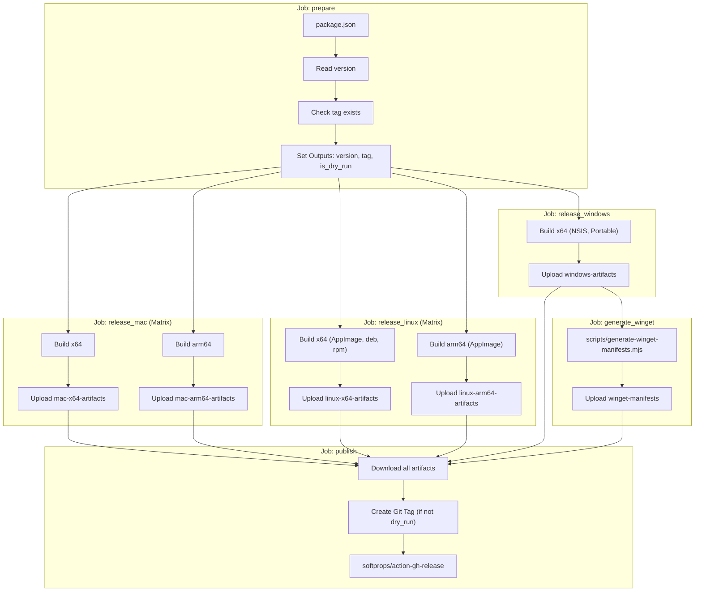
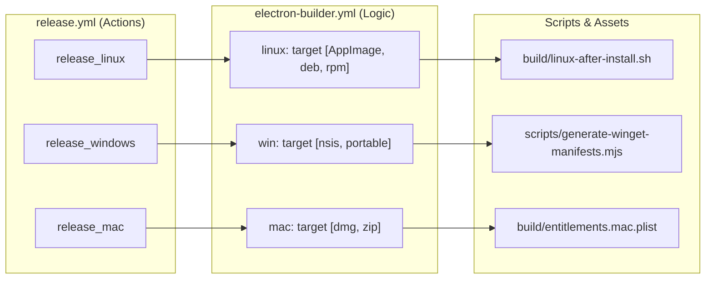

<!-- source: DeepWiki mcp.deepwiki.com · repo fathah/hermes-desktop · page 7.1 GitHub Actions Release Workflow · fetched 2026-10-30 -->

# GitHub Actions Release Workflow

Relevant source files

The following files were used as context for generating this wiki page:

- [.gitattributes](.gitattributes)
- [.github/workflows/beta-release.yml](.github/workflows/beta-release.yml)
- [.github/workflows/release.yml](.github/workflows/release.yml)
- [build/linux-after-install.sh](build/linux-after-install.sh)
- [build/winget/Installer.template.yaml](build/winget/Installer.template.yaml)
- [build/winget/Locale.en-US.template.yaml](build/winget/Locale.en-US.template.yaml)
- [build/winget/Version.template.yaml](build/winget/Version.template.yaml)
- [electron-builder.yml](electron-builder.yml)
- [eslint.config.mjs](eslint.config.mjs)
- [lat.md/desktop-updates.md](lat.md/desktop-updates.md)
- [lat.md/provider-setup.md](lat.md/provider-setup.md)
- [package-lock.json](package-lock.json)
- [package.json](package.json)
- [scripts/generate-winget-manifests.mjs](scripts/generate-winget-manifests.mjs)
- [scripts/set-version.mjs](scripts/set-version.mjs)
- [src/main/remote-provider-statuses.ts](src/main/remote-provider-statuses.ts)
- [src/renderer/src/components/HermesAccountModal.tsx](src/renderer/src/components/HermesAccountModal.tsx)
- [src/renderer/src/components/ProviderKeysSection.tsx](src/renderer/src/components/ProviderKeysSection.tsx)
- [src/renderer/src/screens/Chat/FileViewer.tsx](src/renderer/src/screens/Chat/FileViewer.tsx)
- [src/renderer/src/screens/Chat/HistoryRow.tsx](src/renderer/src/screens/Chat/HistoryRow.tsx)
- [src/renderer/src/screens/Chat/MessageList.tsx](src/renderer/src/screens/Chat/MessageList.tsx)
- [src/renderer/src/screens/Chat/WorktreePanel.tsx](src/renderer/src/screens/Chat/WorktreePanel.tsx)
- [src/renderer/src/screens/Providers/Providers.tsx](src/renderer/src/screens/Providers/Providers.tsx)
- [tests/remote-provider-statuses.test.ts](tests/remote-provider-statuses.test.ts)
- [tests/winget-generator.test.ts](tests/winget-generator.test.ts)

The Hermes Desktop release process is automated via a multi-stage GitHub Actions pipeline. This workflow handles version detection, cross-platform compilation for macOS (Intel and Apple Silicon), Linux (AppImage, Debian, and RPM), and Windows (NSIS and Portable), as well as automated manifest generation for the Windows Package Manager (Winget).

## Workflow Architecture

The workflow defined in `.github/workflows/release.yml` is triggered by pushes to the `release` branch or via a manual `workflow_dispatch` [.github/workflows/release.yml:3-7](). The manual dispatch includes a `dry_run` input (defaulting to `true`) which allows testing the full build pipeline without creating a Git tag or a GitHub Release [.github/workflows/release.yml:8-12]().

### Pipeline Stages

The pipeline is divided into six sequential and parallel jobs:

1.  **Prepare**: Extracts versioning metadata from `package.json`, determines if the run is a dry run, and checks for existing tags [.github/workflows/release.yml:22-30]().
2.  **release_mac**: Builds macOS binaries using a matrix strategy for `x64` and `arm64` [.github/workflows/release.yml:63-70]().
3.  **release_linux**: Builds Linux binaries, including AppImage, `.deb`, and `.rpm` [.github/workflows/release.yml:142-156]().
4.  **release_windows**: Builds the Windows NSIS installer and a portable executable [.github/workflows/release.yml:221-225]().
5.  **generate_winget**: Uses the Windows installer to generate Winget YAML manifests [.github/workflows/release.yml:257-261]().
6.  **Publish**: Consolidates all platform artifacts and creates the GitHub Release [.github/workflows/release.yml:295-298]().

### Workflow Data Flow

The following diagram illustrates the flow of data and dependencies between the pipeline jobs.

**Release Pipeline Execution Flow**

Sources: [.github/workflows/release.yml:21-335](), [package.json:1-95]()

---

## Detailed Job Implementation

### 1. Prepare Release
This job determines the unique identifier for the release. It reads the `version` from `package.json` using a Node.js one-liner [.github/workflows/release.yml:34-40](). It performs a safety check using `git ls-remote` to ensure the tag (e.g., `v0.7.4`) does not already exist [.github/workflows/release.yml:42-50](). It also computes the `is_dry_run` flag based on the trigger type and manual input [.github/workflows/release.yml:52-61]().

Sources: [.github/workflows/release.yml:22-62](), [package.json:3-3]()

### 2. macOS Build (release_mac)
Runs on `macos-latest` using a matrix for `x64` and `arm64` [.github/workflows/release.yml:67-70]().
*   **Architecture Rebuild**: Executes `electron-builder install-app-deps --arch=${{ matrix.arch }}` to ensure native modules like `better-sqlite3` are compiled for the correct target [.github/workflows/release.yml:84-85]().
*   **Notarization**: Stages the App Store Connect API key from secrets to `$RUNNER_TEMP/appstore` to allow `electron-builder` to notarize the app [.github/workflows/release.yml:95-111]().
*   **Packaging**: Runs `electron-builder --mac dmg zip --${{ matrix.arch }}` [.github/workflows/release.yml:118]().
*   **Verification**: Uses the `file` command to verify that the native `better_sqlite3.node` binary matches the expected architecture [.github/workflows/release.yml:120-131]().

Sources: [.github/workflows/release.yml:63-141](), [electron-builder.yml:29-43]()

### 3. Linux Build (release_linux)
Uses a matrix to target `x64` (on `ubuntu-latest`) and `arm64` (on `ubuntu-24.04-arm`) [.github/workflows/release.yml:147-156](). It produces `AppImage`, `deb`, and `rpm` formats for x64 [.github/workflows/release.yml:186](). A specific `afterInstall` script `build/linux-after-install.sh` is used for `.deb` and `.rpm` to fix `chrome-sandbox` SUID permissions [.electron-builder.yml:60-68]().

Sources: [.github/workflows/release.yml:142-219](), [electron-builder.yml:44-68]()

### 4. Windows Build (release_windows)
Runs on `windows-latest`. It generates both a standard NSIS installer (`-setup.exe`) and a `portable` version [.github/workflows/release.yml:245](), [.electron-builder.yml:15-28](). The job also produces `latest.yml` and `.blockmap` files required for the `electron-updater` differential update mechanism [.github/workflows/release.yml:252-255]().

Sources: [.github/workflows/release.yml:221-256](), [electron-builder.yml:15-28]()

### 5. Winget Manifest Generation (generate_winget)
This job runs on `ubuntu-latest` and depends on the Windows build [.github/workflows/release.yml:259-261]().
*   **Implementation**: It downloads the `.exe` from the previous job and executes `scripts/generate-winget-manifests.mjs` [.github/workflows/release.yml:287]().
*   **Logic**: The script uses templates in `build/winget/` (e.g., `Installer.template.yaml`) to generate manifests for submission to the Windows Package Manager.

Sources: [.github/workflows/release.yml:257-293](), [scripts/generate-winget-manifests.mjs:1-50]()

### 6. Publish Release
The final stage executes only if `is_dry_run` is false and the tag is new [.github/workflows/release.yml:298]().
*   **Consolidation**: Downloads all artifacts from the matrix builds into a local directory [.github/workflows/release.yml:311-315]().
*   **Release**: Uses `softprops/action-gh-release` to upload the binaries. It includes installers, portable builds, and update metadata [.github/workflows/release.yml:318-335]().

Sources: [.github/workflows/release.yml:295-335]()

---

## Beta Releases

A separate workflow, `.github/workflows/beta-release.yml`, handles pre-release builds.
*   **Versioning**: Uses `scripts/set-version.mjs` to append a beta suffix (e.g., `0.7.4-beta.1`) to `package.json` and `package-lock.json` before building.
*   **Trigger**: Usually triggered manually or on specific beta branches.

Sources: [.github/workflows/beta-release.yml:1-100](), [scripts/set-version.mjs:1-26]()

---

## Continuous Integration (CI) Workflow

Hermes Desktop uses a CI workflow to ensure code quality on every push and Pull Request.

### CI Pipeline Steps
1.  **Typecheck**: Runs `npm run typecheck`, which executes both `typecheck:node` (Main/Preload) and `typecheck:web` (Renderer) [package.json:15-17]().
2.  **Test**: Runs the full `vitest` suite via `npm test` [package.json:11-11]().
3.  **Lint**: Runs `eslint` via `npm run lint` [package.json:10-10]().

Sources: [package.json:8-18](), [eslint.config.mjs:1-77]()

---

## Configuration Mapping

The release workflow maps build jobs to `electron-builder` configurations defined in `electron-builder.yml`.

**Workflow to Packaging Entity Mapping**

Sources: [.github/workflows/release.yml:118](), [.github/workflows/release.yml:186](), [.github/workflows/release.yml:245](), [electron-builder.yml:1-73]()

### Artifact Manifest

| Platform | Architecture | Output Formats | Purpose |
| :--- | :--- | :--- | :--- |
| macOS | `x64`, `arm64` | `.dmg`, `.zip` | Primary distribution and auto-update [.github/workflows/release.yml:138-139]() |
| Linux | `x64`, `arm64` | `.AppImage`, `.deb`, `.rpm` | Portable and system-integrated packages [.github/workflows/release.yml:194-196]() |
| Windows | `x64` | `.exe` (NSIS), `portable.exe` | Installer and standalone executable [electron-builder.yml:15-21]() |
| Winget | N/A | `.yaml` manifests | Submission to Windows Package Manager [.github/workflows/release.yml:287]() |
| Metadata | N/A | `latest*.yml`, `.blockmap` | Electron Auto-Updater support [.github/workflows/release.yml:254-255]() |

Sources: [.github/workflows/release.yml:116-293](), [electron-builder.yml:1-73]()

---

