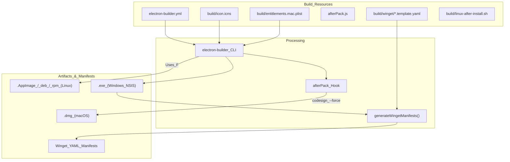
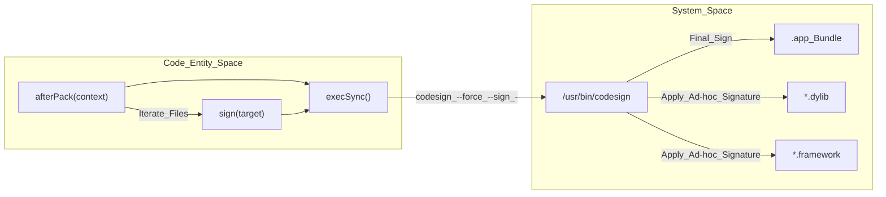
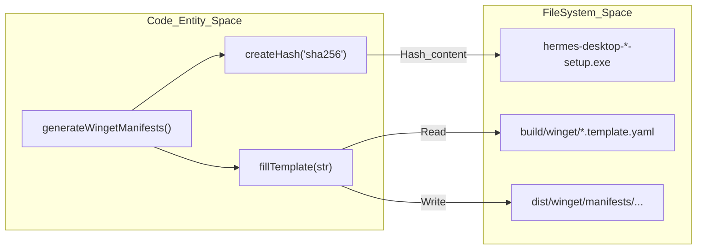

<!-- source: DeepWiki mcp.deepwiki.com · repo fathah/hermes-desktop · page 7.2 Platform Packaging and Code Signing · fetched 2026-10-30 -->

# Platform Packaging and Code Signing

Relevant source files

The following files were used as context for generating this wiki page:

- [.gitattributes](.gitattributes)
- [.github/workflows/release.yml](.github/workflows/release.yml)
- [build/afterPack.js](build/afterPack.js)
- [build/entitlements.mac.inherit.plist](build/entitlements.mac.inherit.plist)
- [build/entitlements.mac.plist](build/entitlements.mac.plist)
- [build/icon.icns](build/icon.icns)
- [build/icon.ico](build/icon.ico)
- [build/icon.png](build/icon.png)
- [build/linux-after-install.sh](build/linux-after-install.sh)
- [build/winget/Installer.template.yaml](build/winget/Installer.template.yaml)
- [build/winget/Locale.en-US.template.yaml](build/winget/Locale.en-US.template.yaml)
- [build/winget/Version.template.yaml](build/winget/Version.template.yaml)
- [electron-builder.yml](electron-builder.yml)
- [eslint.config.mjs](eslint.config.mjs)
- [package-lock.json](package-lock.json)
- [package.json](package.json)
- [scripts/generate-winget-manifests.mjs](scripts/generate-winget-manifests.mjs)
- [src/renderer/src/assets/icon.png](src/renderer/src/assets/icon.png)
- [src/renderer/src/screens/Chat/FileViewer.tsx](src/renderer/src/screens/Chat/FileViewer.tsx)
- [src/renderer/src/screens/Chat/HistoryRow.tsx](src/renderer/src/screens/Chat/HistoryRow.tsx)
- [src/renderer/src/screens/Chat/MessageList.tsx](src/renderer/src/screens/Chat/MessageList.tsx)
- [src/renderer/src/screens/Chat/WorktreePanel.tsx](src/renderer/src/screens/Chat/WorktreePanel.tsx)
- [tests/winget-generator.test.ts](tests/winget-generator.test.ts)

This page details the configuration and scripts responsible for transforming the Hermes Desktop source code into distributable application packages. It covers the `electron-builder` configuration, macOS security entitlements, the inside-out re-signing process, Linux-specific sandbox fixes, and the generation of Windows Package Manager (Winget) manifests.

## Packaging Pipeline Overview

Hermes Desktop uses `electron-builder` as its primary packaging engine [package.json:78-78](). The pipeline is configured to produce artifacts for macOS (`.dmg`), Linux (`.AppImage`, `.deb`, `.rpm`), and Windows (`.exe` via NSIS and portable) [electron-builder.yml:15-68]().

The following diagram illustrates the data flow from build resources and templates to final platform-specific artifacts and manifests:

**Build to Artifact Data Flow**

Sources: [electron-builder.yml:1-73](), [build/afterPack.js:20-52](), [scripts/generate-winget-manifests.mjs:16-21](), [.github/workflows/release.yml:112-119]()

## Configuration (electron-builder.yml)

The `electron-builder.yml` file defines the application identity and platform-specific build instructions.

### Core Identity and Exclusions
The application is identified as `com.nousresearch.hermes` [electron-builder.yml:1-1]() with the product name "Hermes One" [electron-builder.yml:2-2](). To keep the package size optimal, the configuration explicitly excludes development-only files such as `.vscode`, source files (`src/*`), build scripts, and environment/lock files [electron-builder.yml:6-11]().

### ASAR Unpacking
Specific resources are excluded from the ASAR archive to ensure they remain accessible to the system or external processes.
*   **Resources:** Files in the `resources/**` directory are unpacked [electron-builder.yml:12-13]().
*   **Native Modules:** The `better-sqlite3` native binary is unpacked to allow direct access by the SQLite engine [electron-builder.yml:14-14]().

### Platform Specifics
| Platform | Key Configurations | Output Formats |
| :--- | :--- | :--- |
| **Windows** | Executable name: `hermes-agent` [electron-builder.yml:16-16](). NSIS installer creates desktop shortcuts [electron-builder.yml:22-27](). | NSIS Setup (`.exe`), Portable [electron-builder.yml:17-19]() |
| **macOS** | Uses `entitlements.mac.plist` [electron-builder.yml:32-32]() and requests camera/microphone/folder permissions via `extendInfo` [electron-builder.yml:34-38](). Hardened runtime is enabled [electron-builder.yml:39-39](). | DMG, ZIP [electron-builder.yml:29-43]() |
| **Linux** | Maintainer: `electronjs.org` [electron-builder.yml:50-50](). Vendor: `Nous Research` [electron-builder.yml:51-51](). Includes a post-install script for sandbox fixes [electron-builder.yml:64-64](). | AppImage, snap, deb, rpm [electron-builder.yml:44-49]() |

Sources: [electron-builder.yml:1-73]()

## macOS Entitlements and Security

macOS requires specific entitlements to allow the application to perform low-level operations like Just-In-Time (JIT) compilation and loading unsigned code, necessary for high-performance agent operations and native module execution.

### Entitlement Definitions
The project maintains two primary plist files for macOS:
1.  **Main Entitlements (`entitlements.mac.plist`):** Applied to the main application bundle [build/entitlements.mac.plist:1-14]().
2.  **Inherit Entitlements (`entitlements.mac.inherit.plist`):** Used for child processes to inherit the parent's security context [build/entitlements.mac.inherit.plist:1-14]().

Both files grant the following capabilities:
*   `com.apple.security.cs.allow-jit`: Allows JIT compilation [build/entitlements.mac.plist:5-6]().
*   `com.apple.security.cs.allow-unsigned-executable-memory`: Allows execution of unsigned memory [build/entitlements.mac.plist:7-8]().
*   `com.apple.security.cs.allow-dyld-environment-variables`: Allows use of dynamic linker variables [build/entitlements.mac.plist:9-10]().
*   `com.apple.security.cs.disable-library-validation`: Permits loading of libraries not signed by Apple or the team [build/entitlements.mac.plist:11-12]().

Sources: [build/entitlements.mac.plist:1-14](), [build/entitlements.mac.inherit.plist:1-14]()

## Linux Sandbox Fix (chrome-sandbox)

Modern Linux distributions (e.g., Ubuntu 24.04+) restrict unprivileged user namespaces, which can prevent Electron's sandbox from functioning. Hermes Desktop addresses this via `build/linux-after-install.sh`.

*   **Implementation:** The script is triggered after `.deb` and `.rpm` installation [electron-builder.yml:64-68]().
*   **Mechanism:** It applies `chmod 4755` to the `chrome-sandbox` executable [electron-builder.yml:61-63](). This sets the SUID bit, allowing the sandbox helper to run with the necessary privileges to create namespaces.

Sources: [electron-builder.yml:60-68](), [build/linux-after-install.sh:1-5]()

## Ad-hoc Re-signing (afterPack.js)

The project implements an `afterPack` hook to perform manual ad-hoc re-signing on macOS. This ensures that native binaries and nested frameworks are correctly signed with a local identity when formal notarization is bypassed or during local builds.

The script `build/afterPack.js` executes an "inside-out" signing strategy:
1.  **Platform Check:** The script exits immediately if the platform is not `darwin` [build/afterPack.js:21-21]().
2.  **Inside-Out Strategy:** It signs components in order of depth to ensure signature validity:
    *   **Step 1:** Signs all `.dylib` files found in the bundle [build/afterPack.js:30-34]().
    *   **Step 2:** Signs XPC services and nested `.app` bundles within `Contents/Frameworks` [build/afterPack.js:36-40]().
    *   **Step 3:** Signs each `.framework` bundle [build/afterPack.js:42-46]().
    *   **Step 4:** Signs the outer `.app` wrapper [build/afterPack.js:48-49]().
3.  **Error Handling:** The `sign` helper function ignores files that are not Mach-O binaries to prevent the build from failing on non-signable assets [build/afterPack.js:5-18]().

**Code Signing Entity Map**

Sources: [build/afterPack.js:1-52]()

## Winget Manifest Generation

The project includes a utility to generate manifests for the Windows Package Manager (Winget), allowing users to install Hermes via `winget install NousResearch.HermesDesktop`.

### Manifest Generation Logic
The `generateWingetManifests` function in `scripts/generate-winget-manifests.mjs` automates the creation of YAML manifests.

1.  **Checksum Calculation:** It reads the NSIS installer (`-setup.exe`) from the `dist/` directory and generates a SHA256 hash [scripts/generate-winget-manifests.mjs:22-33]().
2.  **Placeholder Replacement:** It populates a `replacements` object containing the `VERSION`, `INSTALLER_URL`, `INSTALLER_SHA256`, and `RELEASE_DATE` [scripts/generate-winget-manifests.mjs:38-44]().
3.  **Template Processing:** It reads three templates from `build/winget/`:
    *   `Installer.template.yaml`: Defines installer behavior and hash [scripts/generate-winget-manifests.mjs:73-73]().
    *   `Locale.en-US.template.yaml`: Contains metadata and release notes URL [scripts/generate-winget-manifests.mjs:74-77]().
    *   `Version.template.yaml`: Maps the package ID to the current version [scripts/generate-winget-manifests.mjs:78-78]().
4.  **Output Generation:** The filled YAML files are written to a structured directory path: `dist/winget/manifests/n/NousResearch/HermesDesktop/<version>/` [scripts/generate-winget-manifests.mjs:60-69]().

**Winget Generator Entity Map**

Sources: [scripts/generate-winget-manifests.mjs:10-87](), [tests/winget-generator.test.ts:42-180]()

## Release Workflow Integration

The packaging pipeline is triggered by the GitHub Actions release workflow (`.github/workflows/release.yml`).

*   **macOS Builds:** Handles architecture-specific builds (`x64`, `arm64`) and notarization using App Store Connect API keys [release.yml:63-119](). It also verifies the architecture of native modules like `better-sqlite3` [release.yml:120-131]().
*   **Linux Builds:** Generates AppImage, DEB, and RPM artifacts using a matrix for `x64` and `arm64` [release.yml:142-187]().
*   **Windows Builds:** Produces NSIS and Portable executables, and triggers the Winget manifest generation [release.yml:216-240]().

Sources: [.github/workflows/release.yml:1-240](), [package.json:24-30]()

---

