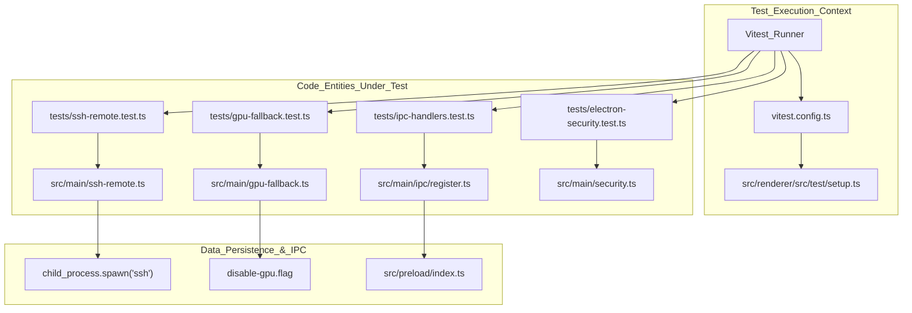
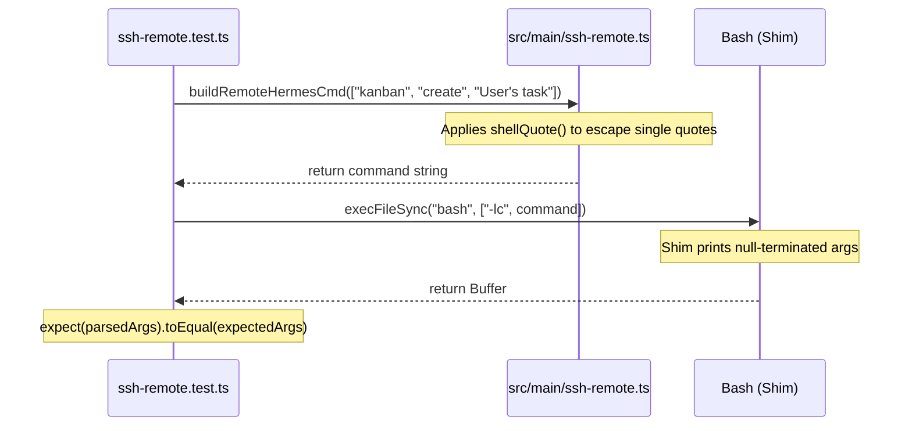

<!-- source: DeepWiki mcp.deepwiki.com · repo fathah/hermes-desktop · page 8 Testing · fetched 2026-10-30 -->

# Testing

Relevant source files

The following files were used as context for generating this wiki page:

- [lat.md/main-process.md](lat.md/main-process.md)
- [pr-comment.md](pr-comment.md)
- [src/main/gpu-fallback.ts](src/main/gpu-fallback.ts)
- [src/main/security.ts](src/main/security.ts)
- [src/main/ssh-remote.ts](src/main/ssh-remote.ts)
- [tests/electron-security.test.ts](tests/electron-security.test.ts)
- [tests/gpu-fallback.test.ts](tests/gpu-fallback.test.ts)
- [tests/ipc-handlers.test.ts](tests/ipc-handlers.test.ts)
- [tests/ssh-remote.test.ts](tests/ssh-remote.test.ts)

The Hermes Desktop testing infrastructure provides a framework for validating the integrity of the Electron main process, the IPC bridge, and the React renderer components. The system utilizes **Vitest** as the primary test runner, configured to simulate a browser environment for UI components while maintaining access to Node.js utilities for backend logic.

### Test Architecture Overview

The testing strategy is divided into unit tests for shared utilities and integration tests for the renderer's translation and UI layers. The infrastructure supports alias resolution to match the production build environment, ensuring that imports using `@renderer` or `@shared` function correctly during test execution [vitest.config.ts:5-10]().

#### Component Interaction Map
The following diagram illustrates how the testing utilities interact with the application layers, specifically bridging the gap between test files and the underlying code entities:

**Testing System to Code Entity Mapping**

**Sources:** [vitest.config.ts:1-18](), [tests/ssh-remote.test.ts:1-19](), [tests/gpu-fallback.test.ts:1-13](), [tests/ipc-handlers.test.ts:1-10](), [tests/electron-security.test.ts:1-20]()

---

### Test Infrastructure

The foundation of the testing suite is built on **Vitest** and **jsdom**. The configuration mirrors the application's multi-process structure by resolving path aliases used in the `electron-vite` build pipeline.

*   **Environment**: Uses `jsdom` to provide a browser-like global environment for testing React components [vitest.config.ts:12]().
*   **Main Process Hardening**: Tests in `electron-security.test.ts` verify that `nodeIntegration` is disabled and `contextIsolation` is enabled in `src/main/app/start.ts` to maintain the security model [tests/electron-security.test.ts:21-28]().
*   **IPC Consistency**: A dedicated suite ensures that every `ipcRenderer.invoke` call in the preload script has a corresponding `ipcMain.handle` in the main process, preventing broken bridge calls [tests/ipc-handlers.test.ts:42-60]().
*   **GPU Crash Guard**: The infrastructure includes mocks for Electron's `app` and `commandLine` to test the logic that disables hardware acceleration after a crash without requiring a physical GPU [tests/gpu-fallback.test.ts:27-50]().

For details on configuration and local execution, see [Test Infrastructure](#8.1).

**Sources:** [vitest.config.ts:1-18](), [src/renderer/src/test/setup.ts:1-8](), [tests/ipc-handlers.test.ts:1-60](), [tests/gpu-fallback.test.ts:15-50]()

---

### Test Suites

The codebase contains specialized test suites targeting critical paths, particularly focusing on remote execution, security policies, and process stability.

| Suite Category | Target Entities | Purpose |
| :--- | :--- | :--- |
| **Remote Execution** | `sshExec`, `buildRemoteHermesCmd` | Validates shell-quoting and argument preservation for commands executed over SSH [src/main/ssh-remote.ts:58-108](), [tests/ssh-remote.test.ts:124-178](). |
| **Security Policy** | `isAllowedExternalUrl`, `isAllowedWebviewUrl` | Enforces allowlists for external URLs and webview navigation to prevent XSS and data exfiltration [src/main/security.ts:20-86](). |
| **GPU Fallback** | `isGpuDisabled`, `applyGpuPreferences` | Verifies the 24-hour TTL logic for the `disable-gpu.flag` and ensures `HERMES_DISABLE_GPU=0` can force recovery [src/main/gpu-fallback.ts:63-153](). |
| **IPC Registry** | `registerIpcHandlers` | Confirms that new features (MCP, Wallets, Backups) have correctly registered IPC handlers [tests/ipc-handlers.test.ts:64-89](). |

#### Logic Flow: SSH Command Quoting
This diagram shows how the system verifies that user input (like a Kanban task title) is safely quoted when sent to a remote host.

**SSH Remote Command Validation**

**Sources:** [tests/ssh-remote.test.ts:62-100](), [tests/ssh-remote.test.ts:124-178](), [src/main/ssh-remote.ts:147-149]()

For details on specific test files and implementation logic, see [Test Suites](#8.2).

**Sources:** [tests/ssh-remote.test.ts:1-202](), [tests/gpu-fallback.test.ts:1-194](), [tests/electron-security.test.ts:1-169](), [tests/ipc-handlers.test.ts:1-129]()

---

