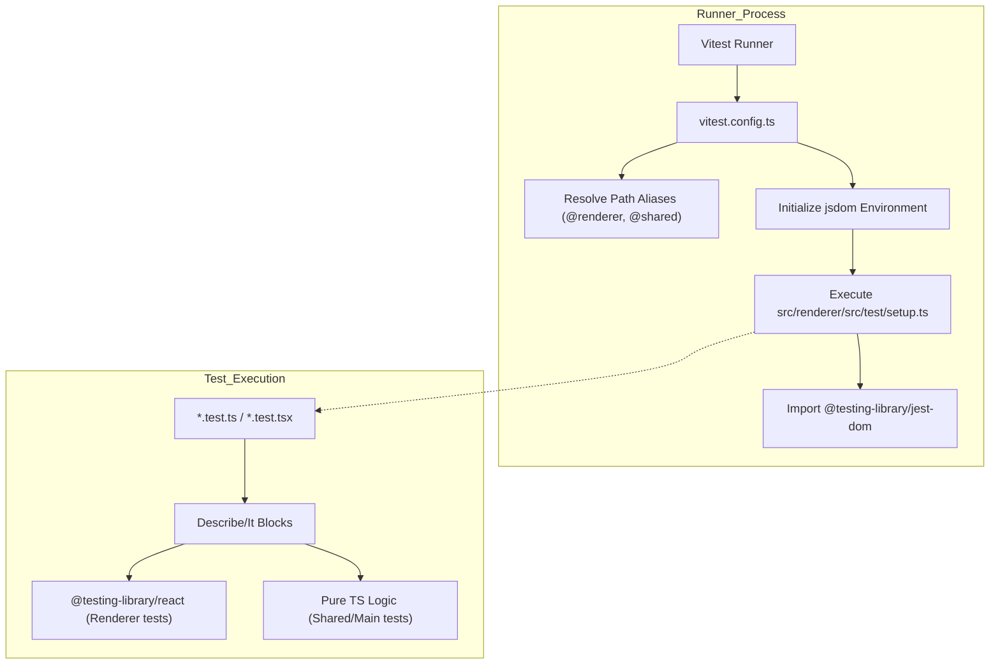
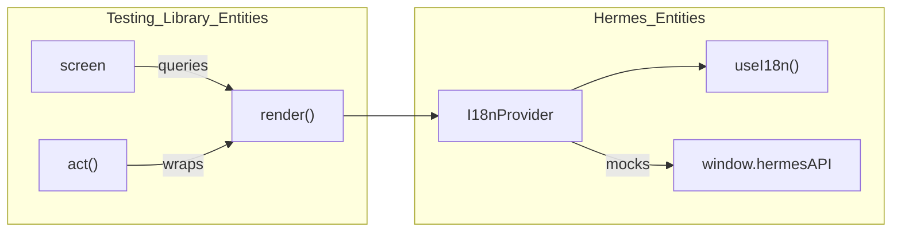
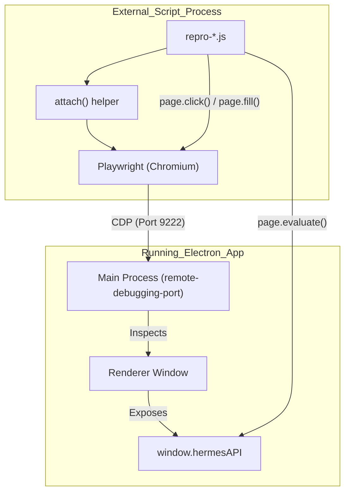

<!-- source: DeepWiki mcp.deepwiki.com · repo fathah/hermes-desktop · page 8.1 Test Infrastructure · fetched 2026-10-30 -->

# Test Infrastructure

Relevant source files

The following files were used as context for generating this wiki page:

- [scripts/README.md](scripts/README.md)
- [scripts/e2e-attach.js](scripts/e2e-attach.js)
- [scripts/probe-chat-state.js](scripts/probe-chat-state.js)
- [scripts/probe-models-list.js](scripts/probe-models-list.js)
- [scripts/probe-selectors.js](scripts/probe-selectors.js)
- [scripts/repro-edit-model-emptykey.js](scripts/repro-edit-model-emptykey.js)
- [scripts/repro-gateway-restart-midchat.js](scripts/repro-gateway-restart-midchat.js)
- [scripts/repro-gateway-restart-v2.js](scripts/repro-gateway-restart-v2.js)
- [scripts/repro-nous-cards-schema-367.js](scripts/repro-nous-cards-schema-367.js)
- [src/main/security.ts](src/main/security.ts)
- [tests/electron-security.test.ts](tests/electron-security.test.ts)
- [tests/ipc-handlers.test.ts](tests/ipc-handlers.test.ts)

The Hermes Desktop testing infrastructure is built upon **Vitest**, providing a fast, Vite-native unit testing framework that mirrors the application's build pipeline. It is configured to support both logic-heavy TypeScript modules in the Main process and UI-centric React components in the Renderer process, alongside a specialized E2E harness for live application debugging.

## Core Configuration

The test runner configuration is centralized in `vitest.config.ts`. It leverages the same path aliasing strategy used by the `electron-vite` build system to ensure that imports remain consistent between development and testing environments.

### Vitest Configuration Table

| Property | Value | Description |
| :--- | :--- | :--- |
| `environment` | `jsdom` | Simulates a web browser environment for DOM testing. |
| `globals` | `true` | Enables Jest-like global APIs (e.g., `describe`, `it`, `expect`). |
| `setupFiles` | `src/renderer/src/test/setup.ts` | Global setup script executed before every test file. |
| `alias` | `@renderer`, `@shared` | Maps internal paths to `src/renderer/src` and `src/shared`. |
| `include` | `src/**/*.test.ts(x)`, `tests/**/*.test.ts` | Defines the search pattern for test files across the repository. |

### Test Environment Flow
The following diagram illustrates how the Vitest runner initializes the environment before executing test suites.

**Test Initialization Sequence**

Sources: [src/renderer/src/test/setup.ts:1-7]()

## Renderer Testing Environment

Testing React components requires a simulated DOM and specialized matchers. The infrastructure uses `@testing-library/react` for component mounting and `@testing-library/jest-dom` for extended assertions.

### JSDOM Setup
The `jsdom` environment allows tests to interact with `window`, `document`, and other browser globals. The setup file at `src/renderer/src/test/setup.ts` imports the Vitest-compatible version of `jest-dom` [src/renderer/src/test/setup.ts:1-1]() and registers a global `afterEach` hook to call `cleanup()` from `@testing-library/react` [src/renderer/src/test/setup.ts:2-7](). This ensures that the DOM is cleared between tests to prevent state leakage.

### Component Testing Pattern
Renderer tests typically wrap components in the necessary providers (such as `I18nProvider`) to ensure context is available.

**Code Entity Relationship: UI Testing**

Sources: [src/renderer/src/test/setup.ts:1-8]()

## Main Process and Security Testing

Testing the Main process involves verifying security hardening, IPC handler consistency, and OS-level interactions.

### Security Policy Validation
Tests in `tests/electron-security.test.ts` verify the application's defense-in-depth posture by inspecting source files and asserting against policy helpers.

*   **Hardening Checks**: Verifies that `nodeIntegration` is disabled and `contextIsolation` is enabled in `src/main/app/start.ts` [tests/electron-security.test.ts:22-28]().
*   **Navigation & Webviews**: Validates that `isAllowedAppNavigationUrl` and `isAllowedWebviewUrl` correctly filter protocols. For example, `https:` is blocked for webviews unless explicitly permitted [tests/electron-security.test.ts:164-169](), and `file://` access is restricted to the packaged renderer [tests/electron-security.test.ts:144-150]().
*   **External URLs**: Ensures `isAllowedExternalUrl` only permits `https:`, `http:`, and `mailto:` protocols [src/main/security.ts:4-23]().

### IPC Consistency
The `tests/ipc-handlers.test.ts` suite ensures that every IPC call invoked in the Preload bridge has a corresponding handler in the Main process. It extracts channel names from `src/main/ipc/register.ts` and `src/preload/index.ts` [tests/ipc-handlers.test.ts:8-37]() and asserts a 1:1 mapping [tests/ipc-handlers.test.ts:51-59]().

Sources: [tests/electron-security.test.ts:1-169](), [src/main/security.ts:1-115](), [tests/ipc-handlers.test.ts:1-129]()

## E2E and Repro Harness

For live verification, the codebase includes a Chrome DevTools Protocol (CDP) based harness in `scripts/e2e-attach.js`. This allows developers to drive a running Electron instance using Playwright.

### The `attach()` Mechanism
The harness connects to an Electron instance launched with `ENABLE_CDP=1` [scripts/e2e-attach.js:4-5]().
*   **Connection**: Uses `chromium.connectOverCDP` to attach to the remote debugging port (default 9222) [scripts/e2e-attach.js:28-34]().
*   **Page Discovery**: Scans browser contexts for a page matching `index.html` or the dev server URL [scripts/e2e-attach.js:54-62]().
*   **Renderer Access**: The harness can execute code in the renderer context via `page.evaluate`, allowing it to call `window.hermesAPI` directly [scripts/e2e-attach.js:83-91]().

### Repro and Verification Scripts
The `scripts/` directory contains one-shot scripts used for debugging specific issues:
*   **`repro-gateway-restart-v2.js`**: Simulates a gateway crash mid-chat to verify session persistence and auto-respawn logic [scripts/repro-gateway-restart-v2.js:1-188]().
*   **`repro-nous-cards-schema-367.js`**: Verifies UI rendering and IPC schema fixes for LLM providers [scripts/repro-nous-cards-schema-367.js:1-124]().
*   **`probe-selectors.js`**: Inventories DOM elements (textareas, buttons, model pickers) to assist in writing robust selectors for other scripts [scripts/probe-selectors.js:1-96]().

**Data Flow: CDP E2E Harness**

Sources: [scripts/e2e-attach.js:1-74](), [scripts/README.md:1-159]()

## Continuous Integration (CI)

Hermes Desktop uses GitHub Actions to automate the testing pipeline. The CI workflow ensures that every pull request and push to the `main` branch meets quality standards.

### CI Workflow Steps
The workflow runs on `ubuntu-latest` and performs the following sequence:
1.  **Environment Setup**: Sets up Node.js and caches `npm` dependencies.
2.  **Typecheck**: Runs `npm run typecheck` to validate TypeScript types across the entire codebase.
3.  **Test**: Executes the full Vitest suite via `npm test`.
4.  **Lint**: Runs `npm run lint` to enforce code style.

Sources: [scripts/README.md:32-39]()

## Local Execution

*   **Run Unit/Integration Tests**: `npm test` (executes `vitest`).
*   **Run Live Visual Regression**: `npm run test:live-visual` (requires a running Electron app with `ENABLE_CDP=1`) [scripts/README.md:32-39]().
*   **Launch for CDP Debugging**: `ENABLE_CDP=1 npm run dev` [scripts/README.md:13-17]().

Sources: [scripts/README.md:11-30]()

---

