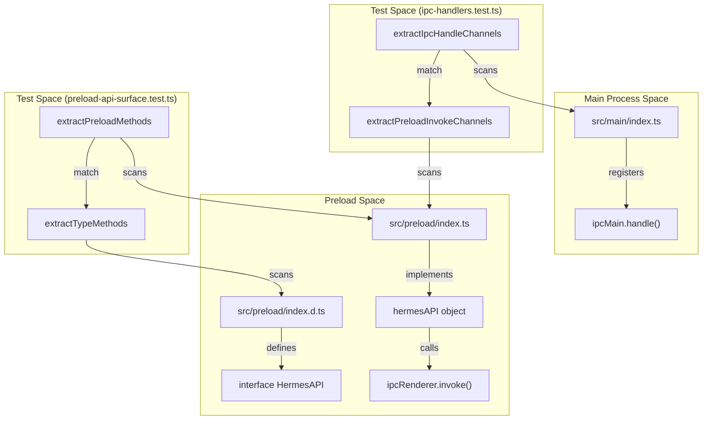
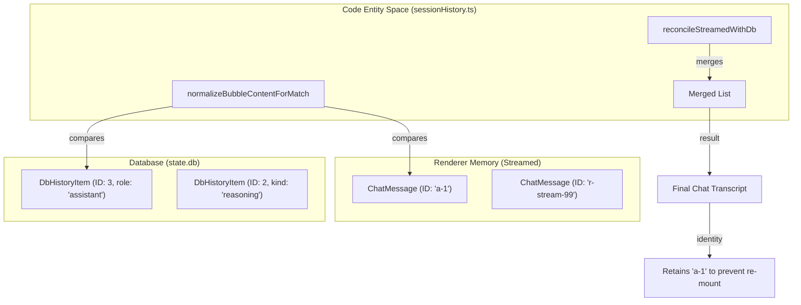

<!-- source: DeepWiki mcp.deepwiki.com · repo fathah/hermes-desktop · page 8.2 Test Suites · fetched 2026-10-30 -->

# Test Suites

Relevant source files

The following files were used as context for generating this wiki page:

- [KANBAN_GAP_REPORT.md](KANBAN_GAP_REPORT.md)
- [lat.md/agent-capabilities.md](lat.md/agent-capabilities.md)
- [lat.md/connections.md](lat.md/connections.md)
- [lat.md/kanban.md](lat.md/kanban.md)
- [lat.md/main-process.md](lat.md/main-process.md)
- [lat.md/wallet-token-balances.md](lat.md/wallet-token-balances.md)
- [pr-comment.md](pr-comment.md)
- [scripts/probe-validation-and-banner.js](scripts/probe-validation-and-banner.js)
- [scripts/repro-nous-detection-367.js](scripts/repro-nous-detection-367.js)
- [scripts/verify-nous-discovery.js](scripts/verify-nous-discovery.js)
- [src/main/agent-config-providers.test.ts](src/main/agent-config-providers.test.ts)
- [src/main/agent-config-providers.ts](src/main/agent-config-providers.ts)
- [src/main/config-health.ts](src/main/config-health.ts)
- [src/main/connection-status.ts](src/main/connection-status.ts)
- [src/main/gpu-fallback.ts](src/main/gpu-fallback.ts)
- [src/main/hermes.test.ts](src/main/hermes.test.ts)
- [src/main/hermesone-provision.test.ts](src/main/hermesone-provision.test.ts)
- [src/main/hermesone-provision.ts](src/main/hermesone-provision.ts)
- [src/main/installer.ts](src/main/installer.ts)
- [src/main/kanban.ts](src/main/kanban.ts)
- [src/main/model-discovery.ts](src/main/model-discovery.ts)
- [src/main/provider-registry.ts](src/main/provider-registry.ts)
- [src/main/session-location-store.ts](src/main/session-location-store.ts)
- [src/main/ssh-remote.ts](src/main/ssh-remote.ts)
- [src/main/validation.ts](src/main/validation.ts)
- [src/main/wallet-actions.test.ts](src/main/wallet-actions.test.ts)
- [src/main/wallet-sync.test.ts](src/main/wallet-sync.test.ts)
- [src/main/wallet-sync.ts](src/main/wallet-sync.ts)
- [src/renderer/src/components/profile/ProfileWalletPane.test.tsx](src/renderer/src/components/profile/ProfileWalletPane.test.tsx)
- [src/renderer/src/components/profile/ProfileWalletPane.tsx](src/renderer/src/components/profile/ProfileWalletPane.tsx)
- [src/renderer/src/hooks/useDiscoveredModels.ts](src/renderer/src/hooks/useDiscoveredModels.ts)
- [src/renderer/src/screens/Chat/dashboardEventAdapter.test.ts](src/renderer/src/screens/Chat/dashboardEventAdapter.test.ts)
- [src/renderer/src/screens/Chat/dashboardEventAdapter.ts](src/renderer/src/screens/Chat/dashboardEventAdapter.ts)
- [src/renderer/src/screens/Chat/lossyText.test.ts](src/renderer/src/screens/Chat/lossyText.test.ts)
- [src/renderer/src/screens/Chat/lossyText.ts](src/renderer/src/screens/Chat/lossyText.ts)
- [src/renderer/src/screens/Chat/sessionHistory.ts](src/renderer/src/screens/Chat/sessionHistory.ts)
- [src/renderer/src/screens/Kanban/Kanban.tsx](src/renderer/src/screens/Kanban/Kanban.tsx)
- [src/renderer/src/screens/Layout/ProfileSwitcher.tsx](src/renderer/src/screens/Layout/ProfileSwitcher.tsx)
- [src/shared/i18n/index.ts](src/shared/i18n/index.ts)
- [src/shared/i18n/locales/en/kanban.ts](src/shared/i18n/locales/en/kanban.ts)
- [src/shared/i18n/locales/pt-PT/kanban.ts](src/shared/i18n/locales/pt-PT/kanban.ts)
- [src/shared/url-key-map.ts](src/shared/url-key-map.ts)
- [src/shared/wallets.ts](src/shared/wallets.ts)
- [tests/api-server-key-migration.test.ts](tests/api-server-key-migration.test.ts)
- [tests/config-health.test.ts](tests/config-health.test.ts)
- [tests/connection-config-security.test.ts](tests/connection-config-security.test.ts)
- [tests/constants.test.ts](tests/constants.test.ts)
- [tests/dashboard-event-adapter.test.ts](tests/dashboard-event-adapter.test.ts)
- [tests/gpu-fallback.test.ts](tests/gpu-fallback.test.ts)
- [tests/install-gate-providers.test.ts](tests/install-gate-providers.test.ts)
- [tests/installer-utils.test.ts](tests/installer-utils.test.ts)
- [tests/kanban-unsupported.test.ts](tests/kanban-unsupported.test.ts)
- [tests/model-discovery.test.ts](tests/model-discovery.test.ts)
- [tests/provider-registry.test.ts](tests/provider-registry.test.ts)
- [tests/reconcile-streamed-with-db.test.ts](tests/reconcile-streamed-with-db.test.ts)
- [tests/set-model-config-base-url.test.ts](tests/set-model-config-base-url.test.ts)
- [tests/ssh-remote.test.ts](tests/ssh-remote.test.ts)
- [tests/url-key-map.test.ts](tests/url-key-map.test.ts)
- [tests/validation.test.ts](tests/validation.test.ts)

The Hermes Desktop test suite ensures consistency across the Electron process boundaries (Main, Preload, and Renderer) and validates critical utility logic such as SSH remote execution, session reconciliation, configuration health, and wallet synchronization. The project utilizes **Vitest** as its primary testing framework [[tests/ssh-remote.test.ts:5]]().

## Core Test Modules

### 1. IPC and API Surface Integrity
These tests ensure that the communication bridge between the Main process and the Renderer process remains intact.

*   **`ipc-handlers.test.ts`**: Extracts `ipcMain.handle` calls from `src/main/index.ts` and compares them against `ipcRenderer.invoke` calls in `src/preload/index.ts`.
*   **`preload-api-surface.test.ts`**: Validates the `HermesAPI` interface, checking that every method implemented in `src/preload/index.ts` is explicitly declared in the `index.d.ts` type definition file.

**Title: IPC Bridge Validation Flow**

Sources: `ipc-handlers.test.ts`, `preload-api-surface.test.ts`

---

### 2. Remote Execution and SSH Shell Quoting
The `ssh-remote.test.ts` file validates the execution of commands over SSH, focusing on security and shell integrity.

*   **Quoting Integrity**: Tests `buildRemoteHermesCmd` to ensure that multi-word titles and multiline markdown bodies are preserved through double-shell layers (SSH + remote shell) [[tests/ssh-remote.test.ts:124-178]]().
*   **Systemd Detection**: Validates that gateway commands (`start`/`stop`/`status`) correctly detect `hermes.service` on the remote host before falling back to `nohup` [[tests/ssh-remote.test.ts:180-202]]().
*   **Error Sanitization**: Validates `sanitizeSshError` to provide user-friendly messages for `Permission denied (publickey)` or `Host key verification failed` [[src/main/ssh-remote.ts:122-145]]().

Sources: [[src/main/ssh-remote.ts:38-149]](), [[tests/ssh-remote.test.ts:124-202]]()

---

### 3. Session Reconciliation and History
`reconcile-streamed-with-db.test.ts` covers the logic required to merge volatile streaming messages with authoritative records from `state.db`.

*   **Reasoning Injection**: Validates that if the gateway does not stream reasoning (e.g., DeepSeek/o1 models), the merge logic correctly inserts reasoning rows from the DB at the end of the stream [[tests/reconcile-streamed-with-db.test.ts:176-200]]().
*   **Identity Stability**: Ensures that messages retain their streamed IDs (e.g., `u-1`, `a-1`) to prevent React from re-mounting components when the DB version (prefixed with `db-`) arrives [[tests/reconcile-streamed-with-db.test.ts:202-219]]().
*   **Tool Call Reconciliation**: Matches `tool_call` and `tool_result` rows using the OpenAI `callId` [[src/renderer/src/screens/Chat/sessionHistory.ts:125-132]]().

**Title: Session Reconciliation Strategy**

Sources: [[src/renderer/src/screens/Chat/sessionHistory.ts:43-184]](), [[tests/reconcile-streamed-with-db.test.ts:1-244]]()

---

### 4. Agent Capabilities and Model Discovery
`hermes.test.ts` and `model-discovery.test.ts` validate how the app interacts with the Hermes Agent backend and external providers.

*   **Capability Evidence**: Tests `recordAgentRuntimeInfo` to ensure that command evidence (like `/queue`) is invalidated when the `desktop_contract` version changes [[src/main/hermes.test.ts:111-133]]().
*   **OAuth Discovery**: Validates `discoverOAuthModels`, which uses a Python snippet to fetch account-aware model lists for providers like `openai-codex` or `nous` [[src/main/model-discovery.ts:136-140]]().
*   **Nous Free Tier**: Tests `fetchNousFreeModelIds`, which parses the Nous Portal `/models` endpoint to identify zero-priced models [[src/main/model-discovery.ts:154-189]]().

Sources: [[src/main/hermes.test.ts:111-162]](), [[src/main/model-discovery.ts:96-189]]()

---

### 5. Connection Security and Migration
`connection-config-security.test.ts` ensures that sensitive credentials remain redacted and that legacy configurations migrate correctly.

*   **Legacy Migration**: Validates that old `desktop.json` fields (e.g., `remoteApiKey`) are correctly moved into the new `connectionRegistry` format and subsequently deleted from the root object [[tests/connection-config-security.test.ts:38-124]]().
*   **Secret Redaction**: Ensures that `getPublicConnectionRegistry` never returns raw API keys or SSH passwords, only returning a `hasApiKey: true` flag [[tests/connection-config-security.test.ts:155-212]]().

Sources: [[tests/connection-config-security.test.ts:38-212]]()

---

### 6. Wallet and Token Economy
`wallet-sync.test.ts` and `hermesone-provision.test.ts` validate the Ethereum wallet subsystem.

*   **Wallet Provisioning**: Tests the creation of profile-scoped wallets and the encryption of private keys via `safeStorage`.
*   **Balance Sync**: Validates the fetching of $H1 and $HD token balances from the Base mainnet via the Hermes API server.
*   **UI Integration**: `ProfileWalletPane.test.tsx` ensures the wallet UI correctly displays addresses and triggers the rename/delete IPC handlers.

Sources: `src/main/wallet-sync.test.ts`, `src/main/hermesone-provision.test.ts`, `src/renderer/src/components/profile/ProfileWalletPane.test.tsx`

---

### 7. Kanban Board Logic
The Kanban test suite validates task management and column transitions.

*   **Drag Actions**: Validates `dragAction` logic, ensuring that cards can only move to columns that have corresponding CLI verbs (e.g., `complete`, `block`, `archive`) [[src/renderer/src/screens/Kanban/Kanban.tsx:133-157]]().
*   **Unsupported Fallback**: Ensures that the Kanban screen displays a "not supported" message when the active connection mode does not provide the required CLI backend [[src/renderer/src/screens/Kanban/Kanban.tsx:168-172]]().

Sources: [[src/renderer/src/screens/Kanban/Kanban.tsx:98-161]]()

---

### 8. GPU Fallback and Health
`gpu-fallback.test.ts` and `config-health.test.ts` validate system stability.

*   **GPU Crash Guard**: Tests that the app correctly detects a GPU process crash and relaunches with hardware acceleration disabled [[lat.md/main-process.md:11-34]]().
*   **Config Health**: Validates the `checkConfigHealth` logic which identifies missing environment variables or invalid provider URLs before they cause runtime agent failures.

Sources: `tests/gpu-fallback.test.ts`, `tests/config-health.test.ts`, [[lat.md/main-process.md:11-34]]()

---

