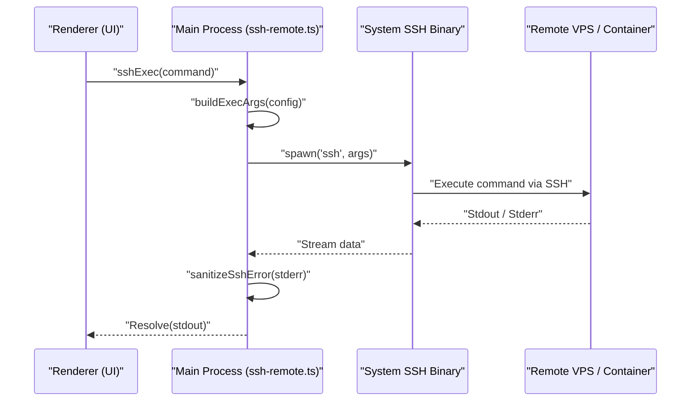
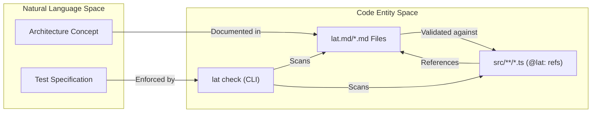

<!-- source: DeepWiki mcp.deepwiki.com · repo fathah/hermes-desktop · page 9.1 Bundled Skill Definitions · fetched 2026-10-30 -->

# Bundled Skill Definitions

Relevant source files

The following files were used as context for generating this wiki page:

- [.claude/settings.json](.claude/settings.json)
- [.claude/skills/lat-md/SKILL.md](.claude/skills/lat-md/SKILL.md)
- [CLAUDE.md](CLAUDE.md)
- [lat.md/.cache/lat_init.json](lat.md/.cache/lat_init.json)
- [lat.md/main-process.md](lat.md/main-process.md)
- [lat.md/model-context.md](lat.md/model-context.md)
- [pr-comment.md](pr-comment.md)
- [src/main/gpu-fallback.ts](src/main/gpu-fallback.ts)
- [src/main/ssh-remote.ts](src/main/ssh-remote.ts)
- [tests/gpu-fallback.test.ts](tests/gpu-fallback.test.ts)
- [tests/ssh-remote.test.ts](tests/ssh-remote.test.ts)

This page provides a detailed technical breakdown of the bundled skills and architectural documentation integrated into Hermes Desktop. These skills serve as the internal expertise layer used by the Hermes Agent when it operates on its own codebase or provides specialized development assistance to the user.

## 1. Electron Pro (`electron-pro`)

The `electron-pro` skill encapsulates the architectural patterns and security requirements for building high-performance cross-platform desktop applications. It defines the standard for how Hermes Desktop manages the boundary between the native operating system and the web-based renderer.

### Architecture and Security Model
The skill enforces a "Security First" approach, which is reflected in the Hermes Desktop implementation of the IPC bridge [lat.md/main-process.md:39-43]().

*   **Context Isolation**: Mandatory separation of the renderer's JavaScript context from the Electron internal APIs.
*   **Node Integration**: Strictly disabled in the renderer to prevent RCE (Remote Code Execution) vulnerabilities.
*   **Preload Scripts**: Used as the secure "Bridge API" to expose limited, validated functionality to the frontend via `contextBridge`.

### GPU Fallback and Stability
A critical component of the Electron expertise is the GPU crash guard. The system monitors for hardware acceleration failures and implements a 24-hour TTL (Time-To-Live) for software-rendering fallbacks [src/main/gpu-fallback.ts:63-63]().

*   **Sentinel Logic**: Uses `--hermes-gpu-disabled` as a one-shot command-line argument to break infinite crash loops [src/main/gpu-fallback.ts:10-10]().
*   **Persistence**: Fallback state is stored in `disable-gpu.flag` within the user data directory [src/main/gpu-fallback.ts:49-49]().
*   **Platform Specifics**: macOS clears stale flags by default to protect the performance of the 3D Office tab, while Windows/Linux prioritize stability [src/main/gpu-fallback.ts:21-28]().

**Sources:**
* [src/main/gpu-fallback.ts:1-159]()
* [lat.md/main-process.md:1-74]()
* [tests/gpu-fallback.test.ts:1-194]()

---

## 2. Hermes Agent (`hermes-agent`)

The `hermes-agent` skill is the "self-knowledge" module. It contains the architectural blueprint of the Hermes Agent system, enabling the agent to understand its own orchestration logic, tool usage, and learning loops.

### SSH Remote Orchestration
Hermes Desktop extends the agent's capabilities to remote environments via a specialized SSH proxy layer [src/main/ssh-remote.ts:2-5](). This allows the agent to execute Python scripts and CLI commands on a remote VPS or Docker container.

**Diagram: Remote Execution Flow (SSH Proxy)**

### Key Functions
*   `sshExec`: The core wrapper for spawning the system SSH binary with secure options like `BatchMode` and `StrictHostKeyChecking` [src/main/ssh-remote.ts:58-73]().
*   `sshPython`: Executes Python scripts on the remote host by piping them into `python3 -` [src/main/ssh-remote.ts:110-120]().
*   `buildRemoteHermesCmd`: Wraps CLI arguments in shell-quoted strings to ensure complex Markdown or JSON payloads survive the SSH transport [tests/ssh-remote.test.ts:124-140]().

**Sources:**
* [src/main/ssh-remote.ts:1-221]()
* [tests/ssh-remote.test.ts:1-202]()

---

## 3. Architecture Tooling (`lat-md`)

The `lat-md` skill governs the creation and maintenance of the `lat.md/` directory, which houses the project's living architecture documentation.

### Syntax and Constraints
*   **Leading Paragraphs**: Every section must start with a summary paragraph of ≤250 characters [CLAUDE.md:81-85]().
*   **Wiki Links**: Uses `[[target]]` syntax to link between documentation sections and specific code entities like `[[src/main/index.ts]]` [CLAUDE.md:37-38]().
*   **Code Refs**: The `@lat:` comment tag (e.g., `// @lat: [[section-id]]`) bridges source code to the documentation [CLAUDE.md:39-39]().

### Documentation Entities
The following diagram maps the `lat-md` documentation concepts to the actual files and validation tools in the codebase.

**Diagram: lat.md Documentation Mapping**

**Sources:**
* [.claude/skills/lat-md/SKILL.md:1-169]()
* [CLAUDE.md:1-105]()

---

## 4. TypeScript Expert (`typescript-expert`)

The `typescript-expert` skill provides the intelligence required to maintain strict type safety. It includes diagnostic patterns and reference configurations for the Hermes build pipeline.

### Model Context Management
A key application of TypeScript expertise in the codebase is the management of model context windows and token occupancy estimates [lat.md/model-context.md:1-5]().

*   **Storage**: Shared model definitions are persisted in `model-definitions.json` [lat.md/model-context.md:11-13]().
*   **Resolution**: The context gauge resolves sizes through a hierarchy: `config override` → `provider API` → `static heuristic` [lat.md/model-context.md:19-21]().
*   **Estimation**: When providers omit usage data, the system performs a `chars / 4` estimate of the transcript to prevent the UI gauge from going blank [lat.md/model-context.md:25-27]().

**Sources:**
* [lat.md/model-context.md:1-29]()
* [pr-comment.md:1-41]()

---

