# Page: Overview

# Overview

<details>
<summary>Relevant source files</summary>

The following files were used as context for generating this wiki page:

- [.gitattributes](.gitattributes)
- [.github/workflows/release.yml](.github/workflows/release.yml)
- [Development.md](Development.md)
- [README.md](README.md)
- [assets/header.webp](assets/header.webp)
- [assets/partners/atlascloud.webp](assets/partners/atlascloud.webp)
- [assets/partners/greptile.webp](assets/partners/greptile.webp)
- [build/linux-after-install.sh](build/linux-after-install.sh)
- [electron-builder.yml](electron-builder.yml)
- [eslint.config.mjs](eslint.config.mjs)
- [lat.md/lat.md](lat.md/lat.md)
- [lat.md/sidebar-navigation.md](lat.md/sidebar-navigation.md)
- [package-lock.json](package-lock.json)
- [package.json](package.json)
- [previews/discover.png](previews/discover.png)
- [previews/memory.png](previews/memory.png)
- [previews/sessions.png](previews/sessions.png)
- [src/main/config.ts](src/main/config.ts)
- [src/main/default-models.ts](src/main/default-models.ts)
- [src/main/hermes.ts](src/main/hermes.ts)
- [src/main/index.ts](src/main/index.ts)
- [src/main/ipc/register.ts](src/main/ipc/register.ts)
- [src/preload/index.d.ts](src/preload/index.d.ts)
- [src/preload/index.ts](src/preload/index.ts)
- [src/renderer/src/assets/main.css](src/renderer/src/assets/main.css)
- [src/renderer/src/screens/Chat/Chat.tsx](src/renderer/src/screens/Chat/Chat.tsx)
- [src/renderer/src/screens/Chat/FileViewer.tsx](src/renderer/src/screens/Chat/FileViewer.tsx)
- [src/renderer/src/screens/Chat/HistoryRow.tsx](src/renderer/src/screens/Chat/HistoryRow.tsx)
- [src/renderer/src/screens/Chat/MessageList.tsx](src/renderer/src/screens/Chat/MessageList.tsx)
- [src/renderer/src/screens/Chat/WorktreePanel.tsx](src/renderer/src/screens/Chat/WorktreePanel.tsx)
- [src/renderer/src/screens/Layout/Layout.tsx](src/renderer/src/screens/Layout/Layout.tsx)

</details>


Hermes Desktop is a native cross-platform application designed to manage, configure, and interact with the [Hermes Agent](https://github.com/NousResearch/hermes-agent) ecosystem [README.md:44-47](). It provides a graphical interface for a complex backend that handles multi-provider LLM orchestration, tool use, memory persistence, and multi-platform messaging gateways [README.md:136-139]().

The application is built on Electron and follows a multi-process architecture to ensure security and performance when handling streaming AI responses and local system operations [src/main/index.ts:1-21]().

### High-Level Architecture

Hermes Desktop bridges the gap between a high-level React UI and a Python-based agent backend. It utilizes a local API gateway to facilitate communication between the desktop interface and the underlying Hermes engine, supporting local execution, remote server connections via HTTP, or secure SSH tunnels [src/main/hermes.ts:131-148](), [src/main/hermes.ts:150-155]().

**System Context Diagram**

```mermaid
graph TD
  subgraph "User Interface (Renderer Process)"
    "UI[React UI / src/renderer]"
  end

  subgraph "Application Core (Main Process)"
    "IPC[IPC Handlers / src/main/ipc/register.ts]"
    "GW[Gateway Manager / src/main/hermes.ts]"
    "INST[Installer Service / src/main/installer.ts]"
    "SSH[SSH Tunnel / src/main/ssh-tunnel.ts]"
    "DASH[Dashboard / src/main/dashboard.ts]"
  end

  subgraph "Hermes Engine (Local or Remote)"
    "AG[Hermes Agent]"
    "API[Hermes API :8642]"
    "FS[~/.hermes File System]"
  end

  "UI" <-- "Exposed API via ContextBridge / src/preload" --> "IPC"
  "IPC" --> "GW"
  "IPC" --> "INST"
  "IPC" --> "SSH"
  "IPC" --> "DASH"
  "GW" <-- "SSE / HTTP" --> "API"
  "API" <-- "Orchestration" --> "AG"
  "AG" <-- "State/Config" --> "FS"
```
Sources: [README.md:44-47](), [src/main/hermes.ts:131-148](), [src/main/ipc/register.ts:116-140](), [src/preload/index.ts:127-221]()

### Key Capabilities

The system is organized into several major functional areas:

*   **Installation & Environment**: Automated setup of the Hermes environment in `~/.hermes`, including dependency resolution, "Hermes Doctor" diagnostics, and environment validation [src/main/ipc/register.ts:61-79](), [README.md:138-138]().
*   **Chat & Orchestration**: A streaming interface supporting SSE (Server-Sent Events), reasoning extraction, and real-time tool progress tracking [src/renderer/src/screens/Chat/Chat.tsx:146-164](), [src/preload/index.d.ts:261-300]().
*   **Data Management**: Persistence layers for conversation sessions, profile-scoped memory entries, and persona management via `SOUL.md` [src/main/ipc/register.ts:210-215](), [src/main/ipc/register.ts:265-270]().
*   **Connectivity & Wallets**: Management of messaging gateways and LLM providers [src/main/ipc/register.ts:116-126](), alongside a profile-scoped Ethereum wallet system on Base mainnet [src/preload/index.d.ts:7-14]().
*   **Automation & Visualization**: A built-in cron job scheduler [src/main/ipc/register.ts:285-290]() and the Hermes Office (Claw3D) visual interface featuring a 3D R3F scene and Kanban task management [src/renderer/src/screens/Layout/Layout.tsx:21-33](), [src/preload/index.d.ts:177-207]().

### Subsystem Relationships

The application transitions through distinct states, from initial installation to active agent management. Communication is strictly mediated via IPC (Inter-Process Communication) handlers registered in the main process.

**Code Entity Mapping: Process Communication**

```mermaid
graph LR
  subgraph "Renderer Space (src/renderer/src)"
    "App.tsx[App Entry]"
    "Chat.tsx[Chat UI]"
    "Layout.tsx[Main Shell]"
  end

  subgraph "Preload Bridge (src/preload)"
    "hermesAPI[hermesAPI / index.ts]"
  end

  subgraph "Main Space (src/main)"
    "register.ts[IPC Handler Registration]"
    "hermes.ts[sendMessage / startGateway]"
    "installer.ts[runInstall / checkInstallStatus]"
    "config.ts[readEnv / getModelConfig]"
    "ssh-tunnel.ts[startSshTunnel]"
  end

  "App.tsx" --> "hermesAPI"
  "hermesAPI" -- "ipcRenderer.invoke" --> "register.ts"
  "register.ts" -- "calls" --> "hermes.ts"
  "register.ts" -- "calls" --> "installer.ts"
  "register.ts" -- "calls" --> "config.ts"
  "register.ts" -- "calls" --> "ssh-tunnel.ts"
```
Sources: [src/main/ipc/register.ts:1-261](), [src/preload/index.ts:127-221](), [src/renderer/src/screens/Layout/Layout.tsx:1-33]()

### Navigation and Documentation

This wiki is structured to provide both high-level conceptual overviews and deep technical dives into specific subsystems.

#### [Getting Started](#1.1)
Covers the prerequisites and the initial onboarding flow, including the transition from the `Welcome` screen to the `Install` and `Setup` phases. It explains how the app handles local vs. remote backend modes. For details, see [Getting Started](#1.1).

#### [Project Structure and Build System](#1.2)
Detailed breakdown of the repository layout (main, preload, renderer, shared), the `electron-vite` build pipeline, and how the application is packaged for macOS, Linux, and Windows using `electron-builder`. For details, see [Project Structure and Build System](#1.2).

#### Further Sections
*   **Electron Architecture**: Deep dive into IPC patterns, the `hermesAPI` bridge, and process lifecycles.
*   **Hermes Engine Integration**: Details on the Gateway lifecycle, Installer environment setup, and profile-scoped configuration.
*   **Agent Features and Data Layer**: Exploration of the memory system, soul management, skills registry, and SQLite-backed session cache.
*   **User Interface**: Documentation of the React component library, i18n localization system, and specialized screens like the Kanban board and 3D Office.
*   **Testing and CI/CD**: Overview of the Vitest suites and the multi-platform GitHub Actions release pipeline.

Sources: [package.json:8-31](), [src/main/ipc/register.ts:1-261](), [lat.md/sidebar-navigation.md:1-46]()

---

# Page: Getting Started

# Getting Started

<details>
<summary>Relevant source files</summary>

The following files were used as context for generating this wiki page:

- [lat.md/chat-experience-preferences.md](lat.md/chat-experience-preferences.md)
- [lat.md/onboarding.md](lat.md/onboarding.md)
- [scripts/verify-nous-discovery.js](scripts/verify-nous-discovery.js)
- [src/main/installer.ts](src/main/installer.ts)
- [src/main/model-discovery.ts](src/main/model-discovery.ts)
- [src/main/provider-registry.ts](src/main/provider-registry.ts)
- [src/renderer/src/assets/hermesbg.webp](src/renderer/src/assets/hermesbg.webp)
- [src/renderer/src/assets/splashtext-w.webp](src/renderer/src/assets/splashtext-w.webp)
- [src/renderer/src/assets/startvid.mp4](src/renderer/src/assets/startvid.mp4)
- [src/renderer/src/components/common/OnboardHero.tsx](src/renderer/src/components/common/OnboardHero.tsx)
- [src/renderer/src/hooks/useDiscoveredModels.ts](src/renderer/src/hooks/useDiscoveredModels.ts)
- [src/renderer/src/screens/Install/Install.tsx](src/renderer/src/screens/Install/Install.tsx)
- [src/renderer/src/screens/Setup/Setup.tsx](src/renderer/src/screens/Setup/Setup.tsx)
- [src/renderer/src/screens/SplashScreen/SplashScreen.tsx](src/renderer/src/screens/SplashScreen/SplashScreen.tsx)
- [src/renderer/src/screens/Welcome/Welcome.tsx](src/renderer/src/screens/Welcome/Welcome.tsx)
- [src/shared/i18n/locales/en/install.ts](src/shared/i18n/locales/en/install.ts)
- [src/shared/i18n/locales/en/setup.ts](src/shared/i18n/locales/en/setup.ts)
- [src/shared/i18n/locales/es/setup.ts](src/shared/i18n/locales/es/setup.ts)
- [src/shared/i18n/locales/id/setup.ts](src/shared/i18n/locales/id/setup.ts)
- [src/shared/i18n/locales/ja/setup.ts](src/shared/i18n/locales/ja/setup.ts)
- [src/shared/i18n/locales/pt-BR/setup.ts](src/shared/i18n/locales/pt-BR/setup.ts)
- [src/shared/i18n/locales/pt-PT/setup.ts](src/shared/i18n/locales/pt-PT/setup.ts)
- [src/shared/i18n/locales/zh-CN/setup.ts](src/shared/i18n/locales/zh-CN/setup.ts)
- [src/shared/url-key-map.ts](src/shared/url-key-map.ts)
- [tests/constants.test.ts](tests/constants.test.ts)
- [tests/install-gate-providers.test.ts](tests/install-gate-providers.test.ts)
- [tests/installer-utils.test.ts](tests/installer-utils.test.ts)
- [tests/model-discovery.test.ts](tests/model-discovery.test.ts)
- [tests/provider-registry.test.ts](tests/provider-registry.test.ts)
- [tests/set-model-config-base-url.test.ts](tests/set-model-config-base-url.test.ts)
- [tests/url-key-map.test.ts](tests/url-key-map.test.ts)

</details>


The first-run experience of Hermes Desktop is designed to handle the complex requirements of the [Hermes Agent](https://github.com/fathah/hermes-agent) ecosystem, including dependency resolution, environment configuration, and local/remote API orchestration. The application uses a state-machine approach to guide users from initial launch through installation and final configuration.

## Prerequisites

Before running the application, ensure the following requirements are met:
*   **Operating System**: macOS (Intel/Apple Silicon), Linux (`.AppImage`, `.deb`, or `.rpm`), and Windows (`.exe`).
*   **Disk Space**: Approximately 2 GB for the agent installation and dependencies.
*   **macOS Security**: Since the app is not currently notarized, users must bypass Gatekeeper using `xattr -cr` or via System Settings.
*   **Windows SmartScreen**: The installer is not code-signed; users must click "More info" → "Run anyway".

## Onboarding Chrome

The first-run screens share a cinematic shell provided by `OnboardHero.tsx` [lat.md/onboarding.md:3](). This component renders a dark aurora backdrop, a twinkling starfield, and an animated Hermes emblem that performs a choreographed intro (drawing, settling, and fading into place) [lat.md/onboarding.md:9-19](). The onboarding design is strictly dark-themed to maintain visual contrast, regardless of the user's later theme preferences [lat.md/onboarding.md:5-6]().

**Sources:** [lat.md/onboarding.md:1-22](), [src/renderer/src/components/common/OnboardHero.tsx:1-100]()

## Onboarding State Machine

The `App.tsx` component manages the high-level application state using a `Screen` type: `splash`, `welcome`, `installing`, `setup`, and `main`.

### 1. Initialization (`splash`)
The app starts with a `SplashScreen`. The transition is driven by the `runInstallCheck` function which executes on mount. The splash stays visible for a minimum of 1300ms to ensure the brand animation completes.

### 2. The Install Check Logic
The system evaluates the environment to decide where to route the user. A key factor is the resolution of `HERMES_HOME`, which prioritizes the `HERMES_HOME` environment variable, then a user-defined override persisted in `hermes-home.json`, and finally platform-specific defaults [src/main/installer.ts:128-131](). On Windows, the app probes `%LOCALAPPDATA%\hermes` and `~/.hermes` to find existing data [src/main/installer.ts:63-78]().

| Condition | Target Screen |
| :--- | :--- |
| Remote mode enabled and server reachable | `main` |
| Remote mode enabled but server unreachable | `welcome` (with connection error) |
| Local mode: Not installed in `HERMES_HOME` | `welcome` |
| Local mode: Installed but verification failed | `welcome` (with `installBroken` error) |
| Local mode: Installed but no API keys found | `setup` |
| Local mode: Installed and configured | `main` |

**Sources:** [src/main/installer.ts:27-131](), [src/renderer/src/screens/Install/Install.tsx:77-90]()

### 3. Welcome and Connection Mode (`welcome`)
The `Welcome.tsx` screen allows users to choose between a local installation, a remote gateway, or an SSH tunnel [src/renderer/src/screens/Welcome/Welcome.tsx:18-22]().
*   **Local Mode**: Initiates the `startInstall` pipeline.
*   **Remote Mode**: Connects to a remote Hermes API server via `connectRemoteGateway` using a URL and API key [src/renderer/src/screens/Welcome/Welcome.tsx:52-77]().
*   **SSH Mode**: Establishes a tunnel to a remote host (optionally targeting a Docker container) via `testSshConnection` and `setSshConfig` [src/renderer/src/screens/Welcome/Welcome.tsx:79-117]().

**Sources:** [src/renderer/src/screens/Welcome/Welcome.tsx:1-214]()

### 4. Installation Pipeline (`installing`)
The `Install.tsx` screen tracks the progress of the official Hermes installer. 
*   **Existing Installation**: Users can point the app at a manual Hermes install via `selectFolder`. The path is validated with `validateHermesHome` and adopted via `adoptHermesHome`, which writes to the `hermes-home.json` override file [src/renderer/src/screens/Install/Install.tsx:137-153](), [src/main/installer.ts:110-126]().
*   **Binary Paths**: The installer defines `HERMES_REPO`, `HERMES_VENV`, and resolves the Python interpreter. On Windows, it specifically uses `pythonw.exe` to prevent flashing console windows during CLI operations [src/main/installer.ts:132-150]().
*   **Terminal Log**: A fixed-size terminal window (`.onboard-terminal`) displays streaming logs from the installation process [lat.md/onboarding.md:35-36]().

**Sources:** [src/main/installer.ts:80-166](), [src/renderer/src/screens/Install/Install.tsx:54-214](), [lat.md/onboarding.md:29-36]()

### 5. Provider Setup (`setup`)
Once installed, the user must configure an LLM provider. `Setup.tsx` provides a grid of options based on `PROVIDERS.setup` [src/renderer/src/screens/Setup/Setup.tsx:99-128]().
*   **Presets**: Supports OpenRouter, Anthropic, OpenAI, and local presets like LM Studio or Ollama [src/renderer/src/screens/Setup/Setup.tsx:131-175]().
*   **Key Resolution**: The app automatically maps the provider or URL to the correct environment variable (e.g., `DEEPSEEK_API_KEY`, `HF_TOKEN`) using `expectedEnvKeyForUrl` [src/renderer/src/screens/Setup/Setup.tsx:43-47](), [src/shared/url-key-map.ts:25-43]().
*   **Model Discovery**: For OpenAI-compatible providers, the app can fetch available models via `/v1/models` [src/main/model-discovery.ts:4-12](). For OAuth providers (like OpenAI Codex or Google Gemini CLI), it runs a Python snippet to get live account-aware model lists [src/main/model-discovery.ts:100-132]().

**Sources:** [src/renderer/src/screens/Setup/Setup.tsx:1-185](), [src/shared/url-key-map.ts:1-131](), [src/main/model-discovery.ts:1-140](), [src/main/provider-registry.ts:1-44]()

## Data Flow Diagrams

### Onboarding Flow & Logic
This diagram illustrates the logic used to determine the initial screen.

```mermaid
graph TD
    ["App.tsx:runInstallCheck"] --> ["hermesAPI:getConnectionConfig"]
    ["hermesAPI:getConnectionConfig"] --> IS_REMOTE{"mode == 'remote'?"}
    
    IS_REMOTE -- "Yes" --> ["hermesAPI:connectRemoteGateway"]
    ["hermesAPI:connectRemoteGateway"] -- "Success" --> MAIN["Screen:main"]
    ["hermesAPI:connectRemoteGateway"] -- "Failure" --> WELCOME["Screen:welcome"]
    
    IS_REMOTE -- "No" --> ["hermesAPI:checkInstallStatus"]
    ["hermesAPI:checkInstallStatus"] -- "Not Found" --> WELCOME
    ["hermesAPI:checkInstallStatus"] -- "Found" --> ["hermesAPI:verifyInstall"]
    
    ["hermesAPI:verifyInstall"] -- "Broken" --> WELCOME
    ["hermesAPI:verifyInstall"] -- "OK" --> HAS_KEY{"hasApiKey?"}
    
    HAS_KEY -- "No" --> SETUP["Screen:setup"]
    HAS_KEY -- "Yes" --> MAIN
```
**Sources:** [src/renderer/src/screens/Install/Install.tsx:77-90](), [src/main/installer.ts:52-78]()

### Installation & Setup Pipeline
This diagram bridges the UI screens to the underlying IPC handlers and main process logic.

```mermaid
graph LR
    subgraph "Renderer Process"
        ["Install.tsx"]
        ["Setup.tsx"]
        ["Welcome.tsx"]
    end

    subgraph "Preload (HermesAPI)"
        ["hermesAPI:startInstall"]
        ["hermesAPI:setEnv"]
        ["hermesAPI:connectRemoteGateway"]
    end

    subgraph "Main Process"
        ["installer.ts:runInstall"]
        ["config.ts:setEnv"]
        ["hermes.ts:connectRemote"]
    end

    ["Install.tsx"] -- "Confirm" --> ["hermesAPI:startInstall"]
    ["hermesAPI:startInstall"] -- "IPC" --> ["installer.ts:runInstall"]
    
    ["Setup.tsx"] -- "Save" --> ["hermesAPI:setEnv"]
    ["hermesAPI:setEnv"] -- "IPC" --> ["config.ts:setEnv"]
    
    ["Welcome.tsx"] -- "Connect" --> ["hermesAPI:connectRemoteGateway"]
    ["hermesAPI:connectRemoteGateway"] -- "IPC" --> ["hermes.ts:connectRemote"]
```
**Sources:** [src/renderer/src/screens/Install/Install.tsx:93-119](), [src/renderer/src/screens/Setup/Setup.tsx:49-85](), [src/renderer/src/screens/Welcome/Welcome.tsx:52-77]()

## Key Implementation Details

### IPC Progress Tracking
Installation progress is handled via an event listener. The Main process emits `InstallProgress` objects containing `step`, `totalSteps`, and `log` [src/renderer/src/screens/Install/Install.tsx:29-35](). The Renderer subscribes via `onInstallProgress` [src/renderer/src/screens/Install/Install.tsx:96-98]().

### Canonical Provider Registry
To prevent configuration drift, the app maintains `PROVIDER_BASE_URLS`, a mapping of provider IDs to their default API endpoints (e.g., `groq` -> `https://api.groq.com/openai/v1`) [src/main/provider-registry.ts:15-44](). This registry is used by `Setup.tsx` to pre-fill URLs when a user selects a built-in provider [src/renderer/src/screens/Setup/Setup.tsx:71-72]().

**Sources:**
* [src/main/installer.ts:1-175]()
* [src/renderer/src/screens/Welcome/Welcome.tsx:1-214]()
* [src/renderer/src/screens/Install/Install.tsx:1-214]()
* [src/renderer/src/screens/Setup/Setup.tsx:1-185]()
* [src/main/model-discovery.ts:1-189]()
* [src/shared/url-key-map.ts:1-131]()
* [src/main/provider-registry.ts:1-54]()
* [lat.md/onboarding.md:1-39]()

---

# Page: Project Structure and Build System

# Project Structure and Build System

<details>
<summary>Relevant source files</summary>

The following files were used as context for generating this wiki page:

- [.gitattributes](.gitattributes)
- [.github/workflows/release.yml](.github/workflows/release.yml)
- [.gitignore](.gitignore)
- [.husky/pre-commit](.husky/pre-commit)
- [.husky/pre-push](.husky/pre-push)
- [Development.md](Development.md)
- [README.md](README.md)
- [assets/header.webp](assets/header.webp)
- [assets/partners/atlascloud.webp](assets/partners/atlascloud.webp)
- [assets/partners/greptile.webp](assets/partners/greptile.webp)
- [build/linux-after-install.sh](build/linux-after-install.sh)
- [electron-builder.yml](electron-builder.yml)
- [eslint.config.mjs](eslint.config.mjs)
- [package-lock.json](package-lock.json)
- [package.json](package.json)
- [previews/discover.png](previews/discover.png)
- [previews/memory.png](previews/memory.png)
- [previews/sessions.png](previews/sessions.png)
- [src/main/default-models.ts](src/main/default-models.ts)
- [src/renderer/src/screens/Chat/FileViewer.tsx](src/renderer/src/screens/Chat/FileViewer.tsx)
- [src/renderer/src/screens/Chat/HistoryRow.tsx](src/renderer/src/screens/Chat/HistoryRow.tsx)
- [src/renderer/src/screens/Chat/MessageList.tsx](src/renderer/src/screens/Chat/MessageList.tsx)
- [src/renderer/src/screens/Chat/WorktreePanel.tsx](src/renderer/src/screens/Chat/WorktreePanel.tsx)

</details>


This page details the technical organization of the Hermes Desktop repository, its multi-process build pipeline powered by `electron-vite`, and the configuration required for cross-platform packaging and distribution via GitHub Actions.

## Repository Layout

Hermes Desktop follows the standard Electron process separation, organized into four primary directories within `src/`. This structure ensures a strict boundary between the Node.js main process, the secure preload bridge, and the web-based renderer.

| Directory | Process Type | Responsibility |
| :--- | :--- | :--- |
| `src/main` | **Main** | Manages app lifecycle, window creation, SQLite database access (`better-sqlite3`), and the Python Hermes Agent gateway. |
| `src/preload` | **Preload** | Exposes a secure, typed IPC bridge (`HermesAPI`) to the renderer using `contextBridge`. |
| `src/renderer` | **Renderer** | The React 19-based UI, containing components, hooks, and styles. |
| `src/shared` | **Shared** | Universal TypeScript definitions, constants, and i18n translation files used by multiple processes. |

### Data Flow and Process Boundary
The following diagram illustrates how the build system maps these source directories to the final application execution layers.

**Build Entity Mapping**
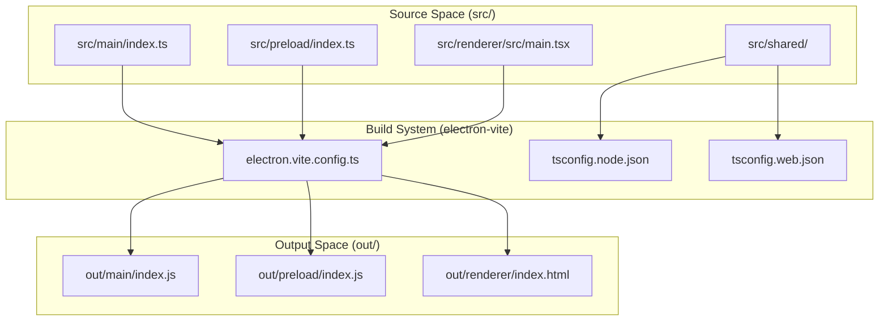
Sources: [package.json:5-5](), [package.json:15-16]()

## Build Pipeline (`electron-vite`)

The project utilizes `electron-vite` to manage the compilation of the three distinct Electron processes simultaneously. This tool integrates Vite's fast HMR (Hot Module Replacement) for the renderer with Rollup-based bundling for the main and preload scripts.

### Configuration
The `electron-vite` orchestration is driven by `package.json` scripts:
*   **Main & Preload**: Handled by the Node configuration. The `better-sqlite3` dependency [package.json:42-42]() is a native module and requires special handling during the build to ensure it is compiled for the correct target architecture.
*   **Renderer**: Integrates `@vitejs/plugin-react` [package.json:75-75]() and `@tailwindcss/vite` [package.json:66-66](). The renderer entry point is located at `src/renderer/index.html`.

### TypeScript Integration
The project uses a split TypeScript configuration to handle the differing environments (Node.js vs. Browser):
1.  **Node Config (`tsconfig.node.json`)**: Targets the main and preload processes. It includes `src/main`, `src/preload`, and `src/shared`.
2.  **Web Config (`tsconfig.web.json`)**: Targets the renderer process, enabling React JSX transforms.

Sources: [package.json:15-17](), [package.json:75-79](), [package.json:91-92]()

## Packaging and Distribution

Packaging is handled by `electron-builder`, configured via `electron-builder.yml`. The application is distributed as a single executable or installer across macOS, Windows, and Linux.

### Build Commands
The `package.json` defines several scripts for platform-specific builds:
*   `npm run build`: Runs typechecks for both environments and triggers the `electron-vite build` pipeline [package.json:24-24]().
*   `npm run build:mac`: Executes the Vite build followed by `electron-builder --mac` [package.json:28-28]().
*   `npm run build:win`: Executes the Vite build followed by `electron-builder --win` [package.json:27-27]().
*   `npm run build:linux`: Executes the Vite build followed by `electron-builder --linux` [package.json:29-29]().

### Configuration Details
*   **ASAR Unpacking**: The `resources/**` directory and the `better-sqlite3` native binary are explicitly unpacked from the ASAR archive to allow direct filesystem access [electron-builder.yml:12-14]().
*   **Platform Specifics**: 
    *   **Windows**: Uses NSIS for the installer and also generates a `portable` executable [electron-builder.yml:15-21]().
    *   **macOS**: Configures `hardenedRuntime`, `notarize`, and requests permissions for Camera, Microphone, and Documents [electron-builder.yml:29-41]().
    *   **Linux**: Targets `AppImage`, `snap`, `deb`, and `rpm` [electron-builder.yml:44-49](). It includes a specific `afterInstall` script (`build/linux-after-install.sh`) to fix `chrome-sandbox` SUID permissions [electron-builder.yml:60-68]().

**Packaging Data Flow**
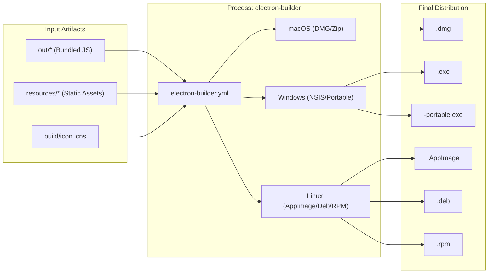
Sources: [electron-builder.yml:1-73](), [package.json:26-30]()

## CI/CD Release Pipeline

The release process is automated via GitHub Actions in `.github/workflows/release.yml`. It uses a multi-stage matrix build to generate artifacts for all supported platforms.

### Pipeline Stages
1.  **Prepare**: Reads the version from `package.json` [package.json:3-3]() and checks if the git tag already exists [.github/workflows/release.yml:22-62]().
2.  **Build Jobs**: Separate jobs run for macOS (x64 and arm64) [.github/workflows/release.yml:63-141](), Linux [.github/workflows/release.yml:142-202](), and Windows.
    *   **Native Modules**: The workflow explicitly rebuilds native dependencies for the target architecture using `electron-builder install-app-deps` [.github/workflows/release.yml:85-85]().
    *   **Verification**: The workflow verifies the architecture of the native `better_sqlite3.node` binary before uploading to ensure x64/arm64 consistency [.github/workflows/release.yml:120-132]().
3.  **Publish**: Consolidates artifacts and creates a GitHub Release [.github/workflows/release.yml:1-15]().

Sources: [.github/workflows/release.yml:1-202](), [package.json:3-3]()

## Dependency Management

*   **Production Dependencies**: Includes `better-sqlite3` for local storage, `electron-updater` for auto-updates, `ethers` for wallet operations, and `i18next` for localization [package.json:33-61]().
*   **Development Dependencies**: Includes the `electron-vite` build tool, `tailwindcss` for styling, and `vitest` for the test suite [package.json:62-94]().
*   **Native Modules**: `better-sqlite3` is identified as a critical native dependency requiring specific handling in both the build [electron-builder.yml:14-14]() and CI pipelines [.github/workflows/release.yml:123-126]().

Sources: [package.json:33-94](), [electron-builder.yml:12-14]()

---

# Page: Electron Architecture

# Electron Architecture

<details>
<summary>Relevant source files</summary>

The following files were used as context for generating this wiki page:

- [lat.md/lat.md](lat.md/lat.md)
- [lat.md/sidebar-navigation.md](lat.md/sidebar-navigation.md)
- [src/main/config.ts](src/main/config.ts)
- [src/main/hermes.ts](src/main/hermes.ts)
- [src/main/index.ts](src/main/index.ts)
- [src/main/ipc/register.ts](src/main/ipc/register.ts)
- [src/main/security.ts](src/main/security.ts)
- [src/preload/index.d.ts](src/preload/index.d.ts)
- [src/preload/index.ts](src/preload/index.ts)
- [src/renderer/src/assets/main.css](src/renderer/src/assets/main.css)
- [src/renderer/src/screens/Chat/Chat.tsx](src/renderer/src/screens/Chat/Chat.tsx)
- [src/renderer/src/screens/Layout/Layout.tsx](src/renderer/src/screens/Layout/Layout.tsx)
- [tests/electron-security.test.ts](tests/electron-security.test.ts)
- [tests/ipc-handlers.test.ts](tests/ipc-handlers.test.ts)

</details>


Hermes Desktop follows the standard Electron multi-process architecture, strictly separating system-level operations from the user interface. This separation ensures that the heavy lifting of managing the Hermes Python engine, local file system, and network requests does not block the UI thread and remains secure.

### Process Split Overview

The application is divided into three distinct layers:

1.  **Main Process**: The privileged Node.js environment responsible for window lifecycle, native API access, and orchestrating the Hermes engine.
2.  **Preload Bridge**: A secure gateway that exposes a limited, type-safe API to the renderer process while maintaining process isolation.
3.  **Renderer Process**: The React-based frontend that handles user interactions and displays data.

#### Process Interaction Diagram

This diagram illustrates how code entities across the three layers interact via IPC (Inter-Process Communication), specifically mapping frontend UI components to the backend handlers defined in the main process.

```mermaid
graph TD
    subgraph "Renderer Process (React)"
        [App.tsx] -- "calls" --> [HermesAPI]
        [Chat.tsx] -- "listens to" --> [onInstallProgress]
        [Layout.tsx] -- "calls" --> [getPublicConnectionRegistry]
    end

    subgraph "Preload Bridge (contextBridge)"
        [HermesAPI] -- "ipcRenderer.invoke" --> [ipcMain.handle]
        [ipcRenderer.on] -- "emits" --> [onInstallProgress]
        [ipcRenderer.invoke] -- "channel: get-public-connection-registry" --> [ipcMain.handle]
    end

    subgraph "Main Process (Node.js)"
        [ipcMain.handle] -- "routes to" --> [src/main/ipc/register.ts]
        [src/main/ipc/register.ts] -- "calls" --> [installer.ts]
        [src/main/ipc/register.ts] -- "calls" --> [hermes.ts]
        [src/main/ipc/register.ts] -- "calls" --> [config.ts]
        [installer.ts] -- "event.sender.send" --> [ipcRenderer.on]
    end
```
**Sources:** [src/main/ipc/register.ts:61-134](), [src/preload/index.ts:127-221](), [src/preload/index.d.ts:261-280](), [src/renderer/src/screens/Layout/Layout.tsx:110-112]()

---

### Main Process

The **Main Process** serves as the application's entry point, bootstrapped in `src/main/index.ts` [src/main/index.ts:1-21](). It manages the `BrowserWindow` instance and registers handlers for all IPC calls originating from the UI via `src/main/ipc/register.ts` [src/main/ipc/register.ts:1-261](). It has full access to Node.js built-ins, allowing it to manage the Hermes Python environment, local SQLite databases, and the file system.

Key responsibilities include:
*   **Window Management**: Creating the main window with security configurations like `sandbox: true`, `contextIsolation: true`, and `nodeIntegration: false` [tests/electron-security.test.ts:22-28]().
*   **IPC Handling**: Mapping frontend requests (e.g., `check-install`, `send-message`, `get-public-connection-registry`) to backend logic in modules like `installer.ts`, `hermes.ts`, or `config.ts` [src/main/ipc/register.ts:61-190]().
*   **Engine Control**: Managing the lifecycle of the Hermes gateway, SSH tunnels, and dashboard WebSocket transports [src/main/hermes.ts:131-155](), [src/main/dashboard.ts:134-154]().

For details, see [Main Process](#2.1).

**Sources:** [src/main/index.ts:1-21](), [src/main/ipc/register.ts:1-261](), [src/main/hermes.ts:1-155]()

---

### Preload Bridge (IPC API)

The **Preload Bridge** is the security boundary of the application. Using Electron's `contextBridge`, it exposes the `hermesAPI` object to the `window` global in the renderer process [src/preload/index.ts:1-127](). This ensures the renderer cannot access Node.js primitives directly, preventing Remote Code Execution (RCE) vulnerabilities.

The bridge defines a strict interface, `HermesAPI`, which includes:
*   **Invokers**: Asynchronous functions that return Promises (e.g., `checkInstall`, `startGateway`, `sendMessage`) [src/preload/index.ts:129-221]().
*   **Listeners**: Subscription-based patterns for streaming data, such as installation logs (`onInstallProgress`) or gateway events [src/preload/index.ts:164-188]().
*   **Type Safety**: Shared type definitions ensure that complex objects like `PublicConnectionConfig` or `KanbanTask` are handled consistently across the process boundary [src/preload/index.d.ts:89-207]().

For details, see [Preload Bridge (IPC API)](#2.2).

**Sources:** [src/preload/index.ts:1-221](), [src/preload/index.d.ts:1-261]()

---

### Renderer Entry and Routing

The **Renderer Process** is a React application bundled by Vite. It treats the `hermesAPI` provided by the preload script as its primary data source. The architecture uses a screen-state machine to manage the transition from initial setup to the main chat interface.

*   **Entry Point**: The application mounts and initializes the UI, utilizing the `ElectronAPI` for environment metadata [src/preload/index.ts:116-125]().
*   **Routing Logic**: The UI transitions through states such as `welcome`, `installing`, and `setup` based on the status returned by `hermesAPI.checkInstall()` [src/preload/index.ts:129-133]().
*   **Multi-Session Management**: `Layout.tsx` manages multiple `ChatRun` instances, allowing users to switch between active conversations and background sessions [src/renderer/src/screens/Layout/Layout.tsx:109-113]().

For details, see [Renderer Entry and Routing](#2.3).

**Sources:** [src/renderer/src/screens/Layout/Layout.tsx:1-197](), [src/renderer/src/screens/Chat/Chat.tsx:86-164]()

---

### Security Model

Hermes Desktop implements a defense-in-depth strategy to protect user data and the local system. Security policies are centralized in `src/main/security.ts` and verified by automated tests in `tests/electron-security.test.ts`.

#### Security Hardening Diagram

This diagram maps the security functions in `security.ts` to their application within the `BrowserWindow` creation and lifecycle.

```mermaid
graph LR
    subgraph "Main Process Security"
        [startMainProcess] -- "sets" --> [WebPreferences]
        [WebPreferences] -- "configures" --> [Sandbox: true]
        [WebPreferences] -- "configures" --> [ContextIsolation: true]
        
        [app.on: web-contents-created] -- "calls" --> [hardenAttachedWebContents]
        [hardenAttachedWebContents] -- "calls" --> [isAllowedWebviewUrl]
        [openExternalUrl] -- "calls" --> [isAllowedExternalUrl]
    end
```
**Sources:** [tests/electron-security.test.ts:22-59](), [src/main/security.ts:1-77]()

#### Security Features Table

| Feature | Implementation | Purpose |
| :--- | :--- | :--- |
| **Context Isolation** | `contextIsolation: true` | Prevents renderer access to preload internals or Node.js APIs [tests/electron-security.test.ts:24-24](). |
| **Sandbox** | `sandbox: true` | Restricts the renderer and preload process to a limited set of APIs [tests/electron-security.test.ts:25-25](). |
| **URL Allowlist** | `isAllowedExternalUrl` | Validates protocols (`https:`, `http:`, `mailto:`) before opening external links [tests/electron-security.test.ts:99-103](). |
| **Webview Hardening** | `hardenWebviewPreferences` | Strips preloads and forces isolation for embedded webviews [tests/electron-security.test.ts:50-50](). |
| **Navigation Control** | `isAllowedAppNavigationUrl` | Blocks the renderer from navigating away from the local `index.html` [tests/electron-security.test.ts:120-125](). |

**Sources:** [src/main/security.ts:1-77](), [tests/electron-security.test.ts:21-169]()

---

# Page: Main Process

# Main Process

<details>
<summary>Relevant source files</summary>

The following files were used as context for generating this wiki page:

- [docs/superpowers/plans/2026-07-14-remote-dashboard-oauth.md](docs/superpowers/plans/2026-07-14-remote-dashboard-oauth.md)
- [docs/superpowers/specs/2026-07-14-remote-dashboard-oauth-design.md](docs/superpowers/specs/2026-07-14-remote-dashboard-oauth-design.md)
- [lat.md/lat.md](lat.md/lat.md)
- [lat.md/sidebar-navigation.md](lat.md/sidebar-navigation.md)
- [src/main/app/context-menu.ts](src/main/app/context-menu.ts)
- [src/main/app/menu.ts](src/main/app/menu.ts)
- [src/main/app/start.ts](src/main/app/start.ts)
- [src/main/app/updater.ts](src/main/app/updater.ts)
- [src/main/config.ts](src/main/config.ts)
- [src/main/dashboard-websocket-relay.ts](src/main/dashboard-websocket-relay.ts)
- [src/main/hermes.ts](src/main/hermes.ts)
- [src/main/index.ts](src/main/index.ts)
- [src/main/ipc/register.ts](src/main/ipc/register.ts)
- [src/main/security.ts](src/main/security.ts)
- [src/main/ws.d.ts](src/main/ws.d.ts)
- [src/preload/index.d.ts](src/preload/index.d.ts)
- [src/preload/index.ts](src/preload/index.ts)
- [src/renderer/index.html](src/renderer/index.html)
- [src/renderer/src/assets/main.css](src/renderer/src/assets/main.css)
- [src/renderer/src/screens/Chat/Chat.tsx](src/renderer/src/screens/Chat/Chat.tsx)
- [src/renderer/src/screens/Chat/RemoteFolderPicker.tsx](src/renderer/src/screens/Chat/RemoteFolderPicker.tsx)
- [src/renderer/src/screens/Layout/Layout.tsx](src/renderer/src/screens/Layout/Layout.tsx)
- [tests/dashboard-csp.test.ts](tests/dashboard-csp.test.ts)
- [tests/electron-security.test.ts](tests/electron-security.test.ts)
- [tests/ipc-handlers.test.ts](tests/ipc-handlers.test.ts)

</details>


The **Main Process** is the entry point and backbone of the Hermes Desktop application. It orchestrates the application lifecycle, manages native browser windows, handles system-level integrations (auto-updates, GPU fallbacks, and notifications), and serves as the secure bridge between the Renderer process and the local filesystem or Hermes engine.

The implementation is centered in `src/main/index.ts`, which bootstraps the environment and delegates logic to specialized modules for window management, IPC registration, and gateway orchestration.

## Application Lifecycle and Start Sequence

The main process initialization follows a strict sequence to ensure environment variables are loaded, GPU preferences are applied, and security guards are in place before any window is created.

### Start Sequence
1.  **Environment Loading**: In development, `loadDotEnvForDev` is called to ensure `process.env` reflects local `.env` changes [src/main/index.ts:9-9]().
2.  **GPU Configuration**: `applyGpuPreferences` and `installGpuCrashGuard` are invoked to manage hardware acceleration stability [src/main/index.ts:11-12]().
3.  **Process Entry**: `startMainProcess` is called to register global error handlers and initialize the app [src/main/index.ts:21-21]().

### Window Creation and Chrome
The `createWindow` function in `src/main/app/start.ts` instantiates the `BrowserWindow`. It configures platform-specific aesthetics, such as the macOS `hiddenInset` title bar and `vibrancy` effects [src/main/app/start.ts:164-181]().

| Feature | Implementation Detail |
| :--- | :--- |
| **Vibrancy** | macOS uses `under-window` vibrancy to create a frosted glass effect [src/main/app/start.ts:180-180](). |
| **Theme Sync** | `nativeTheme.themeSource` is set to "dark" by default to prevent light-mode flashes during boot [src/main/app/start.ts:163-163](). |
| **Security** | `hardenAttachedWebContents` restricts permissions for both the main window and embedded webviews [src/main/app/start.ts:69-69](). |

**Sources:** [src/main/index.ts:1-21](), [src/main/app/start.ts:158-181]()

## IPC Handler Registration

The communication hub is established via `registerIpcHandlers` in `src/main/ipc/register.ts`. This module maps hundreds of frontend requests to backend logic, ranging from session management to complex engine operations.

### Core System Flow: Chat and Gateway
The following diagram illustrates the data flow when a user sends a message, showing how the Main Process bridges the Renderer to the Hermes Gateway (local or remote).

**Chat Execution and Routing Flow**
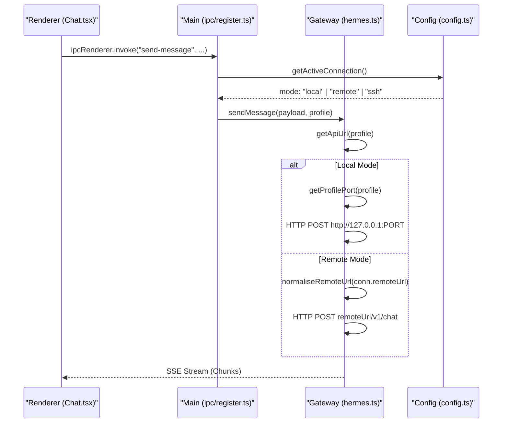
**Sources:** [src/main/ipc/register.ts:1116-1140](), [src/main/hermes.ts:131-148](), [src/main/hermes.ts:190-206]()

### Service Management Handlers
The main process manages the lifecycle of the Hermes Gateway and the auto-updater.

| IPC Channel | Main Process Function | Description |
| :--- | :--- | :--- |
| `start-gateway` | `startGateway(profile)` | Boots the Python FastAPI server for a specific profile [src/main/ipc/register.ts:1015-1017](). |
| `check-install` | `checkInstallStatus()` | Verifies if Hermes Agent is installed and configured [src/main/ipc/register.ts:634-634](). |
| `run-hermes-doctor` | `runHermesDoctor()` | Executes diagnostic checks on the local environment [src/main/ipc/register.ts:664-665](). |
| `get-gpu-status` | `getGpuStatus()` | Returns the current state of hardware acceleration [src/main/ipc/register.ts:592-592](). |

**Sources:** [src/main/ipc/register.ts:533-1100]()

## Process Lifecycle and Cleanup

The Main Process is responsible for the graceful termination of all subprocesses and connections to prevent orphaned resources.

### Shutdown Sequence
When the `before-quit` event fires, the app executes the following cleanup:
1.  **Polling**: Stops health polling for all gateways via `stopHealthPolling` [src/main/app/start.ts:120-120]().
2.  **Abort Signals**: Iterates through `activeRuns` and triggers abort controllers for in-flight LLM requests [src/main/app/start.ts:121-122]().
3.  **Infrastructure**: Stops all active dashboards and the SSH tunnel process [src/main/app/start.ts:124-128]().
4.  **Database**: Closes the SQLite connection via `closeDbConnection` [src/main/app/start.ts:129-129]().

**Sources:** [src/main/app/start.ts:115-131]()

## Auto-Updater and Notifications

Hermes Desktop uses `electron-updater` to manage the update lifecycle. The logic is encapsulated in `src/main/app/updater.ts` and initialized during the start sequence [src/main/app/start.ts:50-50]().

### Update Flow
- **Detection**: Checks for updates on startup or via the `check-for-updates` IPC.
- **Progress**: The updater emits `download-progress`, which is forwarded to the renderer to update the `StatusBar` [src/renderer/src/screens/Layout/StatusBar.tsx]().
- **Installation**: `quitAndInstall` is called after the user clicks the update button in the UI.

### Notifications
The main process handles native OS notifications. In `src/renderer/src/screens/Chat/Chat.tsx`, a chime is played locally using a shared `AudioContext` to avoid memory leaks when a turn finishes [src/renderer/src/screens/Chat/Chat.tsx:61-84]().

**Sources:** [src/main/app/start.ts:50-50](), [src/renderer/src/screens/Chat/Chat.tsx:57-84]()

## Code Entity Mapping

The following diagram bridges the high-level system components to the specific files and functions that implement them.

**System to Code Entity Mapping**
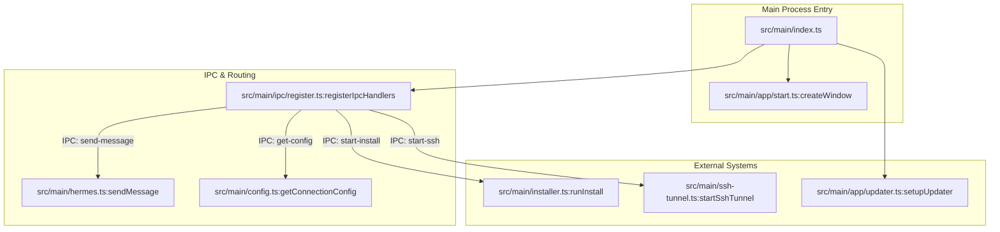

**Sources:** [src/main/index.ts:1-21](), [src/main/app/start.ts:32-50](), [src/main/ipc/register.ts:1-134]()

---

# Page: Preload Bridge (IPC API)

# Preload Bridge (IPC API)

<details>
<summary>Relevant source files</summary>

The following files were used as context for generating this wiki page:

- [lat.md/lat.md](lat.md/lat.md)
- [lat.md/sidebar-navigation.md](lat.md/sidebar-navigation.md)
- [src/main/askpass.ts](src/main/askpass.ts)
- [src/main/config.ts](src/main/config.ts)
- [src/main/gatewayPrompt.ts](src/main/gatewayPrompt.ts)
- [src/main/hermes.ts](src/main/hermes.ts)
- [src/main/index.ts](src/main/index.ts)
- [src/main/ipc/register.ts](src/main/ipc/register.ts)
- [src/main/security.ts](src/main/security.ts)
- [src/preload/askpass.ts](src/preload/askpass.ts)
- [src/preload/index.d.ts](src/preload/index.d.ts)
- [src/preload/index.ts](src/preload/index.ts)
- [src/renderer/src/assets/main.css](src/renderer/src/assets/main.css)
- [src/renderer/src/screens/Chat/Chat.tsx](src/renderer/src/screens/Chat/Chat.tsx)
- [src/renderer/src/screens/Layout/Layout.tsx](src/renderer/src/screens/Layout/Layout.tsx)
- [src/shared/askpass.ts](src/shared/askpass.ts)
- [tests/askpass-security.test.ts](tests/askpass-security.test.ts)
- [tests/electron-security.test.ts](tests/electron-security.test.ts)
- [tests/ipc-handlers.test.ts](tests/ipc-handlers.test.ts)

</details>


The Preload Bridge serves as the secure communication layer between the isolated Renderer process (UI) and the Main process (Node.js/System access). By utilizing Electron's `contextBridge`, Hermes Desktop exposes a type-safe `hermesAPI` interface to the window global, ensuring that the frontend can interact with the Hermes engine without direct access to dangerous Node.js primitives.

### Architecture Overview

The bridge implementation is split between the runtime logic in `src/preload/index.ts` and the TypeScript interface definitions in `src/preload/index.d.ts`. This separation provides full IntelliSense support in the React frontend while maintaining strict process isolation.

#### Data Flow and Security
Hermes enforces strict security by enabling `contextIsolation`, `sandbox`, and `webSecurity` in the `BrowserWindow` configuration [tests/electron-security.test.ts:22-28](). The bridge uses a "Request-Response" pattern via `ipcRenderer.invoke` for most configuration and data fetching, and an "Observer" pattern via `ipcRenderer.on` for streaming chat responses and installation logs [src/preload/index.ts:129-188]().

**IPC Communication Bridge**
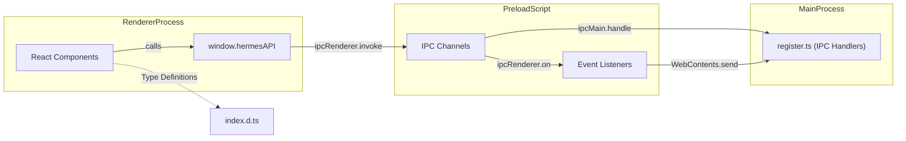
Sources: [src/preload/index.ts:1-127](), [src/preload/index.d.ts:261-1349](), [src/main/ipc/register.ts:1-134](), [tests/electron-security.test.ts:22-28]()

---

### The HermesAPI Interface

The `HermesAPI` interface is the primary contract for all agent-related operations. It is injected into the renderer via `contextBridge.exposeInMainWorld("hermes", hermesAPI)` [src/preload/index.ts:1784-1786]().

#### 1. Installation and Engine Info
These methods manage the lifecycle of the Hermes Python backend and the local environment.

| Method | Description | File |
|:---|:---|:---|
| `checkInstall` | Returns `InstallStatus` (installed, configured, etc.) | [src/preload/index.ts:129-133]() |
| `startInstall` | Triggers the `runInstall` pipeline in the main process | [src/preload/index.ts:137-138]() |
| `onInstallProgress` | Subscribes to installation logs and step updates | [src/preload/index.ts:164-188]() |
| `runHermesDoctor` | Executes system diagnostics via CLI | [src/preload/index.ts:219-220]() |
| `inspectInstallTarget`| Checks for existing installations or update states | [src/preload/index.ts:141-145]() |

Sources: [src/preload/index.d.ts:53-67](), [src/preload/index.ts:129-221]()

#### 2. Chat and Streaming
Chat interactions utilize a hybrid model: an initial `sendMessage` invoke followed by multiple event listeners for streaming content.

**Chat Streaming Sequence**
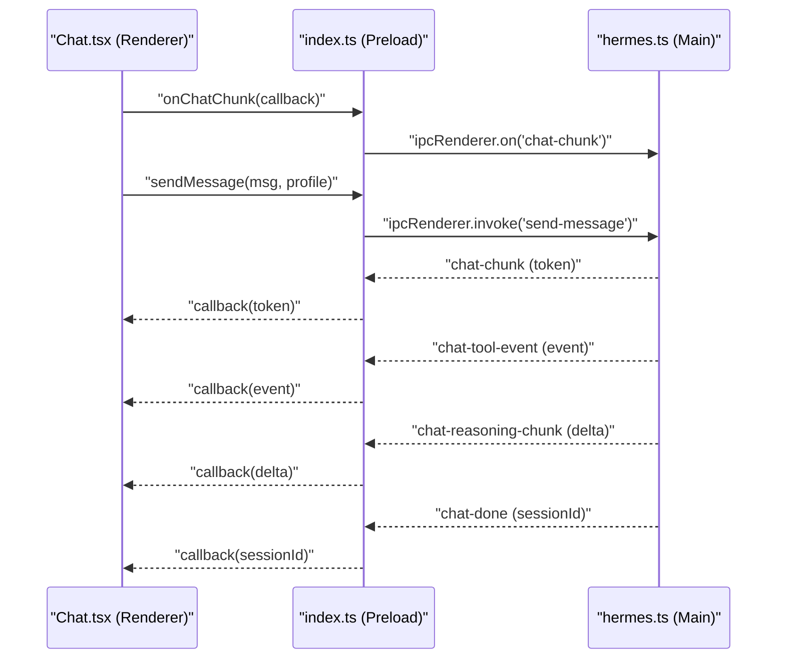
Sources: [src/preload/index.ts:586-630](), [src/main/hermes.ts:63-84](), [src/renderer/src/screens/Chat/Chat.tsx:132-164]()

#### 3. Profile and Configuration Management
The API is "profile-aware," meaning most methods accept an optional `profile` string to target specific agent configurations [src/preload/index.d.ts:285-300]().

*   **`readEnv` / `setEnvValue`**: Manages `.env` files within profile directories [src/preload/index.ts:285-295]().
*   **`getModelConfig` / `setModelConfig`**: Configures the LLM provider and model IDs [src/preload/index.ts:318-329]().
*   **`listProfiles`**: Returns metadata for all available agent profiles [src/preload/index.ts:875-876]().
*   **`getConnectionConfig`**: Retrieves application-wide connection mode (Local, Remote, or SSH) [src/preload/index.ts:347-348]().

Sources: [src/preload/index.ts:285-348](), [src/preload/index.d.ts:285-380]()

---

### New v0.7.0 Features: Wallets and Agent Sync

The v0.7.0 update introduced significant new interfaces for the token economy and cloud synchronization.

#### Wallet and Token Economy
Profile-scoped Ethereum wallets on Base mainnet are managed through these IPC channels.
*   **`provisionWallet`**: Generates a new encrypted wallet for a profile [src/preload/index.ts:1493-1497]().
*   **`getWalletPortfolio`**: Fetches token balances ($H1, $HD) and ETH [src/preload/index.ts:1516-1520]().
*   **`importWallet`**: Allows users to import existing recovery phrases [src/preload/index.ts:1506-1510]().

#### Agent Sync
Synchronizes local profiles with the Hermes One cloud account.
*   **`syncAgents`**: Triggers a bidirectional sync [src/preload/index.ts:1454-1458]().
*   **`getAgentSyncStatus`**: Returns the current sync state (idle, syncing, error) [src/preload/index.ts:1460-1464]().

Sources: [src/preload/index.d.ts:6-14](), [src/preload/index.ts:1454-1525]()

---

### Data Structures and Types

The bridge defines several key interfaces that ensure data consistency between the backend and the React state.

#### CredentialPoolEntry
Shape of a credential-pool entry as the engine expects, supporting both API keys and OAuth [src/preload/index.d.ts:162-175]().
```typescript
interface CredentialPoolEntry {
  id?: string;
  label?: string;
  auth_type?: "api_key" | "oauth_device_code" | string;
  api_key?: string;
  access_token?: string;
  refresh_token?: string;
}
```
Sources: [src/preload/index.d.ts:162-175](), [src/preload/index.ts:45-57]()

#### Kanban System
Interfaces for the multi-agent task board [src/preload/index.d.ts:177-247]().
*   **`KanbanTask`**: Represents a task status, assignee, and associated skills.
*   **`KanbanBoard`**: Represents a collection of tasks (slug, counts, db_path).

Sources: [src/preload/index.d.ts:177-247]()

---

### Implementation Details: Event Unsubscription
To prevent memory leaks in the Renderer, every "on" method returns an unsubscription function. This allows React components to clean up listeners in `useEffect` hooks [src/preload/index.ts:602-607]().

```typescript
// Example from src/preload/index.ts:602-607
onChatChunk: (callback: (chunk: string) => void): (() => void) => {
  const handler = (_event: Electron.IpcRendererEvent, chunk: unknown): void =>
    callback(String(chunk));
  ipcRenderer.on("chat-chunk", handler);
  return () => ipcRenderer.removeListener("chat-chunk", handler);
}
```
Sources: [src/preload/index.ts:602-607](), [src/preload/index.ts:616-621]()

---

# Page: Renderer Entry and Routing

# Renderer Entry and Routing

<details>
<summary>Relevant source files</summary>

The following files were used as context for generating this wiki page:

- [.env.example](.env.example)
- [lat.md/analytics.md](lat.md/analytics.md)
- [src/main/dashboard.ts](src/main/dashboard.ts)
- [src/main/remote-oauth.ts](src/main/remote-oauth.ts)
- [src/renderer/src/App.tsx](src/renderer/src/App.tsx)
- [src/renderer/src/assets/hermesbg.webp](src/renderer/src/assets/hermesbg.webp)
- [src/renderer/src/assets/splashtext-w.webp](src/renderer/src/assets/splashtext-w.webp)
- [src/renderer/src/assets/startvid.mp4](src/renderer/src/assets/startvid.mp4)
- [src/renderer/src/components/settings/CommunityPane.tsx](src/renderer/src/components/settings/CommunityPane.tsx)
- [src/renderer/src/components/settings/ConnectionPane.test.tsx](src/renderer/src/components/settings/ConnectionPane.test.tsx)
- [src/renderer/src/components/settings/ConnectionPane.tsx](src/renderer/src/components/settings/ConnectionPane.tsx)
- [src/renderer/src/components/settings/DataPane.tsx](src/renderer/src/components/settings/DataPane.tsx)
- [src/renderer/src/components/settings/PrivacyPane.tsx](src/renderer/src/components/settings/PrivacyPane.tsx)
- [src/renderer/src/components/settings/useSettingsData.test.tsx](src/renderer/src/components/settings/useSettingsData.test.tsx)
- [src/renderer/src/components/settings/useSettingsData.ts](src/renderer/src/components/settings/useSettingsData.ts)
- [src/renderer/src/env.d.ts](src/renderer/src/env.d.ts)
- [src/renderer/src/main.tsx](src/renderer/src/main.tsx)
- [src/renderer/src/screens/SplashScreen/SplashScreen.tsx](src/renderer/src/screens/SplashScreen/SplashScreen.tsx)
- [src/renderer/src/utils/analytics.ts](src/renderer/src/utils/analytics.ts)
- [src/shared/i18n/locales/en/settings.ts](src/shared/i18n/locales/en/settings.ts)
- [tests/dashboard-remote.test.ts](tests/dashboard-remote.test.ts)
- [tests/preload-api-surface.test.ts](tests/preload-api-surface.test.ts)
- [tests/remote-auth-mode.test.ts](tests/remote-auth-mode.test.ts)
- [tests/remote-oauth.test.ts](tests/remote-oauth.test.ts)

</details>


This page details the entry point and view management of the Hermes Desktop renderer process. It covers how the application initializes, verifies the environment (local, remote, or SSH), and transitions through the onboarding state machine to reach the main interface.

## Application Entry Point

The renderer process begins execution at `src/renderer/src/main.tsx`. This file initializes the React environment and wraps the application in essential providers.

- **`createRoot`**: Mounts the React application into the `#root` DOM element [src/renderer/src/main.tsx:12-18]().
- **`I18nProvider`**: Provides internationalization context to all child components [src/renderer/src/main.tsx:14-16]().
- **`initAnalytics`**: Initializes privacy-first tracking via an in-house service if the user has consented and keys are configured in the build environment [src/renderer/src/main.tsx:10-10](), [src/renderer/src/utils/analytics.ts:63-75]().
- **`StrictMode`**: Enables additional development-time checks for the component tree [src/renderer/src/main.tsx:13-17]().

**Sources:**
- [src/renderer/src/main.tsx:1-19]()
- [src/renderer/src/utils/analytics.ts:1-10]()
- [src/renderer/src/utils/analytics.ts:63-75]()

## View State Machine

The core of the renderer's routing logic resides in `App.tsx`. Unlike a traditional URL-based router, Hermes uses a state-driven "Screen" machine to manage transitions between the splash screen, installation, and the main application layout.

### Screen States
The application defines five primary screen states [src/renderer/src/App.tsx:16-16]():

| State | Component | Purpose |
| :--- | :--- | :--- |
| `splash` | `SplashScreen` | Initial loading animation and background environment check. |
| `welcome` | `Welcome` | Landing page for new users or handling installation errors. |
| `installing` | `Install` | Active execution of the Hermes engine installation pipeline. |
| `setup` | `Setup` | Post-install configuration (e.g., API key entry). |
| `main` | `Layout` | The primary application interface (Chat, Settings, etc.). |

### Logic and Data Flow
The `runInstallCheck` function is the primary driver for state transitions [src/renderer/src/App.tsx:44-140](). It uses the `window.hermesAPI` bridge to query the backend status.

1.  **Connection Configuration**: Fetches the current mode (local, remote, or ssh) via `getConnectionConfig()` [src/renderer/src/App.tsx:53-56]().
2.  **SSH Mode**: If mode is `ssh`, it attempts `startSshTunnel()` [src/renderer/src/App.tsx:58-61](). Success leads to `main` [src/renderer/src/App.tsx:65-65]().
3.  **Remote Mode**: Attempts to ping the `remoteUrl` using `testRemoteConnection()`. Regardless of immediate reachability, it transitions to `main` to allow the user to adjust settings if the remote is down [src/renderer/src/App.tsx:66-74]().
4.  **Local Mode**: Calls `checkInstall()` [src/renderer/src/App.tsx:77-77]().
    - If not installed: Transitions to `welcome` [src/renderer/src/App.tsx:78-79]().
    - If installed but no API key: Transitions to `setup` [src/renderer/src/App.tsx:80-81]().
    - Otherwise: Transitions to `main` [src/renderer/src/App.tsx:82-84]().
5.  **Performance Warming**: While the splash is visible, the app pre-fetches `getConfigHealth()` and `gatewayStatus()` to ensure the first render of the main UI is snappy [src/renderer/src/App.tsx:89-104]().
6.  **Soft Verification**: For local connections, a lazy `verifyInstall()` call is performed after the UI is up. If it fails, `setVerifyWarning(true)` surfaces a dismissible banner rather than forcing a reinstall loop [src/renderer/src/App.tsx:133-138]().

### Screen Transition Diagram
The following diagram illustrates the logic flow from application launch to the main UI.

**Title: Renderer Initialization Flow**
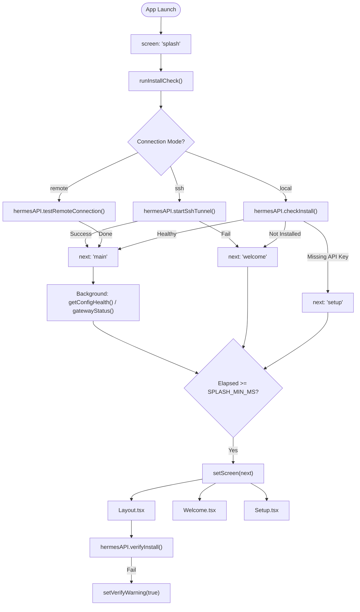
**Sources:**
- [src/renderer/src/App.tsx:16-16]()
- [src/renderer/src/App.tsx:44-140]()
- [src/renderer/src/App.tsx:160-183]()

## Splash Screen Management

The `SplashScreen` component handles the initial visual presentation while the app performs its environment checks.

- **Timing**: The splash screen is guaranteed to stay visible for at least `SPLASH_MIN_MS` (3000ms) to ensure the background video plays through [src/renderer/src/App.tsx:20-20]().
- **Assets**: It renders `hermesbg.webp` as a background and `splashtext-w.webp` as the logo, often accompanied by `startvid.mp4` [src/renderer/src/screens/SplashScreen/SplashScreen.tsx:1-23]().
- **Status Updates**: During initialization, `App.tsx` updates `splashStatus` (e.g., "Checking connection...", "Starting SSH tunnel...") which is displayed on the splash screen [src/renderer/src/App.tsx:52-76]().

**Sources:**
- [src/renderer/src/App.tsx:20-20]()
- [src/renderer/src/App.tsx:52-76]()
- [src/renderer/src/screens/SplashScreen/SplashScreen.tsx:1-23]()

## Routing and State Transitions

The application manages transitions between screens via callback functions passed from `App.tsx` to child components.

**Title: State Transition Mapping**
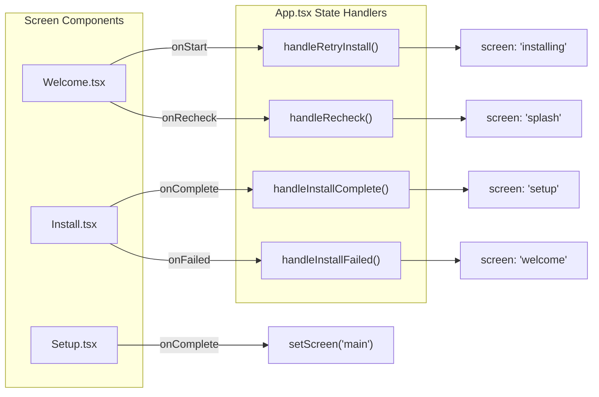

- **`handleInstallComplete`**: Transitions from the installation pipeline to the API setup screen [src/renderer/src/App.tsx:164-167]().
- **`handleInstallFailed`**: Captures the error message and returns the user to the welcome screen [src/renderer/src/App.tsx:169-172]().
- **`handleRetryInstall`**: Resets the install error and sets the screen to `installing` [src/renderer/src/App.tsx:174-177]().
- **`handleRecheck`**: Resets the state to `splash` and re-runs the environment detection logic [src/renderer/src/App.tsx:179-183]().

**Sources:**
- [src/renderer/src/App.tsx:164-183]()

## Remote Authentication Routing

With the introduction of Remote OAuth in v0.7.0, routing logic also accounts for authenticated states.

- **`probeRemoteAuthMode`**: Called during initialization or when configuring a remote connection to determine if the gateway requires "token" or "oauth" authentication [src/main/remote-oauth.ts:107-176]().
- **OAuth Session State**: The renderer checks `remoteOAuthSessionState` to determine if a browser-based login is required [src/main/remote-oauth.ts:97-105]().
- **Login Flow**: If OAuth is required, the `remoteOAuthLogin` IPC call opens a sandboxed `BrowserWindow` to handle the provider's sign-in flow [src/renderer/src/components/settings/useSettingsData.ts:127-127]().

**Sources:**
- [src/main/remote-oauth.ts:97-176]()
- [src/renderer/src/components/settings/useSettingsData.ts:127-127]()

## Error Handling and Shell

The application shell provides global features regardless of the active screen.

- **Theme & Font**: Wrapped in `ThemeProvider` and `FontProvider` to manage UI appearance [src/renderer/src/App.tsx:3-4]().
- **Error Boundary**: A top-level `ErrorBoundary` catches React rendering errors [src/renderer/src/App.tsx:8-8]().
- **Analytics**: Tracks `screen_view` events every time the `screen` state changes [src/renderer/src/App.tsx:156-158]().
- **macOS Support**: Detects the `darwin` platform to handle specific UI adjustments like title bar behavior [src/renderer/src/App.tsx:38-38]().

**Sources:**
- [src/renderer/src/App.tsx:1-43]()
- [src/renderer/src/App.tsx:156-158]()

---

# Page: Hermes Engine Integration

# Hermes Engine Integration

<details>
<summary>Relevant source files</summary>

The following files were used as context for generating this wiki page:

- [lat.md/lat.md](lat.md/lat.md)
- [lat.md/sidebar-navigation.md](lat.md/sidebar-navigation.md)
- [scripts/verify-nous-discovery.js](scripts/verify-nous-discovery.js)
- [src/main/config.ts](src/main/config.ts)
- [src/main/hermes.ts](src/main/hermes.ts)
- [src/main/index.ts](src/main/index.ts)
- [src/main/installer.ts](src/main/installer.ts)
- [src/main/ipc/register.ts](src/main/ipc/register.ts)
- [src/main/model-discovery.ts](src/main/model-discovery.ts)
- [src/main/provider-registry.ts](src/main/provider-registry.ts)
- [src/preload/index.d.ts](src/preload/index.d.ts)
- [src/preload/index.ts](src/preload/index.ts)
- [src/renderer/src/assets/main.css](src/renderer/src/assets/main.css)
- [src/renderer/src/hooks/useDiscoveredModels.ts](src/renderer/src/hooks/useDiscoveredModels.ts)
- [src/renderer/src/screens/Chat/Chat.tsx](src/renderer/src/screens/Chat/Chat.tsx)
- [src/renderer/src/screens/Layout/Layout.tsx](src/renderer/src/screens/Layout/Layout.tsx)
- [src/shared/url-key-map.ts](src/shared/url-key-map.ts)
- [tests/constants.test.ts](tests/constants.test.ts)
- [tests/install-gate-providers.test.ts](tests/install-gate-providers.test.ts)
- [tests/installer-utils.test.ts](tests/installer-utils.test.ts)
- [tests/model-discovery.test.ts](tests/model-discovery.test.ts)
- [tests/provider-registry.test.ts](tests/provider-registry.test.ts)
- [tests/set-model-config-base-url.test.ts](tests/set-model-config-base-url.test.ts)
- [tests/url-key-map.test.ts](tests/url-key-map.test.ts)

</details>


The **Hermes Engine Integration** layer manages the lifecycle and communication between the Electron desktop application and the Python-based `hermes-agent` backend. This integration is responsible for local environment preparation, process orchestration, and the high-performance message routing required for real-time agent interactions.

### Architecture Overview

The integration bridges the TypeScript/Electron environment with a local Python virtual environment. It handles the transition from a "Cold Start" (installation and configuration) to a "Warm State" (active API gateway and message streaming). It supports three primary connectivity modes: **Local**, **Remote**, and **SSH Tunnel** [src/main/config.ts:50-58]().

#### Communication Flow: Renderer to Agent
The following diagram illustrates how a user prompt travels from the UI through the Electron Main process to the Hermes Engine, including the new Dashboard WebSocket transport.

**Message Routing Path**
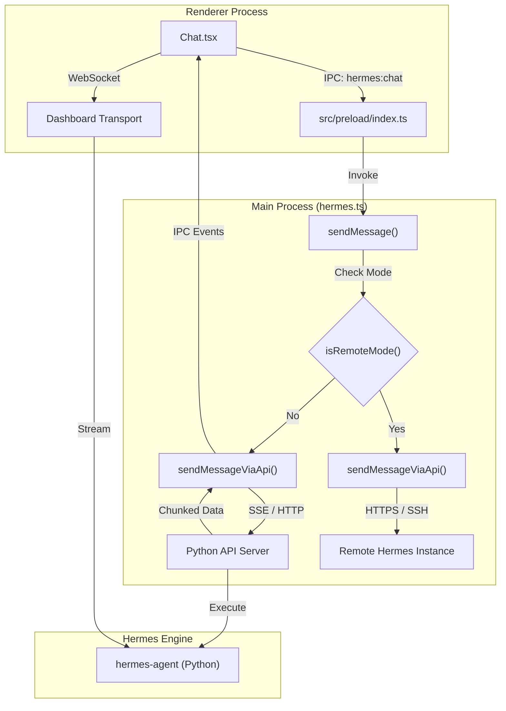
Sources: [src/main/hermes.ts:131-148](), [src/main/hermes.ts:150-155](), [src/preload/index.ts:127-220](), [src/renderer/src/screens/Chat/Chat.tsx:23-26]()

---

### Core Components

The integration is divided into four primary functional areas:

#### 1. Gateway and Message Routing
The Gateway manages the connection to the Hermes Python backend. It supports a dual-path execution model:
*   **Fast Path (HTTP API):** Communicates with a running local or remote API server using Server-Sent Events (SSE). It handles `session_id` tracking to maintain conversation state [src/main/hermes.ts:95-104]().
*   **Dashboard Transport:** A high-performance WebSocket-based transport that allows for bidirectional communication and richer event types, including tool progress and reasoning deltas [src/preload/index.ts:67-87]().

For details, see [Gateway and Message Routing](#3.1).

#### 2. Installer and Environment Setup
Before the engine can run, the application ensures a valid Python environment exists. The `installer.ts` module manages the `HERMES_HOME` directory, which can be overridden via the "Use existing installation" flow [src/main/installer.ts:80-91](). It handles `venv` creation and utilizes `pythonw.exe` on Windows to prevent console window flashes [src/main/installer.ts:145-147]().

For details, see [Installer and Environment Setup](#3.2).

#### 3. Configuration Management
Configuration is synchronized between the Electron UI and the Python backend through `desktop.json`, `.env`, and `config.yaml`. This layer handles the **Credential Pool** for API keys and profile-scoped settings [src/main/config.ts:182-185](). It also includes a **Config Health** system to diagnose and fix setup issues [src/preload/index.d.ts:69-86]().

For details, see [Configuration Management](#3.3).

#### 4. SSH Remote and Tunnel
For users running Hermes on remote hardware or in Docker containers, the `ssh-tunnel.ts` and `ssh-remote.ts` modules provide a secure proxy. This includes support for targeting specific Docker containers on a remote host [src/main/config.ts:34-45]().

For details, see [SSH Remote and Tunnel](#3.4).

---

### Integration Entity Mapping

The following diagram maps high-level system concepts to their specific implementations and data structures in the codebase.

**System to Code Mapping**
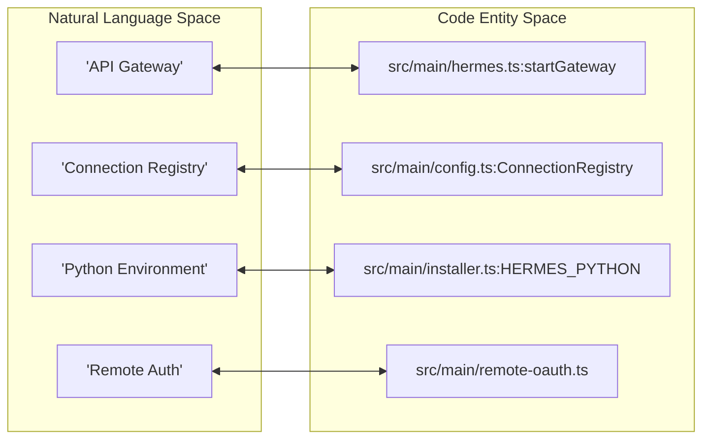
Sources: [src/main/hermes.ts:134-134](), [src/main/config.ts:68-72](), [src/main/installer.ts:145-147](), [src/main/ipc/register.ts:142-147]()

### Key Integration Constants

| Constant | Value / Path | Description |
| :--- | :--- | :--- |
| `HERMES_HOME` | `~/.hermes` or `%LOCALAPPDATA%\hermes` | The root directory for all agent data [src/main/installer.ts:128-131](). |
| `HERMES_PYTHON` | `venv/bin/python` or `pythonw.exe` | The specific interpreter used to run the agent [src/main/installer.ts:145-147](). |
| `HERMES_SCRIPT` | `hermes` or `hermes.exe` | The entry point for the Python CLI [src/main/installer.ts:148-150](). |
| `CONNECTION_REGISTRY_VERSION` | `1` | Versioning for the `desktop.json` connection schema [src/main/config.ts:60-60](). |
| `DEFAULT_PORT` | `8642` | Default local port for the Hermes API [src/main/config.ts:167-167](). |

Sources: [src/main/installer.ts:128-150](), [src/main/config.ts:60-167]()

### Process Lifecycle
1.  **Verification:** `checkInstallStatus()` validates the environment on startup [src/main/ipc/register.ts:61-61]().
2.  **Provisioning:** If missing, `runInstall()` handles the full pipeline (git clone, venv setup, dependency install) [src/main/ipc/register.ts:63-63]().
3.  **Connectivity:** The app resolves the active connection via `getActiveConnection()` and determines if it should use a local gateway or a remote tunnel [src/main/hermes.ts:131-148]().
4.  **Communication:** Messages are sent via `sendMessage()`, which selects the appropriate transport (SSE or Dashboard WebSocket) based on configuration [src/main/ipc/register.ts:119-119]().

---

# Page: Gateway and Message Routing

# Gateway and Message Routing

<details>
<summary>Relevant source files</summary>

The following files were used as context for generating this wiki page:

- [lat.md/agent-capabilities.md](lat.md/agent-capabilities.md)
- [lat.md/connections.md](lat.md/connections.md)
- [lat.md/lat.md](lat.md/lat.md)
- [lat.md/remote-dashboard-oauth.md](lat.md/remote-dashboard-oauth.md)
- [lat.md/sidebar-navigation.md](lat.md/sidebar-navigation.md)
- [src/main/config.ts](src/main/config.ts)
- [src/main/connection-status.ts](src/main/connection-status.ts)
- [src/main/dashboard.ts](src/main/dashboard.ts)
- [src/main/hermes.test.ts](src/main/hermes.test.ts)
- [src/main/hermes.ts](src/main/hermes.ts)
- [src/main/index.ts](src/main/index.ts)
- [src/main/ipc/register.ts](src/main/ipc/register.ts)
- [src/main/remote-api.test.ts](src/main/remote-api.test.ts)
- [src/main/remote-api.ts](src/main/remote-api.ts)
- [src/main/remote-oauth.ts](src/main/remote-oauth.ts)
- [src/main/remote-sessions.ts](src/main/remote-sessions.ts)
- [src/main/session-location-store.ts](src/main/session-location-store.ts)
- [src/preload/index.d.ts](src/preload/index.d.ts)
- [src/preload/index.ts](src/preload/index.ts)
- [src/renderer/src/App.tsx](src/renderer/src/App.tsx)
- [src/renderer/src/assets/main.css](src/renderer/src/assets/main.css)
- [src/renderer/src/components/settings/ConnectionPane.test.tsx](src/renderer/src/components/settings/ConnectionPane.test.tsx)
- [src/renderer/src/components/settings/ConnectionPane.tsx](src/renderer/src/components/settings/ConnectionPane.tsx)
- [src/renderer/src/components/settings/useSettingsData.test.tsx](src/renderer/src/components/settings/useSettingsData.test.tsx)
- [src/renderer/src/components/settings/useSettingsData.ts](src/renderer/src/components/settings/useSettingsData.ts)
- [src/renderer/src/screens/Chat/Chat.tsx](src/renderer/src/screens/Chat/Chat.tsx)
- [src/renderer/src/screens/Layout/Layout.tsx](src/renderer/src/screens/Layout/Layout.tsx)
- [src/shared/i18n/locales/en/settings.ts](src/shared/i18n/locales/en/settings.ts)
- [tests/connection-config-security.test.ts](tests/connection-config-security.test.ts)
- [tests/dashboard-remote.test.ts](tests/dashboard-remote.test.ts)
- [tests/gateway-ports.test.ts](tests/gateway-ports.test.ts)
- [tests/hermes-cli-session-id.test.ts](tests/hermes-cli-session-id.test.ts)
- [tests/preload-api-surface.test.ts](tests/preload-api-surface.test.ts)
- [tests/remote-auth-mode.test.ts](tests/remote-auth-mode.test.ts)
- [tests/remote-oauth.test.ts](tests/remote-oauth.test.ts)

</details>


The Gateway is the communication backbone of Hermes Desktop, responsible for managing the lifecycle of the Python-based Hermes Agent backend and routing messages between the Electron frontend and the agent engine. It implements a dual-path execution model that prioritizes high-performance HTTP streaming and WebSocket dashboard transport while maintaining a robust CLI fallback for local environments.

## Execution Model: Dual-Path Routing

Hermes utilizes two distinct paths for message delivery, managed within `src/main/hermes.ts`. The system automatically determines the best path based on the availability of the API server and the active connection mode.

### 1. The Fast Path (HTTP API & WebSocket)
The preferred method for message exchange is the HTTP API or the newer WebSocket-based Dashboard transport.
*   **Local Mode**: Connects to a profile-specific port (defaulting to 8642 for the default profile) [src/main/hermes.ts:147-147]().
*   **Remote Mode**: Connects to a user-defined `remoteUrl` [src/main/hermes.ts:140-142]().
*   **SSH Mode**: Connects via a local port forwarded through an SSH tunnel [src/main/hermes.ts:135-139]().
*   **Dashboard Transport**: v0.7.0 introduces a WebSocket transport for the chat interface, enabling richer interaction patterns and bypassing standard HTTP request overhead [src/main/dashboard.ts:122-140]().

### 2. The Fallback Path (CLI)
If the API server is unreachable and the app is in local mode, the system falls back to spawning the Hermes Python script as a child process.
*   **Implementation**: Handled by `sendMessageViaCli` [src/main/hermes.ts:696-696]().
*   **Mechanism**: Uses `child_process.spawn` to execute the agent via the configured `HERMES_PYTHON` interpreter [src/main/hermes.ts:723-735]().

### Message Routing Logic
The `sendMessage` function acts as the primary entry point, orchestrating the transition between these paths.

| Step | Action | Code Reference |
| :--- | :--- | :--- |
| 1 | Resolve targeted profile | [src/main/hermes.ts:102-104]() |
| 2 | Check if API server is ready | [src/main/hermes.ts:854-854]() |
| 3 | If ready, use `sendMessageViaApi` | [src/main/hermes.ts:856-856]() |
| 4 | If not ready and local, use `sendMessageViaCli` | [src/main/hermes.ts:859-859]() |
| 5 | If remote and not ready, return error | [src/main/hermes.ts:857-857]() |

**Sources:** [src/main/hermes.ts:94-162](), [src/main/hermes.ts:840-863](), [src/main/dashboard.ts:1-50]()

---

## SSE Streaming and Dashboard Transport

Hermes uses Server-Sent Events (SSE) and WebSockets to provide a responsive chat experience. The parsing logic handles incremental updates, reasoning tokens, and tool execution progress.

### SSE Stream Parsing
The gateway processes several types of information through the SSE stream:
*   **Content Chunks**: Incremental text updates via `gatewayMessageDelta` [src/main/tui-gateway-stream.ts:25-27]().
*   **Reasoning**: Hidden reasoning tokens (e.g., for DeepSeek R1) are captured via `gatewayReasoningText` [src/main/tui-gateway-stream.ts:28-30]().
*   **Tool Progress**: Notifications when the agent invokes tools, identified by `gatewayToolEvent` [src/main/tui-gateway-stream.ts:31-33]().
*   **Usage Metadata**: Token counts and cost metrics provided at the end of the stream [src/main/tui-gateway-stream.ts:34-36]().

### WebSocket Dashboard Transport
For connections that support it, the `DashboardChatTransport` provides a full-duplex connection.
*   **Lifecycle**: The renderer requests a `freshDashboardWebSocketUrl` via IPC [src/main/ipc/register.ts:136-140]().
*   **Auth**: Uses single-use tickets for secure WebSocket upgrades [src/main/dashboard.ts:137-140]().
*   **Implementation**: The `useDashboardChatTransport` hook in the renderer manages the socket state and message dispatch [src/renderer/src/screens/Chat/hooks/useDashboardChatTransport.ts:25-26]().

### Session ID Tracking
The gateway ensures session persistence by generating a unique `X-Hermes-Session-Id` for fresh chats or passing an existing `sessionId` [src/main/hermes.ts:335-345](). The ID is extracted from response headers to keep the frontend synchronized [src/main/hermes.ts:511-514]().

**Diagram: Message Data Flow**
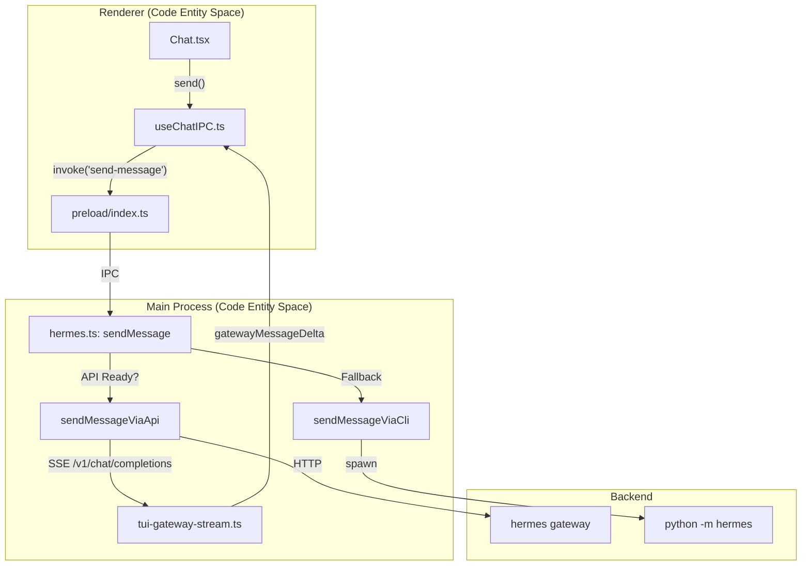
**Sources:** [src/main/hermes.ts:320-520](), [src/main/tui-gateway-stream.ts:1-40](), [src/main/dashboard.ts:122-150]()

---

## Gateway Lifecycle Management

The gateway lifecycle is managed through stateful operations that ensure the Python backend is correctly configured for the active profile.

### Lifecycle Operations
1.  **Initialization**: `ensureApiServerConfig` checks `config.yaml` to ensure the `api_server` platform is enabled for the specific profile [src/main/hermes.ts:310-318]().
2.  **Startup**: `startGatewayDetailed` spawns the agent with `gateway start` arguments, binding to a profile-specific port [src/main/hermes.ts:875-900]().
3.  **Stopping**: `stopGateway` attempts to kill the process using its stored PID or by finding the process listening on the profile's port [src/main/hermes.ts:942-955]().
4.  **Health Polling**: `isApiServerReady` performs an HTTP GET request to the `/health` endpoint to verify the gateway is accepting connections [src/main/hermes.ts:273-295]().

### Remote and SSH Modes
*   **Remote Mode**: Local process spawning is bypassed. The gateway assumes the endpoint at `remoteUrl` is managed externally [src/main/hermes.ts:877-878]().
*   **SSH Mode**: The gateway ensures the `ssh-tunnel` is active and healthy before attempting communication [src/main/hermes.ts:135-139]().

**Diagram: Gateway Startup Sequence**
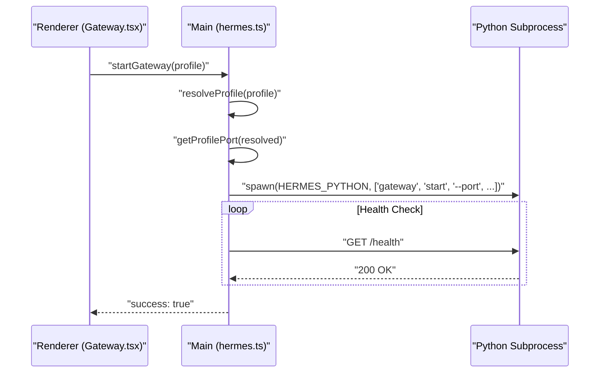
**Sources:** [src/main/hermes.ts:870-960](), [src/main/gateway-ports.ts:1-20]()

---

## Remote Mode and Authentication

Hermes supports complex remote configurations, including OAuth-based authentication for remote dashboards.

*   **URL Normalization**: `normaliseRemoteUrl` strips trailing slashes and `/v1` segments to prevent malformed routing (e.g., `.../v1/v1/chat/...`) [src/main/hermes.ts:122-129]().
*   **Bearer Auth**: Standard remote connections inject an `Authorization: Bearer <key>` header [src/main/hermes.ts:171-187]().
*   **Remote Dashboard OAuth**: v0.7.0 adds support for authenticating against a remote Hermes Dashboard via browser-based OAuth [src/main/remote-oauth.ts:40-60](). This flow captures a session cookie which is used to negotiate a WebSocket ticket for the chat transport [src/main/remote-oauth.ts:120-135]().
*   **SSH Remote API Key**: In SSH mode, the API key is automatically resolved from the remote environment's `.env` file once the tunnel is established [src/main/hermes.ts:165-170]().

**Sources:** [src/main/hermes.ts:122-187](), [src/main/remote-oauth.ts:1-150](), [src/main/ipc/register.ts:141-147]()

---

# Page: Installer and Environment Setup

# Installer and Environment Setup

<details>
<summary>Relevant source files</summary>

The following files were used as context for generating this wiki page:

- [scripts/probe-validation-and-banner.js](scripts/probe-validation-and-banner.js)
- [scripts/probe-wsl-detection.js](scripts/probe-wsl-detection.js)
- [scripts/repro-nous-detection-367.js](scripts/repro-nous-detection-367.js)
- [scripts/verify-369-wsl-drift.js](scripts/verify-369-wsl-drift.js)
- [scripts/verify-nous-discovery.js](scripts/verify-nous-discovery.js)
- [scripts/verify-wsl-detection.js](scripts/verify-wsl-detection.js)
- [src/main/config-health.ts](src/main/config-health.ts)
- [src/main/installer.ts](src/main/installer.ts)
- [src/main/model-discovery.ts](src/main/model-discovery.ts)
- [src/main/provider-registry.ts](src/main/provider-registry.ts)
- [src/main/validation.ts](src/main/validation.ts)
- [src/main/wsl-detection.ts](src/main/wsl-detection.ts)
- [src/renderer/src/hooks/useDiscoveredModels.ts](src/renderer/src/hooks/useDiscoveredModels.ts)
- [src/shared/url-key-map.ts](src/shared/url-key-map.ts)
- [tests/api-server-key-migration.test.ts](tests/api-server-key-migration.test.ts)
- [tests/config-health.test.ts](tests/config-health.test.ts)
- [tests/constants.test.ts](tests/constants.test.ts)
- [tests/install-gate-providers.test.ts](tests/install-gate-providers.test.ts)
- [tests/installer-utils.test.ts](tests/installer-utils.test.ts)
- [tests/model-discovery.test.ts](tests/model-discovery.test.ts)
- [tests/provider-registry.test.ts](tests/provider-registry.test.ts)
- [tests/set-model-config-base-url.test.ts](tests/set-model-config-base-url.test.ts)
- [tests/sibling-hermes-home-drift.test.ts](tests/sibling-hermes-home-drift.test.ts)
- [tests/url-key-map.test.ts](tests/url-key-map.test.ts)
- [tests/validation.test.ts](tests/validation.test.ts)

</details>


The Hermes Desktop installer and environment management system is responsible for orchestrating the lifecycle of the underlying Python-based Hermes Agent, managing its dependencies, and ensuring the host environment is correctly configured for local execution.

## Overview of `installer.ts`

The core logic for installation and environment validation resides in `src/main/installer.ts`. It manages the `HERMES_HOME` directory and handles the retrieval of the agent repository, virtual environment creation, and diagnostic checks.

### Constants and Paths
The system defines several critical paths for the local environment. Precedence for `HERMES_HOME` is calculated by checking the `HERMES_HOME` env var, then a persistent override file in the app's `userData` directory, and finally a platform-specific default [src/main/installer.ts:128-131]().

- **HERMES_HOME**: The root directory for all Hermes data [src/main/installer.ts:128]().
- **HERMES_REPO**: The location of the agent source code [src/main/installer.ts:132]().
- **HERMES_VENV**: The Python virtual environment directory [src/main/installer.ts:133]().
- **HERMES_PYTHON**: The path to the Python executable. On Windows, this uses `pythonw.exe` to prevent console window flashes during background CLI calls [src/main/installer.ts:145-147]().
- **HERMES_SCRIPT**: The entry point script for the agent [src/main/installer.ts:148-150]().

Sources: [src/main/installer.ts:128-153]()

---

## The Installation Pipeline

The `runInstall` pipeline (exposed via IPC as `startInstall`) is a multi-step process that transitions through cloning, environment setup, and verification.

### Pipeline Execution Flow
The `runInstall` function executes the following sequence:
1. **Directory Preparation**: Ensures `HERMES_HOME` exists using `mkdirSync`.
2. **Sudo/Askpass Setup**: On Linux, it invokes `precacheSudoCredentials` to handle administrative prompts for browser dependencies [src/main/sudoCreds.ts:29-58]().
3. **Repository Management**: Clones the `hermes-agent` repository or performs a `git pull` if it already exists.
4. **Virtual Environment**: Creates a Python venv using the system's `python3`.
5. **Dependency Resolution**: Runs `pip install -e .` to install the agent and its requirements.
6. **Configuration**: Initializes default `.env` and `config.yaml` files if they are missing.
7. **Verification**: Executes `hermes --version` to ensure the installation is functional.

### Installation Progress Tracking
The installer reports progress back to the renderer via a progress interface.
- `step`: Current step index.
- `totalSteps`: Total number of steps.
- `title` & `detail`: Human-readable status strings.
- `log`: Cumulative output from the spawn processes, stripped of ANSI codes via `stripAnsi` [src/main/utils.ts:20]().

### Pipeline Logic Diagram
This diagram maps the natural language steps of the installation to the internal logic within `installer.ts`.

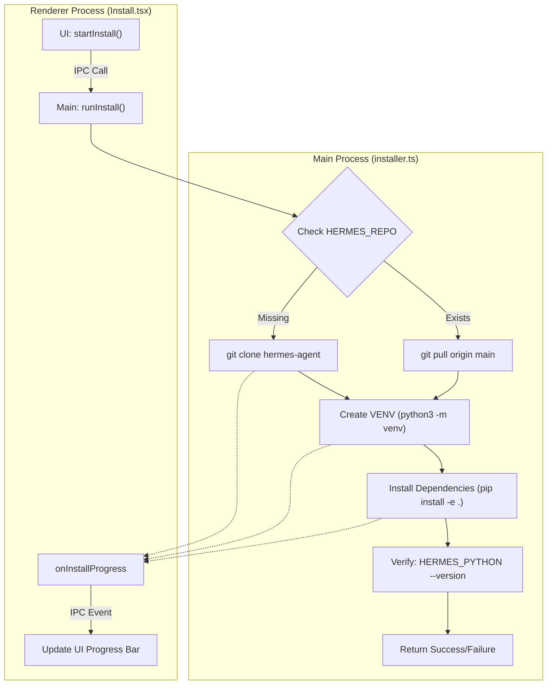
Sources: [src/main/installer.ts:1-175](), [src/main/sudoCreds.ts:29-58](), [src/main/utils.ts:20]()

---

## Status and Diagnostics

### `checkInstallStatus`
This function is called during the application boot sequence to determine the application's readiness state.
- **Remote Mode**: If `connection.mode` is "remote", it returns all status flags as `true` [src/main/config.ts:15]().
- **File Check**: Performs a fast check for the existence of `HERMES_PYTHON` and `HERMES_SCRIPT`.
- **API Key Detection**: Scans the `.env` file for valid keys or OAuth credentials using `hasOAuthCredentials` [src/main/config.ts:17]().

### `verifyInstall`
A lazy background verification that actually invokes the Python process to confirm it can run. It uses a cache with a TTL to avoid redundant process spawning.

### Hermes Doctor
The `runHermesDoctor` function executes `hermes doctor` via the CLI. It captures the output of the agent's internal diagnostic tool and returns it as a string to the UI.

Sources: [src/main/installer.ts:1-175](), [src/main/config.ts:15-18]()

---

## Model Discovery and Provider Registry

Hermes includes a robust system for discovering models available through various providers, powering the autocomplete in the UI.

### Provider Model Discovery
The discovery logic in `src/main/model-discovery.ts` handles three distinct paths:
1. **OpenAI-Compatible**: Hits the provider's `/models` endpoint directly using Node.js `http`/`https` [src/main/model-discovery.ts:170-189]().
2. **OAuth Providers**: Executes a short Python snippet (`PROVIDER_MODELS_SNIPPET`) to call `hermes-agent`'s `provider_model_ids` function [src/main/model-discovery.ts:96-132]().
3. **Nous Portal Free Tier**: Specifically fetches the Nous Portal catalogue and filters for zero-priced models [src/main/model-discovery.ts:154-189]().

### Canonical Provider Registry
The `src/main/provider-registry.ts` serves as the single source of truth for built-in provider base URLs [src/main/provider-registry.ts:15-44](). This ensures that when a user selects a provider like "DeepSeek", the system automatically knows to hit `https://api.deepseek.com/v1` [src/main/provider-registry.ts:20]().

### URL to Env Key Mapping
The `src/shared/url-key-map.ts` maps base URL patterns to their respective environment variable names [src/shared/url-key-map.ts:25-43](). For example, any URL matching `openrouter.ai` maps to `OPENROUTER_API_KEY` [src/shared/url-key-map.ts:27]().

Sources: [src/main/model-discovery.ts:1-189](), [src/main/provider-registry.ts:1-54](), [src/shared/url-key-map.ts:1-131]()

---

## Config Health Audit

The `runConfigHealthCheck` function in `src/main/config-health.ts` performs a startup scan for configuration inconsistencies [src/main/config-health.ts:89-120]().

### Key Health Checks
- **`checkApiServerKeyPlacement`**: Ensures the `API_SERVER_KEY` is in the canonical `.env` location rather than nested in `config.yaml` [src/main/config-health.ts:170-184]().
- **`checkActiveModelKeyPresence`**: Verifies that the currently selected model has a corresponding API key in the environment [src/main/config-health.ts:95]().
- **`checkSiblingHermesHomeDrift`**: Detects if multiple Hermes installations (e.g., WSL vs Native) have drifted in configuration [src/main/config-health.ts:98]().

### Auto-Fix Dispatcher
Issues flagged as `autoFixable` can be resolved via `autoFixIssue`, which dispatches to specific handlers like `fixApiServerKeyPlacement` [src/main/config-health.ts:126-149]().

Sources: [src/main/config-health.ts:1-184]()

---

## Enhanced PATH Mechanism

To ensure the Hermes Agent can find system dependencies (like `git`, `node`, or `npm`) regardless of the user's shell configuration, Hermes implements an **Enhanced PATH** mechanism.

### `getEnhancedPath()`
This function constructs a custom `PATH` string by prepending common binary locations to the existing `process.env.PATH`.
- **Windows**: Includes bundled `git` paths and standard `Program Files` locations.
- **Unix**: Includes `/usr/local/bin`, `/opt/homebrew/bin`, and version manager paths (`NVM`, `Volta`, `asdf`, `fnm`).

### NVM Resolution
The `resolveNvmBin` function dynamically detects the active Node.js version by reading the `default` alias file or falling back to the latest installed version found in the versions directory.

Sources: [src/main/installer.ts:1-175]()

---

## Environment Parsing and Discovery

### Memory Provider Discovery
The system discovers available memory providers by scanning the `plugins/memory/` directory within the agent repository. It checks for the presence of an `__init__.py` file to determine if a provider is installed [tests/installer-utils.test.ts:184-192]().

### MCP Server Parsing
Hermes parses the `config.yaml` to extract Model Context Protocol (MCP) server configurations. It uses regex to identify `mcp_servers` blocks and determines the type (stdio vs http) based on the presence of a `url` field [tests/installer-utils.test.ts:75-98]().

Sources: [tests/installer-utils.test.ts:73-194]()

---

## Sudo Bridge and Pre-caching

On Linux, the installer uses `precacheSudoCredentials` to avoid deadlocks during dependency installation (e.g., Playwright libraries) [src/main/sudoCreds.ts:29-58]().

1. **Check**: It first checks if sudo is already non-interactive via `sudo -n -v` [src/main/sudoCreds.ts:60-66]().
2. **UI Dialog**: If credentials are needed, it pops a native Electron `BrowserWindow` with a password input [src/main/sudoCreds.ts:106-165]().
3. **Validation**: Validates the password using `sudo -S -v` [src/main/sudoCreds.ts:68-84]().
4. **Keep-alive**: Starts a background loop to refresh the sudo cache every 60 seconds until the installation completes [src/main/sudoCreds.ts:86-104]().

Sources: [src/main/sudoCreds.ts:1-165]()

---

## Backup and Import

Hermes provides utilities for managing user data through zip-based backups.

- **`exportBackup`**: Compresses the `.hermes` directory, excluding the `venv` and the agent repository code to keep file sizes manageable.
- **`importBackup`**: Extracts a backup zip into `HERMES_HOME`. It includes logic to handle migrations from legacy structures like `OpenClaw`.

Sources: [src/main/installer.ts:1-175]()

---

# Page: Configuration Management

# Configuration Management

<details>
<summary>Relevant source files</summary>

The following files were used as context for generating this wiki page:

- [lat.md/lat.md](lat.md/lat.md)
- [lat.md/sidebar-navigation.md](lat.md/sidebar-navigation.md)
- [scripts/probe-validation-and-banner.js](scripts/probe-validation-and-banner.js)
- [scripts/repro-nous-detection-367.js](scripts/repro-nous-detection-367.js)
- [scripts/verify-compat-host-derived-key.js](scripts/verify-compat-host-derived-key.js)
- [src/main/config-health.test.ts](src/main/config-health.test.ts)
- [src/main/config-health.ts](src/main/config-health.ts)
- [src/main/config.ts](src/main/config.ts)
- [src/main/hermes.ts](src/main/hermes.ts)
- [src/main/host-derived-env.ts](src/main/host-derived-env.ts)
- [src/main/index.ts](src/main/index.ts)
- [src/main/ipc/register.ts](src/main/ipc/register.ts)
- [src/main/secrets/commandProvider.stdio.test.ts](src/main/secrets/commandProvider.stdio.test.ts)
- [src/main/secrets/commandProvider.test.ts](src/main/secrets/commandProvider.test.ts)
- [src/main/secrets/commandProvider.ts](src/main/secrets/commandProvider.ts)
- [src/main/secrets/envProvider.ts](src/main/secrets/envProvider.ts)
- [src/main/secrets/getSpawnFloor.test.ts](src/main/secrets/getSpawnFloor.test.ts)
- [src/main/secrets/index.test.ts](src/main/secrets/index.test.ts)
- [src/main/secrets/index.ts](src/main/secrets/index.ts)
- [src/main/secrets/provider.ts](src/main/secrets/provider.ts)
- [src/main/secrets/resolvedSecretMap.test.ts](src/main/secrets/resolvedSecretMap.test.ts)
- [src/main/secrets/spawnRateFloor.test.ts](src/main/secrets/spawnRateFloor.test.ts)
- [src/main/tui-gateway-stream.test.ts](src/main/tui-gateway-stream.test.ts)
- [src/main/validation.ts](src/main/validation.ts)
- [src/preload/index.d.ts](src/preload/index.d.ts)
- [src/preload/index.ts](src/preload/index.ts)
- [src/renderer/src/assets/main.css](src/renderer/src/assets/main.css)
- [src/renderer/src/screens/Chat/Chat.tsx](src/renderer/src/screens/Chat/Chat.tsx)
- [src/renderer/src/screens/Layout/Layout.tsx](src/renderer/src/screens/Layout/Layout.tsx)
- [src/shared/i18n/locales/en/diagnose.ts](src/shared/i18n/locales/en/diagnose.ts)
- [tests/api-server-key-migration.test.ts](tests/api-server-key-migration.test.ts)
- [tests/api-server-key-secrets-provider.test.ts](tests/api-server-key-secrets-provider.test.ts)
- [tests/api-server-key-status.test.ts](tests/api-server-key-status.test.ts)
- [tests/compat-host-derived-key-persistence.test.ts](tests/compat-host-derived-key-persistence.test.ts)
- [tests/compat-host-derived-key.test.ts](tests/compat-host-derived-key.test.ts)
- [tests/config-health.test.ts](tests/config-health.test.ts)
- [tests/validation.test.ts](tests/validation.test.ts)

</details>


The configuration management system in Hermes Desktop handles application-level connection settings, profile-specific environment variables, model provider configurations, and toolset toggles. It utilizes a layered approach combining persistent JSON files, YAML configuration for the agent backend, a secrets provider system for credential isolation, and an in-memory TTL (Time-To-Live) cache to optimize performance.

## Connection Configuration

Hermes Desktop supports three primary execution modes: `local`, `remote`, and `ssh` [src/main/config.ts:51](). This state is managed via `desktop.json` located in the `HERMES_HOME` directory [src/main/config.ts:98-100]().

| Property | Key in `ConnectionConfig` | Description |
| :--- | :--- | :--- |
| **Mode** | `mode` | Determines if the app uses the local Python backend, a remote URL, or an SSH tunnel [src/main/config.ts:51](). |
| **Remote URL** | `remoteUrl` | The endpoint for the Hermes Agent when in remote mode [src/main/config.ts:52](). |
| **API Key** | `apiKey` | The credential used for authenticating with a remote instance [src/main/config.ts:53](). |
| **SSH Config** | `ssh` | Contains host, port, username, key path, and tunnel port mappings [src/main/config.ts:34-45, 57](). |
| **Transport** | `remoteChatTransport` | Choice between `dashboard` (WebSocket) or `legacy` (SSE) for remote communication [src/main/config.ts:47, 55](). |

The functions `getConnectionConfig` and `setConnectionConfig` provide the interface for reading and persisting these values [src/main/config.ts:187, 196](). To protect secrets, `getPublicConnectionConfig` is used to send configuration to the renderer, replacing the actual API key with its length (`apiKeyLength`) and a boolean flag (`hasApiKey`) [src/main/config.ts:74-88]().

### Data Flow: Connection Settings
The following diagram illustrates how connection settings are retrieved and stored.

"Connection Configuration Flow"
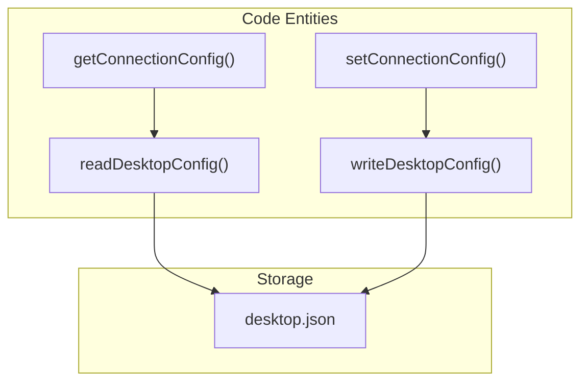
Sources: [src/main/config.ts:34-100](), [src/main/config.ts:187-196]()

## Profile-Scoped Management

Configuration is isolated by "Profiles". Each profile maintains its own directory containing `.env`, `config.yaml`, and personality files [src/main/utils.ts:46-50]().

### Environment Variables (.env)
The `.env` file stores sensitive credentials and platform toggles.
- **Reading**: `readEnv(profile)` parses the file into a key-value record, stripping quotes and ignoring comments [src/main/config.ts:175]().
- **Writing**: `setEnvValue(key, value, profile)` uses regex to find and update existing keys or append new ones, ensuring the cache is invalidated [src/main/config.ts:176]().

### Backend Configuration (config.yaml)
The `config.yaml` file controls the Hermes Agent's behavior, including the active model and toolsets. Because the app avoids a heavy YAML dependency in the main bundle, it uses a custom indentation-aware parser in `yaml-path.ts` [src/main/yaml-path.ts:1-25]().

- **Model Config**: `getModelConfig(profile)` extracts the `provider`, `default` (model ID), and `base_url` from the `model:` block [src/main/config.ts:180]().
- **Auto-API-Key**: `setModelConfig` includes logic to auto-populate `model.api_key` for custom providers pointing at known commercial hosts using values from the profile's `.env` [src/main/config.ts:181]().

### API Server Key Resolution
The system uses a specific precedence order to resolve the `API_SERVER_KEY` used for internal gateway authentication. `getApiServerKey(profile)` checks [src/main/config.ts:200]():
1. Profile `.env` `API_SERVER_KEY`.
2. The `secrets` provider system (e.g. Keychain/Vault).
3. The `api_server.token` path in `config.yaml`.

Sources: [src/main/config.ts:175-200](), [src/main/utils.ts:46-50](), [src/main/yaml-path.ts:1-25]()

## Secrets Provider System

To support secure credential storage beyond flat `.env` files, Hermes implements a `getSecretsProvider()` system [src/main/config.ts:22]().

- **Provider Resolution**: The system resolves secrets by checking `process.env` first, then the profile's `.env` file, and finally the configured secrets provider [src/main/config-health.ts:39]().
- **Lazy Construction**: Providers are constructed lazily to avoid circular dependencies during module initialization [src/main/config.ts:13-20]().
- **Resolved Map**: `resolvedSecretMap(profile)` provides a merged view of all available credentials across these layers [src/main/config-health.ts:180]().

Sources: [src/main/config.ts:13-25](), [src/main/config-health.ts:36-43](), [src/main/config-health.ts:180]()

## Config Health Validation

The `config-health.ts` module performs startup and on-demand audits for inconsistencies across `.env`, `config.yaml`, and `models.json` [src/main/config-health.ts:2-4]().

- **Check Runner**: `runConfigHealthCheck(profile)` executes a suite of checks, including `checkApiServerKeyPlacement` and `checkRuntimeEnvKeyMismatch` [src/main/config-health.ts:89-100]().
- **Issue Model**: Issues are categorized by `Severity` ("error", "warning", "info") and include an `autoFixable` flag [src/main/config-health.ts:45, 64]().
- **Auto-Fix Dispatcher**: `autoFixIssue(code, profile, context)` routes fix requests from the UI to specific handlers like `fixApiServerKeyPlacement` [src/main/config-health.ts:126-149]().
- **Audit Logging**: Every auto-fix is recorded in `~/.hermes/logs/config-fixes.log` [src/main/config-health.ts:11-12]().

### System Entity Mapping: Health Audit
This diagram maps the health check logic to the UI and physical storage.

"Config Health System Mapping"
```mermaid
graph TD
    subgraph "Renderer_UI"
        CHB["ConfigHealthBanner"]
        DUI["Diagnose UI"]
    end

    subgraph "Main_Process_Logic"
        RCHC["runConfigHealthCheck()"]
        AFI["autoFixIssue()"]
        RSM["resolvedSecretMap()"]
    end

    subgraph "Storage_Layers"
        ENV[".env"]
        YAML["config.yaml"]
        SEC["Secrets Provider"]
    end

    CHB -- "displays" --> RCHC
    DUI -- "triggers" --> AFI
    RCHC -- "audits" --> RSM
    RSM -- "merges" --> ENV
    RSM -- "merges" --> YAML
    RSM -- "merges" --> SEC
    AFI -- "updates" --> ENV
```
Sources: [src/main/config-health.ts:1-149](), [src/renderer/src/screens/Chat/Chat.tsx:30]()

## TTL Cache Strategy

To prevent redundant disk I/O during high-frequency operations, `config.ts` uses an in-memory cache for environment and configuration reads.

- **Invalidation**: `invalidateSecretsCache()` clears cached credential lookups when settings change [src/main/config.ts:200]().
- **Provider Cache**: `invalidateProviderListCache()` specifically targets the list of available secret providers [src/main/config.ts:24]().

## Implementation Details: `yaml-path.ts`

`getYamlPath` is a lightweight, indentation-aware reader designed to avoid the overhead of a full YAML parser [src/main/yaml-path.ts:5-8]().

| Feature | Support Level | Implementation Detail |
| :--- | :--- | :--- |
| **Indentation** | 2+ spaces | Detects `indent` via `raw.length - trimmed.length` [src/main/yaml-path.ts:40](). |
| **Comments** | Trailing supported | Strips ` #` unless inside quotes [src/main/yaml-path.ts:103-105](). |
| **Quotes** | Single/Double | `stripQuotes` handles wrapping on keys and values [src/main/yaml-path.ts:75-84](). |
| **Dotted Keys** | Supported | Recursively descends through `agent.service_tier` style paths [src/main/yaml-path.ts:25-73](). |

Sources: [src/main/yaml-path.ts:1-107](), [src/main/config.ts:12]()

---

# Page: SSH Remote and Tunnel

# SSH Remote and Tunnel

<details>
<summary>Relevant source files</summary>

The following files were used as context for generating this wiki page:

- [docs/SSH-TUNNEL-VPS.md](docs/SSH-TUNNEL-VPS.md)
- [lat.md/main-process.md](lat.md/main-process.md)
- [pr-comment.md](pr-comment.md)
- [src/main/gpu-fallback.ts](src/main/gpu-fallback.ts)
- [src/main/ssh-docker.ts](src/main/ssh-docker.ts)
- [src/main/ssh-options.ts](src/main/ssh-options.ts)
- [src/main/ssh-remote.test.ts](src/main/ssh-remote.test.ts)
- [src/main/ssh-remote.ts](src/main/ssh-remote.ts)
- [src/main/ssh-tunnel.ts](src/main/ssh-tunnel.ts)
- [src/renderer/src/components/settings/SshDockerTargetSection.tsx](src/renderer/src/components/settings/SshDockerTargetSection.tsx)
- [src/shared/ssh-docker.ts](src/shared/ssh-docker.ts)
- [tests/gpu-fallback.test.ts](tests/gpu-fallback.test.ts)
- [tests/ssh-docker.test.ts](tests/ssh-docker.test.ts)
- [tests/ssh-options.test.ts](tests/ssh-options.test.ts)
- [tests/ssh-remote.test.ts](tests/ssh-remote.test.ts)

</details>


The SSH Remote and Tunnel subsystem provides full functional parity between local and remote Hermes installations. Unlike a simple HTTP proxy, this implementation allows the Desktop app to manage remote skills, sessions, memory, and gateway lifecycles as if they were running on the local machine [docs/SSH-TUNNEL-VPS.md:1-7](). It utilizes a dual-transport approach: an SSH command-line proxy for file/CLI operations and an SSH tunnel for the HTTP API and WebSocket dashboard.

## Architecture Overview

The system is split into two primary modules:
1.  **`ssh-remote.ts`**: Handles proxied execution of the Hermes CLI and file system operations on the remote host via `ssh` commands [src/main/ssh-remote.ts:1-5]().
2.  **`ssh-tunnel.ts`**: Manages a persistent background SSH process that forwards a local port to the remote Hermes API server (default `8642`) [src/main/ssh-tunnel.ts:100-123]().

### Data Flow: Desktop to Remote Agent

```mermaid
graph TD
    subgraph "Desktop (Local)"
        UI["Renderer UI"]
        IPC["IPC Handlers"]
        SR["ssh-remote.ts (sshExec)"]
        ST["ssh-tunnel.ts (Port Forward)"]
    end

    subgraph "Remote Host (VPS/Server)"
        SSHD["SSH Daemon"]
        CLI["Hermes CLI (Python)"]
        FS["~/.hermes (Config/DB)"]
        GATEWAY["Hermes Gateway (API)"]
    end

    UI --> IPC
    IPC --> SR
    IPC --> ST
    SR -- "spawn('ssh', ['cmd'])" --> SSHD
    ST -- "ssh -L local:remote" --> SSHD
    SSHD --> CLI
    CLI --> FS
    SSHD --> GATEWAY
    GATEWAY --> FS
```
**Sources:** [src/main/ssh-remote.ts:58-73](), [src/main/ssh-tunnel.ts:100-123](), [docs/SSH-TUNNEL-VPS.md:14-37]()

## SSH Proxy Implementation (`ssh-remote.ts`)

Every feature that normally reads or writes local files (e.g., `sessions.ts`, `memory.ts`) is instead executed on the remote host when the connection mode is set to `ssh` [src/main/ssh-remote.ts:1-5]().

### Key Functions
- **`sshExec`**: The core execution engine. It spawns a system `ssh` process using `BatchMode=yes` and `StrictHostKeyChecking=accept-new` to ensure non-interactive operation [src/main/ssh-remote.ts:40-56](). It handles timeouts (default 30s) and sanitizes SSH-specific errors (e.g., authentication failures) into user-friendly messages [src/main/ssh-remote.ts:62-108](), [src/main/ssh-remote.ts:122-145]().
- **`sshPython`**: A wrapper around `sshExec` that pipes Python scripts to the remote `python3` interpreter, allowing complex logic (like directory scanning or JSON parsing) to run in a single SSH round-trip [src/main/ssh-remote.ts:110-120]().
- **`sshReadDirectory`**: Uses a remote Python script to scan the remote filesystem and return `SshDirectoryEntry` objects, used for profile and skill discovery [src/main/ssh-remote.ts:164-188]().

### Command Mapping (Natural Language to Code)
| Feature | Code Entity | Remote CLI Command / Script |
| :--- | :--- | :--- |
| **Start Gateway** | `buildGatewayStartCommand` | `systemctl start hermes.service` OR `nohup hermes gateway run` [tests/ssh-remote.test.ts:192-202](), [src/main/ssh-remote.test.ts:33-48]() |
| **Stop Gateway** | `buildGatewayStopCommand` | `systemctl stop hermes.service` OR `kill $(cat gateway.pid)` [src/main/ssh-remote.test.ts:50-60]() |
| **Edit .env** | `upsertEnvLine` | `sed` / `awk` style replacement via remote shell [src/main/ssh-remote.test.ts:97-144]() |
| **List Profiles** | `selectSshProfiles` | `ls ~/.hermes/profiles` [tests/ssh-remote.test.ts:17-19]() |

**Sources:** [src/main/ssh-remote.ts:58-63](), [src/main/ssh-remote.ts:110-115](), [src/main/ssh-remote.ts:164-167](), [src/main/ssh-remote.test.ts:21-61]()

## SSH Tunneling (`ssh-tunnel.ts`)

The tunnel provides the transport for the Hermes API and the WebSocket dashboard. It ensures that even if the remote API is bound to `127.0.0.1` on the server, the desktop can reach it via a local loopback port [docs/SSH-TUNNEL-VPS.md:55-57]().

### Tunnel Lifecycle
1.  **Port Discovery**: `findFreePort` searches for an available local port, starting at the user's preferred port (default `18642`) [src/main/ssh-tunnel.ts:83-98]().
2.  **Establishment**: Spawns `ssh` with the `-L` flag (Local Forwarding) and `ExitOnForwardFailure=yes` [src/main/ssh-tunnel.ts:100-123]().
3.  **Health Check**: The `waitForHealth` function polls the local port's `/health` or `/api/status` endpoints to verify the tunnel is actually routing traffic to a functional Hermes Agent [src/main/ssh-tunnel.ts:68-75]().
4.  **Multiplexing**: Uses `buildSshControlOptions` to enable SSH connection sharing (ControlMaster), which significantly speeds up subsequent `sshExec` calls by reusing the tunnel's socket [src/main/ssh-tunnel.ts:114](), [src/main/ssh-remote.ts:49]().

**Sources:** [src/main/ssh-tunnel.ts:27-30](), [src/main/ssh-tunnel.ts:60-75](), [src/main/ssh-tunnel.ts:100-123](), [src/main/ssh-tunnel.ts:135-156]()

## SSH Docker Targeting

Hermes Desktop supports targets where the Agent runs inside a Docker container (e.g., NAS, Coolify). This is handled by `ssh-docker.ts` by provisioning host-side shims [src/main/ssh-docker.ts:11-25]().

### Provisioning Logic
Instead of modifying the container, the system creates two artifacts on the SSH host:
1.  **Launcher Hook**: A script at `~/.config/hermes-desktop/remote-hermes` that wraps `docker exec` to route CLI commands into the container [src/main/ssh-docker.ts:77-98]().
2.  **Data Symlink**: A symlink from `~/.hermes` to the host directory mounted as the container's volume (usually `/opt/data`), allowing the file proxy to see the Agent's real database and logs [src/main/ssh-docker.ts:20-22](), [src/shared/ssh-docker.ts:10-11]().

### Docker Inspection Flow
```mermaid
sequenceDiagram
    participant R as SshDockerTargetSection (Renderer)
    participant M as ssh-docker.ts (Main)
    participant H as Remote Host (Python)

    R->>M: inspectSshHermesTarget()
    M->>H: buildInspectSshHermesTargetCommand()
    Note over H: Checks for docker binary,<br/>running containers,<br/>and volume mounts.
    H-->>M: JSON Payload
    M-->>R: SshHermesTargetInspection
    Note over R: User selects container
    R->>M: provisionSshDockerTarget()
    M->>H: Write launcher + symlink
    H-->>M: Success
    M-->>R: SshDockerProvisionResult
```
**Sources:** [src/renderer/src/components/settings/SshDockerTargetSection.tsx:55-118](), [src/main/ssh-docker.ts:105-185](), [src/shared/ssh-docker.ts:16-37]()

## Configuration and Security

### SSH Options
`buildSshControlOptions` configures connection multiplexing. On non-Windows platforms, it uses a ControlPath socket in `~/.ssh/` to reuse existing connections [src/main/ssh-options.ts]().

### API Key Provisioning
The gateway requires a secure `API_SERVER_KEY` to bind. `ssh-remote.ts` includes `isUsableApiServerKey` to detect insecure placeholders (like "changeme") and automatically generates/upserts a fresh key into the remote `.env` file during connection setup [src/main/ssh-remote.test.ts:63-83](), [src/main/ssh-remote.test.ts:97-144]().

### Sanitization
All remote commands are escaped using `shellQuote` to prevent shell injection when user-provided strings (like task titles or session names) are passed to the remote CLI [src/main/ssh-remote.ts:147-149](), [tests/ssh-remote.test.ts:124-178]().

**Sources:** [src/main/ssh-remote.ts:147-149](), [src/main/ssh-remote.test.ts:63-83](), [tests/ssh-remote.test.ts:124-178]()

---

# Page: Agent Features and Data Layer

# Agent Features and Data Layer

<details>
<summary>Relevant source files</summary>

The following files were used as context for generating this wiki page:

- [Development.md](Development.md)
- [README.md](README.md)
- [assets/header.webp](assets/header.webp)
- [assets/partners/atlascloud.webp](assets/partners/atlascloud.webp)
- [assets/partners/greptile.webp](assets/partners/greptile.webp)
- [previews/discover.png](previews/discover.png)
- [previews/memory.png](previews/memory.png)
- [previews/sessions.png](previews/sessions.png)
- [src/main/default-models.ts](src/main/default-models.ts)
- [src/main/profiles.ts](src/main/profiles.ts)
- [src/renderer/src/components/profile/ProfileModal.tsx](src/renderer/src/components/profile/ProfileModal.tsx)
- [src/renderer/src/screens/Agents/Agents.test.tsx](src/renderer/src/screens/Agents/Agents.test.tsx)
- [src/renderer/src/screens/Agents/Agents.tsx](src/renderer/src/screens/Agents/Agents.tsx)
- [src/shared/i18n/locales/en/agents.ts](src/shared/i18n/locales/en/agents.ts)
- [tests/profiles.test.ts](tests/profiles.test.ts)

</details>


This section provides an overview of the backend modules that power the Hermes agent's intelligence, persistence, and extensibility. The data layer is designed around a **Profile-centric isolation model**, where each profile maintains its own distinct configuration, memory, skills, and persona.

The core logic resides in the Electron main process, interacting with a combination of flat-file Markdown stores (`MEMORY.md`, `SOUL.md`), YAML configurations, a SQLite database (`state.db`) for session history, and encrypted storage for blockchain wallets.

### Data Layer Architecture

The following diagram illustrates the relationship between the high-level agent concepts and the underlying code entities.

**Diagram: Agent Entity Mapping**
```mermaid
graph TD
    subgraph "Natural Language Space"
        Persona["Agent Persona"]
        Knowledge["Long-term Memory"]
        Capabilities["Skills & Tools"]
        History["Conversation History"]
        Economy["Token Economy"]
    end

    subgraph "Code Entity Space (src/main/)"
        Soul["soul.ts: readSoul()"]
        Mem["memory.ts: readMemory()"]
        Tools["tools.ts: getToolsets()"]
        Skills["skills.ts: listInstalledSkills()"]
        Sess["sessions.ts: listSessions()"]
        Wallets["wallets.ts: listWallets()"]
    end

    subgraph "Storage Layer"
        SoulFile["SOUL.md"]
        MemFile["MEMORY.md"]
        Config["config.yaml"]
        SkillsDir["/skills/"]
        DB[("state.db (SQLite)")]
        SafeStore["Electron safeStorage"]
    end

    Persona --> Soul --> SoulFile
    Knowledge --> Mem --> MemFile
    Capabilities --> Tools --> Config
    Capabilities --> Skills --> SkillsDir
    History --> Sess --> DB
    Economy --> Wallets --> SafeStore
```
**Sources:** [src/main/soul.ts:12-21](), [src/main/memory.ts:110-128](), [src/main/tools.ts:170-191](), [src/main/skills.ts:69-118](), [src/main/sessions.ts:179-222](), [src/main/wallets.ts:112-145]()

---

### Subsystem Overviews

#### 4.1 Profiles and Skills
Hermes uses a directory-based isolation model. The "default" profile is located at `HERMES_HOME`, while named profiles reside in `HERMES_HOME/profiles/<id>` [src/main/profiles.ts:23-24](). Profiles are managed via `listProfiles`, which detects directories and retrieves metadata like active status, model configuration, and skill counts [src/main/profiles.ts:176-223](). Skills are modular capabilities organizational by category and are discovered by parsing `SKILL.md` frontmatter [src/main/profiles.ts:119-143](). Profiles can also be synced with a cloud account [src/renderer/src/screens/Agents/Agents.tsx:117-139]().

For details, see [Profiles and Skills](#4.1).

#### 4.2 Memory, Soul, and Tools
The agent's "Soul" (persona) and "Memory" (knowledge) are managed as human-readable Markdown files. 
- **Memory**: Uses a delimited flat-file format (`MEMORY.md`) with character limits to ensure context window efficiency [src/main/memory.ts:6-9]().
- **Soul**: Defines the system prompt and behavioral guidelines in `SOUL.md` [src/main/soul.ts:12-21]().
- **Tools**: Managed via `config.yaml` toggles. The system enables or disables specific capabilities like `web` or `terminal` [src/main/tools.ts:123-168]().

For details, see [Memory, Soul, and Tools](#4.2).

#### 4.3 Sessions and Session Cache
Conversation history is stored in a SQLite database (`state.db`) [src/main/utils.ts:175-177](). To provide a snappy UI, Hermes maintains a `sessions.json` cache [src/main/session-cache.ts:19-25](). 
- **Delta Sync**: Fetches only sessions updated since the last sync to optimize performance [src/main/session-cache.ts:97-165]().
- **Search**: Full-text search is powered by SQLite FTS5 [src/main/sessions.ts:224-245]().

For details, see [Sessions and Session Cache](#4.3).

#### 4.4 Cron Jobs and Automation
Hermes supports scheduled tasks via a Cron Job subsystem. Jobs are persisted in `jobs.json` [src/main/cronjobs.ts:27-29]().
- **Execution**: Jobs can be created, removed, or triggered manually via the Hermes CLI [src/main/cronjobs.ts:142-174]().
- **Remote Mode**: In remote mode, the system fetches jobs via the Hermes API server's `/api/jobs` endpoint [src/main/cronjobs.ts:92-114]().

For details, see [Cron Jobs and Automation](#4.4).

#### 4.5 Wallets and Token Economy
Introduced in v0.7.0, the wallet subsystem allows profiles to manage Ethereum wallets on the Base mainnet.
- **Security**: Private keys/recovery phrases are encrypted using Electron's `safeStorage` before being persisted [src/main/wallets.ts:190-215]().
- **Token Integration**: Supports tracking balances for $H1 and $HD tokens [src/shared/i18n/locales/en/agents.ts:16-16]().
- **UI**: The `ProfileWalletPane` provides a dedicated interface for wallet CRUD and balance refreshing [src/renderer/src/components/profile/ProfileWalletPane.tsx:45-110]().

For details, see [Wallets and Token Economy](#4.5).

---

### Profile Data Flow

The `profileHome` utility function is the primary mechanism for directing data operations to the correct file system path based on the active agent.

**Diagram: Profile-Scoped Data Resolution**
```mermaid
flowchart LR
    IPC["IPC Call (profile id)"] --> Utils["utils.ts: profileHome()"]
    Utils --> Default["~/.hermes/"]
    Utils --> Named["~/.hermes/profiles/{id}/"]

    subgraph "Files per Profile"
        Default --- F1["config.yaml"]
        Default --- F2["state.db"]
        Default --- F3["MEMORY.md"]
        Default --- F4["SOUL.md"]
        Default --- F5["wallets.json (Encrypted)"]
    end
```

| Entity | Storage Type | Primary Controller | Purpose |
| :--- | :--- | :--- | :--- |
| **Profile** | Directory | `profiles.ts` | Isolation of all agent data and environment [src/main/profiles.ts:23-34](). |
| **Memory** | Markdown | `memory.ts` | Persistent user-specific facts with char limits [src/main/memory.ts:110-128](). |
| **Soul** | Markdown | `soul.ts` | The agent's core identity/persona [src/main/soul.ts:12-21](). |
| **Wallets** | Encrypted JSON | `wallets.ts` | Profile-scoped crypto wallets on Base [src/main/wallets.ts:40-65](). |
| **Sessions** | SQLite | `sessions.ts` | Message history and FTS5 search in `state.db` [src/main/sessions.ts:171-177](). |
| **Cron Jobs** | JSON | `cronjobs.ts` | Scheduled automation tasks [src/main/cronjobs.ts:10-25](). |

**Sources:** [src/main/utils.ts:47-50](), [src/main/profiles.ts:176-223](), [src/main/memory.ts:110-128](), [src/main/wallets.ts:112-145](), [src/main/sessions.ts:171-222](), [src/main/cronjobs.ts:27-29]()

---

# Page: Profiles and Skills

# Profiles and Skills

<details>
<summary>Relevant source files</summary>

The following files were used as context for generating this wiki page:

- [src/main/cronjobs.ts](src/main/cronjobs.ts)
- [src/main/profiles.ts](src/main/profiles.ts)
- [src/main/remote-skills.test.ts](src/main/remote-skills.test.ts)
- [src/main/remote-skills.ts](src/main/remote-skills.ts)
- [src/main/skills.ts](src/main/skills.ts)
- [src/renderer/src/components/profile/ProfileModal.tsx](src/renderer/src/components/profile/ProfileModal.tsx)
- [src/renderer/src/screens/Agents/Agents.test.tsx](src/renderer/src/screens/Agents/Agents.test.tsx)
- [src/renderer/src/screens/Agents/Agents.tsx](src/renderer/src/screens/Agents/Agents.tsx)
- [src/renderer/src/screens/Skills/Skills.test.tsx](src/renderer/src/screens/Skills/Skills.test.tsx)
- [src/shared/i18n/locales/en/agents.ts](src/shared/i18n/locales/en/agents.ts)
- [tests/cronjobs-ssh.test.ts](tests/cronjobs-ssh.test.ts)
- [tests/cronjobs.test.ts](tests/cronjobs.test.ts)
- [tests/profiles.test.ts](tests/profiles.test.ts)
- [tests/remote-mode-url-and-spawn.test.ts](tests/remote-mode-url-and-spawn.test.ts)
- [tests/skills-cli-output.test.ts](tests/skills-cli-output.test.ts)

</details>


This page covers the implementation of the profile isolation model and the skill management system in Hermes Desktop. These systems allow users to maintain multiple independent agent configurations and extend agent capabilities through a structured skill registry.

## Profile Isolation Model

Hermes uses a directory-based isolation model for profiles. The `default` profile is located directly in the `HERMES_HOME` directory (typically `~/.hermes`), while named profiles are stored in a dedicated sub-directory `profiles/` [src/main/profiles.ts:23-23]().

### Directory Structure
Each profile directory acts as a self-contained environment containing:
*   `config.yaml`: Model and provider settings [src/main/profiles.ts:103-103]().
*   `.env`: Profile-specific environment variables and API keys [src/main/profiles.ts:190-190]().
*   `SOUL.md`: The agent's persona and instructions [src/main/profiles.ts:191-191]().
*   `skills/`: A categorized directory of installed skills [src/main/profiles.ts:120-120]().
*   `gateway.pid`: Tracking file for the profile's active gateway process [src/main/profiles.ts:146-146]().
*   `profile-meta.json`: UI-specific metadata like custom names, colors, and avatars [src/main/profiles.ts:21-21]().

### Profile Management Operations
The `profiles.ts` module interfaces with the Python-based `hermes` CLI to perform lifecycle operations. It uses `execFileSync` to trigger the agent's internal management commands [src/main/profiles.ts:1-1]().

| Function | Logic | Source |
| :--- | :--- | :--- |
| `listProfiles()` | Scans `HERMES_HOME` and `profiles/` to aggregate metadata (model, skill count, status). | [src/main/profiles.ts:176-223]() |
| `createProfile()` | Normalizes agent names into slugs and executes the creation logic. | [src/main/profiles.ts:64-97]() |
| `readProfileConfig()` | Parses `config.yaml` using regex to extract `default` model and `provider`. | [src/main/profiles.ts:99-117]() |
| `isGatewayRunning()` | Reads `gateway.pid` and verifies the process via `pidIsAliveAs`. | [src/main/profiles.ts:145-161]() |

**Profile Detection Logic**
The `listProfiles` function aggregates data from multiple files to construct a `ProfileInfo` object. It ensures profiles are visible even if they lack configuration files, preventing "ghost" profiles [src/main/profiles.ts:176-223]().

```mermaid
graph TD
    subgraph "Profile Detection Logic [listProfiles]"
        A["Read active_profile via getActiveProfileNameSync"] --> B["Scan PROFILES_DIR"]
        B --> C["For each directory:"]
        C --> D["readProfileConfig (config.yaml)"]
        D --> E["fileExists (.env & SOUL.md)"]
        F["countSkills (Recursive SKILL.md search)"]
        G["isGatewayRunning (Check gateway.pid via pidIsAliveAs)"]
        D --- F
        E --- G
        G --> H["Return ProfileInfo[]"]
    end
```
Sources: [src/main/profiles.ts:23-54](), [src/main/profiles.ts:99-117](), [src/main/profiles.ts:119-143](), [src/main/profiles.ts:145-161](), [src/main/profiles.ts:176-223]()

---

## Skills System

Skills are structured Markdown files (`SKILL.md`) that provide the agent with domain-specific knowledge and tool-use instructions.

### Skill Anatomy and Parsing
The `SKILL.md` file uses YAML frontmatter to define metadata. The `parseSkillFrontmatter` function extracts the name and description for the UI. If frontmatter is missing, it falls back to the first Markdown heading and paragraph [src/main/skills.ts:40-70]().

**Data Mapping: Markdown to Code**
```mermaid
graph LR
    subgraph "Natural Language Space (SKILL.md)"
        FM["--- frontmatter ---"]
        HD["# Heading"]
        BD["First Paragraph"]
    end

    subgraph "Code Entity Space (src/main/skills.ts)"
        IS["InstalledSkill Interface"]
        IS_N["name: string"]
        IS_D["description: string"]
        IS_P["path: string"]
    end

    FM -- "regex match (name:)" --> IS_N
    FM -- "regex match (description:)" --> IS_D
    HD -- "fallback headingMatch" --> IS_N
    BD -- "fallback paraMatch.slice(0, 120)" --> IS_D
```
Sources: [src/main/skills.ts:22-27](), [src/main/skills.ts:40-70]()

### Skill Registry and Storage
Hermes distinguishes between skills included in the core repository and those added to a specific profile.

1.  **Bundled Skills**: Located in the `HERMES_REPO` directory under `skills/`. Discovered via `listBundledSkills` [src/main/skills.ts:233-241]().
2.  **Installed Skills**: Located in the profile-specific `skills/` directory. The structure follows `skills/<category>/<skill-name>/SKILL.md` [src/main/skills.ts:76-125]().
3.  **Search Registry**: The `searchSkills` function queries the agent's remote registry using the `skills browse` CLI command with the `--json` flag [src/main/skills.ts:185-228]().

### Remote Skill Management
In Remote Mode, skill operations are routed through the Dashboard API rather than the local CLI to ensure data consistency with the remote agent [src/main/remote-skills.ts:4-10]().

*   **Remote Paths**: Remote skills are identified by a `remote-skill:<profile>:<name>` prefix to allow content lookups to target the correct profile on the remote host [src/main/remote-skills.ts:20-24]().
*   **API Endpoints**: The system communicates with `/api/skills`, `/api/skills/content`, and `/api/skills/hub/install|uninstall` [src/main/remote-skills.ts:8-9]().

**Skill Installation Flow**
```mermaid
sequenceDiagram
    participant R as Renderer (Skills.tsx)
    participant M as Main Process (remote-skills.ts)
    participant D as Remote Dashboard (Python)

    R->>M: remoteInstallSkill("identifier", "research")
    M->>D: POST /api/skills/hub/install
    Note over D: Spawns CLI install process
    D-->>M: { ok: true, pid: 42 }
    M-->>R: { success: true }
    Note right of R: Refresh triggered by UI
    R->>M: remoteListInstalledSkills("research")
    M->>D: GET /api/skills?profile=research
    D-->>M: Updated Skill List
    M-->>R: InstalledSkill[]
```
Sources: [src/main/remote-skills.ts:20-24](), [src/main/remote-skills.ts:65-86](), [src/main/remote-skills.ts:118-137](), [src/renderer/src/screens/Skills/Skills.test.tsx:22-44]()

### Security and Path Validation
To prevent directory traversal, the `isAllowedSkillFile` function restricts skill file access to `HERMES_HOME/skills`, `HERMES_REPO/skills`, or valid profile skill directories [src/main/skills.ts:152-162]().

Sources: [src/main/profiles.ts](), [src/main/skills.ts](), [src/main/remote-skills.ts](), [tests/profiles.test.ts](), [src/renderer/src/screens/Agents/Agents.tsx]()

---

# Page: Memory, Soul, and Tools

# Memory, Soul, and Tools

<details>
<summary>Relevant source files</summary>

The following files were used as context for generating this wiki page:

- [lat.md/mcp-servers.md](lat.md/mcp-servers.md)
- [src/main/mcp-servers.ts](src/main/mcp-servers.ts)
- [src/main/memory-limits.ts](src/main/memory-limits.ts)
- [src/main/memory.ts](src/main/memory.ts)
- [src/main/messaging-platforms.ts](src/main/messaging-platforms.ts)
- [src/main/registry.ts](src/main/registry.ts)
- [src/main/soul.ts](src/main/soul.ts)
- [src/main/tools.ts](src/main/tools.ts)
- [src/renderer/src/screens/Discover/Discover.tsx](src/renderer/src/screens/Discover/Discover.tsx)
- [src/renderer/src/screens/Gateway/Gateway.tsx](src/renderer/src/screens/Gateway/Gateway.tsx)
- [src/renderer/src/screens/Tools/Tools.tsx](src/renderer/src/screens/Tools/Tools.tsx)
- [src/shared/i18n/locales/en/common.ts](src/shared/i18n/locales/en/common.ts)
- [src/shared/i18n/locales/en/discover.ts](src/shared/i18n/locales/en/discover.ts)
- [src/shared/i18n/locales/en/gateway.ts](src/shared/i18n/locales/en/gateway.ts)
- [src/shared/i18n/locales/en/providers.ts](src/shared/i18n/locales/en/providers.ts)
- [src/shared/i18n/locales/en/tools.ts](src/shared/i18n/locales/en/tools.ts)
- [src/shared/messaging-platforms.test.ts](src/shared/messaging-platforms.test.ts)
- [src/shared/messaging-platforms.ts](src/shared/messaging-platforms.ts)
- [src/shared/registry.ts](src/shared/registry.ts)
- [tests/memory-limits.test.ts](tests/memory-limits.test.ts)
- [tests/toolset-toggle.test.ts](tests/toolset-toggle.test.ts)

</details>


This section documents the core modules responsible for managing the agent's persistent identity, knowledge base, and functional capabilities. These features are implemented through a combination of flat-file storage for transparency, SQLite for statistics, and YAML-based configuration for tool orchestration.

## Memory Management

Hermes utilizes a flat-file memory system to provide the agent with long-term context. This system distinguishes between **Memory** (discrete facts or observations) and the **User Profile** (general information about the human user).

### Implementation Details
Memory is stored in `MEMORY.md` and `USER.md` within the `memories/` subdirectory of the profile home [src/main/memory.ts:33-39](). To maintain performance and context window efficiency, the system reads limits from `config.yaml` via `parseMemoryLimitsConfig` [src/main/memory.ts:45-53]().

The system uses a specific delimiter `\n§\n` to separate individual memory entries within the flat file [src/main/memory.ts:7](). This allows for granular CRUD operations on specific "facts" without overwriting the entire file manually.

### Data Structures
The `MemoryInfo` interface aggregates file content, metadata, and session statistics retrieved from the local SQLite `state.db` [src/main/memory.ts:14-31]().

| Entity | File | Purpose |
| :--- | :--- | :--- |
| `MemoryEntry` | `MEMORY.md` | Discrete facts separated by `§` [src/main/memory.ts:9-12](). |
| `User Profile` | `USER.md` | Persistent "About Me" for the user [src/main/memory.ts:37-39](). |
| `Stats` | `state.db` | Aggregate message and session counts [src/main/memory.ts:91-119](). |

### Memory Data Flow
The following diagram illustrates how memory is parsed from the filesystem into the application state.

**Memory Parsing and Storage Flow**
```mermaid
graph TD
    subgraph "Filesystem Space"
        MEM_FILE["MEMORY.md"]
        USER_FILE["USER.md"]
        DB_FILE["state.db"]
        CONF["config.yaml"]
    end

    subgraph "Code Entity Space (memory.ts)"
        readMemory["readMemory(profile)"]
        parse["parseMemoryEntries(content)"]
        stats["getSessionStats(profile)"]
        limits["readMemoryLimits(profile)"]
        serialize["serializeEntries(entries)"]
        write["safeWriteFile()"]
    end

    MEM_FILE -->|readFileSync| readMemory
    readMemory --> parse
    parse -->|"split('\n§\n')"| MEM_ENTRIES["MemoryEntry[]"]
    
    USER_FILE -->|readFileSync| readMemory
    
    CONF -->|parseMemoryLimitsConfig| limits
    limits -->|charLimit| readMemory

    DB_FILE -->|"better-sqlite3"| stats
    stats -->|"SELECT COUNT(*)"| STAT_OBJ["stats object"]

    MEM_ENTRIES --> serialize
    serialize -->|"join('\n§\n')"| write
    write --> MEM_FILE
```
Sources: [src/main/memory.ts:7-12](), [src/main/memory.ts:76-82](), [src/main/memory.ts:91-119](), [src/main/memory.ts:123-142]()

## Soul and Persona

The "Soul" of the agent defines its core personality, instructions, and behavioral constraints. This is managed in `soul.ts` and persisted in `SOUL.md` [src/main/soul.ts:12-13]().

### Personality Management
*   **Default Persona:** If no `SOUL.md` exists, the system defaults to a "friendly, knowledgeable, and clear" persona named Hermes [src/main/soul.ts:5-10]().
*   **Reset Workflow:** The `resetSoul` function allows users to revert their agent to the factory settings by overwriting the file with `DEFAULT_SOUL` [src/main/soul.ts:34-37]().
*   **Persistence:** All changes are written using `safeWriteFile` to ensure the directory structure exists before attempting a write [src/main/soul.ts:27]().

Sources: [src/main/soul.ts:1-37]()

## Tools and Capabilities

The `tools.ts` module manages the availability of functional toolsets (e.g., Web Search, Terminal, Vision). Toolsets are defined in a static registry `TOOLSET_DEFS` [src/main/tools.ts:15-115]().

### Toolset Orchestration
Toolsets are toggled via the `config.yaml` file under the `platform_toolsets` key [src/main/tools.ts:130-138](). The system supports both the `cli` platform and external `messaging` platforms [src/main/tools.ts:236-246](). Because the application avoids a heavy YAML dependency in the main process, `tools.ts` implements a custom line-by-line parser `parsePlatformToolsets` [src/main/tools.ts:139-183]().

### Tool Configuration Mapping
The system maps internal keys to user-friendly labels and descriptions for the UI using the application's locale settings via `localizeToolDefs` [src/main/tools.ts:117-127]().

| Key | Label Key | Purpose |
| :--- | :--- | :--- |
| `web` | `tools.web.label` | Search the web and extract content [src/main/tools.ts:21-24](). |
| `terminal` | `tools.terminal.label` | Execute shell commands and scripts [src/main/tools.ts:36-39](). |
| `vision` | `tools.vision.label` | Analyze images and visual content [src/main/tools.ts:56-59](). |
| `memory` | `tools.memory.label` | Store and recall persistent knowledge [src/main/tools.ts:80-83](). |
| `cronjob` | `tools.cronjob.label` | Schedule and manage automated tasks [src/main/tools.ts:101-104](). |

### MCP Server Registry
Hermes integrates with the **Model Context Protocol (MCP)** to extend capabilities.
*   **Discovery:** The `Discover.tsx` screen allows browsing MCPs from a community registry hosted on GitHub [src/main/registry.ts:25-35]().
*   **Management:** Users can add, edit, or remove MCP servers (both `stdio` and `http` transports) via the Tools screen [src/renderer/src/screens/Tools/Tools.tsx:81-92]().
*   **Registry Fetching:** `fetchRegistry` retrieves the catalog from `index.json` and caches it to prevent redundant network calls [src/main/registry.ts:131-163]().

**Tool Configuration and Sync Flow**
```mermaid
graph TD
    subgraph "Configuration Space"
        YAML["config.yaml"]
    end

    subgraph "Code Entity Space (tools.ts / registry.ts)"
        getTools["getToolsets(profile)"]
        parseYAML["parsePlatformToolsets(content)"]
        fetchReg["fetchRegistry(force)"]
        DEFS["TOOLSET_DEFS"]
        REG_REPO["hermes-registry"]
    end

    subgraph "Renderer Space (Tools.tsx)"
        ToolUI["Tools Screen"]
        McpForm["McpServerInput"]
    end

    YAML -->|readFileSync| getTools
    getTools --> parseYAML
    parseYAML -->|Compare| DEFS
    DEFS -->|Return| ToolUI
    
    REG_REPO -->|fetch| fetchReg
    fetchReg -->|RegistryItem[]| ToolUI
    
    ToolUI -->|formToInput| McpForm
    McpForm -->|IPC| window.hermesAPI
```
Sources: [src/main/tools.ts:15-115](), [src/main/tools.ts:139-183](), [src/main/registry.ts:32-41](), [src/renderer/src/screens/Tools/Tools.tsx:144-154]()

## Shared Registry Types
The system uses shared interfaces to ensure consistency between the main process (which handles fetching and installation) and the renderer (which handles the UI) [src/shared/registry.ts:1-5]().

*   **`RegistryItem`**: Represents a skill, MCP, agent, or workflow in the marketplace [src/shared/registry.ts:9-27]().
*   **`RegistryCatalog`**: A grouped collection of registry items [src/shared/registry.ts:29-34]().
*   **`RegistryModel`**: Defines curated models available for selection in the Models screen [src/shared/registry.ts:66-74]().

Sources: [src/shared/registry.ts:7-94]()

---

# Page: Sessions and Session Cache

# Sessions and Session Cache

<details>
<summary>Relevant source files</summary>

The following files were used as context for generating this wiki page:

- [lat.md/remote-dashboard-oauth.md](lat.md/remote-dashboard-oauth.md)
- [src/main/remote-api.test.ts](src/main/remote-api.test.ts)
- [src/main/remote-api.ts](src/main/remote-api.ts)
- [src/main/remote-sessions.ts](src/main/remote-sessions.ts)
- [src/main/session-cache.ts](src/main/session-cache.ts)
- [src/main/sessions.ts](src/main/sessions.ts)
- [src/main/utils.ts](src/main/utils.ts)
- [src/renderer/src/screens/Sessions/Sessions.test.tsx](src/renderer/src/screens/Sessions/Sessions.test.tsx)
- [src/renderer/src/screens/Sessions/Sessions.tsx](src/renderer/src/screens/Sessions/Sessions.tsx)
- [src/shared/i18n/locales/en/sessions.ts](src/shared/i18n/locales/en/sessions.ts)
- [tests/remote-sessions.test.ts](tests/remote-sessions.test.ts)
- [tests/session-cache-sync.test.ts](tests/session-cache-sync.test.ts)
- [tests/sessions-delete-session.test.ts](tests/sessions-delete-session.test.ts)

</details>


The Hermes Desktop application manages conversation history through a combination of a persistent SQLite database (`state.db`) maintained by the Hermes Agent backend and a localized JSON cache (`sessions.json`) used by the Electron main process for high-performance UI rendering, delta-syncing, and title generation.

## 1. Data Architecture

Hermes utilizes two distinct storage layers for session data to balance data integrity with UI responsiveness. Both layers are isolated per-profile [src/main/session-cache.ts:15-20]().

### 1.1 SQLite Schema (state.db)
The primary source of truth is the SQLite database located at `activeStateDbPath()` [src/main/utils.ts:4-9](). This database stores raw conversation data, including multimodal content and tool execution logs.

| Table | Purpose | Key Columns |
| :--- | :--- | :--- |
| `sessions` | Metadata for each conversation | `id`, `source`, `started_at`, `message_count`, `model`, `title` |
| `messages` | Individual chat turns and tool interactions | `id`, `session_id`, `role`, `content`, `timestamp` |
| `messages_fts` | Virtual FTS5 table for search | Virtual columns for full-text indexing |

Sources: [src/main/sessions.ts:28-37](), [src/main/sessions.ts:39-45](), [src/main/session-cache.ts:129-135](), [src/main/utils.ts:4-9]()

### 1.2 Desktop Cache (sessions.json)
To avoid expensive SQLite joins and frequent disk I/O during sidebar navigation, the main process maintains a `sessions.json` file.
- **Location**: `~/.hermes/desktop/sessions.json` for default, or `~/.hermes/profiles/<name>/desktop/sessions.json` [src/main/session-cache.ts:21-27]().
- **Structure**: Stores a `CacheData` object containing `sessions: CachedSession[]` and a `lastSync` timestamp [src/main/session-cache.ts:39-42]().

Sources: [src/main/session-cache.ts:21-42]()

## 2. Session Synchronization Logic

The `syncSessionCache` function implements a delta-sync strategy to keep the JSON cache updated with the SQLite database while minimizing overhead [src/main/session-cache.ts:120]().

### 2.1 Delta-Sync Flow
1. **Read Cache**: Loads existing data via `readCache()` [src/main/session-cache.ts:121]().
2. **Query SQLite**: Fetches sessions where `s.started_at > ?`. It uses `lastSync - 300` (a 5-minute overlap window) to ensure no sessions are missed due to clock drift [src/main/session-cache.ts:129-143]().
3. **O(N) Merge Optimization**:
   - Existing sessions are indexed into a `Map` (`existingById`) [src/main/session-cache.ts:149-150]().
   - If the ID exists, it updates `messageCount`, `model`, and `title` [src/main/session-cache.ts:156-161]().
   - If new, it generates a title (see 2.2) and adds to `newSessions` [src/main/session-cache.ts:164-192]().
4. **Stale Count Refresh**: For sessions outside the sync window, it performs a batched query to update `message_count` for older active conversations to fix stale counts in the UI [src/main/session-cache.ts:203-204]().
5. **Context Folder Attachment**: Linked folders are attached in a single batched read via `attachContextFolders` [src/main/session-cache.ts:111-117]().

### 2.2 Title Generation Heuristics
If the agent hasn't set a title, `generateTitle` [src/main/session-cache.ts:45]() derives one from the first user message:
- **Sanitization**: Strips Markdown (`#*_~[]()`) and URLs via regex [src/main/session-cache.ts:52-55]().
- **Truncation**: Aims for ~45 characters, breaking at the last word boundary to prevent partial words [src/main/session-cache.ts:64-72]().

Sources: [src/main/session-cache.ts:45-73](), [src/main/session-cache.ts:120-204]()

## 3. History Reconstruction and FTS

Hermes provides a rich "resumed" transcript by reconstructing non-message entities from the database.

### 3.1 Rich History (HistoryItem)
The application reconstructs a full timeline of `HistoryItem` objects [src/main/sessions.ts:56]():
- **Reasoning**: Extracted into a specific kind for collapsible sub-rows [src/main/sessions.ts:73-78]().
- **Tool Calls/Results**: Reconstructed into `tool_call` and `tool_result` kinds to match live conversation flow [src/main/sessions.ts:80-96]().
- **Multimodal Content**: Decoded using `decodeContent` which identifies the `\x00json:` sentinel used by the agent to store base64 images in the content column [src/main/sessions.ts:110-160]().

### 3.2 Full-Text Search (FTS5)
`searchSessions` [src/main/sessions.ts:177]() performs the following:
1. **Query Sanitization**: `escapeLikePattern` handles special characters for SQLite [src/main/sessions.ts:202-204]().
2. **Snippet Generation**: Uses `highlightTextMatch` with `<< >>` markers to provide context around matches [src/main/sessions.ts:206-222]().

### 3.3 Code Entity Space: Session Retrieval

**Session Data Flow**
```mermaid
graph TD
    subgraph "Renderer Process (src/renderer/src/screens/Sessions)"
        UI["Sessions.tsx"]
        S_CARD["SessionCard"]
    end

    subgraph "Main Process (src/main/session-cache.ts)"
        syncSessionCache["syncSessionCache()"]
        listCachedSessions["listCachedSessions()"]
        generateTitle["generateTitle()"]
        CACHE_FILE["sessions.json"]
    end

    subgraph "Main Process (src/main/sessions.ts)"
        listSessions["listSessions()"]
        searchSessions["searchSessions()"]
        decodeContent["decodeContent()"]
    end

    subgraph "Data Layer (SQLite)"
        DB_PATH["state.db"]
        S_TBL["Table: sessions"]
        M_TBL["Table: messages"]
    end

    UI -- "IPC: syncSessionCache" --> syncSessionCache
    UI -- "IPC: listCachedSessions" --> listCachedSessions
    listCachedSessions -- "Read" --> CACHE_FILE
    syncSessionCache -- "Write" --> CACHE_FILE
    syncSessionCache -- "SELECT" --> S_TBL
    
    UI -- "IPC: searchSessions" --> searchSessions
    searchSessions -- "SELECT" --> S_TBL
    
    UI -- "Uses" --> decodeContent
```
Sources: [src/main/sessions.ts:110-160](), [src/main/session-cache.ts:120-204](), [src/renderer/src/screens/Sessions/Sessions.tsx:1-50]()

## 4. Remote Session Access

When Hermes is in "Remote" mode, session management is routed through the `remoteDashboardRequestJson` boundary [src/main/remote-api.ts:53]().

### 4.1 Authentication Routing
The system automatically selects the correct transport based on the remote gateway's capabilities [src/main/remote-api.ts:74-77]():
- **OAuth**: Requests are routed through Electron's persistent cookie partition via `requestRemoteOAuthJson` [src/main/remote-api.ts:79-84]().
- **Token**: Uses the `X-Hermes-Session-Token` header via `remoteRequestJson` [src/main/remote-api.ts:86]().
- **Profile Scoping**: Every remote request is scoped using the `?profile=` query parameter to ensure data isolation on multi-profile remote hosts [src/main/remote-sessions.ts:55-69]().

### 4.2 Remote API Boundary
**Remote Request Flow**
```mermaid
graph TD
    subgraph "Main Process (src/main/remote-api.ts)"
        RD_REQ["remoteDashboardRequestJson()"]
        PROBE["probeRemoteAuthMode()"]
    end

    subgraph "Transport (src/main/remote-sessions.ts)"
        RR_JSON["remoteRequestJson()"]
        OAUTH["requestRemoteOAuthJson()"]
    end

    RD_REQ -- "Check Auth" --> PROBE
    PROBE -- "If Token" --> RR_JSON
    PROBE -- "If OAuth" --> OAUTH
    RR_JSON -- "HTTP Header: X-Hermes-Session-Token" --> REMOTE["Remote Gateway"]
    OAUTH -- "Electron Net (Cookie Partition)" --> REMOTE
```
Sources: [src/main/remote-api.ts:53-90](), [src/main/remote-sessions.ts:71-152](), [lat.md/remote-dashboard-oauth.md:37-40]()

## 5. Implementation Details

### 5.1 Key Entities and Functions

| Entity | Location | Description |
| :--- | :--- | :--- |
| `SessionSummary` | [src/main/sessions.ts:28]() | Metadata structure for session listing. |
| `HistoryItem` | [src/main/sessions.ts:56]() | Union type for reasoning, tool calls, and messages. |
| `decodeContent` | [src/main/sessions.ts:110]() | Unpacks `\x00json:` multimodal content from the DB. |
| `syncSessionCache`| [src/main/session-cache.ts:120]()| Performs the delta-sync and stale count refresh. |
| `Sessions` (UI) | [src/renderer/src/screens/Sessions/Sessions.tsx:85]() | React component managing session filtering and display. |

### 5.2 Profile Isolation
The following diagram illustrates how the Session system respects the Profile architecture.

**Profile and Session Association**
```mermaid
graph LR
    subgraph "Profile Utils (src/main/utils.ts)"
        profileHome["profileHome()"]
        profilePaths["profilePaths()"]
    end

    subgraph "Session Logic"
        S_DB["state.db"]
        S_JSON["sessions.json"]
    end

    profilePaths -- "Resolves" --> S_DB
    profileHome -- "Determines Path for" --> S_JSON
```
Sources: [src/main/utils.ts:54-57](), [src/main/utils.ts:63-74](), [src/main/session-cache.ts:21-27]()

### 5.3 Live Refresh Behavior
The `Sessions` screen in the renderer uses an interval to re-sync from `state.db` while visible, ensuring that background tasks (like cron jobs) that create sessions are reflected in the UI [src/renderer/src/screens/Sessions/Sessions.test.tsx:102-119](). It also refreshes when the window regains focus [src/renderer/src/screens/Sessions/Sessions.test.tsx:149-159]().

Sources: [src/renderer/src/screens/Sessions/Sessions.test.tsx:92-159]()

---

# Page: Cron Jobs and Automation

# Cron Jobs and Automation

<details>
<summary>Relevant source files</summary>

The following files were used as context for generating this wiki page:

- [src/main/cronjobs.ts](src/main/cronjobs.ts)
- [src/main/skills.ts](src/main/skills.ts)
- [src/renderer/src/screens/Skills/Skills.test.tsx](src/renderer/src/screens/Skills/Skills.test.tsx)
- [tests/cronjobs-ssh.test.ts](tests/cronjobs-ssh.test.ts)
- [tests/cronjobs.test.ts](tests/cronjobs.test.ts)
- [tests/remote-mode-url-and-spawn.test.ts](tests/remote-mode-url-and-spawn.test.ts)
- [tests/skills-cli-output.test.ts](tests/skills-cli-output.test.ts)

</details>


Hermes Desktop provides a robust scheduling system that allows users to automate agent tasks. This subsystem enables periodic prompts, delivery of results to various platforms (e.g., Slack, Telegram, Email), and script execution. Automation is managed by the Hermes Agent CLI and surfaced in the Electron frontend via a dedicated Schedules UI.

## Data Model and Persistence

Cron jobs are profile-scoped and persisted in a `jobs.json` file located within each profile's `cron` directory [src/main/cronjobs.ts:35-37](). The system uses a standard `CronJob` interface to represent these tasks in both the main process and the renderer.

### The CronJob Interface
The `CronJob` interface defines the state and configuration of an automated task:

| Property | Type | Description |
| :--- | :--- | :--- |
| `id` | `string` | Unique identifier for the job. |
| `name` | `string` | User-defined label for the task. |
| `schedule` | `string` | Cron expression or interval (e.g., `30m`, `1h`). |
| `prompt` | `string` | The natural language instruction sent to the agent. |
| `state` | `active` \| `paused` \| `completed` | The current operational status. |
| `enabled` | `boolean` | Flag indicating if the job is active. |
| `next_run_at` | `string` \| `null` | ISO timestamp of the next scheduled execution. |
| `repeat` | `object` \| `null` | Completion tracking (e.g., `2/5` runs). |
| `deliver` | `string[]` | List of delivery targets (e.g., `local`, `slack`). |
| `skills` | `string[]` | Skills associated with the job execution. |
| `script` | `string` \| `null` | Optional path to a script to execute. |

**Sources:** [src/main/cronjobs.ts:18-33](), [src/main/cronjobs.ts:39-70]()

### Persistence Logic
The `listCronJobs` function retrieves the job list. In local mode, it reads the `jobs.json` file asynchronously [src/main/cronjobs.ts:285-300](). It performs data normalization via `normalizeJob`, ensuring that malformed entries are handled and that delivery targets default to `["local"]` if not specified [src/main/cronjobs.ts:39-70]().

In **Remote Mode**, determined by `isRemoteMode()`, the system can fetch job data from the Hermes API server's `/api/jobs` endpoint using `remoteFetch` [src/main/cronjobs.ts:262-283](). For named profiles in SSH mode, it uses `sshRunCron` to execute the CLI remotely and parses the table-style output via `parseCronListOutput` [src/main/cronjobs.ts:118-171](), [src/main/cronjobs.ts:183-191]().

**Sources:** [src/main/cronjobs.ts:118-171](), [src/main/cronjobs.ts:262-300]()

## CLI Integration and Execution

The Electron app does not run the cron scheduler itself; instead, it acts as a management layer for the underlying Python-based Hermes Agent CLI. All state changes (create, pause, resume, trigger) are executed by calling the `hermes cron` command.

### Command Execution Flow
The `runCronCommand` function encapsulates the execution of the Python CLI [src/main/cronjobs.ts:217-249](). It constructs arguments using `hermesCliArgs()` and targets the specific profile using the `-p` flag [src/main/cronjobs.ts:221-225](). It utilizes `HERMES_PYTHON` as the executable and executes within the `HERMES_REPO` directory [src/main/cronjobs.ts:229-232]().

#### Natural Language to Code Entity: CLI Interaction
This diagram shows how UI actions in the `Schedules` screen map to CLI commands executed via `runCronCommand` or SSH equivalents.

```mermaid
graph TD
    subgraph "Renderer Process (UI Space)"
        UI_Trigger["handleTrigger()"]
        UI_Create["handleCreate()"]
        UI_Toggle["handleToggle()"]
    end

    subgraph "Main Process (Code Entity Space)"
        IPC_Trigger["triggerCronJob()"]
        IPC_Create["createCronJob()"]
        IPC_Pause["pauseCronJob()"]
        
        Runner["runCronCommand()"]
        Remote["remoteFetch()"]
        SSH_Runner["sshRunCron()"]
    end

    subgraph "External System"
        PythonCLI["python -m hermes_cli.main cron ..."]
        RemoteAPI["/api/jobs"]
        SSH_Host["Remote SSH Agent"]
    end

    UI_Trigger --> IPC_Trigger
    UI_Create --> IPC_Create
    UI_Toggle --> IPC_Pause
    
    IPC_Trigger -- "Local Mode" --> Runner
    IPC_Create -- "Local Mode" --> Runner
    
    IPC_Trigger -- "SSH Named Profile" --> SSH_Runner
    IPC_Create -- "SSH Named Profile" --> SSH_Runner

    IPC_Trigger -- "Remote API Mode" --> Remote
    IPC_Create -- "Remote API Mode" --> Remote
    
    Runner -- "execFile(HERMES_PYTHON)" --> PythonCLI
    SSH_Runner -- "SSH Exec" --> SSH_Host
    Remote -- "HTTP POST/DELETE" --> RemoteAPI
```

**Sources:** [src/main/cronjobs.ts:217-249](), [src/main/cronjobs.ts:302-342](), [src/main/cronjobs.ts:354-388]()

### Key Automation Functions
The following functions in `src/main/cronjobs.ts` map directly to Hermes logic:

*   **`createCronJob`**: Passes the schedule, prompt, name, and delivery target to the CLI or Remote API. It places the prompt as a positional argument before flags [src/main/cronjobs.ts:354-388]().
*   **`removeCronJob`**: Executes the `remove` command for a specific ID or sends a `DELETE` request in remote mode [src/main/cronjobs.ts:390-413]().
*   **`pauseCronJob` / `resumeCronJob`**: Toggles the job state via the CLI `pause`/`resume` commands or Remote API [src/main/cronjobs.ts:415-456]().
*   **`triggerCronJob`**: Manually executes a job immediately using the `run` command [src/main/cronjobs.ts:458-479]().

**Sources:** [src/main/cronjobs.ts:354-479]()

## Schedules UI Screen

The `Schedules` screen provides a management interface for these jobs, including a schedule builder and status monitoring.

### Schedule Builder
The UI supports five frequency types in `Schedules.tsx`, which are converted into cron strings or interval formats via `buildSchedule()`:

*   **Minutes**: Formatted as `${minutesInterval}m`.
*   **Hourly**: Formatted as `${hourlyInterval}h`.
*   **Daily**: Formatted into standard cron expressions (e.g., `m h * * *`).
*   **Weekly**: Formatted as `m h * * day`.
*   **Custom**: Allows raw cron string input.

### Delivery Targets
Hermes supports a wide array of delivery targets. The available options range from standard messaging apps like Slack and Discord to technical targets like Webhooks and Home Assistant.

### SSH Port Fallback
A specific defensive mechanism exists in `getCronApiUrl` for SSH users. If the standard `getApiUrl()` fails (which happens if the Chat path hasn't initialized the tunnel), the system attempts a `/health` probe on the configured `localPort` or the default `18642` before falling back to the SSH CLI [src/main/cronjobs.ts:205-227]().

#### Data Flow: Schedule Management
This diagram illustrates the lifecycle of a cron job from UI definition to persistence.

```mermaid
sequenceDiagram
    participant User
    participant UI as "Schedules Screen"
    participant Bridge as "hermesAPI (Preload)"
    participant Main as "cronjobs.ts"
    participant CLI as "Hermes CLI (Python)"

    User->>UI: Input Prompt & Schedule
    UI->>Bridge: createCronJob(schedule, prompt, ...)
    Bridge->>Main: createCronJob(...)
    Main->>CLI: execFile("python -m hermes_cli.main cron create ...")
    CLI-->>Main: Success/Output
    Main-->>Bridge: { success: true }
    Bridge-->>UI: Result
    UI->>Bridge: listCronJobs(profile)
    Bridge->>Main: listCronJobs()
    Main->>Main: readFile("jobs.json") OR SSH CLI list
    Main-->>UI: CronJob[]
```

**Sources:** [src/main/cronjobs.ts:205-227](), [src/main/cronjobs.ts:262-300](), [src/main/cronjobs.ts:354-388]()

---

# Page: Wallets and Token Economy

# Wallets and Token Economy

<details>
<summary>Relevant source files</summary>

The following files were used as context for generating this wiki page:

- [lat.md/wallet-token-balances.md](lat.md/wallet-token-balances.md)
- [src/main/wallet-actions.test.ts](src/main/wallet-actions.test.ts)
- [src/main/wallet-balances.test.ts](src/main/wallet-balances.test.ts)
- [src/main/wallet-balances.ts](src/main/wallet-balances.ts)
- [src/main/wallet-store.test.ts](src/main/wallet-store.test.ts)
- [src/main/wallet-store.ts](src/main/wallet-store.ts)
- [src/main/wallet-sync.test.ts](src/main/wallet-sync.test.ts)
- [src/main/wallet-sync.ts](src/main/wallet-sync.ts)
- [src/renderer/src/components/profile/ProfileWalletPane.test.tsx](src/renderer/src/components/profile/ProfileWalletPane.test.tsx)
- [src/renderer/src/components/profile/ProfileWalletPane.tsx](src/renderer/src/components/profile/ProfileWalletPane.tsx)
- [src/shared/tokens.ts](src/shared/tokens.ts)
- [src/shared/wallets.ts](src/shared/wallets.ts)

</details>


The wallet subsystem, introduced in v0.7.0, provides profile-scoped Ethereum wallets on the **Base mainnet**. It manages local wallet generation and encryption, synchronization with cloud-provisioned agent wallets, and on-chain token balance monitoring for ETH and the $HD token.

## System Architecture

The wallet subsystem is split between the Main process (storage, encryption, RPC communication) and the Renderer process (UI, balance caching).

### Wallet Data Flow
Local wallets are stored in a `wallets.json` file within each profile's directory [src/main/wallet-store.ts:15-31](). Recovery phrases are never stored in plaintext; they are encrypted using Electron's `safeStorage` before being written to disk [src/main/wallet-store.ts:55-60]().

The following diagram illustrates the relationship between the UI, the Main process stores, and external providers:

**Wallet Subsystem Entity Map**
```mermaid
graph TD
    subgraph "Renderer Process"
        UI["ProfileWalletPane.tsx"]
        Cache["balanceCache (Map)"]
    end

    subgraph "Main Process"
        WS["wallet-store.ts (Local Wallets)"]
        Sync["wallet-sync.ts (Cloud Wallets)"]
        Bal["wallet-balances.ts (RPC)"]
        SS["safeStorage (Encryption)"]
    end

    subgraph "External"
        Base["Base Mainnet RPC"]
        Backend["Hermes Backend API"]
    end

    UI -- "listWallets / syncWallets" --> WS
    UI -- "getTokenBalances" --> Bal
    WS -- "encrypt/decrypt" --> SS
    Sync -- "GET /api/wallets" --> Backend
    Bal -- "eth_getBalance / balanceOf" --> Base
    UI -- "Background Hydration" --> Cache
```
Sources: [src/main/wallet-store.ts:1-206](), [src/main/wallet-sync.ts:1-131](), [src/renderer/src/components/profile/ProfileWalletPane.tsx:1-180]()

## Wallet Storage and Security

Local wallets are managed by `wallet-store.ts`. Each profile is capped at 10 wallets [src/main/wallet-store.ts:16](). 

### Key Security Implementation
- **Encryption**: The `encryptRecoveryPhrase` function uses `safeStorage.encryptString` to protect mnemonics [src/main/wallet-store.ts:55-60]().
- **Secret Isolation**: The `publicWallet` function strips the `encryptedRecoveryPhrase` from the wallet object before it is sent over IPC to the renderer [src/main/wallet-store.ts:33-37]().
- **Validation**: Import operations validate BIP39 mnemonics using `ethers` before attempting storage [src/main/wallet-store.ts:162-167]().

Sources: [src/main/wallet-store.ts:33-60](), [src/main/wallet-store.ts:162-167]()

## Wallet Sync Pipeline

The desktop app synchronizes with the Hermes One backend to display wallets provisioned for a profile's linked cloud agent [src/main/wallet-sync.ts:20-25](). These appear as read-only "Cloud" wallets in the UI.

### Provisioning Logic
The `resolveLinkedAgent` function ensures that wallet actions only proceed if the current local account owns the linked agent [src/main/wallet-sync.ts:59-90](). 

1. **Check Link**: Looks for a linked agent ID in `cloud-sync.json` [src/main/wallet-sync.ts:68]().
2. **Auto-Sync**: If no ID exists, it triggers `syncAgents()` to establish a link [src/main/wallet-sync.ts:71]().
3. **Ownership Gate**: Validates that `getLinkedAgentAccountId` matches the active `account.user.id` [src/main/wallet-sync.ts:88](). If they differ, it returns a `foreign` status to prevent unauthorized access [src/main/wallet-sync.ts:100]().

**Sync Logic and Code Entities**
```mermaid
sequenceDiagram
    participant UI as ProfileWalletPane.tsx
    participant IPC as registerIpcHandlers
    participant Sync as wallet-sync.ts
    participant Agent as agent-sync.ts
    participant API as Backend API

    UI->>IPC: window.hermesAPI.syncWallets(profile)
    IPC->>Sync: syncWalletsForProfile(profile)
    Sync->>Agent: getLinkedAgentId(profile)
    Note over Sync, Agent: If null, calls syncAgents()
    Sync->>Agent: getLinkedAgentAccountId(profile)
    Note over Sync: Validate owner == current account
    Sync->>API: GET /api/wallets?agentId=...
    API-->>Sync: CloudWalletRaw[]
    Sync->>Sync: mapCloudWallet()
    Sync-->>UI: WalletSyncResult
```
Sources: [src/main/wallet-sync.ts:59-131](), [src/shared/wallets.ts:31-60]()

## Token Economy and Balances

The system tracks native **ETH** and the **$HD** token on Base mainnet [src/shared/tokens.ts:40-54]().

### On-Chain Reads
Balance fetching is handled by `wallet-balances.ts` using `ethers v6`.
- **RPC Endpoint**: `https://mainnet.base.org` [src/main/wallet-balances.ts:17]().
- **Concurrency**: Uses `Promise.allSettled()` so a single token RPC failure doesn't block the entire request [src/main/wallet-balances.ts:74-106]().
- **Timeouts**: Every request is wrapped in `withTimeout` (default 10s) to prevent hung chips in the UI [src/main/wallet-balances.ts:27-48]().

### Balance Formatting
Balances are formatted into compact strings (e.g., "1.5M", "10.5K") using pure `BigInt` math in `tokens.ts` to maintain precision for large values that exceed `Number.MAX_SAFE_INTEGER` [src/shared/tokens.ts:86-128]().

| Value | Formatted (`formatTokenBalance`) | Full (`formatTokenBalanceFull`) |
| :--- | :--- | :--- |
| `0` | "0" | "0" |
| `1,500,000` | "1.5M" | "1500000" |
| `0.00001` | "< 0.0001" | "< 0.0001" |
| `123.4567` | "123.4567" | "123.4567" |

Sources: [src/main/wallet-balances.ts:1-127](), [src/shared/tokens.ts:56-128]()

## Renderer Implementation

The `ProfileWalletPane` component manages the lifecycle of wallet display and balance updates.

### Caching Strategy
A module-level `balanceCache` stores `TokenBalancesResponse` objects keyed by wallet address [src/renderer/src/components/profile/ProfileWalletPane.tsx:23]().
- **Instant Display**: On mount or profile switch, the UI hydrates from the cache immediately [src/renderer/src/components/profile/ProfileWalletPane.tsx:68-79]().
- **Background Refresh**: Fresh balances are fetched in the background and update the cache/UI upon completion [src/renderer/src/components/profile/ProfileWalletPane.tsx:81-109]().

### Stale Result Protection
The component uses a `loadRunRef` counter to ensure that asynchronous wallet loads from an older profile selection do not overwrite data for a newly selected profile [src/renderer/src/components/profile/ProfileWalletPane.tsx:66, 133-134]().

Sources: [src/renderer/src/components/profile/ProfileWalletPane.tsx:23-109](), [src/renderer/src/components/profile/ProfileWalletPane.tsx:132-178]()

---

# Page: User Interface

# User Interface

<details>
<summary>Relevant source files</summary>

The following files were used as context for generating this wiki page:

- [lat.md/lat.md](lat.md/lat.md)
- [lat.md/sidebar-navigation.md](lat.md/sidebar-navigation.md)
- [src/main/config.ts](src/main/config.ts)
- [src/main/hermes.ts](src/main/hermes.ts)
- [src/main/index.ts](src/main/index.ts)
- [src/main/ipc/register.ts](src/main/ipc/register.ts)
- [src/preload/index.d.ts](src/preload/index.d.ts)
- [src/preload/index.ts](src/preload/index.ts)
- [src/renderer/src/assets/icons/index.tsx](src/renderer/src/assets/icons/index.tsx)
- [src/renderer/src/assets/main.css](src/renderer/src/assets/main.css)
- [src/renderer/src/screens/Chat/Chat.tsx](src/renderer/src/screens/Chat/Chat.tsx)
- [src/renderer/src/screens/Layout/Layout.tsx](src/renderer/src/screens/Layout/Layout.tsx)
- [src/renderer/src/screens/Layout/SidebarRecentSessions.tsx](src/renderer/src/screens/Layout/SidebarRecentSessions.tsx)
- [src/renderer/src/screens/Layout/SidebarSessionMenu.tsx](src/renderer/src/screens/Layout/SidebarSessionMenu.tsx)
- [src/shared/i18n/locales/en/navigation.ts](src/shared/i18n/locales/en/navigation.ts)

</details>


The Hermes Desktop user interface is a single-page React application running within an Electron renderer process. It is designed with a "Clean Design System" philosophy—utilizing a flat, high-contrast aesthetic with distinct themes including Dark, Light, Dracula, Nord, and One Dark [src/renderer/src/assets/main.css:8-181](). The UI manages complex state transitions between local execution and remote connection modes, while providing a streamlined interface for agent orchestration, session management, and system configuration.

### UI Architecture Overview

The interface is structured around a central `Layout` shell that manages the sidebar navigation and view switching. The application utilizes a state-driven routing approach where the `view` state determines which functional screen is rendered in the primary content area.

Title: Renderer View Routing
```mermaid
graph TD
    subgraph "App Shell (Layout.tsx)"
        NAV["Sidebar Navigation (PINNED_NAV_ITEMS)"]
        VIEW["View State Container (useState View)"]
        STATUS["Status Bar (StatusBar component)"]
        RUNS["Multi-Session State (ChatRun[])"]
    end

    subgraph "Functional Screens (src/renderer/src/screens/)"
        CHAT["Chat.tsx (runId context)"]
        SESS["Sessions.tsx (History)"]
        SETT["SettingsModal.tsx (System Config)"]
        GATE["Gateway.tsx (Backend Control)"]
        OFFC["Office.tsx (R3F Scene)"]
        KANB["Kanban.tsx (Task Board)"]
        OTH["Management (Agents, Models, Skills)"]
    end

    NAV -->|setView| VIEW
    VIEW --> CHAT
    VIEW --> SESS
    VIEW --> SETT
    VIEW --> GATE
    VIEW --> OFFC
    VIEW --> KANB
    VIEW --> OTH
    
    RUNS -->|activeRunId| CHAT
    STATUS -->|activeProfile| CHAT
```
Sources: [src/renderer/src/screens/Layout/Layout.tsx:55-66](), [src/renderer/src/screens/Layout/Layout.tsx:104-113](), [src/renderer/src/screens/Layout/chatRuns.ts:8-18]()

---

### Layout Shell and Navigation

The `Layout` component acts as the primary orchestrator for the renderer. It maintains the global state for the active profile, current session, and application view. It supports a multi-session architecture where multiple `ChatRun` objects coexist, allowing users to maintain several active conversations simultaneously [src/renderer/src/screens/Layout/Layout.tsx:110-113]().

*   **View Management**: Switches between functional views including `chat`, `discover`, `office`, `kanban`, and `gateway` [src/renderer/src/screens/Layout/Layout.tsx:55-66]().
*   **Sidebar Navigation**: Organized into `PINNED_NAV_ITEMS` (Discover, Office, Kanban, Schedules) and `FOOTER_NAV_ITEMS` (Providers, Gateway, Tools, Memory) [src/renderer/src/screens/Layout/Layout.tsx:68-84]().
*   **Session Management**: The sidebar includes a `SidebarRecentSessions` component that lazily loads chat history and groups them by "Projects" (context folders) or "Chats" [lat.md/sidebar-navigation.md:13-32]().
*   **Remote Notice**: Displays a `RemoteNotice` when the active connection is in `remote` or `ssh` mode [src/renderer/src/screens/Layout/Layout.tsx:34-34]().

For details, see [Layout Shell and Navigation](#5.1).

Sources: [src/renderer/src/screens/Layout/Layout.tsx:55-113](), [src/renderer/src/screens/Layout/chatRuns.ts:8-18](), [lat.md/sidebar-navigation.md:1-46]()

---

### Chat Interface

The `Chat` screen is the primary interaction point with the Hermes Agent. It features a streaming message interface supported by `useChatIPC`, handling real-time text, reasoning chunks, and tool execution progress [src/renderer/src/screens/Chat/Chat.tsx:13-15]().

Title: Chat Data Flow
```mermaid
sequenceDiagram
    participant UI as Chat.tsx
    participant IPC as Preload (hermesAPI)
    participant MAIN as Main Process (hermes.ts)
    participant ENG as Hermes Engine (Python)

    UI->>IPC: sendMessage(text, attachments)
    IPC->>MAIN: ipcMain.handle("send-message")
    MAIN->>ENG: HTTP POST /v1/chat/completions
    ENG-->>MAIN: SSE Stream (Chunks)
    MAIN-->>IPC: webContents.send("chat-chunk")
    IPC-->>UI: onChatChunk callback
    UI->>UI: setMessages(prev => updateLast(prev, chunk))
```
Sources: [src/renderer/src/screens/Chat/Chat.tsx:146-164](), [src/preload/index.ts:221-230](), [src/main/hermes.ts:119-134](), [src/renderer/src/screens/Chat/hooks/useChatIPC.ts:31-52]()

For details, see [Chat Interface](#5.2).

---

### Management and Configuration Screens

The UI provides several specialized screens for managing the underlying Hermes engine and its assets:

*   **Settings & Gateway**: Configuration for model providers, credential pools, and the lifecycle of the Python gateway process. It includes a `ConfigHealthBanner` to alert users of misconfigurations [src/renderer/src/screens/Chat/Chat.tsx:30-30]().
*   **Providers**: Specialized screen for API key management and OAuth sign-in flows (e.g., for Hermes One or OpenAI) [src/renderer/src/screens/Layout/Layout.tsx:80-80]().
*   **Kanban**: A JIRA-style multi-agent board for task management, integrated with the office agent status polling [src/renderer/src/screens/Layout/Layout.tsx:73-73]().
*   **Memory & Soul**: Interfaces for managing the agent's long-term context (`MEMORY.md`) and persona definitions (`SOUL.md`) [src/renderer/src/screens/Layout/Layout.tsx:83-83]().

For details, see [Settings, Gateway, Tools, and Providers Screens](#5.3) and [Agents, Models, Skills, Memory, and Soul Screens](#5.4).

Sources: [src/renderer/src/screens/Layout/Layout.tsx:68-84](), [src/renderer/src/screens/Chat/Chat.tsx:30-30](), [src/preload/index.d.ts:177-207]()

---

### Office (Native 3D) Screen

The "Office" view provides a React Three Fiber (R3F) 3D environment where agents are represented as avatars. It supports two main modes:
*   **Walk Mode**: A third-person perspective allowing users to navigate the city and enter buildings [lat.md/lat.md:31-31]().
*   **Orbit Mode**: A traditional top-down or free-camera view for observing agent activities.
*   **Interactions**: Proximity-based triggers for interacting with space representatives (e.g., Bank Teller, ATM) [lat.md/lat.md:32-32]().

For details, see [Office (Native 3D and Claw3D) Screen](#5.5).

Sources: [src/renderer/src/screens/Layout/Layout.tsx:72-72](), [lat.md/lat.md:29-33]()

---

### Design System and Theming

The application's visual identity is defined using CSS Variables for theming, supporting multiple developer-centric themes [src/renderer/src/assets/main.css:1-230]().

| Theme | Key Characteristics | Source |
| :--- | :--- | :--- |
| **Dark** | Default flat grey/charcoal (`#212121`) | [main.css:9-41]() |
| **Light** | High-contrast white/grey (`#ffffff`) | [main.css:44-76]() |
| **Dracula** | Purple-accented classic dev theme | [main.css:79-111]() |
| **Nord** | Frosty blue "Arctic" aesthetic | [main.css:114-146]() |
| **One Dark** | Atom-inspired balanced dark theme | [main.css:149-181]() |

*   **Icons**: Standardized on `lucide-react` via a central index [src/renderer/src/assets/icons/index.tsx:1-64]().
*   **Typography**: Utilizes a mix of Cairo, Manrope, and Space Grotesk for UI elements, with SF Mono for code.

For details, see [Design System and Theming](#5.7).

Sources: [src/renderer/src/assets/main.css:1-230](), [src/renderer/src/assets/icons/index.tsx:1-64]()

---

# Page: Layout Shell and Navigation

# Layout Shell and Navigation

<details>
<summary>Relevant source files</summary>

The following files were used as context for generating this wiki page:

- [lat.md/lat.md](lat.md/lat.md)
- [lat.md/sidebar-navigation.md](lat.md/sidebar-navigation.md)
- [lat.md/window-chrome.md](lat.md/window-chrome.md)
- [src/main/config.ts](src/main/config.ts)
- [src/main/hermes.ts](src/main/hermes.ts)
- [src/main/index.ts](src/main/index.ts)
- [src/main/ipc/register.ts](src/main/ipc/register.ts)
- [src/preload/index.d.ts](src/preload/index.d.ts)
- [src/preload/index.ts](src/preload/index.ts)
- [src/renderer/src/assets/icons/index.tsx](src/renderer/src/assets/icons/index.tsx)
- [src/renderer/src/assets/main.css](src/renderer/src/assets/main.css)
- [src/renderer/src/screens/Chat/Chat.tsx](src/renderer/src/screens/Chat/Chat.tsx)
- [src/renderer/src/screens/Layout/ActiveSessionsBar.test.tsx](src/renderer/src/screens/Layout/ActiveSessionsBar.test.tsx)
- [src/renderer/src/screens/Layout/ActiveSessionsBar.tsx](src/renderer/src/screens/Layout/ActiveSessionsBar.tsx)
- [src/renderer/src/screens/Layout/Layout.tsx](src/renderer/src/screens/Layout/Layout.tsx)
- [src/renderer/src/screens/Layout/SidebarRecentSessions.tsx](src/renderer/src/screens/Layout/SidebarRecentSessions.tsx)
- [src/renderer/src/screens/Layout/SidebarSessionMenu.tsx](src/renderer/src/screens/Layout/SidebarSessionMenu.tsx)
- [src/renderer/src/screens/Layout/chatRuns.test.ts](src/renderer/src/screens/Layout/chatRuns.test.ts)
- [src/renderer/src/screens/Layout/chatRuns.ts](src/renderer/src/screens/Layout/chatRuns.ts)
- [src/shared/i18n/locales/en/navigation.ts](src/shared/i18n/locales/en/navigation.ts)
- [tests/chat-runs.test.ts](tests/chat-runs.test.ts)

</details>


The `Layout` component serves as the primary container for the Hermes Desktop application. It manages global application state, including the sidebar navigation, active profile context, multi-session management via the `ChatRuns` system, and the auto-update lifecycle. It acts as a coordinator between functional screens and the underlying Electron IPC layer.

### Core Implementation

The `Layout` component is defined in [src/renderer/src/screens/Layout/Layout.tsx:96-1040](). It utilizes a central `view` state to determine which functional screen to render in the main content area. To optimize performance, the layout uses a "lazy-mount" strategy: tabs are mounted on their first visit and then persisted in the DOM using `display: none` to avoid expensive IPC refetches and DOM rebuilds during tab switching [src/renderer/src/screens/Layout/Layout.tsx:104-104]().

#### Navigation State and View Management
The application supports eleven distinct primary views, defined by the `View` type [src/renderer/src/screens/Layout/Layout.tsx:55-66](). These are categorized into pinned items (Discover, Office, Kanban, Schedules) and footer items (Providers, Gateway, Tools, Memory).

| View | Component | Description |
| :--- | :--- | :--- |
| `chat` | `Chat` | The primary interaction interface for the agent. |
| `discover` | `Discover` | Hub for finding models and community content. |
| `agents` | `Agents` | Profile management (CRUD operations). |
| `office` | `Office` | 3D environment for agent interaction. |
| `kanban` | `Kanban` | JIRA-style task board for agent runs. |
| `providers` | `Providers` | API key and endpoint management. |
| `gateway` | `Gateway` | Engine status and environment key management. |
| `tools` | `Tools` | Toolset toggling and MCP server management. |
| `memory` | `Memory` | Long-term memory and persona files. |
| `schedules` | `Schedules` | Cron job and automation management. |

**Sources:** [src/renderer/src/screens/Layout/Layout.tsx:55-84](), [src/renderer/src/screens/Layout/Layout.tsx:104-104]()

### Multi-Session Management (ChatRuns)

Hermes Desktop allows multiple concurrent conversations across different profiles and connections. This is managed by the `ChatRuns` system [src/renderer/src/screens/Layout/chatRuns.ts:1-178]().

*   **ChatRun Entity:** A `ChatRun` represents a unique conversation instance. It tracks a `runId` (stable UI ID), `connectionId`, `profile`, and an optional `sessionId` (gateway-side UUID) [src/renderer/src/screens/Layout/chatRuns.ts:25-36]().
*   **State Transitions:** The `Layout` uses helper functions to manage the `runs` array:
    *   `mintRun`: Creates a new "scratch" run for a profile [src/renderer/src/screens/Layout/chatRuns.ts:39-49]().
    *   `openSessionRunTransition`: Transitions the UI to a specific session, either by finding an existing run or creating a new one [src/renderer/src/screens/Layout/chatRuns.ts:80-112]().
    *   `selectProfileRunTransition`: Ensures a scratch run exists for the target profile when switching [src/renderer/src/screens/Layout/chatRuns.ts:114-138]().

**Multi-Session Orchestration**
```mermaid
graph TD
    subgraph "Layout Shell (renderer)"
        L["Layout.tsx"]
        RUNS["runs: ChatRun[]"]
        ACTIVE_ID["activeRunId state"]
        P_STATE["activeProfile state"]
    end

    subgraph "Logic (chatRuns.ts)"
        MINT["mintRun()"]
        TRANS["openSessionRunTransition()"]
        CYCLE["cycleRunId()"]
    end

    subgraph "Components"
        ASB["ActiveSessionsBar.tsx"]
        C["Chat.tsx"]
    end

    L -- "initialState" --> MINT
    MINT -- "new ChatRun" --> RUNS
    ASB -- "click tab" --> ACTIVE_ID
    ACTIVE_ID -- "render active" --> C
    RUNS -- "map to tabs" --> ASB
    L -- "Cmd+[" --> CYCLE
    CYCLE -- "next/prev" --> ACTIVE_ID
```
**Sources:** [src/renderer/src/screens/Layout/Layout.tsx:110-113](), [src/renderer/src/screens/Layout/chatRuns.ts:39-49](), [src/renderer/src/screens/Layout/chatRuns.ts:80-112]()

### Sidebar and Navigation

The sidebar provides access to global views and recent conversations.

#### SidebarRecentSessions
This component [src/renderer/src/screens/Layout/SidebarRecentSessions.tsx]() implements an infinite-scroll list of conversation history.
*   **Grouping:** It groups sessions by "Projects" (based on the `contextFolder` linked to the session) and "Chats" [lat.md/sidebar-navigation.md:23-32]().
*   **Lazy Loading:** It fetches sessions in pages from the `sessions.json` cache using `window.hermesAPI.listCachedSessions` [lat.md/sidebar-navigation.md:13-22]().
*   **Context Menu:** Each row provides a `SidebarSessionMenu` for Pinning, Renaming, Moving to projects, or Deleting [src/renderer/src/screens/Layout/SidebarSessionMenu.tsx]().

#### Sidebar Scrollbar Implementation
To avoid layout shifts, the sidebar uses a custom overlay scrollbar. `Layout.tsx` measures the `sidebarChatScrollRef` and renders an absolutely positioned thumb only during active scrolling [src/renderer/src/screens/Layout/Layout.tsx:141-180]().

**Sources:** [src/renderer/src/screens/Layout/Layout.tsx:122-131](), [src/renderer/src/screens/Layout/SidebarRecentSessions.tsx](), [lat.md/sidebar-navigation.md:1-46]()

### Active Profile and Session Flow

The `Layout` coordinates transitions between profiles and specific conversation sessions.

*   **Profile Switching:** Handled by `handleSelectProfile` [src/renderer/src/screens/Layout/Layout.tsx:505-520](). It updates the `activeProfile` state and uses `selectProfileRunTransition` to activate the correct scratch run for that agent.
*   **Session Resumption:** `handleResumeSession` [src/renderer/src/screens/Layout/Layout.tsx:540-575]() handles re-opening a conversation from history. It checks if the session is already open in a tab; if not, it triggers `openSessionRunTransition` and switches the view to `chat`.
*   **Active Sessions Bar:** Rendered at the top of the chat view, this component allows users to switch between concurrent `ChatRun` tabs, showing loading spinners for background tasks [src/renderer/src/screens/Layout/ActiveSessionsBar.tsx]().

**Session Loading and Re-attachment**
```mermaid
sequenceDiagram
    participant U as User
    participant L as Layout.tsx
    participant CR as chatRuns.ts
    participant API as hermesAPI (IPC)
    participant C as Chat.tsx

    U->>L: Clicks Session in Sidebar
    L->>CR: openSessionRunTransition(runs, sessionId)
    CR-->>L: Updated runs + targetRunId
    L->>L: setActiveRunId(targetRunId)
    L->>L: setView("chat")
    Note over L,C: Chat component for runId mounts
    C->>API: getSessionMessages(sessionId)
    API-->>C: DbHistoryItem[]
    C->>C: setMessages(dbItemsToChatMessages)
```
**Sources:** [src/renderer/src/screens/Layout/Layout.tsx:540-575](), [src/renderer/src/screens/Layout/chatRuns.ts:80-112](), [src/renderer/src/screens/Chat/sessionHistory.ts:36-93]()

### Remote and SSH Mode Support

The `Layout` adapts the UI based on the active connection's mode (Local, Remote, or SSH).
*   **Remote Flag:** `isRemoteMode` is checked to display the `RemoteNotice` [src/renderer/src/screens/Layout/Layout.tsx:884-884]().
*   **Connection Context:** The `connectionId` is passed down to all functional screens to ensure they address the correct backend instance [src/renderer/src/screens/Layout/Layout.tsx:90-90]().

**Sources:** [src/main/hermes.ts:150-155](), [src/renderer/src/screens/Layout/Layout.tsx:884-884]()

### Status Bar and Updates

The `StatusBar` component [src/renderer/src/screens/Layout/StatusBar.tsx]() resides at the bottom of the layout.
*   **Update Tracking:** The `Layout` listens for Electron `autoUpdater` events via IPC (`onUpdateAvailable`, `onUpdateDownloaded`) and passes the state to the `StatusBar` [src/renderer/src/screens/Layout/Layout.tsx:392-427]().
*   **Actions:** Users can trigger `downloadUpdate` or `installUpdate` directly from the status bar [src/renderer/src/screens/Layout/Layout.tsx:430-445]().

**Sources:** [src/renderer/src/screens/Layout/Layout.tsx:392-445](), [src/renderer/src/screens/Layout/StatusBar.tsx]()

---

# Page: Chat Interface

# Chat Interface

<details>
<summary>Relevant source files</summary>

The following files were used as context for generating this wiki page:

- [docs/superpowers/plans/2026-08-23-hermes-agent-enhanced-desktop-roadmap.md](docs/superpowers/plans/2026-08-23-hermes-agent-enhanced-desktop-roadmap.md)
- [lat.md/chat-commands.md](lat.md/chat-commands.md)
- [lat.md/chat-performance.md](lat.md/chat-performance.md)
- [lat.md/code-blocks.md](lat.md/code-blocks.md)
- [lat.md/web-preview.md](lat.md/web-preview.md)
- [src/main/db.ts](src/main/db.ts)
- [src/main/media.ts](src/main/media.ts)
- [src/main/web-preview-inspector.test.ts](src/main/web-preview-inspector.test.ts)
- [src/main/web-preview-inspector.ts](src/main/web-preview-inspector.ts)
- [src/renderer/src/components/AgentMarkdown.test.tsx](src/renderer/src/components/AgentMarkdown.test.tsx)
- [src/renderer/src/components/AgentMarkdown.tsx](src/renderer/src/components/AgentMarkdown.tsx)
- [src/renderer/src/components/AttachmentChip.tsx](src/renderer/src/components/AttachmentChip.tsx)
- [src/renderer/src/components/MediaImage.lightbox.test.tsx](src/renderer/src/components/MediaImage.lightbox.test.tsx)
- [src/renderer/src/components/MediaImage.tsx](src/renderer/src/components/MediaImage.tsx)
- [src/renderer/src/hooks/useLightboxClose.ts](src/renderer/src/hooks/useLightboxClose.ts)
- [src/renderer/src/screens/Chat/ChatInput.test.tsx](src/renderer/src/screens/Chat/ChatInput.test.tsx)
- [src/renderer/src/screens/Chat/ChatInput.tsx](src/renderer/src/screens/Chat/ChatInput.tsx)
- [src/renderer/src/screens/Chat/ContextFolderChip.tsx](src/renderer/src/screens/Chat/ContextFolderChip.tsx)
- [src/renderer/src/screens/Chat/MessageRow.tsx](src/renderer/src/screens/Chat/MessageRow.tsx)
- [src/renderer/src/screens/Chat/QueuedMessages.tsx](src/renderer/src/screens/Chat/QueuedMessages.tsx)
- [src/renderer/src/screens/Chat/WebPreviewPanel.test.tsx](src/renderer/src/screens/Chat/WebPreviewPanel.test.tsx)
- [src/renderer/src/screens/Chat/WebPreviewPanel.tsx](src/renderer/src/screens/Chat/WebPreviewPanel.tsx)
- [src/renderer/src/screens/Chat/attachmentUtils.test.ts](src/renderer/src/screens/Chat/attachmentUtils.test.ts)
- [src/renderer/src/screens/Chat/attachmentUtils.ts](src/renderer/src/screens/Chat/attachmentUtils.ts)
- [src/renderer/src/screens/Chat/hooks/useChatActions.ts](src/renderer/src/screens/Chat/hooks/useChatActions.ts)
- [src/renderer/src/screens/Chat/hooks/useChatIPC.test.tsx](src/renderer/src/screens/Chat/hooks/useChatIPC.test.tsx)
- [src/renderer/src/screens/Chat/hooks/useChatIPC.ts](src/renderer/src/screens/Chat/hooks/useChatIPC.ts)
- [src/renderer/src/screens/Chat/hooks/useDashboardChatTransport.test.tsx](src/renderer/src/screens/Chat/hooks/useDashboardChatTransport.test.tsx)
- [src/renderer/src/screens/Chat/hooks/useDashboardChatTransport.ts](src/renderer/src/screens/Chat/hooks/useDashboardChatTransport.ts)
- [src/renderer/src/screens/Chat/mediaUtils.test.ts](src/renderer/src/screens/Chat/mediaUtils.test.ts)
- [src/renderer/src/screens/Chat/mediaUtils.ts](src/renderer/src/screens/Chat/mediaUtils.ts)
- [src/renderer/src/screens/Chat/slash/commandCatalog.test.ts](src/renderer/src/screens/Chat/slash/commandCatalog.test.ts)
- [src/renderer/src/screens/Chat/slash/commandCatalog.ts](src/renderer/src/screens/Chat/slash/commandCatalog.ts)
- [src/renderer/src/screens/Chat/slash/desktopCommands.ts](src/renderer/src/screens/Chat/slash/desktopCommands.ts)
- [src/renderer/src/screens/Chat/slash/executeAgentCommand.ts](src/renderer/src/screens/Chat/slash/executeAgentCommand.ts)
- [src/renderer/src/screens/Chat/slash/handleSlashCommand.test.ts](src/renderer/src/screens/Chat/slash/handleSlashCommand.test.ts)
- [src/renderer/src/screens/Chat/slash/handleSlashCommand.ts](src/renderer/src/screens/Chat/slash/handleSlashCommand.ts)
- [src/renderer/src/screens/Chat/slash/parseSlashCommand.test.ts](src/renderer/src/screens/Chat/slash/parseSlashCommand.test.ts)
- [src/renderer/src/screens/Chat/slash/prepareModelSubmission.ts](src/renderer/src/screens/Chat/slash/prepareModelSubmission.ts)
- [src/renderer/src/screens/Chat/slash/types.ts](src/renderer/src/screens/Chat/slash/types.ts)
- [src/renderer/src/screens/Chat/types.ts](src/renderer/src/screens/Chat/types.ts)
- [src/shared/attachments.ts](src/shared/attachments.ts)
- [tests/db.test.ts](tests/db.test.ts)
- [tests/focus-outline.test.ts](tests/focus-outline.test.ts)
- [tests/hermes-api.test.ts](tests/hermes-api.test.ts)
- [tests/media.test.ts](tests/media.test.ts)
- [tests/remote-history.test.ts](tests/remote-history.test.ts)

</details>


The Chat Interface is the primary interaction surface of Hermes Desktop, implemented primarily in `Chat.tsx`. It manages the lifecycle of message streaming, handles complex user inputs via slash commands, and provides specialized rendering for agent outputs including tool progress, code diffs, media delivery, and action approvals.

## Message Streaming Lifecycle

The chat system uses a dual-path transport model: a legacy HTTP/SSE path and a modern JSON-RPC WebSocket transport via the **Dashboard Gateway** [lat.md/chat-commands.md:31-35](). The renderer logic is orchestrated by `useChatActions.ts`, `useChatIPC.ts`, and `useDashboardChatTransport.ts`.

1.  **Input Capture**: User input is captured in `ChatInput.tsx`. It handles auto-resizing via `useLayoutEffect` to avoid per-keystroke reflows [src/renderer/src/screens/Chat/ChatInput.tsx:141-143]().
2.  **Transport Selection**: `useDashboardChatTransport` determines if the WebSocket (`/api/ws`) is available. If the dashboard is running, it avoids the `/v1` HTTP fallback to prevent 405 errors [lat.md/chat-commands.md:37-41]().
3.  **Optimistic UI**: A new message object is added to the `messages` state with `role: "user"` via `pushUser` in `useChatActions.ts` [src/renderer/src/screens/Chat/hooks/useChatActions.ts:143-159]().
4.  **Stream Handling**: 
    *   **Dashboard Events**: `applyDashboardStreamEvent` processes real-time JSON-RPC notifications [src/renderer/src/screens/Chat/hooks/useDashboardChatTransport.ts:9-11]().
    *   **Text Reconciliation**: On `message.complete`, the desktop reconciles streamed deltas with the `final_response` to ensure text isn't clobbered by tool call interruptions [lat.md/chat-commands.md:45-48]().
    *   **DB Polling**: `useChatIPC` runs a background poller (every 750ms) to bridge persisted rows (like reasoning or tool results) that might be omitted from the live stream [src/renderer/src/screens/Chat/hooks/useChatIPC.ts:43-46](), [src/renderer/src/screens/Chat/hooks/useChatIPC.ts:121-123]().

### Data Flow: Message Submission
Title: Chat Submission and Streaming Flow
```mermaid
sequenceDiagram
    participant UI as Chat.tsx (Renderer)
    participant Dash as useDashboardChatTransport
    participant WS as DashboardGatewayClient (WS)
    participant Main as Main Process (IPC)
    participant Agent as Hermes Agent (Backend)

    UI->>Dash: sendMessage(text)
    Dash->>WS: request("prompt.submit", {text, profile})
    WS->>Agent: JSON-RPC over WebSocket
    Agent-->>WS: event: "message.delta"
    WS-->>Dash: onEvent(delta)
    Dash-->>UI: setMessages(updatedText)
    Agent-->>WS: event: "tool.call"
    WS-->>UI: setToolProgress(toolName)
    Agent-->>WS: event: "message.complete"
    UI->>Main: getSessionMessages (DB Poll)
    Main-->>UI: Final Reconciled History
```
Sources: [src/renderer/src/screens/Chat/hooks/useDashboardChatTransport.ts:179-203](), [lat.md/chat-commands.md:45-48](), [src/renderer/src/screens/Chat/hooks/useChatIPC.ts:121-123]()

## Slash Commands

Slash commands are executed through a registry-backed worker. Unlike plain prompts, they do not sit in the busy queue; they run on a persistent **slash-worker subprocess** to remain responsive even during model turns [lat.md/chat-commands.md:23-27]().

| Category | Target | Description | Implementation |
| :--- | :--- | :--- | :--- |
| **Local** | `desktop` | UI actions like `/settings`, `/clear`, `/fast` | `desktopCommands.ts` |
| **Agent** | `agent` | Gateway ops like `/compact`, `/reset`, `/remember` | `slash.exec` RPC [lat.md/chat-commands.md:5-7]() |
| **Tool** | `model` | Capability triggers formatted as prompts | `command.dispatch` fallback |

### Quick Ask (/btw)
The `/btw` (or `/background`, `/bg`) command launches a concurrent agent via `prompt.background` [src/renderer/src/screens/Chat/hooks/useChatActions.ts:20-25](). It bypasses the main session's busy queue, and results arrive as `background.complete` events [src/renderer/src/screens/Chat/hooks/useDashboardChatTransport.ts:123-129]().

### Command Parsing
`parseSlash` uses a `dotAll` regex flag, allowing arguments to span multiple lines (e.g., a multi-line note for `/remember`) [lat.md/chat-commands.md:12-14]().

Sources: [lat.md/chat-commands.md:1-22](), [src/renderer/src/screens/Chat/hooks/useChatActions.ts:20-31]()

## Specialized UI Components

### AgentMarkdown and Diff Renderer
The `AgentMarkdown` component handles complex formatting and lazy-loads heavy dependencies [src/renderer/src/components/AgentMarkdown.tsx:9-12]().
*   **Box Diagrams**: Detects tree connectors and progress bars (Unicode U+2500–U+259F). If these dominate a block, it renders as plain text to prevent Prism syntax highlighting from fragmenting and misaligning the characters [src/renderer/src/components/AgentMarkdown.tsx:14-30]().
*   **Diff View**: Renders `diff` blocks with colored line treatments for `+`, `-`, and `@@` hunk headers [src/renderer/src/components/AgentMarkdown.tsx:65-82]().
*   **Persistence**: Uses a module-scope `Set` to track expanded code blocks so that they remain expanded even when `react-markdown` remounts during streaming [src/renderer/src/components/AgentMarkdown.tsx:92-96]().

### Web Preview Panel
A split-screen `<webview>` for rendering links and locally served apps [lat.md/web-preview.md:1-4]().
*   **Security**: The only webview allowed to load remote HTTPS, identified by `partition="web-preview"` [lat.md/web-preview.md:11-15]().
*   **Annotation Mode**: Uses an inspector in Electron isolated world `1001`. Users can select elements and add comments; the system returns only the CSS selector and comment, never the element HTML [lat.md/web-preview.md:5-5]().
*   **Resizable**: Persistence of panel width via `localStorage` (`hermes:webPreviewWidth`) [src/renderer/src/screens/Chat/WebPreviewPanel.tsx:91-94]().

### Media Delivery
*   **Verification**: `MediaSegmentView` verifies local paths via `window.hermesAPI.mediaFileExists` before rendering them as media [src/renderer/src/components/MediaImage.tsx:175-195]().
*   **Lightbox**: Images open in a `createPortal` lightbox to escape `content-visibility` containment in the message list [src/renderer/src/components/MediaImage.tsx:89-93]().

### Entity Association: Chat UI to Backend
Title: UI Component to Backend Service Mapping
```mermaid
graph TD
    subgraph "Renderer (React)"
        ChatInput["ChatInput.tsx"]
        Chat["Chat.tsx"]
        Markdown["AgentMarkdown.tsx"]
        WebPrev["WebPreviewPanel.tsx"]
    end

    subgraph "Preload / Main"
        WSClient["DashboardGatewayClient.ts"]
        Inspector["web-preview-inspector.ts"]
        MediaAPI["media.ts"]
    end

    subgraph "Hermes Agent (Python)"
        SlashWorker["slash-worker (Subprocess)"]
        AgentCore["Agent Turn / Tools"]
    end

    ChatInput -- "handleSubmit" --> Chat
    Chat -- "slash.exec" --> WSClient
    WSClient -- "JSON-RPC" --> SlashWorker
    Chat -- "prompt.submit" --> WSClient
    WSClient -- "SSE/WS" --> AgentCore
    Markdown -- "mediaFileExists" --> MediaAPI
    WebPrev -- "IPC: inspect" --> Inspector
```
Sources: [lat.md/chat-commands.md:23-27](), [lat.md/web-preview.md:5-5](), [src/renderer/src/screens/Chat/ChatInput.tsx:72-89](), [src/renderer/src/components/AgentMarkdown.tsx:130-134]()

## Context and Attachments

*   **Context Folder**: The `ContextFolderChip` displays the working directory bound to the session [src/renderer/src/screens/Chat/hooks/useChatActions.ts:56-57]().
*   **Queued Messages**: If a user sends a message while the agent is busy, it is placed in `QueuedMessages.tsx` [src/renderer/src/screens/Chat/QueuedMessages.tsx:1-5](). Slash commands bypass this queue [lat.md/chat-commands.md:23-27]().
*   **Approval Bar**: `MessageRow` detects dangerous tool requests using `APPROVAL_RE` and renders "Approve" / "Deny" controls [src/renderer/src/screens/Chat/MessageRow.tsx:13-14](), [src/renderer/src/screens/Chat/MessageRow.tsx:171-179]().

Sources: [src/renderer/src/screens/Chat/MessageRow.tsx:13-14](), [lat.md/chat-commands.md:23-27](), [src/renderer/src/screens/Chat/hooks/useChatActions.ts:56-57]()

---

# Page: Settings, Gateway, Tools, and Providers Screens

# Settings, Gateway, Tools, and Providers Screens

<details>
<summary>Relevant source files</summary>

The following files were used as context for generating this wiki page:

- [.env.example](.env.example)
- [.github/workflows/beta-release.yml](.github/workflows/beta-release.yml)
- [lat.md/analytics.md](lat.md/analytics.md)
- [lat.md/desktop-updates.md](lat.md/desktop-updates.md)
- [lat.md/mcp-servers.md](lat.md/mcp-servers.md)
- [lat.md/provider-setup.md](lat.md/provider-setup.md)
- [scripts/set-version.mjs](scripts/set-version.mjs)
- [src/main/mcp-servers.ts](src/main/mcp-servers.ts)
- [src/main/registry.ts](src/main/registry.ts)
- [src/main/remote-provider-statuses.ts](src/main/remote-provider-statuses.ts)
- [src/renderer/src/components/ConfigHealthBanner.test.tsx](src/renderer/src/components/ConfigHealthBanner.test.tsx)
- [src/renderer/src/components/ConfigHealthBanner.tsx](src/renderer/src/components/ConfigHealthBanner.tsx)
- [src/renderer/src/components/HermesAccountModal.tsx](src/renderer/src/components/HermesAccountModal.tsx)
- [src/renderer/src/components/ProviderKeysSection.tsx](src/renderer/src/components/ProviderKeysSection.tsx)
- [src/renderer/src/components/settings/AppearancePane.test.tsx](src/renderer/src/components/settings/AppearancePane.test.tsx)
- [src/renderer/src/components/settings/AppearancePane.tsx](src/renderer/src/components/settings/AppearancePane.tsx)
- [src/renderer/src/components/settings/CommunityPane.tsx](src/renderer/src/components/settings/CommunityPane.tsx)
- [src/renderer/src/components/settings/DataPane.tsx](src/renderer/src/components/settings/DataPane.tsx)
- [src/renderer/src/components/settings/PrivacyPane.tsx](src/renderer/src/components/settings/PrivacyPane.tsx)
- [src/renderer/src/constants.ts](src/renderer/src/constants.ts)
- [src/renderer/src/env.d.ts](src/renderer/src/env.d.ts)
- [src/renderer/src/main.tsx](src/renderer/src/main.tsx)
- [src/renderer/src/screens/Discover/Discover.tsx](src/renderer/src/screens/Discover/Discover.tsx)
- [src/renderer/src/screens/Gateway/Gateway.tsx](src/renderer/src/screens/Gateway/Gateway.tsx)
- [src/renderer/src/screens/Providers/Providers.tsx](src/renderer/src/screens/Providers/Providers.tsx)
- [src/renderer/src/screens/Settings/ConfigHealth.tsx](src/renderer/src/screens/Settings/ConfigHealth.tsx)
- [src/renderer/src/screens/Tools/Tools.tsx](src/renderer/src/screens/Tools/Tools.tsx)
- [src/renderer/src/utils/analytics.ts](src/renderer/src/utils/analytics.ts)
- [src/shared/i18n/locales/en/constants.ts](src/shared/i18n/locales/en/constants.ts)
- [src/shared/i18n/locales/en/discover.ts](src/shared/i18n/locales/en/discover.ts)
- [src/shared/i18n/locales/en/gateway.ts](src/shared/i18n/locales/en/gateway.ts)
- [src/shared/i18n/locales/en/tools.ts](src/shared/i18n/locales/en/tools.ts)
- [src/shared/i18n/locales/es/constants.ts](src/shared/i18n/locales/es/constants.ts)
- [src/shared/i18n/locales/es/diagnose.ts](src/shared/i18n/locales/es/diagnose.ts)
- [src/shared/i18n/locales/id/constants.ts](src/shared/i18n/locales/id/constants.ts)
- [src/shared/i18n/locales/ja/constants.ts](src/shared/i18n/locales/ja/constants.ts)
- [src/shared/i18n/locales/pl/constants.ts](src/shared/i18n/locales/pl/constants.ts)
- [src/shared/i18n/locales/pt-BR/constants.ts](src/shared/i18n/locales/pt-BR/constants.ts)
- [src/shared/i18n/locales/pt-PT/constants.ts](src/shared/i18n/locales/pt-PT/constants.ts)
- [src/shared/i18n/locales/tr/constants.ts](src/shared/i18n/locales/tr/constants.ts)
- [src/shared/i18n/locales/tr/diagnose.ts](src/shared/i18n/locales/tr/diagnose.ts)
- [src/shared/i18n/locales/zh-CN/constants.ts](src/shared/i18n/locales/zh-CN/constants.ts)
- [src/shared/i18n/locales/zh-TW/constants.ts](src/shared/i18n/locales/zh-TW/constants.ts)
- [src/shared/registry.ts](src/shared/registry.ts)
- [tests/remote-provider-statuses.test.ts](tests/remote-provider-statuses.test.ts)

</details>


This section covers the management interfaces for the Hermes Desktop application. These screens handle the core configuration of the LLM engine, the messaging gateway for external platform integration, and the toggling of agent capabilities (tools).

## Settings Screen

The Settings screen is the primary configuration hub for the application, managing connection modes, system maintenance, diagnostics, and local network settings.

### Connection Modes
Hermes supports three primary connection modes managed via the `connMode` state:
*   **Local Mode**: Uses the Hermes engine installed on the local device.
*   **Remote Mode**: Connects to a Hermes API server on the network or cloud via a `remoteUrl` and an optional `apiKey`.
*   **SSH Mode**: Tunnels to a remote Hermes instance over SSH.

The connection configuration is persisted via `window.hermesAPI.setConnectionConfig`.

### Diagnostics and Maintenance
*   **Hermes Doctor**: Runs a diagnostic suite via the backend to verify the environment using `window.hermesAPI.runDoctor()`.
*   **Backup/Import**: Exports or restores the entire `.hermes` configuration directory as a ZIP file using `window.hermesAPI.runBackup()` and `window.hermesAPI.runImport()`.
*   **OpenClaw Migration**: Detects existing OpenClaw installations and provides a migration path via `window.hermesAPI.runClawMigrate()`.
*   **Analytics and Privacy**: Manages user consent for anonymous usage tracking. Hermes uses a privacy-first, opt-out model [lat.md/analytics.md:3-5](). A stable, random UUID is stored in `localStorage` as `hermes-anonymous-id` [src/renderer/src/utils/analytics.ts:21-21]() and sent with events to the in-house analytics service if the user has not opted out [src/renderer/src/utils/analytics.ts:94-122](). Consent is managed in the `PrivacyPane` [src/renderer/src/utils/analytics.ts:139-151]().
*   **Appearance**: Allows users to toggle between System, Light, and Dark themes, as well as developer themes like Dracula or Nord.

**Settings Hydration Flow**
```mermaid
sequenceDiagram
    participant UI as "Settings.tsx"
    participant API as "HermesAPI (Preload)"
    participant Main as "Main Process (Config/Installer)"

    UI->>API: "getHermesHome(profile)"
    API->>Main: "path.join(homedir, '.hermes')"
    Main-->>UI: "homePath string"

    UI->>API: "getConnectionConfig()"
    API->>Main: "Read app config"
    Main-->>UI: "{mode, remoteUrl, hasApiKey}"

    UI->>API: "getConfig('network.proxy', profile)"
    API->>Main: "Read config.yaml"
    Main-->>UI: "proxy string"

    UI->>API: "getHermesVersion()"
    API->>Main: "Execute 'hermes --version'"
    Main-->>UI: "version string"
```
Sources: [src/renderer/src/utils/analytics.ts:1-161](), [lat.md/analytics.md:1-33]()

---

## Providers Screen

The Providers screen handles per-provider API key management, the Credential Pool, and interactive OAuth sign-in flows. It has been redesigned to use a two-tab layout: **Providers** and **Auxiliary Tasks** [lat.md/provider-setup.md:33-33]().

### Model Configuration and Auto-Save
The screen sets the active model by choosing from configured providers [lat.md/provider-setup.md:29-31](). 
*   **Provider Selection**: Uses a custom `LogoSelect` component to render brand logos within the dropdown [src/renderer/src/screens/Providers/Providers.tsx:61-117]().
*   **Canonical Providers**: The top grid is limited to providers natively supported by the agent (e.g., Anthropic, OpenAI, DeepSeek) [lat.md/provider-setup.md:13-17]().
*   **Hermes One**: Listed as the first priority provider, routing through the `custom` provider with a hardcoded `baseUrl` of `https://inference.hermesone.org/v1` [lat.md/provider-setup.md:7-11]().
*   **Persistence**: Changes to `modelProvider`, `modelName`, and `modelBaseUrl` are persisted via `window.hermesAPI.setModelConfig` [src/renderer/src/screens/Providers/Providers.tsx:155-157]().

### Credential Pool
The Credential Pool allows users to store multiple credentials for the same provider, following the upstream engine schema [src/renderer/src/screens/Providers/Providers.tsx:177-182]().
*   **Data Structure**: Entries are stored in `credPool` as a record of provider IDs to arrays of `CredentialPoolEntry` objects [src/renderer/src/screens/Providers/Providers.tsx:180-182]().
*   **Fields**: Supports `api_key`, `access_token`, `refresh_token`, and `auth_type` (e.g., `oauth_device_code`) [src/renderer/src/screens/Providers/Providers.tsx:119-131]().

### OAuth Sign-in Flows
Hermes supports interactive OAuth flows. The renderer asks the main process for boolean statuses per supported OAuth provider via `window.hermesAPI.hasOAuthCredentials` [lat.md/provider-setup.md:41-45]().
*   **Security**: Access and refresh tokens remain in `auth.json` on the filesystem and never cross the context-isolated preload boundary into the renderer state [lat.md/provider-setup.md:41-45]().

**Provider Entity Mapping**
| UI Component | Code Entity | Function/Logic |
| :--- | :--- | :--- |
| API Key Masking | `maskKey` | Shows prefix + dots + last 4 chars [src/renderer/src/screens/Providers/Providers.tsx:38-42]() |
| Provider Mapping | `displayProviderFromConfig` | Maps `custom` + `baseUrl` back to brand IDs for UI logos [src/renderer/src/screens/Providers/Providers.tsx:47-57]() |
| Registry Browser | `RegistryBrowserModal` | Adds curated models to the local library [lat.md/provider-setup.md:33-33]() |
| OAuth Status | `oauthProviderStatuses` | Boolean flags for authenticated accounts [src/renderer/src/screens/Providers/Providers.tsx:170-171]() |

Sources: [src/renderer/src/screens/Providers/Providers.tsx:1-184](), [lat.md/provider-setup.md:1-48](), [src/renderer/src/constants.ts:37-178]()

---

## Gateway Screen

The Gateway screen manages the messaging platform integrations (e.g., Telegram, Discord, WhatsApp) and the lifecycle of the messaging gateway subprocess.

### Lifecycle Management
The screen provides controls to `startGateway`, `stopGateway`, and `restartGateway` [src/renderer/src/screens/Gateway/Gateway.tsx:122-204]().
*   **Health Polling**: The UI polls `window.hermesAPI.gatewayStatus()` every 10 seconds [src/renderer/src/screens/Gateway/Gateway.tsx:79-84]().
*   **Error Handling**: If a gateway start fails, the UI displays the error and suggests checking the log path returned by the main process [src/renderer/src/screens/Gateway/Gateway.tsx:142-151]().

### Platform Configuration
Platforms are fetched via `getMessagingPlatforms` [src/renderer/src/screens/Gateway/Gateway.tsx:58-58]().
*   **Environment Variables**: Each platform defines a set of `env_vars` (e.g., `TELEGRAM_BOT_TOKEN`) [src/renderer/src/screens/Gateway/Gateway.tsx:110-110]().
*   **Filtering**: Users can search platforms by name, description, or environment variable keys [src/renderer/src/screens/Gateway/Gateway.tsx:102-120]().

Sources: [src/renderer/src/screens/Gateway/Gateway.tsx:1-204](), [src/shared/i18n/locales/es/constants.ts:134-157]()

---

## Tools Screen

The Tools screen controls the "capabilities" available to the agent, including built-in toolsets and external MCP servers.

### Toolset Toggling
Tools are grouped into functional sets. Toggling a toolset updates the profile's `config.yaml` to enable or disable specific capabilities.
*   **UI Components**: Uses `ToolIcon` to display visual identifiers for different tool categories [src/renderer/src/screens/Tools/Tools.tsx:32-38]().

### MCP (Model Context Protocol) Servers
The screen manages external tool providers via the Model Context Protocol.
*   **Discovery**: Displays active servers, including their transport type (`stdio` or `http`) [src/renderer/src/screens/Tools/Tools.tsx:81-92]().
*   **Logos**: `McpLogo` attempts to resolve icons from the registry, then the server's favicon, before falling back to a generic icon [src/renderer/src/screens/Tools/Tools.tsx:45-79]().
*   **Manual Configuration**: Users can add servers via a form that accepts `command`, `args`, and `env` for `stdio` transports, or a `url` for `http` transports [src/renderer/src/screens/Tools/Tools.tsx:94-154]().
*   **JSON Import/Export**: Supports raw JSON editing of server configurations via `parseServerJson` and `formToJson` [src/renderer/src/screens/Tools/Tools.tsx:157-207]().

**Tool Configuration Flow**
```mermaid
graph TD
    subgraph "Renderer Process"
        TS["Tools.tsx"]
        T_UI["Toolset Toggle"]
        MCP_F["AddMcpForm"]
    end

    subgraph "Main Process (hermesAPI)"
        STE["setToolsetEnabled"]
        AMCP["addMcpServer"]
        GMCPS["listMcpServers"]
    end

    subgraph "File System"
        CONF["config.yaml"]
        M_JSON["mcps.json"]
    end

    TS -- "Load" --> GMCPS
    GMCPS -- "Read" --> M_JSON
    T_UI -- "Toggle" --> STE
    STE -- "Update" --> CONF
    MCP_F -- "formToInput" --> AMCP
    AMCP -- "Persist" --> M_JSON
```
Sources: [src/renderer/src/screens/Tools/Tools.tsx:1-230](), [src/main/registry.ts:24-58]()

---

# Page: Agents, Models, Skills, Memory, and Soul Screens

# Agents, Models, Skills, Memory, and Soul Screens

<details>
<summary>Relevant source files</summary>

The following files were used as context for generating this wiki page:

- [lat.md/wallet-token-balances.md](lat.md/wallet-token-balances.md)
- [scripts/verify-nous-discovery.js](scripts/verify-nous-discovery.js)
- [src/main/installer.ts](src/main/installer.ts)
- [src/main/model-discovery.ts](src/main/model-discovery.ts)
- [src/main/profiles.ts](src/main/profiles.ts)
- [src/main/provider-registry.ts](src/main/provider-registry.ts)
- [src/main/wallet-actions.test.ts](src/main/wallet-actions.test.ts)
- [src/main/wallet-sync.test.ts](src/main/wallet-sync.test.ts)
- [src/main/wallet-sync.ts](src/main/wallet-sync.ts)
- [src/renderer/src/components/profile/ProfileModal.tsx](src/renderer/src/components/profile/ProfileModal.tsx)
- [src/renderer/src/components/profile/ProfileWalletPane.test.tsx](src/renderer/src/components/profile/ProfileWalletPane.test.tsx)
- [src/renderer/src/components/profile/ProfileWalletPane.tsx](src/renderer/src/components/profile/ProfileWalletPane.tsx)
- [src/renderer/src/hooks/useDiscoveredModels.ts](src/renderer/src/hooks/useDiscoveredModels.ts)
- [src/renderer/src/screens/Agents/Agents.test.tsx](src/renderer/src/screens/Agents/Agents.test.tsx)
- [src/renderer/src/screens/Agents/Agents.tsx](src/renderer/src/screens/Agents/Agents.tsx)
- [src/renderer/src/screens/Memory/Memory.tsx](src/renderer/src/screens/Memory/Memory.tsx)
- [src/renderer/src/screens/Schedules/Schedules.tsx](src/renderer/src/screens/Schedules/Schedules.tsx)
- [src/renderer/src/screens/Skills/Skills.tsx](src/renderer/src/screens/Skills/Skills.tsx)
- [src/renderer/src/screens/Soul/Soul.tsx](src/renderer/src/screens/Soul/Soul.tsx)
- [src/shared/i18n/locales/en/agents.ts](src/shared/i18n/locales/en/agents.ts)
- [src/shared/url-key-map.ts](src/shared/url-key-map.ts)
- [src/shared/wallets.ts](src/shared/wallets.ts)
- [tests/constants.test.ts](tests/constants.test.ts)
- [tests/install-gate-providers.test.ts](tests/install-gate-providers.test.ts)
- [tests/installer-utils.test.ts](tests/installer-utils.test.ts)
- [tests/model-discovery.test.ts](tests/model-discovery.test.ts)
- [tests/profiles.test.ts](tests/profiles.test.ts)
- [tests/provider-registry.test.ts](tests/provider-registry.test.ts)
- [tests/set-model-config-base-url.test.ts](tests/set-model-config-base-url.test.ts)
- [tests/url-key-map.test.ts](tests/url-key-map.test.ts)

</details>


This section documents the management interfaces within the Hermes Desktop renderer. These screens provide the administrative UI for configuring agent identities (Profiles), managing the LLM library (Models), extending capabilities (Skills), maintaining long-term state (Memory), defining agent personalities (Soul), and managing the token economy (Wallets).

## 1. Agents (Profile Management)

The Agents screen `Agents.tsx` provides CRUD operations for **Profiles**. In Hermes, a profile is an isolated workspace containing its own configuration, memory files, and installed skills [src/main/profiles.ts:36-54]().

### Data Flow and Operations
- **Listing**: The renderer calls `window.hermesAPI.listProfiles()` [src/renderer/src/screens/Agents/Agents.tsx:56-59](). The main process aggregates metadata (model, provider, skill counts, and gateway status) from the profile's directory structure [src/main/profiles.ts:176-223]().
- **Creation**: Users can create new profiles with an option to clone the `.env` and `config.yaml` from a source profile (defaulting to `default`) [src/renderer/src/screens/Agents/Agents.tsx:44-50](). Profile IDs are slugified from agent names to ensure filesystem compatibility [src/main/profiles.ts:68-82]().
- **Cloud Sync**: Profiles can be backed up to a Hermes One account. The `syncAgents` IPC trigger pushes local changes and pulls remote agents, creating local directories for new cloud-side agents [src/renderer/src/screens/Agents/Agents.tsx:125-139]().
- **Gateway Polling**: When switching profiles, the UI polls `listProfiles` until the `gatewayRunning` flag (derived from `gateway.pid` and process liveness) returns true [src/renderer/src/screens/Agents/Agents.tsx:74-103]().

### Profile Appearance and Metadata
Profiles support custom accent colors and avatars. These are persisted in a `profile-meta.json` file within each profile directory [src/main/profiles.ts:21-21](). The `ProfileModal` provides the interface for updating these fields via `setProfileColor` and `setProfileAvatar` [src/renderer/src/components/profile/ProfileModal.tsx:175-197]().

**Sources:** [src/main/profiles.ts:1-223](), [src/renderer/src/screens/Agents/Agents.tsx:1-187](), [src/renderer/src/components/profile/ProfileModal.tsx:1-200](), [src/shared/i18n/locales/en/agents.ts:1-132]()

---

## 2. Models Library and Discovery

The Models screen manages a persistent library of LLM configurations. It features live model discovery and provider auto-detection based on the endpoint URL.

### Model Discovery and Auto-Detection
The system uses `URL_KEY_MAP` to map base URLs to specific environment variables (e.g., `api.groq.com` maps to `GROQ_API_KEY`) [src/shared/url-key-map.ts:25-43]().

1.  **Standard Discovery**: For OpenAI-compatible providers, the system hits the `/models` endpoint using the resolved API key [src/main/model-discovery.ts:4-12]().
2.  **OAuth Discovery**: Providers like `openai-codex`, `xai-oauth`, and `nous` require account-aware discovery. The system executes a Python snippet that calls `hermes_cli.models.provider_model_ids` within the Hermes venv [src/main/model-discovery.ts:96-132]().
3.  **Nous Free Tier**: For the Nous provider, the system specifically fetches the model catalog and filters for models with zero pricing to highlight free-tier options [src/main/model-discovery.ts:154-189]().

### Discovery Logic Space
"Model Discovery Logic Space"
```mermaid
graph TD
    subgraph "Renderer: Models.tsx"
        UI["Models UI Component"]
        Hook["useDiscoveredModels Hook"]
    end

    subgraph "Main Process: model-discovery.ts"
        MD["discoverProviderModels()"]
        OAuth["discoverOAuthModels()"]
        Python["runProviderModelIdsPython()"]
        HTTP["HTTP /v1/models (OpenAI Shape)"]
    end

    UI -- "Provider/Key Change" --> Hook
    Hook -- "IPC: discoverProviderModels" --> MD
    
    MD -- "If OAuth Provider" --> OAuth
    OAuth -- "Exec Python" --> Python
    Python -- "hermes-agent" --> Agent["provider_model_ids"]
    
    MD -- "Standard Provider" --> HTTP
    MD -- "Nous Provider" --> Nous["fetchNousFreeModelIds"]
```

**Sources:** [src/main/model-discovery.ts:1-189](), [src/main/provider-registry.ts:1-54](), [src/shared/url-key-map.ts:1-131](), [tests/model-discovery.test.ts:1-204]()

---

## 3. Wallets and Token Economy

Introduced in v0.7.0, the `ProfileWalletPane` manages Ethereum wallets on the **Base** mainnet associated with a profile [src/renderer/src/components/profile/ProfileWalletPane.tsx:5-6]().

### Implementation Details
- **Local vs. Cloud**: Wallets can be created locally (stored in `wallets.json` within the profile) or synced from a Hermes One account [src/renderer/src/components/profile/ProfileWalletPane.tsx:140-177]().
- **Balance Tracking**: The UI fetches real-time balances for $ETH and $HD (Hermes Desktop) tokens using `getTokenBalances` [src/renderer/src/components/profile/ProfileWalletPane.tsx:81-109]().
- **Caching**: A module-level `balanceCache` ensures that previously fetched balances are visible instantly when switching between profile tabs [src/renderer/src/components/profile/ProfileWalletPane.tsx:23-23]().
- **Security**: Local wallets are managed via the main process `wallet-actions.ts` (not shown) and presented through the `WalletView` interface [src/renderer/src/components/profile/ProfileWalletPane.tsx:34-36]().

**Sources:** [src/renderer/src/components/profile/ProfileWalletPane.tsx:1-180](), [src/shared/i18n/locales/en/agents.ts:61-132]()

---

## 4. Memory and Soul Management

These screens manage the agent's long-term context and personality.

### Memory (MEMORY.md and USER.md)
The Memory screen provides CRUD operations for atomic memory entries.
- **Entry Management**: The `MemoryEntries` component (rendered inside `ProfileModal`) uses `readMemory` to fetch entries from the profile's `MEMORY.md` [src/renderer/src/components/profile/ProfileModal.tsx:145-157]().
- **User Profile**: Manages `USER.md`, which stores static context about the user.

### Soul (SOUL.md)
The Soul screen `Soul.tsx` acts as a persona editor.
- **Debounced Sync**: Changes to the persona are debounced to minimize disk writes to `SOUL.md` [src/renderer/src/screens/Soul/Soul.tsx:43-52]().
- **Reset Workflow**: Users can revert the persona to the default Hermes template via `resetSoul` [src/renderer/src/screens/Soul/Soul.tsx:54-64]().

"Soul and Memory Data Flow"
```mermaid
graph TD
    subgraph "Renderer (ProfileModal)"
        SoulUI["Soul Editor (Soul.tsx)"]
        MemUI["Memory Entries"]
    end

    subgraph "Main Process (memory.ts / soul.ts)"
        SoulFile["SOUL.md"]
        MemFile["MEMORY.md"]
        UserFile["USER.md"]
    end

    SoulUI -- "writeSoul" --> SoulFile
    SoulUI -- "resetSoul" --> SoulFile
    MemUI -- "addMemoryEntry" --> MemFile
    MemUI -- "writeUserProfile" --> UserFile
```

**Sources:** [src/renderer/src/screens/Soul/Soul.tsx:1-127](), [src/renderer/src/components/profile/ProfileModal.tsx:145-168]()

---

## 5. Skills Management

The Skills screen `Skills.tsx` allows users to browse, install, and uninstall capabilities.

- **Installed Skills**: Skills currently active for the profile, listed from the `skills/` subdirectory [src/main/profiles.ts:119-143]().
- **Bundled Skills**: Skills included with the Hermes Desktop distribution (e.g., `electron-pro`, `typescript-expert`).
- **Discovery**: The screen parses `SKILL.md` files to display documentation and requirements for each skill.

**Sources:** [src/renderer/src/screens/Skills/Skills.tsx:1-228](), [src/main/profiles.ts:119-143]()

---

# Page: Office (Native 3D and Claw3D) Screen

# Office (Native 3D and Claw3D) Screen

<details>
<summary>Relevant source files</summary>

The following files were used as context for generating this wiki page:

- [lat.md/office-3d-interiors.md](lat.md/office-3d-interiors.md)
- [lat.md/office-3d-walk-mode.md](lat.md/office-3d-walk-mode.md)
- [lat.md/office-interactions.md](lat.md/office-interactions.md)
- [lat.md/office-world-actions.md](lat.md/office-world-actions.md)
- [src/main/claw3d.ts](src/main/claw3d.ts)
- [src/main/office-start.ts](src/main/office-start.ts)
- [src/renderer/src/assets/fonts/SpaceGrotesk-Variable.ttf](src/renderer/src/assets/fonts/SpaceGrotesk-Variable.ttf)
- [src/renderer/src/screens/Office/Office.statusPolling.test.tsx](src/renderer/src/screens/Office/Office.statusPolling.test.tsx)
- [src/renderer/src/screens/Office/Office.tsx](src/renderer/src/screens/Office/Office.tsx)
- [src/renderer/src/screens/Office/OneChatModal.tsx](src/renderer/src/screens/Office/OneChatModal.tsx)
- [src/renderer/src/screens/Office/RepInteractionPanel.test.tsx](src/renderer/src/screens/Office/RepInteractionPanel.test.tsx)
- [src/renderer/src/screens/Office/RepInteractionPanel.tsx](src/renderer/src/screens/Office/RepInteractionPanel.tsx)
- [src/renderer/src/screens/Office/office3d/Office3D.tsx](src/renderer/src/screens/Office/office3d/Office3D.tsx)
- [src/renderer/src/screens/Office/office3d/agents.test.ts](src/renderer/src/screens/Office/office3d/agents.test.ts)
- [src/renderer/src/screens/Office/office3d/agents.ts](src/renderer/src/screens/Office/office3d/agents.ts)
- [src/renderer/src/screens/Office/office3d/assets/building1.glb](src/renderer/src/screens/Office/office3d/assets/building1.glb)
- [src/renderer/src/screens/Office/office3d/assets/building2.glb](src/renderer/src/screens/Office/office3d/assets/building2.glb)
- [src/renderer/src/screens/Office/office3d/assets/man.glb](src/renderer/src/screens/Office/office3d/assets/man.glb)
- [src/renderer/src/screens/Office/office3d/assets/pantry.glb](src/renderer/src/screens/Office/office3d/assets/pantry.glb)
- [src/renderer/src/screens/Office/office3d/core/cityPlan.ts](src/renderer/src/screens/Office/office3d/core/cityPlan.ts)
- [src/renderer/src/screens/Office/office3d/core/glb.ts](src/renderer/src/screens/Office/office3d/core/glb.ts)
- [src/renderer/src/screens/Office/office3d/core/routing.test.ts](src/renderer/src/screens/Office/office3d/core/routing.test.ts)
- [src/renderer/src/screens/Office/office3d/core/routing.ts](src/renderer/src/screens/Office/office3d/core/routing.ts)
- [src/renderer/src/screens/Office/office3d/core/types.ts](src/renderer/src/screens/Office/office3d/core/types.ts)
- [src/renderer/src/screens/Office/office3d/interactions/missionBus.test.ts](src/renderer/src/screens/Office/office3d/interactions/missionBus.test.ts)
- [src/renderer/src/screens/Office/office3d/interactions/missionBus.ts](src/renderer/src/screens/Office/office3d/interactions/missionBus.ts)
- [src/renderer/src/screens/Office/office3d/interactions/proximity.ts](src/renderer/src/screens/Office/office3d/interactions/proximity.ts)
- [src/renderer/src/screens/Office/office3d/interactions/registry.ts](src/renderer/src/screens/Office/office3d/interactions/registry.ts)
- [src/renderer/src/screens/Office/office3d/interactions/worldActions.test.ts](src/renderer/src/screens/Office/office3d/interactions/worldActions.test.ts)
- [src/renderer/src/screens/Office/office3d/interactions/worldActions.ts](src/renderer/src/screens/Office/office3d/interactions/worldActions.ts)
- [src/renderer/src/screens/Office/office3d/layout.ts](src/renderer/src/screens/Office/office3d/layout.ts)
- [src/renderer/src/screens/Office/office3d/objects/AgentsLayer.tsx](src/renderer/src/screens/Office/office3d/objects/AgentsLayer.tsx)
- [src/renderer/src/screens/Office/office3d/objects/Bank.tsx](src/renderer/src/screens/Office/office3d/objects/Bank.tsx)
- [src/renderer/src/screens/Office/office3d/objects/CarShowroom.tsx](src/renderer/src/screens/Office/office3d/objects/CarShowroom.tsx)
- [src/renderer/src/screens/Office/office3d/objects/CityBackdrop.tsx](src/renderer/src/screens/Office/office3d/objects/CityBackdrop.tsx)
- [src/renderer/src/screens/Office/office3d/objects/OfficeShell.tsx](src/renderer/src/screens/Office/office3d/objects/OfficeShell.tsx)
- [src/renderer/src/screens/Office/office3d/objects/RiggedCharacter.tsx](src/renderer/src/screens/Office/office3d/objects/RiggedCharacter.tsx)
- [src/renderer/src/screens/Office/office3d/objects/SceneEnvironment.tsx](src/renderer/src/screens/Office/office3d/objects/SceneEnvironment.tsx)
- [src/renderer/src/screens/Office/office3d/objects/Traffic.tsx](src/renderer/src/screens/Office/office3d/objects/Traffic.tsx)
- [src/renderer/src/screens/Office/office3d/objects/agents.tsx](src/renderer/src/screens/Office/office3d/objects/agents.tsx)
- [src/renderer/src/screens/Office/office3d/objects/furniture.tsx](src/renderer/src/screens/Office/office3d/objects/furniture.tsx)
- [src/renderer/src/screens/Office/office3d/objects/types.ts](src/renderer/src/screens/Office/office3d/objects/types.ts)
- [src/renderer/src/screens/Office/office3d/trips.ts](src/renderer/src/screens/Office/office3d/trips.ts)
- [src/renderer/src/screens/Office/officeUrl.ts](src/renderer/src/screens/Office/officeUrl.ts)
- [src/shared/i18n/locales/en/office.ts](src/shared/i18n/locales/en/office.ts)
- [tests/office-env.test.ts](tests/office-env.test.ts)
- [tests/office-start.test.ts](tests/office-start.test.ts)
- [tests/office-url.test.ts](tests/office-url.test.ts)

</details>


The **Office Screen** provides a dedicated interface for managing and interacting with both the native React Three Fiber (R3F) 3D environment and the legacy Claw3D integration. This subsystem allows Hermes to operate within a 3D environment, facilitating spatial reasoning and visual agentic workflows. The native R3F office offers a rich, interactive experience with city, office, bank, and showroom locations, walk mode, orbit mode, agent status polling, Space Representatives (bank teller, ATM), the Mission Bus, world actions, and proximity interactions. The legacy Claw3D integration involves managing a local Git repository, a Node.js development server, and an adapter process that bridges Hermes to the 3D canvas.

## Native 3D Office (React Three Fiber)

The primary Office experience is now a native, in-renderer 3D environment built with React Three Fiber (`Office3D.tsx`). This replaces the older webview-based Claw3D integration, offering better performance and tighter integration with the desktop application.

### Core Components and Scene Structure

The `Office3D` component orchestrates the entire 3D scene, managing agents, locations, interactions, and camera controls.

Title: Native 3D Office Component Structure
```mermaid
graph TD
    OfficeScreen[Office.tsx] --> Office3D[Office3D.tsx]
    Office3D --> SceneEnvironment[SceneEnvironment.tsx]
    Office3D --> CityBackdrop[CityBackdrop.tsx]
    Office3D --> TrafficLayer[TrafficLayer.tsx]
    Office3D --> BankSection[BankSection.tsx]
    Office3D --> CarShowroom[CarShowroom.tsx]
    Office3D --> Room[Room.tsx]
    Office3D --> InteriorWalls[InteriorWalls.tsx]
    Office3D --> GlassWalls[GlassWalls.tsx]
    Office3D --> CeoOfficeExtras[CeoOfficeExtras.tsx]
    Office3D --> Workstations[Workstations.tsx]
    Office3D --> FurniturePieces[FurniturePieces.tsx]
    Office3D --> AgentsLayer[AgentsLayer.tsx]
    Office3D --> PedestriansLayer[PedestriansLayer.tsx]
    Office3D --> PlayerLayer[PlayerLayer.tsx]
    Office3D --> CameraRig[CameraRig]
    Office3D --> OrbitControls[OrbitControls (drei)]

    Workstations --> GlbItem[GlbItem]
    FurniturePieces --> GlbItem
    AgentsLayer --> RiggedCharacter[RiggedCharacter.tsx]
    BankSection --> Interactable[Interactable.tsx]
    CarShowroom --> Interactable
    PlayerLayer --> Interactable
```
Sources: [src/renderer/src/screens/Office/Office3D.tsx:1-192](), [src/renderer/src/screens/Office/office3d/objects/furniture.tsx:1-204]()

### Locations and Navigation

The 3D office features several distinct locations:
-   **City**: The main outdoor environment with buildings, roads, and traffic.
-   **Office Interior**: The main workspace with agent desks and a lounge area.
-   **Bank Interior**: A dedicated space for financial interactions.
-   **Car Showroom**: A display area for vehicles.

Users can navigate between these locations:
-   **Orbit Mode**: The default camera control, allowing free rotation and zoom around a target [src/renderer/src/screens/Office/office3d/Office3D.tsx:15]().
-   **Walk Mode**: A third-person perspective where the user controls an avatar (`PlayerLayer`) using WASD/arrow keys and Shift for running. Interactions occur by pressing 'E' near interactable objects [src/renderer/src/screens/Office/Office.tsx:104-105]().
-   **Building Entry/Exit**: Clicking on a building in city view focuses it, and an "Enter" prompt appears. Entering switches the scene to the interior. "Exit to city" returns to the city view [src/renderer/src/screens/Office/Office.tsx:88-93]().
-   **Camera Rig**: The `CameraRig` component handles smooth camera transitions (fly-ins) when changing locations or entering/exiting walk mode [src/renderer/src/screens/Office/office3d/Office3D.tsx:86-159]().

Sources: [src/renderer/src/screens/Office/Office.tsx:88-105](), [src/renderer/src/screens/Office/office3d/Office3D.tsx:15](), [src/renderer/src/screens/Office/office3d/Office3D.tsx:86-159](), [src/shared/i18n/locales/en/office.ts:60-70]()

### Agent Status and Placement

Each Hermes profile appears as an interactive agent in the 3D environment.
-   **Agent Data**: `OfficeAgent` objects are derived from desktop profiles and Kanban tasks, including `id`, `name`, `status` (idle/working), `color`, and `avatarProfile` [src/renderer/src/screens/Office/office3d/core/types.ts:1-10](), [src/renderer/src/screens/Office/office3d/agents.ts:57-86]().
-   **Status Polling**: The `Office` component periodically requests agent statuses from the main process using `window.hermesAPI.listProfiles()` and `window.hermesAPI.kanbanListTasks()` [src/renderer/src/screens/Office/Office.tsx:147-153](). This updates the `OfficeAgent` data, which then reflects in the 3D scene.
-   **Workstations**: Agents are placed at `Workstation` objects, which define desk and chair positions. The `buildWorkstations` function arranges agents in a grid, with a special executive desk for the CEO [src/renderer/src/screens/Office/office3d/layout.ts:210-218]().
-   **CEO Assignment**: A specific agent can be designated as the CEO, which is a desktop-local UI state persisted in `localStorage` [src/renderer/src/screens/Office/Office.tsx:64-74](). The CEO gets a larger, tinted executive desk in a glass-walled corner office [src/renderer/src/screens/Office/office3d/layout.ts:98-149]().

Title: Agent Status Polling and Mapping
```mermaid
graph TD
    OfficeScreen[Office.tsx] -->|useEffect (polling)| requestAgentStatuses[requestAgentStatuses()]
    requestAgentStatuses -->|IPC| hermesAPI.listProfiles()[hermesAPI.listProfiles()]
    requestAgentStatuses -->|IPC| hermesAPI.kanbanListTasks()[hermesAPI.kanbanListTasks()]
    hermesAPI.listProfiles() -->|profilesResult| profilesToOfficeAgents[profilesToOfficeAgents()]
    hermesAPI.kanbanListTasks() -->|runningTasks| profilesToOfficeAgents
    profilesToOfficeAgents -->|OfficeAgent[]| setAgents[setAgents(OfficeAgent[])]
    setAgents --> Office3D[Office3D.tsx]
    Office3D --> AgentsLayer[AgentsLayer.tsx]
    AgentsLayer --> RiggedCharacter[RiggedCharacter.tsx]
```
Sources: [src/renderer/src/screens/Office/Office.tsx:64-74](), [src/renderer/src/screens/Office/Office.tsx:141-171](), [src/renderer/src/screens/Office/office3d/agents.ts:57-86](), [src/renderer/src/screens/Office/office3d/layout.ts:210-218]()

### Space Representatives and Interactions

The 3D environment includes "Space Representatives" like bank tellers and ATMs, which agents can interact with.
-   **Registry**: `REPRESENTATIVES` in `registry.ts` defines the identity and available actions for each representative (e.g., `bank-teller`, `atm`) [src/renderer/src/screens/Office/office3d/interactions/registry.ts:1-11]().
-   **Interaction Panel**: The `RepInteractionPanel` component provides a modal interface for interacting with representatives. It displays available actions (e.g., "Check balance", "Account status", "Create account") and their outcomes [src/renderer/src/screens/Office/RepInteractionPanel.tsx:148-167]().
-   **Wallet Integration**: Actions in the panel (e.g., checking balance) interact with the `window.hermesAPI.syncWallets()` and `window.hermesAPI.getWalletPortfolio()` IPC calls. The panel uses an in-memory cache (`AgentBankCache`) to store an agent's wallet and portfolio data, keyed by `${signed-in account id}::${agent id}` to prevent data leakage across account changes [src/renderer/src/screens/Office/RepInteractionPanel.tsx:127-140]().
-   **Proximity Interactions**: In walk mode, `PlayerInteraction` objects define areas where the player can interact with objects by pressing 'E' [src/renderer/src/screens/Office/office3d/interactions/proximity.ts:1-10]().

Sources: [src/renderer/src/screens/Office/RepInteractionPanel.tsx:1-191](), [src/renderer/src/screens/Office/office3d/interactions/registry.ts:1-11](), [lat.md/office-interactions.md:1-32]()

### Mission Bus and World Actions

The "Mission Bus" facilitates chat-commanded errands in the 3D world, allowing agents to perform actions like "go to the bank and check my balance."
-   **Action Protocol**: The chat system injects a `world-action` JSON block into agent replies, which the renderer parses and validates. `buildWorldActionSystemPrompt` generates the vocabulary of available actions (e.g., `go_to`, `bank` operations) [src/renderer/src/screens/Office/office3d/interactions/worldActions.ts:1-14]().
-   **Mission Definition**: A `Mission` object encapsulates an errand, including the agent ID, destination, and optional interaction (rep ID + panel action) [src/renderer/src/screens/Office/office3d/interactions/missionBus.ts:1-10]().
-   **Orchestration**: `Office.tsx` handles the mission lifecycle. It dispatches the mission via `dispatchMission`, closes the chat, and adjusts the camera. Upon arrival ("arrived" event from the mission bus), it selects the agent, flies into the destination, and if an interaction is specified, opens the `RepInteractionPanel` with `autoAction` [src/renderer/src/screens/Office/Office.tsx:99-101](), [lat.md/office-world-actions.md:32-36]().
-   **Agent Trips**: The `AgentsLayer` component uses the existing trip machinery (`trips.ts`) to guide agents along routes, handling collision and crowd separation [src/renderer/src/screens/Office/office3d/trips.ts:1-10]().

Title: World Action Pipeline
```mermaid
graph TD
    ChatInput[ChatInput.tsx] -->|User Command| OneChatModal[OneChatModal.tsx]
    OneChatModal -->|sendMessage (with system prompt)| AgentLLM[Agent LLM]
    AgentLLM -->|JSON world-action block| OfficeScreen[Office.tsx]
    OfficeScreen -->|parseWorldActions| ParsedActions[Parsed World Actions]
    ParsedActions -->|planWorldActions| Mission[Mission Object]
    Mission -->|dispatchMission| AgentsLayer[AgentsLayer.tsx]
    AgentsLayer -->|Agent Movement| RiggedCharacter[RiggedCharacter.tsx]
    AgentsLayer -->|Emits "arrived"| MissionBus[Mission Bus]
    MissionBus --> OfficeScreen
    OfficeScreen -->|Open RepInteractionPanel| RepInteractionPanel[RepInteractionPanel.tsx]
    RepInteractionPanel -->|autoAction| hermesAPI.syncWallets()[hermesAPI.syncWallets()]
    RepInteractionPanel -->|autoAction| hermesAPI.getWalletPortfolio()[hermesAPI.getWalletPortfolio()]
```
Sources: [src/renderer/src/screens/Office/Office.tsx:99-101](), [src/renderer/src/screens/Office/office3d/interactions/worldActions.ts:1-14](), [src/renderer/src/screens/Office/office3d/interactions/missionBus.ts:1-10](), [lat.md/office-world-actions.md:32-36]()

### GPU Status and Fallback

The 3D office is performance-intensive. The application monitors the GPU status and provides warnings if hardware acceleration is disabled or crashes, suggesting re-enabling it or noting environmental overrides (`HERMES_DISABLE_GPU`) [src/renderer/src/screens/Office/Office.tsx:114-117]().

Sources: [src/renderer/src/screens/Office/Office.tsx:114-117](), [src/shared/i18n/locales/en/office.ts:50-57]()

## Legacy Claw3D Integration

The following sections describe the legacy Claw3D integration, which is now largely superseded by the native R3F 3D office.

### System Architecture

The integration consists of three primary layers: the **Renderer UI** (React), the **Main Process Controller** (Electron), and the **External Processes** (Vite dev server and the Hermes-Claw3D adapter).

#### Process Management Flow
The Main process manages the lifecycle of the Office environment by tracking PIDs and handling process spawning via `child_process` [src/main/claw3d.ts:1-28]().

Title: Office Process Lifecycle and Entity Mapping (Legacy Claw3D)
```mermaid
graph TD
    subgraph "Renderer Process (Natural Language Space)"
        UI["Office.tsx (React Screen)"]
        STATUS["checkStatus()"]
        START["handleStartStop()"]
    end

    subgraph "Main Process (Code Entity Space)"
        API["claw3d.ts"]
        DP["devServerProcess: ChildProcess"]
        AP["adapterProcess: ChildProcess"]
        PID_D["claw3d-dev.pid"]
        PID_A["claw3d-adapter.pid"]
        
        API -->|spawn| DP
        API -->|spawn| AP
        API -->|write| PID_D
        API -->|write| PID_A
    end

    subgraph "External Workspace"
        REPO["hermes-office/"]
        VITE["Vite Dev Server (Port 3000)"]
        ADAPTER["hermes-gateway-adapter.js"]
    end

    UI -->|IPC: claw3dStatus| API
    START -->|IPC: claw3dStartAll| API
    DP -->|runs| VITE
    AP -->|runs| ADAPTER
```
Sources: [src/main/claw3d.ts:1-32](), [src/renderer/src/screens/Office/Office.tsx:63-78](), [src/renderer/src/screens/Office/Office.tsx:190-212]()

### Setup Pipeline

Before the Claw3D Office screen can be used, the `hermes-office` repository must be cloned and initialized. This is handled by a multi-step setup pipeline.

1.  **Repository Cloning**: Clones `https://github.com/fathah/hermes-office` into `HERMES_OFFICE_DIR` (located within `HERMES_HOME`) [src/main/claw3d.ts:17-18]().
2.  **Environment Discovery**: Resolves `node` and `npm` paths, handling platform-specific differences (e.g., `.cmd` shims on Windows) to ensure the build tools are available [src/main/claw3d.ts:81-115]().
3.  **Dependency Installation**: Runs `npm install` within the cloned directory to populate `node_modules`. The system uses `createNpmCommandInvocation` to correctly wrap calls on Windows to avoid console flashes and handle environment variables [src/main/claw3d.ts:174-192]().
4.  **Configuration**: Generates a `.env` file in the office directory and a `settings.json` in `~/.openclaw/claw3d/` via `writeClaw3dSettings` [src/main/claw3d.ts:25-26](). This ensures the Office model matches the user's configured agent model (Issue #256) and includes necessary API keys for the gateway [src/main/claw3d.ts:248-278]().

#### Setup Progress Tracking
Progress is communicated from the Main process to the Renderer via the `onClaw3dSetupProgress` IPC event [src/renderer/src/screens/Office/Office.tsx:170-172](). The renderer listens for these updates to update the `SetupProgress` state [src/renderer/src/screens/Office/Office.tsx:12-18]().

Sources: [src/main/claw3d.ts:17-26](), [src/main/claw3d.ts:248-278](), [src/renderer/src/screens/Office/Office.tsx:166-188](), [tests/office-env.test.ts:7-17]()

### Dev Server and Adapter Management

The Claw3D Office environment requires two concurrent processes to be "Running":
1.  **Dev Server**: A Node.js process tracked by `devServerProcess` running the frontend [src/main/claw3d.ts:27-29]().
2.  **Adapter**: A process tracked by `adapterProcess` that connects the Hermes gateway to the Claw3D WebSocket [src/main/claw3d.ts:28-30]().

#### Port Conflict Handling
The system checks if the configured port (default `3000`) is available before starting the server. It uses `net.createConnection` to probe the port [src/main/claw3d.ts:11-12](). If the port is in use, the `portInUse` flag is set to true in the status report [src/renderer/src/screens/Office/Office.tsx:33]().

#### Status Polling
The Renderer polls the status every 5 seconds via `window.hermesAPI.claw3dStatus()` when the tab is visible [src/renderer/src/screens/Office/Office.tsx:85-105]().

| Property | Description | Code Entity |
| :--- | :--- | :--- |
| **Installed** | Repository and `node_modules` exist | `state === "ready"` [src/renderer/src/screens/Office/Office.tsx:74]() |
| **Running** | Processes are active | `status.running` [src/renderer/src/screens/Office/Office.tsx:67]() |
| **Port** | The HTTP port for the webview | `status.port` [src/renderer/src/screens/Office/Office.tsx:68]() |
| **Remote URL** | URL if running in SSH tunnel mode | `status.remoteUrl` [src/renderer/src/screens/Office/Office.tsx:66]()

Sources: [src/main/claw3d.ts:204-221](), [src/renderer/src/screens/Office/Office.tsx:63-78](), [src/renderer/src/screens/Office/Office.tsx:85-105]()

### Webview Rendering

Once the processes are active, the UI renders the Office interface using an Electron `<webview>` tag [src/renderer/src/screens/Office/Office.tsx:53]().

#### Onboarding Bypass
The Renderer performs a "stealth" initialization by injecting JavaScript into the webview to skip onboarding screens within the guest application. It uses `executeJavaScript` to set `claw3d:onboarding:completed` in the webview's `localStorage` [src/renderer/src/screens/Office/Office.tsx:123-132]().

Title: Webview Initialization and Communication (Legacy Claw3D)
```mermaid
sequenceDiagram
    participant R as Office.tsx (Renderer)
    participant W as Webview (Guest)
    participant M as claw3d.ts (Main)

    R->>M: claw3dStartAll()
    M-->>R: { success: true }
    R->>W: src="http://localhost:3000"
    W-->>R: did-start-loading
    Note over R,W: injectOnboardingFlag
    R->>W: localStorage.setItem("onboarding:completed", "true")
    W-->>R: dom-ready
    Note over W: Interface Ready
```

#### Remote Mode (SSH Tunneling)
If Hermes is running in SSH tunnel mode, the main process detects the Claw3D service on the remote host and provides a `remoteUrl` [src/renderer/src/screens/Office/Office.tsx:48-51](). In this state, the local install/start UX is bypassed, and the webview points directly at the remote instance [src/renderer/src/screens/Office/Office.tsx:73-77]().

Sources: [src/renderer/src/screens/Office/Office.tsx:115-164](), [src/renderer/src/screens/Office/Office.tsx:190-212]()

### Claw3D HQ Kanban Board

The Office screen integrates with the Kanban subsystem by providing a virtual, read-only "HQ" board.

-   **Virtual Board**: The board is identified by the sentinel slug `__claw3d_hq__` [src/renderer/src/screens/Kanban/Kanban.tsx:108-109]().
-   **Read-Only**: When this board is active, all mutation affordances (create, delete, move) are hidden in the UI [src/renderer/src/screens/Kanban/Kanban.tsx:156-160]().
-   **Data Source**: Tasks are fetched from a specific task-store JSON on the remote via `kanbanListClaw3dHqTasks` [src/renderer/src/screens/Kanban/Kanban.tsx:189-210]().

Sources: [src/renderer/src/screens/Kanban/Kanban.tsx:108-112](), [src/renderer/src/screens/Kanban/Kanban.tsx:189-210]()

---

# Page: Kanban Screen

# Kanban Screen

<details>
<summary>Relevant source files</summary>

The following files were used as context for generating this wiki page:

- [KANBAN_GAP_REPORT.md](KANBAN_GAP_REPORT.md)
- [lat.md/kanban.md](lat.md/kanban.md)
- [src/main/kanban.ts](src/main/kanban.ts)
- [src/renderer/src/screens/Kanban/Kanban.tsx](src/renderer/src/screens/Kanban/Kanban.tsx)
- [src/shared/i18n/index.ts](src/shared/i18n/index.ts)
- [src/shared/i18n/locales/en/kanban.ts](src/shared/i18n/locales/en/kanban.ts)
- [src/shared/i18n/locales/pt-PT/kanban.ts](src/shared/i18n/locales/pt-PT/kanban.ts)
- [tests/kanban-unsupported.test.ts](tests/kanban-unsupported.test.ts)

</details>


The Kanban screen provides a durable, multi-agent task management interface, described as "JIRA for AI agents." It allows users to coordinate multiple named agent profiles that pick up cards, execute tasks, and hand off work through a persistent SQLite-backed state machine [lat.md/kanban.md:1-5]().

## Architecture and Data Flow

The Kanban system is implemented as a thin client over the `hermes kanban` CLI [lat.md/kanban.md:5-6](). It supports two primary execution environments:
1.  **Local Mode:** Executes the Python-based Hermes CLI directly on the host machine [src/main/kanban.ts:122-133]().
2.  **SSH Tunnel Mode:** Dispatches commands to a remote Hermes instance over an SSH connection [src/main/kanban.ts:112-120]().

### Data Model associate with Code Entities
The following diagram maps the high-level Kanban concepts to their specific TypeScript interface definitions used in both the main and renderer processes.

```mermaid
classDiagram
    class KanbanBoard {
        +slug: string
        +name: string
        +is_current: boolean
        +counts: Record~string, number~
    }
    class KanbanTask {
        +id: string
        +title: string
        +status: string
        +priority: number
        +assignee: string
    }
    class KanbanTaskDetail {
        +task: KanbanTask
        +comments: KanbanComment[]
        +events: KanbanEvent[]
        +runs: KanbanRun[]
    }
    class KanbanRun {
        +id: number
        +status: string
        +outcome: string
        +summary: string
    }

    KanbanBoard "1" -- "*" KanbanTask : contains
    KanbanTask "1" -- "1" KanbanTaskDetail : expands to
    KanbanTaskDetail "1" -- "*" KanbanRun : tracks
```
**Sources:** [src/main/kanban.ts:13-83](), [src/renderer/src/screens/Kanban/Kanban.tsx:22-92]()

## Core Components

### KanbanBoard and Column Logic
The board organizes tasks into eight canonical columns, synchronized with the agent's `kanban_db.VALID_STATUSES` [lat.md/kanban.md:9-11]().

| Column Key | Tone | Description |
| :--- | :--- | :--- |
| `triage` | neutral | Initial entry point for un-scoped tasks. |
| `todo` | todo | Tasks ready for specification/assignment. |
| `scheduled` | scheduled | Tasks with a delayed start time. |
| `ready` | ready | Tasks available for an agent to claim. |
| `running` | running | Tasks currently being executed by a worker. |
| `blocked` | blocked | Tasks halted due to errors or missing info. |
| `review` | review | Tasks awaiting human or agent verification. |
| `done` | done | Completed tasks. |

**Sources:** [src/renderer/src/screens/Kanban/Kanban.tsx:98-107](), [KANBAN_GAP_REPORT.md:29-35]()

### Drag-and-Drop State Machine
Unlike the web dashboard, the desktop app does not write directly to the database. It maps drag-and-drop actions to specific CLI verbs via the `dragAction` function [src/renderer/src/screens/Kanban/Kanban.tsx:133-157]().

```mermaid
graph TD
    subgraph "Renderer UI"
        [DragStart] --> [dragAction]
    end

    subgraph "Main Process (IPC)"
        [dragAction] -- "complete" --> [completeTask]
        [dragAction] -- "block" --> [blockTask]
        [dragAction] -- "archive" --> [archiveTask]
        [dragAction] -- "unblock/promote" --> [unblockTask]
    end

    subgraph "CLI / Backend"
        [completeTask] --> hermes_kanban_complete
        [blockTask] --> hermes_kanban_block
        [unblockTask] --> hermes_kanban_unblock
    end
```
**Sources:** [src/renderer/src/screens/Kanban/Kanban.tsx:118-131](), [src/main/kanban.ts:202-229](), [lat.md/kanban.md:19-22]()

## Integration and Fallbacks

### Unsupported Mode Fallback
The Kanban screen requires a high-fidelity connection (Local or SSH). Plain remote HTTP mode (API key only) does not expose the required CLI surface. The system uses a specific `unsupportedMode` flag to trigger a "switch modes" UI rather than a generic error [src/main/kanban.ts:90-98]().

*   **Function:** `unsupportedInRemote()` [src/main/kanban.ts:163-172]()
*   **Test Validation:** Ensures the flag is correctly set to prevent mislabeling operational failures [tests/kanban-unsupported.test.ts:10-17]().

### Office 3D Integration (Claw3D HQ)
The Kanban screen includes a virtual, read-only board titled **Claw3D HQ** (`__claw3d_hq__`) [src/renderer/src/screens/Kanban/Kanban.tsx:168]().
*   **Purpose:** Mirrors the remote task-store JSON from the Office 3D environment.
*   **Implementation:** Selecting this board routes reads to `sshListClaw3dHqTasks` and disables all mutation affordances in the UI [lat.md/kanban.md:37-39](), [src/main/kanban.ts:11]()

## Implementation Details

### Polling and Synchronization
The board maintains state through three triggers:
1.  **Interval Polling:** A 6-second tick (`POLL_INTERVAL_MS`) while the tab is visible [src/renderer/src/screens/Kanban/Kanban.tsx:163]().
2.  **Visibility Listeners:** Refetches data when the window gains focus [lat.md/kanban.md:27]().
3.  **Mutation Feedback:** Every successful action (e.g., `createTask`, `blockTask`) triggers an immediate `loadAll(true)` call [lat.md/kanban.md:27]().

### Task Detail View
The `KanbanTaskDetail` view (drawer) provides a deep dive into task history, including:
*   **Comments:** Inter-agent protocol and human notes [src/main/kanban.ts:58-64]().
*   **Events:** A timeline of state changes (kind, payload, run_id) [src/main/kanban.ts:66-73]().
*   **Run History:** Details on specific execution attempts, including heartbeats and errors [src/main/kanban.ts:45-56]().

**Sources:** [src/renderer/src/screens/Kanban/Kanban.tsx:84-92](), [lat.md/kanban.md:29-34]()

---

# Page: Design System and Theming

# Design System and Theming

<details>
<summary>Relevant source files</summary>

The following files were used as context for generating this wiki page:

- [lat.md/lat.md](lat.md/lat.md)
- [lat.md/sidebar-navigation.md](lat.md/sidebar-navigation.md)
- [src/main/config.ts](src/main/config.ts)
- [src/main/hermes.ts](src/main/hermes.ts)
- [src/main/index.ts](src/main/index.ts)
- [src/main/ipc/register.ts](src/main/ipc/register.ts)
- [src/preload/index.d.ts](src/preload/index.d.ts)
- [src/preload/index.ts](src/preload/index.ts)
- [src/renderer/src/assets/base.css](src/renderer/src/assets/base.css)
- [src/renderer/src/assets/fonts/Cairo-Bold.ttf](src/renderer/src/assets/fonts/Cairo-Bold.ttf)
- [src/renderer/src/assets/fonts/Cairo-Medium.ttf](src/renderer/src/assets/fonts/Cairo-Medium.ttf)
- [src/renderer/src/assets/fonts/Cairo-Regular.ttf](src/renderer/src/assets/fonts/Cairo-Regular.ttf)
- [src/renderer/src/assets/fonts/Cairo-SemiBold.ttf](src/renderer/src/assets/fonts/Cairo-SemiBold.ttf)
- [src/renderer/src/assets/icons/index.tsx](src/renderer/src/assets/icons/index.tsx)
- [src/renderer/src/assets/logos/atlascloud.svg](src/renderer/src/assets/logos/atlascloud.svg)
- [src/renderer/src/assets/logos/cerebras.svg](src/renderer/src/assets/logos/cerebras.svg)
- [src/renderer/src/assets/logos/fireworksai.svg](src/renderer/src/assets/logos/fireworksai.svg)
- [src/renderer/src/assets/logos/lmstudio.svg](src/renderer/src/assets/logos/lmstudio.svg)
- [src/renderer/src/assets/logos/mimo.svg](src/renderer/src/assets/logos/mimo.svg)
- [src/renderer/src/assets/logos/ollama.svg](src/renderer/src/assets/logos/ollama.svg)
- [src/renderer/src/assets/logos/togetherai.svg](src/renderer/src/assets/logos/togetherai.svg)
- [src/renderer/src/assets/logos/vllm.svg](src/renderer/src/assets/logos/vllm.svg)
- [src/renderer/src/assets/main.css](src/renderer/src/assets/main.css)
- [src/renderer/src/components/common/BrandLogo.tsx](src/renderer/src/components/common/BrandLogo.tsx)
- [src/renderer/src/screens/Chat/Chat.tsx](src/renderer/src/screens/Chat/Chat.tsx)
- [src/renderer/src/screens/Layout/Layout.tsx](src/renderer/src/screens/Layout/Layout.tsx)
- [src/renderer/src/screens/Layout/SidebarRecentSessions.tsx](src/renderer/src/screens/Layout/SidebarRecentSessions.tsx)
- [src/renderer/src/screens/Layout/SidebarSessionMenu.tsx](src/renderer/src/screens/Layout/SidebarSessionMenu.tsx)
- [src/shared/i18n/locales/en/navigation.ts](src/shared/i18n/locales/en/navigation.ts)

</details>


The Hermes Desktop design system is built on a flat, clean architectural philosophy that prioritizes high contrast, clear typography, and a consistent token-based CSS structure. It utilizes a custom CSS variable architecture to support seamless switching between Light, Dark, and specialized developer themes while maintaining a unified component interface.

## CSS Architecture and Tokens

The core of the design system is defined in `main.css`, which uses CSS custom properties (variables) to manage colors, spacing, and typography. The system is split into theme-specific tokens and shared global tokens.

### Theme Tokens
Hermes supports two primary themes, **Dark** (default) and **Light**, alongside several developer-centric themes like **Dracula**, **Nord**, and **One Dark**. These are applied via the `data-theme` attribute on the `<html>` element [src/renderer/src/assets/main.css:9-181]().

| Token Category | Dark (`[data-theme="dark"]`) | Light (`[data-theme="light"]`) | Dracula (`[data-theme="dracula"]`) |
| :--- | :--- | :--- | :--- |
| `--bg-primary` | `#212121` | `#ffffff` | `#282a36` |
| `--bg-secondary` | `#171717` | `#f8f8f8` | `#21222c` |
| `--accent` | `#003f7a` | `#003f7a` | `#bd93f9` |
| `--text-primary` | `#ececec` | `#111111` | `#f8f8f2` |
| `--border` | `rgba(255,255,255,0.06)` | `#e5e5e5` | `rgba(255,255,255,0.07)` |
| `--user-bubble` | `#003f7a` | `#003f7a` | `#bd93f9` |

### Shared Global Tokens
Global tokens define the structural feel of the application and remain constant across themes. These are typically managed through Tailwind CSS imports and base styles [src/renderer/src/assets/main.css:1-2]().

**Sources:** [src/renderer/src/assets/main.css:9-41](), [src/renderer/src/assets/main.css:44-76](), [src/renderer/src/assets/main.css:79-111](), [src/renderer/src/assets/main.css:114-146](), [src/renderer/src/assets/main.css:149-181]()

## Typography

The application uses a multi-font strategy to distinguish between UI/Content and Technical/Code data.

*   **UI Typography**: The system leverages **Cairo**, **Manrope**, and **Space Grotesk** for primary interface elements. These are loaded via local `@font-face` declarations in `base.css` and `main.css`.
*   **Monospace (Code)**: **SF Mono** is the primary typeface for code blocks, terminal outputs, and technical identifiers.

### Font Implementation Map
The following diagram maps CSS font categories to their respective code entities and file types.

**Typography Mapping**
```mermaid
graph TD
    subgraph "CSS_Font_Stacks"
        SANS["UI Sans Stack"]
        MONO["Code Mono Stack"]
    end

    subgraph "Font_Assets"
        C_REG["Cairo-Regular.ttf"]
        C_MED["Cairo-Medium.ttf"]
        C_BOLD["Cairo-Bold.ttf"]
        SFM["SF Mono (System)"]
    end

    SANS --> C_REG
    SANS --> C_MED
    SANS --> C_BOLD
    MONO --> SFM
```
**Sources:** [src/renderer/src/assets/main.css:1-20](), [src/renderer/src/assets/fonts/Cairo-Regular.ttf]() (implied by path), [src/renderer/src/assets/fonts/Cairo-Medium.ttf]() (implied by path).

## App Shell and Layout Classes

The layout handles the specific constraints of an Electron window, such as the window drag region and sidebar navigation.

*   **Sidebar Navigation**: The sidebar is managed in `Layout.tsx`. It includes a `PINNED_NAV_ITEMS` array for core views (Discover, Office, Kanban, Schedules) and `FOOTER_NAV_ITEMS` for settings and technical views (Providers, Gateway, Tools, Memory) [src/renderer/src/screens/Layout/Layout.tsx:68-84]().
*   **Drag Region**: To support custom window chrome, the header area uses a drag region class to allow moving the Electron window.
*   **Scroll Management**: The sidebar implements a custom scrollbar logic to avoid layout shifts. An overlay thumb is rendered only while the user is scrolling [lat.md/sidebar-navigation.md:21-22]().

### Sidebar Collapse Swap
The sidebar header's collapse control doubles as the brand mark. It uses a `.sidebar-collapse-swap` box that stacks a `.sidebar-collapse-mark` circle over the `PanelLeftOpen` icon [lat.md/sidebar-navigation.md:9-12]().

**Sources:** [src/renderer/src/screens/Layout/Layout.tsx:68-84](), [lat.md/sidebar-navigation.md:9-22]()

## Component Interfaces

The design system provides standardized visual patterns for shared components.

### Shared Visual Components
*   **OrbLoader**: A specialized loading component used for "thinking" states. It pins dark/light modes from the Hermes theme registry rather than relying on library auto-detection [lat.md/lat.md:13-13]().
*   **BrandLogo**: A dynamic SVG resolver that maps provider names (OpenAI, Anthropic, Ollama, etc.) to their respective brand assets [src/renderer/src/components/common/BrandLogo.tsx:78-158]().
*   **Chat Bubbles**: Message bubbles are styled using `--user-bubble` and `--agent-bubble` tokens to maintain theme consistency [src/renderer/src/assets/main.css:33-36]().

### Chat Interface Elements
The composer and message list utilize theme tokens for high-contrast rendering:
*   **Fast Mode**: Indicated by the `Zap` icon [src/renderer/src/screens/Chat/Chat.tsx:3]().
*   **Context Folder**: The `ContextFolderChip` displays the linked working directory for the current session [src/renderer/src/screens/Chat/Chat.tsx:9]().

**Sources:** [src/renderer/src/assets/main.css:33-36](), [src/renderer/src/screens/Chat/Chat.tsx:1-12](), [lat.md/lat.md:13-13]()

## Icon Registry

Hermes uses a centralized icon registry in `src/renderer/src/assets/icons/index.tsx`. It re-exports selected icons from `lucide-react`, often aliasing them to better match the application's domain language.

| Registry Name | Lucide Original | Usage Context |
| :--- | :--- | :--- |
| `Refresh` | `RefreshCw` | Gateway restarts, health checks [src/renderer/src/assets/icons/index.tsx:43]() |
| `Alert` | `TriangleAlert` | Error states, connection failures [src/renderer/src/assets/icons/index.tsx:44]() |
| `Trash` | `Trash2` | Session/Model deletion [src/renderer/src/assets/icons/index.tsx:45]() |
| `ChatBubble` | `MessageSquare` | Session navigation [src/renderer/src/assets/icons/index.tsx:46]() |
| `Spinner` | `Loader2` | Async operations, streaming [src/renderer/src/assets/icons/index.tsx:52]() |
| `Kanban` | `Columns3` | Task board navigation [src/renderer/src/assets/icons/index.tsx:53]() |

**Icon Entity Mapping**
```mermaid
graph LR
    subgraph "Lucide_React_Library"
        LC_REFRESH["RefreshCw"]
        LC_MESSAGE["MessageSquare"]
        LC_LOADER["Loader2"]
        LC_COLUMNS["Columns3"]
    end

    subgraph "Hermes_Icon_Registry"
        H_REFRESH["Refresh"]
        H_CHAT["ChatBubble"]
        H_SPIN["Spinner"]
        H_KANBAN["Kanban"]
    end

    LC_REFRESH --> H_REFRESH
    LC_MESSAGE --> H_CHAT
    LC_LOADER --> H_SPIN
    LC_COLUMNS --> H_KANBAN
```

**Sources:** [src/renderer/src/assets/icons/index.tsx:1-64]()

---

# Page: Internationalization (i18n)

# Internationalization (i18n)

<details>
<summary>Relevant source files</summary>

The following files were used as context for generating this wiki page:

- [KANBAN_GAP_REPORT.md](KANBAN_GAP_REPORT.md)
- [lat.md/kanban.md](lat.md/kanban.md)
- [src/main/kanban.ts](src/main/kanban.ts)
- [src/main/locale.ts](src/main/locale.ts)
- [src/renderer/src/components/I18nContext.ts](src/renderer/src/components/I18nContext.ts)
- [src/renderer/src/components/I18nProvider.test.tsx](src/renderer/src/components/I18nProvider.test.tsx)
- [src/renderer/src/components/I18nProvider.tsx](src/renderer/src/components/I18nProvider.tsx)
- [src/renderer/src/components/useI18n.ts](src/renderer/src/components/useI18n.ts)
- [src/renderer/src/screens/Kanban/Kanban.tsx](src/renderer/src/screens/Kanban/Kanban.tsx)
- [src/shared/i18n/config.ts](src/shared/i18n/config.ts)
- [src/shared/i18n/index.test.ts](src/shared/i18n/index.test.ts)
- [src/shared/i18n/index.ts](src/shared/i18n/index.ts)
- [src/shared/i18n/locales/en/kanban.ts](src/shared/i18n/locales/en/kanban.ts)
- [src/shared/i18n/locales/pt-PT/kanban.ts](src/shared/i18n/locales/pt-PT/kanban.ts)
- [src/shared/i18n/types.ts](src/shared/i18n/types.ts)
- [tests/kanban-unsupported.test.ts](tests/kanban-unsupported.test.ts)
- [tests/locale-persistence.test.ts](tests/locale-persistence.test.ts)

</details>


The Hermes Desktop localization system is built on `i18next` and provides a centralized way to manage UI strings across the application. The system is architected in `src/shared/i18n` to ensure that translation logic and locale resources are accessible to both the React renderer and the Electron main process.

The application currently supports twelve locales: English (`en`), Arabic (`ar`), Spanish (`es`), Hebrew (`he`), Indonesian (`id`), Japanese (`ja`), Polish (`pl`), Brazilian Portuguese (`pt-BR`), Portuguese (`pt-PT`), Turkish (`tr`), Simplified Chinese (`zh-CN`), and Traditional Chinese (`zh-TW`) [[src/shared/i18n/types.ts:1-13]](). English is designated as the source, fallback, and default active locale [[src/shared/i18n/config.ts:3-5]]().

### System Architecture

The i18n system consists of a shared configuration, a resource registry containing namespaced translation files, and a React-specific provider layer that synchronizes with the main process for persistence. It also includes specific support for Right-to-Left (RTL) languages like Arabic and Hebrew by dynamically adjusting the document direction [[src/shared/i18n/config.ts:23-29]]().

**Translation Flow: From Files to UI**

```mermaid
graph TD
    subgraph "Natural Language Space (Locales)"
        EN_FILES["src/shared/i18n/locales/en/*.ts"]
        ES_FILES["src/shared/i18n/locales/es/*.ts"]
        HE_FILES["src/shared/i18n/locales/he/*.ts"]
        ZH_FILES["src/shared/i18n/locales/zh-CN/*.ts"]
        OTHER_FILES["Other locales (ar, ja, id, pl, tr, etc.)"]
    end

    subgraph "Code Entity Space (Shared Logic)"
        RESOURCES["resources (Resource object)"]
        SHARED_I18N["sharedI18n (i18next instance)"]
        SET_LOCALE["setLocale() helper"]
    end

    subgraph "Code Entity Space (Renderer Layer)"
        I18N_PROV["I18nProvider"]
        USE_I18N["useI18n() hook"]
        HERMES_API["window.hermesAPI (IPC Bridge)"]
        DOC_LOCALE["applyDocumentLocale()"]
    end

    EN_FILES --> RESOURCES
    ES_FILES --> RESOURCES
    HE_FILES --> RESOURCES
    ZH_FILES --> RESOURCES
    OTHER_FILES --> RESOURCES
    
    RESOURCES --> SHARED_I18N
    SHARED_I18N --> I18N_PROV
    I18N_PROV --> USE_I18N
    I18N_PROV <--> HERMES_API
    I18N_PROV --> DOC_LOCALE
    USE_I18N --> UI["React Components"]
```
**Sources:** [[src/shared/i18n/index.ts:1-643]](), [[src/renderer/src/components/I18nProvider.tsx:13-46]](), [[src/shared/i18n/config.ts:27-29]]()

### i18n Configuration and Provider

The application initializes an `i18next` instance named `sharedI18n` [[src/shared/i18n/index.ts:635]](). In the renderer, the `I18nProvider` manages the active language state and ensures that the user's preference is persisted via the Electron main process and `localStorage` [[src/renderer/src/components/I18nProvider.tsx:85-100]]().

Key components include:
*   **`sharedI18n`**: The core `i18next` instance initialized with the `resources` object containing all supported languages [[src/shared/i18n/index.ts:635-643]]().
*   **`I18nProvider`**: A React component that wraps the app, providing `I18nContext` and initializing the locale from `window.hermesAPI.getLocale()` [[src/renderer/src/components/I18nProvider.tsx:42-115]]().
*   **`applyDocumentLocale`**: A utility that sets the `dir` (LTR/RTL) and `lang` attributes on the document root to mirror the UI for languages like Hebrew or Arabic [[src/renderer/src/components/I18nProvider.tsx:19-24]]().
*   **`useI18n`**: A hook that provides the translation function `t` and the `setLocale` action to functional components [[src/renderer/src/components/useI18n.ts:6-22]]().
*   **Main Process Persistence**: `src/main/locale.ts` handles reading and writing the `locale` key in the desktop configuration file to persist settings across restarts [[src/main/locale.ts:32-40]]().

For details on the initialization logic and the React integration, see [i18n Configuration and Provider](#6.1).

**Sources:** [[src/shared/i18n/index.ts:635-643]](), [[src/renderer/src/components/I18nProvider.tsx:19-115]](), [[src/main/locale.ts:32-40]](), [[src/shared/i18n/config.ts:23-29]]()

### Locale Strings Reference

Translations are organized into namespaces corresponding to application features. These are aggregated into a central `resources` object that maps locale codes to their respective translation trees [[src/shared/i18n/index.ts:285-633]]().

**Locale Resource Mapping**

```mermaid
classDiagram
    class resources {
        +en: translation
        +ar: translation
        +he: translation
        +es: translation
        +zh-CN: translation
        +pt-BR: translation
        +ja: translation
        +id: translation
        +pl: translation
        +tr: translation
        +pt-PT: translation
        +zh-TW: translation
    }
    class translation {
        +chat
        +agents
        +gateway
        +memory
        +models
        +office
        +kanban
        +settings
        +skills
        +soul
        +common
        +diagnose
    }
    class sharedI18n {
        +language: AppLocale
        +t(key, options)
        +changeLanguage(locale)
    }
    resources --* translation : contains
    resources --> sharedI18n : injected into
```

The application divides strings into over 20 specific files per language to maintain modularity [[src/shared/i18n/index.ts:12-34]](). Notable namespaces include:
*   **Core UI**: `common`, `navigation`, `welcome`, `errors`, `constants`.
*   **Agent Management**: `agents`, `skills`, `soul`, `memory`.
*   **Feature Specific**: `chat`, `sessions`, `schedules`, `office`, `kanban`, `diagnose`.
*   **Infrastructure**: `gateway`, `models`, `providers`, `settings`, `install`, `setup`.

For a full list of available keys and instructions on adding new translations for specific languages, see [Locale Strings Reference](#6.2).

**Sources:** [[src/shared/i18n/index.ts:9-633]](), [[src/shared/i18n/locales/en/kanban.ts:1-112]](), [[src/shared/i18n/locales/pt-PT/kanban.ts:1-101]]()

---

# Page: i18n Configuration and Provider

# i18n Configuration and Provider

<details>
<summary>Relevant source files</summary>

The following files were used as context for generating this wiki page:

- [src/main/locale.ts](src/main/locale.ts)
- [src/renderer/src/components/I18nContext.ts](src/renderer/src/components/I18nContext.ts)
- [src/renderer/src/components/I18nProvider.test.tsx](src/renderer/src/components/I18nProvider.test.tsx)
- [src/renderer/src/components/I18nProvider.tsx](src/renderer/src/components/I18nProvider.tsx)
- [src/renderer/src/components/useI18n.ts](src/renderer/src/components/useI18n.ts)
- [src/shared/i18n/config.ts](src/shared/i18n/config.ts)
- [src/shared/i18n/index.test.ts](src/shared/i18n/index.test.ts)
- [src/shared/i18n/types.ts](src/shared/i18n/types.ts)
- [tests/locale-persistence.test.ts](tests/locale-persistence.test.ts)

</details>


This page details the internationalization (i18n) infrastructure of Hermes Desktop. The system is built on `i18next` and provides a unified translation mechanism accessible across the shared logic and the React renderer. It utilizes a provider-pattern to manage locale state, persistence, and synchronization between the renderer and main processes.

## i18n Configuration

The core configuration defines the supported languages and the initialization parameters for the `i18next` instance. The application supports multiple languages including English, Arabic, Spanish, Hebrew, Indonesian, Japanese, Polish, Portuguese (Brazil and Portugal), Turkish, and Chinese (Simplified and Traditional) [src/shared/i18n/config.ts:6-19]().

### Core Constants
The configuration is centralized in `src/shared/i18n/config.ts`, defining the bounds of the localization system:
*   `SOURCE_LOCALE`: The primary language used for development ("en") [src/shared/i18n/config.ts:3-3]().
*   `FALLBACK_LOCALE`: The language used if a key is missing in the active locale ("en") [src/shared/i18n/config.ts:4-4]().
*   `DEFAULT_ACTIVE_LOCALE`: The initial locale used if no preference is found [src/shared/i18n/config.ts:5-5]().
*   `APP_LOCALES`: An array of all supported locale strings [src/shared/i18n/config.ts:6-19]().
*   `RTL_LOCALES`: A list of locales requiring right-to-left layout ("ar", "he") [src/shared/i18n/config.ts:23-23]().

### Text Direction
The system automatically handles Right-to-Left (RTL) mirroring. The function `getLocaleDirection` checks if a locale is in the `RTL_LOCALES` list [src/shared/i18n/config.ts:27-29](). In the renderer, `applyDocumentLocale` sets the `dir` and `lang` attributes on the `document.documentElement` to trigger CSS-level mirroring [src/renderer/src/components/I18nProvider.tsx:19-24]().

**Sources:** [src/shared/i18n/config.ts:1-29](), [src/shared/i18n/types.ts:1-13](), [src/renderer/src/components/I18nProvider.tsx:19-24]()

## Shared i18n Instance

Hermes uses a "shared" `i18next` instance (`sharedI18n`) created via `i18next.createInstance()` [src/shared/i18n/index.ts:200-200](). This allows translation logic to be used in non-React contexts (like the Main process or background utilities) while serving as the backbone for the React integration.

### Initialization and State Management
The instance is initialized with `initImmediate: false` to ensure resources are ready before the UI renders [src/shared/i18n/index.ts:202-213]().

The internal state is managed via:
*   `getLocale()`: Returns the current `AppLocale` [src/shared/i18n/index.ts:215-217]().
*   `setLocale(nextLocale)`: Updates the internal `locale` variable and triggers `sharedI18n.changeLanguage()` [src/shared/i18n/index.ts:219-223]().
*   `t(key, lang, options)`: A standalone translation function that performs manual key lookup via `readKey` and handles string interpolation for `{{variable}}` patterns [src/shared/i18n/index.ts:225-239]().

### i18n Data Flow: Configuration to Instance
The following diagram illustrates how configuration constants and locale files are aggregated into the shared i18n instance.

**Shared i18n Architecture**
```mermaid
graph TD
    subgraph "Configuration Space"
        CONFIG["config.ts"]
        TYPES["types.ts"]
    end

    subgraph "Resource Space"
        EN_FILES["locales/en/*.ts"]
        ES_FILES["locales/es/*.ts"]
        HE_FILES["locales/he/*.ts"]
        RES_OBJ["resources Object"]
    end

    subgraph "Entity: sharedI18n"
        I18N_INST["i18next Instance"]
        T_FUNC["t() Function"]
        SET_LOC["setLocale()"]
    end

    CONFIG -->|defines APP_LOCALES| I18N_INST
    TYPES -->|defines AppLocale| I18N_INST
    EN_FILES & ES_FILES & HE_FILES -->|imported by| RES_OBJ
    RES_OBJ -->|passed to init| I18N_INST
    I18N_INST -->|provides| T_FUNC
    SET_LOC -->|calls changeLanguage| I18N_INST
```
**Sources:** [src/shared/i18n/index.ts:189-239](), [src/shared/i18n/config.ts:1-29](), [src/shared/i18n/index.test.ts:1-59]()

## React Integration

The renderer process consumes the shared i18n logic through a dedicated Context and Provider pattern.

### I18nProvider and Persistence
The `I18nProvider` performs several critical tasks:
1.  **Initialization**: Registers `sharedI18n` with `react-i18next` using `initReactI18next` [src/renderer/src/components/I18nProvider.tsx:13-13]().
2.  **Persistence**: Loads the initial locale from `localStorage` (key: `hermes-locale`) [src/renderer/src/components/I18nProvider.tsx:26-36]().
3.  **IPC Sync**: On mount, it attempts to fetch the system locale from the Main process via `window.hermesAPI.getLocale()` [src/renderer/src/components/I18nProvider.tsx:58-83](). It avoids overwriting the main-process locale with the startup fallback if the user hasn't explicitly changed it [src/renderer/src/components/I18nProvider.test.tsx:91-115]().
4.  **State Management**: When the locale changes, it updates `localStorage`, the `sharedI18n` instance, and notifies the Main process via `window.hermesAPI.setLocale()` [src/renderer/src/components/I18nProvider.tsx:85-100]().

### useI18n Hook
Components interact with the i18n system via the `useI18n` hook. This hook combines the standard `useTranslation` hook from `react-i18next` with the custom `I18nContext` [src/renderer/src/components/useI18n.ts:6-22]().

**Entity Association: UI to i18n Logic**
```mermaid
graph LR
    subgraph "React UI Space"
        COMP["React Component"]
        HOOK["useI18n()"]
    end

    subgraph "Provider Space"
        PROV["I18nProvider"]
        CTX["I18nContext"]
        LS["localStorage"]
    end

    subgraph "Bridge & Main Space"
        HAPI["window.hermesAPI"]
        MAIN_LOC["getAppLocale / setAppLocale"]
    end

    subgraph "Core Logic Space"
        SHARED["sharedI18n (i18next)"]
        SET_LOC_SHARED["setLocale()"]
    end

    COMP -->|calls| HOOK
    HOOK -->|consumes| CTX
    HOOK -->|calls| USE_TRANS["useTranslation()"]
    USE_TRANS -->|links to| SHARED
    PROV -->|initializes| SHARED
    PROV -->|syncs| LS
    PROV -->|calls| HAPI
    HAPI <-->|IPC| MAIN_LOC
    CTX -->|updates| SET_LOC_SHARED
```

### Main Process Synchronization
The main process maintains a locale state in `src/main/locale.ts`. It persists the selected locale to the desktop configuration file via `readDesktopConfig` and `writeDesktopConfig` [src/main/locale.ts:21-25](). This ensures that the app starts with the correct language even before the renderer process is fully initialized, verified by persistence tests [tests/locale-persistence.test.ts:38-46]().

**Implementation Details:**
*   **Context Definition**: `I18nContext` stores the `locale` and `setLocale` function [src/renderer/src/components/I18nContext.ts:4-9]().
*   **Provider Logic**: Uses `useMemo` to prevent unnecessary context updates [src/renderer/src/components/I18nProvider.tsx:102-108]().
*   **Hook Safety**: `useI18n` throws an error if used outside of an `I18nProvider` [src/renderer/src/components/useI18n.ts:14-16]().

**Sources:** [src/renderer/src/components/I18nProvider.tsx:1-115](), [src/renderer/src/components/I18nContext.ts:1-9](), [src/renderer/src/components/useI18n.ts:1-22](), [src/main/locale.ts:1-40](), [tests/locale-persistence.test.ts:1-47]()

---

# Page: Locale Strings Reference

# Locale Strings Reference

<details>
<summary>Relevant source files</summary>

The following files were used as context for generating this wiki page:

- [src/renderer/src/constants.ts](src/renderer/src/constants.ts)
- [src/shared/i18n/locales/ar/office.ts](src/shared/i18n/locales/ar/office.ts)
- [src/shared/i18n/locales/en/chat.ts](src/shared/i18n/locales/en/chat.ts)
- [src/shared/i18n/locales/en/constants.ts](src/shared/i18n/locales/en/constants.ts)
- [src/shared/i18n/locales/es/agents.ts](src/shared/i18n/locales/es/agents.ts)
- [src/shared/i18n/locales/es/chat.ts](src/shared/i18n/locales/es/chat.ts)
- [src/shared/i18n/locales/es/constants.ts](src/shared/i18n/locales/es/constants.ts)
- [src/shared/i18n/locales/es/navigation.ts](src/shared/i18n/locales/es/navigation.ts)
- [src/shared/i18n/locales/es/office.ts](src/shared/i18n/locales/es/office.ts)
- [src/shared/i18n/locales/es/sessions.ts](src/shared/i18n/locales/es/sessions.ts)
- [src/shared/i18n/locales/es/settings.ts](src/shared/i18n/locales/es/settings.ts)
- [src/shared/i18n/locales/he/agents.ts](src/shared/i18n/locales/he/agents.ts)
- [src/shared/i18n/locales/he/office.ts](src/shared/i18n/locales/he/office.ts)
- [src/shared/i18n/locales/id/agents.ts](src/shared/i18n/locales/id/agents.ts)
- [src/shared/i18n/locales/id/chat.ts](src/shared/i18n/locales/id/chat.ts)
- [src/shared/i18n/locales/id/constants.ts](src/shared/i18n/locales/id/constants.ts)
- [src/shared/i18n/locales/id/navigation.ts](src/shared/i18n/locales/id/navigation.ts)
- [src/shared/i18n/locales/id/office.ts](src/shared/i18n/locales/id/office.ts)
- [src/shared/i18n/locales/id/sessions.ts](src/shared/i18n/locales/id/sessions.ts)
- [src/shared/i18n/locales/id/settings.ts](src/shared/i18n/locales/id/settings.ts)
- [src/shared/i18n/locales/ja/agents.ts](src/shared/i18n/locales/ja/agents.ts)
- [src/shared/i18n/locales/ja/chat.ts](src/shared/i18n/locales/ja/chat.ts)
- [src/shared/i18n/locales/ja/constants.ts](src/shared/i18n/locales/ja/constants.ts)
- [src/shared/i18n/locales/ja/navigation.ts](src/shared/i18n/locales/ja/navigation.ts)
- [src/shared/i18n/locales/ja/office.ts](src/shared/i18n/locales/ja/office.ts)
- [src/shared/i18n/locales/ja/sessions.ts](src/shared/i18n/locales/ja/sessions.ts)
- [src/shared/i18n/locales/ja/settings.ts](src/shared/i18n/locales/ja/settings.ts)
- [src/shared/i18n/locales/pl/agents.ts](src/shared/i18n/locales/pl/agents.ts)
- [src/shared/i18n/locales/pl/chat.ts](src/shared/i18n/locales/pl/chat.ts)
- [src/shared/i18n/locales/pl/constants.ts](src/shared/i18n/locales/pl/constants.ts)
- [src/shared/i18n/locales/pl/navigation.ts](src/shared/i18n/locales/pl/navigation.ts)
- [src/shared/i18n/locales/pl/office.ts](src/shared/i18n/locales/pl/office.ts)
- [src/shared/i18n/locales/pl/sessions.ts](src/shared/i18n/locales/pl/sessions.ts)
- [src/shared/i18n/locales/pt-BR/agents.ts](src/shared/i18n/locales/pt-BR/agents.ts)
- [src/shared/i18n/locales/pt-BR/chat.ts](src/shared/i18n/locales/pt-BR/chat.ts)
- [src/shared/i18n/locales/pt-BR/constants.ts](src/shared/i18n/locales/pt-BR/constants.ts)
- [src/shared/i18n/locales/pt-BR/navigation.ts](src/shared/i18n/locales/pt-BR/navigation.ts)
- [src/shared/i18n/locales/pt-BR/office.ts](src/shared/i18n/locales/pt-BR/office.ts)
- [src/shared/i18n/locales/pt-BR/sessions.ts](src/shared/i18n/locales/pt-BR/sessions.ts)
- [src/shared/i18n/locales/pt-BR/settings.ts](src/shared/i18n/locales/pt-BR/settings.ts)
- [src/shared/i18n/locales/pt-PT/agents.ts](src/shared/i18n/locales/pt-PT/agents.ts)
- [src/shared/i18n/locales/pt-PT/chat.ts](src/shared/i18n/locales/pt-PT/chat.ts)
- [src/shared/i18n/locales/pt-PT/common.ts](src/shared/i18n/locales/pt-PT/common.ts)
- [src/shared/i18n/locales/pt-PT/constants.ts](src/shared/i18n/locales/pt-PT/constants.ts)
- [src/shared/i18n/locales/pt-PT/diagnose.ts](src/shared/i18n/locales/pt-PT/diagnose.ts)
- [src/shared/i18n/locales/pt-PT/memory.ts](src/shared/i18n/locales/pt-PT/memory.ts)
- [src/shared/i18n/locales/pt-PT/models.ts](src/shared/i18n/locales/pt-PT/models.ts)
- [src/shared/i18n/locales/pt-PT/navigation.ts](src/shared/i18n/locales/pt-PT/navigation.ts)
- [src/shared/i18n/locales/pt-PT/office.ts](src/shared/i18n/locales/pt-PT/office.ts)
- [src/shared/i18n/locales/pt-PT/schedules.ts](src/shared/i18n/locales/pt-PT/schedules.ts)
- [src/shared/i18n/locales/pt-PT/sessions.ts](src/shared/i18n/locales/pt-PT/sessions.ts)
- [src/shared/i18n/locales/pt-PT/settings.ts](src/shared/i18n/locales/pt-PT/settings.ts)
- [src/shared/i18n/locales/pt-PT/skills.ts](src/shared/i18n/locales/pt-PT/skills.ts)
- [src/shared/i18n/locales/pt-PT/tools.ts](src/shared/i18n/locales/pt-PT/tools.ts)
- [src/shared/i18n/locales/tr/agents.ts](src/shared/i18n/locales/tr/agents.ts)
- [src/shared/i18n/locales/tr/chat.ts](src/shared/i18n/locales/tr/chat.ts)
- [src/shared/i18n/locales/tr/constants.ts](src/shared/i18n/locales/tr/constants.ts)
- [src/shared/i18n/locales/tr/discover.ts](src/shared/i18n/locales/tr/discover.ts)
- [src/shared/i18n/locales/tr/gateway.ts](src/shared/i18n/locales/tr/gateway.ts)
- [src/shared/i18n/locales/tr/install.ts](src/shared/i18n/locales/tr/install.ts)
- [src/shared/i18n/locales/tr/kanban.ts](src/shared/i18n/locales/tr/kanban.ts)
- [src/shared/i18n/locales/tr/memory.ts](src/shared/i18n/locales/tr/memory.ts)
- [src/shared/i18n/locales/tr/navigation.ts](src/shared/i18n/locales/tr/navigation.ts)
- [src/shared/i18n/locales/tr/office.ts](src/shared/i18n/locales/tr/office.ts)
- [src/shared/i18n/locales/tr/providers.ts](src/shared/i18n/locales/tr/providers.ts)
- [src/shared/i18n/locales/tr/sessions.ts](src/shared/i18n/locales/tr/sessions.ts)
- [src/shared/i18n/locales/tr/settings.ts](src/shared/i18n/locales/tr/settings.ts)
- [src/shared/i18n/locales/tr/setup.ts](src/shared/i18n/locales/tr/setup.ts)
- [src/shared/i18n/locales/tr/skills.ts](src/shared/i18n/locales/tr/skills.ts)
- [src/shared/i18n/locales/tr/soul.ts](src/shared/i18n/locales/tr/soul.ts)
- [src/shared/i18n/locales/tr/tools.ts](src/shared/i18n/locales/tr/tools.ts)
- [src/shared/i18n/locales/zh-CN/agents.ts](src/shared/i18n/locales/zh-CN/agents.ts)
- [src/shared/i18n/locales/zh-CN/chat.ts](src/shared/i18n/locales/zh-CN/chat.ts)
- [src/shared/i18n/locales/zh-CN/constants.ts](src/shared/i18n/locales/zh-CN/constants.ts)
- [src/shared/i18n/locales/zh-CN/navigation.ts](src/shared/i18n/locales/zh-CN/navigation.ts)
- [src/shared/i18n/locales/zh-CN/office.ts](src/shared/i18n/locales/zh-CN/office.ts)
- [src/shared/i18n/locales/zh-CN/sessions.ts](src/shared/i18n/locales/zh-CN/sessions.ts)
- [src/shared/i18n/locales/zh-CN/settings.ts](src/shared/i18n/locales/zh-CN/settings.ts)
- [src/shared/i18n/locales/zh-TW/agents.ts](src/shared/i18n/locales/zh-TW/agents.ts)
- [src/shared/i18n/locales/zh-TW/chat.ts](src/shared/i18n/locales/zh-TW/chat.ts)
- [src/shared/i18n/locales/zh-TW/constants.ts](src/shared/i18n/locales/zh-TW/constants.ts)
- [src/shared/i18n/locales/zh-TW/navigation.ts](src/shared/i18n/locales/zh-TW/navigation.ts)
- [src/shared/i18n/locales/zh-TW/sessions.ts](src/shared/i18n/locales/zh-TW/sessions.ts)
- [src/shared/i18n/locales/zh-TW/settings.ts](src/shared/i18n/locales/zh-TW/settings.ts)

</details>


This page documents the internationalization (i18n) string architecture in Hermes Desktop. The system utilizes `i18next` to manage translations across the application, organized into feature-specific namespaces.

## Architecture Overview

The localization system is structured into namespaces that correspond to major UI modules. Each namespace is defined as a TypeScript object exported with `as const` to ensure type safety when using the `useI18n` hook or `t()` function in the renderer.

### Translation Data Flow

The following diagram illustrates how natural language strings are mapped from static definition files to the UI components.

**Natural Language to Code Mapping**

```mermaid
graph TD
    subgraph "Locale Definition Space (src/shared/i18n/locales/en/)"
        A["chat.ts"]
        B["agents.ts"]
        C["common.ts"]
        D["navigation.ts"]
        E["settings.ts"]
        L["constants.ts"]
    end

    subgraph "I18n Core (src/shared/i18n/)"
        F["config.ts"]
        G["I18nProvider"]
    end

    subgraph "UI Component Space (src/renderer/src/)"
        H["Chat.tsx"]
        I["Layout.tsx"]
        J["Agents.tsx"]
        K["Settings.tsx"]
        M["Setup.tsx"]
    end

    A -->|"Namespace: 'chat'"| F
    B -->|"Namespace: 'agents'"| F
    C -->|"Namespace: 'common'"| F
    D -->|"Namespace: 'navigation'"| F
    E -->|"Namespace: 'settings'"| F
    L -->|"Namespace: 'constants'"| F
    
    F --> G
    G -->|"t('chat:title')"| H
    G -->|"t('navigation:agents')"| I
    G -->|"t('agents:newAgent')"| J
    G -->|"t('settings:theme.label')"| K
    G -->|"t(p.name) from constants"| M
```

**Sources:** [src/shared/i18n/locales/en/chat.ts:1-174](), [src/shared/i18n/locales/en/constants.ts:1-278](), [src/renderer/src/constants.ts:1-178]()

## Namespace Reference

The following table summarizes the primary English (`en`) locale files and their functional roles within the application.

| Namespace | File Path | Primary Purpose |
| :--- | :--- | :--- |
| `common` | `src/shared/i18n/locales/en/common.ts` | Global UI verbs (Save, Cancel, Delete), loading states, and app-wide labels. |
| `chat` | `src/shared/i18n/locales/en/chat.ts` | Main interaction screen, slash commands, message streaming, reasoning levels, and worktree explorer. |
| `agents` | `src/shared/i18n/locales/en/agents.ts` | Profile management, creation, and isolation workspace labels. |
| `navigation` | `src/shared/i18n/locales/en/navigation.ts` | Sidebar labels and application routing titles. |
| `settings` | `src/shared/i18n/locales/en/settings.ts` | App configuration including theme, language, and data migration. |
| `constants` | `src/shared/i18n/locales/en/constants.ts` | Provider names, model descriptions, and static category labels used in setup/settings. |
| `tools` | `src/shared/i18n/locales/en/tools.ts` | Descriptions for built-in toolsets (Web, Browser, Terminal, MCP). |
| `models` | `src/shared/i18n/locales/en/models.ts` | Model library management, custom provider hints, and API key mapping. |
| `office` | `src/shared/i18n/locales/en/office.ts` | 3D Office environment strings, representative interactions, and setup logs. |
| `gateway` | `src/shared/i18n/locales/en/gateway.ts` | Messaging platform connection status (Telegram, Discord, Slack, etc.). |
| `kanban` | `src/shared/i18n/locales/en/kanban.ts` | Task management board strings, task CRUD, and status columns. |

**Sources:** [src/shared/i18n/locales/en/chat.ts:1-174](), [src/shared/i18n/locales/en/constants.ts:1-278](), [src/renderer/src/constants.ts:37-87]()

## Key String Implementations

### Chat and Commands
The `chat` namespace contains a nested `commands` object that maps slash commands to their descriptions displayed in the command palette.

*   **Slash Command Descriptions**: [src/shared/i18n/locales/en/chat.ts:113-137]()
*   **Reasoning Levels**: Supports `minimal`, `low`, `medium`, `high`, and `xhigh` reasoning depths for O1-style models [src/shared/i18n/locales/en/chat.ts:17-36]().
*   **Dynamic Session Titles**: Uses interpolation, e.g., `Session {{id}}` [src/shared/i18n/locales/en/chat.ts:3-3]().
*   **Worktree Explorer**: Strings for the file browser integrated into the chat interface [src/shared/i18n/locales/en/chat.ts:143-155]().

### Auxiliary Tasks and Providers
The `constants` namespace handles the mapping of technical provider IDs to user-friendly labels and descriptions for auxiliary task overrides.

*   **Auxiliary Tasks**: Labels for vision, compression, web extraction, and kanban decomposition [src/shared/i18n/locales/en/constants.ts:140-165]().
*   **Provider Registry**: Labels for all supported LLM backends including first-party (OpenAI, Anthropic) and local (Ollama, LM Studio) [src/renderer/src/constants.ts:89-128]().
*   **DashScope Endpoints**: Localized names for regional endpoints (China vs International) [src/renderer/src/constants.ts:15-26]().

### Gateway Messaging Platforms
The `gateway` section in `constants.ts` (and regional equivalents) defines fields for various messaging integrations.

*   **Platform Support**: Includes Telegram, Discord, Slack, WhatsApp, Signal, Matrix, Mattermost, and Email [src/shared/i18n/locales/zh-CN/constants.ts:132-171]().

**Sources:** [src/shared/i18n/locales/en/chat.ts:17-36](), [src/shared/i18n/locales/en/constants.ts:140-165](), [src/renderer/src/constants.ts:89-128]()

## Multi-Language Support

Hermes supports a wide range of locales. Each locale folder contains a set of `.ts` files mirroring the `en` structure.

### Supported Locale Sets
*   **zh-CN (Simplified Chinese)**: Full translation of settings, chat, and extensive gateway provider hints [src/shared/i18n/locales/zh-CN/constants.ts:1-191](), [src/shared/i18n/locales/zh-CN/chat.ts:1-90]().
*   **pt-BR (Portuguese Brazil)**: Comprehensive coverage for interaction and configuration [src/shared/i18n/locales/pt-BR/chat.ts:1-94]().
*   **es (Spanish)**: Full interaction strings and provider setup cards [src/shared/i18n/locales/es/chat.ts:1-128](), [src/shared/i18n/locales/es/constants.ts:1-157]().
*   **tr (Turkish)**: Detailed interaction strings including reasoning/thought process labels [src/shared/i18n/locales/tr/chat.ts:1-124]().
*   **ja (Japanese)**: Localized commands and worktree labels [src/shared/i18n/locales/ja/chat.ts:1-93]().
*   **id (Indonesian)**: Translated interface for chat, commands, and setup [src/shared/i18n/locales/id/chat.ts:1-94]().
*   **pt-PT (Portuguese Portugal)**: Specific dialect translations for the European region [src/shared/i18n/locales/pt-PT/chat.ts:1-106]().

**Sources:** [src/shared/i18n/locales/tr/chat.ts:24-27](), [src/shared/i18n/locales/es/constants.ts:4-33](), [src/shared/i18n/locales/zh-CN/constants.ts:132-157]()

## Adding New Translations

To add a new translation string or a new locale:

1.  **Define the String**: Add the key-value pair to the relevant file in `src/shared/i18n/locales/en/`.
2.  **Type Safety**: Ensure the file ends with `as const` to allow TypeScript to provide autocomplete in the renderer [src/shared/i18n/locales/en/chat.ts:174-174]().
3.  **Usage**: Use the `useI18n` hook in a component to access the `t` function.

### String Interpolation Logic
Hermes uses standard `i18next` interpolation syntax (double curly braces).

**Code to UI Mapping (Interpolation)**

```mermaid
graph LR
    subgraph "Data Source (Renderer)"
        Count["count: 5"]
        ID["id: '101'"]
        Path["path: '/home/user'"]
    end

    subgraph "Locale File (TS Const)"
        S1["'{{count}} queued'"]
        S2["'Session {{id}}'"]
        S3["'Context folder: {{path}}'"]
    end

    subgraph "Rendered UI Output"
        R1["'5 queued'"]
        R2["'Session 101'"]
        R3["'Context folder: /home/user'"]
    end

    Count --> S1
    ID --> S2
    Path --> S3
    S1 --> R1
    S2 --> R2
    S3 --> R3
```

**Sources:** [src/shared/i18n/locales/en/chat.ts:3-3](), [src/shared/i18n/locales/en/chat.ts:64-64](), [src/shared/i18n/locales/en/chat.ts:139-139]()

## Validation and Errors
Standardized validation and error strings are maintained within feature namespaces to provide context-aware feedback.

*   **Chat Validation**: Missing keys, missing providers, or unselected models [src/shared/i18n/locales/en/chat.ts:87-95]().
*   **Attachment Errors**: File size limits (50MB for images, 256KB for text) and unsupported type warnings [src/shared/i18n/locales/en/chat.ts:78-86]().
*   **Worktree Errors**: Failures to load folders or open terminals [src/shared/i18n/locales/en/chat.ts:147-152]().

**Sources:** [src/shared/i18n/locales/en/chat.ts:78-86](), [src/shared/i18n/locales/en/chat.ts:87-95](), [src/shared/i18n/locales/en/chat.ts:147-152]()

---

# Page: CI/CD, Packaging, and Release

# CI/CD, Packaging, and Release

<details>
<summary>Relevant source files</summary>

The following files were used as context for generating this wiki page:

- [.gitattributes](.gitattributes)
- [.github/workflows/release.yml](.github/workflows/release.yml)
- [build/linux-after-install.sh](build/linux-after-install.sh)
- [build/winget/Installer.template.yaml](build/winget/Installer.template.yaml)
- [build/winget/Locale.en-US.template.yaml](build/winget/Locale.en-US.template.yaml)
- [build/winget/Version.template.yaml](build/winget/Version.template.yaml)
- [electron-builder.yml](electron-builder.yml)
- [eslint.config.mjs](eslint.config.mjs)
- [package-lock.json](package-lock.json)
- [package.json](package.json)
- [scripts/generate-winget-manifests.mjs](scripts/generate-winget-manifests.mjs)
- [src/renderer/src/screens/Chat/FileViewer.tsx](src/renderer/src/screens/Chat/FileViewer.tsx)
- [src/renderer/src/screens/Chat/HistoryRow.tsx](src/renderer/src/screens/Chat/HistoryRow.tsx)
- [src/renderer/src/screens/Chat/MessageList.tsx](src/renderer/src/screens/Chat/MessageList.tsx)
- [src/renderer/src/screens/Chat/WorktreePanel.tsx](src/renderer/src/screens/Chat/WorktreePanel.tsx)
- [tests/winget-generator.test.ts](tests/winget-generator.test.ts)

</details>


This section provides a high-level overview of how Hermes Desktop is built, packaged for different operating systems, and distributed via GitHub. The project uses a fully automated pipeline to ensure consistent builds and reliable updates for macOS, Windows, and Linux users.

## Pipeline Overview

The Hermes Desktop release process is triggered by pushes to the `release` branch or manual dispatch via `workflow_dispatch` [ .github/workflows/release.yml:4-7](). It orchestrates environment setup, multi-platform compilation, and artifact distribution.

The pipeline is divided into five primary phases:
1.  **Preparation**: Validation of versioning from `package.json`, dry-run flags, and tag existence checks [ .github/workflows/release.yml:22-61]().
2.  **Matrix Build**: Parallel execution of macOS (x64 and arm64), Linux (AppImage, deb, rpm), and Windows (nsis and portable) builds [ .github/workflows/release.yml:63-215]().
3.  **Validation**: Post-build verification of native module architectures, specifically ensuring `better-sqlite3` matches the target CPU [ .github/workflows/release.yml:120-131]().
4.  **Manifest Generation**: Automated creation of Winget manifests for Windows Package Manager distribution using `scripts/generate-winget-manifests.mjs` [ .github/workflows/release.yml:217-251](), [ scripts/generate-winget-manifests.mjs:16-87]().
5.  **Publishing**: Consolidation of all platform-specific artifacts and `latest.yml` update metadata into a unified GitHub Release [ .github/workflows/release.yml:253-294]().

### Pipeline Flow to Code Mapping

The following diagram maps the logical stages of the CI/CD pipeline to the specific jobs defined in the GitHub Actions configuration.

```mermaid
graph TD
    subgraph "Natural Language Space"
        A["Version & Tag Check"]
        B["Multi-Platform Build"]
        C["Package Manifests"]
        D["GitHub Release"]
    end

    subgraph "Code Entity Space (.github/workflows/release.yml)"
        A --- Job_Prepare["job: prepare"]
        B --- Job_Mac["job: release_mac"]
        B --- Job_Linux["job: release_linux"]
        B --- Job_Win["job: release_windows"]
        C --- Job_Winget["job: generate_winget"]
        D --- Job_Publish["job: publish"]
    end

    Job_Prepare --> Job_Mac
    Job_Prepare --> Job_Linux
    Job_Prepare --> Job_Win
    Job_Win --> Job_Winget
    Job_Mac --> Job_Publish
    Job_Linux --> Job_Publish
    Job_Win --> Job_Publish
    Job_Winget --> Job_Publish
```

**Sources:**
- [.github/workflows/release.yml:21-251]()

## GitHub Actions Workflows

The project maintains two primary workflows:

*   **CI Workflow (`ci.yml`)**: Runs on every pull request and push to `main`. It executes `npm run typecheck`, `npm test`, and `npm run lint` to ensure code quality and prevent regressions [ package.json:11-17]().
*   **Release Workflow (`release.yml`)**: Handles the heavy lifting of cross-platform builds.
    *   **Prepare Job**: Extracts the version from `package.json` [ .github/workflows/release.yml:34-40](), checks for existing tags [ .github/workflows/release.yml:42-50](), and sets the `is_dry_run` flag [ .github/workflows/release.yml:52-61]().
    *   **Build Jobs**: Uses `macos-latest`, `ubuntu-latest`, and `windows-latest` runners to execute `npm run build` and `electron-builder` [ .github/workflows/release.yml:63-215]().
    *   **Publish Job**: Consolidates artifacts using `actions/download-artifact`, creates a Git tag, and generates a release via `softprops/action-gh-release@v2` [ .github/workflows/release.yml:253-294]().

For details, see [GitHub Actions Release Workflow](#7.1).

**Sources:**
- [package.json:11-17]()
- [.github/workflows/release.yml:22-61]() (Prepare)
- [.github/workflows/release.yml:63-215]() (Build Matrix)
- [.github/workflows/release.yml:253-294]() (Publish)

## Packaging and Artifacts

Hermes Desktop uses `electron-builder` [ package.json:78]() to transform the compiled source code into installable binaries. The configuration is centralized in `electron-builder.yml`.

### Build Targets and Configuration

The application targets several formats to ensure broad compatibility:
*   **macOS**: Generates `.dmg` and `.zip` files for both `x64` and `arm64`. Includes Hardened Runtime and Notarization support [ electron-builder.yml:29-43]().
*   **Linux**: Produces `.AppImage`, `.deb`, and `.rpm` packages [ electron-builder.yml:44-68](). A specific `afterInstall` script `build/linux-after-install.sh` is used to fix `chrome-sandbox` SUID permissions [ electron-builder.yml:64, 68]().
*   **Windows**: Produces an NSIS installer (`.exe`) and a `portable` executable for `x64` [ electron-builder.yml:15-28]().

### Packaging System Entities

This diagram illustrates the relationship between the configuration files and the resulting output artifacts.

```mermaid
graph LR
    subgraph "Configuration Entities"
        E_Config["electron-builder.yml"]
        E_WingetTmpl["build/winget/*.template.yaml"]
        E_LinuxFix["build/linux-after-install.sh"]
    end

    subgraph "Output Artifacts (dist/)"
        DMG[".dmg (macOS)"]
        EXE[".exe (Windows)"]
        AppImage[".AppImage (Linux)"]
        DEB[".deb (Linux)"]
        RPM[".rpm (Linux)"]
        Winget["Winget Manifests"]
    end

    E_Config --> DMG
    E_Config --> EXE
    E_Config --> AppImage
    E_Config --> DEB
    E_Config --> RPM
    E_WingetTmpl -.-> Winget
    E_LinuxFix -.-> DEB
    E_LinuxFix -.-> RPM
```

For details, see [Platform Packaging and Code Signing](#7.2).

**Sources:**
- [electron-builder.yml:1-73]()
- [scripts/generate-winget-manifests.mjs:16-87]()
- [build/winget/Locale.en-US.template.yaml:1-25]()

## Updates and Distribution

Updates are managed via `electron-updater` [ package.json:44](), which references metadata files generated during the build process. The `publish` provider is configured as `github` [ electron-builder.yml:70-73]().

The `generate-winget-manifests.mjs` script automates the generation of YAML manifests required for the Windows Package Manager, using templates located in `build/winget/` [ scripts/generate-winget-manifests.mjs:53-84](). These manifests include the installer URL and the SHA256 hash of the generated `.exe` [ scripts/generate-winget-manifests.mjs:30-36]().

**Sources:**
- [package.json:44]()
- [electron-builder.yml:70-73]()
- [scripts/generate-winget-manifests.mjs:1-104]()
- [tests/winget-generator.test.ts:42-180]()

---

# Page: GitHub Actions Release Workflow

# GitHub Actions Release Workflow

<details>
<summary>Relevant source files</summary>

The following files were used as context for generating this wiki page:

- [.gitattributes](.gitattributes)
- [.github/workflows/beta-release.yml](.github/workflows/beta-release.yml)
- [.github/workflows/release.yml](.github/workflows/release.yml)
- [build/linux-after-install.sh](build/linux-after-install.sh)
- [build/winget/Installer.template.yaml](build/winget/Installer.template.yaml)
- [build/winget/Locale.en-US.template.yaml](build/winget/Locale.en-US.template.yaml)
- [build/winget/Version.template.yaml](build/winget/Version.template.yaml)
- [electron-builder.yml](electron-builder.yml)
- [eslint.config.mjs](eslint.config.mjs)
- [lat.md/desktop-updates.md](lat.md/desktop-updates.md)
- [lat.md/provider-setup.md](lat.md/provider-setup.md)
- [package-lock.json](package-lock.json)
- [package.json](package.json)
- [scripts/generate-winget-manifests.mjs](scripts/generate-winget-manifests.mjs)
- [scripts/set-version.mjs](scripts/set-version.mjs)
- [src/main/remote-provider-statuses.ts](src/main/remote-provider-statuses.ts)
- [src/renderer/src/components/HermesAccountModal.tsx](src/renderer/src/components/HermesAccountModal.tsx)
- [src/renderer/src/components/ProviderKeysSection.tsx](src/renderer/src/components/ProviderKeysSection.tsx)
- [src/renderer/src/screens/Chat/FileViewer.tsx](src/renderer/src/screens/Chat/FileViewer.tsx)
- [src/renderer/src/screens/Chat/HistoryRow.tsx](src/renderer/src/screens/Chat/HistoryRow.tsx)
- [src/renderer/src/screens/Chat/MessageList.tsx](src/renderer/src/screens/Chat/MessageList.tsx)
- [src/renderer/src/screens/Chat/WorktreePanel.tsx](src/renderer/src/screens/Chat/WorktreePanel.tsx)
- [src/renderer/src/screens/Providers/Providers.tsx](src/renderer/src/screens/Providers/Providers.tsx)
- [tests/remote-provider-statuses.test.ts](tests/remote-provider-statuses.test.ts)
- [tests/winget-generator.test.ts](tests/winget-generator.test.ts)

</details>


The Hermes Desktop release process is automated via a multi-stage GitHub Actions pipeline. This workflow handles version detection, cross-platform compilation for macOS (Intel and Apple Silicon), Linux (AppImage, Debian, and RPM), and Windows (NSIS and Portable), as well as automated manifest generation for the Windows Package Manager (Winget).

## Workflow Architecture

The workflow defined in `.github/workflows/release.yml` is triggered by pushes to the `release` branch or via a manual `workflow_dispatch` [.github/workflows/release.yml:3-7](). The manual dispatch includes a `dry_run` input (defaulting to `true`) which allows testing the full build pipeline without creating a Git tag or a GitHub Release [.github/workflows/release.yml:8-12]().

### Pipeline Stages

The pipeline is divided into six sequential and parallel jobs:

1.  **Prepare**: Extracts versioning metadata from `package.json`, determines if the run is a dry run, and checks for existing tags [.github/workflows/release.yml:22-30]().
2.  **release_mac**: Builds macOS binaries using a matrix strategy for `x64` and `arm64` [.github/workflows/release.yml:63-70]().
3.  **release_linux**: Builds Linux binaries, including AppImage, `.deb`, and `.rpm` [.github/workflows/release.yml:142-156]().
4.  **release_windows**: Builds the Windows NSIS installer and a portable executable [.github/workflows/release.yml:221-225]().
5.  **generate_winget**: Uses the Windows installer to generate Winget YAML manifests [.github/workflows/release.yml:257-261]().
6.  **Publish**: Consolidates all platform artifacts and creates the GitHub Release [.github/workflows/release.yml:295-298]().

### Workflow Data Flow

The following diagram illustrates the flow of data and dependencies between the pipeline jobs.

**Release Pipeline Execution Flow**
```mermaid
graph TD
    subgraph "Job: prepare"
        A["package.json"] --> B["Read version"]
        B --> C["Check tag exists"]
        C --> D["Set Outputs: version, tag, is_dry_run"]
    end

    subgraph "Job: release_mac (Matrix)"
        D --> E1["Build x64"]
        D --> E2["Build arm64"]
        E1 --> F1["Upload mac-x64-artifacts"]
        E2 --> F2["Upload mac-arm64-artifacts"]
    end

    subgraph "Job: release_linux (Matrix)"
        D --> G1["Build x64 (AppImage, deb, rpm)"]
        D --> G2["Build arm64 (AppImage)"]
        G1 --> H1["Upload linux-x64-artifacts"]
        G2 --> H2["Upload linux-arm64-artifacts"]
    end

    subgraph "Job: release_windows"
        D --> I["Build x64 (NSIS, Portable)"]
        I --> J["Upload windows-artifacts"]
    end

    subgraph "Job: generate_winget"
        J --> K["scripts/generate-winget-manifests.mjs"]
        K --> L["Upload winget-manifests"]
    end

    subgraph "Job: publish"
        F1 --> M["Download all artifacts"]
        F2 --> M
        H1 --> M
        H2 --> M
        J --> M
        L --> M
        M --> N["Create Git Tag (if not dry_run)"]
        N --> O["softprops/action-gh-release"]
    end
```
Sources: [.github/workflows/release.yml:21-335](), [package.json:1-95]()

---

## Detailed Job Implementation

### 1. Prepare Release
This job determines the unique identifier for the release. It reads the `version` from `package.json` using a Node.js one-liner [.github/workflows/release.yml:34-40](). It performs a safety check using `git ls-remote` to ensure the tag (e.g., `v0.7.4`) does not already exist [.github/workflows/release.yml:42-50](). It also computes the `is_dry_run` flag based on the trigger type and manual input [.github/workflows/release.yml:52-61]().

Sources: [.github/workflows/release.yml:22-62](), [package.json:3-3]()

### 2. macOS Build (release_mac)
Runs on `macos-latest` using a matrix for `x64` and `arm64` [.github/workflows/release.yml:67-70]().
*   **Architecture Rebuild**: Executes `electron-builder install-app-deps --arch=${{ matrix.arch }}` to ensure native modules like `better-sqlite3` are compiled for the correct target [.github/workflows/release.yml:84-85]().
*   **Notarization**: Stages the App Store Connect API key from secrets to `$RUNNER_TEMP/appstore` to allow `electron-builder` to notarize the app [.github/workflows/release.yml:95-111]().
*   **Packaging**: Runs `electron-builder --mac dmg zip --${{ matrix.arch }}` [.github/workflows/release.yml:118]().
*   **Verification**: Uses the `file` command to verify that the native `better_sqlite3.node` binary matches the expected architecture [.github/workflows/release.yml:120-131]().

Sources: [.github/workflows/release.yml:63-141](), [electron-builder.yml:29-43]()

### 3. Linux Build (release_linux)
Uses a matrix to target `x64` (on `ubuntu-latest`) and `arm64` (on `ubuntu-24.04-arm`) [.github/workflows/release.yml:147-156](). It produces `AppImage`, `deb`, and `rpm` formats for x64 [.github/workflows/release.yml:186](). A specific `afterInstall` script `build/linux-after-install.sh` is used for `.deb` and `.rpm` to fix `chrome-sandbox` SUID permissions [.electron-builder.yml:60-68]().

Sources: [.github/workflows/release.yml:142-219](), [electron-builder.yml:44-68]()

### 4. Windows Build (release_windows)
Runs on `windows-latest`. It generates both a standard NSIS installer (`-setup.exe`) and a `portable` version [.github/workflows/release.yml:245](), [.electron-builder.yml:15-28](). The job also produces `latest.yml` and `.blockmap` files required for the `electron-updater` differential update mechanism [.github/workflows/release.yml:252-255]().

Sources: [.github/workflows/release.yml:221-256](), [electron-builder.yml:15-28]()

### 5. Winget Manifest Generation (generate_winget)
This job runs on `ubuntu-latest` and depends on the Windows build [.github/workflows/release.yml:259-261]().
*   **Implementation**: It downloads the `.exe` from the previous job and executes `scripts/generate-winget-manifests.mjs` [.github/workflows/release.yml:287]().
*   **Logic**: The script uses templates in `build/winget/` (e.g., `Installer.template.yaml`) to generate manifests for submission to the Windows Package Manager.

Sources: [.github/workflows/release.yml:257-293](), [scripts/generate-winget-manifests.mjs:1-50]()

### 6. Publish Release
The final stage executes only if `is_dry_run` is false and the tag is new [.github/workflows/release.yml:298]().
*   **Consolidation**: Downloads all artifacts from the matrix builds into a local directory [.github/workflows/release.yml:311-315]().
*   **Release**: Uses `softprops/action-gh-release` to upload the binaries. It includes installers, portable builds, and update metadata [.github/workflows/release.yml:318-335]().

Sources: [.github/workflows/release.yml:295-335]()

---

## Beta Releases

A separate workflow, `.github/workflows/beta-release.yml`, handles pre-release builds.
*   **Versioning**: Uses `scripts/set-version.mjs` to append a beta suffix (e.g., `0.7.4-beta.1`) to `package.json` and `package-lock.json` before building.
*   **Trigger**: Usually triggered manually or on specific beta branches.

Sources: [.github/workflows/beta-release.yml:1-100](), [scripts/set-version.mjs:1-26]()

---

## Continuous Integration (CI) Workflow

Hermes Desktop uses a CI workflow to ensure code quality on every push and Pull Request.

### CI Pipeline Steps
1.  **Typecheck**: Runs `npm run typecheck`, which executes both `typecheck:node` (Main/Preload) and `typecheck:web` (Renderer) [package.json:15-17]().
2.  **Test**: Runs the full `vitest` suite via `npm test` [package.json:11-11]().
3.  **Lint**: Runs `eslint` via `npm run lint` [package.json:10-10]().

Sources: [package.json:8-18](), [eslint.config.mjs:1-77]()

---

## Configuration Mapping

The release workflow maps build jobs to `electron-builder` configurations defined in `electron-builder.yml`.

**Workflow to Packaging Entity Mapping**
```mermaid
graph LR
    subgraph "release.yml (Actions)"
        W1["release_linux"]
        W2["release_windows"]
        W3["release_mac"]
    end

    subgraph "electron-builder.yml (Logic)"
        S1["linux: target [AppImage, deb, rpm]"]
        S2["win: target [nsis, portable]"]
        S3["mac: target [dmg, zip]"]
    end

    subgraph "Scripts & Assets"
        B1["build/linux-after-install.sh"]
        B2["scripts/generate-winget-manifests.mjs"]
        B3["build/entitlements.mac.plist"]
    end

    W1 --> S1
    W2 --> S2
    W3 --> S3
    S1 --> B1
    S2 --> B2
    S3 --> B3
```
Sources: [.github/workflows/release.yml:118](), [.github/workflows/release.yml:186](), [.github/workflows/release.yml:245](), [electron-builder.yml:1-73]()

### Artifact Manifest

| Platform | Architecture | Output Formats | Purpose |
| :--- | :--- | :--- | :--- |
| macOS | `x64`, `arm64` | `.dmg`, `.zip` | Primary distribution and auto-update [.github/workflows/release.yml:138-139]() |
| Linux | `x64`, `arm64` | `.AppImage`, `.deb`, `.rpm` | Portable and system-integrated packages [.github/workflows/release.yml:194-196]() |
| Windows | `x64` | `.exe` (NSIS), `portable.exe` | Installer and standalone executable [electron-builder.yml:15-21]() |
| Winget | N/A | `.yaml` manifests | Submission to Windows Package Manager [.github/workflows/release.yml:287]() |
| Metadata | N/A | `latest*.yml`, `.blockmap` | Electron Auto-Updater support [.github/workflows/release.yml:254-255]() |

Sources: [.github/workflows/release.yml:116-293](), [electron-builder.yml:1-73]()

---

# Page: Platform Packaging and Code Signing

# Platform Packaging and Code Signing

<details>
<summary>Relevant source files</summary>

The following files were used as context for generating this wiki page:

- [.gitattributes](.gitattributes)
- [.github/workflows/release.yml](.github/workflows/release.yml)
- [build/afterPack.js](build/afterPack.js)
- [build/entitlements.mac.inherit.plist](build/entitlements.mac.inherit.plist)
- [build/entitlements.mac.plist](build/entitlements.mac.plist)
- [build/icon.icns](build/icon.icns)
- [build/icon.ico](build/icon.ico)
- [build/icon.png](build/icon.png)
- [build/linux-after-install.sh](build/linux-after-install.sh)
- [build/winget/Installer.template.yaml](build/winget/Installer.template.yaml)
- [build/winget/Locale.en-US.template.yaml](build/winget/Locale.en-US.template.yaml)
- [build/winget/Version.template.yaml](build/winget/Version.template.yaml)
- [electron-builder.yml](electron-builder.yml)
- [eslint.config.mjs](eslint.config.mjs)
- [package-lock.json](package-lock.json)
- [package.json](package.json)
- [scripts/generate-winget-manifests.mjs](scripts/generate-winget-manifests.mjs)
- [src/renderer/src/assets/icon.png](src/renderer/src/assets/icon.png)
- [src/renderer/src/screens/Chat/FileViewer.tsx](src/renderer/src/screens/Chat/FileViewer.tsx)
- [src/renderer/src/screens/Chat/HistoryRow.tsx](src/renderer/src/screens/Chat/HistoryRow.tsx)
- [src/renderer/src/screens/Chat/MessageList.tsx](src/renderer/src/screens/Chat/MessageList.tsx)
- [src/renderer/src/screens/Chat/WorktreePanel.tsx](src/renderer/src/screens/Chat/WorktreePanel.tsx)
- [tests/winget-generator.test.ts](tests/winget-generator.test.ts)

</details>


This page details the configuration and scripts responsible for transforming the Hermes Desktop source code into distributable application packages. It covers the `electron-builder` configuration, macOS security entitlements, the inside-out re-signing process, Linux-specific sandbox fixes, and the generation of Windows Package Manager (Winget) manifests.

## Packaging Pipeline Overview

Hermes Desktop uses `electron-builder` as its primary packaging engine [package.json:78-78](). The pipeline is configured to produce artifacts for macOS (`.dmg`), Linux (`.AppImage`, `.deb`, `.rpm`), and Windows (`.exe` via NSIS and portable) [electron-builder.yml:15-68]().

The following diagram illustrates the data flow from build resources and templates to final platform-specific artifacts and manifests:

**Build to Artifact Data Flow**

```mermaid
graph TD
    subgraph "Build_Resources"
        A["electron-builder.yml"]
        B["build/icon.icns"]
        C["build/entitlements.mac.plist"]
        D["afterPack.js"]
        E["build/winget/*.template.yaml"]
        F["build/linux-after-install.sh"]
    end

    subgraph "Processing"
        G["electron-builder_CLI"]
        H["afterPack_Hook"]
        I["generateWingetManifests()"]
    end

    subgraph "Artifacts_&_Manifests"
        J[".dmg_(macOS)"]
        K[".AppImage_/_deb_/_rpm_(Linux)"]
        L[".exe_(Windows_NSIS)"]
        M["Winget_YAML_Manifests"]
    end

    A --> G
    B --> G
    C --> G
    G --> H
    H -- "codesign_--force" --> J
    G -- "Uses_F" --> K
    G --> L
    L --> I
    E --> I
    I --> M
```
Sources: [electron-builder.yml:1-73](), [build/afterPack.js:20-52](), [scripts/generate-winget-manifests.mjs:16-21](), [.github/workflows/release.yml:112-119]()

## Configuration (electron-builder.yml)

The `electron-builder.yml` file defines the application identity and platform-specific build instructions.

### Core Identity and Exclusions
The application is identified as `com.nousresearch.hermes` [electron-builder.yml:1-1]() with the product name "Hermes One" [electron-builder.yml:2-2](). To keep the package size optimal, the configuration explicitly excludes development-only files such as `.vscode`, source files (`src/*`), build scripts, and environment/lock files [electron-builder.yml:6-11]().

### ASAR Unpacking
Specific resources are excluded from the ASAR archive to ensure they remain accessible to the system or external processes.
*   **Resources:** Files in the `resources/**` directory are unpacked [electron-builder.yml:12-13]().
*   **Native Modules:** The `better-sqlite3` native binary is unpacked to allow direct access by the SQLite engine [electron-builder.yml:14-14]().

### Platform Specifics
| Platform | Key Configurations | Output Formats |
| :--- | :--- | :--- |
| **Windows** | Executable name: `hermes-agent` [electron-builder.yml:16-16](). NSIS installer creates desktop shortcuts [electron-builder.yml:22-27](). | NSIS Setup (`.exe`), Portable [electron-builder.yml:17-19]() |
| **macOS** | Uses `entitlements.mac.plist` [electron-builder.yml:32-32]() and requests camera/microphone/folder permissions via `extendInfo` [electron-builder.yml:34-38](). Hardened runtime is enabled [electron-builder.yml:39-39](). | DMG, ZIP [electron-builder.yml:29-43]() |
| **Linux** | Maintainer: `electronjs.org` [electron-builder.yml:50-50](). Vendor: `Nous Research` [electron-builder.yml:51-51](). Includes a post-install script for sandbox fixes [electron-builder.yml:64-64](). | AppImage, snap, deb, rpm [electron-builder.yml:44-49]() |

Sources: [electron-builder.yml:1-73]()

## macOS Entitlements and Security

macOS requires specific entitlements to allow the application to perform low-level operations like Just-In-Time (JIT) compilation and loading unsigned code, necessary for high-performance agent operations and native module execution.

### Entitlement Definitions
The project maintains two primary plist files for macOS:
1.  **Main Entitlements (`entitlements.mac.plist`):** Applied to the main application bundle [build/entitlements.mac.plist:1-14]().
2.  **Inherit Entitlements (`entitlements.mac.inherit.plist`):** Used for child processes to inherit the parent's security context [build/entitlements.mac.inherit.plist:1-14]().

Both files grant the following capabilities:
*   `com.apple.security.cs.allow-jit`: Allows JIT compilation [build/entitlements.mac.plist:5-6]().
*   `com.apple.security.cs.allow-unsigned-executable-memory`: Allows execution of unsigned memory [build/entitlements.mac.plist:7-8]().
*   `com.apple.security.cs.allow-dyld-environment-variables`: Allows use of dynamic linker variables [build/entitlements.mac.plist:9-10]().
*   `com.apple.security.cs.disable-library-validation`: Permits loading of libraries not signed by Apple or the team [build/entitlements.mac.plist:11-12]().

Sources: [build/entitlements.mac.plist:1-14](), [build/entitlements.mac.inherit.plist:1-14]()

## Linux Sandbox Fix (chrome-sandbox)

Modern Linux distributions (e.g., Ubuntu 24.04+) restrict unprivileged user namespaces, which can prevent Electron's sandbox from functioning. Hermes Desktop addresses this via `build/linux-after-install.sh`.

*   **Implementation:** The script is triggered after `.deb` and `.rpm` installation [electron-builder.yml:64-68]().
*   **Mechanism:** It applies `chmod 4755` to the `chrome-sandbox` executable [electron-builder.yml:61-63](). This sets the SUID bit, allowing the sandbox helper to run with the necessary privileges to create namespaces.

Sources: [electron-builder.yml:60-68](), [build/linux-after-install.sh:1-5]()

## Ad-hoc Re-signing (afterPack.js)

The project implements an `afterPack` hook to perform manual ad-hoc re-signing on macOS. This ensures that native binaries and nested frameworks are correctly signed with a local identity when formal notarization is bypassed or during local builds.

The script `build/afterPack.js` executes an "inside-out" signing strategy:
1.  **Platform Check:** The script exits immediately if the platform is not `darwin` [build/afterPack.js:21-21]().
2.  **Inside-Out Strategy:** It signs components in order of depth to ensure signature validity:
    *   **Step 1:** Signs all `.dylib` files found in the bundle [build/afterPack.js:30-34]().
    *   **Step 2:** Signs XPC services and nested `.app` bundles within `Contents/Frameworks` [build/afterPack.js:36-40]().
    *   **Step 3:** Signs each `.framework` bundle [build/afterPack.js:42-46]().
    *   **Step 4:** Signs the outer `.app` wrapper [build/afterPack.js:48-49]().
3.  **Error Handling:** The `sign` helper function ignores files that are not Mach-O binaries to prevent the build from failing on non-signable assets [build/afterPack.js:5-18]().

**Code Signing Entity Map**

```mermaid
graph LR
    subgraph "Code_Entity_Space"
        AP["afterPack(context)"]
        S["sign(target)"]
        EXEC["execSync()"]
    end

    subgraph "System_Space"
        CS["/usr/bin/codesign"]
        APP[".app_Bundle"]
        DYLIB["*.dylib"]
        FRAME["*.framework"]
    end

    AP --> EXEC
    S --> EXEC
    AP -- "Iterate_Files" --> S
    EXEC -- "codesign_--force_--sign_-" --> CS
    CS -- "Apply_Ad-hoc_Signature" --> DYLIB
    CS -- "Apply_Ad-hoc_Signature" --> FRAME
    CS -- "Final_Sign" --> APP
```
Sources: [build/afterPack.js:1-52]()

## Winget Manifest Generation

The project includes a utility to generate manifests for the Windows Package Manager (Winget), allowing users to install Hermes via `winget install NousResearch.HermesDesktop`.

### Manifest Generation Logic
The `generateWingetManifests` function in `scripts/generate-winget-manifests.mjs` automates the creation of YAML manifests.

1.  **Checksum Calculation:** It reads the NSIS installer (`-setup.exe`) from the `dist/` directory and generates a SHA256 hash [scripts/generate-winget-manifests.mjs:22-33]().
2.  **Placeholder Replacement:** It populates a `replacements` object containing the `VERSION`, `INSTALLER_URL`, `INSTALLER_SHA256`, and `RELEASE_DATE` [scripts/generate-winget-manifests.mjs:38-44]().
3.  **Template Processing:** It reads three templates from `build/winget/`:
    *   `Installer.template.yaml`: Defines installer behavior and hash [scripts/generate-winget-manifests.mjs:73-73]().
    *   `Locale.en-US.template.yaml`: Contains metadata and release notes URL [scripts/generate-winget-manifests.mjs:74-77]().
    *   `Version.template.yaml`: Maps the package ID to the current version [scripts/generate-winget-manifests.mjs:78-78]().
4.  **Output Generation:** The filled YAML files are written to a structured directory path: `dist/winget/manifests/n/NousResearch/HermesDesktop/<version>/` [scripts/generate-winget-manifests.mjs:60-69]().

**Winget Generator Entity Map**

```mermaid
graph LR
    subgraph "Code_Entity_Space"
        GW["generateWingetManifests()"]
        CH["createHash('sha256')"]
        FT["fillTemplate(str)"]
    end

    subgraph "FileSystem_Space"
        EXE["hermes-desktop-*-setup.exe"]
        TMPL["build/winget/*.template.yaml"]
        OUT["dist/winget/manifests/..."]
    end

    GW --> CH
    CH -- "Hash_content" --> EXE
    GW --> FT
    FT -- "Read" --> TMPL
    FT -- "Write" --> OUT
```
Sources: [scripts/generate-winget-manifests.mjs:10-87](), [tests/winget-generator.test.ts:42-180]()

## Release Workflow Integration

The packaging pipeline is triggered by the GitHub Actions release workflow (`.github/workflows/release.yml`).

*   **macOS Builds:** Handles architecture-specific builds (`x64`, `arm64`) and notarization using App Store Connect API keys [release.yml:63-119](). It also verifies the architecture of native modules like `better-sqlite3` [release.yml:120-131]().
*   **Linux Builds:** Generates AppImage, DEB, and RPM artifacts using a matrix for `x64` and `arm64` [release.yml:142-187]().
*   **Windows Builds:** Produces NSIS and Portable executables, and triggers the Winget manifest generation [release.yml:216-240]().

Sources: [.github/workflows/release.yml:1-240](), [package.json:24-30]()

---

# Page: Testing

# Testing

<details>
<summary>Relevant source files</summary>

The following files were used as context for generating this wiki page:

- [lat.md/main-process.md](lat.md/main-process.md)
- [pr-comment.md](pr-comment.md)
- [src/main/gpu-fallback.ts](src/main/gpu-fallback.ts)
- [src/main/security.ts](src/main/security.ts)
- [src/main/ssh-remote.ts](src/main/ssh-remote.ts)
- [tests/electron-security.test.ts](tests/electron-security.test.ts)
- [tests/gpu-fallback.test.ts](tests/gpu-fallback.test.ts)
- [tests/ipc-handlers.test.ts](tests/ipc-handlers.test.ts)
- [tests/ssh-remote.test.ts](tests/ssh-remote.test.ts)

</details>


The Hermes Desktop testing infrastructure provides a framework for validating the integrity of the Electron main process, the IPC bridge, and the React renderer components. The system utilizes **Vitest** as the primary test runner, configured to simulate a browser environment for UI components while maintaining access to Node.js utilities for backend logic.

### Test Architecture Overview

The testing strategy is divided into unit tests for shared utilities and integration tests for the renderer's translation and UI layers. The infrastructure supports alias resolution to match the production build environment, ensuring that imports using `@renderer` or `@shared` function correctly during test execution [vitest.config.ts:5-10]().

#### Component Interaction Map
The following diagram illustrates how the testing utilities interact with the application layers, specifically bridging the gap between test files and the underlying code entities:

**Testing System to Code Entity Mapping**
```mermaid
graph TD
    subgraph "Test_Execution_Context"
        V["Vitest_Runner"]
        V --> CFG["vitest.config.ts"]
        CFG --> SETUP["src/renderer/src/test/setup.ts"]
    end

    subgraph "Code_Entities_Under_Test"
        V --> S_REMOTE_TEST["tests/ssh-remote.test.ts"]
        V --> GPU_TEST["tests/gpu-fallback.test.ts"]
        V --> IPC_CONSISTENCY["tests/ipc-handlers.test.ts"]
        V --> SEC_TEST["tests/electron-security.test.ts"]
        
        S_REMOTE_TEST --> S_REMOTE["src/main/ssh-remote.ts"]
        GPU_TEST --> GPU_FB["src/main/gpu-fallback.ts"]
        IPC_CONSISTENCY --> IPC_REG["src/main/ipc/register.ts"]
        SEC_TEST --> SEC_MAIN["src/main/security.ts"]
    end

    subgraph "Data_Persistence_&_IPC"
        S_REMOTE --> SSH["child_process.spawn('ssh')"]
        GPU_FB --> FS["disable-gpu.flag"]
        IPC_REG --> PRELOAD["src/preload/index.ts"]
    end
```
**Sources:** [vitest.config.ts:1-18](), [tests/ssh-remote.test.ts:1-19](), [tests/gpu-fallback.test.ts:1-13](), [tests/ipc-handlers.test.ts:1-10](), [tests/electron-security.test.ts:1-20]()

---

### Test Infrastructure

The foundation of the testing suite is built on **Vitest** and **jsdom**. The configuration mirrors the application's multi-process structure by resolving path aliases used in the `electron-vite` build pipeline.

*   **Environment**: Uses `jsdom` to provide a browser-like global environment for testing React components [vitest.config.ts:12]().
*   **Main Process Hardening**: Tests in `electron-security.test.ts` verify that `nodeIntegration` is disabled and `contextIsolation` is enabled in `src/main/app/start.ts` to maintain the security model [tests/electron-security.test.ts:21-28]().
*   **IPC Consistency**: A dedicated suite ensures that every `ipcRenderer.invoke` call in the preload script has a corresponding `ipcMain.handle` in the main process, preventing broken bridge calls [tests/ipc-handlers.test.ts:42-60]().
*   **GPU Crash Guard**: The infrastructure includes mocks for Electron's `app` and `commandLine` to test the logic that disables hardware acceleration after a crash without requiring a physical GPU [tests/gpu-fallback.test.ts:27-50]().

For details on configuration and local execution, see [Test Infrastructure](#8.1).

**Sources:** [vitest.config.ts:1-18](), [src/renderer/src/test/setup.ts:1-8](), [tests/ipc-handlers.test.ts:1-60](), [tests/gpu-fallback.test.ts:15-50]()

---

### Test Suites

The codebase contains specialized test suites targeting critical paths, particularly focusing on remote execution, security policies, and process stability.

| Suite Category | Target Entities | Purpose |
| :--- | :--- | :--- |
| **Remote Execution** | `sshExec`, `buildRemoteHermesCmd` | Validates shell-quoting and argument preservation for commands executed over SSH [src/main/ssh-remote.ts:58-108](), [tests/ssh-remote.test.ts:124-178](). |
| **Security Policy** | `isAllowedExternalUrl`, `isAllowedWebviewUrl` | Enforces allowlists for external URLs and webview navigation to prevent XSS and data exfiltration [src/main/security.ts:20-86](). |
| **GPU Fallback** | `isGpuDisabled`, `applyGpuPreferences` | Verifies the 24-hour TTL logic for the `disable-gpu.flag` and ensures `HERMES_DISABLE_GPU=0` can force recovery [src/main/gpu-fallback.ts:63-153](). |
| **IPC Registry** | `registerIpcHandlers` | Confirms that new features (MCP, Wallets, Backups) have correctly registered IPC handlers [tests/ipc-handlers.test.ts:64-89](). |

#### Logic Flow: SSH Command Quoting
This diagram shows how the system verifies that user input (like a Kanban task title) is safely quoted when sent to a remote host.

**SSH Remote Command Validation**
```mermaid
sequenceDiagram
    participant T as ssh-remote.test.ts
    participant S as src/main/ssh-remote.ts
    participant B as Bash (Shim)

    T->>S: buildRemoteHermesCmd(["kanban", "create", "User's task"])
    Note over S: Applies shellQuote() to escape single quotes
    S-->>T: return command string
    T->>B: execFileSync("bash", ["-lc", command])
    Note over B: Shim prints null-terminated args
    B-->>T: return Buffer
    Note over T: expect(parsedArgs).toEqual(expectedArgs)
```
**Sources:** [tests/ssh-remote.test.ts:62-100](), [tests/ssh-remote.test.ts:124-178](), [src/main/ssh-remote.ts:147-149]()

For details on specific test files and implementation logic, see [Test Suites](#8.2).

**Sources:** [tests/ssh-remote.test.ts:1-202](), [tests/gpu-fallback.test.ts:1-194](), [tests/electron-security.test.ts:1-169](), [tests/ipc-handlers.test.ts:1-129]()

---

# Page: Test Infrastructure

# Test Infrastructure

<details>
<summary>Relevant source files</summary>

The following files were used as context for generating this wiki page:

- [scripts/README.md](scripts/README.md)
- [scripts/e2e-attach.js](scripts/e2e-attach.js)
- [scripts/probe-chat-state.js](scripts/probe-chat-state.js)
- [scripts/probe-models-list.js](scripts/probe-models-list.js)
- [scripts/probe-selectors.js](scripts/probe-selectors.js)
- [scripts/repro-edit-model-emptykey.js](scripts/repro-edit-model-emptykey.js)
- [scripts/repro-gateway-restart-midchat.js](scripts/repro-gateway-restart-midchat.js)
- [scripts/repro-gateway-restart-v2.js](scripts/repro-gateway-restart-v2.js)
- [scripts/repro-nous-cards-schema-367.js](scripts/repro-nous-cards-schema-367.js)
- [src/main/security.ts](src/main/security.ts)
- [tests/electron-security.test.ts](tests/electron-security.test.ts)
- [tests/ipc-handlers.test.ts](tests/ipc-handlers.test.ts)

</details>


The Hermes Desktop testing infrastructure is built upon **Vitest**, providing a fast, Vite-native unit testing framework that mirrors the application's build pipeline. It is configured to support both logic-heavy TypeScript modules in the Main process and UI-centric React components in the Renderer process, alongside a specialized E2E harness for live application debugging.

## Core Configuration

The test runner configuration is centralized in `vitest.config.ts`. It leverages the same path aliasing strategy used by the `electron-vite` build system to ensure that imports remain consistent between development and testing environments.

### Vitest Configuration Table

| Property | Value | Description |
| :--- | :--- | :--- |
| `environment` | `jsdom` | Simulates a web browser environment for DOM testing. |
| `globals` | `true` | Enables Jest-like global APIs (e.g., `describe`, `it`, `expect`). |
| `setupFiles` | `src/renderer/src/test/setup.ts` | Global setup script executed before every test file. |
| `alias` | `@renderer`, `@shared` | Maps internal paths to `src/renderer/src` and `src/shared`. |
| `include` | `src/**/*.test.ts(x)`, `tests/**/*.test.ts` | Defines the search pattern for test files across the repository. |

### Test Environment Flow
The following diagram illustrates how the Vitest runner initializes the environment before executing test suites.

**Test Initialization Sequence**
```mermaid
graph TD
    subgraph "Runner_Process"
        V["Vitest Runner"] --> CFG["vitest.config.ts"]
        CFG --> ALIAS["Resolve Path Aliases (@renderer, @shared)"]
        CFG --> JSDOM["Initialize jsdom Environment"]
        JSDOM --> SETUP["Execute src/renderer/src/test/setup.ts"]
        SETUP --> JEST_DOM["Import @testing-library/jest-dom"]
    end

    subgraph "Test_Execution"
        FILE["*.test.ts / *.test.tsx"] --> SUITE["Describe/It Blocks"]
        SUITE --> RTL["@testing-library/react (Renderer tests)"]
        SUITE --> LOGIC["Pure TS Logic (Shared/Main tests)"]
    end

    SETUP -.-> FILE
```
Sources: [src/renderer/src/test/setup.ts:1-7]()

## Renderer Testing Environment

Testing React components requires a simulated DOM and specialized matchers. The infrastructure uses `@testing-library/react` for component mounting and `@testing-library/jest-dom` for extended assertions.

### JSDOM Setup
The `jsdom` environment allows tests to interact with `window`, `document`, and other browser globals. The setup file at `src/renderer/src/test/setup.ts` imports the Vitest-compatible version of `jest-dom` [src/renderer/src/test/setup.ts:1-1]() and registers a global `afterEach` hook to call `cleanup()` from `@testing-library/react` [src/renderer/src/test/setup.ts:2-7](). This ensures that the DOM is cleared between tests to prevent state leakage.

### Component Testing Pattern
Renderer tests typically wrap components in the necessary providers (such as `I18nProvider`) to ensure context is available.

**Code Entity Relationship: UI Testing**
```mermaid
graph LR
    subgraph "Testing_Library_Entities"
        R["render()"]
        S["screen"]
        A["act()"]
    end

    subgraph "Hermes_Entities"
        P["I18nProvider"]
        U["useI18n()"]
        HAPI["window.hermesAPI"]
    end

    R --> P
    P --> U
    P -- "mocks" --> HAPI
    S -- "queries" --> R
    A -- "wraps" --> R
```
Sources: [src/renderer/src/test/setup.ts:1-8]()

## Main Process and Security Testing

Testing the Main process involves verifying security hardening, IPC handler consistency, and OS-level interactions.

### Security Policy Validation
Tests in `tests/electron-security.test.ts` verify the application's defense-in-depth posture by inspecting source files and asserting against policy helpers.

*   **Hardening Checks**: Verifies that `nodeIntegration` is disabled and `contextIsolation` is enabled in `src/main/app/start.ts` [tests/electron-security.test.ts:22-28]().
*   **Navigation & Webviews**: Validates that `isAllowedAppNavigationUrl` and `isAllowedWebviewUrl` correctly filter protocols. For example, `https:` is blocked for webviews unless explicitly permitted [tests/electron-security.test.ts:164-169](), and `file://` access is restricted to the packaged renderer [tests/electron-security.test.ts:144-150]().
*   **External URLs**: Ensures `isAllowedExternalUrl` only permits `https:`, `http:`, and `mailto:` protocols [src/main/security.ts:4-23]().

### IPC Consistency
The `tests/ipc-handlers.test.ts` suite ensures that every IPC call invoked in the Preload bridge has a corresponding handler in the Main process. It extracts channel names from `src/main/ipc/register.ts` and `src/preload/index.ts` [tests/ipc-handlers.test.ts:8-37]() and asserts a 1:1 mapping [tests/ipc-handlers.test.ts:51-59]().

Sources: [tests/electron-security.test.ts:1-169](), [src/main/security.ts:1-115](), [tests/ipc-handlers.test.ts:1-129]()

## E2E and Repro Harness

For live verification, the codebase includes a Chrome DevTools Protocol (CDP) based harness in `scripts/e2e-attach.js`. This allows developers to drive a running Electron instance using Playwright.

### The `attach()` Mechanism
The harness connects to an Electron instance launched with `ENABLE_CDP=1` [scripts/e2e-attach.js:4-5]().
*   **Connection**: Uses `chromium.connectOverCDP` to attach to the remote debugging port (default 9222) [scripts/e2e-attach.js:28-34]().
*   **Page Discovery**: Scans browser contexts for a page matching `index.html` or the dev server URL [scripts/e2e-attach.js:54-62]().
*   **Renderer Access**: The harness can execute code in the renderer context via `page.evaluate`, allowing it to call `window.hermesAPI` directly [scripts/e2e-attach.js:83-91]().

### Repro and Verification Scripts
The `scripts/` directory contains one-shot scripts used for debugging specific issues:
*   **`repro-gateway-restart-v2.js`**: Simulates a gateway crash mid-chat to verify session persistence and auto-respawn logic [scripts/repro-gateway-restart-v2.js:1-188]().
*   **`repro-nous-cards-schema-367.js`**: Verifies UI rendering and IPC schema fixes for LLM providers [scripts/repro-nous-cards-schema-367.js:1-124]().
*   **`probe-selectors.js`**: Inventories DOM elements (textareas, buttons, model pickers) to assist in writing robust selectors for other scripts [scripts/probe-selectors.js:1-96]().

**Data Flow: CDP E2E Harness**
```mermaid
graph TD
    subgraph "External_Script_Process"
        SCR["repro-*.js"] --> ATT["attach() helper"]
        ATT --> PW["Playwright (Chromium)"]
    end

    subgraph "Running_Electron_App"
        PW -- "CDP (Port 9222)" --> MAIN["Main Process (remote-debugging-port)"]
        MAIN -- "Inspects" --> REND["Renderer Window"]
        REND -- "Exposes" --> HAPI["window.hermesAPI"]
    end

    SCR -- "page.click() / page.fill()" --> PW
    SCR -- "page.evaluate()" --> HAPI
```
Sources: [scripts/e2e-attach.js:1-74](), [scripts/README.md:1-159]()

## Continuous Integration (CI)

Hermes Desktop uses GitHub Actions to automate the testing pipeline. The CI workflow ensures that every pull request and push to the `main` branch meets quality standards.

### CI Workflow Steps
The workflow runs on `ubuntu-latest` and performs the following sequence:
1.  **Environment Setup**: Sets up Node.js and caches `npm` dependencies.
2.  **Typecheck**: Runs `npm run typecheck` to validate TypeScript types across the entire codebase.
3.  **Test**: Executes the full Vitest suite via `npm test`.
4.  **Lint**: Runs `npm run lint` to enforce code style.

Sources: [scripts/README.md:32-39]()

## Local Execution

*   **Run Unit/Integration Tests**: `npm test` (executes `vitest`).
*   **Run Live Visual Regression**: `npm run test:live-visual` (requires a running Electron app with `ENABLE_CDP=1`) [scripts/README.md:32-39]().
*   **Launch for CDP Debugging**: `ENABLE_CDP=1 npm run dev` [scripts/README.md:13-17]().

Sources: [scripts/README.md:11-30]()

---

# Page: Test Suites

# Test Suites

<details>
<summary>Relevant source files</summary>

The following files were used as context for generating this wiki page:

- [KANBAN_GAP_REPORT.md](KANBAN_GAP_REPORT.md)
- [lat.md/agent-capabilities.md](lat.md/agent-capabilities.md)
- [lat.md/connections.md](lat.md/connections.md)
- [lat.md/kanban.md](lat.md/kanban.md)
- [lat.md/main-process.md](lat.md/main-process.md)
- [lat.md/wallet-token-balances.md](lat.md/wallet-token-balances.md)
- [pr-comment.md](pr-comment.md)
- [scripts/probe-validation-and-banner.js](scripts/probe-validation-and-banner.js)
- [scripts/repro-nous-detection-367.js](scripts/repro-nous-detection-367.js)
- [scripts/verify-nous-discovery.js](scripts/verify-nous-discovery.js)
- [src/main/agent-config-providers.test.ts](src/main/agent-config-providers.test.ts)
- [src/main/agent-config-providers.ts](src/main/agent-config-providers.ts)
- [src/main/config-health.ts](src/main/config-health.ts)
- [src/main/connection-status.ts](src/main/connection-status.ts)
- [src/main/gpu-fallback.ts](src/main/gpu-fallback.ts)
- [src/main/hermes.test.ts](src/main/hermes.test.ts)
- [src/main/hermesone-provision.test.ts](src/main/hermesone-provision.test.ts)
- [src/main/hermesone-provision.ts](src/main/hermesone-provision.ts)
- [src/main/installer.ts](src/main/installer.ts)
- [src/main/kanban.ts](src/main/kanban.ts)
- [src/main/model-discovery.ts](src/main/model-discovery.ts)
- [src/main/provider-registry.ts](src/main/provider-registry.ts)
- [src/main/session-location-store.ts](src/main/session-location-store.ts)
- [src/main/ssh-remote.ts](src/main/ssh-remote.ts)
- [src/main/validation.ts](src/main/validation.ts)
- [src/main/wallet-actions.test.ts](src/main/wallet-actions.test.ts)
- [src/main/wallet-sync.test.ts](src/main/wallet-sync.test.ts)
- [src/main/wallet-sync.ts](src/main/wallet-sync.ts)
- [src/renderer/src/components/profile/ProfileWalletPane.test.tsx](src/renderer/src/components/profile/ProfileWalletPane.test.tsx)
- [src/renderer/src/components/profile/ProfileWalletPane.tsx](src/renderer/src/components/profile/ProfileWalletPane.tsx)
- [src/renderer/src/hooks/useDiscoveredModels.ts](src/renderer/src/hooks/useDiscoveredModels.ts)
- [src/renderer/src/screens/Chat/dashboardEventAdapter.test.ts](src/renderer/src/screens/Chat/dashboardEventAdapter.test.ts)
- [src/renderer/src/screens/Chat/dashboardEventAdapter.ts](src/renderer/src/screens/Chat/dashboardEventAdapter.ts)
- [src/renderer/src/screens/Chat/lossyText.test.ts](src/renderer/src/screens/Chat/lossyText.test.ts)
- [src/renderer/src/screens/Chat/lossyText.ts](src/renderer/src/screens/Chat/lossyText.ts)
- [src/renderer/src/screens/Chat/sessionHistory.ts](src/renderer/src/screens/Chat/sessionHistory.ts)
- [src/renderer/src/screens/Kanban/Kanban.tsx](src/renderer/src/screens/Kanban/Kanban.tsx)
- [src/renderer/src/screens/Layout/ProfileSwitcher.tsx](src/renderer/src/screens/Layout/ProfileSwitcher.tsx)
- [src/shared/i18n/index.ts](src/shared/i18n/index.ts)
- [src/shared/i18n/locales/en/kanban.ts](src/shared/i18n/locales/en/kanban.ts)
- [src/shared/i18n/locales/pt-PT/kanban.ts](src/shared/i18n/locales/pt-PT/kanban.ts)
- [src/shared/url-key-map.ts](src/shared/url-key-map.ts)
- [src/shared/wallets.ts](src/shared/wallets.ts)
- [tests/api-server-key-migration.test.ts](tests/api-server-key-migration.test.ts)
- [tests/config-health.test.ts](tests/config-health.test.ts)
- [tests/connection-config-security.test.ts](tests/connection-config-security.test.ts)
- [tests/constants.test.ts](tests/constants.test.ts)
- [tests/dashboard-event-adapter.test.ts](tests/dashboard-event-adapter.test.ts)
- [tests/gpu-fallback.test.ts](tests/gpu-fallback.test.ts)
- [tests/install-gate-providers.test.ts](tests/install-gate-providers.test.ts)
- [tests/installer-utils.test.ts](tests/installer-utils.test.ts)
- [tests/kanban-unsupported.test.ts](tests/kanban-unsupported.test.ts)
- [tests/model-discovery.test.ts](tests/model-discovery.test.ts)
- [tests/provider-registry.test.ts](tests/provider-registry.test.ts)
- [tests/reconcile-streamed-with-db.test.ts](tests/reconcile-streamed-with-db.test.ts)
- [tests/set-model-config-base-url.test.ts](tests/set-model-config-base-url.test.ts)
- [tests/ssh-remote.test.ts](tests/ssh-remote.test.ts)
- [tests/url-key-map.test.ts](tests/url-key-map.test.ts)
- [tests/validation.test.ts](tests/validation.test.ts)

</details>


The Hermes Desktop test suite ensures consistency across the Electron process boundaries (Main, Preload, and Renderer) and validates critical utility logic such as SSH remote execution, session reconciliation, configuration health, and wallet synchronization. The project utilizes **Vitest** as its primary testing framework [[tests/ssh-remote.test.ts:5]]().

## Core Test Modules

### 1. IPC and API Surface Integrity
These tests ensure that the communication bridge between the Main process and the Renderer process remains intact.

*   **`ipc-handlers.test.ts`**: Extracts `ipcMain.handle` calls from `src/main/index.ts` and compares them against `ipcRenderer.invoke` calls in `src/preload/index.ts`.
*   **`preload-api-surface.test.ts`**: Validates the `HermesAPI` interface, checking that every method implemented in `src/preload/index.ts` is explicitly declared in the `index.d.ts` type definition file.

**Title: IPC Bridge Validation Flow**
```mermaid
graph TD
    subgraph "Main Process Space"
        A["src/main/index.ts"] -- "registers" --> B["ipcMain.handle()"]
    end

    subgraph "Preload Space"
        C["src/preload/index.ts"] -- "implements" --> D["hermesAPI object"]
        D -- "calls" --> E["ipcRenderer.invoke()"]
        F["src/preload/index.d.ts"] -- "defines" --> G["interface HermesAPI"]
    end

    subgraph "Test Space (ipc-handlers.test.ts)"
        T1["extractIpcHandleChannels"] -- "scans" --> A
        T2["extractPreloadInvokeChannels"] -- "scans" --> C
        T1 -- "match" --> T2
    end

    subgraph "Test Space (preload-api-surface.test.ts)"
        T3["extractPreloadMethods"] -- "scans" --> C
        T4["extractTypeMethods"] -- "scans" --> F
        T3 -- "match" --> T4
    end
```
Sources: `ipc-handlers.test.ts`, `preload-api-surface.test.ts`

---

### 2. Remote Execution and SSH Shell Quoting
The `ssh-remote.test.ts` file validates the execution of commands over SSH, focusing on security and shell integrity.

*   **Quoting Integrity**: Tests `buildRemoteHermesCmd` to ensure that multi-word titles and multiline markdown bodies are preserved through double-shell layers (SSH + remote shell) [[tests/ssh-remote.test.ts:124-178]]().
*   **Systemd Detection**: Validates that gateway commands (`start`/`stop`/`status`) correctly detect `hermes.service` on the remote host before falling back to `nohup` [[tests/ssh-remote.test.ts:180-202]]().
*   **Error Sanitization**: Validates `sanitizeSshError` to provide user-friendly messages for `Permission denied (publickey)` or `Host key verification failed` [[src/main/ssh-remote.ts:122-145]]().

Sources: [[src/main/ssh-remote.ts:38-149]](), [[tests/ssh-remote.test.ts:124-202]]()

---

### 3. Session Reconciliation and History
`reconcile-streamed-with-db.test.ts` covers the logic required to merge volatile streaming messages with authoritative records from `state.db`.

*   **Reasoning Injection**: Validates that if the gateway does not stream reasoning (e.g., DeepSeek/o1 models), the merge logic correctly inserts reasoning rows from the DB at the end of the stream [[tests/reconcile-streamed-with-db.test.ts:176-200]]().
*   **Identity Stability**: Ensures that messages retain their streamed IDs (e.g., `u-1`, `a-1`) to prevent React from re-mounting components when the DB version (prefixed with `db-`) arrives [[tests/reconcile-streamed-with-db.test.ts:202-219]]().
*   **Tool Call Reconciliation**: Matches `tool_call` and `tool_result` rows using the OpenAI `callId` [[src/renderer/src/screens/Chat/sessionHistory.ts:125-132]]().

**Title: Session Reconciliation Strategy**
```mermaid
graph TD
    subgraph "Renderer Memory (Streamed)"
        S1["ChatMessage (ID: 'a-1')"]
        S2["ChatMessage (ID: 'r-stream-99')"]
    end

    subgraph "Database (state.db)"
        D1["DbHistoryItem (ID: 3, role: 'assistant')"]
        D2["DbHistoryItem (ID: 2, kind: 'reasoning')"]
    end

    subgraph "Code Entity Space (sessionHistory.ts)"
        F1["normalizeBubbleContentForMatch"] -- "compares" --> S1
        F1 -- "compares" --> D1
        F2["reconcileStreamedWithDb"] -- "merges" --> M["Merged List"]
    end

    M -- "result" --> R["Final Chat Transcript"]
    R -- "identity" --> ID["Retains 'a-1' to prevent re-mount"]
```
Sources: [[src/renderer/src/screens/Chat/sessionHistory.ts:43-184]](), [[tests/reconcile-streamed-with-db.test.ts:1-244]]()

---

### 4. Agent Capabilities and Model Discovery
`hermes.test.ts` and `model-discovery.test.ts` validate how the app interacts with the Hermes Agent backend and external providers.

*   **Capability Evidence**: Tests `recordAgentRuntimeInfo` to ensure that command evidence (like `/queue`) is invalidated when the `desktop_contract` version changes [[src/main/hermes.test.ts:111-133]]().
*   **OAuth Discovery**: Validates `discoverOAuthModels`, which uses a Python snippet to fetch account-aware model lists for providers like `openai-codex` or `nous` [[src/main/model-discovery.ts:136-140]]().
*   **Nous Free Tier**: Tests `fetchNousFreeModelIds`, which parses the Nous Portal `/models` endpoint to identify zero-priced models [[src/main/model-discovery.ts:154-189]]().

Sources: [[src/main/hermes.test.ts:111-162]](), [[src/main/model-discovery.ts:96-189]]()

---

### 5. Connection Security and Migration
`connection-config-security.test.ts` ensures that sensitive credentials remain redacted and that legacy configurations migrate correctly.

*   **Legacy Migration**: Validates that old `desktop.json` fields (e.g., `remoteApiKey`) are correctly moved into the new `connectionRegistry` format and subsequently deleted from the root object [[tests/connection-config-security.test.ts:38-124]]().
*   **Secret Redaction**: Ensures that `getPublicConnectionRegistry` never returns raw API keys or SSH passwords, only returning a `hasApiKey: true` flag [[tests/connection-config-security.test.ts:155-212]]().

Sources: [[tests/connection-config-security.test.ts:38-212]]()

---

### 6. Wallet and Token Economy
`wallet-sync.test.ts` and `hermesone-provision.test.ts` validate the Ethereum wallet subsystem.

*   **Wallet Provisioning**: Tests the creation of profile-scoped wallets and the encryption of private keys via `safeStorage`.
*   **Balance Sync**: Validates the fetching of $H1 and $HD token balances from the Base mainnet via the Hermes API server.
*   **UI Integration**: `ProfileWalletPane.test.tsx` ensures the wallet UI correctly displays addresses and triggers the rename/delete IPC handlers.

Sources: `src/main/wallet-sync.test.ts`, `src/main/hermesone-provision.test.ts`, `src/renderer/src/components/profile/ProfileWalletPane.test.tsx`

---

### 7. Kanban Board Logic
The Kanban test suite validates task management and column transitions.

*   **Drag Actions**: Validates `dragAction` logic, ensuring that cards can only move to columns that have corresponding CLI verbs (e.g., `complete`, `block`, `archive`) [[src/renderer/src/screens/Kanban/Kanban.tsx:133-157]]().
*   **Unsupported Fallback**: Ensures that the Kanban screen displays a "not supported" message when the active connection mode does not provide the required CLI backend [[src/renderer/src/screens/Kanban/Kanban.tsx:168-172]]().

Sources: [[src/renderer/src/screens/Kanban/Kanban.tsx:98-161]]()

---

### 8. GPU Fallback and Health
`gpu-fallback.test.ts` and `config-health.test.ts` validate system stability.

*   **GPU Crash Guard**: Tests that the app correctly detects a GPU process crash and relaunches with hardware acceleration disabled [[lat.md/main-process.md:11-34]]().
*   **Config Health**: Validates the `checkConfigHealth` logic which identifies missing environment variables or invalid provider URLs before they cause runtime agent failures.

Sources: `tests/gpu-fallback.test.ts`, `tests/config-health.test.ts`, [[lat.md/main-process.md:11-34]]()

---

# Page: Agent Skills and Developer Context

# Agent Skills and Developer Context

<details>
<summary>Relevant source files</summary>

The following files were used as context for generating this wiki page:

- [.claude/settings.json](.claude/settings.json)
- [.claude/skills/lat-md/SKILL.md](.claude/skills/lat-md/SKILL.md)
- [CLAUDE.md](CLAUDE.md)
- [lat.md/.cache/lat_init.json](lat.md/.cache/lat_init.json)
- [lat.md/model-context.md](lat.md/model-context.md)

</details>


This page documents the internal agent skill definitions and reference materials located in the `.agents/` and `.claude/` directories. These resources provide the Hermes agent with the specialized domain knowledge required to maintain, develop, and troubleshoot the Hermes Desktop codebase itself, specifically utilizing the `lat.md` documentation framework.

## Overview of Agent Context

The codebase includes bundled skill definitions that act as a "manual" for the AI agent. These skills bridge the gap between high-level requirements and specific implementation patterns used in this repository.

### Skill Directories
- **`.agents/skills/`**: Contains active skill definitions including `SKILL.md` files, reference configurations, and diagnostic scripts.
- **`.claude/skills/`**: Specialized versions of skills and context optimized for the Claude agent environment, such as `lat-md` [.claude/skills/lat-md/SKILL.md:1-7]().
- **`lat.md/`**: A structured knowledge graph describing the "what" and "why" of the project's architecture and design decisions [CLAUDE.md:16-18]().

---

## Bundled Skill Ecosystem

The agent utilizes several primary skill sets to manage the desktop application and its documentation:

### 1. Architecture Documentation (`lat-md`)
This skill governs the creation and maintenance of `lat.md/` files. It enforces a strict structure where every section must have a leading paragraph of ≤250 characters [.claude/skills/lat-md/SKILL.md:29-34](). It enables the agent to cross-reference source code with documentation using wiki links like `[[src/main/models.ts#ModelDefinition]]` [lat.md/model-context.md:11-11]() and validates these links using the `lat check` command [.claude/skills/lat-md/SKILL.md:165-169]().

### 2. Electron Professional (`electron-pro`)
Focuses on the desktop-specific architecture of the app. It defines the "Security First" approach, mandating `contextIsolation` and prohibiting `nodeIntegration` in the renderer process. It provides patterns for IPC communication using `ipcRenderer.invoke` for request/response and `ipcMain.handle` for main-process logic.

### 3. Hermes Agent Core (`hermes-agent`)
Provides the comprehensive reference for the underlying Python-based Hermes engine. This skill documents the core architecture, including tool orchestration and the session database logic. It is essential for the agent to understand how the Desktop frontend interacts with the backend gateway.

### 4. TypeScript Expert (`typescript-expert`)
Ensures code quality through strict type safety and performance optimization. It guides the agent on using branded types for domain modeling and advanced conditional types.

For deep technical details on these definitions, see **[Bundled Skill Definitions](#9.1)**.

**Sources:** [.claude/skills/lat-md/SKILL.md:1-7](), [CLAUDE.md:16-28](), [lat.md/model-context.md:11-15]()

---

## Knowledge Mapping: Natural Language to Code Entities

The following diagrams illustrate how the agent maps high-level development concepts to specific code entities and documentation patterns within the Hermes Desktop environment.

### Diagram 1: Documentation and Code Correlation
This diagram bridges the conceptual "Architecture Knowledge" to the actual `lat.md` implementation and code-tagging patterns.

```mermaid
graph TD
    subgraph "NaturalLanguageSpace" ["Natural Language Space"]
        "ArchIntent"["Architectural Intent"]
        "DesignRationale"["Design Rationale"]
        "TestSpecs"["Test Specifications"]
    end

    subgraph "CodeEntitySpace" ["Code Entity Space"]
        "lat_md_files"["lat.md/*.md Files"]
        "wiki_links"["[[path/to/file#Symbol]]"]
        "lat_comments"["// @lat: [[section-id]]"]
        "lat_check"["lat check (Validation)"]
    end

    "ArchIntent" --> "lat_md_files"
    "DesignRationale" --> "lat_md_files"
    "lat_md_files" -- "references" --> "wiki_links"
    "wiki_links" -- "targets" --> "CodeEntitySpace"
    "lat_comments" -- "links back to" --> "lat_md_files"
    "TestSpecs" -- "enforced by" --> "lat_check"
```
**Sources:** [.claude/skills/lat-md/SKILL.md:57-80](), [.claude/skills/lat-md/SKILL.md:92-109](), [CLAUDE.md:34-40]()

### Diagram 2: Context Management Logic
This diagram shows how the agent understands the relationship between model definitions and the UI context gauge.

```mermaid
graph LR
    subgraph "NaturalLanguageSpace" ["Natural Language Space"]
        "ContextOverride"["Context Window Override"]
        "AutoCompaction"["Agent Auto-Compaction"]
        "OccupancyEstimate"["Gauge Occupancy Estimate"]
    end

    subgraph "CodeEntitySpace" ["Code Entity Space"]
        "model_defs"["model-definitions.json"]
        "setModelConfig"["setModelConfig()"]
        "getModelContextWindow"["getModelContextWindow()"]
        "estimateContextTokens"["estimateContextTokens()"]
    end

    "ContextOverride" --> "model_defs"
    "model_defs" --> "getModelContextWindow"
    "ContextOverride" --> "setModelConfig"
    "AutoCompaction" -- "triggered by" --> "getModelContextWindow"
    "OccupancyEstimate" --> "estimateContextTokens"
```
**Sources:** [lat.md/model-context.md:9-15](), [lat.md/model-context.md:17-22](), [lat.md/model-context.md:27-29]()

---

## Developer Utility References

The agent relies on specific tools and lifecycle hooks to maintain the integrity of the documentation and codebase.

| Tool / Resource | Role |
| :--- | :--- |
| `lat search` | Semantic search across all architecture sections to find relevant context [CLAUDE.md:25-25]() |
| `lat check` | Validates that all wiki links and `@lat` code references are valid [.claude/skills/lat-md/SKILL.md:165-169]() |
| `lat expand` | Resolves `[[refs]]` in user prompts to full file locations for the agent [CLAUDE.md:26-26]() |
| `UserPromptSubmit` | Hook that triggers `lat hook claude` to inject context before processing prompts [.claude/settings.json:3-9]() |
| `model-definitions.json` | Centralized storage for `contextLength` and model capabilities [lat.md/model-context.md:11-13]() |

**Sources:** [CLAUDE.md:22-32](), [.claude/skills/lat-md/SKILL.md:163-169](), [.claude/settings.json:1-24](), [lat.md/model-context.md:1-15]()

---

# Page: Bundled Skill Definitions

# Bundled Skill Definitions

<details>
<summary>Relevant source files</summary>

The following files were used as context for generating this wiki page:

- [.claude/settings.json](.claude/settings.json)
- [.claude/skills/lat-md/SKILL.md](.claude/skills/lat-md/SKILL.md)
- [CLAUDE.md](CLAUDE.md)
- [lat.md/.cache/lat_init.json](lat.md/.cache/lat_init.json)
- [lat.md/main-process.md](lat.md/main-process.md)
- [lat.md/model-context.md](lat.md/model-context.md)
- [pr-comment.md](pr-comment.md)
- [src/main/gpu-fallback.ts](src/main/gpu-fallback.ts)
- [src/main/ssh-remote.ts](src/main/ssh-remote.ts)
- [tests/gpu-fallback.test.ts](tests/gpu-fallback.test.ts)
- [tests/ssh-remote.test.ts](tests/ssh-remote.test.ts)

</details>


This page provides a detailed technical breakdown of the bundled skills and architectural documentation integrated into Hermes Desktop. These skills serve as the internal expertise layer used by the Hermes Agent when it operates on its own codebase or provides specialized development assistance to the user.

## 1. Electron Pro (`electron-pro`)

The `electron-pro` skill encapsulates the architectural patterns and security requirements for building high-performance cross-platform desktop applications. It defines the standard for how Hermes Desktop manages the boundary between the native operating system and the web-based renderer.

### Architecture and Security Model
The skill enforces a "Security First" approach, which is reflected in the Hermes Desktop implementation of the IPC bridge [lat.md/main-process.md:39-43]().

*   **Context Isolation**: Mandatory separation of the renderer's JavaScript context from the Electron internal APIs.
*   **Node Integration**: Strictly disabled in the renderer to prevent RCE (Remote Code Execution) vulnerabilities.
*   **Preload Scripts**: Used as the secure "Bridge API" to expose limited, validated functionality to the frontend via `contextBridge`.

### GPU Fallback and Stability
A critical component of the Electron expertise is the GPU crash guard. The system monitors for hardware acceleration failures and implements a 24-hour TTL (Time-To-Live) for software-rendering fallbacks [src/main/gpu-fallback.ts:63-63]().

*   **Sentinel Logic**: Uses `--hermes-gpu-disabled` as a one-shot command-line argument to break infinite crash loops [src/main/gpu-fallback.ts:10-10]().
*   **Persistence**: Fallback state is stored in `disable-gpu.flag` within the user data directory [src/main/gpu-fallback.ts:49-49]().
*   **Platform Specifics**: macOS clears stale flags by default to protect the performance of the 3D Office tab, while Windows/Linux prioritize stability [src/main/gpu-fallback.ts:21-28]().

**Sources:**
* [src/main/gpu-fallback.ts:1-159]()
* [lat.md/main-process.md:1-74]()
* [tests/gpu-fallback.test.ts:1-194]()

---

## 2. Hermes Agent (`hermes-agent`)

The `hermes-agent` skill is the "self-knowledge" module. It contains the architectural blueprint of the Hermes Agent system, enabling the agent to understand its own orchestration logic, tool usage, and learning loops.

### SSH Remote Orchestration
Hermes Desktop extends the agent's capabilities to remote environments via a specialized SSH proxy layer [src/main/ssh-remote.ts:2-5](). This allows the agent to execute Python scripts and CLI commands on a remote VPS or Docker container.

**Diagram: Remote Execution Flow (SSH Proxy)**
```mermaid
sequenceDiagram
    participant R as "Renderer (UI)"
    participant M as "Main Process (ssh-remote.ts)"
    participant S as "System SSH Binary"
    participant V as "Remote VPS / Container"

    R->>M: "sshExec(command)"
    M->>M: "buildExecArgs(config)"
    M->>S: "spawn('ssh', args)"
    S->>V: "Execute command via SSH"
    V-->>S: "Stdout / Stderr"
    S-->>M: "Stream data"
    M->>M: "sanitizeSshError(stderr)"
    M-->>R: "Resolve(stdout)"
```

### Key Functions
*   `sshExec`: The core wrapper for spawning the system SSH binary with secure options like `BatchMode` and `StrictHostKeyChecking` [src/main/ssh-remote.ts:58-73]().
*   `sshPython`: Executes Python scripts on the remote host by piping them into `python3 -` [src/main/ssh-remote.ts:110-120]().
*   `buildRemoteHermesCmd`: Wraps CLI arguments in shell-quoted strings to ensure complex Markdown or JSON payloads survive the SSH transport [tests/ssh-remote.test.ts:124-140]().

**Sources:**
* [src/main/ssh-remote.ts:1-221]()
* [tests/ssh-remote.test.ts:1-202]()

---

## 3. Architecture Tooling (`lat-md`)

The `lat-md` skill governs the creation and maintenance of the `lat.md/` directory, which houses the project's living architecture documentation.

### Syntax and Constraints
*   **Leading Paragraphs**: Every section must start with a summary paragraph of ≤250 characters [CLAUDE.md:81-85]().
*   **Wiki Links**: Uses `[[target]]` syntax to link between documentation sections and specific code entities like `[[src/main/index.ts]]` [CLAUDE.md:37-38]().
*   **Code Refs**: The `@lat:` comment tag (e.g., `// @lat: [[section-id]]`) bridges source code to the documentation [CLAUDE.md:39-39]().

### Documentation Entities
The following diagram maps the `lat-md` documentation concepts to the actual files and validation tools in the codebase.

**Diagram: lat.md Documentation Mapping**
```mermaid
graph LR
    subgraph "Natural Language Space"
        Concept["Architecture Concept"]
        Spec["Test Specification"]
    end

    subgraph "Code Entity Space"
        MD["lat.md/*.md Files"]
        Check["lat check (CLI)"]
        Source["src/**/*.ts (@lat: refs)"]
    end

    Concept -->|Documented in| MD
    Spec -->|Enforced by| Check
    MD -->|Validated against| Source
    Source -->|References| MD
    Check -->|Scans| MD
    Check -->|Scans| Source
```

**Sources:**
* [.claude/skills/lat-md/SKILL.md:1-169]()
* [CLAUDE.md:1-105]()

---

## 4. TypeScript Expert (`typescript-expert`)

The `typescript-expert` skill provides the intelligence required to maintain strict type safety. It includes diagnostic patterns and reference configurations for the Hermes build pipeline.

### Model Context Management
A key application of TypeScript expertise in the codebase is the management of model context windows and token occupancy estimates [lat.md/model-context.md:1-5]().

*   **Storage**: Shared model definitions are persisted in `model-definitions.json` [lat.md/model-context.md:11-13]().
*   **Resolution**: The context gauge resolves sizes through a hierarchy: `config override` → `provider API` → `static heuristic` [lat.md/model-context.md:19-21]().
*   **Estimation**: When providers omit usage data, the system performs a `chars / 4` estimate of the transcript to prevent the UI gauge from going blank [lat.md/model-context.md:25-27]().

**Sources:**
* [lat.md/model-context.md:1-29]()
* [pr-comment.md:1-41]()

---

# Page: Glossary

# Glossary

<details>
<summary>Relevant source files</summary>

The following files were used as context for generating this wiki page:

- [.github/workflows/beta-release.yml](.github/workflows/beta-release.yml)
- [Development.md](Development.md)
- [KANBAN_GAP_REPORT.md](KANBAN_GAP_REPORT.md)
- [README.md](README.md)
- [assets/header.webp](assets/header.webp)
- [assets/partners/atlascloud.webp](assets/partners/atlascloud.webp)
- [assets/partners/greptile.webp](assets/partners/greptile.webp)
- [lat.md/chat-commands.md](lat.md/chat-commands.md)
- [lat.md/desktop-updates.md](lat.md/desktop-updates.md)
- [lat.md/kanban.md](lat.md/kanban.md)
- [lat.md/lat.md](lat.md/lat.md)
- [lat.md/main-process.md](lat.md/main-process.md)
- [lat.md/office-3d-walk-mode.md](lat.md/office-3d-walk-mode.md)
- [lat.md/office-interactions.md](lat.md/office-interactions.md)
- [lat.md/provider-setup.md](lat.md/provider-setup.md)
- [lat.md/sidebar-navigation.md](lat.md/sidebar-navigation.md)
- [lat.md/wallet-token-balances.md](lat.md/wallet-token-balances.md)
- [pr-comment.md](pr-comment.md)
- [previews/discover.png](previews/discover.png)
- [previews/memory.png](previews/memory.png)
- [previews/sessions.png](previews/sessions.png)
- [scripts/set-version.mjs](scripts/set-version.mjs)
- [scripts/verify-nous-discovery.js](scripts/verify-nous-discovery.js)
- [src/main/config.ts](src/main/config.ts)
- [src/main/default-models.ts](src/main/default-models.ts)
- [src/main/gpu-fallback.ts](src/main/gpu-fallback.ts)
- [src/main/hermes.ts](src/main/hermes.ts)
- [src/main/index.ts](src/main/index.ts)
- [src/main/installer.ts](src/main/installer.ts)
- [src/main/ipc/register.ts](src/main/ipc/register.ts)
- [src/main/kanban.ts](src/main/kanban.ts)
- [src/main/model-discovery.ts](src/main/model-discovery.ts)
- [src/main/provider-registry.ts](src/main/provider-registry.ts)
- [src/main/remote-provider-statuses.ts](src/main/remote-provider-statuses.ts)
- [src/main/ssh-remote.ts](src/main/ssh-remote.ts)
- [src/main/wallet-actions.test.ts](src/main/wallet-actions.test.ts)
- [src/main/wallet-sync.test.ts](src/main/wallet-sync.test.ts)
- [src/main/wallet-sync.ts](src/main/wallet-sync.ts)
- [src/preload/index.d.ts](src/preload/index.d.ts)
- [src/preload/index.ts](src/preload/index.ts)
- [src/renderer/src/assets/fonts/SpaceGrotesk-Variable.ttf](src/renderer/src/assets/fonts/SpaceGrotesk-Variable.ttf)
- [src/renderer/src/assets/main.css](src/renderer/src/assets/main.css)
- [src/renderer/src/components/HermesAccountModal.tsx](src/renderer/src/components/HermesAccountModal.tsx)
- [src/renderer/src/components/ProviderKeysSection.tsx](src/renderer/src/components/ProviderKeysSection.tsx)
- [src/renderer/src/components/profile/ProfileWalletPane.test.tsx](src/renderer/src/components/profile/ProfileWalletPane.test.tsx)
- [src/renderer/src/components/profile/ProfileWalletPane.tsx](src/renderer/src/components/profile/ProfileWalletPane.tsx)
- [src/renderer/src/hooks/useDiscoveredModels.ts](src/renderer/src/hooks/useDiscoveredModels.ts)
- [src/renderer/src/screens/Chat/Chat.tsx](src/renderer/src/screens/Chat/Chat.tsx)
- [src/renderer/src/screens/Chat/hooks/useChatActions.ts](src/renderer/src/screens/Chat/hooks/useChatActions.ts)
- [src/renderer/src/screens/Chat/hooks/useDashboardChatTransport.test.tsx](src/renderer/src/screens/Chat/hooks/useDashboardChatTransport.test.tsx)
- [src/renderer/src/screens/Chat/hooks/useDashboardChatTransport.ts](src/renderer/src/screens/Chat/hooks/useDashboardChatTransport.ts)
- [src/renderer/src/screens/Kanban/Kanban.tsx](src/renderer/src/screens/Kanban/Kanban.tsx)
- [src/renderer/src/screens/Layout/Layout.tsx](src/renderer/src/screens/Layout/Layout.tsx)
- [src/renderer/src/screens/Office/Office.tsx](src/renderer/src/screens/Office/Office.tsx)
- [src/renderer/src/screens/Office/RepInteractionPanel.test.tsx](src/renderer/src/screens/Office/RepInteractionPanel.test.tsx)
- [src/renderer/src/screens/Office/RepInteractionPanel.tsx](src/renderer/src/screens/Office/RepInteractionPanel.tsx)
- [src/renderer/src/screens/Office/office3d/interactions/proximity.ts](src/renderer/src/screens/Office/office3d/interactions/proximity.ts)
- [src/renderer/src/screens/Office/office3d/interactions/registry.ts](src/renderer/src/screens/Office/office3d/interactions/registry.ts)
- [src/renderer/src/screens/Providers/Providers.tsx](src/renderer/src/screens/Providers/Providers.tsx)
- [src/shared/i18n/index.ts](src/shared/i18n/index.ts)
- [src/shared/i18n/locales/en/kanban.ts](src/shared/i18n/locales/en/kanban.ts)
- [src/shared/i18n/locales/en/office.ts](src/shared/i18n/locales/en/office.ts)
- [src/shared/i18n/locales/pt-PT/kanban.ts](src/shared/i18n/locales/pt-PT/kanban.ts)
- [src/shared/url-key-map.ts](src/shared/url-key-map.ts)
- [src/shared/wallets.ts](src/shared/wallets.ts)
- [tests/constants.test.ts](tests/constants.test.ts)
- [tests/gpu-fallback.test.ts](tests/gpu-fallback.test.ts)
- [tests/install-gate-providers.test.ts](tests/install-gate-providers.test.ts)
- [tests/installer-utils.test.ts](tests/installer-utils.test.ts)
- [tests/kanban-unsupported.test.ts](tests/kanban-unsupported.test.ts)
- [tests/model-discovery.test.ts](tests/model-discovery.test.ts)
- [tests/provider-registry.test.ts](tests/provider-registry.test.ts)
- [tests/remote-provider-statuses.test.ts](tests/remote-provider-statuses.test.ts)
- [tests/set-model-config-base-url.test.ts](tests/set-model-config-base-url.test.ts)
- [tests/ssh-remote.test.ts](tests/ssh-remote.test.ts)
- [tests/url-key-map.test.ts](tests/url-key-map.test.ts)

</details>


This page defines the core terminology, domain concepts, and codebase-specific abbreviations used throughout Hermes Desktop. It serves as a technical reference for onboarding engineers to understand how high-level agent concepts map to specific implementation details in the code, particularly following the v0.7.0 updates.

## System Architecture Overview

Hermes Desktop operates as a bridge between a local or remote **Hermes Engine** (the Python backend) and a React-based **Renderer**.

### Core Terms

#### 1. Hermes Engine (Agent)
The core logic layer written in Python. It handles LLM orchestration, tool execution, and state management. The desktop app manages its lifecycle via the `hermes.ts` module, which supports both a fast-path HTTP API and a CLI fallback.
*   **Implementation**: Spawns as a background process or communicated with via HTTP/SSE.
*   **Code Pointer**: [src/main/hermes.ts:1-25]()

#### 2. Profile
A self-contained environment for an agent. Each profile has its own configuration (`config.yaml`), environment variables (`.env`), memory files, and installed skills. The default profile is rooted at `HERMES_HOME`, while named profiles reside in a sub-directory.
*   **Implementation**: Managed via `listProfiles`, `createProfile`, and `setActiveProfile`.
*   **Code Pointer**: [src/main/ipc/register.ts:278-285](), [src/main/config.ts:148-175]()

#### 3. Gateway
A subsystem that allows the Hermes Agent to communicate over external messaging platforms (e.g., Telegram, Discord, Slack).
*   **Implementation**: Toggled via `setPlatformEnabled` which modifies the `platforms` section in `config.yaml`.
*   **Code Pointer**: [src/main/config.ts:197-198](), [src/main/ipc/register.ts:197-198]()

#### 4. Skill
A modular extension of the agent's capabilities. Skills are typically Python-based and are discovered by walking the filesystem for `SKILL.md` files.
*   **Implementation**: `listInstalledSkills` parses frontmatter from markdown files to extract metadata.
*   **Code Pointer**: [src/main/ipc/register.ts:265-270](), [src/main/ssh-remote.ts:16-19]()

---

## Data Flow & Communication

The following diagram illustrates the relationship between the User Interface, the Electron Main process, and the underlying Hermes Engine, including the new Dashboard transport.

### System Interaction Diagram

```mermaid
graph TD
    subgraph "Renderer Process (React)"
        UI["Chat.tsx"]
        DASH_HOOK["useDashboardChatTransport"]
        API_BRIDGE["window.hermesAPI (Preload)"]
    end

    subgraph "Main Process (Node.js)"
        IPC["IPC Handlers (ipc/register.ts)"]
        GATEWAY["hermes.ts (sendMessage)"]
        DASH_MGR["dashboard.ts (startDashboard)"]
        SSH_TUNNEL["ssh-tunnel.ts (startSshTunnel)"]
        CONFIG["config.ts (getConnectionConfig)"]
    end

    subgraph "Hermes Engine (Python)"
        SRV["API Server (Port 8642)"]
        DASH_SRV["Dashboard WS Server"]
    end

    UI -- "invoke()" --> API_BRIDGE
    API_BRIDGE -- "IPC Channel" --> IPC
    IPC -- "sendMessage()" --> GATEWAY
    GATEWAY -- "HTTP/SSE" --> SRV
    DASH_HOOK -- "WebSocket" --> DASH_SRV
    DASH_MGR -- "spawn" --> DASH_SRV
    SSH_TUNNEL -- "Port Forward" --> SRV
```
**Sources**: [src/main/hermes.ts:131-148](), [src/main/dashboard.ts:134-140](), [src/renderer/src/screens/Chat/hooks/useDashboardChatTransport.ts:23-26](), [src/main/ipc/register.ts:117-140]()

---

## Technical Glossary (v0.7.0+)

| Term | Definition | Relevant Code Entities |
| :--- | :--- | :--- |
| **Dashboard Transport** | A WebSocket-based communication layer for real-time chat and tool events, replacing legacy SSE in v0.7.0. | `useDashboardChatTransport` [src/renderer/src/screens/Chat/Chat.tsx:25-26]() |
| **Config Health** | A diagnostic system that scans `config.yaml` and `.env` for errors, missing keys, or invalid provider URLs. | `ConfigHealthReport` [src/preload/index.d.ts:81-86]() |
| **Wallet** | Profile-scoped Ethereum wallets (Base mainnet) for the agent's token economy. | `ProfileWallet` [src/preload/index.d.ts:8-13]() |
| **Agent Sync** | Pipeline to synchronize agent state (Soul, Memory) across different machines or instances. | `AgentSyncStatus` [src/preload/index.d.ts:23]() |
| **SSH Docker** | Ability to target a specific Docker container on a remote host via SSH for agent execution. | `dockerContainerName` [src/main/config.ts:44-45]() |
| **Secrets Provider** | A layered system for resolving API keys from `.env`, `config.yaml`, or secure OS storage. | `getSecretsProvider` [src/main/config.ts:22-25]() |
| **Walk Mode** | A third-person avatar control mode within the 3D Office environment. | `Office.tsx` [src/renderer/src/screens/Layout/Layout.tsx:72]() |
| **Kanban** | A task management system integrated with agent status polling and task lifecycle. | `KanbanBoard` [src/preload/index.d.ts:196-207]() |
| **Web Preview** | A renderer panel for displaying HTML/web content generated or manipulated by the agent. | `WebPreviewPanel` [src/renderer/src/screens/Chat/Chat.tsx:12]() |

---

## Code Entity Mapping

This diagram maps natural language concepts to the specific TypeScript/JavaScript entities that implement them.

### Concept to Code Map

```mermaid
classDiagram
    class AgentCapabilities {
        +getAgentCapabilities()
        +recordAgentRuntimeInfo()
        +recordAgentCommandInventory()
    }
    class ConnectionConfig {
        +mode: "local" | "remote" | "ssh"
        +remoteAuthMode: "token" | "oauth"
        +sshChatTransport: "dashboard" | "legacy"
    }
    class Persistence {
        +readDesktopConfig()
        +writeDesktopConfig()
        +getCredentialPool()
    }
    class UI_State {
        +ChatRun
        +activeProfile
        +view: "chat" | "office" | "kanban"
    }

    AgentCapabilities -- ConnectionConfig : uses
    UI_State -- AgentCapabilities : visualizes
    Persistence -- ConnectionConfig : stores
```
**Sources**: [src/preload/index.d.ts:99-124](), [src/renderer/src/screens/Layout/Layout.tsx:55-66](), [src/main/ipc/register.ts:182-191](), [src/shared/agent-capabilities.ts:39-40]()

---

## Domain Concepts

### Connection Modes & Transports
Hermes Desktop supports three connection modes, each configurable with specific transports in `desktop.json`:
*   **Local**: Spawns a local API server using bundled Python.
*   **Remote**: Connects via HTTP/HTTPS. Supports **Remote Dashboard OAuth** for secure authentication.
*   **SSH**: Tunnels to a remote host. Supports **SSH Docker** targeting where the agent runs inside a container.
*   **Code Pointer**: [src/main/config.ts:50-58](), [src/main/hermes.ts:150-162]()

### Chat Runs and Multi-Session
The UI manages multiple concurrent conversations using the `ChatRun` model. This allows background sessions to remain mounted while the user switches between agents or projects.
*   **Implementation**: `mintRun` creates a new session identity; `Layout.tsx` tracks an array of `runs`.
*   **Code Pointer**: [src/renderer/src/screens/Layout/chatRuns.ts:8-18](), [src/renderer/src/screens/Layout/Layout.tsx:110-113]()

### Token Economy ($H1/$HD)
Integrates on-chain balances into the agent profile. Users can view and manage $H1 and $HD tokens within the `ProfileWalletPane`.
*   **Implementation**: Uses `TokenBalancesResponse` and `ProvisionWalletResult` via IPC.
*   **Code Pointer**: [src/preload/index.d.ts:7-14](), [src/renderer/src/components/profile/ProfileWalletPane.tsx:1-20]()

### Office and Kanban HQ
The `Office` view provides a 3D interface for agent interaction, while the `Kanban` board provides a structured task view. These are bridged by status polling that updates agent locations (e.g., "Bank", "Showroom") based on their current task.
*   **Implementation**: `KanbanTask` and `KanbanRun` track execution; `Office.tsx` renders the R3F scene.
*   **Code Pointer**: [src/preload/index.d.ts:177-247](), [src/renderer/src/screens/Layout/Layout.tsx:72-73]()

**Sources**:
- [src/main/ipc/register.ts:1-261]()
- [src/main/hermes.ts:122-187]()
- [src/main/config.ts:34-94]()
- [src/preload/index.d.ts:1-261]()
- [src/renderer/src/screens/Layout/Layout.tsx:1-135]()
- [src/renderer/src/screens/Chat/Chat.tsx:1-145]()