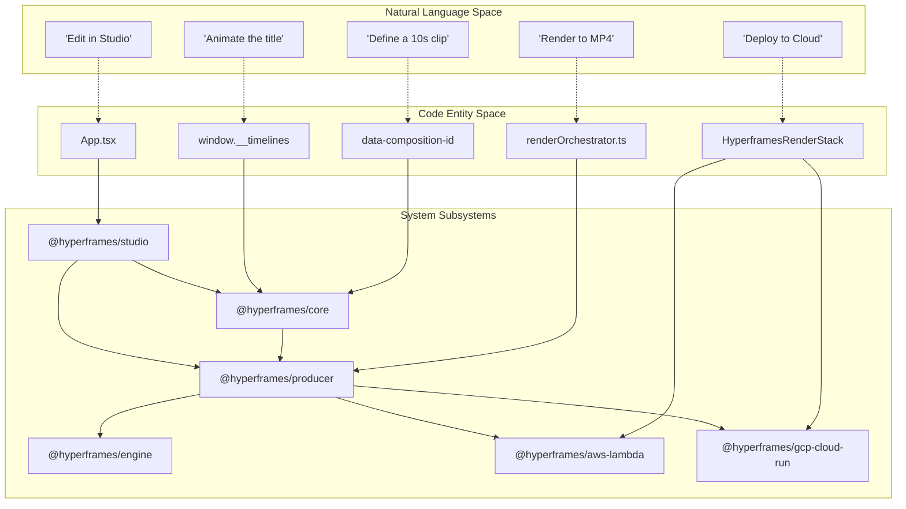
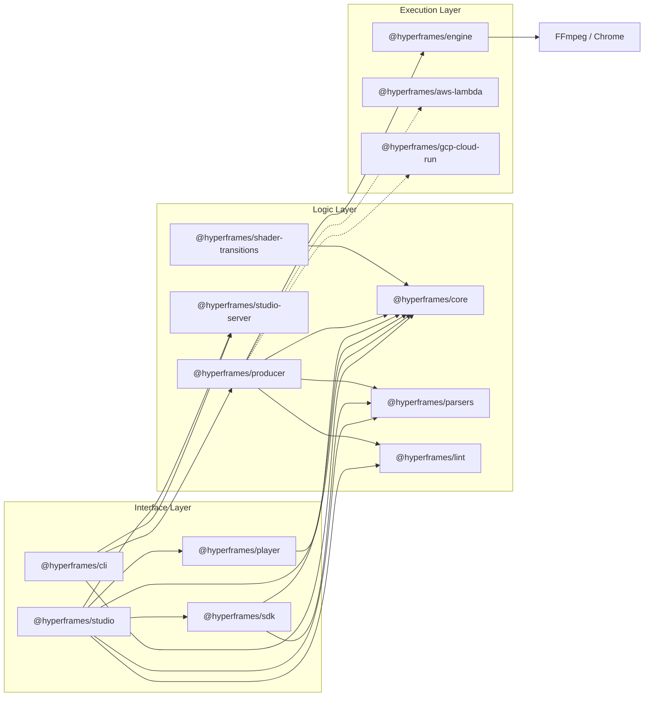

<!-- source: DeepWiki mcp.deepwiki.com · repo heygen-com/hyperframes · page 1 HyperFrames Overview · fetched 2026-11-02 -->

# HyperFrames Overview

Relevant source files

The following files were used as context for generating this wiki page:

- [.claude-plugin/plugin.json](.claude-plugin/plugin.json)
- [.codex-plugin/plugin.json](.codex-plugin/plugin.json)
- [.cursor-plugin/plugin.json](.cursor-plugin/plugin.json)
- [docs/changelog.mdx](docs/changelog.mdx)
- [docs/concepts/compositions.mdx](docs/concepts/compositions.mdx)
- [docs/concepts/data-attributes.mdx](docs/concepts/data-attributes.mdx)
- [docs/concepts/determinism.mdx](docs/concepts/determinism.mdx)
- [docs/concepts/variables.mdx](docs/concepts/variables.mdx)
- [docs/deploy/aws-lambda.mdx](docs/deploy/aws-lambda.mdx)
- [docs/deploy/migrating-to-hyperframes-lambda.mdx](docs/deploy/migrating-to-hyperframes-lambda.mdx)
- [docs/introduction.mdx](docs/introduction.mdx)
- [docs/packages/aws-lambda.mdx](docs/packages/aws-lambda.mdx)
- [docs/packages/core.mdx](docs/packages/core.mdx)
- [docs/packages/gcp-cloud-run.mdx](docs/packages/gcp-cloud-run.mdx)
- [docs/packages/shader-transitions.mdx](docs/packages/shader-transitions.mdx)
- [docs/packages/studio.mdx](docs/packages/studio.mdx)
- [docs/studio/canvas.mdx](docs/studio/canvas.mdx)
- [packages/aws-lambda/package.json](packages/aws-lambda/package.json)
- [packages/cli/package.json](packages/cli/package.json)
- [packages/cli/src/docs/compositions.md](packages/cli/src/docs/compositions.md)
- [packages/core/package.json](packages/core/package.json)
- [packages/engine/package.json](packages/engine/package.json)
- [packages/gcp-cloud-run/package.json](packages/gcp-cloud-run/package.json)
- [packages/player/package.json](packages/player/package.json)
- [packages/producer/package.json](packages/producer/package.json)
- [packages/shader-transitions/package.json](packages/shader-transitions/package.json)
- [packages/studio/package.json](packages/studio/package.json)

HyperFrames is an open-source framework for turning HTML, CSS, media, and seekable animations into deterministic MP4 videos [packages/cli/package.json:4-4](). By treating the browser as a high-fidelity rendering engine, it allows developers and AI agents to author videos using standard web technologies.

The system is built on the principle of **Deterministic Rendering**, ensuring that identical inputs consistently produce identical frames and video output. It is designed to be agent-friendly, featuring a comprehensive "skills" system that teaches AI coding agents the specific patterns required for video production [packages/cli/package.json:8-10]().

Sources: [packages/cli/package.json:4-4](), [packages/cli/package.json:8-10]()

## Monorepo Package Structure

HyperFrames is organized as a monorepo with specialized packages handling distinct layers of the video production, editing, and deployment stack.

| Package | Role | Description |
| :--- | :--- | :--- |
| [`@hyperframes/cli`](packages/cli/package.json:2-4)() | **Interface** | The `hyperframes` binary [packages/cli/package.json:29-31]() handling scaffolding, preview servers, and render orchestration. |
| [`@hyperframes/core`](packages/core/package.json:2-3)() | **Logic & Runtime** | Shared libraries for HTML compilation, registry, and the runtime IIFE [packages/core/package.json:1-203](). |
| [`@hyperframes/parsers`](packages/parsers/package.json:1-15)() | **AST & Contracts** | GSAP AST parsing and writing, clip tweens, asset resolution, and composition contracts. |
| [`@hyperframes/lint`](packages/lint/package.json:1-15)() | **Validation** | Rule sets for core rules, media checks, GSAP correctness, captions, and layout analysis. |
| [`@hyperframes/studio`](packages/studio/package.json:2-3)() | **IDE** | React-based browser surface for NLE editing, file management, and timeline scrubbing [packages/studio/package.json:1-30](). |
| [`@hyperframes/studio-server`](packages/studio-server/package.json:1-15)() | **Backend** | Hono backend supporting file management, preview sync, media proxy/transcoding, and history. |
| [`@hyperframes/producer`](packages/producer/package.json:2-4)() | **Orchestrator** | Manages render job orchestration, the HTTP server, and staged pipelines [packages/producer/package.json:2-4](). |
| [`@hyperframes/engine`](packages/engine/package.json:2-4)() | **Execution** | Puppeteer and FFmpeg layer for deterministic frame capture, video extraction, and audio mixing [packages/engine/package.json:4-4](). |
| [`@hyperframes/player`](packages/player/package.json:2-4)() | **Distribution** | Embeddable `<hyperframes-player>` web component and slideshow element [packages/player/package.json:2-4](). |
| [`@hyperframes/sdk`](packages/sdk/package.json:1-15)() | **Headless SDK** | Framework-neutral composition editing engine, session models, and RFC 6902 patch pipelines. |
| [`@hyperframes/shader-transitions`](packages/shader-transitions/package.json:2-4)() | **WebGL Effects** | WebGL scene transitions, shader registry, and GSAP integration [packages/shader-transitions/package.json:2-4](). |
| [`@hyperframes/aws-lambda`](packages/aws-lambda/package.json:2-4)() | **Cloud Adapter** | AWS Lambda handler, client-side SDK, and CDK construct for distributed rendering [packages/aws-lambda/package.json:2-4](). |
| [`@hyperframes/gcp-cloud-run`](packages/gcp-cloud-run/package.json:1-15)() | **Cloud Adapter** | Hono Cloud Run server, Terraform modules, and GCS transport adapters. |

Sources: [packages/cli/package.json:2-4](), [packages/cli/package.json:29-31](), [packages/core/package.json:2-3](), [packages/core/package.json:1-203](), [packages/parsers/package.json:1-15](), [packages/lint/package.json:1-15](), [packages/studio/package.json:2-3](), [packages/studio/package.json:1-30](), [packages/studio-server/package.json:1-15](), [packages/producer/package.json:2-4](), [packages/engine/package.json:2-4](), [packages/engine/package.json:4-4](), [packages/player/package.json:2-4](), [packages/sdk/package.json:1-15](), [packages/shader-transitions/package.json:2-4](), [packages/aws-lambda/package.json:2-4](), [packages/gcp-cloud-run/package.json:1-15]()

## System Architecture

The following diagram bridges natural language authoring concepts with the code entities and subsystems that implement them.

**Code Entity & Subsystem Mapping**

Sources: [packages/cli/package.json:4-4](), [packages/producer/package.json:2-4](), [packages/core/package.json:2-3](), [packages/studio/package.json:2-3](), [packages/aws-lambda/package.json:2-4](), [packages/gcp-cloud-run/package.json:1-15]()

## Core Subsystems

### The CLI and AI Skills
The CLI package (`@hyperframes/cli`) provides the primary developer command suite for project initialization (`hyperframes init`), preview servers (`hyperframes preview`), and final rendering (`hyperframes render`) [packages/cli/package.json:2-4](). It integrates with the AI skills system (`skills/`) to guide coding agents through valid HyperFrames authoring patterns [packages/cli/package.json:8-10]().
For details, see [Getting Started](#1.1).

Sources: [packages/cli/package.json:2-4](), [packages/cli/package.json:8-10]()

### Deterministic Runtime and Core Concepts
Core composition models rely on strict HTML contracts, data attributes (`data-composition-id`, `data-start`, `data-duration`), and specialized runtime IIFEs that intercept time-based APIs [packages/core/package.json:1-203](). Seek-driven frame rendering via `renderSeek` and Frame Adapters (GSAP, Lottie, CSS, WAAPI) guarantee complete frame determinism [packages/core/package.json:1-203]().
For details, see [Core Concepts](#1.2).

Sources: [packages/core/package.json:1-203]()

### Rendering Pipeline and Execution
Rendering is orchestrated by `@hyperframes/producer` through staged pipelines, leveraging `@hyperframes/engine` to execute Chrome via the `BeginFrame` CDP protocol alongside FFmpeg for mixing and encoding [packages/producer/package.json:2-4](), [packages/engine/package.json:4-4]().

**Subsystem Interaction Flow**

Sources: [packages/cli/package.json:2-4](), [packages/producer/package.json:2-4](), [packages/aws-lambda/package.json:2-4](), [packages/core/package.json:2-3](), [packages/studio/package.json:2-3](), [packages/sdk/package.json:1-15](), [packages/player/package.json:2-4](), [packages/parsers/package.json:1-15](), [packages/lint/package.json:1-15](), [packages/studio-server/package.json:1-15](), [packages/shader-transitions/package.json:2-4](), [packages/engine/package.json:4-4](), [packages/gcp-cloud-run/package.json:1-15]()

## Next Steps

Explore the child pages for detailed technical implementation and usage guides:

*   **[Getting Started](#1.1)**: Installation, CLI usage, previewing in Studio, and rendering a first video.
*   **[Core Concepts](#1.2)**: Compositions, Data Attributes, Frame Adapters, and Deterministic Rendering.

Sources: [packages/cli/package.json:8-10]()

---

