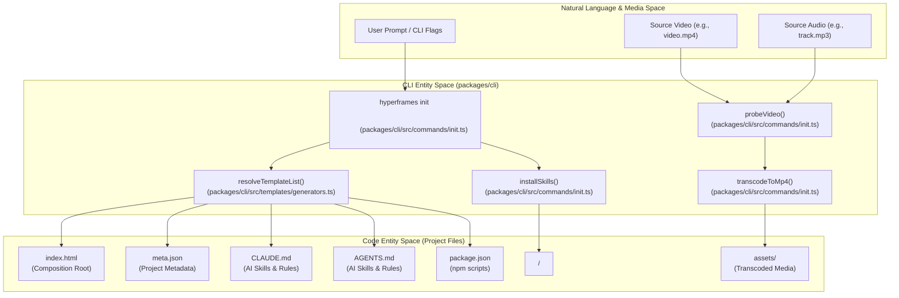
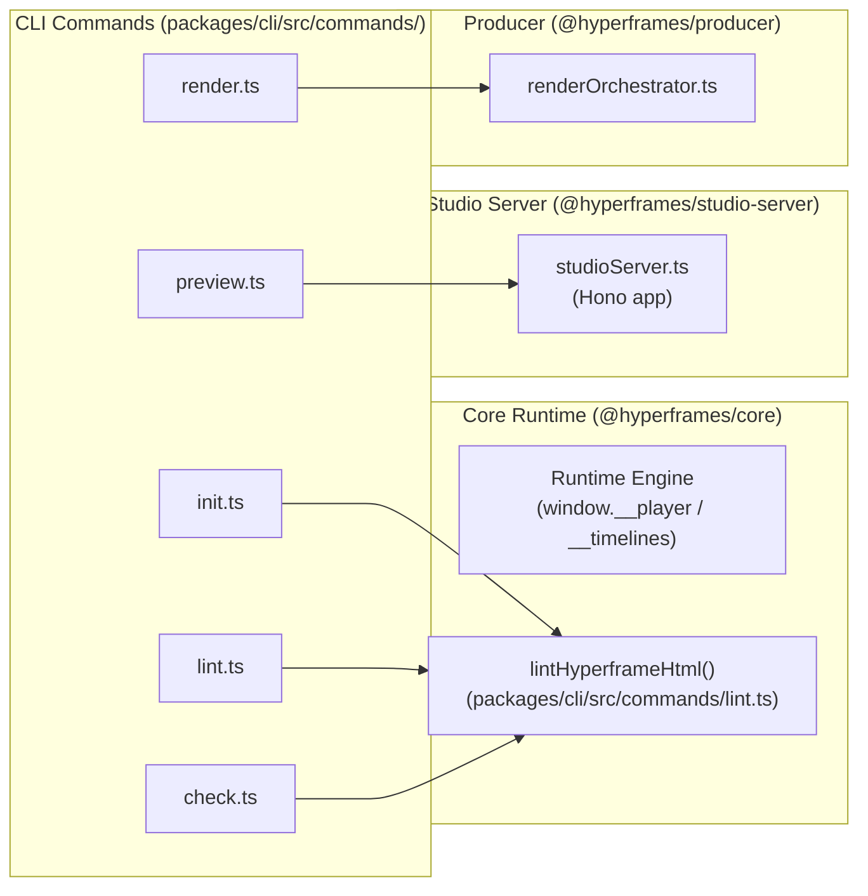

<!-- source: DeepWiki mcp.deepwiki.com · repo heygen-com/hyperframes · page 1.1 Getting Started · fetched 2026-11-02 -->

# Getting Started

<details>
<summary>Relevant source files</summary>

The following files were used as context for generating this wiki page:

- [.claude-plugin/marketplace.json](.claude-plugin/marketplace.json)
- [AGENTS.md](AGENTS.md)
- [CLAUDE.md](CLAUDE.md)
- [DESIGN.md](DESIGN.md)
- [README.md](README.md)
- [docs/catalog-gallery.css](docs/catalog-gallery.css)
- [docs/contributing/testing-local-changes.mdx](docs/contributing/testing-local-changes.mdx)
- [docs/custom.css](docs/custom.css)
- [docs/examples.mdx](docs/examples.mdx)
- [docs/guides/free-agents.mdx](docs/guides/free-agents.mdx)
- [docs/guides/gsap-animation.mdx](docs/guides/gsap-animation.mdx)
- [docs/guides/skills.mdx](docs/guides/skills.mdx)
- [docs/packages/cli.mdx](docs/packages/cli.mdx)
- [docs/quickstart.mdx](docs/quickstart.mdx)
- [docs/reference/html-schema.mdx](docs/reference/html-schema.mdx)
- [docs/snippets/advanced-path-grid.jsx](docs/snippets/advanced-path-grid.jsx)
- [docs/snippets/day-list.jsx](docs/snippets/day-list.jsx)
- [docs/snippets/docs-video.jsx](docs/snippets/docs-video.jsx)
- [docs/snippets/example-player.jsx](docs/snippets/example-player.jsx)
- [docs/snippets/film-rows.jsx](docs/snippets/film-rows.jsx)
- [docs/snippets/hover-video.jsx](docs/snippets/hover-video.jsx)
- [docs/snippets/quickstart-continuation-grid.jsx](docs/snippets/quickstart-continuation-grid.jsx)
- [docs/snippets/remix-shelf.jsx](docs/snippets/remix-shelf.jsx)
- [docs/snippets/replica-compare.jsx](docs/snippets/replica-compare.jsx)
- [docs/template-gallery.css](docs/template-gallery.css)
- [docs/thirty-days.mdx](docs/thirty-days.mdx)
- [packages/cli/src/cli.ts](packages/cli/src/cli.ts)
- [packages/cli/src/commands/coreSkillContent.test.ts](packages/cli/src/commands/coreSkillContent.test.ts)
- [packages/cli/src/commands/feedback.test.ts](packages/cli/src/commands/feedback.test.ts)
- [packages/cli/src/commands/feedback.ts](packages/cli/src/commands/feedback.ts)
- [packages/cli/src/commands/init.test.ts](packages/cli/src/commands/init.test.ts)
- [packages/cli/src/commands/init.ts](packages/cli/src/commands/init.ts)
- [packages/cli/src/help.ts](packages/cli/src/help.ts)
- [packages/cli/src/templates/_shared/AGENTS.md](packages/cli/src/templates/_shared/AGENTS.md)
- [packages/cli/src/templates/_shared/CLAUDE.md](packages/cli/src/templates/_shared/CLAUDE.md)
- [packages/cli/src/utils/submitFeedback.test.ts](packages/cli/src/utils/submitFeedback.test.ts)
- [packages/cli/src/utils/submitFeedback.ts](packages/cli/src/utils/submitFeedback.ts)
- [scripts/check-docs-snippet-motion.test.mjs](scripts/check-docs-snippet-motion.test.mjs)
- [scripts/sync-docs-catalog.mjs](scripts/sync-docs-catalog.mjs)
- [skills-manifest.json](skills-manifest.json)
- [skills/hyperframes-cli/SKILL.md](skills/hyperframes-cli/SKILL.md)
- [skills/hyperframes-cli/references/lint-validate-inspect.md](skills/hyperframes-cli/references/lint-validate-inspect.md)
- [skills/hyperframes-cli/references/preview-render.md](skills/hyperframes-cli/references/preview-render.md)
- [skills/hyperframes/SKILL.md](skills/hyperframes/SKILL.md)

</details>


HyperFrames is an open-source video rendering framework that allows you to create, preview, and render HTML-based video compositions [README.md:32](). It is designed specifically for **deterministic rendering** and **AI-agent-driven workflows**, where an AI (like Claude Code or Cursor) can author and iterate on video projects as easily as it writes code [README.md:32]().

This page covers installing the CLI, running `hyperframes init`, previewing in Studio, rendering your first video, and handling both manual and AI-agent workflows.

## Prerequisites

Before using the CLI, ensure your environment meets the following requirements:

*   **Node.js >= 22**: Required for the CLI runtime and the Vite-based preview server [README.md:13](), [docs/packages/cli.mdx:13]().
*   **FFmpeg**: Required for local video rendering, transcoding, and probing [skills/hyperframes-cli/SKILL.md:16]().
*   **npx**: Used to run the CLI and install AI skills [docs/packages/cli.mdx:14]().

Sources: [README.md:13](), [docs/packages/cli.mdx:13-14](), [skills/hyperframes-cli/SKILL.md:16]()

---

## Installation and AI Setup

HyperFrames provides **Skills** via the `vercel-labs/skills` protocol. These skills teach AI agents framework-specific patterns (like `window.__timelines` registration and `data-*` semantics) that generic web documentation lacks [CLAUDE.md:5-7]().

### 1. Install AI Skills (Recommended)
To prepare your AI agent for HyperFrames development, run:
```bash
npx hyperframes skills update
```
This installs/refreshes the core set of skills (`/hyperframes`, `/hyperframes-cli`, `/hyperframes-registry`, `/media-use`) and any other skills already installed [CLAUDE.md:10-10](). This teaches your coding agent how to write correct compositions, GSAP timelines, and use first-party adapters [README.md:59-62](), [CLAUDE.md:23-26]().

For Claude Code, you can install the plugin directly:
```bash
claude plugin marketplace add heygen-com/hyperframes
claude plugin install hyperframes@hyperframes
```
Then enable auto-update for the `hyperframes` marketplace [README.md:40-52]().

### 2. Manual CLI Usage
The CLI is defined in `@hyperframes/cli` [CLAUDE.md:78]() and can be executed via:
```bash
npx hyperframes <command>
```
No installation is required when using `npx` [docs/packages/cli.mdx:14-15](). Alternatively, you can install it globally:
```bash
npm install -g hyperframes
```

Sources: [README.md:40-52, 59-62](), [docs/packages/cli.mdx:14-19](), [CLAUDE.md:5-7, 10, 23-26, 78]()

---

## Workflow: Creating Your First Video

The HyperFrames lifecycle moves from initialization to preview, validation, and final rendering.

### Step 1: Initialize a Project
The `init` command scaffolds a new composition project. It supports an interactive wizard for manual use and non-interactive flags for AI agents [docs/packages/cli.mdx:67-71](), [packages/cli/src/commands/init.ts:12-19]().

```bash
# Default: centered Inter blank. Non-TTY skips the wizard.
npx hyperframes init my-video

# Start from a video file
npx hyperframes init my-video --video video.mp4 --non-interactive

# With the Tailwind browser runtime
npx hyperframes init my-video --tailwind
```

**What happens during `init`:**
1.  **Template Resolution**: The CLI resolves a template from bundled assets or remote templates [packages/cli/src/commands/init.ts:41-46](). The default is a centered blank composition [packages/cli/src/commands/init.ts:64]().
2.  **Media Ingestion & Probing**: If `--video` or `--audio` is provided, the CLI uses `ffprobe` to determine dimensions, framerate, and duration [packages/cli/src/commands/init.ts:116-178]().
3.  **Transcoding**: Non-web-compatible videos are checked and transcoded to H.264/AAC MP4 for browser preview compatibility [packages/cli/src/commands/init.ts:180-197]().
4.  **Skill & Agent Configuration**: It initializes project files including `CLAUDE.md` and `AGENTS.md` to guide agent workflows [packages/cli/src/templates/_shared/CLAUDE.md](), [packages/cli/src/templates/_shared/AGENTS.md]().

Sources: [docs/packages/cli.mdx:67-71, 90-102](), [packages/cli/src/commands/init.ts:12-19, 41-46, 64, 116-178, 180-197](), [packages/cli/src/templates/_shared/CLAUDE.md](), [packages/cli/src/templates/_shared/AGENTS.md]()

### Step 2: Preview in the Studio
Start the development server to see your composition in the browser with Hot Module Replacement (HMR):
```bash
cd my-video
npx hyperframes preview
```
This command launches the Studio in your browser, providing a live preview of your composition [skills/hyperframes-cli/SKILL.md:34](). For agents or non-interactive environments, you can use the `--background` flag to keep the server running without blocking the terminal [skills/hyperframes-cli/SKILL.md:34]().

Sources: [skills/hyperframes-cli/SKILL.md:34]()

### Step 3: Check and Render to MP4
Before rendering, run the comprehensive check gate to catch layout, lint, or runtime issues:
```bash
npm run check
```
This command executes `npx hyperframes check`, which performs static HTML structure checks (`lint`), runtime checks in a headless browser, layout audits, and WCAG contrast checks [skills/hyperframes-cli/SKILL.md:18, 31-32]().

Once verified, render the final high-quality video:
```bash
npx hyperframes render --quality looks --output final.mp4
```
The `render` command generates an MP4 file. `--quality looks` is recommended for final output, while `draft` can be used for faster iterations [skills/hyperframes-cli/SKILL.md:59]().

Sources: [skills/hyperframes-cli/SKILL.md:18, 31-32, 59]()

---

## System Architecture: Data Flow

The following diagram illustrates how the CLI orchestrates the transition from natural language/media inputs to a structured code project.

### CLI Initialization Data Flow

Sources: [packages/cli/src/commands/init.ts:1-197](), [packages/cli/src/templates/generators.ts](), [packages/cli/src/templates/_shared/CLAUDE.md](), [packages/cli/src/templates/_shared/AGENTS.md]()

---

## Project Structure Reference

A standard HyperFrames project contains the following files:

| File/Folder | Description |
| :--- | :--- |
| `index.html` | Root composition — your video's entry point with `data-composition-id` [docs/reference/html-schema.mdx:38-45]() |
| `meta.json` | Project metadata (id, name) [packages/cli/src/templates/_shared/CLAUDE.md]() |
| `assets/` | Media files (video, audio, images) [packages/cli/src/templates/_shared/CLAUDE.md]() |
| `compositions/` | Sub-compositions loaded via `data-composition-src` [packages/cli/src/templates/_shared/CLAUDE.md]() |
| `CLAUDE.md` | Skill-specific patterns and agent instructions [packages/cli/src/templates/_shared/CLAUDE.md:1-5]() |
| `AGENTS.md` | Agent-specific instructions, often mirroring `CLAUDE.md` [packages/cli/src/templates/_shared/AGENTS.md]() |
| `package.json` | Contains `npm` scripts for `dev`, `check`, `render`, and `publish` [packages/cli/src/commands/init.test.ts:56-64]() |

### Composition Anatomy
Every composition must follow core rules to be valid:
1.  **Root Element**: Must have `data-composition-id`, `data-start="0"`, `data-width`, and `data-height` [docs/reference/html-schema.mdx:38-45]().
2.  **Timed Clips**: Elements must have `data-start`, `data-duration`, and preferably `class="clip"` [docs/reference/html-schema.mdx:46-55, 93-101]().
3.  **Animation Registration**: GSAP timelines must be created with `{ paused: true }` and registered on `window.__timelines` [docs/reference/html-schema.mdx:57-67]().

### Runtime Orchestration
The diagram below maps CLI commands to their underlying execution packages during initialization, preview, and rendering.

### CLI to Core Package Mapping

Sources: [packages/cli/src/cli.ts:130-150](), [skills/hyperframes-cli/SKILL.md:14-29](), [docs/reference/html-schema.mdx:38-67, 93-101](), [packages/cli/src/commands/init.test.ts:56-64]()

---

## AI-Agent Workflow

When using an AI agent (Claude Code, Cursor, etc.), the workflow is optimized for speed and correctness:

1.  **Describe**: Tell the agent what video to build using the `/hyperframes` skill. For example: "Using `/hyperframes`, create a 10-second product intro with a fade-in title, a background video, and subtle background music." [README.md:70-72](), [docs/quickstart.mdx:84-85]().
2.  **Skill Context**: The agent loads the `/hyperframes` skill, which carries the render contract and work loop, ensuring it uses correct `data-attributes` and `window.__timelines` syntax [CLAUDE.md:23-26](), [skills/hyperframes/SKILL.md:16-25]().
3.  **Scaffold**: The agent runs `npx hyperframes init` to create the project structure and may use `npx hyperframes add` to install components from the registry [skills/hyperframes-cli/SKILL.md:16-17, 21]().
4.  **Validate**: The agent runs `npx hyperframes check --json` to execute linting, layout audits, and motion checks. It fixes any reported errors before proceeding [skills/hyperframes-cli/SKILL.md:31-32]().
5.  **Preview**: The agent starts a preview server using `npx hyperframes preview --background` and provides the URL for review [skills/hyperframes-cli/SKILL.md:34]().
6.  **Render**: Once the preview is approved, the agent renders the final video using `npx hyperframes render` [skills/hyperframes-cli/SKILL.md:35]().

Sources: [README.md:70-72](), [docs/quickstart.mdx:84-85](), [CLAUDE.md:23-26](), [skills/hyperframes/SKILL.md:16-25](), [skills/hyperframes-cli/SKILL.md:16-17, 21, 31-32, 34-35]()

---

