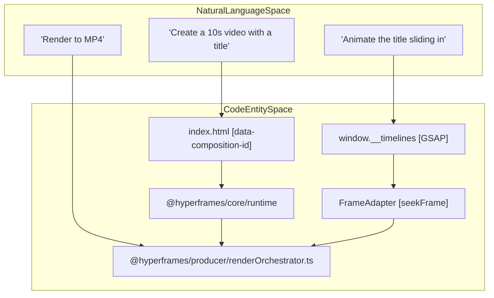
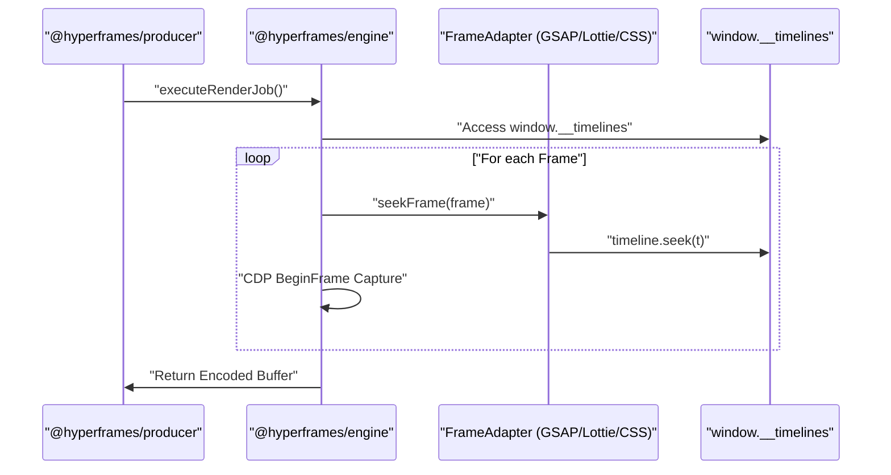

<!-- source: DeepWiki mcp.deepwiki.com · repo heygen-com/hyperframes · page 1.2 Core Concepts · fetched 2026-11-02 -->

# Core Concepts

Relevant source files

The following files were used as context for generating this wiki page:

- [docs/concepts/compositions.mdx](docs/concepts/compositions.mdx)
- [docs/concepts/data-attributes.mdx](docs/concepts/data-attributes.mdx)
- [docs/concepts/determinism.mdx](docs/concepts/determinism.mdx)
- [docs/concepts/variables.mdx](docs/concepts/variables.mdx)
- [docs/deploy/aws-lambda.mdx](docs/deploy/aws-lambda.mdx)
- [docs/deploy/migrating-to-hyperframes-lambda.mdx](docs/deploy/migrating-to-hyperframes-lambda.mdx)
- [docs/introduction.mdx](docs/introduction.mdx)
- [docs/packages/aws-lambda.mdx](docs/packages/aws-lambda.mdx)
- [docs/packages/core.mdx](docs/packages/core.mdx)
- [docs/packages/gcp-cloud-run.mdx](docs/packages/gcp-cloud-run.mdx)
- [docs/packages/shader-transitions.mdx](docs/packages/shader-transitions.mdx)
- [docs/packages/studio.mdx](docs/packages/studio.mdx)
- [docs/studio/canvas.mdx](docs/studio/canvas.mdx)
- [packages/cli/src/docs/compositions.md](packages/cli/src/docs/compositions.md)

HyperFrames is built on a foundation of deterministic, frame-based rendering using standard web technologies. Unlike traditional video editors that use a variable "wall-clock" for playback, HyperFrames treats HTML and CSS as a seekable state machine.

This page provides a high-level overview of the foundational concepts of the HyperFrames architecture: Compositions, Data Attributes, Deterministic Rendering, and Frame Adapters. For a tour of supporting non-package directories, see [Repository Layout and Supporting Directories](#1.2.3).

## The Architecture at a Glance

The following diagram illustrates how high-level project definitions in "Natural Language Space" map to specific "Code Entities" within the HyperFrames ecosystem.

### From Intent to Execution

Sources: [docs/concepts/compositions.mdx:6-17](), [docs/packages/core.mdx:26-27](), [docs/packages/aws-lambda.mdx:28-31]()

---

## 1. Compositions and Data Attributes

A **Composition** is the fundamental unit of a HyperFrames project. It is a standard HTML document that describes a video timeline. Every element that appears on the timeline—whether it is a video, an image, or a nested animation—is governed by **Data Attributes**.

### Key Concepts:
*   **Root Element**: Every composition must have a root element with a `data-composition-id` [docs/concepts/compositions.mdx:18-25]().
*   **Declarative Timing**: Timing is handled via attributes like `data-start`, `data-duration`, and `data-track-index` [docs/concepts/data-attributes.mdx:17-20]().
*   **Clips**: A clip is any element with timing attributes. Elements with `class="clip"` have their visibility managed automatically by the runtime [docs/concepts/data-attributes.mdx:21-25]().
*   **Variables**: Designs can be reused with different content by declaring `data-composition-variables` on the `<html>` tag and passing `data-variable-values` on sub-composition host elements [docs/concepts/variables.mdx:54-61](), [docs/concepts/variables.mdx:145-162](). These variables are accessible via `window.__hyperframes.getVariables()` [docs/concepts/variables.mdx:132-138]().

For a detailed reference on the HTML model, clip types, and timing attributes, see **[Compositions and Data Attributes](#1.2.1)**.

Sources: [docs/concepts/compositions.mdx:6-57](), [docs/concepts/variables.mdx:54-162](), [docs/concepts/data-attributes.mdx:17-25]()

---

## 2. Deterministic Rendering

HyperFrames guarantees that the same composition always produces identical video output. This is achieved by treating time as a discrete frame number rather than a continuous clock.

### Determinism Rules:
*   **No Wall-Clocks**: Usage of `Date.now()`, `requestAnimationFrame`, or system timers is forbidden during render execution [docs/concepts/determinism.mdx:27-28]().
*   **Integer Math**: The engine calculates time using `time = floor(frame) / fps` [docs/concepts/determinism.mdx:39-40]().
*   **Seek-Driven**: The renderer asks for one frame at a time, and the answer depends solely on that frame index [docs/concepts/determinism.mdx:12-14]().
*   **Pre-extraction**: Every asset loads before the first frame to prevent mid-render fetching [docs/concepts/determinism.mdx:31]().

For deep dives into seek-driven frame-by-frame rendering, forbidden wall-clock APIs, and `window.__timelines`, see **[Deterministic Rendering and Frame Adapters](#1.2.2)**.

Sources: [docs/concepts/compositions.mdx:42-45](), [docs/concepts/determinism.mdx:12-40]()

---

## 3. Frame Adapters

While Data Attributes handle the "when" of clips, **Frame Adapters** handle the "how" of the motion. An adapter bridges external animation libraries (such as GSAP, Lottie, CSS, or WAAPI) to the HyperFrames rendering loop.

### How Adapters Map to Code
The following sequence diagram shows how the `FrameAdapter` pattern interacts with the global runtime state and the producer rendering pipeline.

### Render Loop Sequence

Sources: [docs/packages/core.mdx:167-188](), [docs/concepts/determinism.mdx:42-54]()

### Supported Runtimes:
*   **GSAP**: Timelines must be created with `{ paused: true }` and registered on `window.__timelines` [docs/concepts/compositions.mdx:99-101](). The `@hyperframes/core` package includes `createGSAPFrameAdapter` [docs/packages/core.mdx:172-172]().
*   **CSS/WAAPI**: Adapters map progress to element styles or animation offsets.
*   **Lottie**: Vector animations are seeked frame-by-frame by the runtime adapter.

For further details on the Frame Adapter pattern and the `BeginFrame` CDP integration, see **[Deterministic Rendering and Frame Adapters](#1.2.2)**.

Sources: [docs/packages/core.mdx:167-188](), [docs/concepts/compositions.mdx:99-101]()

---

## Summary of Core Terminology

| Term | Definition | Code Reference |
| :--- | :--- | :--- |
| **Composition** | An HTML document representing a video timeline. | `data-composition-id` [docs/cli/src/docs/compositions.md:10-10]() |
| **Clip** | An individual element (video, audio, img) on the timeline. | `class="clip"` [docs/concepts/data-attributes.mdx:21-21]() |
| **Track** | A horizontal layer in the Studio editor; does not affect paint order. | `data-track-index` [docs/concepts/data-attributes.mdx:20-20]() |
| **Media Start** | The offset into a source file for trimming (media clips only). | `data-playback-start` [docs/concepts/compositions.mdx:113-113]() |
| **Playback Start** | The offset into a child timeline for nested compositions. | `data-playback-start` [docs/concepts/compositions.mdx:113-113]() |
| **Variables** | Key-value pairs that allow dynamic content injection. | `data-variable-values` [docs/cli/src/docs/compositions.md:32-32]() |

Sources: [docs/concepts/compositions.mdx:18-57](), [docs/concepts/variables.mdx:112-162](), [docs/concepts/data-attributes.mdx:17-25](), [docs/cli/src/docs/compositions.md:10-32]()

---

