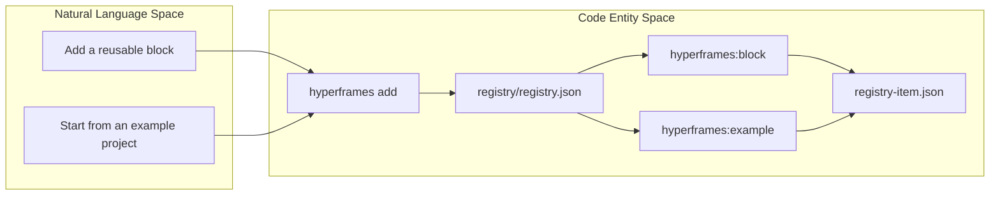
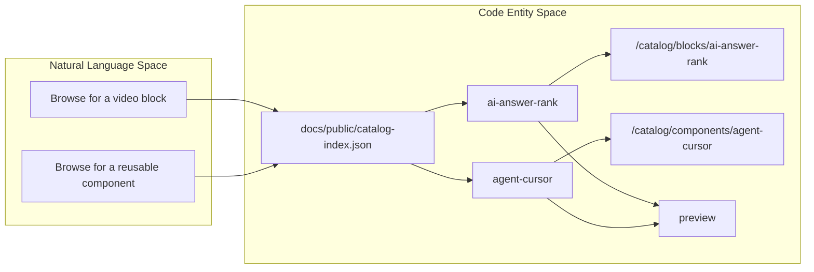

<!-- source: DeepWiki mcp.deepwiki.com · repo heygen-com/hyperframes · page 10 Registry and Catalog · fetched 2026-11-02 -->

# Registry and Catalog

Relevant source files

The following files were used as context for generating this wiki page:

- [docs/catalog/components/filmed-screen.mdx](docs/catalog/components/filmed-screen.mdx)
- [docs/catalog/components/motion-blur.mdx](docs/catalog/components/motion-blur.mdx)
- [docs/catalog/components/shutter-slam.mdx](docs/catalog/components/shutter-slam.mdx)
- [docs/docs.json](docs/docs.json)
- [docs/public/catalog-index.json](docs/public/catalog-index.json)
- [docs/public/catalog/components/filmed-screen.json](docs/public/catalog/components/filmed-screen.json)
- [docs/public/catalog/components/motion-blur.json](docs/public/catalog/components/motion-blur.json)
- [docs/public/catalog/components/shutter-slam.json](docs/public/catalog/components/shutter-slam.json)
- [docs/snippets/catalog-gallery-data.mdx](docs/snippets/catalog-gallery-data.mdx)
- [packages/cli/src/registry/motionBlurShutter.browser.test.ts](packages/cli/src/registry/motionBlurShutter.browser.test.ts)
- [registry/blocks/gooey-split/gooey-split.html](registry/blocks/gooey-split/gooey-split.html)
- [registry/blocks/gooey-split/registry-item.json](registry/blocks/gooey-split/registry-item.json)
- [registry/catalog-artifact/local-vectors.bin](registry/catalog-artifact/local-vectors.bin)
- [registry/catalog-artifact/local-vectors.json](registry/catalog-artifact/local-vectors.json)
- [registry/components/motion-blur/demo.html](registry/components/motion-blur/demo.html)
- [registry/components/motion-blur/motion-blur.html](registry/components/motion-blur/motion-blur.html)
- [registry/components/motion-blur/registry-item.json](registry/components/motion-blur/registry-item.json)
- [registry/components/shutter-slam/demo.html](registry/components/shutter-slam/demo.html)
- [registry/components/shutter-slam/shutter-slam.html](registry/components/shutter-slam/shutter-slam.html)
- [registry/registry.json](registry/registry.json)
- [scripts/catalog-drift.test.ts](scripts/catalog-drift.test.ts)
- [scripts/catalog-drift.ts](scripts/catalog-drift.ts)
- [scripts/catalog-publication.test.mjs](scripts/catalog-publication.test.mjs)
- [scripts/catalog-vectors.mjs](scripts/catalog-vectors.mjs)
- [scripts/publish-catalog.mjs](scripts/publish-catalog.mjs)

## Purpose and scope

`registry/` is the source collection for reusable HyperFrames items and example projects. Its top-level `registry/registry.json` identifies entries by name and item type; generated catalog data and documentation provide a browsable view of registry content. This page connects those parts at a high level. For item structure, see [Blocks and Components](#10.1); for bundled projects, see [Example Projects](#10.2); for catalog generation, see [Catalog Generation Pipeline](#10.3). [registry/registry.json:1-37]()

Sources: `registry/registry.json`

## Registry and catalog at a glance

The registry manifest groups entries by types such as `hyperframes:block` and `hyperframes:example`. The catalog index presents items in a documentation-oriented shape, including a `name`, `type`, descriptive metadata, tags, a page `href`, and sometimes a preview URL. These are related views: the registry identifies available items, while catalog data supports discovery and presentation. [registry/registry.json:5-37](), [docs/public/catalog-index.json:1-34]()

| Concern | Representative entity | Role |
|---|---|---|
| Registry listing | `registry/registry.json` | Names and types registry items |
| Item manifest | `registry-item.json` | Item-level metadata and installation contract; details are covered in [Blocks and Components](#10.1) |
| CLI installation | `hyperframes add` | User-facing route for adding registry items |
| Published catalog index | `docs/public/catalog-index.json` | Search/browse-oriented item metadata and preview references |

Sources: `registry/registry.json`, `docs/public/catalog-index.json`

### Registry concepts mapped to code entities

This diagram connects user goals to named registry entities. The project-installation command is shown as a concept-level entry point; the manifest listing itself is visible in `registry/registry.json`.

Sources: `registry/registry.json`

### Catalog concepts mapped to published entities

The catalog index associates item names with their catalog type, documentation destination, and preview metadata. For example, `ai-answer-rank` is indexed as a block, while `agent-cursor` is indexed as a component. [docs/public/catalog-index.json:1-34]()

Sources: `docs/public/catalog-index.json`

## Registry items and installation

Registry entries include examples and blocks; the broader registry also includes components. `registry/registry.json` is the central name/type listing, while each item’s `registry-item.json` is the manifest associated with that item. `hyperframes add` is the CLI installation path for registry items. The manifest fields, file targets, and installation contract are covered in [Blocks and Components](#10.1). [registry/registry.json:1-37]()

Sources: `registry/registry.json`

## Example projects

The registry lists bundled examples including `decision-tree`, `kinetic-type`, `nyt-graph`, `play-mode`, `product-promo`, `swiss-grid`, `vignelli`, and `warm-grain`. These are project-scale resources, distinct from individual blocks or components. See [Example Projects](#10.2) for the examples and their layouts. [registry/registry.json:5-37]()

Sources: `registry/registry.json`

## Catalog generation and published data

The documentation site exposes a Catalog navigation tab, and `docs/public/catalog-index.json` contains catalog entries with names, types, descriptions, tags, page paths, and preview references where available. A companion local-vector metadata file identifies the embedding model, dimensions, and indexed item names. The generation and preview pipeline—including how these published artifacts are produced—is detailed in [Catalog Generation Pipeline](#10.3). [docs/docs.json:176-224](), [docs/public/catalog-index.json:1-34](), [registry/catalog-artifact/local-vectors.json:1-19]()

Sources: `docs/docs.json`, `docs/public/catalog-index.json`, `registry/catalog-artifact/local-vectors.json`

## Related pages

- [Blocks and Components](#10.1) — Item manifests, file targets, dimensions, duration, and variable contracts.
- [Example Projects](#10.2) — Bundled registry projects and deployment-oriented examples.
- [Catalog Generation Pipeline](#10.3) — Catalog documentation, index and embedding artifacts, and preview generation.

Sources: `registry/registry.json`, `docs/public/catalog-index.json`

---

