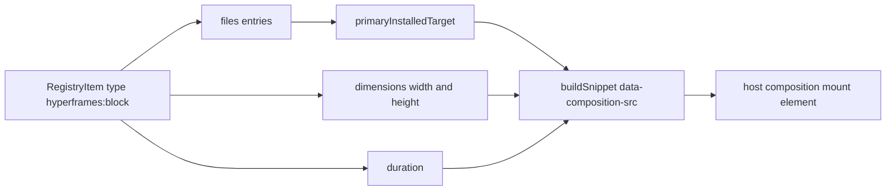
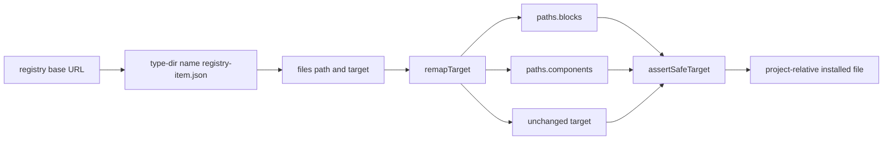
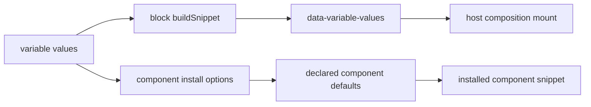
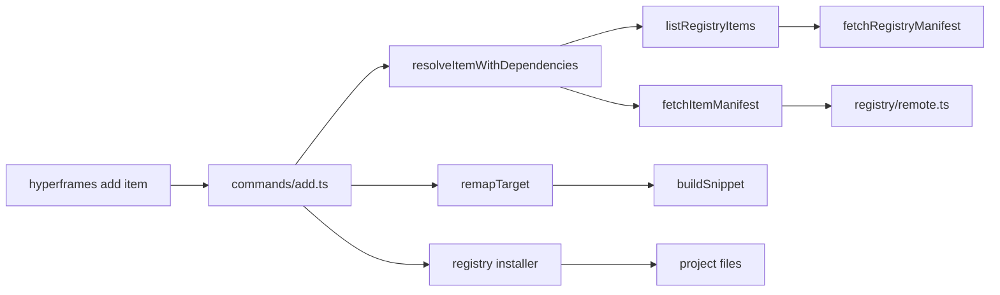
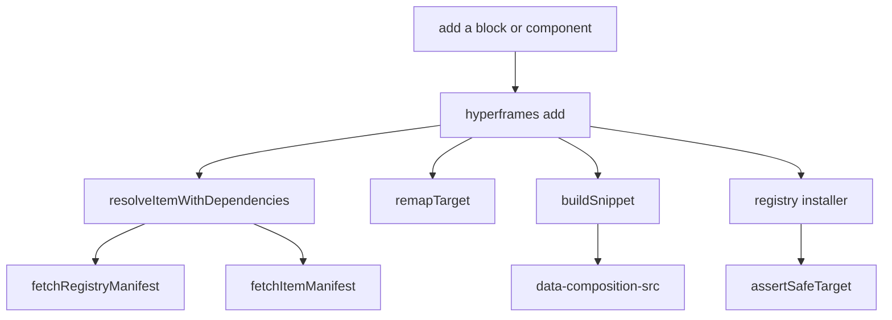
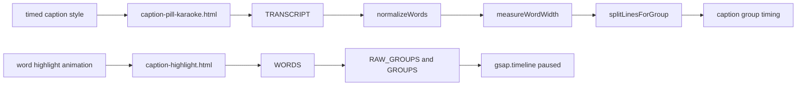

<!-- source: DeepWiki mcp.deepwiki.com · repo heygen-com/hyperframes · page 10.1 Blocks and Components · fetched 2026-11-02 -->

# Blocks and Components

Relevant source files

The following files were used as context for generating this wiki page:

- [packages/cli/src/commands/add.test.ts](packages/cli/src/commands/add.test.ts)
- [packages/cli/src/commands/add.ts](packages/cli/src/commands/add.ts)
- [packages/cli/src/registry/boundedFile.test.ts](packages/cli/src/registry/boundedFile.test.ts)
- [packages/cli/src/registry/boundedFile.ts](packages/cli/src/registry/boundedFile.ts)
- [packages/cli/src/registry/compatibility.test.ts](packages/cli/src/registry/compatibility.test.ts)
- [packages/cli/src/registry/compatibility.ts](packages/cli/src/registry/compatibility.ts)
- [packages/cli/src/registry/index.ts](packages/cli/src/registry/index.ts)
- [packages/cli/src/registry/installer.test.ts](packages/cli/src/registry/installer.test.ts)
- [packages/cli/src/registry/installer.ts](packages/cli/src/registry/installer.ts)
- [packages/cli/src/registry/publication.test.ts](packages/cli/src/registry/publication.test.ts)
- [packages/cli/src/registry/publication.ts](packages/cli/src/registry/publication.ts)
- [packages/cli/src/registry/remote.test.ts](packages/cli/src/registry/remote.test.ts)
- [packages/cli/src/registry/remote.ts](packages/cli/src/registry/remote.ts)
- [packages/cli/src/registry/resolver.test.ts](packages/cli/src/registry/resolver.test.ts)
- [packages/cli/src/registry/resolver.ts](packages/cli/src/registry/resolver.ts)
- [packages/cli/src/registry/transport.test.ts](packages/cli/src/registry/transport.test.ts)
- [packages/cli/src/registry/transport.ts](packages/cli/src/registry/transport.ts)
- [packages/cli/src/registry/variableDefaults.test.ts](packages/cli/src/registry/variableDefaults.test.ts)
- [packages/cli/src/registry/variableDefaults.ts](packages/cli/src/registry/variableDefaults.ts)
- [packages/cli/src/telemetry/lintRun.e2e.test.ts](packages/cli/src/telemetry/lintRun.e2e.test.ts)
- [packages/cli/src/templates/generators.ts](packages/cli/src/templates/generators.ts)
- [packages/cli/src/templates/remote.ts](packages/cli/src/templates/remote.ts)
- [packages/cli/src/utils/motionSpec.test.ts](packages/cli/src/utils/motionSpec.test.ts)
- [registry/components/caption-clip-wipe/caption-clip-wipe.html](registry/components/caption-clip-wipe/caption-clip-wipe.html)
- [registry/components/caption-editorial-emphasis/caption-editorial-emphasis.html](registry/components/caption-editorial-emphasis/caption-editorial-emphasis.html)
- [registry/components/caption-emoji-pop/caption-emoji-pop.html](registry/components/caption-emoji-pop/caption-emoji-pop.html)
- [registry/components/caption-glitch-rgb/caption-glitch-rgb.html](registry/components/caption-glitch-rgb/caption-glitch-rgb.html)
- [registry/components/caption-gradient-fill/caption-gradient-fill.html](registry/components/caption-gradient-fill/caption-gradient-fill.html)
- [registry/components/caption-highlight/caption-highlight.html](registry/components/caption-highlight/caption-highlight.html)
- [registry/components/caption-kinetic-slam/caption-kinetic-slam.html](registry/components/caption-kinetic-slam/caption-kinetic-slam.html)
- [registry/components/caption-matrix-decode/caption-matrix-decode.html](registry/components/caption-matrix-decode/caption-matrix-decode.html)
- [registry/components/caption-neon-accent/caption-neon-accent.html](registry/components/caption-neon-accent/caption-neon-accent.html)
- [registry/components/caption-neon-glow/caption-neon-glow.html](registry/components/caption-neon-glow/caption-neon-glow.html)
- [registry/components/caption-parallax-layers/caption-parallax-layers.html](registry/components/caption-parallax-layers/caption-parallax-layers.html)
- [registry/components/caption-particle-burst/caption-particle-burst.html](registry/components/caption-particle-burst/caption-particle-burst.html)
- [registry/components/caption-pill-karaoke/caption-pill-karaoke.html](registry/components/caption-pill-karaoke/caption-pill-karaoke.html)
- [registry/components/caption-weight-shift/caption-weight-shift.html](registry/components/caption-weight-shift/caption-weight-shift.html)

## Purpose and scope

This page explains how registry blocks and components are described, installed, and mounted in a project. It focuses on the manifest fields and file targets visible in the provided code, the CLI’s target-path and snippet behavior, and the dimensions, duration, and variable conventions illustrated by the supplied caption components. The repository scope identifies this catalog as including 600+ blocks and 800+ component files; the provided excerpts do not include an inventory from which to verify those counts. [packages/cli/src/commands/add.ts:5-11]() [packages/cli/src/commands/add.test.ts:30-85]()

Sources: [packages/cli/src/commands/add.ts:5-11]() [packages/cli/src/commands/add.test.ts:30-85]()

## Registry item definitions and manifest structure

A registry item distinguishes blocks from components with `type`: `hyperframes:block` or `hyperframes:component`. In the supplied fixtures, an item can include a name, title, description, dimensions, duration, and a `files` list. Each file entry has a source `path`, project-relative `target`, and file `type`; examples include `hyperframes:composition`, `hyperframes:snippet`, `hyperframes:style`, and `hyperframes:asset`. The remote registry layout places each item manifest at `<type-dir>/<name>/registry-item.json` and its files under the same item directory. [packages/cli/src/commands/add.test.ts:45-85]() [packages/cli/src/commands/add.test.ts:145-154]() [packages/cli/src/registry/remote.ts:7-18]()

| Manifest field | Role shown in the provided code |
|---|---|
| `name` | Item identifier used to look up the item manifest. [packages/cli/src/registry/remote.ts:150-160]() |
| `type` | Selects the item kind and corresponding registry directory. [packages/cli/src/registry/remote.ts:17-18]() [packages/cli/src/registry/remote.ts:156-160]() |
| `dimensions` | Optional width and height; the block mount snippet uses these values when present. [packages/cli/src/commands/add.ts:126-142]() |
| `duration` | Block duration emitted as the mount’s `data-duration` value. [packages/cli/src/commands/add.ts:126-142]() |
| `files` | Source-to-target file mappings, with a file role such as composition, snippet, style, or asset. [packages/cli/src/commands/add.test.ts:53-85]() |
| `registryDependencies` | Optional dependencies; the supplied dependent-block fixture declares one. [packages/cli/src/commands/add.test.ts:130-143]() |

The CLI’s remote loader uses `ITEM_TYPE_DIRS` to map item types to registry directories, validates fetched manifests, and fetches file paths referenced by an item. The excerpts establish this loading layout, but do not show the complete item JSON schema. [packages/cli/src/registry/remote.ts:7-18]() [packages/cli/src/registry/remote.ts:150-160]()

Sources: [packages/cli/src/commands/add.test.ts:45-85]() [packages/cli/src/commands/add.test.ts:130-154]() [packages/cli/src/registry/remote.ts:7-18]() [packages/cli/src/registry/remote.ts:150-160]()

## Blocks

A block is represented in the supplied fixtures as a registry item of type `hyperframes:block`, with a composition file as its primary content. A block item may declare dimensions and duration. The CLI uses those values to construct a mount element with `data-duration` and, when dimensions exist, `data-width` and `data-height`; it can also include a composition ID and serialized variable values. [packages/cli/src/commands/add.test.ts:45-60]() [packages/cli/src/commands/add.ts:126-143]()

The mount snippet omits `data-start`, leaving timeline placement to the project author. Its `data-composition-src` references the selected installed target. The CLI chooses a snippet file first, otherwise a composition file, otherwise the first file in the manifest; the selected target is used to keep the generated reference aligned with the recorded install target. [packages/cli/src/commands/add.ts:96-111]() [packages/cli/src/commands/add.ts:126-143]()

### Block mount data flow

**Diagram: From block manifest to host-composition mount**

Sources: [packages/cli/src/commands/add.ts:96-111]() [packages/cli/src/commands/add.ts:126-143]()

The supplied caption HTML files demonstrate composition-root conventions, not block-manifest examples. Their root elements carry `data-composition-id`, `data-start`, `data-duration`, `data-fps`, `data-width`, and `data-height`; these are concrete examples of composition metadata, not evidence that every block has identical values or structure. [registry/components/caption-weight-shift/caption-weight-shift.html:103-117]() [registry/components/caption-editorial-emphasis/caption-editorial-emphasis.html:115-129]()

Sources: [packages/cli/src/commands/add.test.ts:45-60]() [packages/cli/src/commands/add.ts:96-111]() [packages/cli/src/commands/add.ts:126-143]() [registry/components/caption-weight-shift/caption-weight-shift.html:103-117]() [registry/components/caption-editorial-emphasis/caption-editorial-emphasis.html:115-129]()

## Components

A component is represented as a registry item of type `hyperframes:component`. The supplied fixture has an HTML `hyperframes:snippet`, a CSS `hyperframes:style`, and a PNG `hyperframes:asset`, with separate project targets for each file. The CLI’s generated post-install instruction for a component is a comment directing the user to paste from the installed snippet file into a composition. [packages/cli/src/commands/add.test.ts:62-85]() [packages/cli/src/commands/add.ts:126-147]()

Components need not have the same file set: the fixture for `base-component` contains only a CSS style file. The available examples therefore support treating `files` as an explicit per-item list, rather than assuming every component ships an HTML snippet or that all supporting assets share a single target directory. [packages/cli/src/commands/add.test.ts:115-128]() [packages/cli/src/commands/add.test.ts:62-85]()

### Caption components

The supplied caption components illustrate several implementation patterns:

| Component | Observable example |
|---|---|
| `caption-weight-shift` | Defines an eight-second, 1920×1080 composition and word-level transcript data; its visible excerpt includes word normalization and text-measurement helpers. [registry/components/caption-weight-shift/caption-weight-shift.html:103-117]() [registry/components/caption-weight-shift/caption-weight-shift.html:119-203]() |
| `caption-editorial-emphasis` | Defines an eight-second, 1920×1080 composition and transcript words, then assigns word indices to normal and emphasized display blocks. [registry/components/caption-editorial-emphasis/caption-editorial-emphasis.html:115-129]() [registry/components/caption-editorial-emphasis/caption-editorial-emphasis.html:150-203]() |
| `caption-emoji-pop` | Defines an eight-second, 1920×1080 composition, word-grouping parameters, keyword sets, and a word-to-emoji mapping. [registry/components/caption-emoji-pop/caption-emoji-pop.html:111-125]() [registry/components/caption-emoji-pop/caption-emoji-pop.html:127-207]() |
| `caption-pill-karaoke` | Defines an eight-second, 1920×1080 composition, a word transcript, and parameters for group sizing and active/inactive colors. [registry/components/caption-pill-karaoke/caption-pill-karaoke.html:117-131]() [registry/components/caption-pill-karaoke/caption-pill-karaoke.html:133-182]() |
| `caption-highlight` | Defines an eight-second, 1920×1080 composition; creates a paused GSAP timeline and derives caption groups from word ranges. [registry/components/caption-highlight/caption-highlight.html:103-116]() [registry/components/caption-highlight/caption-highlight.html:166-193]() |
| `caption-gradient-fill` | Defines an eight-second, 1920×1080 composition and word groups, then builds caption elements and adds them to a paused GSAP timeline. [registry/components/caption-gradient-fill/caption-gradient-fill.html:72-84]() [registry/components/caption-gradient-fill/caption-gradient-fill.html:103-120]() [registry/components/caption-gradient-fill/caption-gradient-fill.html:153-185]() |
| `caption-matrix-decode` | Defines an eight-second, 1920×1080 composition and includes a seeded `mulberry32` pseudo-random generator used by `scrambleChars`. [registry/components/caption-matrix-decode/caption-matrix-decode.html:88-101]() [registry/components/caption-matrix-decode/caption-matrix-decode.html:120-139]() |

Across these examples, transcript records contain text and start/end times. Several components also define helpers to normalize words, group them, or measure text against a width limit. These are patterns shown by the named files, not a universal component API. [registry/components/caption-weight-shift/caption-weight-shift.html:133-203]() [registry/components/caption-emoji-pop/caption-emoji-pop.html:198-238]() [registry/components/caption-pill-karaoke/caption-pill-karaoke.html:153-197]()

Sources: [packages/cli/src/commands/add.test.ts:62-85]() [packages/cli/src/commands/add.test.ts:115-128]() [packages/cli/src/commands/add.ts:126-147]() [registry/components/caption-weight-shift/caption-weight-shift.html:103-117]() [registry/components/caption-weight-shift/caption-weight-shift.html:119-203]() [registry/components/caption-editorial-emphasis/caption-editorial-emphasis.html:115-129]() [registry/components/caption-editorial-emphasis/caption-editorial-emphasis.html:150-203]() [registry/components/caption-emoji-pop/caption-emoji-pop.html:111-125]() [registry/components/caption-emoji-pop/caption-emoji-pop.html:127-207]() [registry/components/caption-emoji-pop/caption-emoji-pop.html:198-238]() [registry/components/caption-pill-karaoke/caption-pill-karaoke.html:117-131]() [registry/components/caption-pill-karaoke/caption-pill-karaoke.html:133-182]() [registry/components/caption-pill-karaoke/caption-pill-karaoke.html:153-197]() [registry/components/caption-highlight/caption-highlight.html:103-116]() [registry/components/caption-highlight/caption-highlight.html:166-193]() [registry/components/caption-gradient-fill/caption-gradient-fill.html:72-84]() [registry/components/caption-gradient-fill/caption-gradient-fill.html:103-120]() [registry/components/caption-gradient-fill/caption-gradient-fill.html:153-185]() [registry/components/caption-matrix-decode/caption-matrix-decode.html:88-101]() [registry/components/caption-matrix-decode/caption-matrix-decode.html:120-139]()

## File targets and installation layout

Manifest `target` values are project-relative paths. By default, the CLI remaps block targets beginning with `compositions/` under the configured blocks path, and component targets beginning with `compositions/components/` under the configured components path. Targets that do not match those prefixes pass through unchanged; examples are not remapped by this function. [packages/cli/src/commands/add.ts:48-73]()

| File role | Example target | Install-path behavior shown |
|---|---|---|
| `hyperframes:composition` | `compositions/my-block.html` | Block target can be remapped using the project’s blocks path. [packages/cli/src/commands/add.test.ts:53-59]() [packages/cli/src/commands/add.ts:54-65]() |
| `hyperframes:snippet` | `compositions/components/my-component/my-component.html` | Component target can be remapped using the project’s components path; it is preferred as the primary installed target. [packages/cli/src/commands/add.test.ts:68-72]() [packages/cli/src/commands/add.ts:66-70]() [packages/cli/src/commands/add.ts:105-111]() |
| `hyperframes:style` | `compositions/components/my-component/my-component.css` | Listed as a component file with an explicit target. [packages/cli/src/commands/add.test.ts:74-78]() |
| `hyperframes:asset` | `assets/my-component/mask.png` | Listed as a component file with an explicit target; it does not match the component-prefix remapping rule. [packages/cli/src/commands/add.test.ts:80-84]() [packages/cli/src/commands/add.ts:66-72]() |

The installer rejects absolute targets and paths containing `..`, then verifies that the resolved path remains inside the destination project. It also tracks installed file hashes in `hyperframes.lock.json` so it can distinguish untouched installed files from locally edited files when deciding whether to preserve them. [packages/cli/src/registry/installer.ts:49-87]() [packages/cli/src/registry/installer.ts:107-155]()

**Diagram: Registry paths and CLI target resolution**

Sources: [packages/cli/src/registry/remote.ts:7-18]() [packages/cli/src/registry/remote.ts:150-160]() [packages/cli/src/commands/add.ts:48-73]() [packages/cli/src/registry/installer.ts:134-155]()

Sources: [packages/cli/src/commands/add.test.ts:53-85]() [packages/cli/src/commands/add.ts:48-73]() [packages/cli/src/commands/add.ts:96-111]() [packages/cli/src/registry/installer.ts:49-87]() [packages/cli/src/registry/installer.ts:107-155]()

## Dimensions, duration, and composition attributes

The CLI’s block snippet builder emits the item’s `duration` as `data-duration`. When `dimensions` are present, it emits their `width` and `height` as `data-width` and `data-height`. It can add `data-composition-id` when supplied, and it intentionally omits `data-start` so the user can choose the block’s timeline position after pasting. [packages/cli/src/commands/add.ts:126-143]()

The supplied caption files use roots with `data-composition-id`, `data-start`, `data-duration`, `data-fps`, `data-width`, and `data-height`; they also include `data-timeline-locked`. For example, `caption-weight-shift` and `caption-pill-karaoke` declare an eight-second duration, 30 fps, and 1920×1080 dimensions. This documents those examples’ values, not required defaults for every registry item. [registry/components/caption-weight-shift/caption-weight-shift.html:103-117]() [registry/components/caption-pill-karaoke/caption-pill-karaoke.html:117-131]()

| Attribute or field | Meaning shown in the supplied excerpts |
|---|---|
| `duration` | Manifest value emitted as `data-duration` in a generated block mount. [packages/cli/src/commands/add.ts:126-143]() |
| `dimensions.width`, `dimensions.height` | Optional manifest values emitted as mount `data-width` and `data-height`. [packages/cli/src/commands/add.ts:133-142]() |
| `data-composition-id` | Present on the caption composition roots; can also be supplied to the block snippet builder. [packages/cli/src/commands/add.ts:126-142]() [registry/components/caption-weight-shift/caption-weight-shift.html:103-117]() |
| `data-start` | Present on the caption roots; omitted from generated block snippets so the user can place the block. [packages/cli/src/commands/add.ts:132-143]() [registry/components/caption-weight-shift/caption-weight-shift.html:103-117]() |
| `data-fps` | Present in the supplied caption root examples. [registry/components/caption-weight-shift/caption-weight-shift.html:103-117]() |
| `data-timeline-locked` | Present in the supplied caption root examples. [registry/components/caption-weight-shift/caption-weight-shift.html:103-117]() |

Sources: [packages/cli/src/commands/add.ts:126-143]() [registry/components/caption-weight-shift/caption-weight-shift.html:103-117]() [registry/components/caption-pill-karaoke/caption-pill-karaoke.html:117-131]()

## Variables contract and runtime behavior

The CLI supports variable values in two different places, depending on item type:

- For a block, the CLI serializes nonempty values into a `data-variable-values` attribute on the generated mount element. The values are not written into the installed block file, allowing mounts to carry their own values. [packages/cli/src/commands/add.ts:75-94]()
- For a component, installer options describe `variableValues` as values to apply to declared defaults. The installer identifies an installed component snippet as a component HTML file; the excerpt does not show the full default-rewrite implementation. [packages/cli/src/registry/installer.ts:23-36]() [packages/cli/src/registry/installer.ts:157-160]()

The generated block attribute contains JSON. Before embedding it in a single-quoted HTML attribute, the builder escapes apostrophes as `&#39;`. [packages/cli/src/commands/add.ts:79-94]()

| Variable behavior | Block | Component |
|---|---|---|
| Where values are carried | On the generated mount element as `data-variable-values`. [packages/cli/src/commands/add.ts:79-94]() | Installer option can apply values to declared defaults. [packages/cli/src/registry/installer.ts:31-36]() |
| Per-mount values | Explicitly supported by keeping values on the host mount. [packages/cli/src/commands/add.ts:79-94]() | Not established by the provided installer excerpt. |
| Missing or unknown variable handling | Not established by the shown block snippet logic. | `InstallResult` includes `variablesApplied` and `variablesUnknown` fields. [packages/cli/src/registry/installer.ts:38-46]() |

**Diagram: Variable values from CLI input to block or component**

Sources: [packages/cli/src/commands/add.ts:75-94]() [packages/cli/src/commands/add.ts:126-147]() [packages/cli/src/registry/installer.ts:23-46]() [packages/cli/src/registry/installer.ts:157-160]()

Sources: [packages/cli/src/commands/add.ts:75-94]() [packages/cli/src/commands/add.ts:126-147]() [packages/cli/src/registry/installer.ts:23-46]() [packages/cli/src/registry/installer.ts:157-160]()

## CLI installation and dependency resolution

`hyperframes add` is presented with examples for installing a block, a component effect, or all items matching a tag. Its implementation imports registry preparation, publication, tag resolution, dependency resolution, compatibility checks, and project configuration helpers. The supplied excerpts show those dependencies and selected helper functions, but not the complete `runAdd` execution path. [packages/cli/src/commands/add.ts:5-11]() [packages/cli/src/commands/add.ts:24-46]()

The resolver loads the top-level manifest and can filter its entries by type. For bulk loading, it limits item-manifest fetch concurrency to 32 and skips individual items that fail to load, reporting a summary warning. The dependency-aware resolver is documented and implemented to return dependencies before the requested item, while detecting cycles and missing dependencies. [packages/cli/src/registry/resolver.ts:27-40]() [packages/cli/src/registry/resolver.ts:42-78]() [packages/cli/src/registry/resolver.ts:125-143]()

The remote layer fetches manifests over HTTPS, validates them, and caches manifest data for 24 hours; when revalidation fails, it can return stale cached data. [packages/cli/src/registry/remote.ts:31-42]() [packages/cli/src/registry/remote.ts:104-113]() [packages/cli/src/registry/remote.ts:116-142]()

**Diagram: Registry lookup and install-related code entities**

Sources: [packages/cli/src/commands/add.ts:5-46]() [packages/cli/src/commands/add.ts:48-73]() [packages/cli/src/commands/add.ts:126-147]() [packages/cli/src/registry/resolver.ts:27-40]() [packages/cli/src/registry/resolver.ts:125-143]() [packages/cli/src/registry/remote.ts:104-113]() [packages/cli/src/registry/remote.ts:126-160]()

Sources: [packages/cli/src/commands/add.ts:5-46]() [packages/cli/src/commands/add.ts:48-73]() [packages/cli/src/commands/add.ts:126-147]() [packages/cli/src/registry/resolver.ts:27-40]() [packages/cli/src/registry/resolver.ts:42-78]() [packages/cli/src/registry/resolver.ts:125-143]() [packages/cli/src/registry/remote.ts:31-42]() [packages/cli/src/registry/remote.ts:104-113]() [packages/cli/src/registry/remote.ts:116-142]()

## Natural-language requests and code entities

A request to add a registry block or component maps to a small set of code entities: the `add` command, registry resolution, target remapping, snippet generation, and installation. This diagram associates those user-facing operations with the identifiers present in the supplied implementation. [packages/cli/src/commands/add.ts:5-11]() [packages/cli/src/commands/add.ts:48-73]() [packages/cli/src/commands/add.ts:126-147]() [packages/cli/src/registry/resolver.ts:31-40]() [packages/cli/src/registry/installer.ts:134-155]()

**Diagram: User intent mapped to registry command entities**

Sources: [packages/cli/src/commands/add.ts:5-11]() [packages/cli/src/commands/add.ts:48-73]() [packages/cli/src/commands/add.ts:126-147]() [packages/cli/src/registry/resolver.ts:31-40]() [packages/cli/src/registry/resolver.ts:140-160]() [packages/cli/src/registry/remote.ts:126-160]() [packages/cli/src/registry/installer.ts:134-155]()

A caption customization request maps to the component’s HTML and its local transcript/layout/animation logic. In the supplied examples, `caption-pill-karaoke` has `normalizeWords`, measurement helpers, a transcript, and grouping parameters; `caption-highlight` derives groups from word ranges and creates a paused GSAP timeline. [registry/components/caption-pill-karaoke/caption-pill-karaoke.html:133-197]() [registry/components/caption-highlight/caption-highlight.html:166-193]()

**Diagram: Caption design concepts mapped to component entities**

Sources: [registry/components/caption-pill-karaoke/caption-pill-karaoke.html:133-197]() [registry/components/caption-pill-karaoke/caption-pill-karaoke.html:202-216]() [registry/components/caption-highlight/caption-highlight.html:135-193]()

## Summary

- Blocks and components are represented as registry items with explicit types and file mappings; the supplied fixtures show composition, snippet, style, and asset file roles. [packages/cli/src/commands/add.test.ts:45-85]()
- Block mount snippets can carry `data-composition-src`, `data-duration`, optional dimensions, an optional composition ID, and serialized variable values. [packages/cli/src/commands/add.ts:126-143]()
- Block and component targets can be remapped under project-configured paths; other targets pass through that remapping function unchanged. [packages/cli/src/commands/add.ts:48-73]()
- The installer validates targets against path traversal and records installed-file hashes to support preserving local edits. [packages/cli/src/registry/installer.ts:49-87]() [packages/cli/src/registry/installer.ts:134-155]()
- The caption examples demonstrate composition metadata and several transcript-driven layout and animation approaches; they should be treated as examples rather than a universal component contract. [registry/components/caption-weight-shift/caption-weight-shift.html:103-117]() [registry/components/caption-pill-karaoke/caption-pill-karaoke.html:153-197]() [registry/components/caption-highlight/caption-highlight.html:166-193]()

Sources: [packages/cli/src/commands/add.test.ts:45-85]() [packages/cli/src/commands/add.ts:48-73]() [packages/cli/src/commands/add.ts:126-143]() [packages/cli/src/registry/installer.ts:49-87]() [packages/cli/src/registry/installer.ts:134-155]() [registry/components/caption-weight-shift/caption-weight-shift.html:103-117]() [registry/components/caption-pill-karaoke/caption-pill-karaoke.html:153-197]() [registry/components/caption-highlight/caption-highlight.html:166-193]()

---

