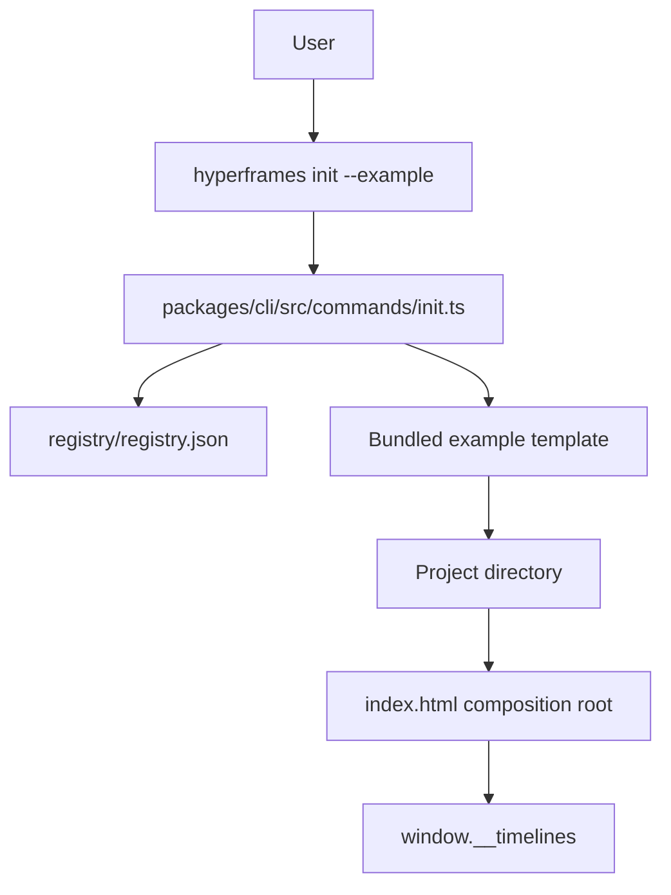
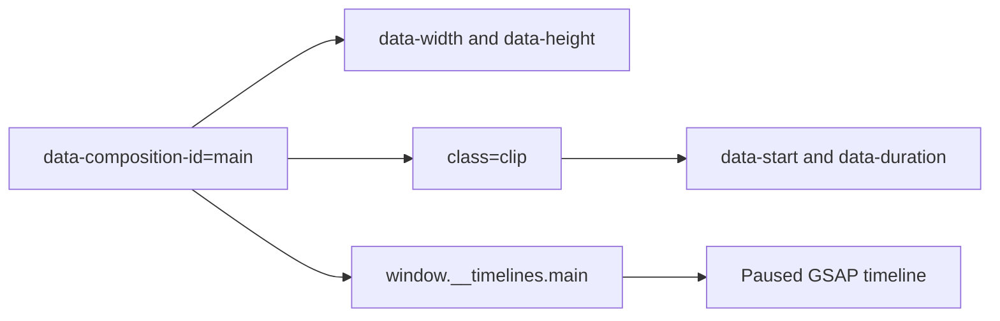
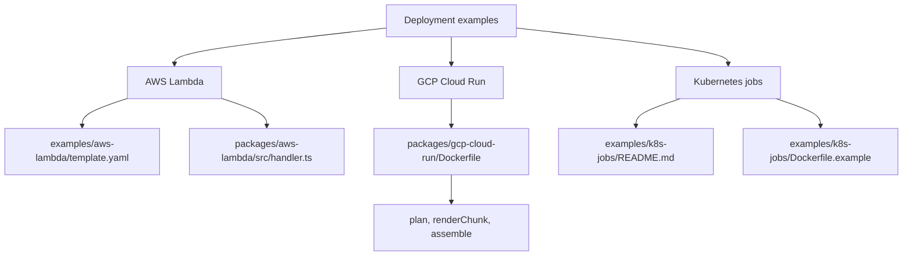

<!-- source: DeepWiki mcp.deepwiki.com · repo heygen-com/hyperframes · page 10.2 Example Projects · fetched 2026-11-02 -->

# Example Projects

Relevant source files

The following files were used as context for generating this wiki page:

- [.gitattributes](.gitattributes)
- [.github/actions/install-ffmpeg-linux/action.yml](.github/actions/install-ffmpeg-linux/action.yml)
- [.gitignore](.gitignore)
- [DESIGN.md](DESIGN.md)
- [Dockerfile.test](Dockerfile.test)
- [docs/catalog-gallery.css](docs/catalog-gallery.css)
- [docs/contributing/testing-local-changes.mdx](docs/contributing/testing-local-changes.mdx)
- [docs/custom.css](docs/custom.css)
- [docs/examples.mdx](docs/examples.mdx)
- [docs/guides/free-agents.mdx](docs/guides/free-agents.mdx)
- [docs/guides/gsap-animation.mdx](docs/guides/gsap-animation.mdx)
- [docs/reference/html-schema.mdx](docs/reference/html-schema.mdx)
- [docs/snippets/advanced-path-grid.jsx](docs/snippets/advanced-path-grid.jsx)
- [docs/snippets/day-list.jsx](docs/snippets/day-list.jsx)
- [docs/snippets/docs-video.jsx](docs/snippets/docs-video.jsx)
- [docs/snippets/example-player.jsx](docs/snippets/example-player.jsx)
- [docs/snippets/film-rows.jsx](docs/snippets/film-rows.jsx)
- [docs/snippets/hover-video.jsx](docs/snippets/hover-video.jsx)
- [docs/snippets/quickstart-continuation-grid.jsx](docs/snippets/quickstart-continuation-grid.jsx)
- [docs/snippets/remix-shelf.jsx](docs/snippets/remix-shelf.jsx)
- [docs/snippets/replica-compare.jsx](docs/snippets/replica-compare.jsx)
- [docs/template-gallery.css](docs/template-gallery.css)
- [docs/thirty-days.mdx](docs/thirty-days.mdx)
- [examples/k8s-jobs/Dockerfile.example](examples/k8s-jobs/Dockerfile.example)
- [examples/k8s-jobs/Dockerfile.example.dockerignore](examples/k8s-jobs/Dockerfile.example.dockerignore)
- [examples/k8s-jobs/README.md](examples/k8s-jobs/README.md)
- [packages/cli/src/docker/Dockerfile.render](packages/cli/src/docker/Dockerfile.render)
- [packages/engine/src/utils/urlDownloader.test.ts](packages/engine/src/utils/urlDownloader.test.ts)
- [packages/engine/src/utils/urlDownloader.ts](packages/engine/src/utils/urlDownloader.ts)
- [packages/gcp-cloud-run/Dockerfile](packages/gcp-cloud-run/Dockerfile)
- [packages/producer/tests/distributed/mp4-h264-sdr/output/compiled.html](packages/producer/tests/distributed/mp4-h264-sdr/output/compiled.html)
- [packages/producer/tests/distributed/mp4-h264-sdr/output/output.mp4](packages/producer/tests/distributed/mp4-h264-sdr/output/output.mp4)
- [scripts/check-docs-snippet-motion.test.mjs](scripts/check-docs-snippet-motion.test.mjs)
- [scripts/sync-docs-catalog.mjs](scripts/sync-docs-catalog.mjs)

## Purpose and scope

This page covers the eight bundled registry examples—`warm-grain`, `swiss-grid`, `vignelli`, `kinetic-type`, `decision-tree`, `nyt-graph`, `product-promo`, and `play-mode`—and the deployment-oriented projects under `examples/`: `aws-lambda`, `gcp-cloud-run`, and `k8s-jobs`. The bundled examples are composition-oriented starting points; the deployment projects demonstrate ways to run distributed renders in cloud or container environments. [registry/registry.json:5-37](), [examples/aws-lambda/template.yaml:1-42](), [packages/gcp-cloud-run/Dockerfile:1-22](), [examples/k8s-jobs/README.md:1-1]()

Sources: [registry/registry.json:5-37](), [examples/aws-lambda/template.yaml:1-42](), [packages/gcp-cloud-run/Dockerfile:1-22](), [examples/k8s-jobs/README.md:1-1]()

## Template architecture

HyperFrames compositions use HTML and CSS for appearance, with data attributes to declare frame dimensions, duration, clips, media, and nested compositions. A composition root uses `data-composition-id`; timed DOM clips conventionally use `class="clip"` and timing attributes such as `data-start` and `data-duration`. [docs/reference/html-schema.mdx:6-10](), [docs/reference/html-schema.mdx:38-55](), [docs/reference/html-schema.mdx:72-101]()

The bundled example identifiers are registered in `registry/registry.json`. The repository also tracks selected cloud and container examples under `examples/`; the `.gitignore` rules explicitly re-include `examples/aws-lambda`, `examples/gcp-cloud-run`, and `examples/k8s-jobs`. [registry/registry.json:5-37](), [.gitignore:97-108]()

Sources: [docs/reference/html-schema.mdx:6-10](), [docs/reference/html-schema.mdx:38-55](), [docs/reference/html-schema.mdx:72-101](), [registry/registry.json:5-37](), [.gitignore:97-108]()

### Composition and initialization flow

The CLI’s `hyperframes init --example <id>` flow uses the bundled example set as project starting points. During initialization, the CLI resolves a template, copies its files into the requested project directory, and applies any relevant media or configuration substitutions. The command implementation is in `packages/cli/src/commands/init.ts`; the shared project instructions are in `packages/cli/src/templates/_shared/CLAUDE.md`. [packages/cli/src/commands/init.ts:4-11](), [packages/cli/src/commands/init.ts:31-127](), [packages/cli/src/templates/_shared/CLAUDE.md:1-86]()

The composition contract establishes how the generated or edited project is structured: the root identifies the composition and its authored dimensions, while clips declare their own timing. A registered animation timeline uses the composition ID as its key. [docs/reference/html-schema.mdx:38-55](), [docs/reference/html-schema.mdx:57-67]()

**Diagram: Example initialization mapped to implementation entities**

Sources: [packages/cli/src/commands/init.ts:4-11](), [packages/cli/src/commands/init.ts:31-127](), [registry/registry.json:5-37](), [docs/reference/html-schema.mdx:38-67]()

## Bundled examples overview

The registry includes the following example IDs. The names below identify registry entries; the table does not imply that each example has a particular internal implementation beyond what its source files define. [registry/registry.json:5-37]()

| Example ID | Registry location |
|---|---|
| `warm-grain` | `registry/registry.json` |
| `swiss-grid` | `registry/registry.json` |
| `vignelli` | `registry/registry.json` |
| `kinetic-type` | `registry/registry.json` |
| `decision-tree` | `registry/registry.json` |
| `nyt-graph` | `registry/registry.json` |
| `product-promo` | `registry/registry.json` |
| `play-mode` | `registry/registry.json` |

Sources: [registry/registry.json:5-37]()

### Composition conventions relevant to the examples

The HTML schema applies across projects: a root composition has an ID and authored width and height; timed clips use `data-start` and usually `data-duration`; and `data-track-index` is an editor display lane, not a render scheduling constraint. For visual stacking, CSS `z-index` controls paint order. [docs/reference/html-schema.mdx:75-105]()

A composition timeline can be registered at `window.__timelines[<composition-id>]`. The schema example creates a paused GSAP timeline and assigns it to `window.__timelines.main`, matching the root’s `data-composition-id="main"`. [docs/reference/html-schema.mdx:38-55](), [docs/reference/html-schema.mdx:57-67]()

Sources: [docs/reference/html-schema.mdx:38-67](), [docs/reference/html-schema.mdx:75-105]()

**Diagram: Composition identifiers and timeline registration**

Sources: [docs/reference/html-schema.mdx:38-55](), [docs/reference/html-schema.mdx:57-67](), [docs/reference/html-schema.mdx:93-105]()

## Deployment examples

The repository includes examples for AWS Lambda, GCP Cloud Run, and Kubernetes jobs. The AWS and Kubernetes example directories are explicitly preserved by `.gitignore`; the GCP Cloud Run Dockerfile describes a container that supports the distributed-render roles `plan`, `renderChunk`, and `assemble`. [.gitignore:97-108](), [packages/gcp-cloud-run/Dockerfile:1-22]()

Sources: [.gitignore:97-108](), [packages/gcp-cloud-run/Dockerfile:1-22]()

### AWS Lambda

The repository’s AWS deployment example includes a template at `examples/aws-lambda/template.yaml`. The AWS adapter handler is `packages/aws-lambda/src/handler.ts`; the existing example documentation describes it as dispatching work by an `Action` field and delegating distributed-render work to producer primitives. [examples/aws-lambda/template.yaml:1-42](), [packages/aws-lambda/src/handler.ts:1-184]()

Sources: [examples/aws-lambda/template.yaml:1-42](), [packages/aws-lambda/src/handler.ts:1-184]()

### GCP Cloud Run

`packages/gcp-cloud-run/Dockerfile` builds a Cloud Run image from the repository root because it copies sibling workspace packages, including the producer and engine dependencies. It describes a single image with three roles—`plan`, `renderChunk`, and `assemble`—selected using an `Action` field in the request body. The image includes pinned rendering dependencies, including FFmpeg and `chrome-headless-shell`. [packages/gcp-cloud-run/Dockerfile:1-22](), [packages/gcp-cloud-run/Dockerfile:57-95]()

The Dockerfile also sets `HYPERFRAMES_CHROME_PATH` and `PRODUCER_HEADLESS_SHELL_PATH` to the packaged browser executable. Its build-stage contract probe is intended to verify that this executable can perform the BeginFrame capture operation required by distributed rendering. [packages/gcp-cloud-run/Dockerfile:79-95](), [packages/gcp-cloud-run/Dockerfile:130-138]()

Sources: [packages/gcp-cloud-run/Dockerfile:1-22](), [packages/gcp-cloud-run/Dockerfile:57-95](), [packages/gcp-cloud-run/Dockerfile:130-138]()

### Kubernetes jobs

The `examples/k8s-jobs` directory contains the Kubernetes jobs example, including a README and `Dockerfile.example`. The repository keeps this directory tracked despite the general `examples/*` ignore rule. [examples/k8s-jobs/README.md:1-1](), [examples/k8s-jobs/Dockerfile.example:1-1](), [.gitignore:97-108]()

Sources: [examples/k8s-jobs/README.md:1-1](), [examples/k8s-jobs/Dockerfile.example:1-1](), [.gitignore:97-108]()

**Diagram: Natural-language deployment targets mapped to repository entities**

Sources: [examples/aws-lambda/template.yaml:1-42](), [packages/aws-lambda/src/handler.ts:1-184](), [packages/gcp-cloud-run/Dockerfile:1-22](), [examples/k8s-jobs/README.md:1-1](), [examples/k8s-jobs/Dockerfile.example:1-1]()

## Using examples as starting points

For a bundled registry example, initialize a project with `hyperframes init --example <id>`, using one of the registered IDs listed above. Inspect the resulting HTML composition and its timing attributes against the HTML schema; the root’s `data-composition-id` and any registered timeline key should correspond. [packages/cli/src/commands/init.ts:4-11](), [registry/registry.json:5-37](), [docs/reference/html-schema.mdx:38-67]()

For deployment-oriented projects, start with the directory matching the target environment. The Cloud Run Dockerfile expects the repository root as its build context, while the AWS and Kubernetes examples have their own project files under `examples/`. [.gitignore:97-108](), [packages/gcp-cloud-run/Dockerfile:7-19](), [examples/aws-lambda/template.yaml:1-42](), [examples/k8s-jobs/README.md:1-1]()

Sources: [packages/cli/src/commands/init.ts:4-11](), [registry/registry.json:5-37](), [docs/reference/html-schema.mdx:38-67](), [.gitignore:97-108](), [packages/gcp-cloud-run/Dockerfile:7-19](), [examples/aws-lambda/template.yaml:1-42](), [examples/k8s-jobs/README.md:1-1]()

---

