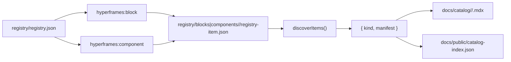
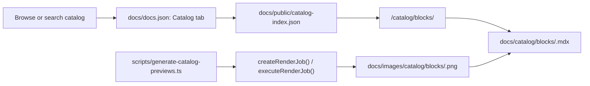
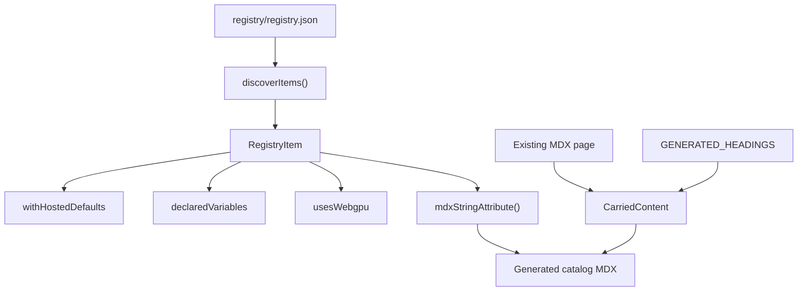
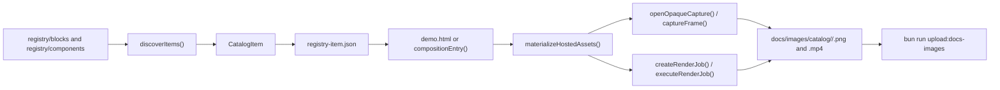

<!-- source: DeepWiki mcp.deepwiki.com · repo heygen-com/hyperframes · page 10.3 Catalog Generation Pipeline · fetched 2026-11-02 -->

# Catalog Generation Pipeline

Relevant source files

The following files were used as context for generating this wiki page:

- [docs/catalog/components/filmed-screen.mdx](docs/catalog/components/filmed-screen.mdx)
- [docs/catalog/components/motion-blur.mdx](docs/catalog/components/motion-blur.mdx)
- [docs/catalog/components/shutter-slam.mdx](docs/catalog/components/shutter-slam.mdx)
- [docs/catalog/components/texture-mask-text.mdx](docs/catalog/components/texture-mask-text.mdx)
- [docs/docs.json](docs/docs.json)
- [docs/public/catalog-index.json](docs/public/catalog-index.json)
- [docs/public/catalog/components/filmed-screen.json](docs/public/catalog/components/filmed-screen.json)
- [docs/public/catalog/components/motion-blur.json](docs/public/catalog/components/motion-blur.json)
- [docs/public/catalog/components/shutter-slam.json](docs/public/catalog/components/shutter-slam.json)
- [docs/snippets/catalog-gallery-data.mdx](docs/snippets/catalog-gallery-data.mdx)
- [packages/cli/src/registry/motionBlurShutter.browser.test.ts](packages/cli/src/registry/motionBlurShutter.browser.test.ts)
- [packages/core/src/registry/catalogGeneratorInstructions.test.ts](packages/core/src/registry/catalogGeneratorInstructions.test.ts)
- [packages/producer/src/benchmark.ts](packages/producer/src/benchmark.ts)
- [packages/producer/src/transparency-test.ts](packages/producer/src/transparency-test.ts)
- [packages/producer/tests/perf/README.md](packages/producer/tests/perf/README.md)
- [packages/producer/tests/transparency-regression/meta.json](packages/producer/tests/transparency-regression/meta.json)
- [packages/producer/tests/transparency-regression/src/index.html](packages/producer/tests/transparency-regression/src/index.html)
- [registry/blocks/gooey-split/gooey-split.html](registry/blocks/gooey-split/gooey-split.html)
- [registry/blocks/gooey-split/registry-item.json](registry/blocks/gooey-split/registry-item.json)
- [registry/catalog-artifact/local-vectors.bin](registry/catalog-artifact/local-vectors.bin)
- [registry/catalog-artifact/local-vectors.json](registry/catalog-artifact/local-vectors.json)
- [registry/components/motion-blur/demo.html](registry/components/motion-blur/demo.html)
- [registry/components/motion-blur/motion-blur.html](registry/components/motion-blur/motion-blur.html)
- [registry/components/motion-blur/registry-item.json](registry/components/motion-blur/registry-item.json)
- [registry/components/shutter-slam/demo.html](registry/components/shutter-slam/demo.html)
- [registry/components/shutter-slam/shutter-slam.html](registry/components/shutter-slam/shutter-slam.html)
- [registry/registry.json](registry/registry.json)
- [scripts/catalog-drift.test.ts](scripts/catalog-drift.test.ts)
- [scripts/catalog-drift.ts](scripts/catalog-drift.ts)
- [scripts/catalog-hosted-files.test.ts](scripts/catalog-hosted-files.test.ts)
- [scripts/catalog-hosted-files.ts](scripts/catalog-hosted-files.ts)
- [scripts/catalog-preview-temp.ts](scripts/catalog-preview-temp.ts)
- [scripts/catalog-publication.test.mjs](scripts/catalog-publication.test.mjs)
- [scripts/catalog-vectors.mjs](scripts/catalog-vectors.mjs)
- [scripts/generate-catalog-pages.ts](scripts/generate-catalog-pages.ts)
- [scripts/generate-catalog-previews.ts](scripts/generate-catalog-previews.ts)
- [scripts/generate-template-previews.ts](scripts/generate-template-previews.ts)
- [scripts/publish-catalog.mjs](scripts/publish-catalog.mjs)
- [scripts/registry-target-paths.mjs](scripts/registry-target-paths.mjs)
- [scripts/registry-target-paths.test.mjs](scripts/registry-target-paths.test.mjs)
- [scripts/upload-docs-images.sh](scripts/upload-docs-images.sh)

## Purpose and scope

The catalog pipeline turns registry entries into documentation pages and a flat catalog index, while a separate preview script renders catalog items into image and video assets. This page covers the manifest-to-MDX flow, preservation of human-authored sections, catalog grouping and search artifacts, preview rendering, and the documented role of the catalog-previews GitHub Action. [scripts/generate-catalog-pages.ts:1-14]()[scripts/generate-catalog-previews.ts:1-20]()

Sources: [scripts/generate-catalog-pages.ts:1-14](), [scripts/generate-catalog-previews.ts:1-20]()

## Pipeline overview

The generator reads the registry’s item list, loads each block or component manifest, and writes individual MDX pages plus `docs/public/catalog-index.json`. Preview rendering is a distinct step: it discovers renderable blocks and components, prepares a project for each item, and writes PNG and MP4 assets under `docs/images/catalog/`. [scripts/generate-catalog-pages.ts:1-14]()[scripts/generate-catalog-pages.ts:30-36]()[scripts/generate-catalog-previews.ts:1-20]()[scripts/generate-catalog-previews.ts:79-85]()

The documentation navigation includes a Catalog tab and a `catalog/index` page; its nested groups include item pages such as `catalog/blocks/canopy-part-title`. [docs/docs.json:175-200]()

### Diagram: registry concepts mapped to generator entities

Sources: [scripts/generate-catalog-pages.ts:1-14](), [scripts/generate-catalog-pages.ts:115-150]()

### Diagram: natural-language catalog experience mapped to preview entities

Sources: [docs/docs.json:175-200](), [docs/public/catalog-index.json:1-35](), [scripts/generate-catalog-pages.ts:1-14](), [scripts/generate-catalog-previews.ts:1-20](), [scripts/generate-catalog-previews.ts:40-46]()

## Manifest-to-MDX generation

### Discovery and filtering

`discoverItems()` reads `registry/registry.json`, accepts entries with type `hyperframes:block` or `hyperframes:component`, resolves each item’s `registry-item.json` below the corresponding registry directory, and skips items with missing or invalid manifests. The resulting entries are sorted by manifest name. [scripts/generate-catalog-pages.ts:115-150]()

The script imports registry types and helpers from the core package’s source, including `RegistryItem`, `FileTarget`, `isBlockItem`, and `ITEM_TYPE_DIRS`. It also imports `withHostedDefaults`, `declaredVariables`, and `usesWebgpu` for catalog generation. [scripts/generate-catalog-pages.ts:16-28]()

### MDX string safety and preview payload checks

`mdxStringAttribute()` escapes ampersands, quotes, angle brackets, and braces before emitting a double-quoted MDX/JSX attribute. The generator uses string literals rather than expression-valued attributes to avoid expression values being stringified incorrectly by documentation search indexing. [scripts/generate-catalog-pages.ts:38-59]()

`payloadPath()` resolves an item’s JSON payload under `docs/public/catalog/<kind>/`. `hasPayload()` requires that the payload exists and that `unsupportedFlag()` returns no unsupported-browser flag; `unsupportedFlag()` reads the payload’s optional `unsupported` property. [scripts/generate-catalog-pages.ts:61-78]()

| Entity | Role |
|---|---|
| `discoverItems()` | Loads and sorts block/component manifests referenced by the registry index. [scripts/generate-catalog-pages.ts:115-150]() |
| `mdxStringAttribute()` | Produces escaped quoted attributes suitable for generated MDX. [scripts/generate-catalog-pages.ts:38-59]() |
| `payloadPath()` | Resolves the per-item preview payload path. [scripts/generate-catalog-pages.ts:61-63]() |
| `hasPayload()` / `unsupportedFlag()` | Determines whether a payload exists and is not marked unsupported. [scripts/generate-catalog-pages.ts:65-78]() |
| `CarriedContent` | Represents retained human-authored sections and whether usage prose has been customized. [scripts/generate-catalog-pages.ts:95-101]() |
| `CatalogEntry` | Defines the flat index entry fields: name, type, title, description, tags, href, and optional preview. [scripts/generate-catalog-pages.ts:103-113]() |

Sources: [scripts/generate-catalog-pages.ts:16-28](), [scripts/generate-catalog-pages.ts:38-78](), [scripts/generate-catalog-pages.ts:95-113](), [scripts/generate-catalog-pages.ts:115-150]()

### Carried sections and generated headings

The generator defines `GENERATED_HEADINGS` as the set of headings it owns, including current template headings and selected headings produced by earlier generator revisions. Its comments establish the preservation rule: content outside that set is treated as human-written and carried across regeneration. [scripts/generate-catalog-pages.ts:154-184]()

The `CarriedContent` shape stores whole `##` sections in their original order and tracks whether a human rewrote the usage prose. The heading `usage` is deliberately not in `GENERATED_HEADINGS`, so it remains human-owned rather than being inferred from the body text. [scripts/generate-catalog-pages.ts:95-101]()[scripts/generate-catalog-pages.ts:172-175]()

| Heading ownership | Behavior |
|---|---|
| Heading is in `GENERATED_HEADINGS` | Treated as generator-owned content. [scripts/generate-catalog-pages.ts:154-184]() |
| Heading is not in `GENERATED_HEADINGS` | Treated as human-written content for preservation. [scripts/generate-catalog-pages.ts:154-158]() |
| `usage` | Explicitly excluded from the generated-heading set; ownership stays human-controlled. [scripts/generate-catalog-pages.ts:172-175]() |

Sources: [scripts/generate-catalog-pages.ts:95-101](), [scripts/generate-catalog-pages.ts:154-184]()

### Group ordering

Catalog group ordering is part of the catalog-generation concern, but the supplied source excerpt does not include the `GROUP_ORDER` definition or its use. Consequently, its entries and sorting behavior cannot be specified from the available code lines. The catalog navigation does show nested groups, including `3D` and `3D motion`, but that navigation is configured in `docs/docs.json`, not in the supplied portion of the generator. [docs/docs.json:175-200]()

Sources: [docs/docs.json:175-200]()

### Diagram: manifest metadata to generated documentation concepts

Sources: [scripts/generate-catalog-pages.ts:16-28](), [scripts/generate-catalog-pages.ts:38-59](), [scripts/generate-catalog-pages.ts:95-101](), [scripts/generate-catalog-pages.ts:115-150](), [scripts/generate-catalog-pages.ts:154-184]()

## `catalog-index.json` and local vector artifacts

The generator’s declared outputs include the per-item MDX pages and `docs/public/catalog-index.json`. A catalog index entry carries the item name and type, display title and description, tags, an href, and an optional preview path. [scripts/generate-catalog-pages.ts:1-14]()[scripts/generate-catalog-pages.ts:103-113]()

The checked-in `docs/public/catalog-index.json` is a flat array of item records. For example, its entries contain `name`, `type`, `title`, `description`, `tags`, `href`, and `preview` fields. [docs/public/catalog-index.json:1-17]()

The local vector metadata identifies the model as `bge-small-en-v1.5`, records a model revision and a 384-dimensional embedding size, and lists catalog item names. The associated `local-vectors.bin` is a binary artifact; the supplied excerpt does not expose its encoding or the code that generates or consumes it. [registry/catalog-artifact/local-vectors.json:1-16]()[registry/catalog-artifact/local-vectors.bin:1-3]()

| Artifact | Known contents or purpose |
|---|---|
| `docs/public/catalog-index.json` | Flat catalog records with item metadata, links, tags, and optional preview URLs. [docs/public/catalog-index.json:1-17]() |
| `registry/catalog-artifact/local-vectors.json` | Vector model metadata, dimensions, revision, and item-name list. [registry/catalog-artifact/local-vectors.json:1-16]() |
| `registry/catalog-artifact/local-vectors.bin` | Binary vector artifact; details of its format are not available in the supplied excerpt. [registry/catalog-artifact/local-vectors.bin:1-3]() |

Sources: [scripts/generate-catalog-pages.ts:1-14](), [scripts/generate-catalog-pages.ts:103-113](), [docs/public/catalog-index.json:1-17](), [registry/catalog-artifact/local-vectors.json:1-16](), [registry/catalog-artifact/local-vectors.bin:1-3]()

## Preview generation

### Discovery and entry selection

`scripts/generate-catalog-previews.ts` generates PNG thumbnails and MP4 previews for blocks and components; examples are handled by the separate template-preview script. Its documented outputs are under `docs/images/catalog/<type>/`, and the script notes that these images are gitignored and uploaded separately. [scripts/generate-catalog-previews.ts:1-20]()

The preview script scans the `registry/blocks` and `registry/components` directories. For each candidate it requires a `registry-item.json` and a usable entry file. If `demo.html` exists, it is selected; otherwise components are skipped, while blocks use the composition file named in the manifest or default to `<name>.html`. [scripts/generate-catalog-previews.ts:79-108]()

`discoverItems()` applies optional type and name filters. If a requested name is not found, it reports the available item names and exits with an error. [scripts/generate-catalog-previews.ts:110-134]()

### Hosted assets and render dependencies

The script imports catalog-preview support for temporary directories, hosted files, hosted defaults, hosted references, and opaque capture. It imports `captureFrame`, `closeCaptureSession`, `createRenderJob`, and `executeRenderJob` from the Producer source, as well as `compileForRender`. [scripts/generate-catalog-previews.ts:35-53]()

The default hosted-asset preparation path downloads hosted files; the `cdn` mode instead rewrites the project to refer to hosted assets by CDN URL. This behavior is defined in `materializeHostedAssets()` and `pointHostedAssetsAtCdn()`. [scripts/generate-catalog-previews.ts:143-169]()

### Outputs and publishing

Preview output directories are selected by item kind: blocks map to `docs/images/catalog/blocks`, and components map to `docs/images/catalog/components`. The script’s header documents PNG and MP4 outputs, and states that `docs/images/` is gitignored and images are published separately through the docs-image upload process. [scripts/generate-catalog-previews.ts:1-20]()[scripts/generate-catalog-previews.ts:136-141]()

| Concern | Implementation |
|---|---|
| Item categories | Blocks and components are discovered from their registry directories; examples use the template-preview script. [scripts/generate-catalog-previews.ts:5-10]()[scripts/generate-catalog-previews.ts:79-85]() |
| Entry selection | Prefers `demo.html`; otherwise components are skipped and blocks resolve a composition file from their manifest. [scripts/generate-catalog-previews.ts:87-108]() |
| Producer integration | Uses Producer capture and render-job APIs imported from source. [scripts/generate-catalog-previews.ts:39-46]() |
| Asset preparation | Downloads hosted files by default or points references at the CDN in `cdn` mode. [scripts/generate-catalog-previews.ts:143-169]() |
| Preview location | Writes to the kind-specific directory beneath `docs/images/catalog`. [scripts/generate-catalog-previews.ts:136-141]() |

Sources: [scripts/generate-catalog-previews.ts:1-20](), [scripts/generate-catalog-previews.ts:35-53](), [scripts/generate-catalog-previews.ts:79-108](), [scripts/generate-catalog-previews.ts:110-141](), [scripts/generate-catalog-previews.ts:143-169]()

### Diagram: preview script mapped to Producer entities

Sources: [scripts/generate-catalog-previews.ts:1-20](), [scripts/generate-catalog-previews.ts:35-53](), [scripts/generate-catalog-previews.ts:79-108](), [scripts/generate-catalog-previews.ts:110-141](), [scripts/generate-catalog-previews.ts:143-169]()

## Preview-image GitHub Action

The requested GitHub Action integration is identified as `catalog-previews`, but its workflow file and contents were not included in the supplied source excerpts. Therefore, its triggers, changed-item filtering, build setup, rendering flags, artifact retention, and failure behavior cannot be documented here as verified implementation details. The preview script itself documents per-item filtering options such as `--only`, `--type`, and `--skip-video`. [scripts/generate-catalog-previews.ts:15-20]()

Sources: [scripts/generate-catalog-previews.ts:15-20]()

## Summary

Catalog page generation reads the registry index and item manifests, defines explicit boundaries between generated headings and carried human-authored sections, and declares MDX pages plus a flat catalog index as outputs. Preview generation separately discovers renderable blocks and components, resolves their entry files, prepares hosted assets, and uses Producer capture/render APIs for catalog visuals. The available vector metadata records the embedding model and dimensions, while the supplied excerpts do not expose the vector-generation implementation or the preview GitHub Action workflow. [scripts/generate-catalog-pages.ts:1-14]()[scripts/generate-catalog-pages.ts:95-101]()[scripts/generate-catalog-pages.ts:115-184]()[scripts/generate-catalog-previews.ts:1-20]()[scripts/generate-catalog-previews.ts:35-53]()[registry/catalog-artifact/local-vectors.json:1-16]()

Sources: [scripts/generate-catalog-pages.ts:1-14](), [scripts/generate-catalog-pages.ts:95-101](), [scripts/generate-catalog-pages.ts:115-184](), [scripts/generate-catalog-previews.ts:1-20](), [scripts/generate-catalog-previews.ts:35-53](), [registry/catalog-artifact/local-vectors.json:1-16]()

---

