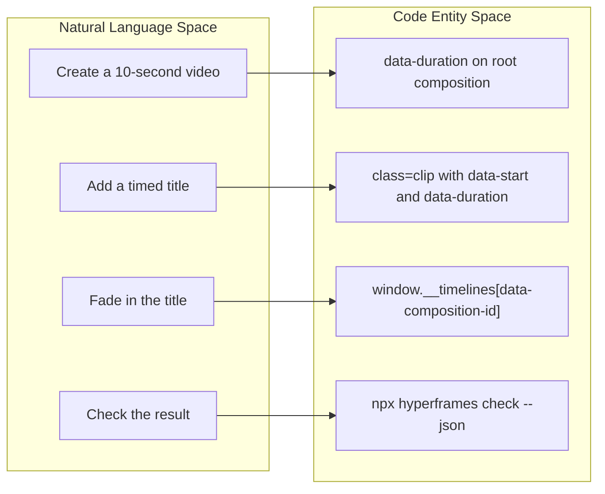
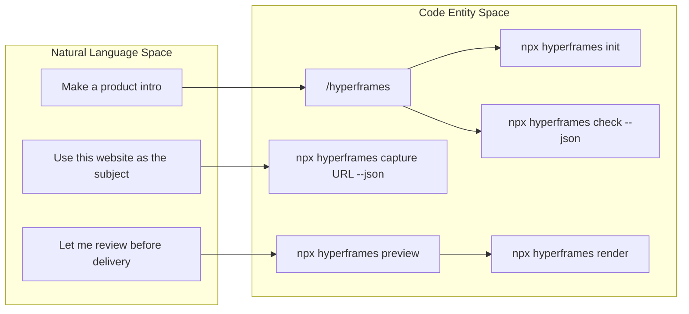

<!-- source: DeepWiki mcp.deepwiki.com · repo heygen-com/hyperframes · page 11 AI Skills System · fetched 2026-11-02 -->

# AI Skills System

Relevant source files

The following files were used as context for generating this wiki page:

- [.claude-plugin/marketplace.json](.claude-plugin/marketplace.json)
- [AGENTS.md](AGENTS.md)
- [CLAUDE.md](CLAUDE.md)
- [README.md](README.md)
- [docs/guides/skills.mdx](docs/guides/skills.mdx)
- [docs/packages/cli.mdx](docs/packages/cli.mdx)
- [docs/quickstart.mdx](docs/quickstart.mdx)
- [gemini-extension.json](gemini-extension.json)
- [packages/cli/src/cli.ts](packages/cli/src/cli.ts)
- [packages/cli/src/commands/coreSkillContent.test.ts](packages/cli/src/commands/coreSkillContent.test.ts)
- [packages/cli/src/commands/feedback.test.ts](packages/cli/src/commands/feedback.test.ts)
- [packages/cli/src/commands/feedback.ts](packages/cli/src/commands/feedback.ts)
- [packages/cli/src/commands/init.test.ts](packages/cli/src/commands/init.test.ts)
- [packages/cli/src/commands/init.ts](packages/cli/src/commands/init.ts)
- [packages/cli/src/commands/skills.test.ts](packages/cli/src/commands/skills.test.ts)
- [packages/cli/src/commands/skills.ts](packages/cli/src/commands/skills.ts)
- [packages/cli/src/help.ts](packages/cli/src/help.ts)
- [packages/cli/src/templates/_shared/AGENTS.md](packages/cli/src/templates/_shared/AGENTS.md)
- [packages/cli/src/templates/_shared/CLAUDE.md](packages/cli/src/templates/_shared/CLAUDE.md)
- [packages/cli/src/utils/skillsManifest.test.ts](packages/cli/src/utils/skillsManifest.test.ts)
- [packages/cli/src/utils/skillsManifest.ts](packages/cli/src/utils/skillsManifest.ts)
- [packages/cli/src/utils/skillsUpdateCheck.test.ts](packages/cli/src/utils/skillsUpdateCheck.test.ts)
- [packages/cli/src/utils/skillsUpdateCheck.ts](packages/cli/src/utils/skillsUpdateCheck.ts)
- [packages/cli/src/utils/submitFeedback.test.ts](packages/cli/src/utils/submitFeedback.test.ts)
- [packages/cli/src/utils/submitFeedback.ts](packages/cli/src/utils/submitFeedback.ts)
- [plugin.json](plugin.json)
- [skills-manifest.json](skills-manifest.json)
- [skills/hyperframes-cli/SKILL.md](skills/hyperframes-cli/SKILL.md)
- [skills/hyperframes-cli/references/lint-validate-inspect.md](skills/hyperframes-cli/references/lint-validate-inspect.md)
- [skills/hyperframes-cli/references/preview-render.md](skills/hyperframes-cli/references/preview-render.md)
- [skills/hyperframes/SKILL.md](skills/hyperframes/SKILL.md)
- [skills/hyperframes/references/skill-lifecycle.md](skills/hyperframes/references/skill-lifecycle.md)

## Purpose and scope

HyperFrames’ AI skills system provides framework-specific guidance to coding agents that create or edit videos. Skills translate a request into HyperFrames conventions for composition structure, animation, media, and the CLI workflow. The `/hyperframes` skill is the main entry point; specialized skills cover CLI use, registry assets, media, and particular creation tasks. [README.md:73-81]() [skills/hyperframes/SKILL.md:8-14]()

This page describes how the skills are organized, installed, and connected to agent integrations. It is a parent overview; see the child pages for each skill domain and workflow. [CLAUDE.md:5-29]()

Sources: [README.md:73-81]() [skills/hyperframes/SKILL.md:8-14]() [CLAUDE.md:5-29]()

## Skills directory and distribution

The repository’s `skills/` directory contains skill definitions and their supporting references. A skill’s `SKILL.md` supplies its name, description, and guidance; for example, `skills/hyperframes/SKILL.md` presents the composition contract and work loop, then routes readers to topic-specific references. [skills/hyperframes/SKILL.md:1-4]() [skills/hyperframes/SKILL.md:16-48]()

The published catalog is not the same as every skill present in the repository. The `skills-manifest.json` excerpt lists seven published skills, while the repository guidance also describes six repo-internal skills under `.claude/skills` and `.agents/skills` that are excluded from default standalone discovery. Claude Code and other supported agents can also use plugin packages; standalone skills are available through the skills installer, and the CLI provides `hyperframes skills` management. [skills-manifest.json:1-32]() [README.md:54-62]() [README.md:83-97]() [packages/cli/src/cli.ts:125-145]()

| Layer | Role |
|---|---|
| `skills/` | Skill source: instructions and references for agent behavior. [skills/hyperframes/SKILL.md:1-4]() |
| `skills-manifest.json` | Records published skill names, hashes, and file counts. [skills-manifest.json:1-32]() |
| `hyperframes skills update` | Installs or refreshes the default core set; named skills can be installed on demand. [README.md:77-81]() |
| Plugin packages | Bundle the skill catalog for agent-specific installation and updates. [README.md:83-97]() |
| `.claude/skills` and `.agents/skills` | Repository-internal skills, excluded from default standalone discovery. [README.md:60-62]() |

Sources: [skills/hyperframes/SKILL.md:1-4]() [skills-manifest.json:1-32]() [README.md:54-62]() [README.md:77-97]() [packages/cli/src/cli.ts:125-145]()

## How skills bridge requests to code

Skills connect natural-language requests to specific HyperFrames entities and constraints. For instance, a request for a timed scene maps to composition duration and clip timing attributes; an animation request maps to a paused timeline registered in `window.__timelines`. The `/hyperframes` skill states these contracts directly, including the prohibition on timers and wall-clock-dependent behavior. [skills/hyperframes/SKILL.md:16-31]()

**Natural language to composition entities**

The correspondences shown reflect the skill’s duration, clip, timeline-registration, and validation guidance. [skills/hyperframes/SKILL.md:18-23]() [skills/hyperframes/SKILL.md:43-48]()

**Agent workflow to CLI and project entities**

The `/hyperframes` skill names the project scaffold and website-capture commands and describes the check, preview, and render stages. The CLI skill further defines the command loop, including checking and reviewing before rendering. [skills/hyperframes/SKILL.md:10-12]() [skills/hyperframes/SKILL.md:43-48]() [skills/hyperframes-cli/SKILL.md:29-36]()

Sources: [skills/hyperframes/SKILL.md:10-12]() [skills/hyperframes/SKILL.md:16-31]() [skills/hyperframes/SKILL.md:43-48]() [skills/hyperframes-cli/SKILL.md:29-36]()

## Skill families

The skill catalog combines general HyperFrames knowledge with specialized domains and creation workflows. The `/hyperframes` skill routes requests to relevant references and other skills; `/hyperframes-cli` explains command usage, while registry and media skills support reuse and asset preparation. The repository also documents on-demand skills such as `/figma`, `/slideshow`, and `/remotion-to-hyperframes`. [CLAUDE.md:21-29]() [README.md:77-81]()

| Family | Examples | Responsibility |
|---|---|---|
| Core composition and animation | `hyperframes`, `hyperframes-animation`, `hyperframes-keyframes`, `hyperframes-studio` | Composition rules, animation behavior, and authoring context. [CLAUDE.md:23-25]() |
| CLI and registry | `hyperframes-cli`, `hyperframes-registry` | CLI workflow and reuse of registry blocks and components. [CLAUDE.md:24-25]() |
| Creation workflows | `product-launch-video`, `pr-to-video`, `faceless-explainer`, `music-to-video`, `slideshow`, `talking-head-recut`, `motion-graphics`, `general-video`, `remotion-to-hyperframes`, `embedded-captions` | Guidance for specific kinds of video or source material. [README.md:101-103]() [CLAUDE.md:28-29]() |
| Media, audio, creative, and design | `media-use`, `hyperframes-audio`, `hyperframes-creative`, `figma` | Media and audio tasks, creative direction, and Figma input. [CLAUDE.md:26-27]() |

For details, see [Core Composition and Animation Skills](#11.1), [Creation Workflow Skills](#11.2), [Website Capture Skill](#11.3), and [Media, Audio, Creative and Figma Skills](#11.4).

Sources: [CLAUDE.md:21-29]() [README.md:77-81]() [README.md:101-103]()

## Agent workflow and validation

The skills encourage a staged workflow: understand the request, author a project that follows the composition contract, run checks, inspect a preview, and render when appropriate. The skill’s work loop distinguishes validation and review from the final render; the CLI skill describes `lint`, `check`, `snapshot`, `preview`, and `render` as separate steps. [skills/hyperframes/SKILL.md:43-48]() [skills/hyperframes-cli/SKILL.md:29-36]()

The diagram summarizes the documented workflow; rendering is not presented as an automatic consequence of passing checks—the skill says to render when the user approves the preview or asks for the file. [skills/hyperframes/SKILL.md:43-48]() [skills/hyperframes-cli/SKILL.md:29-36]()

Sources: [skills/hyperframes/SKILL.md:43-48]() [skills/hyperframes-cli/SKILL.md:29-36]()

## Installation and maintenance

For standalone installs, the documented default is the core set: `/hyperframes`, `/hyperframes-cli`, `/hyperframes-registry`, and `/media-use`. Additional skills, including `/figma`, `/slideshow`, and `/remotion-to-hyperframes`, can be added when needed. The README distinguishes this flow from plugin packages, which bundle the catalog. [README.md:77-87]()

The CLI `init` command supports skipping skill installation with `--skip-skills`; the CLI command map also loads the skills command on demand. For the current installer behavior and options, see the CLI command documentation and the skill lifecycle guidance. [packages/cli/src/commands/init.ts:12-22]() [packages/cli/src/cli.ts:125-145]() [skills/hyperframes/SKILL.md:74]()

Sources: [README.md:77-87]() [packages/cli/src/commands/init.ts:12-22]() [packages/cli/src/cli.ts:125-145]() [skills/hyperframes/SKILL.md:74]()

## Child pages

The following pages cover each skill family in detail:

- [Core Composition and Animation Skills](#11.1) — core composition and animation guidance, CLI and Studio references, and registry patterns.
- [Creation Workflow Skills](#11.2) — skills for specific video types and source-to-video workflows.
- [Website Capture Skill](#11.3) — website capture and the steps that turn captured material into a composition.
- [Media, Audio, Creative and Figma Skills](#11.4) — media, audio, creative direction, and Figma-related skills.

Sources: [CLAUDE.md:21-29]() [README.md:77-81]() [skills/hyperframes/SKILL.md:58-74]()

---

