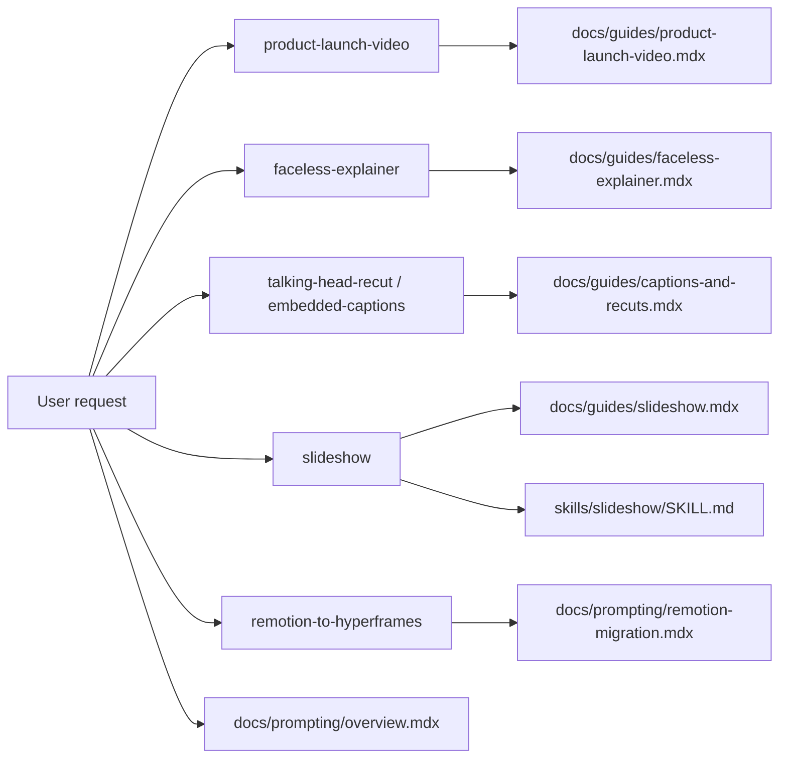
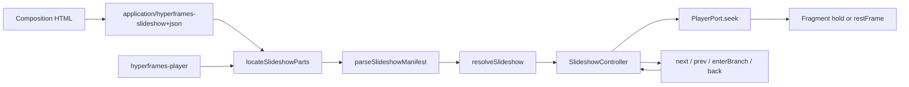
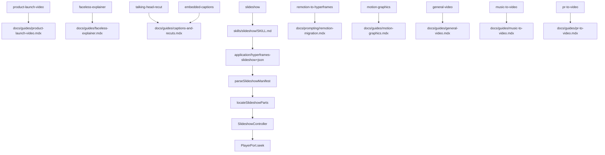

<!-- source: DeepWiki mcp.deepwiki.com · repo heygen-com/hyperframes · page 11.2 Creation Workflow Skills · fetched 2026-11-02 -->

# Creation Workflow Skills

Relevant source files

The following files were used as context for generating this wiki page:

- [docs/concepts/frame-adapters.mdx](docs/concepts/frame-adapters.mdx)
- [docs/guides/captions-and-recuts.mdx](docs/guides/captions-and-recuts.mdx)
- [docs/guides/faceless-explainer.mdx](docs/guides/faceless-explainer.mdx)
- [docs/guides/general-video.mdx](docs/guides/general-video.mdx)
- [docs/guides/motion-graphics.mdx](docs/guides/motion-graphics.mdx)
- [docs/guides/music-to-video.mdx](docs/guides/music-to-video.mdx)
- [docs/guides/pr-to-video.mdx](docs/guides/pr-to-video.mdx)
- [docs/guides/product-launch-video.mdx](docs/guides/product-launch-video.mdx)
- [docs/guides/slideshow.mdx](docs/guides/slideshow.mdx)
- [docs/prompting/capstone.mdx](docs/prompting/capstone.mdx)
- [docs/prompting/motion.mdx](docs/prompting/motion.mdx)
- [docs/prompting/overview.mdx](docs/prompting/overview.mdx)
- [docs/prompting/remotion-migration.mdx](docs/prompting/remotion-migration.mdx)
- [packages/player/src/slideshow/SlideshowController.test.ts](packages/player/src/slideshow/SlideshowController.test.ts)
- [packages/player/src/slideshow/SlideshowController.ts](packages/player/src/slideshow/SlideshowController.ts)
- [packages/player/src/slideshow/hyperframes-slideshow.test.ts](packages/player/src/slideshow/hyperframes-slideshow.test.ts)
- [packages/player/src/slideshow/hyperframes-slideshow.ts](packages/player/src/slideshow/hyperframes-slideshow.ts)
- [packages/player/src/slideshow/slideshowPresenter.ts](packages/player/src/slideshow/slideshowPresenter.ts)
- [skills/hyperframes/references/types/launch.md](skills/hyperframes/references/types/launch.md)
- [skills/slideshow/SKILL.md](skills/slideshow/SKILL.md)
- [skills/slideshow/references/standalone-harness.md](skills/slideshow/references/standalone-harness.md)

## Purpose and scope

This page documents the creation-workflow skills named in the HyperFrames documentation: `product-launch-video`, `pr-to-video`, `faceless-explainer`, `music-to-video`, `slideshow`, `talking-head-recut`, `motion-graphics`, `general-video`, `remotion-to-hyperframes`, and `embedded-captions`. The available source material describes the user-facing workflows for product launches, explainers, captions and recuts, slideshows, and Remotion migration. It does **not** provide the implementation files for most workflow skills, so this page distinguishes documented behavior from implementation detail that is not established by the available sources. [docs/guides/product-launch-video.mdx:9-42](), [docs/guides/faceless-explainer.mdx:9-19](), [docs/guides/captions-and-recuts.mdx:9-20](), [docs/guides/slideshow.mdx:9-19](), [docs/prompting/remotion-migration.mdx:7-18]()

Sources: `docs/guides/product-launch-video.mdx`, `docs/guides/faceless-explainer.mdx`, `docs/guides/captions-and-recuts.mdx`, `docs/guides/slideshow.mdx`, `docs/prompting/remotion-migration.mdx`

---

## Workflow overview

Creation workflows are best understood as distinct ways to describe a desired deliverable and its inputs, rather than as one shared script pipeline. The general prompting guide accepts either a description or supplied material such as a URL, document, spreadsheet, or transcript; it recommends stating duration, format, beats, exact copy, techniques, and exclusions when those details matter. [docs/prompting/overview.mdx:8-10](), [docs/prompting/overview.mdx:26-39](), [docs/prompting/overview.mdx:64-82]()

| Workflow | Documented input and output | Scope established by the available sources |
|---|---|---|
| `product-launch-video` | Product URL, script, or brief; launch video, product tour, or short social video. [docs/guides/product-launch-video.mdx:20-42]() | URL-based workflows can use real product screens, colors, fonts, and words; a brief can instead request invented visuals. [docs/guides/product-launch-video.mdx:9-18](), [docs/guides/product-launch-video.mdx:61-68]() |
| `pr-to-video` | A named workflow in the page scope. [docs/guides/pr-to-video.mdx:1-5]() | Detailed implementation steps and scripts are not present in the supplied source content. |
| `faceless-explainer` | Topic, article, notes, or text; an explainer whose visuals may include typography, diagrams, abstract graphics, and data visualization. [docs/guides/faceless-explainer.mdx:9-19]() | The workflow emphasizes a teaching spine and coherent visual language rather than paragraph-by-paragraph scene conversion. [docs/guides/faceless-explainer.mdx:68-72]() |
| `music-to-video` | A named workflow in the page scope. [docs/guides/music-to-video.mdx:1-5]() | Detailed implementation steps and scripts are not present in the supplied source content. |
| `slideshow` | Presentation material and a decision or outcome; produces a live deck rather than an MP4. [docs/guides/slideshow.mdx:9-10](), [docs/guides/slideshow.mdx:21-33]() | Slides, fragments, hotspots, branches, and presenter notes are part of the documented deck model. [docs/guides/slideshow.mdx:35-51]() |
| `talking-head-recut` | A named workflow in the page scope. [docs/guides/captions-and-recuts.mdx:9-10]() | The available caption guide documents footage recuts and pause removal, but not a skill implementation directory or script inventory. [docs/guides/captions-and-recuts.mdx:32-44]() |
| `motion-graphics` | A named workflow in the page scope. [docs/guides/motion-graphics.mdx:1-5]() | Detailed implementation steps and scripts are not present in the supplied source content. |
| `general-video` | A named workflow in the page scope. [docs/guides/general-video.mdx:1-5]() | Detailed implementation steps and scripts are not present in the supplied source content. |
| `remotion-to-hyperframes` | Existing Remotion composition source; translates the source into HyperFrames HTML. [docs/prompting/remotion-migration.mdx:7-18]() | This is a migration workflow, not a fresh video-creation request. [docs/prompting/remotion-migration.mdx:11-18]() |
| `embedded-captions` | Captions may be requested as part of an explainer or a footage-based caption treatment. [docs/guides/faceless-explainer.mdx:80-91](), [docs/guides/captions-and-recuts.mdx:22-39]() | The supplied material documents caption behavior and prompting, not a standalone skill’s internal scripts. |

Sources: `docs/prompting/overview.mdx`, `docs/guides/product-launch-video.mdx`, `docs/guides/pr-to-video.mdx`, `docs/guides/faceless-explainer.mdx`, `docs/guides/music-to-video.mdx`, `docs/guides/slideshow.mdx`, `docs/guides/captions-and-recuts.mdx`, `docs/guides/motion-graphics.mdx`, `docs/guides/general-video.mdx`, `docs/prompting/remotion-migration.mdx`

---

## Common interaction model: request, material, and specification

The prompting guide documents two broad request patterns: describe the video when the idea is in the requester’s head, or provide material when the video should be grounded in existing information. Examples include a product URL, CSV, script, or other supplied content. [docs/prompting/overview.mdx:26-39]()

A request can specify the video’s duration and dimensions, story beats, exact text, named techniques, and constraints. Within each beat, the guide recommends describing the on-screen element, its motion, layout, style, and timing. [docs/prompting/overview.mdx:64-82](), [docs/prompting/overview.mdx:95-107]()

The user may request a storyboard before construction. The guide says this lets the requester review stills before anything moves; it also describes a direct-build instruction for skipping questions. [docs/prompting/overview.mdx:58-62]()

### Natural-language request to documented workflow entities

This diagram links user-facing workflow names and request concepts to the documentation entities that define them. It does not imply that those docs call particular scripts or sub-agents; those implementation details are not established in the supplied sources. [docs/prompting/overview.mdx:20-39](), [docs/guides/product-launch-video.mdx:20-42](), [docs/guides/faceless-explainer.mdx:41-66](), [docs/guides/captions-and-recuts.mdx:22-44](), [docs/guides/slideshow.mdx:21-33](), [docs/prompting/remotion-migration.mdx:9-18]()

**Diagram: Workflow names mapped to their documented request surfaces**

Sources: `docs/prompting/overview.mdx`, `docs/guides/product-launch-video.mdx`, `docs/guides/faceless-explainer.mdx`, `docs/guides/captions-and-recuts.mdx`, `docs/guides/slideshow.mdx`, `skills/slideshow/SKILL.md`, `docs/prompting/remotion-migration.mdx`

---

## Product-launch-video

The product-launch guide describes a workflow that can start with a product URL, a reference, or a supplied script. A URL-based launch can use real screens and brand details; the guide distinguishes a launch video, which arranges product evidence into a story with a final action, from a product tour and a short social video. [docs/guides/product-launch-video.mdx:9-18](), [docs/guides/product-launch-video.mdx:20-42]()

The documented workflow can be started in Studio by pasting a URL into **Make something** and supplying a brief. A storyboard can be requested for still-image review. For an external agent, the guide says to start with `/hyperframes`. [docs/guides/product-launch-video.mdx:20-34]()

The guide’s prompt recommendations cover choices that affect the output: whether to capture a site, the palette source, story structure, voice and tone, background-music level, duration, and destination aspect ratio. [docs/guides/product-launch-video.mdx:57-72]() When there is no site to capture, the guide advises providing brand details or accepting invented visuals; for supplied narration, it cautions against treating an approximate runtime as an exact duration. [docs/guides/product-launch-video.mdx:82-85](), [docs/guides/product-launch-video.mdx:96-108]()

Sources: `docs/guides/product-launch-video.mdx`

---

## Faceless explainer

The faceless-explainer guide starts from a topic, article, or notes. It describes generating explanatory visuals such as typography, diagrams, abstract graphics, and data visualizations without requiring source video footage. [docs/guides/faceless-explainer.mdx:9-19](), [docs/guides/faceless-explainer.mdx:41-54]()

The workflow is organized around the idea the viewer should retain. The guide describes choosing an angle—such as explaining one idea, following a process, remembering several points, or learning through a story—and says the output should find a teaching spine rather than turn every paragraph into a scene. It also describes using visuals consistently with the explanation: diagrams reveal mechanisms, charts support claims, and motion shows change. [docs/guides/faceless-explainer.mdx:56-72]()

Prompt controls include whether wording is verbatim or may be restructured, approximate duration, scene density, angle, caption style, palette, and voice. The guide highlights “one idea per scene” as an important way to keep the explanation paced and visually focused. [docs/guides/faceless-explainer.mdx:98-117]()

Sources: `docs/guides/faceless-explainer.mdx`

---

## Talking-head recuts and embedded captions

The captions-and-recuts guide describes using a talking-head, interview, or podcast clip to create captions, transcript-synchronized graphic cards, or a tighter cut with long pauses removed. It distinguishes those outputs from footage editing: in the described overlay treatments, the source footage can remain unchanged underneath the graphics. [docs/guides/captions-and-recuts.mdx:9-20]()

The guide presents three main request types:

- **Captions:** spoken words timed to the voice, including a readable rail or a more cinematic treatment. [docs/guides/captions-and-recuts.mdx:32-39]()
- **Designed cards:** titles, pull-quotes, callouts, or lower thirds synchronized to what is said. [docs/guides/captions-and-recuts.mdx:34-39](), [docs/guides/captions-and-recuts.mdx:69-73]()
- **Tighter cut:** remove specified pauses or stretches, then caption the resulting timing. [docs/guides/captions-and-recuts.mdx:38-44]()

The guide recommends giving the agent terms the transcript may miss and describing where the speaker’s face or on-screen text appears so that graphics avoid those areas. [docs/guides/captions-and-recuts.mdx:46-50]() It describes the **rail** as the line carrying most spoken text and an **embed** as a selectively promoted word behind the speaker; it cautions against treating every transcript line as an embedded hero word. [docs/guides/captions-and-recuts.mdx:54-67]()

The supplied sources do not show the internal implementation or script call graph for `talking-head-recut` or `embedded-captions`; the documented material here describes the workflow contract and requested output. [docs/guides/captions-and-recuts.mdx:22-44]()

Sources: `docs/guides/captions-and-recuts.mdx`

---

## Slideshow: authoring contract and runtime navigation

A HyperFrames slideshow is a live presentation, not a rendered video. Its skill describes a normal composition plus a JSON island identifying slides and their connections. Each slide corresponds to a top-level scene; the composition has no master root composition wrapping those scenes. [skills/slideshow/SKILL.md:8-15]()

The island is written in the composition HTML, near the top of `<body>`, rather than generated by a script. A slide can identify a scene by `sceneId`, provide presenter-only `notes`, define reveal `fragments`, or declare `hotspots` that target a slide sequence. [skills/slideshow/SKILL.md:14-40]()

Fragments are absolute timeline times within a slide. Navigation seeks to a hold point rather than playing the timeline forward; a slide without fragments is entered at a rest frame inside its interval. Branch slides are listed in `slideSequences`, and a hotspot target identifies a sequence. [skills/slideshow/SKILL.md:42-44]()

### Runtime entities and data flow

The player custom element locates a `hyperframes-player` and parses the slideshow manifest from its subtree using `parseSlideshowManifest`; an incomplete subtree is classified as missing a player, missing an island, or containing a malformed island. [packages/player/src/slideshow/hyperframes-slideshow.ts:1-5](), [packages/player/src/slideshow/hyperframes-slideshow.ts:104-121]()

`SlideshowController` receives a player port and a resolved slideshow. Its navigation state is a stack of sequence, slide, and fragment positions; it exposes current and next slide information, counter values, and navigation availability. [packages/player/src/slideshow/SlideshowController.ts:1-29](), [packages/player/src/slideshow/SlideshowController.ts:38-85]()

Entering a slide seeks to its first fragment, or to a midpoint rest frame if it has none. The controller’s `playTo` delegates to `player.seek(t)`, which the implementation documents as a synchronous, paused seek that renders and holds the requested position. [packages/player/src/slideshow/SlideshowController.ts:102-134](), [packages/player/src/slideshow/SlideshowController.ts:161-176]()

**Diagram: Slideshow manifest to seek-driven presentation**

Sources: `skills/slideshow/SKILL.md`, `packages/player/src/slideshow/hyperframes-slideshow.ts`, `packages/player/src/slideshow/SlideshowController.ts`

The slideshow element provides presentation controls and synchronizes the controller with player state; its tests cover keyboard navigation, navigation controls, and advancing through the final slide’s fragments. [packages/player/src/slideshow/hyperframes-slideshow.test.ts:49-76](), [packages/player/src/slideshow/hyperframes-slideshow.test.ts:125-173]()

The skill explicitly warns not to render a deck with `hyperframes render`: without a master root composition, rendering resolves only the first scene and can produce a silently truncated MP4. It prescribes `hyperframes present` for a live deck and `hyperframes snapshot --at` for per-slide stills. [skills/slideshow/SKILL.md:55-61]()

Sources: `skills/slideshow/SKILL.md`, `packages/player/src/slideshow/hyperframes-slideshow.ts`, `packages/player/src/slideshow/SlideshowController.ts`, `packages/player/src/slideshow/hyperframes-slideshow.test.ts`

---

## Motion-graphics and general-video workflows

`motion-graphics` and `general-video` are included in this page’s workflow scope, and their guide files are identified in the supplied file list. The contents of those guides are not included, so this page does not infer their scripts, sub-agents, step sequences, or implementation details. [docs/guides/motion-graphics.mdx:1-5](), [docs/guides/general-video.mdx:1-5]()

The general prompting guide does document reusable motion-direction practices: ask for one change at a time, describe visible problems plainly, and specify motion concepts such as overlap, depth, pacing, and transitions when they matter. [docs/prompting/motion.mdx:12-27](), [docs/prompting/motion.mdx:29-39](), [docs/prompting/motion.mdx:80-101]()

Sources: `docs/guides/motion-graphics.mdx`, `docs/guides/general-video.mdx`, `docs/prompting/motion.mdx`

---

## Remotion-to-HyperFrames migration

`remotion-to-hyperframes` is a translation workflow for an existing Remotion source, not a request to create a new video inspired by Remotion. The documented target is HyperFrames HTML with timing and visual output preserved, using GSAP instead of Remotion’s frame-callback model. [docs/prompting/remotion-migration.mdx:7-18]()

The migration guide says the skill lints source patterns before translating and refuses cases that its seek-driven model cannot represent deterministically. It names state-driven animation and third-party React UI kits as blockers; it says `@remotion/lambda` deployment configuration is dropped without blocking the rest of the translation. [docs/prompting/remotion-migration.mdx:26-34]()

For non-trivial translations, the guide recommends validation against the Remotion original using rendered frames and SSIM, and suggests requesting a report of the SSIM difference. It also recommends identifying the exact source composition when a project registers more than one. [docs/prompting/remotion-migration.mdx:20-24](), [docs/prompting/remotion-migration.mdx:36-51]()

The supplied source material documents the migration contract and validation expectations but does not include the skill’s internal scripts or sub-agent implementation. [docs/prompting/remotion-migration.mdx:9-18]()

Sources: `docs/prompting/remotion-migration.mdx`

---

## Music-to-video and PR-to-video

`music-to-video` and `pr-to-video` are named in the requested workflow scope, and their guide paths appear in the supplied file list. Their file contents are not included in the material available for this page; therefore, no specific analysis scripts, beat-detection pipeline, PR-ingestion steps, sub-agents, or output assembly behavior can be verified here. [docs/guides/music-to-video.mdx:1-5](), [docs/guides/pr-to-video.mdx:1-5]()

Sources: `docs/guides/music-to-video.mdx`, `docs/guides/pr-to-video.mdx`

---

## Workflow names to documentation and code entities

This bridge maps workflow terminology to source entities that are visible in the supplied material. It deliberately does not map undocumented workflows to presumed script filenames. [skills/slideshow/SKILL.md:8-15](), [packages/player/src/slideshow/hyperframes-slideshow.ts:104-121](), [packages/player/src/slideshow/SlideshowController.ts:22-29](), [docs/guides/product-launch-video.mdx:20-34](), [docs/prompting/remotion-migration.mdx:9-18]()

**Diagram: Searchable workflow identifiers and source entities**

Sources: `docs/guides/product-launch-video.mdx`, `docs/guides/faceless-explainer.mdx`, `docs/guides/captions-and-recuts.mdx`, `docs/guides/slideshow.mdx`, `skills/slideshow/SKILL.md`, `packages/player/src/slideshow/hyperframes-slideshow.ts`, `packages/player/src/slideshow/SlideshowController.ts`, `docs/prompting/remotion-migration.mdx`, `docs/guides/motion-graphics.mdx`, `docs/guides/general-video.mdx`, `docs/guides/music-to-video.mdx`, `docs/guides/pr-to-video.mdx`

---

## Implementation boundaries

The supplied sources support detailed implementation claims for slideshow parsing and navigation, including `locateSlideshowParts`, `SlideshowController`, and seek-based slide entry. They do not include the script bodies or skill manifests for the other named creation workflows, so claims about shared scripts such as `assemble-index.mjs`, `captions.mjs`, or `build-frame.mjs`, or about frame-worker pools and a common staging pipeline, cannot be grounded in this source set. [packages/player/src/slideshow/hyperframes-slideshow.ts:104-121](), [packages/player/src/slideshow/SlideshowController.ts:22-29](), [packages/player/src/slideshow/SlideshowController.ts:102-128]()

Sources: `packages/player/src/slideshow/hyperframes-slideshow.ts`, `packages/player/src/slideshow/SlideshowController.ts`

---

## Summary

The documented creation workflows differ primarily in their input and deliverable: product launches can draw on real product material; explainers teach from supplied information; caption and recut requests work with existing footage; slideshows produce live, seek-driven presentations; and Remotion migration translates an existing source under determinism and validation constraints. [docs/guides/product-launch-video.mdx:9-42](), [docs/guides/faceless-explainer.mdx:9-19](), [docs/guides/captions-and-recuts.mdx:9-44](), [skills/slideshow/SKILL.md:8-15](), [docs/prompting/remotion-migration.mdx:7-18]()

For implementation work, the slideshow player provides the clearest code-level path in the supplied sources: manifest discovery and parsing lead to `SlideshowController`, which navigates by seeking the player to fragment or rest-frame times. The remaining workflow names are part of the documented scope, but their scripts and sub-agent call graphs require source material beyond what is available here. [packages/player/src/slideshow/hyperframes-slideshow.ts:104-121](), [packages/player/src/slideshow/SlideshowController.ts:102-134](), [packages/player/src/slideshow/SlideshowController.ts:161-176]()

Sources: `docs/guides/product-launch-video.mdx`, `docs/guides/faceless-explainer.mdx`, `docs/guides/captions-and-recuts.mdx`, `skills/slideshow/SKILL.md`, `packages/player/src/slideshow/hyperframes-slideshow.ts`, `packages/player/src/slideshow/SlideshowController.ts`, `docs/prompting/remotion-migration.mdx`

---

