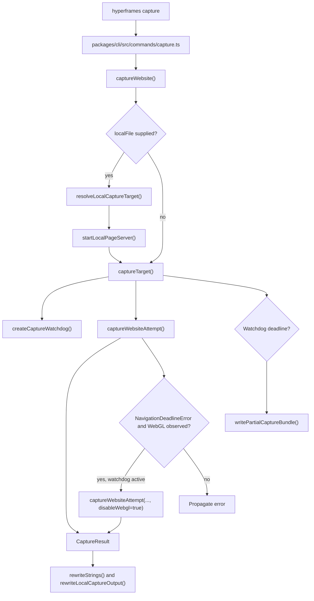
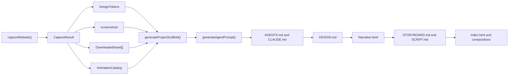
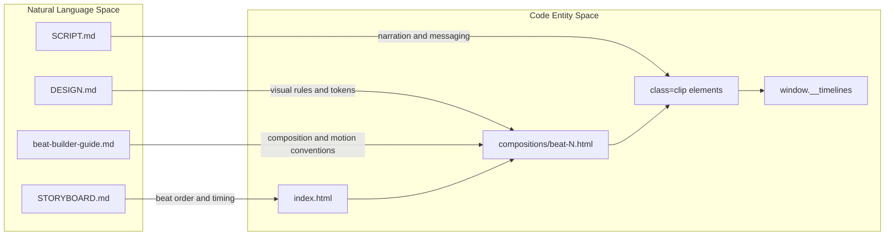

<!-- source: DeepWiki mcp.deepwiki.com · repo heygen-com/hyperframes · page 11.3 Website Capture Skill · fetched 2026-11-02 -->

# Website Capture Skill

Relevant source files

The following files were used as context for generating this wiki page:

- [packages/cli/src/capture/agentPromptGenerator.ts](packages/cli/src/capture/agentPromptGenerator.ts)
- [packages/cli/src/capture/assetDownloader.test.ts](packages/cli/src/capture/assetDownloader.test.ts)
- [packages/cli/src/capture/assetDownloader.ts](packages/cli/src/capture/assetDownloader.ts)
- [packages/cli/src/capture/captureAttempt.test.ts](packages/cli/src/capture/captureAttempt.test.ts)
- [packages/cli/src/capture/captureAttempt.ts](packages/cli/src/capture/captureAttempt.ts)
- [packages/cli/src/capture/captureErrors.ts](packages/cli/src/capture/captureErrors.ts)
- [packages/cli/src/capture/captureFile.test.ts](packages/cli/src/capture/captureFile.test.ts)
- [packages/cli/src/capture/captureFile.ts](packages/cli/src/capture/captureFile.ts)
- [packages/cli/src/capture/contentExtractor.test.ts](packages/cli/src/capture/contentExtractor.test.ts)
- [packages/cli/src/capture/contentExtractor.ts](packages/cli/src/capture/contentExtractor.ts)
- [packages/cli/src/capture/coreExtractionPhase.test.ts](packages/cli/src/capture/coreExtractionPhase.test.ts)
- [packages/cli/src/capture/coreExtractionPhase.ts](packages/cli/src/capture/coreExtractionPhase.ts)
- [packages/cli/src/capture/index.ts](packages/cli/src/capture/index.ts)
- [packages/cli/src/capture/index.watchdog.test.ts](packages/cli/src/capture/index.watchdog.test.ts)
- [packages/cli/src/capture/launchCaptureBrowser.test.ts](packages/cli/src/capture/launchCaptureBrowser.test.ts)
- [packages/cli/src/capture/launchCaptureBrowser.ts](packages/cli/src/capture/launchCaptureBrowser.ts)
- [packages/cli/src/capture/localPage.browser.test.ts](packages/cli/src/capture/localPage.browser.test.ts)
- [packages/cli/src/capture/localPage.output.test.ts](packages/cli/src/capture/localPage.output.test.ts)
- [packages/cli/src/capture/mediaCapture.lottie-dedup.test.ts](packages/cli/src/capture/mediaCapture.lottie-dedup.test.ts)
- [packages/cli/src/capture/mediaCapture.test.ts](packages/cli/src/capture/mediaCapture.test.ts)
- [packages/cli/src/capture/mediaCapture.ts](packages/cli/src/capture/mediaCapture.ts)
- [packages/cli/src/capture/partialCapture.test.ts](packages/cli/src/capture/partialCapture.test.ts)
- [packages/cli/src/capture/partialCapture.ts](packages/cli/src/capture/partialCapture.ts)
- [packages/cli/src/capture/postExtractionPhase.ts](packages/cli/src/capture/postExtractionPhase.ts)
- [packages/cli/src/capture/scaffolding.ts](packages/cli/src/capture/scaffolding.ts)
- [packages/cli/src/capture/screenshotCapture.degrade.test.ts](packages/cli/src/capture/screenshotCapture.degrade.test.ts)
- [packages/cli/src/capture/screenshotCapture.test.ts](packages/cli/src/capture/screenshotCapture.test.ts)
- [packages/cli/src/capture/screenshotCapture.ts](packages/cli/src/capture/screenshotCapture.ts)
- [packages/cli/src/capture/types.ts](packages/cli/src/capture/types.ts)
- [packages/cli/src/commands/capture.test.ts](packages/cli/src/commands/capture.test.ts)
- [packages/cli/src/commands/capture.ts](packages/cli/src/commands/capture.ts)
- [packages/core/src/removeTree.test.ts](packages/core/src/removeTree.test.ts)
- [packages/core/src/removeTree.ts](packages/core/src/removeTree.ts)

## Purpose and scope

The website capture workflow turns a public website or local HTML page into a structured capture directory for an AI agent to use when building a HyperFrames video. The CLI entry point is `hyperframes capture`; the capture result includes extracted HTML, design tokens, screenshots, downloaded assets, warnings, and structured phase status. Capture can be configured for JSON output and for skipping asset downloads or optional vision captioning. [packages/cli/src/commands/capture.ts:54-107]()[packages/cli/src/capture/types.ts:44-110]()

This page covers the capture implementation and its handoff into the website-to-HyperFrames creation workflow: browser capture, extraction, asset and media processing, contact sheets, agent instructions, `DESIGN.md`, storyboard planning, composition building, and validation. The available capture implementation details are concentrated in `packages/cli/src/capture`; downstream skill steps are described at a workflow level where their implementation files are not included in the supplied source excerpts. [packages/cli/src/capture/index.ts:18-85]()[packages/cli/src/capture/types.ts:1-8]()[skills/website-to-hyperframes/SKILL.md:17-101]()

Sources: [packages/cli/src/commands/capture.ts:54-107]()[packages/cli/src/capture/types.ts:1-8]()[packages/cli/src/capture/types.ts:44-110]()[packages/cli/src/capture/index.ts:18-85]()[skills/website-to-hyperframes/SKILL.md:17-101]()

---

## Workflow overview

The workflow has two related layers: the CLI capture pipeline produces the data bundle, and the website-to-HyperFrames skill uses that bundle to design and build a video project. Capture phases are named in `CapturePhase`; progress records include a schema version, status, remaining time, and an optional reason for degraded completion. [packages/cli/src/capture/types.ts:12-42]()

| Step | Workflow phase | Purpose and outputs |
|---|---|---|
| 0 | Capture | Capture page content, screenshots, design tokens, assets, and available animation/media metadata into the output directory. The result type records these fields and any warnings or dropped-asset counts. [packages/cli/src/capture/types.ts:75-110]() |
| 1 | Design | Interpret captured design evidence and establish the visual direction in `DESIGN.md`. [skills/website-to-hyperframes/SKILL.md:17-101]() |
| 2 | Brief | Define the message and narrative arc for the video. [skills/website-to-hyperframes/SKILL.md:17-101]() |
| 3 | Storyboard | Plan beats and script in `STORYBOARD.md` and `SCRIPT.md`. [skills/website-to-hyperframes/SKILL.md:17-101]() |
| 4 | Voiceover and timing | Generate or prepare narration and align it to the planned beats. [skills/website-to-hyperframes/SKILL.md:17-101]() |
| 5 | Build | Author the HyperFrames project, including `index.html` and composition files. [skills/website-to-hyperframes/SKILL.md:17-101]() |
| 6 | Validate | Check the built project against the workflow’s visual, timing, and motion requirements. [skills/website-to-hyperframes/SKILL.md:17-101]() |

The capture scaffold is intentionally a **data directory**, not a completed video project: `generateProjectScaffold` creates `meta.json` when absent and generates `AGENTS.md` and `CLAUDE.md`; it does not create `index.html`. The skill’s build step is responsible for creating the project composition files. [packages/cli/src/capture/scaffolding.ts:38-90]()[skills/website-to-hyperframes/SKILL.md:17-101]()

Sources: [packages/cli/src/capture/types.ts:12-42]()[packages/cli/src/capture/types.ts:75-110]()[packages/cli/src/capture/scaffolding.ts:38-90]()[skills/website-to-hyperframes/SKILL.md:17-101]()

---

## CLI entry point and options

`packages/cli/src/commands/capture.ts` defines the `capture` command. It accepts a positional URL, a local-file input, an output directory, asset and vision options, a screenshot limit, separate navigation and capture-budget settings, JSON output, and a video-download mode. The command description is “Capture a website as editable HyperFrames components.” [packages/cli/src/commands/capture.ts:54-126]()

| Option | Role |
|---|---|
| `url` | Public website URL; omitted for local-file capture or video-download mode. [packages/cli/src/commands/capture.ts:59-63]() |
| `--local-file` | Capture a local HTML file or directory `index.html`. [packages/cli/src/commands/capture.ts:65-69]() |
| `--local-root` | Set the directory a local page may read from; requires `--local-file`. [packages/cli/src/commands/capture.ts:70-74]() |
| `-o`, `--output` | Select the output directory; the documented default is `./capture` with numbered alternatives when that default already exists. [packages/cli/src/commands/capture.ts:75-79]() |
| `--skip-assets` | Skip image and SVG asset downloads. [packages/cli/src/commands/capture.ts:80-84]() |
| `--skip-vision` | Skip optional AI image captioning. [packages/cli/src/commands/capture.ts:85-89]() |
| `--max-screenshots` | Set the maximum page-capture file count, including the full-page plate but excluding derived contact sheets. The default is `DEFAULT_MAX_SCREENSHOTS` (21). [packages/cli/src/commands/capture.ts:90-93]()[packages/cli/src/capture/types.ts:23-25]() |
| `--timeout` | Set the page-load timeout, documented as 120,000 ms by default. [packages/cli/src/commands/capture.ts:94-97]() |
| `--capture-budget` | Set the cooperative post-navigation budget, separately from page-load timeout. It is explicitly not a hard wall-clock timeout and cannot interrupt already-started native/core work. [packages/cli/src/commands/capture.ts:98-102]() |
| `--json` | Request programmatic JSON output. [packages/cli/src/commands/capture.ts:103-107]() |
| `--video` and related flags | Switch to video-download mode and select a manifest entry by index or exact URL, or list entries. [packages/cli/src/commands/capture.ts:108-125]() |

The command validates that local-file and URL inputs are not combined, that `--local-root` is not supplied without `--local-file`, and that a URL is present and parseable for URL capture. It also parses positive integer values for the capture budget and screenshot limit. [packages/cli/src/commands/capture.ts:17-29]()[packages/cli/src/commands/capture.ts:148-191]()

For local-file input, the command resolves the file and root before capture. `captureWebsite` then serves the local page, rewrites local references for capture, and restores local-file references in the result and output during cleanup. Remote subresources remain subject to the public-address policy described by the CLI option. [packages/cli/src/commands/capture.ts:148-162]()[packages/cli/src/capture/index.ts:18-35]()[packages/cli/src/commands/capture.ts:65-74]()

Sources: [packages/cli/src/commands/capture.ts:17-29]()[packages/cli/src/commands/capture.ts:54-126]()[packages/cli/src/commands/capture.ts:148-191]()[packages/cli/src/capture/index.ts:18-35]()[packages/cli/src/capture/types.ts:23-25]()

---

## Capture orchestration and two-pass browser workflow

`captureWebsite` is the public capture entry point. For URL capture, it calls `captureTarget`; for local-file capture, it resolves and starts a local page server, runs the same target capture against the server URL, rewrites returned strings, and closes the server in a `finally` block. [packages/cli/src/capture/index.ts:18-35]()

`captureTarget` creates a watchdog and partial-capture state, then invokes `captureWebsiteAttempt`. A whole-capture deadline produces a partial bundle through `writePartialCaptureBundle`. A navigation deadline can trigger one retry with WebGL disabled, but only when the watchdog has not expired and the error reports that WebGL was observed. [packages/cli/src/capture/index.ts:38-85]()

The CLI phase model names the capture work as `browser`, `navigation`, `core-extraction`, `fonts`, `assets`, `vision`, `contact-sheets`, `scaffold`, and `complete`. The supplied source excerpts establish these phase names and the orchestration retry behavior, but do not show the internals of `captureWebsiteAttempt`; therefore, the sequence below distinguishes the visible orchestration from the skill’s higher-level two-pass description. [packages/cli/src/capture/types.ts:12-42]()[packages/cli/src/capture/index.ts:38-72]()[skills/website-to-hyperframes/SKILL.md:17-101]()

**Diagram: Capture orchestration mapped to implementation entities**

Sources: [packages/cli/src/commands/capture.ts:54-63]()[packages/cli/src/capture/index.ts:18-35]()[packages/cli/src/capture/index.ts:38-85]()[packages/cli/src/capture/types.ts:75-110]()

### Two-pass capture and evidence collection

The website-to-HyperFrames workflow describes capture as a two-pass Puppeteer process: a full-JavaScript pass gathers animation and page evidence, and a second pass supports more stable extraction. The provided source excerpt for `captureWebsite` independently confirms a specific **conditional retry**: if navigation times out after WebGL was observed, the attempt is retried once with WebGL disabled. It does not establish that every ordinary capture always performs two navigations, nor does it expose the implementation details of the passes. [skills/website-to-hyperframes/SKILL.md:17-101]()[packages/cli/src/capture/index.ts:43-69]()

The capture result data contract includes the extracted head and body HTML, CSSOM rules, HTML attributes, viewport dimensions, and full-page height. Design tokens include page metadata, CSS variables, fonts, colors, headings, calls to action, SVGs, and section information. The `CaptureResult` also records HTTP status, screenshots, assets, dropped-asset counts, an optional animation catalog, warnings, and the final phase record. [packages/cli/src/capture/types.ts:75-127]()[packages/cli/src/capture/types.ts:138-203]()

Sources: [skills/website-to-hyperframes/SKILL.md:17-101]()[packages/cli/src/capture/index.ts:43-69]()[packages/cli/src/capture/types.ts:75-127]()[packages/cli/src/capture/types.ts:138-203]()

---

## Extraction, screenshots, and page analysis

### Content extraction and library detection

`contentExtractor.ts` provides content-extraction helpers for library detection, visible text extraction, vision captioning, and asset description generation. Its `detectLibraries` function inspects browser globals, DOM fingerprints, and script URLs; it can also use captured shader source to infer WebGL frameworks. The function returns a deduplicated list and treats page-evaluation failures as non-blocking. [packages/cli/src/capture/contentExtractor.ts:1-8]()[packages/cli/src/capture/contentExtractor.ts:105-179]()

The detection logic recognizes libraries and site technologies including GSAP, Three.js, PixiJS, Babylon.js, Lottie, Next.js, Nuxt, Webflow, React, Svelte, Tailwind CSS, Framer Motion, Anime.js, Matter.js, and Lenis. These findings are evidence for later agent analysis, not a guarantee that the capture recreates the original site’s runtime behavior. [packages/cli/src/capture/contentExtractor.ts:111-169]()

All `page.evaluate()` calls in the content extraction helpers use string expressions to avoid `tsx`/esbuild `__name` injection issues. The same implementation note appears in screenshot and media capture helpers. [packages/cli/src/capture/contentExtractor.ts:1-9]()[packages/cli/src/capture/screenshotCapture.ts:1-6]()[packages/cli/src/capture/mediaCapture.ts:1-8]()

Sources: [packages/cli/src/capture/contentExtractor.ts:1-9]()[packages/cli/src/capture/contentExtractor.ts:105-179]()[packages/cli/src/capture/screenshotCapture.ts:1-6]()[packages/cli/src/capture/mediaCapture.ts:1-8]()

### Screenshot capture and full-page plate

`screenshotCapture.ts` captures viewport screenshots while traversing the page in viewport-sized steps with overlap. It preserves sticky and fixed elements in those viewport images so they represent the page’s natural browsing state. The configured maximum screenshot count includes the full-page plate. [packages/cli/src/capture/screenshotCapture.ts:17-28]()

The full-page plate is a separate artifact. `captureFullPagePlate` temporarily changes fixed and sticky elements to static positioning, measures the resulting document height, checks Chrome’s 16,384-pixel height limit, checks the remaining capture budget, and takes a full-page PNG. It verifies the produced PNG height before writing `screenshots/full-page.png`; if the document exceeds the limit or the budget is exhausted, it omits the plate with a reason. [packages/cli/src/capture/screenshotCapture.ts:30-37]()[packages/cli/src/capture/screenshotCapture.ts:81-137]()

Screenshot failures are classified: certain failures, including a closed browser target/session, a refused output directory, or a degradable evaluation timeout, are rethrown; other individual shot failures can be recorded and capture can proceed. [packages/cli/src/capture/screenshotCapture.ts:44-68]()

Sources: [packages/cli/src/capture/screenshotCapture.ts:17-37]()[packages/cli/src/capture/screenshotCapture.ts:44-68]()[packages/cli/src/capture/screenshotCapture.ts:81-137]()

### Design tokens

`DesignTokens` is the structured design-evidence contract. It includes title and description metadata, an optional Open Graph image, CSS custom properties, fonts and weights, ranked colors, optional color-usage statistics, headings, calls to action, SVG metadata, and detected sections with bounding information. [packages/cli/src/capture/types.ts:129-203]()

The token structure supplies structured inputs for the workflow’s design analysis and `DESIGN.md`; it should be treated as evidence from the captured page rather than as a prewritten brand guide. [packages/cli/src/capture/types.ts:138-203]()[skills/website-to-hyperframes/SKILL.md:17-101]()

Sources: [packages/cli/src/capture/types.ts:129-203]()[skills/website-to-hyperframes/SKILL.md:17-101]()

---

## Asset, media, and vision processing

### Asset downloading and accounting

`assetDownloader.ts` uses the asset catalog as its source of truth for image downloads, so `srcset` variants can be deduplicated and the highest-resolution candidate retained. It handles downloaded assets such as SVGs, images, favicons, and video posters. [packages/cli/src/capture/assetDownloader.ts:1-16]()

Asset drops are categorized as `size-floor`, `size-ceiling`, `budget-exhausted`, `cap-reached`, and `unavailable`. `noDrops`, `mergeDrops`, and `totalDrops` provide the zero tally, combine tallies, and calculate a total; `CaptureResult.dropped` exposes the counts in the overall result. [packages/cli/src/capture/assetDownloader.ts:33-80]()[packages/cli/src/capture/types.ts:97-103]()

Inline SVGs are normalized for standalone-file use by `toStandaloneSvg`: it adds the SVG namespace when missing and adds the XLink namespace when needed by the markup. SVG filenames can be derived from a content hash using `svgContentHashSlug`. [packages/cli/src/capture/assetDownloader.ts:82-112]()

Network asset fetching uses `publicRequest` and the engine’s `isBlockedNetworkHost` policy. The capture tests exercise the related `isPrivateUrl` and `safeFetch` behavior, including rejecting private or metadata addresses and rechecking redirect targets before following them. [packages/cli/src/capture/assetDownloader.ts:8-16]()[packages/cli/src/capture/assetDownloader.test.ts:39-92]()[packages/cli/src/capture/assetDownloader.test.ts:94-178]()

Sources: [packages/cli/src/capture/assetDownloader.ts:1-16]()[packages/cli/src/capture/assetDownloader.ts:33-80]()[packages/cli/src/capture/assetDownloader.ts:82-112]()[packages/cli/src/capture/assetDownloader.test.ts:39-92]()[packages/cli/src/capture/assetDownloader.test.ts:94-178]()[packages/cli/src/capture/types.ts:97-103]()

### Lottie and video evidence

`saveLottieAnimations` writes discovered Lottie animations, supports JSON and `.lottie` archive inputs, deduplicates saved data by content hash, validates the JSON, and applies byte and time budgets. `renderLottiePreviews` renders preview images for eligible saved animations using Puppeteer and `lottie-web`, and writes manifest metadata for the animations and successful previews. [packages/cli/src/capture/mediaCapture.ts:44-107]()[packages/cli/src/capture/mediaCapture.ts:110-178]()

The media helper module also exports `captureVideoManifest`; the supplied excerpt does not include its implementation. `CaptureResult.animationCatalog` is optional and is described as animation-catalog data captured during a full-JavaScript page load. [packages/cli/src/capture/mediaCapture.ts:1-8]()[packages/cli/src/capture/types.ts:97-110]()

Sources: [packages/cli/src/capture/mediaCapture.ts:1-8]()[packages/cli/src/capture/mediaCapture.ts:44-107]()[packages/cli/src/capture/mediaCapture.ts:110-178]()[packages/cli/src/capture/types.ts:97-110]()

### Optional vision captions

`contentExtractor.ts` defines a bounded vision-request helper that races a request against a timeout and aborts the request when the timeout fires. `resolveVisionPhaseCompletion` maps exhausted budgets, internal errors, request timeouts, and provider failures to degraded phase reasons; otherwise it reports completion. [packages/cli/src/capture/contentExtractor.ts:31-69]()[packages/cli/src/capture/contentExtractor.ts:71-103]()

The command exposes `--skip-vision`, and the tests confirm that the option is passed into capture options. The supplied excerpt does not show the complete captioning implementation or establish the exact output filename for captions, so the output should be understood through the capture result and generated agent instructions rather than assumed from this interface alone. [packages/cli/src/commands/capture.ts:85-89]()[packages/cli/src/capture/contentExtractor.test.ts:50-97]()

Sources: [packages/cli/src/capture/contentExtractor.ts:31-69]()[packages/cli/src/capture/contentExtractor.ts:71-103]()[packages/cli/src/commands/capture.ts:85-89]()[packages/cli/src/capture/contentExtractor.test.ts:50-97]()

---

## Contact sheets and capture directory

The phase type includes `contact-sheets`, and the workflow uses contact sheets as a visual index of captured material. The existing website-to-HyperFrames workflow describes scroll, SVG, and Lottie contact sheets, but the contact-sheet implementation file is not included in the supplied excerpts; consequently, its function signatures and exact output paths are not specified here. [packages/cli/src/capture/types.ts:12-25]()[skills/website-to-hyperframes/SKILL.md:17-101]()

The capture result is a data bundle, not a finished HyperFrames composition. The key typed result fields are extracted HTML, screenshots, design tokens, assets, dropped-asset counts, optional animation catalog data, warnings, and the final phase record. [packages/cli/src/capture/types.ts:75-110]()

Sources: [packages/cli/src/capture/types.ts:12-25]()[packages/cli/src/capture/types.ts:75-110]()[skills/website-to-hyperframes/SKILL.md:17-101]()

---

## Agent prompt, `DESIGN.md`, and storyboard handoff

`generateProjectScaffold` writes `meta.json` if it does not already exist, using the captured site name and title. It then dynamically imports `generateAgentPrompt` and invokes it with the output directory, source URL, design tokens, animation catalog, screenshot/Lottie/shader availability, cataloged assets, and detected libraries. It reports prompt-generation failures as warnings rather than failing the entire scaffold step. [packages/cli/src/capture/scaffolding.ts:38-90]()

The generated `AGENTS.md` and `CLAUDE.md` are the agent-facing handoff files. The scaffold implementation explicitly leaves `index.html` and composition authoring to the agent’s later build step, avoiding treating the capture data folder as a ready-to-render project. [packages/cli/src/capture/scaffolding.ts:38-90]()

In the broader workflow, the agent uses captured evidence to create `DESIGN.md`, formulate a narrative brief, and write `STORYBOARD.md` and `SCRIPT.md` before building the HyperFrames composition. Those workflow artifacts are described by the website-to-HyperFrames skill; the supplied source excerpts do not include the corresponding skill prompt or storyboard reference implementations. [skills/website-to-hyperframes/SKILL.md:17-101]()

**Diagram: Capture data to agent-facing workflow artifacts**

Sources: [packages/cli/src/capture/index.ts:18-35]()[packages/cli/src/capture/types.ts:75-110]()[packages/cli/src/capture/scaffolding.ts:38-90]()[skills/website-to-hyperframes/SKILL.md:17-101]()

Sources: [packages/cli/src/capture/scaffolding.ts:38-90]()[packages/cli/src/capture/types.ts:75-110]()[skills/website-to-hyperframes/SKILL.md:17-101]()

---

## Composition strategy and build phase

The workflow’s build phase translates the storyboard into a HyperFrames project. The existing skill description distinguishes faster-paced work, which may use a single composition with beat elements, from slower-paced work, which may use per-beat sub-compositions. It also describes avoiding a slideshow made only from unmodified website screenshots by rebuilding the visual language and using captured assets as supporting material. [skills/website-to-hyperframes/references/step-5-build.md:1-147]()[skills/website-to-hyperframes/references/beat-builder-guide.md:1-85]()

The capture scaffold does not enforce or generate that composition strategy: it deliberately does not write `index.html`. The storyboard and agent workflow therefore bridge captured website evidence to the composition structure. [packages/cli/src/capture/scaffolding.ts:57-70]()[skills/website-to-hyperframes/references/step-5-build.md:1-147]()

**Diagram: Natural-language planning artifacts mapped to HyperFrames entities**

Sources: [skills/website-to-hyperframes/references/step-5-build.md:1-147]()[skills/website-to-hyperframes/references/beat-builder-guide.md:1-85]()[packages/cli/src/capture/scaffolding.ts:57-70]()

Sources: [skills/website-to-hyperframes/references/step-5-build.md:1-147]()[skills/website-to-hyperframes/references/beat-builder-guide.md:1-85]()[packages/cli/src/capture/scaffolding.ts:57-70]()

---

## Validation and quality gate

The workflow describes a validation step after composition building. The existing skill content identifies `w2h-verify.mjs` as a quality gate for brand-asset usage, headline legibility, timeline coverage, and alignment with storyboard media and sound-effect timing. The implementation of that script is not included in the supplied source excerpts, so these checks are documented here as workflow behavior rather than as a detailed account of their code paths. [skills/website-to-hyperframes/references/step-6-validate.md:1-88]()[skills/website-to-hyperframes/scripts/w2h-verify.mjs:26-72]()

Capture itself also exposes structured phase records and partial results. A deadline emits a degraded `complete` phase with reason `deadline` and writes a partial capture bundle, while optional vision work can report a degraded reason such as budget exhaustion, request timeout, provider error, or internal error. [packages/cli/src/capture/index.ts:75-85]()[packages/cli/src/capture/contentExtractor.ts:47-69]()[packages/cli/src/capture/types.ts:27-42]()

Sources: [skills/website-to-hyperframes/references/step-6-validate.md:1-88]()[skills/website-to-hyperframes/scripts/w2h-verify.mjs:26-72]()[packages/cli/src/capture/index.ts:75-85]()[packages/cli/src/capture/contentExtractor.ts:47-69]()[packages/cli/src/capture/types.ts:27-42]()

---

## Operational behavior and failure handling

The CLI distinguishes page-load timeout, cooperative post-navigation budget, and optional whole-capture deadline. The command description explicitly warns that the post-navigation budget cannot interrupt work already underway in native or core code; the capture watchdog supplies the separate deadline path used to return a partial bundle. [packages/cli/src/commands/capture.ts:94-102]()[packages/cli/src/capture/types.ts:55-70]()[packages/cli/src/capture/index.ts:43-50]()[packages/cli/src/capture/index.ts:75-85]()

Capture phases can complete in a degraded state with a reason such as `budget-exhausted`, `disabled`, `request-timeout`, `provider-error`, `internal-error`, `blocked`, `webgl-disabled-retry`, or `deadline`. Asset omissions are reported separately through `AssetDropCounts`, so absent assets can be distinguished by the downloader’s recorded drop reason. [packages/cli/src/capture/types.ts:27-42]()[packages/cli/src/capture/assetDownloader.ts:33-80]()

Sources: [packages/cli/src/commands/capture.ts:94-102]()[packages/cli/src/capture/types.ts:27-70]()[packages/cli/src/capture/index.ts:43-50]()[packages/cli/src/capture/index.ts:75-85]()[packages/cli/src/capture/assetDownloader.ts:33-80]()

---

## Summary

The Website Capture Skill combines a CLI capture pipeline with an agent-led creation workflow. The capture implementation coordinates browser attempts, time budgets, partial results, page and design evidence, screenshots, asset downloads, optional vision processing, and scaffolded agent instructions. The later workflow interprets that data as `DESIGN.md`, a narrative brief, `STORYBOARD.md`, and `SCRIPT.md`, then builds and validates a HyperFrames composition. [packages/cli/src/capture/index.ts:18-85]()[packages/cli/src/capture/types.ts:75-110]()[packages/cli/src/capture/scaffolding.ts:38-90]()[skills/website-to-hyperframes/SKILL.md:17-101]()

Sources: [packages/cli/src/capture/index.ts:18-85]()[packages/cli/src/capture/types.ts:75-110]()[packages/cli/src/capture/scaffolding.ts:38-90]()[skills/website-to-hyperframes/SKILL.md:17-101]()

---

