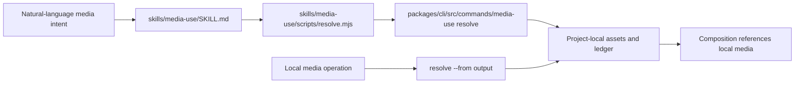
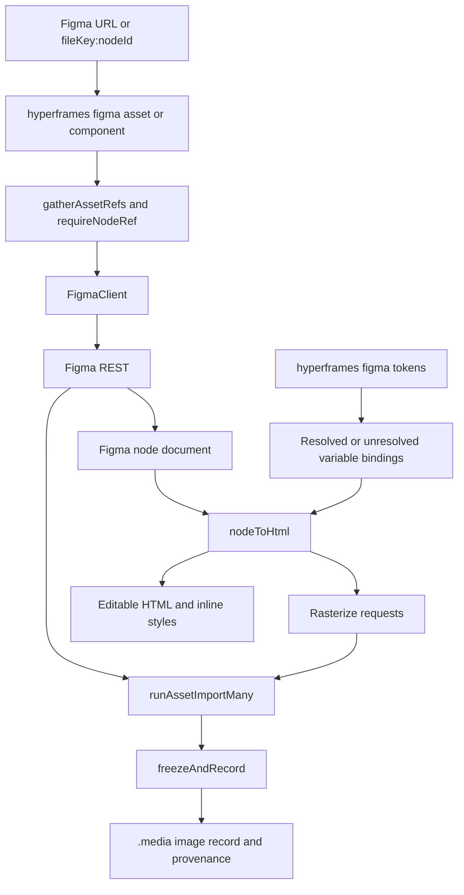
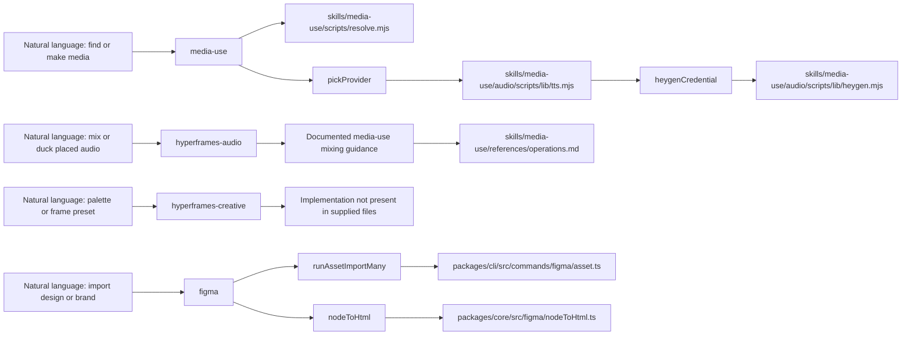

<!-- source: DeepWiki mcp.deepwiki.com · repo heygen-com/hyperframes · page 11.4 Media, Audio, Creative and Figma Skills · fetched 2026-11-02 -->

# Media, Audio, Creative and Figma Skills

Relevant source files

The following files were used as context for generating this wiki page:

- [docs/guides/figma.mdx](docs/guides/figma.mdx)
- [packages/cli/src/commands/figma.ts](packages/cli/src/commands/figma.ts)
- [packages/cli/src/commands/figma/asset.test.ts](packages/cli/src/commands/figma/asset.test.ts)
- [packages/cli/src/commands/figma/asset.ts](packages/cli/src/commands/figma/asset.ts)
- [packages/cli/src/commands/figma/cliError.ts](packages/cli/src/commands/figma/cliError.ts)
- [packages/cli/src/commands/figma/component.test.ts](packages/cli/src/commands/figma/component.test.ts)
- [packages/cli/src/commands/figma/component.ts](packages/cli/src/commands/figma/component.ts)
- [packages/cli/src/commands/figma/tokens.test.ts](packages/cli/src/commands/figma/tokens.test.ts)
- [packages/cli/src/commands/figma/tokens.ts](packages/cli/src/commands/figma/tokens.ts)
- [packages/cli/src/media-use/lib/ff-binaries.mjs](packages/cli/src/media-use/lib/ff-binaries.mjs)
- [packages/cli/src/media-use/lib/manifest.mjs](packages/cli/src/media-use/lib/manifest.mjs)
- [packages/cli/src/media-use/lib/probe.mjs](packages/cli/src/media-use/lib/probe.mjs)
- [packages/cli/src/media-use/lib/probe.test.mjs](packages/cli/src/media-use/lib/probe.test.mjs)
- [packages/cli/src/media-use/lib/tts-local-provider.mjs](packages/cli/src/media-use/lib/tts-local-provider.mjs)
- [packages/cli/src/media-use/resolve.mjs](packages/cli/src/media-use/resolve.mjs)
- [packages/cli/src/media-use/resolve.test.mjs](packages/cli/src/media-use/resolve.test.mjs)
- [packages/core/src/figma/client.test.ts](packages/core/src/figma/client.test.ts)
- [packages/core/src/figma/client.ts](packages/core/src/figma/client.ts)
- [packages/core/src/figma/index.ts](packages/core/src/figma/index.ts)
- [packages/core/src/figma/manifest.ts](packages/core/src/figma/manifest.ts)
- [packages/core/src/figma/mediaIndex.test.ts](packages/core/src/figma/mediaIndex.test.ts)
- [packages/core/src/figma/mediaIndex.ts](packages/core/src/figma/mediaIndex.ts)
- [packages/core/src/figma/nodeToHtml.test.ts](packages/core/src/figma/nodeToHtml.test.ts)
- [packages/core/src/figma/nodeToHtml.ts](packages/core/src/figma/nodeToHtml.ts)
- [packages/core/src/figma/tokensToVariables.test.ts](packages/core/src/figma/tokensToVariables.test.ts)
- [packages/core/src/figma/tokensToVariables.ts](packages/core/src/figma/tokensToVariables.ts)
- [packages/core/src/figma/types.ts](packages/core/src/figma/types.ts)
- [packages/producer/src/services/distributed/shared.ffmpegVersion.test.ts](packages/producer/src/services/distributed/shared.ffmpegVersion.test.ts)
- [skills/figma/SKILL.md](skills/figma/SKILL.md)
- [skills/media-use/SKILL.md](skills/media-use/SKILL.md)
- [skills/media-use/audio/references/sfx.md](skills/media-use/audio/references/sfx.md)
- [skills/media-use/audio/references/tts-to-captions.md](skills/media-use/audio/references/tts-to-captions.md)
- [skills/media-use/audio/references/tts.md](skills/media-use/audio/references/tts.md)
- [skills/media-use/audio/scripts/audio.mjs](skills/media-use/audio/scripts/audio.mjs)
- [skills/media-use/audio/scripts/audio.test.mjs](skills/media-use/audio/scripts/audio.test.mjs)
- [skills/media-use/audio/scripts/gemini-pipeline.test.mjs](skills/media-use/audio/scripts/gemini-pipeline.test.mjs)
- [skills/media-use/audio/scripts/heygen-tts.mjs](skills/media-use/audio/scripts/heygen-tts.mjs)
- [skills/media-use/audio/scripts/heygen-tts.test.mjs](skills/media-use/audio/scripts/heygen-tts.test.mjs)
- [skills/media-use/audio/scripts/heygen-voice.mjs](skills/media-use/audio/scripts/heygen-voice.mjs)
- [skills/media-use/audio/scripts/heygen-voice.test.mjs](skills/media-use/audio/scripts/heygen-voice.test.mjs)
- [skills/media-use/audio/scripts/lib/audio-meta.mjs](skills/media-use/audio/scripts/lib/audio-meta.mjs)
- [skills/media-use/audio/scripts/lib/audio-meta.test.mjs](skills/media-use/audio/scripts/lib/audio-meta.test.mjs)
- [skills/media-use/audio/scripts/lib/gemini-auth.mjs](skills/media-use/audio/scripts/lib/gemini-auth.mjs)
- [skills/media-use/audio/scripts/lib/gemini-auth.py](skills/media-use/audio/scripts/lib/gemini-auth.py)
- [skills/media-use/audio/scripts/lib/gemini-auth.test.mjs](skills/media-use/audio/scripts/lib/gemini-auth.test.mjs)
- [skills/media-use/audio/scripts/lib/heygen.mjs](skills/media-use/audio/scripts/lib/heygen.mjs)
- [skills/media-use/audio/scripts/lib/heygen.test.mjs](skills/media-use/audio/scripts/lib/heygen.test.mjs)
- [skills/media-use/audio/scripts/lib/media-record.mjs](skills/media-use/audio/scripts/lib/media-record.mjs)
- [skills/media-use/audio/scripts/lib/media-record.test.mjs](skills/media-use/audio/scripts/lib/media-record.test.mjs)
- [skills/media-use/audio/scripts/lib/sfx.mjs](skills/media-use/audio/scripts/lib/sfx.mjs)
- [skills/media-use/audio/scripts/lib/sfx.test.mjs](skills/media-use/audio/scripts/lib/sfx.test.mjs)
- [skills/media-use/audio/scripts/lib/tts.cleanup.test.mjs](skills/media-use/audio/scripts/lib/tts.cleanup.test.mjs)
- [skills/media-use/audio/scripts/lib/tts.mjs](skills/media-use/audio/scripts/lib/tts.mjs)
- [skills/media-use/audio/scripts/lib/tts.test.mjs](skills/media-use/audio/scripts/lib/tts.test.mjs)
- [skills/media-use/references/meta.md](skills/media-use/references/meta.md)
- [skills/media-use/references/operations.md](skills/media-use/references/operations.md)
- [skills/media-use/references/setup-providers.md](skills/media-use/references/setup-providers.md)
- [skills/media-use/scripts/lib/manifest.mjs](skills/media-use/scripts/lib/manifest.mjs)
- [skills/media-use/scripts/resolve.mjs](skills/media-use/scripts/resolve.mjs)

## Purpose and scope

This page describes the media and design skills covered here: `media-use` for resolving and preparing local media, `hyperframes-audio` for working with placed audio and carve, `hyperframes-creative` for palettes and frame presets, and `figma` for importing design assets, tokens, components, and motion guidance. The available implementation details are strongest for `media-use` and Figma; the supplied files identify audio and creative tasks but do not include their skill or implementation source files. [skills/media-use/SKILL.md:1-10]()

Sources: [skills/media-use/SKILL.md:1-10]()

## 1. `media-use` skill

### Purpose and asset lifecycle

`media-use` treats media as project-local assets: media is placed in `assets/` with a ledger record, and renders do not fetch it at render time. Its primary entry point is the `media-use resolve` command, which accepts a media type and natural-language intent. `--candidates` lists reusable assets for human or agent selection; `--from` ingests an existing file. [skills/media-use/SKILL.md:8-16]()

The skill distinguishes finding or generating assets from operating on them. For local operations such as cutting, reframing, or stitching, its guidance points to tools such as FFmpeg; after an operation, register the output with `resolve --from <output> --type <type>` so it enters the asset ledger and global reuse path. In-composition trimming can instead use clip timing attributes, avoiding a new media file. [skills/media-use/references/operations.md:1-10]()[skills/media-use/references/operations.md:12-20]()[skills/media-use/references/operations.md:59-65]()

| Need | Documented route |
|---|---|
| BGM | HeyGen catalog or local MusicGen |
| SFX | Openverse or bundled offline sounds |
| Voiceover | HeyGen voices or local `hyperframes tts` |
| Images and icons | HeyGen asset search or local FLUX when installed |
| Logos | Sources such as theSVG, GitHub avatar, and favicon; the skill says not to redraw logos |
| Transcripts | `hyperframes transcribe` |
| Cutouts | HeyGen background removal or `hyperframes remove-background` |
| Grades and looks | `hyperframes media-treatment` |

These routes and their provider qualifications are documented by the skill; local models are optional installs, and `--local-only` skips network providers. [skills/media-use/SKILL.md:18-36]()

Sources: [skills/media-use/SKILL.md:8-16]()[skills/media-use/SKILL.md:18-36]()[skills/media-use/references/operations.md:1-10]()[skills/media-use/references/operations.md:59-65]()

### Resolver launcher and implementation boundary

The skill’s `scripts/resolve.mjs` is a launcher, not the resolver implementation itself. In a plugin installation it detects `HYPERFRAMES_PLUGIN_VERSION` and invokes the version-pinned CLI through `resolveNpxInvocation`; otherwise it runs the built CLI when present, falling back to the CLI TypeScript entry point. [skills/media-use/scripts/resolve.mjs:8-31]()

The supplied files do not show the resolver’s provider registry or manifest implementation. Accordingly, this page does not attribute candidate scoring, manifest locking, or provider dispatch to particular unseen modules. The documented user-facing contract is that resolution prints a one-line result containing an ID, path, type, and metadata. [skills/media-use/SKILL.md:10-16]()

Sources: [skills/media-use/scripts/resolve.mjs:8-31]()[skills/media-use/SKILL.md:10-16]()

### Media operations and treatments

For supported media effects, the skill directs agents to inspect the actual `` or `<video>`, read the treatment guidance, query available capabilities, select a capability, and persist the chosen treatment with `hyperframes media-treatment`. It explicitly discourages using CSS or SVG substitutes for supported effects and says not to generate a `.cube` solely to encode exposure or warmth. [skills/media-use/SKILL.md:40-42]()

For edits that create derived files, the operations guidance calls for registering the result afterward with `resolve --from`; this keeps the generated or processed output in the same asset-management flow. [skills/media-use/references/operations.md:46-60]()

Sources: [skills/media-use/SKILL.md:40-42]()[skills/media-use/references/operations.md:46-60]()

### Data flow: request to local asset

**Diagram: `media-use` request and asset handoff**

The skill documents the natural-language resolution contract, local-asset principle, and post-operation registration. The launcher’s CLI dispatch behavior is defined in `resolve.mjs`. The exact resolver implementation and ledger file layout are not established by the supplied source excerpts. [skills/media-use/SKILL.md:8-16]()[skills/media-use/references/operations.md:1-10]()[skills/media-use/references/operations.md:59-65]()[skills/media-use/scripts/resolve.mjs:20-31]()

Sources: [skills/media-use/SKILL.md:8-16]()[skills/media-use/references/operations.md:1-10]()[skills/media-use/references/operations.md:59-65]()[skills/media-use/scripts/resolve.mjs:20-31]()

## 2. Audio: TTS and placed-track guidance

### TTS provider selection

The bundled audio TTS library exposes `heygenAvailable`, `elevenlabsAvailable`, `pickProvider`, and `resolveVoiceId`. An explicit provider choice is validated; otherwise the shown automatic chain selects HeyGen when credentials are available, then ElevenLabs when its API key and Python package are available, and otherwise Kokoro. Although Gemini is accepted as an explicit provider, the shown automatic fallback expression does not select it. [skills/media-use/audio/scripts/lib/tts.mjs:26-55]()

Voice defaults are provider-specific: Gemini selects `Kore`, ElevenLabs selects Rachel’s ID, Kokoro selects `am_michael` for English and requires an explicit voice for non-English, and HeyGen uses a fixed English default. For non-English HeyGen requests without a pinned voice, the code queries public Starfish voices and chooses a matching catalog entry. [skills/media-use/audio/scripts/lib/tts.mjs:57-80]()

The TTS reference distinguishes the published `hyperframes tts` command, which synthesizes locally with Kokoro, from the bundled HeyGen script, which calls the HeyGen v3 REST API and can return word timestamps with the audio. It also documents ElevenLabs as a route without word timings, requiring a separate transcription step. [skills/media-use/audio/references/tts.md:1-7]()[skills/media-use/audio/references/tts.md:37-47]()[skills/media-use/audio/references/tts.md:54-86]()

Sources: [skills/media-use/audio/scripts/lib/tts.mjs:26-80]()[skills/media-use/audio/references/tts.md:1-7]()[skills/media-use/audio/references/tts.md:37-47]()[skills/media-use/audio/references/tts.md:54-86]()

### HeyGen credentials and request attribution

The bundled HeyGen helper resolves credentials in priority order: a host gateway key, a host-injected OAuth token, environment API keys, and then credentials from the configured or default HeyGen credentials directory. Project `.env` loading excludes `HEYGEN_API_BASE` and `HEYGEN_ALLOW_HTTP`, preventing those host-routing settings from being taken from a project file. [skills/media-use/audio/scripts/lib/heygen.mjs:43-54]()[skills/media-use/audio/scripts/lib/heygen.mjs:67-98]()[skills/media-use/audio/scripts/lib/heygen.mjs:100-145]()

The helper uses the public v3 API base unless `HEYGEN_API_BASE` is set. A plain HTTP override requires `HEYGEN_ALLOW_HTTP=1`; the helper warns that HTTP sends the key in plaintext. [skills/media-use/audio/scripts/lib/heygen.mjs:16-29]()

The helper defines a `media-use` client-source attribution header for media-use calls. Tests confirm it is included with API-key and OAuth authentication, while the CLI-source header is included for OAuth requests rather than API-key requests. [skills/media-use/audio/scripts/lib/heygen.mjs:49-54]()[skills/media-use/audio/scripts/lib/heygen.test.mjs:47-82]()

Sources: [skills/media-use/audio/scripts/lib/heygen.mjs:16-29]()[skills/media-use/audio/scripts/lib/heygen.mjs:43-54]()[skills/media-use/audio/scripts/lib/heygen.mjs:67-98]()[skills/media-use/audio/scripts/lib/heygen.mjs:100-145]()[skills/media-use/audio/scripts/lib/heygen.test.mjs:47-82]()

### Audio carve and mixing scope

The `media-use` skill points to separate mixing guidance for fades, gain, ducking, automation, effects, and buses on placed tracks. Its operations reference describes ducking as something that can be declared in a composition, with a volume lane emitted as a `data-automation` attribute on the background audio element; it also distinguishes this from baking changes into a source file. [skills/media-use/SKILL.md:48-60]()[skills/media-use/references/operations.md:150-154]()

The supplied excerpts do not include the `hyperframes-audio` skill, its carve script, or the core audio graph implementation. Therefore details about carve analysis, effect-chain attributes, bus elements, and preview/render graph construction cannot be verified from the available files. The documented scope here is limited to the media-use references above. [skills/media-use/SKILL.md:48-60]()[skills/media-use/references/operations.md:150-154]()

Sources: [skills/media-use/SKILL.md:48-60]()[skills/media-use/references/operations.md:150-154]()

## 3. Creative palettes and frame presets

`hyperframes-creative` is in this page’s scope for palettes and frame presets, but no creative-skill or implementation file was included in the supplied excerpts. Consequently, this page does not infer its file layout, commands, palette schema, or frame-preset data flow. Figma’s token-to-CSS-variable behavior is described separately below; it should not be treated as evidence of the creative skill’s implementation. [skills/figma/SKILL.md:23-28]()[packages/core/src/figma/nodeToHtml.ts:15-18]()

Sources: [skills/figma/SKILL.md:23-28]()[packages/core/src/figma/nodeToHtml.ts:15-18]()

## 4. Figma skill

### Import surfaces and access

The Figma skill separates build-time imports from render-time use: imported content is frozen locally with source recorded under `.media/`, so renders do not call Figma. Assets, tokens, and components use Figma REST with a token; motion and shader data require a Figma connector or a native export. [skills/figma/SKILL.md:8-10]()

The skill requires `FIGMA_TOKEN` in the shell or project `.env` before running commands. It specifies read-only File content and File metadata scopes, with Library content for token retrieval on non-Enterprise plans. It documents authentication, authorization, enterprise-variable, and rate-limit errors and their meanings. [skills/figma/SKILL.md:12-21]()

| Import | Command or route | Result |
|---|---|---|
| Node asset | `figma asset` | Rendered asset frozen locally, with provenance and a composition snippet |
| Brand colors and type | `figma tokens` | Token entries for composition variables; published styles are the documented fallback |
| Editable frame | `figma component` | HTML component under `compositions/components/<name>/` |
| Motion | Connector workflow | Motion context normalized to docs, then translated to a GSAP timeline |
| Shader | Connector or native export | Frozen still or clip when direct shader translation is unavailable |

These surfaces and their limitations are defined by the skill instructions. [skills/figma/SKILL.md:23-28]()[skills/figma/SKILL.md:30-42]()

Sources: [skills/figma/SKILL.md:8-21]()[skills/figma/SKILL.md:23-42]()

### Asset import: batching, freezing, and provenance

`gatherAssetRefs` comma-splits bare `fileKey:nodeId` references but preserves URL arguments, since Figma URLs can contain commas in their query strings. `requireNodeRef` parses a reference and rejects it if it has no node ID. [packages/cli/src/commands/figma/asset.ts:53-74]()

`runAssetImportMany` requires every reference in one batch to use the same Figma file key. It reads the file version, checks each node for a reusable record matching format, scale, and version, and batches the remaining render requests for that file. The command’s documented contract is that results retain input order and the index is regenerated once for the batch. [packages/cli/src/commands/figma/asset.ts:76-110]()[packages/cli/src/commands/figma/asset.ts:169-194]()

For a new import, `freezeAndRecord` downloads rendered bytes, validates and sanitizes SVG data when applicable, writes the file under the image type directory, records the `figma:<fileKey>/<nodeId>` source and provenance, and appends the record. A cache hit is reused only when its frozen file still exists; supplied description or entity metadata updates the existing record. [packages/cli/src/commands/figma/asset.ts:76-110]()[packages/cli/src/commands/figma/asset.ts:113-157]()

The optional `entity` field is documented as interoperation metadata for later `media-use resolve --entity` cache hits. The skill also advises using it to make an imported brand mark discoverable by `media-use`. [packages/cli/src/commands/figma/asset.ts:31-38]()[skills/figma/SKILL.md:23-26]()

Sources: [packages/cli/src/commands/figma/asset.ts:31-38]()[packages/cli/src/commands/figma/asset.ts:53-74]()[packages/cli/src/commands/figma/asset.ts:76-110]()[packages/cli/src/commands/figma/asset.ts:113-157]()[packages/cli/src/commands/figma/asset.ts:169-194]()[skills/figma/SKILL.md:23-26]()

### Tokens and variable bindings

The Figma skill instructs users to import tokens before components so that component colors can link to brand variables. It documents published styles as a fallback when the variables endpoint is unavailable and directs the agent to re-import after an unknown token is resolved. [skills/figma/SKILL.md:23-28]()

In `nodeToHtml`, resolved bindings emit CSS variables with a literal fallback, while unresolved bindings bake the literal and carry a `data-figma-unresolved` flag. The mapper’s comments explicitly rule out emitting a dangling `var()`. [packages/core/src/figma/nodeToHtml.ts:15-18]()

Sources: [skills/figma/SKILL.md:23-28]()[packages/core/src/figma/nodeToHtml.ts:15-18]()

### Component mapping: Figma nodes to HTML

`nodeToHtml` maps Figma node trees to editable HTML with inline styles. Its documented strategy preserves geometry through absolute positioning in a fixed-size root, emits CSS for properties it can represent faithfully, and returns a rasterization list for content that CSS cannot represent faithfully. Invisible nodes and fills are skipped. [packages/core/src/figma/nodeToHtml.ts:1-20]()

The mapper identifies vector, boolean-operation, star, line, and polygon node types as rasterization candidates. It also routes `IMAGE` fills to rasterization even when the containing node is otherwise a rectangle or frame. [packages/core/src/figma/nodeToHtml.ts:27-45]()[packages/core/src/figma/nodeToHtml.ts:119-124]()

For CSS-representable styles, the shown implementation supports solid fills, linear gradients, drop shadows, layer blur, text styles, and text trimming for a qualifying text box. CSS values are derived from the Figma node document; text and style content are escaped or sanitized during emission. [packages/core/src/figma/nodeToHtml.ts:86-117]()[packages/core/src/figma/nodeToHtml.ts:126-168]()

Tests demonstrate the intended geometry contract: a root frame gets its Figma dimensions; child positions are relative to their parent; and resolved token bindings include a literal fallback while unresolved bindings use a literal plus a diagnostic attribute. [packages/core/src/figma/nodeToHtml.test.ts:21-53]()[packages/core/src/figma/nodeToHtml.test.ts:55-85]()[packages/core/src/figma/nodeToHtml.test.ts:144-189]()

Sources: [packages/core/src/figma/nodeToHtml.ts:1-20]()[packages/core/src/figma/nodeToHtml.ts:27-45]()[packages/core/src/figma/nodeToHtml.ts:86-117]()[packages/core/src/figma/nodeToHtml.ts:119-168]()[packages/core/src/figma/nodeToHtml.test.ts:21-53]()[packages/core/src/figma/nodeToHtml.test.ts:55-85]()[packages/core/src/figma/nodeToHtml.test.ts:144-189]()

### Motion and storyboard guidance

For Figma motion, the skill instructs the agent to fetch and cache motion context, normalize it with `motionContextToDocs`, convert it using `motionToGsap`, and emit a timeline with `emitTimelineScript`. The instructions specify a paused, finite timeline with a literal `window.__timelines` key, and require visual verification against a Figma export. [skills/figma/SKILL.md:30-38]()

For storyboards, the skill treats frames as keyframes or states rather than consecutive slides. It recommends matching child elements across neighboring frames and animating between states; it also describes exporting assets in batches and rebuilding successive product-UI states as live DOM interactions where appropriate. [skills/figma/SKILL.md:44-53]()

Sources: [skills/figma/SKILL.md:30-38]()[skills/figma/SKILL.md:44-53]()

### Data flow: Figma design to local component

**Diagram: Figma REST, asset import, and node mapping**

The asset command defines reference parsing, batch import, cache reuse, freezing, and provenance recording. `nodeToHtml` defines the HTML mapping and rasterization result; the skill documents the CLI surfaces, local freeze principle, and token-before-component workflow. [packages/cli/src/commands/figma/asset.ts:53-74]()[packages/cli/src/commands/figma/asset.ts:76-110]()[packages/cli/src/commands/figma/asset.ts:113-157]()[packages/cli/src/commands/figma/asset.ts:169-194]()[packages/core/src/figma/nodeToHtml.ts:1-20]()[skills/figma/SKILL.md:8-10]()[skills/figma/SKILL.md:23-28]()

Sources: [packages/cli/src/commands/figma/asset.ts:53-74]()[packages/cli/src/commands/figma/asset.ts:76-110]()[packages/cli/src/commands/figma/asset.ts:113-157]()[packages/cli/src/commands/figma/asset.ts:169-194]()[packages/core/src/figma/nodeToHtml.ts:1-20]()[skills/figma/SKILL.md:8-10]()[skills/figma/SKILL.md:23-28]()

## 5. Natural-language requests mapped to code entities

**Diagram: Skill names to searchable code symbols**

The diagram maps only symbols present in the supplied files. The `hyperframes-audio` and `hyperframes-creative` nodes indicate the requested domains, not verified implementation entities; the available audio evidence is media-use guidance, while no creative implementation file was provided. [skills/media-use/scripts/resolve.mjs:8-31]()[skills/media-use/audio/scripts/lib/tts.mjs:26-55]()[skills/media-use/audio/scripts/lib/heygen.mjs:100-145]()[skills/media-use/references/operations.md:150-154]()[packages/cli/src/commands/figma/asset.ts:169-194]()[packages/core/src/figma/nodeToHtml.ts:1-20]()

Sources: [skills/media-use/scripts/resolve.mjs:8-31]()[skills/media-use/audio/scripts/lib/tts.mjs:26-55]()[skills/media-use/audio/scripts/lib/heygen.mjs:100-145]()[skills/media-use/references/operations.md:150-154]()[packages/cli/src/commands/figma/asset.ts:169-194]()[packages/core/src/figma/nodeToHtml.ts:1-20]()

## 6. Summary and implementation coverage

| Domain | Verified behavior in supplied files | Implementation coverage |
|---|---|---|
| `media-use` | Local media resolution contract, provider choices, operations guidance, launcher dispatch, TTS provider selection | Skill docs and selected scripts are available |
| Audio and TTS | Provider detection, voice defaults, HeyGen credential resolution, placed-track ducking guidance | TTS implementation is partly available; `hyperframes-audio` implementation files are not |
| `hyperframes-creative` | Palette and frame-preset scope named for this page | No creative implementation files were supplied |
| Figma | Asset reference parsing, batch import, cache reuse, provenance, node-to-HTML strategy, motion/storyboard guidance | Skill, CLI asset implementation, mapper, and mapper tests are available |

The table deliberately separates verified code behavior from named scope where implementation evidence was not supplied. [skills/media-use/SKILL.md:8-16]()[skills/media-use/audio/scripts/lib/tts.mjs:26-80]()[skills/media-use/references/operations.md:150-154]()[skills/figma/SKILL.md:30-53]()[packages/cli/src/commands/figma/asset.ts:53-74]()[packages/core/src/figma/nodeToHtml.ts:1-20]()

Sources: [skills/media-use/SKILL.md:8-16]()[skills/media-use/audio/scripts/lib/tts.mjs:26-80]()[skills/media-use/references/operations.md:150-154]()[skills/figma/SKILL.md:30-53]()[packages/cli/src/commands/figma/asset.ts:53-74]()[packages/core/src/figma/nodeToHtml.ts:1-20]()

---

