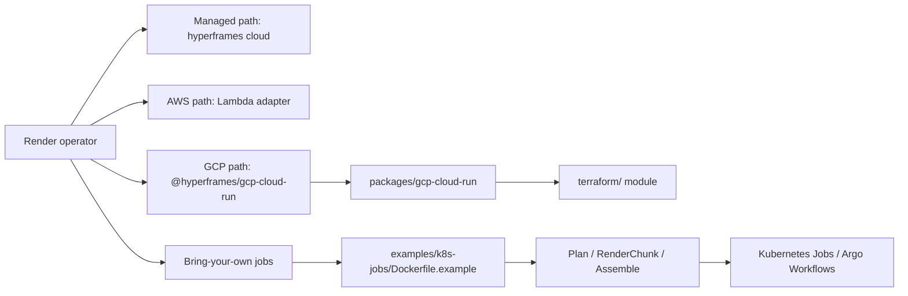
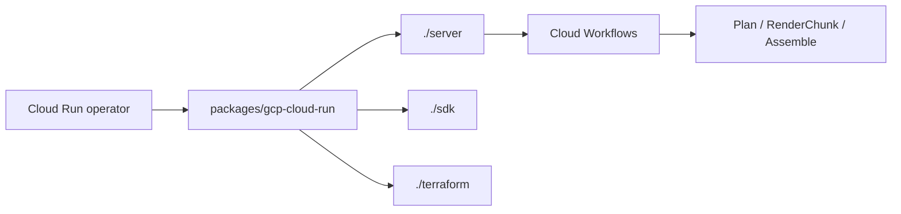
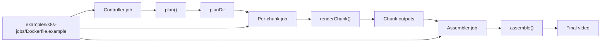

<!-- source: DeepWiki mcp.deepwiki.com · repo heygen-com/hyperframes · page 12 Cloud Deployment · fetched 2026-11-02 -->

# Cloud Deployment

Relevant source files

The following files were used as context for generating this wiki page:

- [.gitattributes](.gitattributes)
- [.github/actions/install-ffmpeg-linux/action.yml](.github/actions/install-ffmpeg-linux/action.yml)
- [.gitignore](.gitignore)
- [Dockerfile.test](Dockerfile.test)
- [docs/changelog.mdx](docs/changelog.mdx)
- [examples/k8s-jobs/Dockerfile.example](examples/k8s-jobs/Dockerfile.example)
- [examples/k8s-jobs/Dockerfile.example.dockerignore](examples/k8s-jobs/Dockerfile.example.dockerignore)
- [examples/k8s-jobs/README.md](examples/k8s-jobs/README.md)
- [packages/cli/src/docker/Dockerfile.render](packages/cli/src/docker/Dockerfile.render)
- [packages/engine/src/utils/urlDownloader.test.ts](packages/engine/src/utils/urlDownloader.test.ts)
- [packages/engine/src/utils/urlDownloader.ts](packages/engine/src/utils/urlDownloader.ts)
- [packages/gcp-cloud-run/Dockerfile](packages/gcp-cloud-run/Dockerfile)
- [packages/gcp-cloud-run/package.json](packages/gcp-cloud-run/package.json)
- [packages/producer/tests/distributed/mp4-h264-sdr/output/compiled.html](packages/producer/tests/distributed/mp4-h264-sdr/output/compiled.html)
- [packages/producer/tests/distributed/mp4-h264-sdr/output/output.mp4](packages/producer/tests/distributed/mp4-h264-sdr/output/output.mp4)

## Purpose and scope

HyperFrames offers several ways to run renders beyond a local machine: a managed cloud option, provider-specific distributed adapters, and containerized jobs that can be orchestrated independently. This parent page compares those paths at a high level; deployment mechanics belong in the child pages. [docs/changelog.mdx:53-53]() [packages/gcp-cloud-run/package.json:2-4]() [examples/k8s-jobs/README.md:1-5]()

Sources: [docs/changelog.mdx:53-53]() [packages/gcp-cloud-run/package.json:2-4]() [examples/k8s-jobs/README.md:1-5]()

## Deployment options

| Option | High-level model | Best fit |
|---|---|---|
| **HyperFrames Cloud** | Managed rendering accessed through the `hyperframes cloud` CLI. | Teams that want a managed service rather than operating rendering infrastructure. The changelog documents cloud-variable validation in the CLI. [docs/changelog.mdx:53-53]() |
| **AWS Lambda** | An AWS-specific deployment path, covered by its own adapter documentation. | Teams choosing the Lambda deployment model. For details, see [AWS Lambda Deployment](#12.2). [examples/k8s-jobs/README.md:40-44]() |
| **GCP Cloud Run** | The `@hyperframes/gcp-cloud-run` adapter packages a server, SDK, and Terraform module. [packages/gcp-cloud-run/package.json:2-4]() | Teams deploying the Cloud Run adapter. For details, see [GCP Cloud Run Deployment](#12.3). [packages/gcp-cloud-run/package.json:2-4]() |
| **Docker and Kubernetes jobs** | Build a reference container and connect distributed-rendering activities to an orchestrator such as Kubernetes Jobs or Argo Workflows. [examples/k8s-jobs/Dockerfile.example:1-16]() | Teams that want to choose their own job orchestration or run the worker container on another compatible platform. [examples/k8s-jobs/README.md:3-5]() |

Sources: [docs/changelog.mdx:53-53]() [packages/gcp-cloud-run/package.json:2-4]() [examples/k8s-jobs/Dockerfile.example:1-16]() [examples/k8s-jobs/README.md:3-5,40-44]()

## How the options relate

Managed cloud is the service-oriented path; the other options give operators more responsibility for deployment and orchestration. The Cloud Run adapter is explicitly packaged with a Terraform module, while the Kubernetes reference Dockerfile is intended for adopters to build themselves rather than use a published image. [packages/gcp-cloud-run/package.json:2-4,10-14]() [examples/k8s-jobs/Dockerfile.example:13-20]()

For container-based jobs, the reference image is designed around the distributed rendering activities `Plan`, `RenderChunk`, and `Assemble`. The example describes running a controller to create a plan, separate jobs for chunks, and an assembler job to produce the final output. [examples/k8s-jobs/Dockerfile.example:1-11]() [examples/k8s-jobs/README.md:17-38]()

Sources: [packages/gcp-cloud-run/package.json:2-4,10-14]() [examples/k8s-jobs/Dockerfile.example:1-20]() [examples/k8s-jobs/README.md:17-38]()

### Deployment landscape

Sources: [packages/gcp-cloud-run/package.json:2-4,10-14]() [examples/k8s-jobs/Dockerfile.example:1-20]() [examples/k8s-jobs/README.md:17-38]()

## Code entities and deployment paths

These diagrams connect deployment concepts to repository identifiers so readers can locate the relevant package or example. The Cloud Run package exports server, SDK, and Terraform entry points; the reference jobs image documents the distributed activity names and orchestration examples. [packages/gcp-cloud-run/package.json:19-39]() [examples/k8s-jobs/README.md:19-38]()

### Cloud Run: package entry points

Sources: [packages/gcp-cloud-run/package.json:19-39,70-77]() [packages/gcp-cloud-run/Dockerfile:1-5]() [examples/k8s-jobs/README.md:19-38]()

### Kubernetes and Docker: reference job flow

Sources: [examples/k8s-jobs/Dockerfile.example:1-20]() [examples/k8s-jobs/README.md:19-38]()

## Container baseline

The reference Kubernetes/jobs Dockerfile builds from the repository root and includes the browser, FFmpeg, and producer distributed primitives needed for rendering. The separate CLI render Dockerfile is a containerized path for invoking `hyperframes render`. [examples/k8s-jobs/Dockerfile.example:1-20,86-128]() [packages/cli/src/docker/Dockerfile.render:1-3,46-48,65-85]()

The Kubernetes reference image is intentionally not published: adopters build it themselves so its Chrome, FFmpeg, and producer versions remain tied to the source checkout they use. [examples/k8s-jobs/Dockerfile.example:13-20]() For details, see the deployment-specific child pages below.

Sources: [examples/k8s-jobs/Dockerfile.example:1-20,86-128]() [packages/cli/src/docker/Dockerfile.render:1-3,46-48,65-85]()

## Child pages

- [HyperFrames Cloud, Auth and Publishing](#12.1) — Managed cloud rendering, authentication, publishing, and feedback workflows.
- [AWS Lambda Deployment](#12.2) — The AWS-specific deployment adapter and its rendering workflow.
- [GCP Cloud Run Deployment](#12.3) — The Cloud Run adapter, server, and Terraform deployment path.

Sources: [docs/changelog.mdx:53-53]() [packages/gcp-cloud-run/package.json:2-4]() [examples/k8s-jobs/README.md:40-44]()

---

