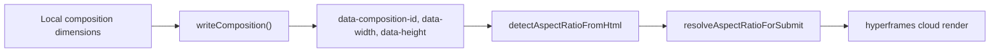
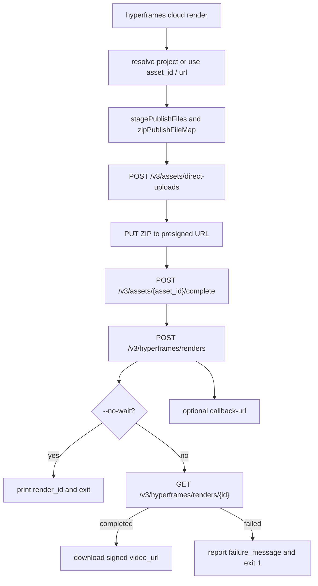
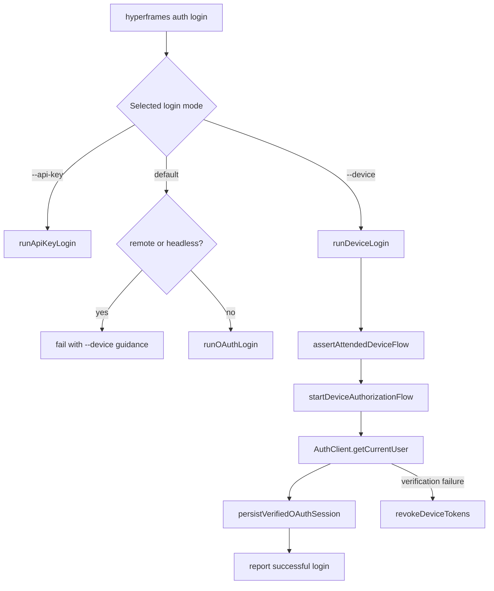
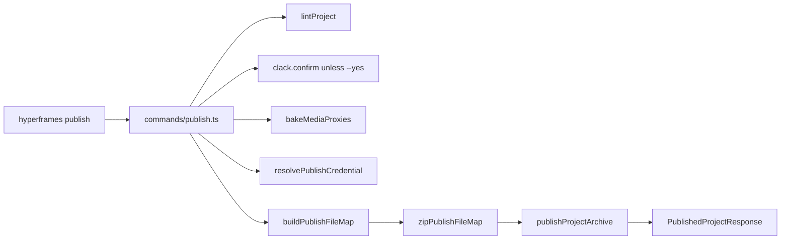
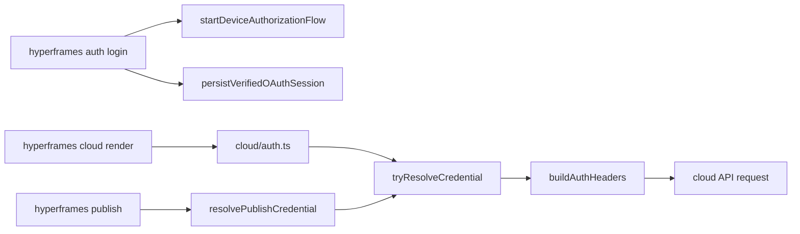
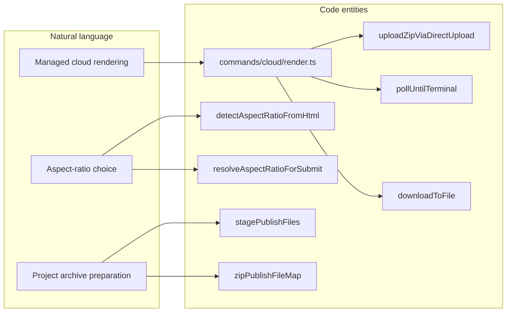
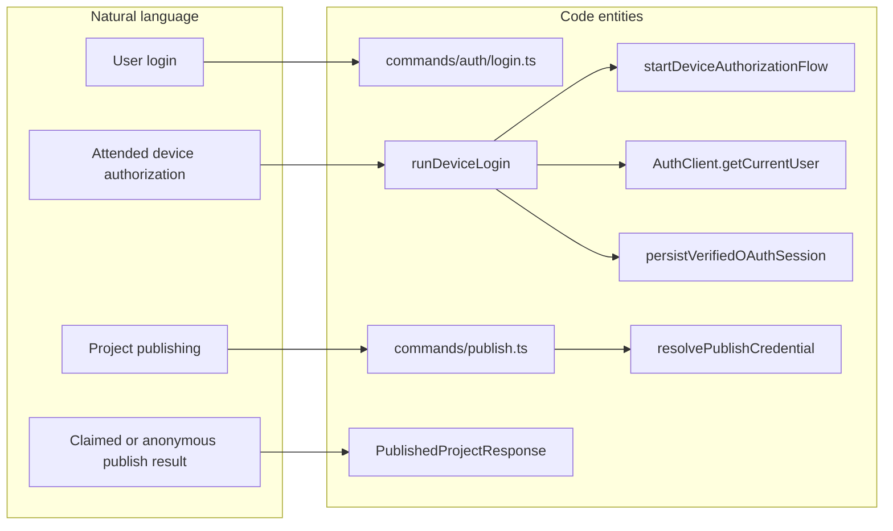

<!-- source: DeepWiki mcp.deepwiki.com · repo heygen-com/hyperframes · page 12.1 HyperFrames Cloud, Auth and Publishing · fetched 2026-11-02 -->

# HyperFrames Cloud, Auth and Publishing

Relevant source files

The following files were used as context for generating this wiki page:

- [docs/deploy/cloud.mdx](docs/deploy/cloud.mdx)
- [packages/cli/src/audio/analysis/decode.ts](packages/cli/src/audio/analysis/decode.ts)
- [packages/cli/src/audio/read/signal.test.ts](packages/cli/src/audio/read/signal.test.ts)
- [packages/cli/src/audio/read/stems.ts](packages/cli/src/audio/read/stems.ts)
- [packages/cli/src/auth/client.test.ts](packages/cli/src/auth/client.test.ts)
- [packages/cli/src/auth/client.ts](packages/cli/src/auth/client.ts)
- [packages/cli/src/auth/errors.ts](packages/cli/src/auth/errors.ts)
- [packages/cli/src/auth/index.ts](packages/cli/src/auth/index.ts)
- [packages/cli/src/auth/oauth.test.ts](packages/cli/src/auth/oauth.test.ts)
- [packages/cli/src/auth/oauth.ts](packages/cli/src/auth/oauth.ts)
- [packages/cli/src/auth/resolver.test.ts](packages/cli/src/auth/resolver.test.ts)
- [packages/cli/src/auth/resolver.ts](packages/cli/src/auth/resolver.ts)
- [packages/cli/src/cloud/errors.test.ts](packages/cli/src/cloud/errors.test.ts)
- [packages/cli/src/cloud/errors.ts](packages/cli/src/cloud/errors.ts)
- [packages/cli/src/cloud/offload.test.ts](packages/cli/src/cloud/offload.test.ts)
- [packages/cli/src/cloud/offload.ts](packages/cli/src/cloud/offload.ts)
- [packages/cli/src/cloud/offload.undecodableTrack.test.ts](packages/cli/src/cloud/offload.undecodableTrack.test.ts)
- [packages/cli/src/cloud/offloadTrim.ts](packages/cli/src/cloud/offloadTrim.ts)
- [packages/cli/src/cloud/upload.test.ts](packages/cli/src/cloud/upload.test.ts)
- [packages/cli/src/commands/auth.ts](packages/cli/src/commands/auth.ts)
- [packages/cli/src/commands/auth/login.test.ts](packages/cli/src/commands/auth/login.test.ts)
- [packages/cli/src/commands/auth/login.ts](packages/cli/src/commands/auth/login.ts)
- [packages/cli/src/commands/auth/logout.ts](packages/cli/src/commands/auth/logout.ts)
- [packages/cli/src/commands/auth/status-user.test.ts](packages/cli/src/commands/auth/status-user.test.ts)
- [packages/cli/src/commands/auth/status.ts](packages/cli/src/commands/auth/status.ts)
- [packages/cli/src/commands/cloud.ts](packages/cli/src/commands/cloud.ts)
- [packages/cli/src/commands/cloud/render.test.ts](packages/cli/src/commands/cloud/render.test.ts)
- [packages/cli/src/commands/cloud/render.ts](packages/cli/src/commands/cloud/render.ts)
- [packages/cli/src/commands/cloud/render.variables.test.ts](packages/cli/src/commands/cloud/render.variables.test.ts)
- [packages/cli/src/commands/init.transcodeToMp4.windowsHide.test.ts](packages/cli/src/commands/init.transcodeToMp4.windowsHide.test.ts)
- [packages/cli/src/commands/normalize-audio.test.ts](packages/cli/src/commands/normalize-audio.test.ts)
- [packages/cli/src/commands/publish.test.ts](packages/cli/src/commands/publish.test.ts)
- [packages/cli/src/commands/publish.ts](packages/cli/src/commands/publish.ts)
- [packages/cli/src/telemetry/index.ts](packages/cli/src/telemetry/index.ts)
- [packages/cli/src/utils/compositionEntry.ts](packages/cli/src/utils/compositionEntry.ts)
- [packages/cli/src/utils/publishProject.test.ts](packages/cli/src/utils/publishProject.test.ts)
- [packages/cli/src/utils/publishProject.ts](packages/cli/src/utils/publishProject.ts)
- [packages/engine/src/services/audioMixer.order.test.ts](packages/engine/src/services/audioMixer.order.test.ts)
- [packages/studio-server/src/helpers/loudness.test.ts](packages/studio-server/src/helpers/loudness.test.ts)
- [packages/studio-server/src/helpers/loudness.ts](packages/studio-server/src/helpers/loudness.ts)
- [packages/studio-server/src/helpers/loudness.windowsHide.test.ts](packages/studio-server/src/helpers/loudness.windowsHide.test.ts)

## Purpose and scope

This page describes the CLI’s managed cloud-render workflow, authentication entry points, generated-client boundary, aspect-ratio selection, project publishing, and feedback-submission documentation scope. The implementation details below are limited to the supplied source excerpts; where those excerpts do not include an implementation, that limitation is called out explicitly. [packages/cli/src/commands/cloud/render.ts:3-28]() [packages/cli/src/commands/auth/login.ts:3-24]() [packages/cli/src/commands/publish.ts:59-95]()

Sources: `packages/cli/src/commands/cloud/render.ts`, `packages/cli/src/commands/auth/login.ts`, `packages/cli/src/commands/publish.ts`

---

## 1. HyperFrames Cloud Rendering Service (`hyperframes cloud render`)

`hyperframes cloud render` orchestrates rendering through the managed service. Its documented command flow accepts a local project or a previously uploaded asset or URL, packages and uploads local project content, submits a render request, optionally polls for a terminal status, and downloads the completed video. [packages/cli/src/commands/cloud/render.ts:3-28]()

### 1.1 Overview of Cloud Render Command Flow

For a local project, the command reuses publishing utilities to stage files and create a ZIP archive. The command documentation describes a direct-to-S3 upload sequence: request a presigned upload URL, PUT the ZIP, then complete the upload. It states a 200 MB upload cap and distinguishes this path from a legacy 32 MB proxy upload path. [packages/cli/src/commands/cloud/render.ts:6-14]()

After upload, the command submits a render using a `project: {type:"asset_id", asset_id}` request shape. With `--no-wait`, it prints the render ID and exits; otherwise it polls `GET /v3/hyperframes/renders/{id}`. The documented polling interval is controlled by `--poll-interval`, with a default of 2 seconds, and the maximum wait is 60 minutes. A callback URL can be used in either mode. On completion the CLI downloads the signed `video_url`; on failure it reports `failure_message` and exits unsuccessfully. [packages/cli/src/commands/cloud/render.ts:15-24]()

The CLI exposes a `--dry-run` path for inspecting archive size without contacting the cloud. Tests exercise JSON output with archive file count, size, upload limit, largest files, and heavy-media offload plans. [packages/cli/src/commands/cloud/render.test.ts:50-103]()

Sources: `packages/cli/src/commands/cloud/render.ts`, `packages/cli/src/commands/cloud/render.test.ts`

### 1.2 Command Flags and Defaults

The command defines the following options and defaults in its CLI argument declarations. Local project directory defaults to the current directory; composition entry defaults to `index.html`; render defaults include 30 fps, `standard` quality, MP4, 1080p, and 16:9. [packages/cli/src/commands/cloud/render.ts:118-146]()

| Flag | Purpose / accepted values | Default or notes |
|---|---|---|
| `dir` | Optional project directory [packages/cli/src/commands/cloud/render.ts:118-122]() | `.` [packages/cli/src/commands/cloud/render.ts:120-122]() |
| `--fps` | Frames per second, 1–240 [packages/cli/src/commands/cloud/render.ts:120-123]() | 30 [packages/cli/src/commands/cloud/render.ts:120-123]() |
| `--quality` | `draft`, `standard`, or `high` [packages/cli/src/commands/cloud/render.ts:88-90]() | `standard` [packages/cli/src/commands/cloud/render.ts:120-124]() |
| `--format` | `mp4`, `webm`, or `mov` [packages/cli/src/commands/cloud/render.ts:89-90]() | `mp4` [packages/cli/src/commands/cloud/render.ts:120-124]() |
| `--resolution` | `1080p` or `4k` [packages/cli/src/commands/cloud/render.ts:90-91]() | `1080p`; 4K is documented as billed at 1.5× [packages/cli/src/commands/cloud/render.ts:130-133]() |
| `--aspect-ratio` | `16:9`, `9:16`, or `1:1` [packages/cli/src/commands/cloud/render.ts:91-92]() | `16:9` in the argument description [packages/cli/src/commands/cloud/render.ts:134-137]() |
| `--composition` / `-c` | Entry HTML path inside the ZIP [packages/cli/src/commands/cloud/render.ts:138-142]() | `index.html` [packages/cli/src/commands/cloud/render.ts:138-142]() |
| `--variables` | Inline JSON overrides for composition variables [packages/cli/src/commands/cloud/render.ts:143-147]() | None shown [packages/cli/src/commands/cloud/render.ts:143-147]() |
| `--variables-file` | JSON file supplying variable values [packages/cli/src/commands/cloud/render.ts:148-151]() | Alternative to `--variables` [packages/cli/src/commands/cloud/render.ts:148-151]() |
| `--strict-variables` | Fail for undeclared keys or wrong types [packages/cli/src/commands/cloud/render.ts:152-156]() | `false` [packages/cli/src/commands/cloud/render.ts:152-156]() |
| `--callback-url`, `--callback-id` | Completion webhook and opaque tracking ID [packages/cli/src/commands/cloud/render.ts:161-169]() | Optional [packages/cli/src/commands/cloud/render.ts:161-169]() |
| `--asset-id` | Reuse an uploaded project asset [packages/cli/src/commands/cloud/render.ts:170-171]() | Optional [packages/cli/src/commands/cloud/render.ts:170-171]() |

The CLI also accepts a `--url` source, exposes `--no-wait`, and provides a poll interval. The supplied excerpt documents these behaviors in the command’s flow comments, but does not include the corresponding argument declarations. [packages/cli/src/commands/cloud/render.ts:6-22]()

Sources: `packages/cli/src/commands/cloud/render.ts`

### 1.3 Aspect Ratio Detection

The render command imports `detectAspectRatioFromHtml` and the `AspectRatioDetection` type from `cloud/detectAspectRatio.js`. The test suite exercises `resolveAspectRatioForSubmit` and creates test compositions whose dimensions are represented by `data-width` and `data-height` on an element carrying `data-composition-id`. [packages/cli/src/commands/cloud/render.ts:33-36]() [packages/cli/src/commands/cloud/render.test.ts:8-13]() [packages/cli/src/commands/cloud/render.test.ts:27-36]()

The supplied source excerpts do not include the implementation of `detectAspectRatioFromHtml` or `resolveAspectRatioForSubmit`; therefore, the precise detection algorithm and handling of unsupported ratios cannot be established from these excerpts. The user-facing cloud-render documentation says the aspect ratio is detected from a local composition when possible, while the CLI argument description lists the supported values and a 16:9 default. [docs/deploy/cloud.mdx:41-50]() [packages/cli/src/commands/cloud/render.ts:134-137]()

#### Aspect-ratio path: CLI entity mapping

**Diagram: cloud-render aspect-ratio code path**

Sources: `packages/cli/src/commands/cloud/render.ts:33-36`, `packages/cli/src/commands/cloud/render.test.ts:8-13,27-36`

Sources: `packages/cli/src/commands/cloud/render.ts`, `packages/cli/src/commands/cloud/render.test.ts`, `docs/deploy/cloud.mdx`

### 1.4 Data Flow Diagram: `hyperframes cloud render`

**Diagram: render submission and result handling**

Sources: `packages/cli/src/commands/cloud/render.ts:3-28`

The render command imports `createCloudClient`, `pollUntilTerminal`, `downloadToFile`, `uploadAssetViaDirectUpload`, and `uploadZipViaDirectUpload`; it also imports shared staging and ZIP utilities from `publishProject.js`. These imports identify the main code boundaries for client requests, polling, downloads, uploads, and archive preparation. [packages/cli/src/commands/cloud/render.ts:41-48]() [packages/cli/src/commands/cloud/render.ts:57-75]()

Sources: `packages/cli/src/commands/cloud/render.ts`

---

## 2. Authentication (`hyperframes auth login`)

`hyperframes auth login` supports OAuth login by default, an attended device-code flow for appropriate headless or SSH contexts, and a legacy API-key path. The login command describes the default OAuth flow as OAuth 2.0 with PKCE and a loopback callback on an ephemeral `127.0.0.1` port; it persists tokens under `~/.heygen/credentials`. [packages/cli/src/commands/auth/login.ts:3-12]()

### 2.1 Supported Authentication Flows

- **OAuth + PKCE:** The default path opens a browser, receives the authorization code through a loopback callback, exchanges it for tokens, and stores the result. [packages/cli/src/commands/auth/login.ts:3-10]()
- **Device code (`--device`):** The command displays a verification URL and, when needed, a user code; it then waits for approval. Device login is intended for attended terminals and is refused in CI. [packages/cli/src/commands/auth/login.ts:69-72]() [packages/cli/src/commands/auth/login.ts:120-145]()
- **API key (`--api-key`):** The command accepts an API key directly or can read one from standard input or prompt. It is mutually exclusive with `--device`. [packages/cli/src/commands/auth/login.ts:64-79]()

For unattended agents and CI, the cloud-render documentation recommends providing a long-lived API key through standard input. [docs/deploy/cloud.mdx:33-37]()

Sources: `packages/cli/src/commands/auth/login.ts`, `docs/deploy/cloud.mdx`

### 2.2 Credential Storage and Verification

The login command’s documented write semantics snapshot existing credentials and merge the new session so that an existing API key is preserved, or vice versa. It checks that input is non-empty and header-safe; the backend’s `GET /v3/users/me` is treated as the source of truth for whether a key is valid. A 401 causes rollback, while network and 5xx errors retain the new credential under the rationale stated in the command documentation. [packages/cli/src/commands/auth/login.ts:13-23]()

For device login, the command verifies the newly issued tokens by calling `AuthClient.getCurrentUser`. It revokes the tokens if verification fails, and persists the verified session with `persistVerifiedOAuthSession`. If persistence fails, it also revokes the device tokens. [packages/cli/src/commands/auth/login.ts:131-179]()

Sources: `packages/cli/src/commands/auth/login.ts`

### 2.3 Command Behavior and Errors

The login command detects remote or headless environments using environment variables and TTY state. If the default browser callback flow is unavailable, it prints guidance to use `--device`; the device flow separately requires an attended terminal and is disabled in CI. [packages/cli/src/commands/auth/login.ts:89-128]()

The device flow records login-started, login-failed, and login-completed telemetry events, and identifies the user when an identity key is available. [packages/cli/src/commands/auth/login.ts:131-136]() [packages/cli/src/commands/auth/login.ts:181-185]()

#### Auth login flow

**Diagram: login branches and verified-session persistence**

Sources: `packages/cli/src/commands/auth/login.ts:75-99,101-128,131-179,181-185`

Sources: `packages/cli/src/commands/auth/login.ts`

---

## 3. Generated API Client

The cloud render command imports its cloud client and related types from `../../cloud/index.js`. Its file-level documentation identifies `cloud/_gen/client.ts` as generated from HeyGen’s external API OpenAPI specification and explicitly says not to hand-edit that generated file. [packages/cli/src/commands/cloud/render.ts:26-28]() [packages/cli/src/commands/cloud/render.ts:57-64]() [packages/cli/src/commands/cloud/render.ts:76-80]()

The generated client’s implementation and method definitions were not included in the supplied file excerpts. Consequently, this page does not enumerate client methods or claim specific request-encoding, authentication-header, or error-decoding behavior beyond the render command’s documented API operations. [packages/cli/src/commands/cloud/render.ts:26-28]()

Sources: `packages/cli/src/commands/cloud/render.ts`

---

## 4. `hyperframes publish` Command: Project Sharing and Publishing

`hyperframes publish` uploads a project to a stable URL and is private by default. Its options include `--yes`, `--public`, `--update`, `--space`, proxy controls, and `--lint-verbose`. [packages/cli/src/commands/publish.ts:59-95]()

### 4.1 Publish Workflow and Features

When the project contains `index.html`, the command runs `lintProject`. It displays findings when errors or warnings exist and aborts when the lint result identifies a definitive entry mismatch. [packages/cli/src/commands/publish.ts:96-133]()

Unless `--yes` is set, the command explains the requested visibility and prompts the user to confirm. A cancelled or declined prompt stops the publish run. [packages/cli/src/commands/publish.ts:136-159]()

The command parses `--update` targets from a published `/p/<id>` path, another URL path, or a bare identifier. It also normalizes a non-empty `--space` value for subsequent use. [packages/cli/src/commands/publish.ts:43-57]() [packages/cli/src/commands/publish.ts:161-166]()

The command imports `buildPublishFileMap`, `publishProjectArchive`, and `zipPublishFileMap` from `publishProject.js`, and imports `bakeMediaProxies` from `publishProxyBake.js`. These imports establish the publishing pipeline’s file-map, archive, upload, and media-proxy boundaries; the supplied excerpt does not show the later call sites or final response handling. [packages/cli/src/commands/publish.ts:16-22]()

Sources: `packages/cli/src/commands/publish.ts`

### 4.2 Authentication and Authorization Requirements

The publish command imports `envCredentialVar` and `ResolvedCredential`, and uses `resolvePublishCredential` from `publishProject.js`. The visible command code comments that the credential is resolved once and passed to the upload, avoiding a second lookup that could change the credential selected during a proxy bake. [packages/cli/src/commands/publish.ts:15-23]() [packages/cli/src/commands/publish.ts:168-171]()

The publishing utility imports `buildAuthHeaders`, `tryResolveCredential`, `isAuthError`, credential metadata helpers, and `refreshIfNeeded`. Its visible type definitions also distinguish published responses with a `claimed` state and `claimToken`; anonymous publishes are required to return a claim token, while claimed publishes need none. [packages/cli/src/utils/publishProject.ts:17-22]() [packages/cli/src/utils/publishProject.ts:41-54]() [packages/cli/src/utils/publishProject.ts:80-104]()

Sources: `packages/cli/src/commands/publish.ts`, `packages/cli/src/utils/publishProject.ts`

### 4.3 Archive Preparation and Upload Contract

`publishProject.ts` declares default ignored paths and files, including `.git`, `node_modules`, `dist`, `.next`, `coverage`, `.DS_Store`, and `Thumbs.db`. It also defines `.hyperframesignore` and default ignore patterns for root `renders/`, root `snapshots/`, and dot-prefixed names. [packages/cli/src/utils/publishProject.ts:24-32]()

The publish utility defines an `application/zip` content type, metadata and upload timeouts, two transport attempts, a retry delay, and a conservative upload-throughput floor used for timeout planning. [packages/cli/src/utils/publishProject.ts:32-40]()

Its visible response parsers validate the server’s nested `data` record. `parsePublishedProjectResponse` requires project ID, title, URL, and numeric file count; it additionally requires a claim token for unclaimed projects. `parseStagedUploadResponse` requires an upload URL and key, applies defaults for content type and expiry, and derives upload headers. [packages/cli/src/utils/publishProject.ts:66-124]()

#### Publishing: command entities and archive/upload boundary

**Diagram: publish command to archive utility**

Sources: `packages/cli/src/commands/publish.ts:16-30,96-171`, `packages/cli/src/utils/publishProject.ts:17-22,41-54`

Sources: `packages/cli/src/commands/publish.ts`, `packages/cli/src/utils/publishProject.ts`

---

## 5. Feedback Submission

The supplied file excerpts do not include the feedback command or its submission utility. The earlier page content refers to `commands/feedback.ts` and `utils/submitFeedback.ts`, but those implementation files were not provided here, so endpoint names, payload fields, project-upload behavior, and consent handling cannot be verified for this revision. [packages/cli/src/commands/publish.ts:1-30]()

Sources: `packages/cli/src/commands/publish.ts`

---

## 6. Cross-cutting data flow

Cloud rendering and publishing share archive-preparation utilities, but the visible command flow differs: cloud render imports staging and ZIP functions directly, while publish imports its file-map, ZIP, and publish-archive operations. Both command areas are tied to the CLI auth package through the cloud auth boundary or publish credential resolver. [packages/cli/src/commands/cloud/render.ts:41-48]() [packages/cli/src/commands/cloud/render.ts:74-75]() [packages/cli/src/commands/publish.ts:15-23]() [packages/cli/src/utils/publishProject.ts:17-22]()

#### Credential and request path: code entity mapping

**Diagram: authentication names mapped to cloud and publish entities**

Sources: `packages/cli/src/commands/auth/login.ts:131-179`, `packages/cli/src/commands/cloud/render.ts:26-28,74-75`, `packages/cli/src/commands/publish.ts:15-23`, `packages/cli/src/utils/publishProject.ts:17-22`

Sources: `packages/cli/src/commands/auth/login.ts`, `packages/cli/src/commands/cloud/render.ts`, `packages/cli/src/commands/publish.ts`, `packages/cli/src/utils/publishProject.ts`

---

## 7. Summary of implementation boundaries

| Capability | Main code entities evidenced in the supplied files |
|---|---|
| Cloud render command | `commands/cloud/render.ts`, `createCloudClient`, `pollUntilTerminal`, `downloadToFile` [packages/cli/src/commands/cloud/render.ts:57-80]() |
| Direct archive upload | `uploadZipViaDirectUpload`, `uploadAssetViaDirectUpload` [packages/cli/src/commands/cloud/render.ts:67-68]() |
| Aspect-ratio selection | `detectAspectRatioFromHtml`, `resolveAspectRatioForSubmit` [packages/cli/src/commands/cloud/render.ts:33-36]() [packages/cli/src/commands/cloud/render.test.ts:8-13]() |
| Login | `runDeviceLogin`, `startDeviceAuthorizationFlow`, `AuthClient.getCurrentUser`, `persistVerifiedOAuthSession` [packages/cli/src/commands/auth/login.ts:131-179]() |
| Publishing | `lintProject`, `resolvePublishCredential`, `buildPublishFileMap`, `zipPublishFileMap`, `publishProjectArchive` [packages/cli/src/commands/publish.ts:16-30]() |
| Generated cloud client | `cloud/_gen/client.ts`, identified as generated from an external OpenAPI specification [packages/cli/src/commands/cloud/render.ts:26-28]() |
| Feedback | Implementation files were not included in the supplied excerpts [packages/cli/src/commands/publish.ts:1-30]() |

Sources: `packages/cli/src/commands/cloud/render.ts`, `packages/cli/src/commands/cloud/render.test.ts`, `packages/cli/src/commands/auth/login.ts`, `packages/cli/src/commands/publish.ts`, `packages/cli/src/utils/publishProject.ts`

---

## 8. Natural-language concepts mapped to code entities

**Diagram: managed cloud rendering mapped to searchable symbols**

Sources: `packages/cli/src/commands/cloud/render.ts:33-48,57-75`

**Diagram: login and publishing mapped to searchable symbols**

Sources: `packages/cli/src/commands/auth/login.ts:26-49,131-179`, `packages/cli/src/commands/publish.ts:15-30`, `packages/cli/src/utils/publishProject.ts:41-54`

Sources: `packages/cli/src/commands/cloud/render.ts`, `packages/cli/src/commands/auth/login.ts`, `packages/cli/src/commands/publish.ts`, `packages/cli/src/utils/publishProject.ts`

---

## 9. Operational notes

For a standard managed render, the documentation’s minimal sequence is `hyperframes auth login` followed by `hyperframes cloud render`. For headless attended SSH usage, it documents `hyperframes auth login --device`; for unattended automation, it documents passing an API key to `hyperframes auth login --api-key` through standard input. [docs/deploy/cloud.mdx:8-15]() [docs/deploy/cloud.mdx:27-37]()

Use `--dry-run` to inspect archive contents before upload. The documentation recommends `.hyperframesignore` for excluding generated or unnecessary files and warns not to exclude media needed at render time. [docs/deploy/cloud.mdx:60-75]()

Sources: `docs/deploy/cloud.mdx`

---

