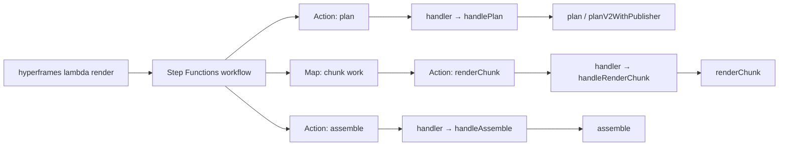
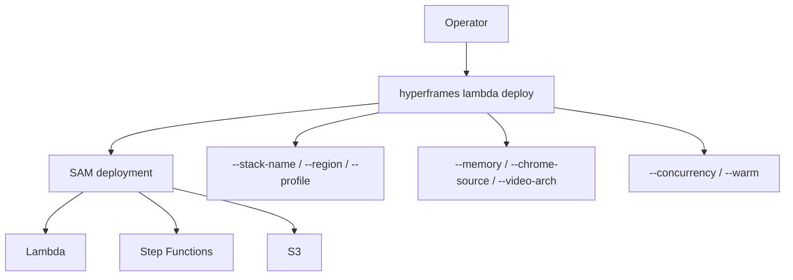
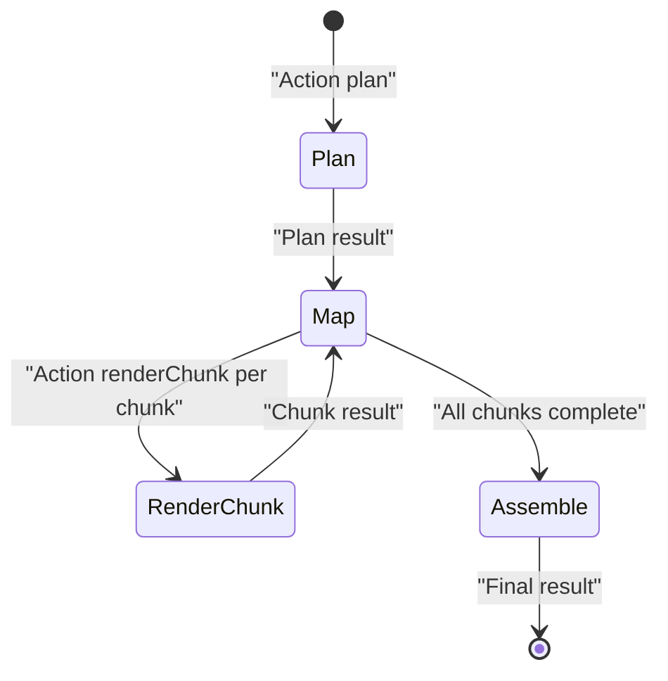
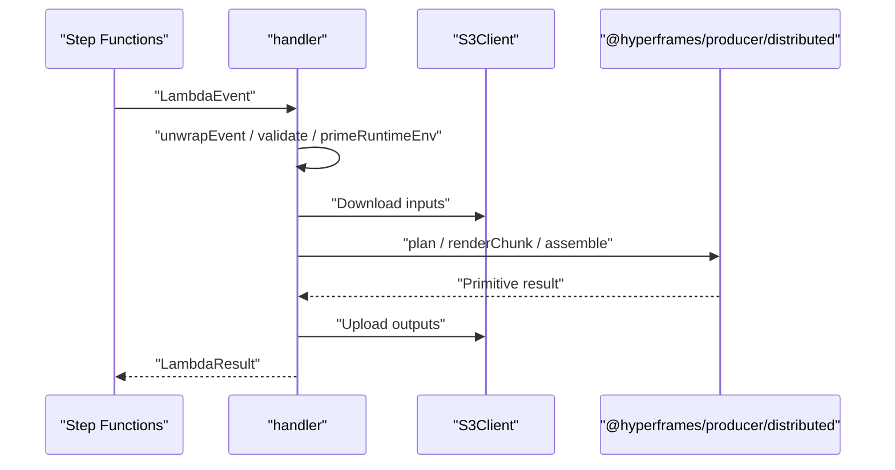
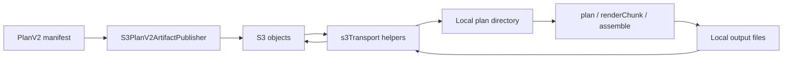
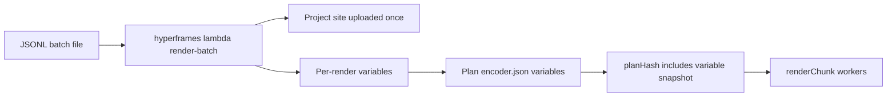
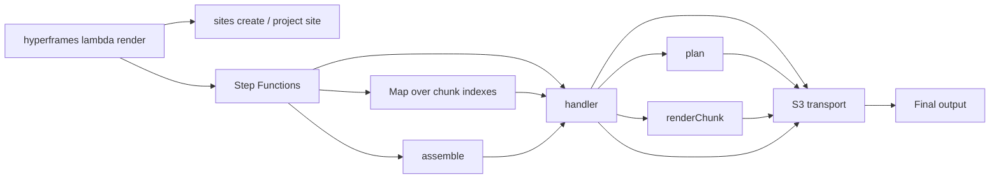

<!-- source: DeepWiki mcp.deepwiki.com · repo heygen-com/hyperframes · page 12.2 AWS Lambda Deployment · fetched 2026-11-02 -->

# AWS Lambda Deployment

Relevant source files

The following files were used as context for generating this wiki page:

- [examples/aws-lambda/template.yaml](examples/aws-lambda/template.yaml)
- [packages/aws-lambda/src/cdk/HyperframesRenderStack.snapshot.test.ts](packages/aws-lambda/src/cdk/HyperframesRenderStack.snapshot.test.ts)
- [packages/aws-lambda/src/cdk/HyperframesRenderStack.ts](packages/aws-lambda/src/cdk/HyperframesRenderStack.ts)
- [packages/aws-lambda/src/events.ts](packages/aws-lambda/src/events.ts)
- [packages/aws-lambda/src/handler.test.ts](packages/aws-lambda/src/handler.test.ts)
- [packages/aws-lambda/src/handler.ts](packages/aws-lambda/src/handler.ts)
- [packages/cli/src/commands/cloudrun.ts](packages/cli/src/commands/cloudrun.ts)
- [packages/cli/src/commands/lambda.ts](packages/cli/src/commands/lambda.ts)
- [packages/cli/src/commands/lambda/render-batch.test.ts](packages/cli/src/commands/lambda/render-batch.test.ts)
- [packages/cli/src/commands/lambda/render-batch.ts](packages/cli/src/commands/lambda/render-batch.ts)
- [packages/cli/src/commands/lambda/render.test.ts](packages/cli/src/commands/lambda/render.test.ts)
- [packages/cli/src/commands/lambda/render.ts](packages/cli/src/commands/lambda/render.ts)
- [packages/cli/src/commands/render/execute.test.ts](packages/cli/src/commands/render/execute.test.ts)
- [packages/cli/src/commands/render/execute.ts](packages/cli/src/commands/render/execute.ts)
- [packages/cli/src/commands/render/plan.test.ts](packages/cli/src/commands/render/plan.test.ts)
- [packages/cli/src/commands/render/plan.ts](packages/cli/src/commands/render/plan.ts)
- [packages/cli/src/utils/compositionFps.test.ts](packages/cli/src/utils/compositionFps.test.ts)
- [packages/cli/src/utils/compositionFps.ts](packages/cli/src/utils/compositionFps.ts)
- [packages/cli/src/utils/missingPackage.test.ts](packages/cli/src/utils/missingPackage.test.ts)
- [packages/cli/src/utils/missingPackage.ts](packages/cli/src/utils/missingPackage.ts)
- [packages/cli/src/utils/renderArgs.test.ts](packages/cli/src/utils/renderArgs.test.ts)
- [packages/cli/src/utils/renderArgs.ts](packages/cli/src/utils/renderArgs.ts)
- [packages/gcp-cloud-run/src/server.test.ts](packages/gcp-cloud-run/src/server.test.ts)
- [packages/gcp-cloud-run/src/server.ts](packages/gcp-cloud-run/src/server.ts)
- [packages/producer/src/distributed.ts](packages/producer/src/distributed.ts)
- [packages/producer/src/index.ts](packages/producer/src/index.ts)
- [packages/producer/src/renderRequest.test.ts](packages/producer/src/renderRequest.test.ts)
- [packages/producer/src/renderRequest.ts](packages/producer/src/renderRequest.ts)
- [packages/producer/src/services/distributed/chunkAudio.test.ts](packages/producer/src/services/distributed/chunkAudio.test.ts)
- [packages/producer/src/services/distributed/chunkAudio.ts](packages/producer/src/services/distributed/chunkAudio.ts)
- [packages/producer/src/services/distributed/chunkFrames.ts](packages/producer/src/services/distributed/chunkFrames.ts)
- [packages/producer/src/services/distributed/mp4Stitch.ts](packages/producer/src/services/distributed/mp4Stitch.ts)
- [packages/producer/src/services/distributed/plan.test.ts](packages/producer/src/services/distributed/plan.test.ts)
- [packages/producer/src/services/distributed/plan.ts](packages/producer/src/services/distributed/plan.ts)
- [packages/producer/src/services/distributed/planV2.test.ts](packages/producer/src/services/distributed/planV2.test.ts)
- [packages/producer/src/services/distributed/planV2.ts](packages/producer/src/services/distributed/planV2.ts)
- [packages/producer/src/services/distributed/publicExports.test.ts](packages/producer/src/services/distributed/publicExports.test.ts)
- [packages/producer/src/services/distributed/renderChunk.test.ts](packages/producer/src/services/distributed/renderChunk.test.ts)
- [packages/producer/src/services/distributed/renderChunk.ts](packages/producer/src/services/distributed/renderChunk.ts)
- [packages/producer/src/services/distributed/renderChunkFallback.test.ts](packages/producer/src/services/distributed/renderChunkFallback.test.ts)
- [packages/producer/src/services/distributed/renderConfigValidation.ts](packages/producer/src/services/distributed/renderConfigValidation.ts)
- [packages/producer/src/services/distributed/shared.ts](packages/producer/src/services/distributed/shared.ts)
- [packages/producer/src/services/distributed/videoMetadata.test.ts](packages/producer/src/services/distributed/videoMetadata.test.ts)
- [packages/producer/src/services/render/runtimeEnvSnapshot.test.ts](packages/producer/src/services/render/runtimeEnvSnapshot.test.ts)
- [packages/producer/src/services/render/runtimeEnvSnapshot.ts](packages/producer/src/services/render/runtimeEnvSnapshot.ts)
- [packages/producer/src/services/render/segmentManifest.test.ts](packages/producer/src/services/render/segmentManifest.test.ts)
- [packages/producer/src/services/render/segmentManifest.ts](packages/producer/src/services/render/segmentManifest.ts)
- [packages/producer/src/services/render/stages/freezePlan.ts](packages/producer/src/services/render/stages/freezePlan.ts)

## Purpose and scope

This page describes the AWS Lambda adapter for HyperFrames distributed rendering: how the `@hyperframes/aws-lambda` handler connects AWS events and S3 transport to the local-path rendering primitives exported by `@hyperframes/producer/distributed`, how the CLI exposes deployment and render operations, and how render variables support personalized jobs. The supplied implementation excerpts document the handler, producer primitives, and CLI surface; they do not include the CDK stack, event schemas, S3 transport implementation, or batch-render implementation, so details specific to those files are limited to what the available sources establish. [packages/aws-lambda/src/handler.ts:1-12]() [packages/cli/src/commands/lambda.ts:3-10]() [packages/producer/src/distributed.ts:1-8]()

Sources: `packages/aws-lambda/src/handler.ts`, `packages/cli/src/commands/lambda.ts`, `packages/producer/src/distributed.ts`

---

## Overview

The AWS adapter coordinates distributed rendering while delegating the expensive rendering work to producer primitives. Its handler describes a thin-glue pattern: parse the event, move data through S3, call a producer primitive, and return a small JSON result. [packages/aws-lambda/src/handler.ts:1-12]()

The available code establishes the following pipeline roles:

| Role | Code entity | Responsibility |
|---|---|---|
| Plan | `plan`, `planV2WithPublisher` | Prepare a distributed execution plan and, for Plan v2, publish artifacts through a publisher. [packages/aws-lambda/src/handler.ts:19-45]() |
| Render chunk | `renderChunk` | Render a chunk from a plan using the producer’s distributed-render primitive. [packages/aws-lambda/src/handler.ts:19-45]() |
| Assemble | `assemble` | Assemble chunk outputs into the final deliverable. [packages/aws-lambda/src/handler.ts:19-45]() |
| AWS dispatch | `handler` | Unwrap and validate events, initialize runtime state, and dispatch by `Action`. [packages/aws-lambda/src/handler.ts:118-173]() |
| CLI | `hyperframes lambda` | Expose deploy, site upload, render, batch, progress, destroy, and policy commands. [packages/cli/src/commands/lambda.ts:62-84]() |

The handler accepts `plan`, `audio`, `renderChunk`, and `assemble` actions in the shown dispatch switch. Step Functions and the CLI are the AWS-side orchestration surfaces; the supplied sources do not show the state-machine definition itself. [packages/aws-lambda/src/handler.ts:137-155]() [packages/cli/src/commands/lambda.ts:62-84]()

Sources: `packages/aws-lambda/src/handler.ts`, `packages/cli/src/commands/lambda.ts`

### Natural-language flow mapped to code entities

This diagram maps the Plan → Map → Assemble workflow terminology to the producer primitives and handler dispatch. The handler’s shown action switch includes `audio` in addition to the three main pipeline roles. [packages/aws-lambda/src/handler.ts:137-155]() [packages/producer/src/distributed.ts:33-60]() [packages/producer/src/distributed.ts:97-123]()

**Diagram: Workflow roles and implementation entities**

Sources: `packages/aws-lambda/src/handler.ts`, `packages/producer/src/distributed.ts`, `packages/cli/src/commands/lambda.ts`

### AWS resources and stack boundary

The CLI documents `hyperframes lambda deploy` as provisioning a Lambda, Step Functions, and S3 stack via SAM. The CDK stack is named `HyperframesRenderStack` in the page scope, but its implementation is not included in the supplied file contents; consequently, specific resource properties, IAM policies, state-machine configuration, and bucket retention behavior cannot be verified here. [packages/cli/src/commands/lambda.ts:62-84]()

Sources: `packages/cli/src/commands/lambda.ts`

---

## 1. CDK Stack: `HyperframesRenderStack`

The deployment surface exposes `deploy` as the stack-provisioning command. Its help text identifies Lambda, Step Functions, and S3 as the resources deployed through SAM. The CLI also exposes stack identity and deployment options including stack name, AWS region, profile, Lambda memory, Chrome source, video architecture, concurrency, and whether to warm the video function after deployment. [packages/cli/src/commands/lambda.ts:62-84]() [packages/cli/src/commands/lambda.ts:106-135]()

| Deployment option | CLI argument | Documented behavior |
|---|---|---|
| Stack name | `--stack-name` | CloudFormation stack name; default is `hyperframes-default`. [packages/cli/src/commands/lambda.ts:106-110]() |
| Region and profile | `--region`, `--profile` | Region defaults to `AWS_REGION` or `us-east-1`; profile defaults to `AWS_PROFILE`. [packages/cli/src/commands/lambda.ts:111-112]() |
| Concurrency | `--concurrency` | Sets reserved Lambda concurrency, or `none` to remove it; the documented default behavior depends on whether the stack already exists. [packages/cli/src/commands/lambda.ts:114-119]() |
| Chrome source | `--chrome-source` | Selects `sparticuz` or `chrome-headless-shell`; default is `sparticuz`. [packages/cli/src/commands/lambda.ts:120-123]() |
| Memory | `--memory` | Lambda memory in MB; default is `10240`. [packages/cli/src/commands/lambda.ts:124]() |
| Video architecture | `--video-arch` | Selects `arm64` or `x86_64`; default is `arm64`, and the help text notes that `arm64` adds a container-image function. [packages/cli/src/commands/lambda.ts:125-129]() |
| Build and warm-up | `--skip-build`, `--warm` | Reuse an existing handler ZIP, or skip the post-deploy video-function warm-up. [packages/cli/src/commands/lambda.ts:130-135]() |

The CLI help lists AWS CLI credentials, AWS SAM CLI, and `bun` as requirements for deployment. [packages/cli/src/commands/lambda.ts:76-84]()

**Diagram: Deployment terminology mapped to the exposed CLI surface**

Sources: `packages/cli/src/commands/lambda.ts`

Sources: `packages/cli/src/commands/lambda.ts`

---

## 2. Step Functions State Machine (Plan → Map → Assemble)

The intended distributed workflow is Plan → Map over chunk work → Assemble. The handler’s action dispatcher routes the `plan`, `renderChunk`, and `assemble` actions to their corresponding handler functions. It also accepts `audio` as an additional action. [packages/aws-lambda/src/handler.ts:137-155]()

At the producer boundary, these jobs are represented by local-path primitives. The distributed package explicitly separates those primitives from transport and orchestration: the activities are pure functions over local file paths, while networking and orchestration belong to adapters. [packages/producer/src/distributed.ts:1-8]() [packages/producer/src/distributed.ts:29-30]()

- **Plan:** `plan` builds a local execution plan from compile, probe, video extraction, audio, and freeze stages. [packages/producer/src/services/distributed/plan.ts:3-27]()
- **Map / render chunks:** chunk workers consume the frozen plan and render individual frame ranges. [packages/producer/src/services/distributed/renderChunk.ts:1-14]()
- **Assemble:** the producer’s distributed API exports `assemble` and `assembleV2` as the assembly primitives. [packages/producer/src/distributed.ts:116-123]()
- **Retry behavior:** `renderChunk` documents byte-identical output for retries on the same plan and chunk index, making the chunk primitive suitable for retrying orchestration. [packages/producer/src/services/distributed/renderChunk.ts:1-14]() The distributed package also describes these retries as safe for Step Functions. [packages/producer/src/distributed.ts:17-26]()

The supplied sources do not include the CDK state-machine definition or its exact Map-state configuration. The diagram therefore represents the documented workflow roles and handler dispatch rather than unverified state-machine parameters. [packages/cli/src/commands/lambda.ts:62-84]() [packages/aws-lambda/src/handler.ts:118-155]()

**Diagram: Plan → Map → Assemble roles**

Sources: `packages/aws-lambda/src/handler.ts`, `packages/producer/src/distributed.ts`, `packages/producer/src/services/distributed/plan.ts`, `packages/producer/src/services/distributed/renderChunk.ts`

Sources: `packages/aws-lambda/src/handler.ts`, `packages/producer/src/distributed.ts`, `packages/producer/src/services/distributed/plan.ts`, `packages/producer/src/services/distributed/renderChunk.ts`

---

## 3. AWS Lambda Handler

The AWS entry point is `handler(event, deps)`. It handles a special `warm` action, unwraps Step Functions event envelopes, validates protocol shape and S3 URIs, primes the Lambda runtime environment, logs the invocation, and dispatches by action. [packages/aws-lambda/src/handler.ts:118-173]()

### Role and responsibilities

The handler is deliberately adapter glue: the documented expensive work—capture, encoding, and audio mixing—happens inside the producer primitives. The handler handles event parsing, S3 download and upload, primitive invocation, and returning a compact result. [packages/aws-lambda/src/handler.ts:1-12]()

`HandlerDeps` provides injection points for an S3 client, a Lambda client, producer primitives, a temporary-directory root, optional Chrome-resolution bypass, and a remaining-time callback. This makes handler behavior testable without requiring production AWS services or mutating module-level state. [packages/aws-lambda/src/handler.ts:89-116]()

### Data flow in handler

**Diagram: Handler invocation and data movement**

Sources: `packages/aws-lambda/src/handler.ts:1-12`, `packages/aws-lambda/src/handler.ts:118-173`, `packages/aws-lambda/src/handler.ts:65-76`

### Key functions and entities

| Entity | Role |
|---|---|
| `handler(event, deps)` | Main Lambda entry point. Special-cases `warm`, unwraps and validates the event, primes runtime state, dispatches by `Action`, and logs before rethrowing errors. [packages/aws-lambda/src/handler.ts:118-173]() |
| `HandlerDeps` | Optional dependencies for S3, Lambda account settings, producer primitives, temporary storage, Chrome resolution, and remaining-time checks. [packages/aws-lambda/src/handler.ts:89-116]() |
| `getS3Client()` | Lazily constructs and caches an `S3Client` at module scope so warm Lambda containers can reuse it. [packages/aws-lambda/src/handler.ts:78-87]() |
| `handlePlan` | The `plan` action target in the handler dispatch. [packages/aws-lambda/src/handler.ts:137-145]() |
| `handleAudio` | The `audio` action target in the handler dispatch. [packages/aws-lambda/src/handler.ts:137-145]() |
| `handleRenderChunk` | The `renderChunk` action target in the handler dispatch. [packages/aws-lambda/src/handler.ts:137-145]() |
| `handleAssemble` | The `assemble` action target in the handler dispatch. [packages/aws-lambda/src/handler.ts:137-145]() |
| `unwrapEvent` | The handler’s documented event-unwrapping step handles Step Functions `Payload` and `Input` envelope shapes. [packages/aws-lambda/src/handler.ts:118-131]() |
| `primeRuntimeEnv` | The handler calls this before dispatch; its implementation is not included in the provided excerpt. [packages/aws-lambda/src/handler.ts:123-136]() |

The handler normalizes terminal error names for workflow-facing failure contracts and writes structured error context before rethrowing. [packages/aws-lambda/src/handler.ts:158-172]() The shown source also identifies structured `handler_start` logging for CloudWatch diagnosis. [packages/aws-lambda/src/handler.ts:132-136]()

### S3 and temporary storage

The handler imports S3 transport helpers for downloading, verified downloading, uploading, tar creation and extraction, S3 URI parsing, and verified presigned GET URLs. [packages/aws-lambda/src/handler.ts:65-74]() The handler dependency interface allows tests to override the temporary root; the production default is Lambda’s `/tmp`. [packages/aws-lambda/src/handler.ts:107-110]()

Sources: `packages/aws-lambda/src/handler.ts`

---

## 4. S3 Transport Mechanism

S3 is the adapter boundary between invocations: the handler imports file-transfer and archive helpers, while the producer’s distributed primitives operate on local paths and explicitly avoid networking. [packages/aws-lambda/src/handler.ts:65-76]() [packages/producer/src/distributed.ts:1-8]()

The handler’s transport imports include:

| Helper | Purpose indicated by the interface |
|---|---|
| `downloadS3ObjectToFile` | Download an S3 object to a local file. [packages/aws-lambda/src/handler.ts:65-74]() |
| `downloadS3ObjectToFileVerified` | Download an S3 object with verification. [packages/aws-lambda/src/handler.ts:65-74]() |
| `uploadFileToS3` | Upload a local file to S3. [packages/aws-lambda/src/handler.ts:65-74]() |
| `tarDirectory`, `untarDirectory` | Package or extract a directory for transport. [packages/aws-lambda/src/handler.ts:65-74]() |
| `parseS3Uri` | Parse S3 URI references supplied to the handler. [packages/aws-lambda/src/handler.ts:65-74]() |
| `presignVerifiedS3GetUrl` | Create a presigned GET URL with verification support. [packages/aws-lambda/src/handler.ts:65-74]() |
| `mapConcurrent` | Provide a concurrency helper for transport-related work. [packages/aws-lambda/src/handler.ts:65-74]() |

Plan v2 further separates the transport representation from execution: a manifest references SHA-256-addressed blobs, and workers materialize only the dependencies required for their role before running shared local execution functions. [packages/producer/src/services/distributed/planV2.ts:1-12]() The AWS handler imports the plan-v2 publisher and the manifest/materialization helpers that support that adapter path. [packages/aws-lambda/src/handler.ts:19-45]() [packages/aws-lambda/src/handler.ts:75]()

**Diagram: S3 adapter boundary and local execution**

Sources: `packages/aws-lambda/src/handler.ts:19-76`, `packages/producer/src/distributed.ts:1-8`, `packages/producer/src/services/distributed/planV2.ts:1-12`

Sources: `packages/aws-lambda/src/handler.ts`, `packages/producer/src/distributed.ts`, `packages/producer/src/services/distributed/planV2.ts`

---

## 5. CLI Commands for AWS Lambda Deployment and Usage

The CLI command group is defined in `packages/cli/src/commands/lambda.ts`. It is described as thin argument-parsing and help glue; operational work such as `renderToLambda`, progress retrieval, site deployment, and the SAM driver lives in `@hyperframes/aws-lambda/sdk`. [packages/cli/src/commands/lambda.ts:3-10]()

| Subcommand | Purpose |
|---|---|
| `hyperframes lambda deploy` | Provision the Lambda, Step Functions, and S3 stack via SAM. [packages/cli/src/commands/lambda.ts:62-73]() |
| `hyperframes lambda sites create <projectDir>` | Tar and upload a project to S3 for reuse across renders. [packages/cli/src/commands/lambda.ts:67-73]() |
| `hyperframes lambda render <projectDir>` | Start a distributed render and return a render ID; `--wait` is shown as an option for waiting on completion. [packages/cli/src/commands/lambda.ts:23-48]() |
| `hyperframes lambda render-batch <projectDir>` | Fan out personalized renders from a JSONL batch file. [packages/cli/src/commands/lambda.ts:45-48]() |
| `hyperframes lambda progress <renderId>` | Print progress and cost for an in-flight or completed render. [packages/cli/src/commands/lambda.ts:49-49]() [packages/cli/src/commands/lambda.ts:67-73]() |
| `hyperframes lambda destroy` | Tear down the stack; the help text says the S3 bucket is retained. [packages/cli/src/commands/lambda.ts:54-54]() [packages/cli/src/commands/lambda.ts:67-73]() |
| `hyperframes lambda policies` | Print or validate the IAM permissions required by the CLI. [packages/cli/src/commands/lambda.ts:55-58]() |

Render examples show options for output dimensions, output-resolution supersampling, a site ID, inline JSON variables, and a variables file. [packages/cli/src/commands/lambda.ts:23-44]() The CLI imports `DistributedFormat`, distributed frame-rate helpers, output-resolution parsing, and shared delivery-flag parsing for its command surface. [packages/cli/src/commands/lambda.ts:12-21]()

Sources: `packages/cli/src/commands/lambda.ts`

---

## 6. Batch Render Pipeline (Template Personalization)

The CLI documents `render-batch` as fan-out of multiple personalized renders from a JSONL file, with a project site deployed once. Its example passes a project directory, batch file, output dimensions, and a maximum concurrency. [packages/cli/src/commands/lambda.ts:45-48]()

For single renders, the command examples show personalization through `--variables` with a JSON object or `--variables-file` with a JSON file. [packages/cli/src/commands/lambda.ts:37-44]() At the producer plan boundary, render variables are snapshotted in the locked encoder configuration; chunk workers re-inject them before capture, and different variable values produce different plan hashes. [packages/producer/src/services/render/stages/freezePlan.ts:83-100]()

The supplied file contents establish the CLI’s batch interface and the producer’s plan-time variable contract, but do not include `render-batch.ts`; implementation specifics such as JSONL parsing, per-item submission, retry policy, or concurrency scheduling cannot be verified from the available excerpts. [packages/cli/src/commands/lambda.ts:45-48]() [packages/producer/src/services/render/stages/freezePlan.ts:83-100]()

**Diagram: Personalization from CLI input to chunk plan**

Sources: `packages/cli/src/commands/lambda.ts:37-48`, `packages/producer/src/services/render/stages/freezePlan.ts:83-100`

Sources: `packages/cli/src/commands/lambda.ts`, `packages/producer/src/services/render/stages/freezePlan.ts`

---

## 7. Data Flow Summary for a Render Request

A render request begins at the CLI. The command surface supports local project directories or reusable site IDs, output dimensions, render variables, and a `--wait` mode. [packages/cli/src/commands/lambda.ts:23-48]() The AWS handler accepts Step Functions events, validates them, dispatches the requested action, and relies on S3 transport helpers to move local files between invocations. [packages/aws-lambda/src/handler.ts:118-155]() [packages/aws-lambda/src/handler.ts:65-76]()

**Diagram: CLI request to distributed render outputs**

Sources: `packages/cli/src/commands/lambda.ts`, `packages/aws-lambda/src/handler.ts`, `packages/producer/src/distributed.ts`

The code-backed boundaries are:

1. The CLI offers deployment, project-site upload, rendering, batch rendering, progress, and teardown commands. [packages/cli/src/commands/lambda.ts:62-84]()
2. The handler unwraps and validates the AWS event, primes runtime state, then dispatches by `Action`. [packages/aws-lambda/src/handler.ts:118-155]()
3. The handler uses S3 transfer and archive helpers to bridge object storage and local files. [packages/aws-lambda/src/handler.ts:65-76]()
4. Producer distributed primitives perform planning, chunk rendering, and assembly without owning cloud networking or orchestration. [packages/producer/src/distributed.ts:1-8]() [packages/producer/src/distributed.ts:33-60]() [packages/producer/src/distributed.ts:97-123]()

Sources: `packages/cli/src/commands/lambda.ts`, `packages/aws-lambda/src/handler.ts`, `packages/producer/src/distributed.ts`

---

## 8. Implementation Details of Distributed Activities

The producer exposes distributed rendering as a cloud-neutral API. `@hyperframes/producer/distributed` states that the activity functions operate on local file paths and that networking and orchestration belong in adapter packages. [packages/producer/src/distributed.ts:1-8]()

### Plan: `plan`

`buildLocalExecutionPlan` composes compile, probe, video extraction, audio, and freeze stages into a self-contained execution directory. The documented directory contains `plan.json`, compiled output, extracted video frames, optional audio, and metadata for composition, encoder settings, and chunks. Planning rejects unsupported configurations before chunk workers run. [packages/producer/src/services/distributed/plan.ts:3-27]()

The plan’s configuration includes distributed output format and encoder settings. The shown type defines supported plan formats and validates format/codec combinations at plan time; distributed FPS is integer-rate rather than the in-process renderer’s rational-rate representation. [packages/producer/src/services/distributed/plan.ts:119-153]()

### Frozen plan and `planHash`

`freezePlan` writes the metadata and manifest after upstream stages have materialized the plan directory. It computes `planHash` from the frozen artifacts so the hash reflects the bytes workers will consume. [packages/producer/src/services/render/stages/freezePlan.ts:1-10]() The locked configuration records capture and encoder settings, chunking, runtime environment, and optional render variables. [packages/producer/src/services/render/stages/freezePlan.ts:28-103]()

### Render chunk: `renderChunk`

`renderChunk(planDir, chunkIndex, outputChunkPath)` validates the plan against the worker environment, captures the assigned frame range, and encodes a chunk. The function operates on local paths and starts and tears down its own Chrome and file-server resources. [packages/producer/src/services/distributed/renderChunk.ts:1-14]()

Its documented determinism contract includes reapplying the runtime environment snapshot before serving HTML, using software GPU rendering with SwiftShader verification, seeding random behavior from the frame, seeking fresh DOM state rather than priming `lastFrameCache`, and locking GOP size to the chunk frame count for safe concatenation. [packages/producer/src/services/distributed/renderChunk.ts:16-34]() A successful result includes output path and kind, frame count, SHA-256, duration, and stage timing fields. [packages/producer/src/services/distributed/renderChunk.ts:151-177]()

### Assemble: `assemble`

The producer distributed API exports `assemble` and `assembleV2` as assembly primitives. The available implementation excerpts do not include the body of `assemble`; details beyond its role as the final producer activity are therefore not specified here. [packages/producer/src/distributed.ts:116-123]()

### Plan v2 transport

Plan v2 separates the transport manifest from execution. Its manifest references SHA-256-addressed artifacts, and workers select and materialize role-specific dependencies before invoking shared execution functions. [packages/producer/src/services/distributed/planV2.ts:1-12]() The producer exports `planV2`, `planV2WithPublisher`, manifest readers, materialization helpers, `renderChunkV2`, and `assembleV2` for adapter use. [packages/producer/src/distributed.ts:62-95]()

Sources: `packages/producer/src/services/distributed/plan.ts`, `packages/producer/src/services/render/stages/freezePlan.ts`, `packages/producer/src/services/distributed/renderChunk.ts`, `packages/producer/src/services/distributed/planV2.ts`, `packages/producer/src/distributed.ts`

---

## Summary Table: Lambda Deployment Components

| Component | Role | Source |
|---|---|---|
| `HyperframesRenderStack` | Stack identity referenced by the deployment scope; detailed resource implementation is not included in the supplied contents. | CDK source not provided |
| CLI command group | Exposes deployment, site upload, render, batch, progress, destroy, and policy commands. [packages/cli/src/commands/lambda.ts:62-84]() | `packages/cli/src/commands/lambda.ts` |
| `handler` | Unwraps and validates events, primes runtime state, dispatches actions, and logs errors. [packages/aws-lambda/src/handler.ts:118-173]() | `packages/aws-lambda/src/handler.ts` |
| `S3Client` and transport helpers | Move artifacts between S3 and local files; the handler caches its S3 client. [packages/aws-lambda/src/handler.ts:65-87]() | `packages/aws-lambda/src/handler.ts` |
| `plan` | Builds and freezes a local distributed execution plan. [packages/producer/src/services/distributed/plan.ts:3-27]() | `packages/producer/src/services/distributed/plan.ts` |
| `renderChunk` | Validates a plan and captures/encodes one chunk with documented retry determinism. [packages/producer/src/services/distributed/renderChunk.ts:1-34]() | `packages/producer/src/services/distributed/renderChunk.ts` |
| `assemble` / `assembleV2` | Producer assembly primitives exported for adapters. [packages/producer/src/distributed.ts:116-123]() | `packages/producer/src/distributed.ts` |
| Plan v2 publisher and materializer | Provides content-addressed manifest and artifact transport capabilities. [packages/producer/src/services/distributed/planV2.ts:1-12]() | `packages/producer/src/services/distributed/planV2.ts` |

Sources: `packages/cli/src/commands/lambda.ts`, `packages/aws-lambda/src/handler.ts`, `packages/producer/src/services/distributed/plan.ts`, `packages/producer/src/services/distributed/renderChunk.ts`, `packages/producer/src/services/distributed/planV2.ts`, `packages/producer/src/distributed.ts`

---

## Sources

- `packages/aws-lambda/src/handler.ts`
- `packages/cli/src/commands/lambda.ts`
- `packages/producer/src/distributed.ts`
- `packages/producer/src/services/distributed/plan.ts`
- `packages/producer/src/services/distributed/renderChunk.ts`
- `packages/producer/src/services/distributed/planV2.ts`
- `packages/producer/src/services/render/stages/freezePlan.ts`

---

