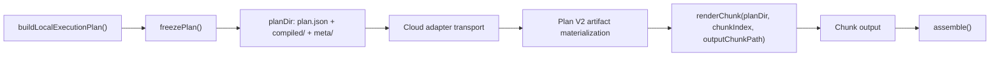
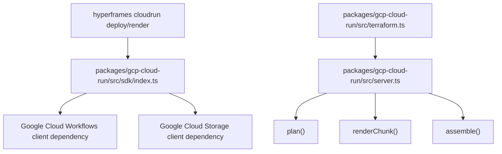
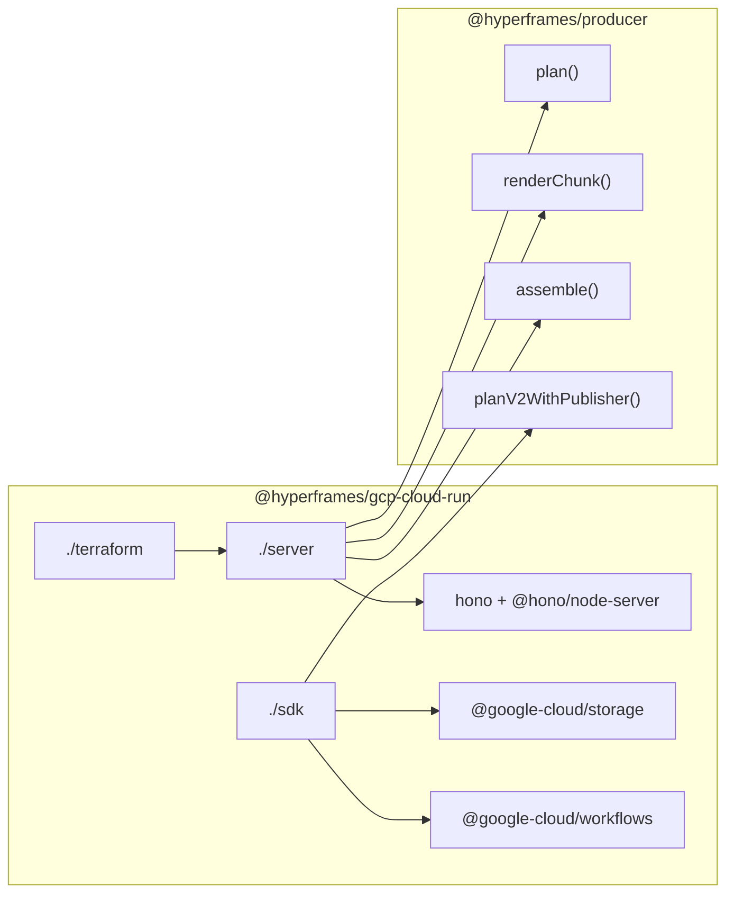
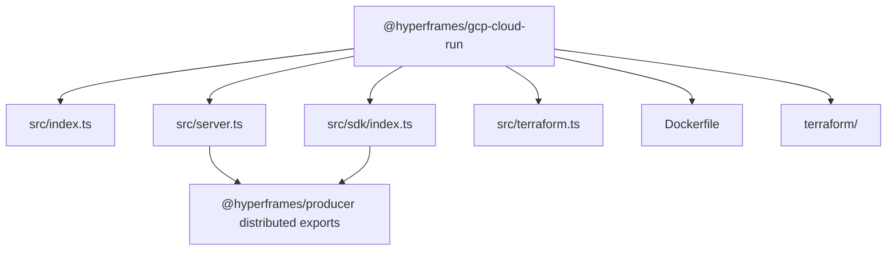
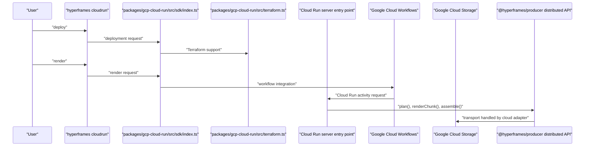

<!-- source: DeepWiki mcp.deepwiki.com · repo heygen-com/hyperframes · page 12.3 GCP Cloud Run Deployment · fetched 2026-11-02 -->

# GCP Cloud Run Deployment

Relevant source files

The following files were used as context for generating this wiki page:

- [docs/changelog.mdx](docs/changelog.mdx)
- [examples/aws-lambda/template.yaml](examples/aws-lambda/template.yaml)
- [packages/aws-lambda/src/cdk/HyperframesRenderStack.snapshot.test.ts](packages/aws-lambda/src/cdk/HyperframesRenderStack.snapshot.test.ts)
- [packages/aws-lambda/src/cdk/HyperframesRenderStack.ts](packages/aws-lambda/src/cdk/HyperframesRenderStack.ts)
- [packages/aws-lambda/src/events.ts](packages/aws-lambda/src/events.ts)
- [packages/aws-lambda/src/handler.test.ts](packages/aws-lambda/src/handler.test.ts)
- [packages/aws-lambda/src/handler.ts](packages/aws-lambda/src/handler.ts)
- [packages/gcp-cloud-run/package.json](packages/gcp-cloud-run/package.json)
- [packages/gcp-cloud-run/src/server.test.ts](packages/gcp-cloud-run/src/server.test.ts)
- [packages/gcp-cloud-run/src/server.ts](packages/gcp-cloud-run/src/server.ts)
- [packages/producer/src/distributed.ts](packages/producer/src/distributed.ts)
- [packages/producer/src/index.ts](packages/producer/src/index.ts)
- [packages/producer/src/services/distributed/chunkAudio.test.ts](packages/producer/src/services/distributed/chunkAudio.test.ts)
- [packages/producer/src/services/distributed/chunkAudio.ts](packages/producer/src/services/distributed/chunkAudio.ts)
- [packages/producer/src/services/distributed/chunkFrames.ts](packages/producer/src/services/distributed/chunkFrames.ts)
- [packages/producer/src/services/distributed/mp4Stitch.ts](packages/producer/src/services/distributed/mp4Stitch.ts)
- [packages/producer/src/services/distributed/plan.test.ts](packages/producer/src/services/distributed/plan.test.ts)
- [packages/producer/src/services/distributed/plan.ts](packages/producer/src/services/distributed/plan.ts)
- [packages/producer/src/services/distributed/planV2.test.ts](packages/producer/src/services/distributed/planV2.test.ts)
- [packages/producer/src/services/distributed/planV2.ts](packages/producer/src/services/distributed/planV2.ts)
- [packages/producer/src/services/distributed/publicExports.test.ts](packages/producer/src/services/distributed/publicExports.test.ts)
- [packages/producer/src/services/distributed/renderChunk.test.ts](packages/producer/src/services/distributed/renderChunk.test.ts)
- [packages/producer/src/services/distributed/renderChunk.ts](packages/producer/src/services/distributed/renderChunk.ts)
- [packages/producer/src/services/distributed/renderChunkFallback.test.ts](packages/producer/src/services/distributed/renderChunkFallback.test.ts)
- [packages/producer/src/services/distributed/shared.ts](packages/producer/src/services/distributed/shared.ts)
- [packages/producer/src/services/distributed/videoMetadata.test.ts](packages/producer/src/services/distributed/videoMetadata.test.ts)
- [packages/producer/src/services/render/runtimeEnvSnapshot.test.ts](packages/producer/src/services/render/runtimeEnvSnapshot.test.ts)
- [packages/producer/src/services/render/runtimeEnvSnapshot.ts](packages/producer/src/services/render/runtimeEnvSnapshot.ts)
- [packages/producer/src/services/render/stages/freezePlan.ts](packages/producer/src/services/render/stages/freezePlan.ts)

## Purpose and Scope

This page describes the GCP deployment package, `@hyperframes/gcp-cloud-run`, and how it fits with HyperFrames’ distributed-rendering primitives. The package is described as a Google Cloud Run and Cloud Workflows adapter that includes a request handler, client-side SDK, and Terraform module. The available source excerpts establish the package’s dependencies and the producer-side plan and chunk contracts; they do not expose the GCP server, Terraform, transport, publisher, CLI, or workflow implementations in enough detail to document their routes, options, or internal behavior precisely. [packages/gcp-cloud-run/package.json:1-4]()

Sources: `packages/gcp-cloud-run/package.json:1-4`

---

## Overview and Purpose

`@hyperframes/gcp-cloud-run` is a workspace package for the GCP Cloud Run and Workflows adapter. Its declared dependencies include Google Cloud Storage and Workflows clients, Hono, the Hono Node server adapter, `@hyperframes/producer`, Puppeteer Core, and `tar`. The package exports root, `./server`, `./sdk`, and `./terraform` entry points. [packages/gcp-cloud-run/package.json:19-39]()[packages/gcp-cloud-run/package.json:70-78]()

The distributed-rendering work is built around producer primitives. The producer’s `plan()` stage prepares a local execution plan, `renderChunk()` renders a selected chunk, and assembly consumes the resulting chunks. The plan directory is designed to hold compiled composition data, extracted video frames, optional audio, and metadata. [packages/producer/src/services/distributed/plan.ts:3-23]()[packages/producer/src/services/distributed/renderChunk.ts:1-14]()

At a high level, the GCP adapter is the cloud-specific layer around those producer capabilities: GCP package dependencies identify Cloud Run, Workflows, and GCS as its service integrations, while the producer package exposes distributed plan, chunk, and assembly functions. Exact route names and request payloads require the corresponding GCP implementation sources. [packages/gcp-cloud-run/package.json:70-78]()[packages/producer/src/index.ts:146-205]()

Sources: `packages/gcp-cloud-run/package.json:19-39`, `packages/gcp-cloud-run/package.json:70-78`, `packages/producer/src/services/distributed/plan.ts:3-23`, `packages/producer/src/services/distributed/renderChunk.ts:1-14`, `packages/producer/src/index.ts:146-205`

---

## Package Modules and Key Concepts

### 1. Server: Hono-based Cloud Run HTTP Service

The package metadata identifies `./server` as a public subpath export, with the workspace import resolving to `src/server.ts` and the published package resolving to `dist/server.js`. It declares both `hono` and `@hono/node-server` as dependencies. These declarations support identifying the package’s server entry point and framework, but the route definitions and request-dispatch behavior are not shown in the available source excerpts. [packages/gcp-cloud-run/package.json:25-29]()[packages/gcp-cloud-run/package.json:70-76]()

The producer supplies the distributed rendering primitives that a cloud adapter can invoke. Its package exports include `plan`, `renderChunk`, `assemble`, and Plan V2 functions, but the available files do not show which of these the GCP server calls or how it maps HTTP requests to them. [packages/producer/src/index.ts:146-205]()

Sources: `packages/gcp-cloud-run/package.json:25-29`, `packages/gcp-cloud-run/package.json:70-76`, `packages/producer/src/index.ts:146-205`

### 2. Client-side SDK

The package exposes an `./sdk` subpath. In the workspace, that subpath resolves to `src/sdk/index.ts`; the published export resolves to `dist/sdk/index.js`. The package metadata does not specify the SDK’s functions or request behavior, so this page does not assume particular operations or signatures. [packages/gcp-cloud-run/package.json:30-34]()

Sources: `packages/gcp-cloud-run/package.json:30-34`

### 3. Terraform Module

The package exposes a `./terraform` subpath, resolving to `src/terraform.ts` in the workspace and `dist/terraform.js` in the published package. Its published files include the `terraform/` directory. The available metadata does not detail the Terraform resources, variables, outputs, or IAM configuration. [packages/gcp-cloud-run/package.json:10-15]()[packages/gcp-cloud-run/package.json:35-39]()

Sources: `packages/gcp-cloud-run/package.json:10-15`, `packages/gcp-cloud-run/package.json:35-39`

### 4. GCS Transport Layer

The package declares `@google-cloud/storage` as a dependency, establishing that Google Cloud Storage is part of the adapter’s dependency surface. The implementation details of GCS upload, download, verification, and archive handling are not included in the provided source excerpts. [packages/gcp-cloud-run/package.json:70-77]()

The producer-side plan representation is explicitly local-path based: `buildLocalExecutionPlan()` produces an execution directory, and transport adapters are responsible for moving that representation to orchestration-level storage. Producer documentation names GCS as one possible transport. [packages/producer/src/services/distributed/plan.ts:5-23]()[packages/producer/src/services/distributed/renderChunk.ts:11-14]()

Sources: `packages/gcp-cloud-run/package.json:70-77`, `packages/producer/src/services/distributed/plan.ts:5-23`, `packages/producer/src/services/distributed/renderChunk.ts:11-14`

### 5. `gcsPlanV2Publisher`

The producer’s Plan V2 design separates transport from execution: an immutable manifest describes SHA-256-addressed blobs, and workers materialize the artifacts needed for their role before running shared execution functions. The producer exposes a `PlanV2ArtifactPublisher` interface and `planV2WithPublisher()` as part of its distributed API. [packages/producer/src/services/distributed/planV2.ts:1-7]()[packages/producer/src/services/distributed/planV2.ts:45-54]()[packages/producer/src/index.ts:168-183]()

The GCP package’s publisher implementation is not included in the provided excerpts. Consequently, the exact GCS publisher class name, its method behavior, and its upload or idempotency rules cannot be verified here. The package metadata does confirm that Cloud Storage is a declared dependency. [packages/gcp-cloud-run/package.json:70-78]()

Sources: `packages/producer/src/services/distributed/planV2.ts:1-7`, `packages/producer/src/services/distributed/planV2.ts:45-54`, `packages/producer/src/index.ts:168-183`, `packages/gcp-cloud-run/package.json:70-78`

### 6. Dockerfile and Workspace Checks

The package defines a `test:dockerfile-workspaces` script that runs `node check-dockerfile-workspaces.mjs`. Its published files include `Dockerfile`, and its build script runs `node build.mjs`. These package scripts establish that a Dockerfile workspace check and a package build are part of the package’s declared tooling; the checker’s validation rules and Dockerfile stages are not shown in the excerpts. [packages/gcp-cloud-run/package.json:10-15]()[packages/gcp-cloud-run/package.json:63-68]()

The package also depends on the producer workspace package and requires Node.js `>=22`. [packages/gcp-cloud-run/package.json:70-78]()[packages/gcp-cloud-run/package.json:87-89]()

Sources: `packages/gcp-cloud-run/package.json:10-15`, `packages/gcp-cloud-run/package.json:63-68`, `packages/gcp-cloud-run/package.json:70-78`, `packages/gcp-cloud-run/package.json:87-89`

---

## CLI Command Interface: `hyperframes cloudrun`

The deployment command implementation is not included in the available source excerpts, so this page cannot verify the exact `hyperframes cloudrun deploy` or `hyperframes cloudrun render` flags, configuration files, or SDK calls.

The package metadata does establish separate server, SDK, and Terraform entry points. It also describes the package as a Cloud Run and Workflows adapter, supporting the broad association between the cloudrun command family and this package, but not specific command semantics. [packages/gcp-cloud-run/package.json:2-4]()[packages/gcp-cloud-run/package.json:19-39]()

Sources: `packages/gcp-cloud-run/package.json:2-4`, `packages/gcp-cloud-run/package.json:19-39`

---

## Distributed Render Pipeline and Cloud Workflows Orchestration

The producer-side distributed pipeline has a plan phase and a chunk-render phase. `buildLocalExecutionPlan()` composes compile, probe, video extraction, audio, and freeze stages into a self-contained execution directory. [packages/producer/src/services/distributed/plan.ts:3-23]()

A frozen plan contains artifacts such as `compiled/`, `video-frames/`, optional `audio.m4a`, `plan.json`, and metadata files. `freezePlan()` writes the plan metadata and computes a plan hash from the staged artifacts. [packages/producer/src/services/distributed/plan.ts:10-18]()[packages/producer/src/services/render/stages/freezePlan.ts:1-10]()

`renderChunk()` validates its plan directory and captures and encodes a requested frame range. Its documented contract is local-path based with no networking; the caller must move the output chunk to orchestration-level storage. The producer code names GCS among the possible storage transports, but the available GCP sources do not show how Cloud Workflows invokes or retries the Cloud Run activities. [packages/producer/src/services/distributed/renderChunk.ts:1-14]()

Plan V2 provides a transport-independent manifest and content-addressed artifacts. A worker selects and materializes artifacts for its role, then uses shared execution functions on the verified local layout. [packages/producer/src/services/distributed/planV2.ts:1-12]()

**Distributed pipeline: producer entities and their roles**

Sources: `packages/producer/src/services/distributed/plan.ts:3-23`, `packages/producer/src/services/render/stages/freezePlan.ts:1-10`, `packages/producer/src/services/distributed/renderChunk.ts:1-14`, `packages/producer/src/services/distributed/planV2.ts:1-12`

### Producer execution flow

Sources: `packages/producer/src/services/distributed/plan.ts:3-23`, `packages/producer/src/services/render/stages/freezePlan.ts:1-10`, `packages/producer/src/services/distributed/renderChunk.ts:1-14`, `packages/producer/src/services/distributed/planV2.ts:1-12`, `packages/producer/src/index.ts:146-205`

The GCP package declares Cloud Workflows and GCS client dependencies, and it publishes server, SDK, and Terraform entry points. The exact workflow state machine and HTTP route names are not available in the supplied excerpts, so the following diagram shows the verified relationship at package and producer-API level rather than asserting concrete routes or workflow steps. [packages/gcp-cloud-run/package.json:19-39]()[packages/gcp-cloud-run/package.json:70-78]()

**GCP package names bridged to producer API entities**

Sources: `packages/gcp-cloud-run/package.json:19-39`, `packages/gcp-cloud-run/package.json:70-78`, `packages/producer/src/index.ts:146-205`

---

## Data Flow and System Components Diagram

The diagram links the package’s declared GCP dependencies and entry points to the producer’s distributed-render exports. It is a package-level map; it does not imply undocumented route names or internal call sites. [packages/gcp-cloud-run/package.json:19-39]()[packages/gcp-cloud-run/package.json:70-78]()[packages/producer/src/index.ts:146-205]()

**GCP package dependencies and producer primitives**

Sources: `packages/gcp-cloud-run/package.json:19-39`, `packages/gcp-cloud-run/package.json:70-78`, `packages/producer/src/index.ts:146-205`

---

## GCP Cloud Run Package Code Map

The package export map identifies the source entry points for the root package, server, SDK, and Terraform module. The package metadata also lists the Dockerfile and Terraform directory among files to publish. [packages/gcp-cloud-run/package.json:10-15]()[packages/gcp-cloud-run/package.json:19-39]()

Sources: `packages/gcp-cloud-run/package.json:10-15`, `packages/gcp-cloud-run/package.json:19-39`

Sources: `packages/gcp-cloud-run/package.json:10-15`, `packages/gcp-cloud-run/package.json:19-39`, `packages/producer/src/index.ts:146-205`

---

## Key Functions and Classes

The producer-side symbols below are visible in the supplied sources. The GCP server and SDK symbols are listed only where their package entry points are established; individual implementation methods are not verified from the excerpts. [packages/gcp-cloud-run/package.json:19-39]()[packages/producer/src/index.ts:146-205]()

| Symbol | Location | Responsibility established by available source |
|---|---|---|
| `plan()` | `packages/producer/src/index.ts` | Exported distributed plan primitive. |
| `renderChunk()` | `packages/producer/src/index.ts` | Exported distributed chunk-render primitive; the implementation documents plan validation, frame capture, and chunk encoding. |
| `assemble()` | `packages/producer/src/index.ts` | Exported distributed assembly primitive. |
| `planV2WithPublisher()` | `packages/producer/src/index.ts` | Exported Plan V2 entry point accepting a publisher abstraction. |
| `buildLocalExecutionPlan()` | `packages/producer/src/services/distributed/plan.ts` | Produces a self-contained local execution plan from render stages. |
| `freezePlan()` | `packages/producer/src/services/render/stages/freezePlan.ts` | Writes plan metadata and computes the plan hash from staged artifacts. |
| `PlanV2ArtifactPublisher` | `packages/producer/src/services/distributed/planV2.ts` | Publisher interface used by the Plan V2 transport design. |
| `./server` | `packages/gcp-cloud-run/package.json` | Public package subpath for the server entry point. |
| `./sdk` | `packages/gcp-cloud-run/package.json` | Public package subpath for the SDK entry point. |
| `./terraform` | `packages/gcp-cloud-run/package.json` | Public package subpath for Terraform support. |

Sources: `packages/gcp-cloud-run/package.json:19-39`, `packages/producer/src/index.ts:146-205`, `packages/producer/src/services/distributed/plan.ts:3-23`, `packages/producer/src/services/render/stages/freezePlan.ts:1-10`, `packages/producer/src/services/distributed/planV2.ts:45-54`

---

## CLI Command Flow Example: Deploy and Render

The command names `hyperframes cloudrun deploy` and `hyperframes cloudrun render` are in scope for this page, but their CLI implementation is not among the supplied source excerpts. The sequence below is therefore a conceptual package-level flow, not a verified call sequence or a guarantee about flags, deployment steps, or response values. [packages/gcp-cloud-run/package.json:2-4]()[packages/gcp-cloud-run/package.json:19-39]()

**Conceptual deployment and render flow**

Sources: `packages/gcp-cloud-run/package.json:2-4`, `packages/gcp-cloud-run/package.json:19-39`, `packages/gcp-cloud-run/package.json:70-78`, `packages/producer/src/index.ts:146-205`

---

## Cloud Workflows Orchestration Pattern

The package metadata declares a dependency on `@google-cloud/workflows`, establishing a Workflows integration point. The available files do not show workflow definitions, step names, retry policies, concurrency limits, or the request schema passed to Cloud Run. [packages/gcp-cloud-run/package.json:70-78]()

At the producer level, the relevant execution units are plan creation, chunk rendering, and assembly. `plan()` creates the plan; `renderChunk()` processes a frame range from it; and `assemble()` is exported as a distributed primitive. The exact orchestration connecting those operations in GCP is not visible in the supplied source excerpts. [packages/producer/src/services/distributed/plan.ts:3-23]()[packages/producer/src/services/distributed/renderChunk.ts:1-14]()[packages/producer/src/index.ts:146-205]()

Sources: `packages/gcp-cloud-run/package.json:70-78`, `packages/producer/src/services/distributed/plan.ts:3-23`, `packages/producer/src/services/distributed/renderChunk.ts:1-14`, `packages/producer/src/index.ts:146-205`

---

## Summary Table of Components

| Component | Evidence in available source | Responsibility established |
|---|---|---|
| Cloud Run package | `packages/gcp-cloud-run/package.json` | Declares server, SDK, and Terraform exports; identifies the package as a Cloud Run and Workflows adapter. |
| Hono server dependencies | `packages/gcp-cloud-run/package.json` | Declares Hono and the Node server adapter. |
| GCP client dependencies | `packages/gcp-cloud-run/package.json` | Declares Cloud Storage and Workflows clients. |
| Producer plan | `packages/producer/src/services/distributed/plan.ts` | Builds a local, self-contained distributed execution plan. |
| Producer chunk renderer | `packages/producer/src/services/distributed/renderChunk.ts` | Validates a plan and captures/encodes one chunk. |
| Plan V2 transport abstraction | `packages/producer/src/services/distributed/planV2.ts` | Separates a manifest and content-addressed blobs from local execution. |
| Dockerfile workspace check | `packages/gcp-cloud-run/package.json` | Declares the `test:dockerfile-workspaces` script. |

Sources: `packages/gcp-cloud-run/package.json:2-4`, `packages/gcp-cloud-run/package.json:19-39`, `packages/gcp-cloud-run/package.json:63-78`, `packages/producer/src/services/distributed/plan.ts:3-23`, `packages/producer/src/services/distributed/renderChunk.ts:1-14`, `packages/producer/src/services/distributed/planV2.ts:1-12`

---

## Additional Notes and Build Considerations

- The package publishes `dist/`, `terraform/`, `Dockerfile`, and `README.md`. [packages/gcp-cloud-run/package.json:10-15]()
- The package build script is `node build.mjs`; the Dockerfile workspace check script is `node check-dockerfile-workspaces.mjs`. [packages/gcp-cloud-run/package.json:63-68]()
- The package declares Node.js `>=22`. [packages/gcp-cloud-run/package.json:87-89]()
- Distributed plan construction rejects certain unsupported configurations at plan time, including GPU encoding, hardware browser GL, and system primary fonts. [packages/producer/src/services/distributed/plan.ts:25-27]()
- `renderChunk()` documents software-GPU verification, deterministic frame behavior, and chunk encoding contracts. [packages/producer/src/services/distributed/renderChunk.ts:16-35]()
- The GCP-specific Dockerfile contents, workspace-check rules, Terraform resources, transport operations, and CLI behavior are not included in the supplied source excerpts and are therefore not specified here.

Sources: `packages/gcp-cloud-run/package.json:10-15`, `packages/gcp-cloud-run/package.json:63-68`, `packages/gcp-cloud-run/package.json:87-89`, `packages/producer/src/services/distributed/plan.ts:25-27`, `packages/producer/src/services/distributed/renderChunk.ts:16-35`

---

## Sources

- `packages/gcp-cloud-run/package.json:1-4`
- `packages/gcp-cloud-run/package.json:10-15`
- `packages/gcp-cloud-run/package.json:19-39`
- `packages/gcp-cloud-run/package.json:63-89`
- `packages/producer/src/services/distributed/plan.ts:3-27`
- `packages/producer/src/services/distributed/renderChunk.ts:1-35`
- `packages/producer/src/services/distributed/planV2.ts:1-12`
- `packages/producer/src/services/distributed/planV2.ts:45-54`
- `packages/producer/src/services/render/stages/freezePlan.ts:1-10`
- `packages/producer/src/index.ts:146-205`

---

