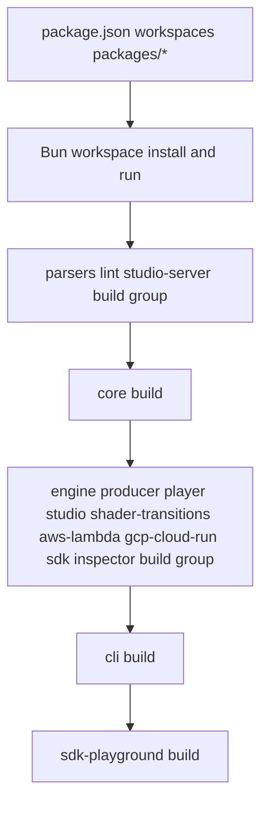
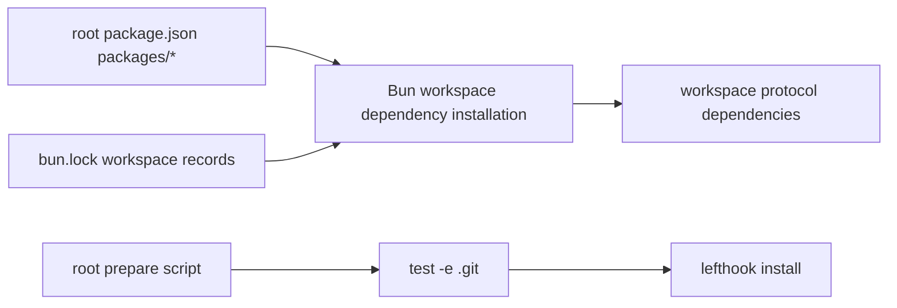
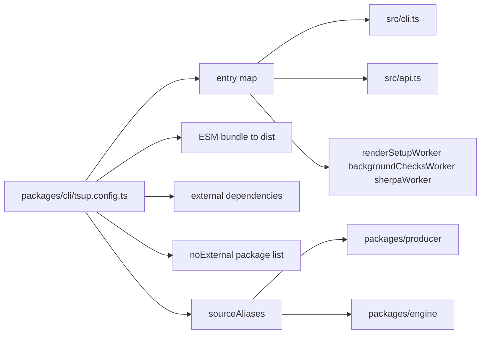
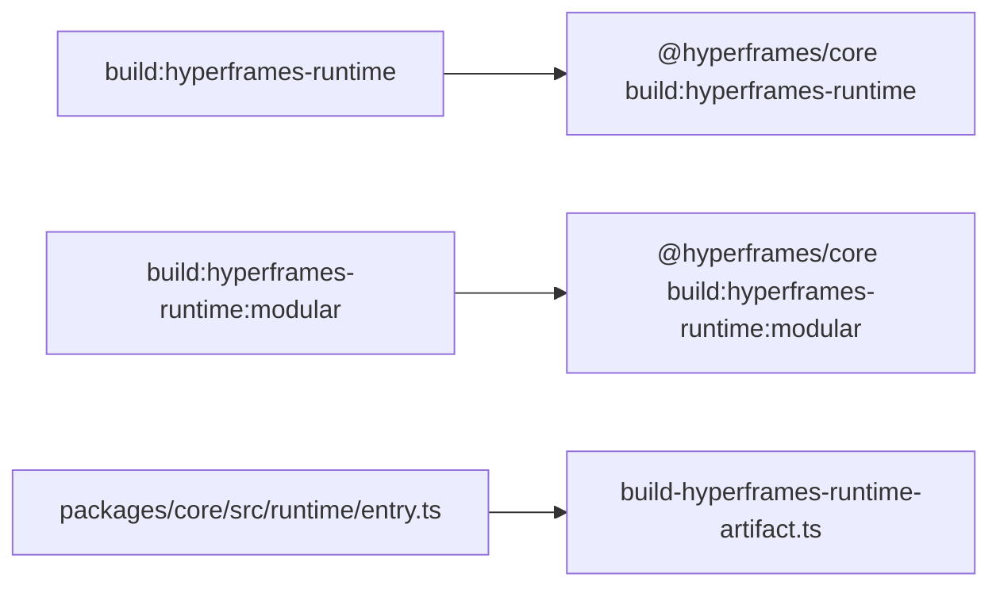
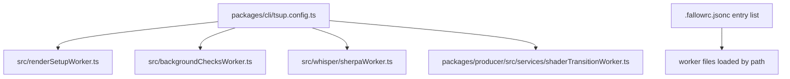
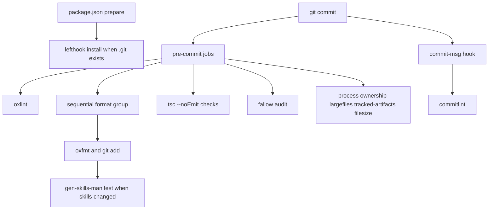
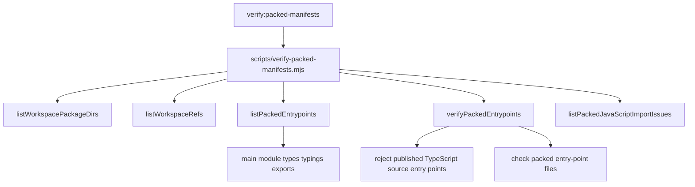
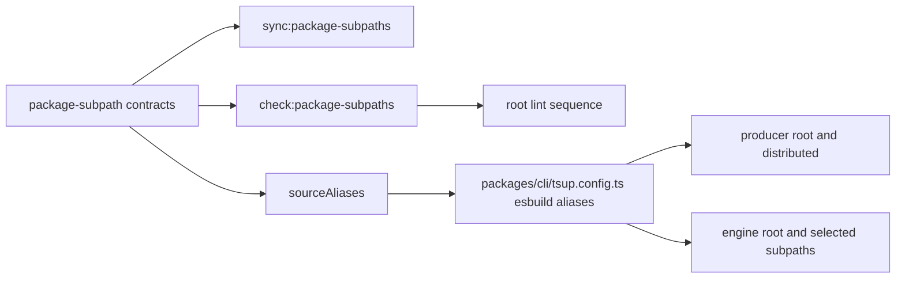
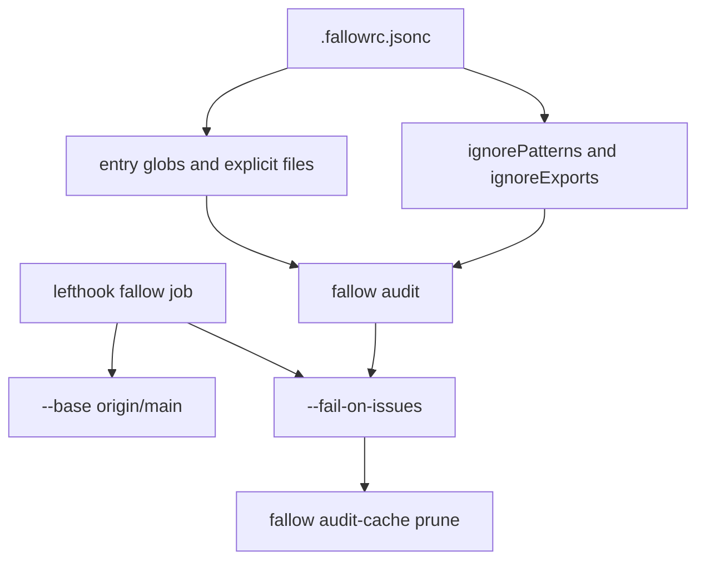

<!-- source: DeepWiki mcp.deepwiki.com · repo heygen-com/hyperframes · page 13.1 Monorepo Setup and Build System · fetched 2026-11-02 -->

# Monorepo Setup and Build System

Relevant source files

The following files were used as context for generating this wiki page:

- [.fallowrc.jsonc](.fallowrc.jsonc)
- [.github/actions/install-ffmpeg-windows/action.yml](.github/actions/install-ffmpeg-windows/action.yml)
- [.github/actions/prepare-ffmpeg-bin/action.yml](.github/actions/prepare-ffmpeg-bin/action.yml)
- [.github/actions/release-only-diff/action.yml](.github/actions/release-only-diff/action.yml)
- [.github/workflows/catalog-previews.yml](.github/workflows/catalog-previews.yml)
- [.github/workflows/ci.yml](.github/workflows/ci.yml)
- [.github/workflows/docs.yml](.github/workflows/docs.yml)
- [.github/workflows/fast-video-validation.yml](.github/workflows/fast-video-validation.yml)
- [.github/workflows/lambda-arm64-image.yml](.github/workflows/lambda-arm64-image.yml)
- [.github/workflows/player-perf.yml](.github/workflows/player-perf.yml)
- [.github/workflows/player-safari.yml](.github/workflows/player-safari.yml)
- [.github/workflows/preview-regression.yml](.github/workflows/preview-regression.yml)
- [.github/workflows/regression.yml](.github/workflows/regression.yml)
- [.github/workflows/windows-render.yml](.github/workflows/windows-render.yml)
- [bun.lock](bun.lock)
- [lefthook.yml](lefthook.yml)
- [package.json](package.json)
- [packages/aws-lambda/build.mjs](packages/aws-lambda/build.mjs)
- [packages/cli/bin/hyperframes.mjs](packages/cli/bin/hyperframes.mjs)
- [packages/cli/src/api.test.ts](packages/cli/src/api.test.ts)
- [packages/cli/src/api/transcribe.ts](packages/cli/src/api/transcribe.ts)
- [packages/cli/src/browser/launch.process.test.ts](packages/cli/src/browser/launch.process.test.ts)
- [packages/cli/src/browser/launch.startupFailure.test.ts](packages/cli/src/browser/launch.startupFailure.test.ts)
- [packages/cli/src/capture/captureCompositionFrame.prelaunch.browser.test.ts](packages/cli/src/capture/captureCompositionFrame.prelaunch.browser.test.ts)
- [packages/cli/src/commands/contrast-solid.browser.test.ts](packages/cli/src/commands/contrast-solid.browser.test.ts)
- [packages/cli/src/commands/snapshot.timeoutHint.test.ts](packages/cli/src/commands/snapshot.timeoutHint.test.ts)
- [packages/cli/src/commands/transcribe.test.ts](packages/cli/src/commands/transcribe.test.ts)
- [packages/cli/src/commands/transcribe.ts](packages/cli/src/commands/transcribe.ts)
- [packages/cli/src/hangReport.test.ts](packages/cli/src/hangReport.test.ts)
- [packages/cli/src/hangReport.ts](packages/cli/src/hangReport.ts)
- [packages/cli/src/utils/download.test.ts](packages/cli/src/utils/download.test.ts)
- [packages/cli/src/utils/download.ts](packages/cli/src/utils/download.ts)
- [packages/cli/src/whisper/manager.install.test.ts](packages/cli/src/whisper/manager.install.test.ts)
- [packages/cli/src/whisper/manager.model.test.ts](packages/cli/src/whisper/manager.model.test.ts)
- [packages/cli/src/whisper/manager.ts](packages/cli/src/whisper/manager.ts)
- [packages/cli/src/whisper/modelFile.ts](packages/cli/src/whisper/modelFile.ts)
- [packages/cli/src/whisper/normalize.test.ts](packages/cli/src/whisper/normalize.test.ts)
- [packages/cli/src/whisper/normalize.ts](packages/cli/src/whisper/normalize.ts)
- [packages/cli/src/whisper/parakeet.ts](packages/cli/src/whisper/parakeet.ts)
- [packages/cli/src/whisper/progress.test.ts](packages/cli/src/whisper/progress.test.ts)
- [packages/cli/src/whisper/progress.ts](packages/cli/src/whisper/progress.ts)
- [packages/cli/src/whisper/sherpa.test.ts](packages/cli/src/whisper/sherpa.test.ts)
- [packages/cli/src/whisper/sherpa.ts](packages/cli/src/whisper/sherpa.ts)
- [packages/cli/src/whisper/sherpaWorker.test.ts](packages/cli/src/whisper/sherpaWorker.test.ts)
- [packages/cli/src/whisper/sherpaWorker.ts](packages/cli/src/whisper/sherpaWorker.ts)
- [packages/cli/src/whisper/transcribe.metadata.test.ts](packages/cli/src/whisper/transcribe.metadata.test.ts)
- [packages/cli/src/whisper/transcribe.test.ts](packages/cli/src/whisper/transcribe.test.ts)
- [packages/cli/src/whisper/transcribe.ts](packages/cli/src/whisper/transcribe.ts)
- [packages/cli/tsup.config.ts](packages/cli/tsup.config.ts)
- [packages/engine/package-subpaths.json](packages/engine/package-subpaths.json)
- [packages/engine/src/services/chromeStartup.test.ts](packages/engine/src/services/chromeStartup.test.ts)
- [packages/engine/src/services/chromeStartup.ts](packages/engine/src/services/chromeStartup.ts)
- [packages/engine/vitest.config.ts](packages/engine/vitest.config.ts)
- [packages/gcp-cloud-run/build.mjs](packages/gcp-cloud-run/build.mjs)
- [scripts/check-test-reachability.mjs](scripts/check-test-reachability.mjs)
- [scripts/check-test-reachability.test.mjs](scripts/check-test-reachability.test.mjs)
- [scripts/ci/release-only-diff.mjs](scripts/ci/release-only-diff.mjs)
- [scripts/ci/release-only-diff.test.mjs](scripts/ci/release-only-diff.test.mjs)
- [scripts/verify-packed-manifests.mjs](scripts/verify-packed-manifests.mjs)
- [scripts/verify-packed-manifests.test.mjs](scripts/verify-packed-manifests.test.mjs)

## Purpose and scope

This page describes the repository-level workspace and build commands, the CLI’s `tsup` configuration, package-subpath and packed-manifest checks, commit hooks, linting and formatting, and the configured `fallow` audit. The available configuration also identifies several standalone runtime and worker entry points; where their build implementation is not shown here, this page describes only what the configuration establishes.

Sources: [package.json:1-66](), [packages/cli/tsup.config.ts:1-114](), [.fallowrc.jsonc:1-83]()

---

## Workspace Structure

The root `package.json` declares a private ESM monorepo and uses `packages/*` as its workspace pattern. The root build script orders package builds in groups: parsers, lint, and studio-server first; core next; then engine, producer, player, studio, shader-transitions, cloud adapters, SDK, and inspector; finally CLI and SDK playground. This ordering is explicit in the command rather than inferred from workspace discovery. [package.json:1-18]()

The lockfile records workspace packages and their workspace-protocol dependencies. For example, the CLI has workspace development dependencies on several HyperFrames packages, while engine depends on core and parsers and the cloud adapters depend on producer. [bun.lock:28-42](), [bun.lock:64-118](), [bun.lock:164-181](), [bun.lock:183-202]()

| Package | Path | Evidence in the supplied configuration |
|---|---|---|
| `@hyperframes/cli` | `packages/cli` | Workspace package with CLI bins and build configuration. [bun.lock:64-118](), [packages/cli/tsup.config.ts:13-35]() |
| `@hyperframes/core` | `packages/core` | Workspace package; built before the later package group. [bun.lock:119-163](), [package.json:14-14]() |
| `@hyperframes/engine` | `packages/engine` | Workspace package depending on core and parsers. [bun.lock:164-181]() |
| `@hyperframes/producer` | `packages/producer` | Workspace package referenced by CLI and cloud adapter packages. [bun.lock:37-42](), [bun.lock:183-202]() |
| `@hyperframes/studio` | `packages/studio` | Workspace dependency of the CLI; included in the root build group. [bun.lock:64-118](), [package.json:14-14]() |
| `@hyperframes/player` | `packages/player` | Root development dependency and member of the root build group. [bun.lock:4-26](), [package.json:14-14]() |
| `@hyperframes/parsers` | `packages/parsers` | Included in the initial root build group and used by core and engine. [package.json:14-14](), [bun.lock:119-130](), [bun.lock:164-175]() |
| `@hyperframes/lint` | `packages/lint` | Included in the initial root build group and referenced by core and CLI. [package.json:14-14](), [bun.lock:119-130]() |
| `@hyperframes/studio-server` | `packages/studio-server` | Included in the initial root build group and referenced by core and CLI. [package.json:14-14](), [bun.lock:119-130]() |
| `@hyperframes/aws-lambda` | `packages/aws-lambda` | Workspace package used by the CLI and producer-based cloud deployment. [bun.lock:28-42](), [bun.lock:90-102]() |
| `@hyperframes/gcp-cloud-run` | `packages/gcp-cloud-run` | Workspace package used by the CLI and producer-based cloud deployment. [bun.lock:183-202](), [bun.lock:90-102]() |

The package list above is not exhaustive: the root build command also names shader-transitions, SDK, inspector, and SDK playground. [package.json:14-14]()

**Diagram: Root workspace and build ordering**

Sources: [package.json:8-18](), [bun.lock:4-26]()

### Root commands and package execution

The root scripts provide common entry points for development, build, testing, linting, formatting, and repository checks. `dev` delegates to the Studio workspace; `build:producer` delegates to the producer workspace; `test:unit` runs the `test` script across all workspaces; and `format` and `format:check` invoke `oxfmt`. [package.json:12-18](), [package.json:29-56]()

The root `lint` script composes repository checks before running `oxlint .`: it includes documentation-snippet, Studio-copy, tracked-artifact, workspace-contract, Dockerfile, package-cycle, package-subpath, and CLI-process-ownership checks, followed by skill checks. The script is therefore a broader gate than a standalone linter invocation. [package.json:29-44]()

| Command | Root behavior |
|---|---|
| `bun run dev` | Runs the root `studio` script, which delegates to the Studio workspace’s `dev` script. [package.json:13-16]() |
| `bun run build` | Runs the ordered workspace build groups described above. [package.json:14-14]() |
| `bun run build:producer` | Runs the producer workspace’s `build` script. [package.json:15-15]() |
| `bun run test:unit` | Runs the `test` script for all workspaces. [package.json:46-47]() |
| `bun run lint` | Runs the listed repository checks, `oxlint .`, and skill checks. [package.json:29-44]() |
| `bun run format` / `bun run format:check` | Formats the repository or checks formatting with `oxfmt`. [package.json:45-45](), [package.json:55-55]() |

Sources: [package.json:12-56]()

---

## Package Installation with Bun

The root package declares workspaces under `packages/*`, and `bun.lock` records workspace package names and dependency specifications, including `workspace:*` and `workspace:^`. Together, these files define the repository’s Bun workspace layout and its local package dependency declarations. [package.json:8-11](), [bun.lock:4-26](), [bun.lock:28-42]()

The root `prepare` script attempts to install Lefthook when a `.git` directory exists, and tolerates failure with `|| true`. This connects dependency setup to Git hook installation without making hook installation a hard requirement in environments that lack a Git checkout. [package.json:66-66]()

**Diagram: Workspace dependency and hook setup**

Sources: [package.json:8-11](), [package.json:66-66](), [bun.lock:28-42]()

Sources: [package.json:8-11](), [package.json:66-66](), [bun.lock:28-42]()

---

## Build Configuration with `tsup`

The supplied `tsup` configuration is for `packages/cli`. It declares multiple named entries, emits ESM into `dist`, targets Node 22, enables bundling and splitting, disables sourcemaps, and cleans the output directory. Declaration generation is restricted to the `api` entry because the other entries are programs rather than library exports. [packages/cli/tsup.config.ts:13-36]()

The CLI bundle keeps selected runtime dependencies external, including Puppeteer packages, `sharp`, Hono, and the AWS and GCP adapters. It marks several HyperFrames packages and dependencies as `noExternal`, so they are included in the bundle. The comments explain that cloud adapters remain external because their subcommands dynamically import them, avoiding their loading as part of the CLI’s default path. [packages/cli/tsup.config.ts:45-93]()

The configuration also inserts a JavaScript banner that defines `require`, `__filename`, and `__dirname` using Node module and URL helpers. It reads the CLI and producer package versions and exposes them to the bundle as `__CLI_VERSION__` and `__PRODUCER_VERSION__`. [packages/cli/tsup.config.ts:6-11](), [packages/cli/tsup.config.ts:37-44](), [packages/cli/tsup.config.ts:94-97]()

| Configuration area | CLI build behavior |
|---|---|
| Entries | Includes CLI, API, runtime/version helpers, worker entries, and a producer worker entry. [packages/cli/tsup.config.ts:13-26]() |
| Output | ESM, `dist`, Node 22 target, bundled with splitting, cleaned before build. [packages/cli/tsup.config.ts:27-36]() |
| Type declarations | Generated for `src/api.ts` only. [packages/cli/tsup.config.ts:34-36]() |
| External dependencies | Keeps browser/runtime packages, cloud adapters, and other dependencies external. [packages/cli/tsup.config.ts:45-77]() |
| Bundled dependencies | Uses `noExternal` for selected internal packages and dependencies. [packages/cli/tsup.config.ts:78-93]() |
| Source aliases | Uses `sourceAliases` for producer and engine package subpaths. [packages/cli/tsup.config.ts:98-111]() |

**Diagram: CLI build configuration mapped to build entities**

Sources: [packages/cli/tsup.config.ts:4-4](), [packages/cli/tsup.config.ts:13-114]()

Sources: [packages/cli/tsup.config.ts:13-35](), [packages/cli/tsup.config.ts:45-93](), [packages/cli/tsup.config.ts:98-111]()

The root build command establishes a build sequence across workspaces, but the supplied files do not include each package’s individual `tsup` or `tsc` configuration. Package-specific build details beyond the CLI configuration should be confirmed from those package manifests and build files. [package.json:14-14](), [packages/cli/tsup.config.ts:1-114]()

Sources: [package.json:14-18](), [packages/cli/tsup.config.ts:1-114]()

---

## The `build:hyperframes-runtime` Pipeline

The root scripts expose `build:hyperframes-runtime` and `build:hyperframes-runtime:modular` by forwarding each command to the core workspace. The supplied root manifest does not show the implementation of those scripts or the paths of their generated outputs, so this page does not assert a specific runtime artifact filename, manifest format, or producer-to-CLI copy process. [package.json:17-18]()

The `fallow` configuration identifies `packages/core/src/runtime/entry.ts` as a standalone IIFE entry point. Its comment says it is referenced by file path, rather than imported, in `build-hyperframes-runtime-artifact.ts`. This establishes that the runtime entry participates in a separate artifact build path, but the implementation details of that builder are not included in the supplied file contents. [.fallowrc.jsonc:35-38]()

**Diagram: Runtime build command and configured entry point**

Sources: [package.json:17-18](), [.fallowrc.jsonc:35-38]()

Sources: [package.json:17-18](), [.fallowrc.jsonc:35-38]()

---

## Specialized Worker Bundling

The CLI `tsup` entry map includes worker-oriented entry points such as `renderSetupWorker`, `backgroundChecksWorker`, and `sherpaWorker`, as well as `shaderTransitionWorker` from the producer package. This makes them explicit build entries alongside the main CLI and API entries. [packages/cli/tsup.config.ts:13-26]()

The `fallow` configuration separately lists several worker files as entries because they are loaded dynamically or spawned by path rather than reached through ordinary imports. Examples include producer worker files and CLI workers for render setup, background checks, and Sherpa decoding. The comments in the configuration explain these entry-point relationships; the supplied files do not provide the worker construction or runtime loading implementations. [.fallowrc.jsonc:53-63]()

**Diagram: Worker entry points linked to build configuration**

Sources: [packages/cli/tsup.config.ts:13-26](), [.fallowrc.jsonc:53-63]()

Sources: [packages/cli/tsup.config.ts:13-26](), [.fallowrc.jsonc:53-63]()

---

## Git Hooks and Code Quality Enforcement with Lefthook

Lefthook defines parallel pre-commit jobs, with a sequential group for formatting and skills-manifest generation. The ordering is intentional: formatting can rewrite staged files, so the manifest generator must run after formatting rather than in parallel with it. The formatting command then re-stages the affected files. [lefthook.yml:1-24]()

Other pre-commit jobs include TypeScript checks for core and Studio plus script typechecking, a `fallow` audit, CLI process-ownership checks, large-file checks, tracked-artifact checks, and a Studio source-file line-count limit. The `fallow` job compares against `origin/main`, fails on issues, prunes old audit caches, and unsets Git worktree environment variables before running. [lefthook.yml:25-68]()

The commit-message hook runs `commitlint` against the message file. Root `prepare` attempts to install Lefthook when running from a Git checkout. [lefthook.yml:70-73](), [package.json:66-66]()

| Hook job | Trigger or behavior |
|---|---|
| `lint` | Runs `oxlint` on staged JavaScript and TypeScript-family files. [lefthook.yml:4-6]() |
| `format` | Runs `oxfmt` on staged files and re-stages them. [lefthook.yml:12-17]() |
| `skills-manifest` | Regenerates and stages `skills-manifest.json` when files under `skills/` change. [lefthook.yml:18-24]() |
| `typecheck` | Runs `tsc --noEmit` for core, Studio, and scripts. [lefthook.yml:25-27]() |
| `fallow` | Audits against `origin/main`, fails on issues, then prunes the cache. [lefthook.yml:28-40]() |
| `cli-process-ownership` | Runs the root CLI process-ownership check for CLI source changes. [lefthook.yml:41-43]() |
| `largefiles` / `tracked-artifacts` | Checks staged files for oversized binaries and tracked artifacts. [lefthook.yml:44-52]() |
| `filesize` | Enforces a 600-line maximum on applicable Studio TypeScript files. [lefthook.yml:53-68]() |
| `commitlint` | Checks the commit message. [lefthook.yml:70-73]() |

**Diagram: Commit hooks and sequencing**

Sources: [lefthook.yml:1-73](), [package.json:66-66]()

Sources: [lefthook.yml:1-73](), [package.json:66-66]()

---

## Formatting and Linting with oxlint and oxfmt

The root `lint` script invokes `oxlint .` after a sequence of repository checks. The root `lint:fix` script runs `oxlint --fix .`; `format` runs `oxfmt .`; and `format:check` runs `oxfmt --check .`. [package.json:29-45](), [package.json:55-55]()

Lefthook runs `oxlint` against staged source files and runs `oxfmt` against staged source, JSON, Markdown, and YAML files. In the formatting hook, the formatter is allowed to rewrite files and the hook re-stages the results. [lefthook.yml:4-17]()

The lockfile records `oxlint` and `oxfmt` as root development dependencies. [bun.lock:10-25]()

Sources: [package.json:29-45](), [package.json:55-55](), [lefthook.yml:4-17](), [bun.lock:10-25]()

---

## Package Verification: `verify-packed-manifests`

The root exposes `verify:packed-manifests`, which runs `scripts/verify-packed-manifests.mjs` with Node. The verifier enumerates workspace package directories and recognizes dependency fields including `dependencies`, `devDependencies`, `peerDependencies`, and `optionalDependencies`. It also collects package entry points from `main`, `module`, `types`, `typings`, and nested `exports` values. [package.json:19-19](), [scripts/verify-packed-manifests.mjs:24-55](), [scripts/verify-packed-manifests.mjs:104-129]()

For a packed package, `verifyPackedEntrypoints` rejects published source TypeScript entry points and checks that non-wildcard package-local manifest entry points exist in the packed file list. The script also contains logic for inspecting relative JavaScript imports in packed files. [scripts/verify-packed-manifests.mjs:183-204](), [scripts/verify-packed-manifests.mjs:206-212]()

The supplied excerpt does not include the complete verifier’s execution flow or all validation branches. In particular, it is not sufficient to claim that every workspace dependency is rejected or to describe precisely how the script packs each package. Those details should be read from the remainder of the verifier before documenting them. [scripts/verify-packed-manifests.mjs:1-4](), [scripts/verify-packed-manifests.mjs:183-212]()

| Validation area visible in the supplied code | What the code checks |
|---|---|
| Workspace discovery | Finds directories under `packages/` that contain `package.json`. [scripts/verify-packed-manifests.mjs:24-41]() |
| Workspace references | Collects dependency specs beginning with `workspace:` across the four dependency fields. [scripts/verify-packed-manifests.mjs:26-49]() |
| Published exports | Identifies `exports` keys missing from `publishConfig.exports` when both objects are present. [scripts/verify-packed-manifests.mjs:51-55]() |
| Manifest entry points | Collects package-local entry points from standard fields and `exports`. [scripts/verify-packed-manifests.mjs:104-129]() |
| Packed entry-point integrity | Rejects source TypeScript entry points and missing, non-wildcard packed targets. [scripts/verify-packed-manifests.mjs:183-204]() |
| Relative imports | Provides a helper that detects relative import/require specifiers in packed JavaScript. [scripts/verify-packed-manifests.mjs:145-168](), [scripts/verify-packed-manifests.mjs:206-212]() |

**Diagram: Packed-manifest validation entities**

Sources: [package.json:19-19](), [scripts/verify-packed-manifests.mjs:24-55](), [scripts/verify-packed-manifests.mjs:104-129](), [scripts/verify-packed-manifests.mjs:183-212]()

Sources: [package.json:19-19](), [scripts/verify-packed-manifests.mjs:24-55](), [scripts/verify-packed-manifests.mjs:104-129](), [scripts/verify-packed-manifests.mjs:183-212]()

---

## Package Subpaths

The root scripts provide `sync:package-subpaths`, which runs `scripts/package-subpaths.mjs --write`, and `check:package-subpaths`, which runs the same script without the write flag. The root lint sequence invokes the check form. [package.json:27-29]()

The CLI build configuration imports `sourceAliases` from `scripts/package-subpaths.mjs` and uses it to construct aliases for producer and engine package roots and selected subpaths. A comment in the configuration states that aliases are generated from the same contracts as package exports, avoiding an esbuild root-alias prefix substitution issue. [packages/cli/tsup.config.ts:4-4](), [packages/cli/tsup.config.ts:98-111]()

The supplied contents do not include the package-subpath contract files or the implementation of `scripts/package-subpaths.mjs`, so the exact generated mappings and validation rules are not described here. [package.json:27-29](), [packages/cli/tsup.config.ts:98-111]()

**Diagram: Package-subpath check and CLI alias use**

Sources: [package.json:27-29](), [packages/cli/tsup.config.ts:4-4](), [packages/cli/tsup.config.ts:98-111]()

Sources: [package.json:27-29](), [packages/cli/tsup.config.ts:4-4](), [packages/cli/tsup.config.ts:98-111]()

---

## Runtime and Inline Script Build Scripts

The `fallow` configuration includes several entries that are not reached through ordinary TypeScript imports. It identifies the core runtime entry, position-edits render entry, audio FX runtime entry, SVG selector aliases entry, and browser audit scripts as standalone or path-referenced build/runtime inputs. [.fallowrc.jsonc:35-51]()

For the core runtime, the comment explicitly describes a standalone IIFE build and names `build-hyperframes-runtime-artifact.ts` as the builder reference. For position edits and audio FX, the comments name their respective build scripts. The supplied contents do not include those build-script implementations or establish the output locations and downstream copying behavior. [.fallowrc.jsonc:35-45]()

| Configured entry | Configuration comment |
|---|---|
| `packages/core/src/runtime/entry.ts` | Standalone IIFE for the browser-side sandbox runtime; referenced by file path in `build-hyperframes-runtime-artifact.ts`. [.fallowrc.jsonc:35-38]() |
| `packages/core/stubs/position-edits-render-entry.ts` | Bundled as a standalone IIFE by the position-edits render artifact generator. [.fallowrc.jsonc:38-40]() |
| `packages/core/stubs/audio-fx-runtime-entry.ts` | Bundled by `build-audio-fx-runtime.ts` for the offline render page. [.fallowrc.jsonc:41-43]() |
| `packages/core/stubs/svg-selector-aliases-entry.ts` | Described as an entry bundled into compiled scene scripts. [.fallowrc.jsonc:44-45]() |
| CLI browser audit scripts | Read as raw strings and injected with `page.addScriptTag`, rather than imported. [.fallowrc.jsonc:46-51]() |

Sources: [.fallowrc.jsonc:35-51]()

---

## Fallow Dead Code Audits

The repository’s `.fallowrc.jsonc` config defines explicit audit entries, ignore patterns, and ignored exports. Its entry list includes tests, scripts, dynamically loaded modules, standalone runtime inputs, worker entry points, and dynamically consumed Studio components. The comments explain that some files need explicit entries because they are loaded by path, injected as text, or selected dynamically rather than reached through the normal import graph. [.fallowrc.jsonc:1-83]()

The configuration excludes categories such as documentation, generated or fixture data, examples, registry content, browser binaries, and selected test or script directories. It also documents specific ignored exports that are public to consumers outside the workspace or used by external harnesses. [.fallowrc.jsonc:84-128]()

Lefthook runs `fallow audit --base origin/main --fail-on-issues` for changes matching package source files, then prunes audit caches older than one day. The hook runs against the working tree, and its comments warn that unstaged package work can be included in the audited diff. [lefthook.yml:28-40]()

**Diagram: Fallow audit inputs and commit gate**

Sources: [.fallowrc.jsonc:1-83](), [.fallowrc.jsonc:84-128](), [lefthook.yml:28-40]()

Sources: [.fallowrc.jsonc:1-83](), [.fallowrc.jsonc:84-128](), [lefthook.yml:28-40]()

---

## Summary

The repository-level build and quality setup is defined by:

- Bun workspaces declared through the root `packages/*` pattern, with a lockfile recording workspace dependencies. [package.json:8-11](), [bun.lock:4-26]()
- An explicit root build sequence across workspace groups. [package.json:14-18]()
- A CLI `tsup` build with multiple entries, Node 22 targeting, selected external and bundled dependencies, declaration output for the API entry, and generated source aliases. [packages/cli/tsup.config.ts:13-36](), [packages/cli/tsup.config.ts:45-93](), [packages/cli/tsup.config.ts:98-111]()
- Root commands for package-subpath synchronization and checking, and for packed-manifest verification. [package.json:19-19](), [package.json:27-29]()
- Lefthook pre-commit and commit-message gates covering lint, formatting, typechecking, audits, and repository-specific checks. [lefthook.yml:1-73]()
- Root lint and format commands using `oxlint` and `oxfmt`. [package.json:29-45](), [package.json:55-55]()
- A `fallow` configuration that explicitly accounts for files outside the normal import graph and scopes exclusions and ignored exports. [.fallowrc.jsonc:1-128]()

Sources: [package.json:8-56](), [packages/cli/tsup.config.ts:13-111](), [lefthook.yml:1-73](), [.fallowrc.jsonc:1-128](), [scripts/verify-packed-manifests.mjs:24-55](), [scripts/verify-packed-manifests.mjs:183-212]()

---

