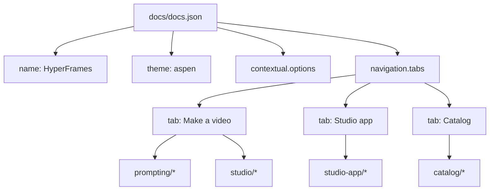
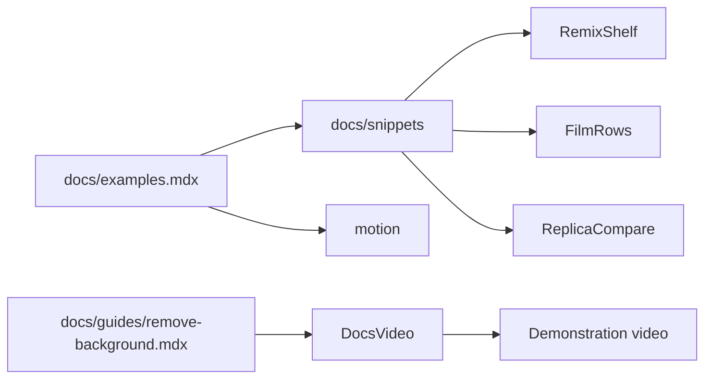
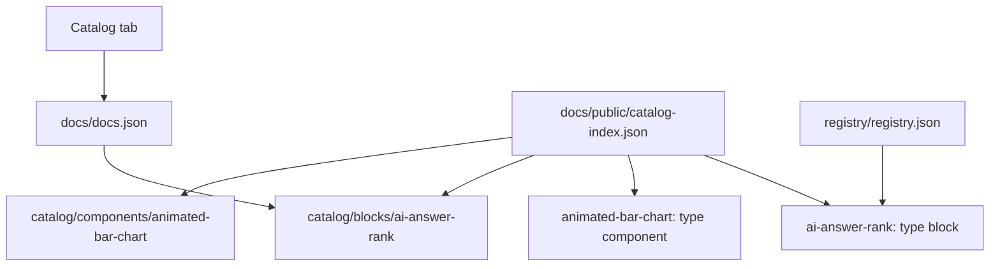
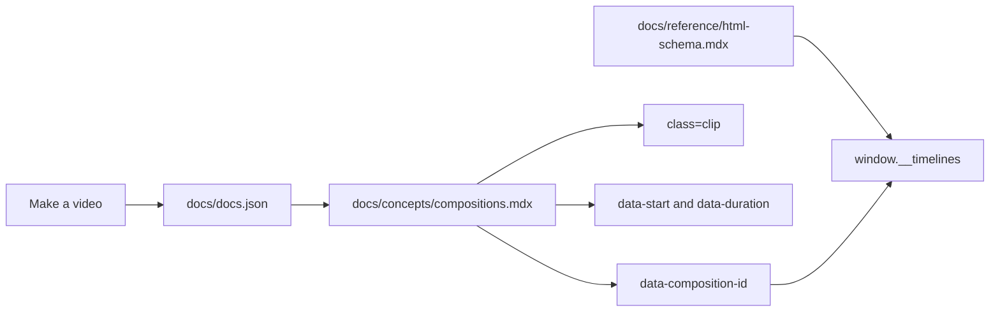
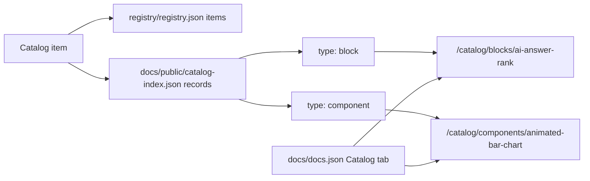

<!-- source: DeepWiki mcp.deepwiki.com · repo heygen-com/hyperframes · page 13.3 Documentation Site · fetched 2026-11-02 -->

# Documentation Site

Relevant source files

The following files were used as context for generating this wiki page:

- [DESIGN.md](DESIGN.md)
- [docs/catalog-gallery.css](docs/catalog-gallery.css)
- [docs/catalog/components/filmed-screen.mdx](docs/catalog/components/filmed-screen.mdx)
- [docs/catalog/components/motion-blur.mdx](docs/catalog/components/motion-blur.mdx)
- [docs/catalog/components/shutter-slam.mdx](docs/catalog/components/shutter-slam.mdx)
- [docs/concepts/compositions.mdx](docs/concepts/compositions.mdx)
- [docs/concepts/data-attributes.mdx](docs/concepts/data-attributes.mdx)
- [docs/concepts/determinism.mdx](docs/concepts/determinism.mdx)
- [docs/concepts/variables.mdx](docs/concepts/variables.mdx)
- [docs/contributing/testing-local-changes.mdx](docs/contributing/testing-local-changes.mdx)
- [docs/custom.css](docs/custom.css)
- [docs/deploy/aws-lambda.mdx](docs/deploy/aws-lambda.mdx)
- [docs/deploy/migrating-to-hyperframes-lambda.mdx](docs/deploy/migrating-to-hyperframes-lambda.mdx)
- [docs/docs.json](docs/docs.json)
- [docs/examples.mdx](docs/examples.mdx)
- [docs/guides/export-and-share.mdx](docs/guides/export-and-share.mdx)
- [docs/guides/free-agents.mdx](docs/guides/free-agents.mdx)
- [docs/guides/gsap-animation.mdx](docs/guides/gsap-animation.mdx)
- [docs/guides/media-effects.mdx](docs/guides/media-effects.mdx)
- [docs/guides/media.mdx](docs/guides/media.mdx)
- [docs/guides/remove-background.mdx](docs/guides/remove-background.mdx)
- [docs/guides/video-components.mdx](docs/guides/video-components.mdx)
- [docs/guides/voice-and-audio.mdx](docs/guides/voice-and-audio.mdx)
- [docs/introduction.mdx](docs/introduction.mdx)
- [docs/packages/aws-lambda.mdx](docs/packages/aws-lambda.mdx)
- [docs/packages/core.mdx](docs/packages/core.mdx)
- [docs/packages/gcp-cloud-run.mdx](docs/packages/gcp-cloud-run.mdx)
- [docs/packages/shader-transitions.mdx](docs/packages/shader-transitions.mdx)
- [docs/packages/studio.mdx](docs/packages/studio.mdx)
- [docs/prompting/color-grading.mdx](docs/prompting/color-grading.mdx)
- [docs/public/catalog-index.json](docs/public/catalog-index.json)
- [docs/public/catalog/components/filmed-screen.json](docs/public/catalog/components/filmed-screen.json)
- [docs/public/catalog/components/motion-blur.json](docs/public/catalog/components/motion-blur.json)
- [docs/public/catalog/components/shutter-slam.json](docs/public/catalog/components/shutter-slam.json)
- [docs/reference/color-grading.mdx](docs/reference/color-grading.mdx)
- [docs/reference/html-schema.mdx](docs/reference/html-schema.mdx)
- [docs/snippets/advanced-path-grid.jsx](docs/snippets/advanced-path-grid.jsx)
- [docs/snippets/catalog-gallery-data.mdx](docs/snippets/catalog-gallery-data.mdx)
- [docs/snippets/day-list.jsx](docs/snippets/day-list.jsx)
- [docs/snippets/docs-video.jsx](docs/snippets/docs-video.jsx)
- [docs/snippets/example-player.jsx](docs/snippets/example-player.jsx)
- [docs/snippets/film-rows.jsx](docs/snippets/film-rows.jsx)
- [docs/snippets/hover-video.jsx](docs/snippets/hover-video.jsx)
- [docs/snippets/quickstart-continuation-grid.jsx](docs/snippets/quickstart-continuation-grid.jsx)
- [docs/snippets/remix-shelf.jsx](docs/snippets/remix-shelf.jsx)
- [docs/snippets/replica-compare.jsx](docs/snippets/replica-compare.jsx)
- [docs/studio/canvas.mdx](docs/studio/canvas.mdx)
- [docs/template-gallery.css](docs/template-gallery.css)
- [docs/thirty-days.mdx](docs/thirty-days.mdx)
- [packages/cli/src/docs/compositions.md](packages/cli/src/docs/compositions.md)
- [packages/cli/src/registry/motionBlurShutter.browser.test.ts](packages/cli/src/registry/motionBlurShutter.browser.test.ts)
- [registry/blocks/gooey-split/gooey-split.html](registry/blocks/gooey-split/gooey-split.html)
- [registry/blocks/gooey-split/registry-item.json](registry/blocks/gooey-split/registry-item.json)
- [registry/catalog-artifact/local-vectors.bin](registry/catalog-artifact/local-vectors.bin)
- [registry/catalog-artifact/local-vectors.json](registry/catalog-artifact/local-vectors.json)
- [registry/components/motion-blur/demo.html](registry/components/motion-blur/demo.html)
- [registry/components/motion-blur/motion-blur.html](registry/components/motion-blur/motion-blur.html)
- [registry/components/motion-blur/registry-item.json](registry/components/motion-blur/registry-item.json)
- [registry/components/shutter-slam/demo.html](registry/components/shutter-slam/demo.html)
- [registry/components/shutter-slam/shutter-slam.html](registry/components/shutter-slam/shutter-slam.html)
- [registry/registry.json](registry/registry.json)
- [scripts/catalog-drift.test.ts](scripts/catalog-drift.test.ts)
- [scripts/catalog-drift.ts](scripts/catalog-drift.ts)
- [scripts/catalog-publication.test.mjs](scripts/catalog-publication.test.mjs)
- [scripts/catalog-vectors.mjs](scripts/catalog-vectors.mjs)
- [scripts/check-docs-snippet-motion.test.mjs](scripts/check-docs-snippet-motion.test.mjs)
- [scripts/check-no-main-deletions.mjs](scripts/check-no-main-deletions.mjs)
- [scripts/check-no-main-deletions.test.mjs](scripts/check-no-main-deletions.test.mjs)
- [scripts/publish-catalog.mjs](scripts/publish-catalog.mjs)
- [scripts/sync-docs-catalog.mjs](scripts/sync-docs-catalog.mjs)

## Purpose and scope

The HyperFrames documentation site is a Mintlify site configured from `docs/docs.json`. Its content explains the product to different audiences through concepts, task-oriented guides, prompting material, package references, Studio documentation, and a registry catalog. This page describes the site structure and the documentation artifacts visible in the supplied files; it does not assume details of generator scripts or checks whose implementations are not shown. [docs/docs.json:1-4]() [docs/concepts/compositions.mdx:1-11]() [docs/packages/core.mdx:1-12]()

Sources: `docs/docs.json`, `docs/concepts/compositions.mdx`, `docs/packages/core.mdx`

---

## 1. Mintlify configuration and navigation

`docs/docs.json` is the site’s Mintlify configuration. It sets the site name and theme, color palette, background, fonts, appearance default, logo, favicon, contextual actions, and navigation. The configuration names the site `HyperFrames`, selects the `aspen` theme, and uses Inter as its configured font family. It also enables contextual options for copying content and opening it in several developer tools, plus a custom issue-reporting action. [docs/docs.json:1-46]()

The shown navigation is organized into tabs, groups, and page slugs. The `Make a video` tab includes starting points, workflows, agent-use guides, comparison material, prompting topics, media guides, Studio browser-editor pages, and help/update pages. A separate `Studio app` tab has its own workflow pages. A `Catalog` tab begins with a catalog index and nested catalog groups. Mintlify uses these configured page identifiers and groupings to build the site’s navigation; the page content itself is authored separately. [docs/docs.json:48-184]()

| Configuration area | Role | Example from the configuration |
| --- | --- | --- |
| Site metadata and theme | Names the site and selects its theme | `name: "HyperFrames"`, `theme: "aspen"` [docs/docs.json:1-4]() |
| Appearance | Defines color, background, font, and system appearance defaults | `colors`, `background`, `fonts`, `appearance` [docs/docs.json:5-24]() |
| Brand assets | Points to light and dark logos and the favicon | `logo`, `favicon` [docs/docs.json:25-30]() |
| Contextual actions | Provides copy, editor, MCP, and issue-reporting actions | `contextual.options` [docs/docs.json:31-46]() |
| Navigation | Organizes page slugs under tabs and groups | `navigation.tabs` [docs/docs.json:48-184]() |

**Diagram: Mintlify configuration mapped to the site’s named navigation entities**

Sources: `docs/docs.json`

---

## 2. Documentation content areas

The navigation and supplied MDX files show several complementary content styles: concept explanations, practical guides, package documentation, prompting advice, Studio instructions, and reference material. These areas are not just folders of prose; pages can include embedded components, videos, code examples, and links to related topics. For example, the composition concept page explains the HTML composition model and links to data attributes and schema references, while the Core package page directs readers to CLI, Studio, and SDK entry points. [docs/concepts/compositions.mdx:6-11]() [docs/concepts/compositions.mdx:46-56]() [docs/packages/core.mdx:6-12]()

### 2.1 Concepts and reference pages

Concept pages explain the composition model and how HyperFrames turns HTML into a timeline. The compositions page describes an HTML file as a video description, identifies `index.html` as the top-level composition, and explains that compositions can contain other compositions. It distinguishes timing declared through data attributes from motion authored in scripts. [docs/concepts/compositions.mdx:6-11]() [docs/concepts/compositions.mdx:169-180]()

The HTML schema reference supplies a more precise contract. It describes the composition root, timing attributes, clip conventions, media attributes, and timeline registration. Its minimal example associates `data-composition-id="main"` with `window.__timelines.main`, illustrating how the HTML composition identifier and timeline registry key correspond. [docs/reference/html-schema.mdx:12-73]()

The variables page explains how a composition can expose approved text, color, media, and other inputs. It covers declared types, direct bindings such as `data-var-text` and `data-var-src`, nested composition values, and CLI overrides. [docs/concepts/variables.mdx:7-12]() [docs/concepts/variables.mdx:63-76]() [docs/concepts/variables.mdx:111-138]()

### 2.2 Guides and prompting material

The navigation presents guides as task-oriented paths for making videos, working with agents, handling media, and using the browser editor. It separately groups prompting pages covering motion, media and audio, captions, color grading, design systems, examples, editing existing videos, recreating references, and a capstone. [docs/docs.json:64-127]()

The supplied color-grading page demonstrates how prompting material can combine advice, worked examples, tables, warnings, and embedded video components. It explains that effects depend on the source image, states a fixed grading pipeline order, and uses `DocsVideo` to show outcomes. [docs/prompting/color-grading.mdx:7-11]() [docs/prompting/color-grading.mdx:13-41]() [docs/prompting/color-grading.mdx:53-58]()

Guides can also be procedural and command-oriented. The background-removal guide describes Studio and CLI workflows, output choices, limitations, and troubleshooting. It imports `DocsVideo` for a demonstration and includes command examples as part of the tutorial. [docs/guides/remove-background.mdx:7-16]() [docs/guides/remove-background.mdx:20-45]() [docs/guides/remove-background.mdx:55-74]()

### 2.3 Package documentation

Package pages provide API-oriented entry points and help readers choose between higher-level tools and direct package use. The supplied Core package page describes `@hyperframes/core` as containing shared composition types and the browser runtime, and lists import surfaces for types and utilities, the compiler, variables, composition contracts, and runtime. [docs/packages/core.mdx:6-12]() [docs/packages/core.mdx:18-30]()

It also documents practical integration tasks, including parsing or generating HTML, validating variables, compiling a project, checking the static composition contract, and building a frame adapter. [docs/packages/core.mdx:49-89]() [docs/packages/core.mdx:91-113]() [docs/packages/core.mdx:115-188]()

The navigation shown in `docs.json` also exposes Studio browser-editor pages and Studio app pages. The supplied configuration does not show a package-reference navigation group for every package named in the broader repository; the page slugs shown here are the ones visible in the provided configuration excerpt. [docs/docs.json:131-173]()

Sources: `docs/docs.json`, `docs/concepts/compositions.mdx`, `docs/reference/html-schema.mdx`, `docs/concepts/variables.mdx`, `docs/prompting/color-grading.mdx`, `docs/guides/remove-background.mdx`, `docs/packages/core.mdx`

---

## 3. Snippets, examples, and motion demonstrations

MDX pages can import JSX snippets and use them as components in the document. The examples page imports `RemixShelf`, `FilmRows`, and `ReplicaCompare`, then defines a `motion` collection containing example metadata such as identifiers, names, aspect ratios, video results, posters, and source handles. [docs/examples.mdx:1-18]() [docs/examples.mdx:20-45]()

The supplied guides show another reusable pattern: `DocsVideo` is imported from `/snippets/docs-video.jsx` and embedded with a title, media source, and optional attributes such as `loop` or `poster`. This lets a page pair a written explanation with a visual example without duplicating the embed pattern in every document. [docs/prompting/color-grading.mdx:7-8]() [docs/prompting/color-grading.mdx:53-58]() [docs/guides/remove-background.mdx:7-16]()

Motion is documented both as a creative subject and as observable output. The compositions page illustrates the mapping from clip timing to rendered frame ranges, while the color-grading guide uses demonstration videos to show the effect of specific treatment choices. The supplied files establish these documentation patterns, but do not provide the implementation of a motion-check test or its pass/fail criteria. [docs/concepts/compositions.mdx:31-44]() [docs/prompting/color-grading.mdx:79-105]()

| Documentation pattern | Example | What it contributes |
| --- | --- | --- |
| Imported JSX snippet | `RemixShelf`, `FilmRows`, `ReplicaCompare` on the examples page [docs/examples.mdx:5-8]() | Reusable content presentation |
| Embedded video component | `DocsVideo` in prompting and guide pages [docs/prompting/color-grading.mdx:53-58]() [docs/guides/remove-background.mdx:12-16]() | Demonstrates a visual result alongside prose |
| Structured example data | `motion` entries with names, ratios, results, and posters [docs/examples.mdx:10-18]() | Supplies example metadata to page components |
| Timing illustration | Five seconds at 30 fps mapped to 150 frames [docs/concepts/compositions.mdx:31-44]() | Makes the relationship between timeline timing and frames concrete |

**Diagram: MDX content, reusable snippets, and demonstrations**

Sources: `docs/examples.mdx`, `docs/guides/remove-background.mdx`, `docs/prompting/color-grading.mdx`

---

## 4. Catalog pages and registry data

The catalog is exposed as a navigation area with a catalog index and nested catalog groups. The shown configuration includes catalog page slugs under `catalog/blocks/...`; the catalog navigation is hierarchical, using groups and tags to organize pages. [docs/docs.json:175-214]()

`docs/public/catalog-index.json` is a public JSON array of catalog records. The supplied entries include names, item types, titles, descriptions, tags, page hrefs, and, where present, preview images. For example, `ai-answer-rank` is identified as a block and links to `/catalog/blocks/ai-answer-rank`; `animated-bar-chart` is identified as a component and links to `/catalog/components/animated-bar-chart`. [docs/public/catalog-index.json:1-35]() [docs/public/catalog-index.json:53-61]()

`registry/registry.json` is a registry item listing with a top-level `items` array. The visible excerpt includes example entries such as `decision-tree` and `kinetic-type`, followed by block entries such as `ai-answer-rank` and `ai-chat-reveal`. This demonstrates that registry names and types are represented in registry data, while the public catalog index provides page-facing metadata and hrefs. The supplied excerpts do not show the catalog-generation implementation, so no generation steps or preservation rules are asserted here. [registry/registry.json:1-45]() [docs/public/catalog-index.json:18-50]()

| Artifact | Observable contents | Documentation role |
| --- | --- | --- |
| `docs/docs.json` | Catalog tab, groups, tags, and page slugs [docs/docs.json:175-214]() | Navigation for catalog pages |
| `docs/public/catalog-index.json` | Names, types, descriptions, tags, hrefs, and previews [docs/public/catalog-index.json:1-35]() | Public catalog record data |
| `registry/registry.json` | Registry item names and types [registry/registry.json:1-45]() | Registry listing data |

**Diagram: Catalog language mapped to named repository artifacts**

Sources: `docs/docs.json`, `docs/public/catalog-index.json`, `registry/registry.json`

---

## 5. Styling and authoring conventions

`docs/custom.css` contains Mintlify theme overrides for the HyperFrames documentation site. It imports IBM Plex Mono, declares TT Norms Pro font faces, and defines namespaced `--hf-` custom properties for light and dark appearance. The file explicitly explains the `--hf-` namespace choice: it avoids collisions with Mintlify’s Tailwind color variables. [docs/custom.css:1-12]() [docs/custom.css:50-58]() [docs/custom.css:60-82]() [docs/custom.css:98-134]()

The CSS also includes reusable classes for workflow routing, including a responsive grid, route cards, preview videos, and title and copy styles. The mobile breakpoint changes the workflow grid to a single column. [docs/custom.css:172-235]()

The supplied MDX pages illustrate practical authoring conventions:

- Use YAML frontmatter for page title and description. [docs/examples.mdx:1-4]() [docs/concepts/compositions.mdx:1-4]()
- Import shared components from `/snippets/...` when a page needs reusable presentation, such as `DocsVideo` or the example-page components. [docs/guides/remove-background.mdx:7-16]() [docs/examples.mdx:5-8]()
- Use headings, lists, tables, warnings, and inline links to structure instructions and connect related topics. [docs/guides/remove-background.mdx:20-30]() [docs/prompting/color-grading.mdx:19-41]()
- Include examples near the prose that explains them; for example, the composition page places a timing example beside its frame-count explanation. [docs/concepts/compositions.mdx:13-44]()
- Prefer links to the relevant concept or reference when a page introduces a contract in summary form. [docs/concepts/compositions.mdx:55-56]() [docs/reference/html-schema.mdx:6-10]()

These are conventions evidenced by the supplied configuration, CSS, and MDX examples. The provided files do not establish a complete repository-wide authoring policy or a specific documentation lint command. [docs/docs.json:1-4]() [docs/custom.css:1-3]() [docs/examples.mdx:1-8]()

Sources: `docs/custom.css`, `docs/examples.mdx`, `docs/guides/remove-background.mdx`, `docs/prompting/color-grading.mdx`, `docs/concepts/compositions.mdx`, `docs/reference/html-schema.mdx`, `docs/docs.json`

---

## 6. Bridging Natural Language Space to Code Entity Space

The documentation connects user-facing concepts to specific code and content entities. In the composition model, a reader’s idea of “a video made from timed clips” maps to `data-composition-id`, `data-start`, `data-duration`, the `clip` class, and a timeline registered under a composition ID. The schema reference states that the root composition ID matches the timeline registry key, while the concepts page relates clip timing to frame output. [docs/concepts/compositions.mdx:17-44]() [docs/reference/html-schema.mdx:38-73]()

### 6.1 From navigation concepts to named files and entities

The navigation labels express audience tasks—such as making a video, using the Studio app, or browsing a catalog—while their configured page slugs point to concrete documentation entities. The examples page then uses named components and a `motion` data collection to present sample work. [docs/docs.json:48-90]() [docs/docs.json:131-184]() [docs/examples.mdx:5-18]()

**Diagram: User-facing documentation terms mapped to code entities**

Sources: `docs/docs.json`, `docs/concepts/compositions.mdx`, `docs/reference/html-schema.mdx`

### 6.2 From catalog language to registry and public data

A reader’s catalog concepts—such as a block, a component, a preview, or a catalog detail page—map to item records and page paths. The public index explicitly represents item type, title, tags, href, and preview fields; the registry listing explicitly represents names and registry types. These are distinct artifacts with complementary visible data. [docs/public/catalog-index.json:1-35]() [registry/registry.json:1-45]()

**Diagram: Catalog terms mapped to named JSON entities and page routes**

Sources: `docs/docs.json`, `docs/public/catalog-index.json`, `registry/registry.json`

---

## 7. Documentation artifacts at a glance

| Documentation concern | File or entity | What the supplied content shows |
| --- | --- | --- |
| Site setup and navigation | `docs/docs.json` | Mintlify metadata, appearance, contextual actions, tabs, groups, and page slugs. [docs/docs.json:1-46]() [docs/docs.json:48-184]() |
| Concepts | `docs/concepts/compositions.mdx` | Composition structure, clip timing, frame mapping, nesting, and the separation of HTML timing from script-authored motion. [docs/concepts/compositions.mdx:6-11]() [docs/concepts/compositions.mdx:31-44]() [docs/concepts/compositions.mdx:169-180]() |
| Schema reference | `docs/reference/html-schema.mdx` | Composition root, timeline key relationship, timed clips, and media attributes. [docs/reference/html-schema.mdx:72-101]() |
| Variables | `docs/concepts/variables.mdx` | Variable declarations, supported types, bindings, and render overrides. [docs/concepts/variables.mdx:49-76]() [docs/concepts/variables.mdx:111-138]() |
| Guides and prompting | `docs/guides/remove-background.mdx`, `docs/prompting/color-grading.mdx` | Task instructions, limitations, advice, tables, warnings, and embedded demonstrations. [docs/guides/remove-background.mdx:20-45]() [docs/prompting/color-grading.mdx:13-41]() |
| Package documentation | `docs/packages/core.mdx` | Core package entry points and integration tasks. [docs/packages/core.mdx:18-30]() [docs/packages/core.mdx:115-188]() |
| Reusable examples | `docs/examples.mdx`, `docs/snippets/...` | Imported presentation components and structured example metadata. [docs/examples.mdx:5-18]() |
| Theme overrides | `docs/custom.css` | Namespaced light/dark variables, typography, and responsive workflow-card styling. [docs/custom.css:50-82]() [docs/custom.css:98-134]() [docs/custom.css:172-235]() |
| Catalog data | `docs/public/catalog-index.json` | Public item metadata and routes. [docs/public/catalog-index.json:1-35]() |
| Registry listing | `registry/registry.json` | Registry item names and types. [registry/registry.json:1-45]() |

Sources: `docs/docs.json`, `docs/concepts/compositions.mdx`, `docs/reference/html-schema.mdx`, `docs/concepts/variables.mdx`, `docs/guides/remove-background.mdx`, `docs/prompting/color-grading.mdx`, `docs/packages/core.mdx`, `docs/examples.mdx`, `docs/custom.css`, `docs/public/catalog-index.json`, `registry/registry.json`

---

## 8. Summary

The documentation site is configured through `docs/docs.json`, with navigation that separates video-making workflows, Studio app guidance, and the catalog. The content examples show how concepts, references, guides, package pages, and prompting material work together: prose explains the model, structured examples make contracts concrete, and reusable snippets and videos provide visual demonstrations. [docs/docs.json:48-184]() [docs/concepts/compositions.mdx:13-44]() [docs/guides/remove-background.mdx:7-16]()

Catalog navigation and public metadata expose registry items through named routes and descriptive records. The supplied excerpts show the configuration and data formats, but do not include enough generator or test implementation to document catalog generation internals or motion-check behavior in detail. [docs/docs.json:175-214]() [docs/public/catalog-index.json:1-35]() [registry/registry.json:1-45]()

Sources: `docs/docs.json`, `docs/concepts/compositions.mdx`, `docs/guides/remove-background.mdx`, `docs/public/catalog-index.json`, `registry/registry.json`

---

