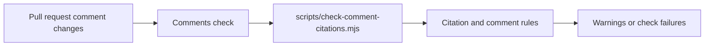
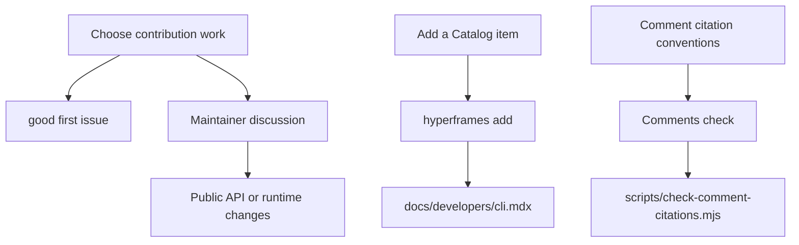
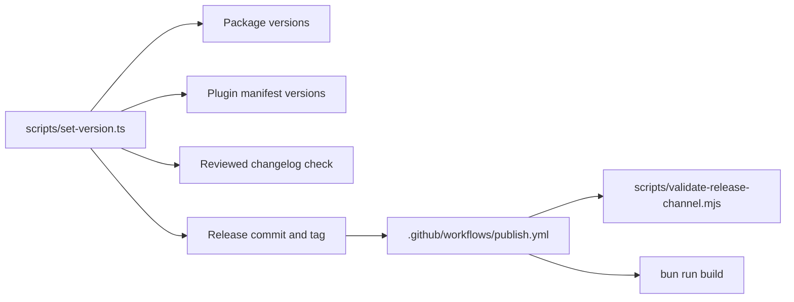

<!-- source: DeepWiki mcp.deepwiki.com · repo heygen-com/hyperframes · page 13.4 Contributing Guide · fetched 2026-11-02 -->

# Contributing Guide

Relevant source files

The following files were used as context for generating this wiki page:

- [.github/release.yml](.github/release.yml)
- [.github/workflows/publish.yml](.github/workflows/publish.yml)
- [CONTRIBUTING.md](CONTRIBUTING.md)
- [docs/developers/cli.mdx](docs/developers/cli.mdx)
- [packages/cli/src/audio/analysis/format.test.ts](packages/cli/src/audio/analysis/format.test.ts)
- [packages/cli/src/audio/analysis/run.test.ts](packages/cli/src/audio/analysis/run.test.ts)
- [packages/cli/src/audio/analysis/run.ts](packages/cli/src/audio/analysis/run.ts)
- [packages/cli/src/browser/chromeOrphans.fixture.ts](packages/cli/src/browser/chromeOrphans.fixture.ts)
- [packages/cli/src/browser/chromeOrphans.process.test.ts](packages/cli/src/browser/chromeOrphans.process.test.ts)
- [packages/cli/src/browser/unzipArchive.ts](packages/cli/src/browser/unzipArchive.ts)
- [packages/cli/src/browser/unzipFallback.test.ts](packages/cli/src/browser/unzipFallback.test.ts)
- [packages/cli/src/browser/windowsChromeWatchdog.ts](packages/cli/src/browser/windowsChromeWatchdog.ts)
- [packages/cli/src/commands/browser.test.ts](packages/cli/src/commands/browser.test.ts)
- [packages/cli/src/renderSetupWorker.test.ts](packages/cli/src/renderSetupWorker.test.ts)
- [packages/cli/src/renderSetupWorkerLifecycle.ts](packages/cli/src/renderSetupWorkerLifecycle.ts)
- [packages/cli/src/utils/cancellableProcess.test.ts](packages/cli/src/utils/cancellableProcess.test.ts)
- [packages/cli/src/utils/cancellableProcess.ts](packages/cli/src/utils/cancellableProcess.ts)
- [packages/cli/src/utils/childReaper.fixture.ts](packages/cli/src/utils/childReaper.fixture.ts)
- [packages/cli/src/utils/childReaper.test.ts](packages/cli/src/utils/childReaper.test.ts)
- [packages/cli/src/utils/childReaper.ts](packages/cli/src/utils/childReaper.ts)
- [packages/cli/src/utils/orphanCleanup.scan.test.ts](packages/cli/src/utils/orphanCleanup.scan.test.ts)
- [packages/cli/src/utils/orphanCleanup.test.ts](packages/cli/src/utils/orphanCleanup.test.ts)
- [packages/cli/src/utils/orphanCleanup.ts](packages/cli/src/utils/orphanCleanup.ts)
- [packages/cli/src/utils/orphanCleanup.windowsHide.test.ts](packages/cli/src/utils/orphanCleanup.windowsHide.test.ts)
- [packages/core/src/browserMarker.test.ts](packages/core/src/browserMarker.test.ts)
- [packages/core/src/browserMarker.ts](packages/core/src/browserMarker.ts)
- [packages/engine/src/services/hdrCapture.ts](packages/engine/src/services/hdrCapture.ts)
- [packages/engine/src/utils/processTracker.test.ts](packages/engine/src/utils/processTracker.test.ts)
- [packages/engine/src/utils/processTracker.ts](packages/engine/src/utils/processTracker.ts)
- [releases/v0.6.52.md](releases/v0.6.52.md)
- [scripts/changelog-weekly.ts](scripts/changelog-weekly.ts)
- [scripts/cli-options.ts](scripts/cli-options.ts)
- [scripts/draft-changelog.test.ts](scripts/draft-changelog.test.ts)
- [scripts/draft-changelog.ts](scripts/draft-changelog.ts)
- [scripts/set-version.test.ts](scripts/set-version.test.ts)
- [scripts/set-version.ts](scripts/set-version.ts)

## Purpose and scope

This page summarizes the contribution workflow and conventions documented in the available repository materials: forking and setup, development commands, type safety, comment practices, and the release tooling that is visible in the supplied files. The contribution guide excerpt also points contributors toward issue triage and maintainer discussion before substantial changes. [CONTRIBUTING.md:1-25]()

Sources: [CONTRIBUTING.md:1-25]()

## 1. Forking and Local Setup

### Fork and clone

Fork the repository, clone your fork, install dependencies, and create a feature branch. The contribution guide gives the commands and order for these steps. [CONTRIBUTING.md:5-10]()

The published skills source is `skills/`. When working in this checkout, the guide recommends `npx hyperframes skills update`; it warns that running project-local `npx skills add ...` from this checkout can overwrite changes because its destination may overlap `skills/`. It also notes that `.claude/skills/` and `.agents/skills/` are already present in the checkout. [CONTRIBUTING.md:12-16]()

Sources: [CONTRIBUTING.md:5-16]()

### Choosing work

The contribution guide directs contributors to newcomer and help-wanted issues, and recommends reading issue discussion and checking existing pull requests before starting. For an issue that appears unassigned, comment with an intended approach and coordinate a claim with a maintainer. [CONTRIBUTING.md:18-20]()

Issue labels distinguish difficulty and readiness: `difficulty/easy`, `difficulty/medium`, and `difficulty/hard` describe work; `triage/ready` indicates accepted scope; and `help wanted` indicates availability. The guide says a `good first issue` also has a testing path and a maintainer willing to help, and points to `TRIAGE.md` for further definitions. [CONTRIBUTING.md:20-22]()

Discuss substantial features, public API or runtime changes, and default changes before implementation. The guide says tiny, self-contained corrections can go directly into a pull request if the problem and verification are explained. [CONTRIBUTING.md:24-24]()

Sources: [CONTRIBUTING.md:18-24]()

## 2. Development Commands

The contribution guide lists Bun commands for installing dependencies, running Studio, building packages, type-checking, linting, and checking formatting. It also lists core and engine test commands, including a runtime contract test command for core. [CONTRIBUTING.md:26-43]()

| Task | Command |
|---|---|
| Install dependencies | `bun install` |
| Run Studio | `bun run dev` |
| Build packages | `bun run build` |
| Type-check all packages | `bun run --filter '*' typecheck` |
| Lint packages | `bun run lint` |
| Check formatting | `bun run format:check` |
| Run core unit tests | `bun run --filter @hyperframes/core test` |
| Run engine unit tests | `bun run --filter @hyperframes/engine test` |
| Run core runtime contract tests | `bun run --filter @hyperframes/core test:hyperframe-runtime-ci` |

The guide identifies Vitest as the test runner for the core and engine unit test commands. [CONTRIBUTING.md:37-43]()

For linting and formatting, the guide also lists `bun run lint:fix` and `bun run format`; the former runs oxlint with auto-fix, and the latter formats files with oxfmt. It says Lefthook hooks run after dependency installation and check linting and formatting on staged files before commits. [CONTRIBUTING.md:45-54]()

Sources: [CONTRIBUTING.md:26-54]()

## 3. Type-Safety Conventions

The contribution guide’s stated goal is “honest types”: avoid types or assertions that hide uncertainty from the compiler. In particular, it says to avoid `any` and use `unknown` with narrowing where possible. [CONTRIBUTING.md:56-61]()

Prefer type guards, `instanceof` or `typeof` narrowing, centralized narrowing helpers such as `resolveIframe`, and properly typed interfaces at the source. Avoid `as T` assertions that suppress warnings without adding information to the compiler. [CONTRIBUTING.md:60-65]()

The guide identifies two acceptable assertion patterns when accompanied by a comment explaining why: `as const` for literal narrowing, and `as unknown as T` at difficult type-system boundaries such as untrusted JSON parsing or FFI/`postMessage` data. It also advises avoiding non-null `!` assertions except in paths checked by preceding conditions; use defaults or guard clauses instead. [CONTRIBUTING.md:66-76]()

Sources: [CONTRIBUTING.md:56-76]()

### Comments

Comments should explain a reason, invariant, or non-obvious constraint—not restate names, types, or straightforward code. The guide recommends simplifying unclear code rather than relying on a comment to clarify it, and using the pull request description for reasoning or history that belongs with the change. [CONTRIBUTING.md:78-85]()

For comments that need explanation, the guide recommends explaining intentional unusual behavior, linking sources for copied or adapted code, and linking useful external references. Bug-fix comments should describe required behavior and reproduction rather than change history. TODO markers should name an owner or issue, using forms such as `TODO(name):`, `TODO(area):`, or `TODO(#1234):`. [CONTRIBUTING.md:86-90]()

Sources: [CONTRIBUTING.md:78-90]()

## 4. Comment Citation Checks

The contribution guide identifies `scripts/check-comment-citations.mjs` as the checker used by the `Comments` check for comments added or edited by a pull request. The available guide excerpt describes the checker’s rules, but does not include the workflow definition or the checker implementation; this section therefore documents the stated conventions, not an inferred CI trigger configuration. [CONTRIBUTING.md:92-100]()

### Citation and comment rules

| Check | Contribution guidance |
|---|---|
| Resolve references | Backticked paths, `path:line` references, backticked camelCase symbols, and phrases such as “pinned by,” “covered by,” or “see” followed by a test file should identify something in the repository. [CONTRIBUTING.md:94-94]() |
| Avoid history | Do not use comments to describe past states or pull requests; state what is true now. [CONTRIBUTING.md:95-95]() |
| Remove commented-out code | Delete it rather than leaving it in comments. [CONTRIBUTING.md:96-96]() |
| Keep comment blocks concise | A comment block must not exceed 40 lines unless it begins with `comment-length: <reason>` to explain why it must remain whole. [CONTRIBUTING.md:97-97]() |
| Identify TODO ownership | A TODO, FIXME, or XXX should identify an owner or issue, or link the issue. [CONTRIBUTING.md:98-98]() |
| Use public URLs | URLs should be well-formed and accessible without private-network access or embedded tokens; the guide allows `localhost` URLs describing a development server. [CONTRIBUTING.md:99-99]() |
| Treat heuristics as warnings | Missing source links for copied code and short comments that mostly restate the next line are described as warnings that do not fail the build. [CONTRIBUTING.md:100-100]() |

The guide also describes a separate comment-share ratchet implemented by `scripts/comment-ratchet.mjs`. For source files under `packages/*/src` (excluding tests), it says a changed file may not increase its comment-line share relative to the branch point unless code was only deleted. The guide also states that new comment blocks over 12 lines are disallowed there and that new files must not exceed the package’s comment share. [CONTRIBUTING.md:102-102]()

Sources: [CONTRIBUTING.md:92-102]()

### Comment-check flow

This diagram maps the guide’s named `Comments` check and checker script to their documented input and outcome; it does not assert an unprovided workflow trigger or job name. [CONTRIBUTING.md:92-100]()

**Diagram: Pull-request comment check**

Sources: [CONTRIBUTING.md:92-100]()

## 5. Registry Items and Plans

The available CLI guide documents `npx hyperframes add <name>` as the command to add a Catalog item. The provided contribution-guide excerpt does not specify registry directory layout, manifest schema, validation commands, or catalog-generation steps, so those implementation details are not asserted here. [docs/developers/cli.mdx:44-52]()

The contribution guide says to discuss substantial features and public API or runtime changes before implementation; it does not specify a `plans/` document format or a design-document approval workflow in the available excerpt. [CONTRIBUTING.md:18-24]()

Sources: [docs/developers/cli.mdx:44-52](), [CONTRIBUTING.md:18-24]()

### From contributor intent to documented code entities

This diagram connects contribution concepts to names present in the supplied files. It distinguishes documented entry points from repository mechanisms whose implementation details are not included in the available materials. [CONTRIBUTING.md:18-24](), [docs/developers/cli.mdx:44-52]()

**Diagram: Contribution topics and code entities**

Sources: [CONTRIBUTING.md:18-24](), [CONTRIBUTING.md:92-100](), [docs/developers/cli.mdx:44-52]()

## 6. Adopters, Pull Requests, and Issue Templates

The available materials do not include the adopters list, issue-template files, or pull-request template. The contribution guide excerpt does document how to select and claim work and what information a small correction should include: explain the problem and verification. It does not provide template-specific fields or instructions for adding an adopter entry. [CONTRIBUTING.md:18-24]()

Sources: [CONTRIBUTING.md:18-24]()

## 7. Release Tooling

Release tooling is included here as contributor context because the supplied files document version updates and publication behavior. It is separate from the contribution workflow described in `CONTRIBUTING.md`.

### Version updates

`scripts/set-version.ts` declares a fixed set of publishable packages and plugin manifests to update together. Its `main()` parses release options, checks the changelog when required, updates package and plugin versions, and—unless `--no-tag` is set—creates a release commit and tag. [scripts/set-version.ts:23-38](), [scripts/set-version.ts:40-49](), [scripts/set-version.ts:67-87]()

`parseReleaseOptions()` selects the version and recognizes `--no-tag`, `--skip-changelog-check`, and `--skip-monotonicity-check`; it validates the version against `CLI_SEMVER_PATTERN`. The script’s usage comments describe `--no-tag` as a version-only bump, with no commit or tag. [scripts/set-version.ts:6-14](), [scripts/set-version.ts:89-109]()

For a tagged release, `createReleaseCommitAndTag()` checks tag monotonicity unless skipped, verifies that changed paths are allowed, stages the allowed paths, creates a `chore: release v<version>` commit, and creates an annotated `v<version>` tag. [scripts/set-version.ts:136-159]()

Sources: [scripts/set-version.ts:6-14](), [scripts/set-version.ts:23-49](), [scripts/set-version.ts:67-109](), [scripts/set-version.ts:136-159]()

### Changelog drafting

`scripts/draft-changelog.ts` creates release notes and a documentation update from commits between the selected refs. By default it prints the draft; when invoked with `--write`, it writes release notes and prepends the documentation update. [scripts/draft-changelog.ts:102-134]()

The draft generator uses a human-review placeholder and style note for the release summary. The version script defines those markers and checks the changelog for applicable stable tagged releases; its tests cover the stable-release requirement and exemptions for prereleases, `--no-tag`, and the explicit skip option. [scripts/draft-changelog.ts:14-21](), [scripts/set-version.ts:49-58](), [scripts/set-version.ts:67-71](), [scripts/set-version.test.ts:34-71]()

Sources: [scripts/draft-changelog.ts:14-21](), [scripts/draft-changelog.ts:102-134](), [scripts/set-version.ts:49-71](), [scripts/set-version.test.ts:34-71]()

### Publication workflow

The supplied portion of `.github/workflows/publish.yml` shows a publication workflow triggered by hyphenated version tag pushes and pull requests closed on `main`. Its jobs use a release commit SHA for checkout; the publish job resolves the version and distribution tag, validates the release channel, and builds packages. The shown file excerpt ends during the Lambda handler zip step, so later publication steps are not described here. [.github/workflows/publish.yml:1-15](), [.github/workflows/publish.yml:52-79](), [.github/workflows/publish.yml:90-121](), [.github/workflows/publish.yml:151-176]()

**Diagram: Version update and release workflow**

The diagram shows the version-update and build stages present in the supplied lines; it does not imply publication steps beyond the excerpt. [scripts/set-version.ts:67-87](), [scripts/set-version.ts:111-159](), [.github/workflows/publish.yml:90-121](), [.github/workflows/publish.yml:151-159]()

Sources: [scripts/set-version.ts:67-87](), [scripts/set-version.ts:111-159](), [.github/workflows/publish.yml:90-121](), [.github/workflows/publish.yml:151-159]()

## 8. Quick Reference

| Area | Repository reference |
|---|---|
| Contribution instructions | `CONTRIBUTING.md` [CONTRIBUTING.md:1-25]() |
| Development commands and tests | `CONTRIBUTING.md` [CONTRIBUTING.md:26-54]() |
| Type-safety conventions | `CONTRIBUTING.md` [CONTRIBUTING.md:56-76]() |
| Comment guidance and citation checks | `CONTRIBUTING.md` [CONTRIBUTING.md:78-102]() |
| CLI Catalog-item command | `docs/developers/cli.mdx` [docs/developers/cli.mdx:44-52]() |
| Version updates and release tagging | `scripts/set-version.ts` [scripts/set-version.ts:67-159]() |
| Changelog drafting | `scripts/draft-changelog.ts` [scripts/draft-changelog.ts:102-134]() |

Sources: [CONTRIBUTING.md:1-102](), [docs/developers/cli.mdx:44-52](), [scripts/set-version.ts:67-159](), [scripts/draft-changelog.ts:102-134]()

---

