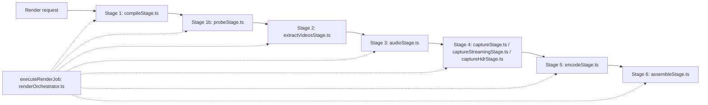
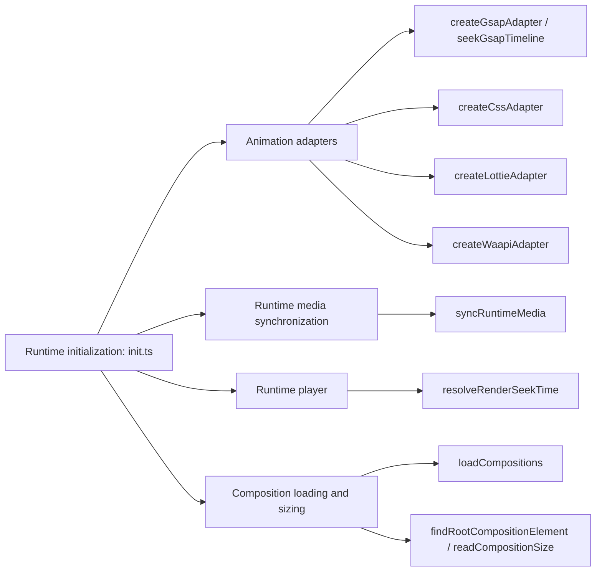

<!-- source: DeepWiki mcp.deepwiki.com · repo heygen-com/hyperframes · page 14 Glossary · fetched 2026-11-02 -->

# Glossary

Relevant source files

The following files were used as context for generating this wiki page:

- [.claude-plugin/plugin.json](.claude-plugin/plugin.json)
- [.codex-plugin/plugin.json](.codex-plugin/plugin.json)
- [.cursor-plugin/plugin.json](.cursor-plugin/plugin.json)
- [docs/guides/rendering.mdx](docs/guides/rendering.mdx)
- [docs/packages/engine.mdx](docs/packages/engine.mdx)
- [docs/packages/producer.mdx](docs/packages/producer.mdx)
- [packages/aws-lambda/package.json](packages/aws-lambda/package.json)
- [packages/cli/package.json](packages/cli/package.json)
- [packages/cli/src/commands/render.test.ts](packages/cli/src/commands/render.test.ts)
- [packages/cli/src/commands/render.ts](packages/cli/src/commands/render.ts)
- [packages/cli/src/docs/rendering.md](packages/cli/src/docs/rendering.md)
- [packages/cli/src/telemetry/events.test.ts](packages/cli/src/telemetry/events.test.ts)
- [packages/cli/src/telemetry/events.ts](packages/cli/src/telemetry/events.ts)
- [packages/cli/src/telemetry/renderObservability.test.ts](packages/cli/src/telemetry/renderObservability.test.ts)
- [packages/cli/src/telemetry/renderObservability.ts](packages/cli/src/telemetry/renderObservability.ts)
- [packages/cli/src/utils/dockerRunArgs.test.ts](packages/cli/src/utils/dockerRunArgs.test.ts)
- [packages/cli/src/utils/dockerRunArgs.ts](packages/cli/src/utils/dockerRunArgs.ts)
- [packages/core/package-subpaths.json](packages/core/package-subpaths.json)
- [packages/core/package.json](packages/core/package.json)
- [packages/core/src/runtime/audioFx.test.ts](packages/core/src/runtime/audioFx.test.ts)
- [packages/core/src/runtime/audioFx.ts](packages/core/src/runtime/audioFx.ts)
- [packages/core/src/runtime/init.test.ts](packages/core/src/runtime/init.test.ts)
- [packages/core/src/runtime/init.ts](packages/core/src/runtime/init.ts)
- [packages/core/src/runtime/init.videoPreseek.test.ts](packages/core/src/runtime/init.videoPreseek.test.ts)
- [packages/core/src/runtime/media.preseek.test.ts](packages/core/src/runtime/media.preseek.test.ts)
- [packages/core/src/runtime/media.test.ts](packages/core/src/runtime/media.test.ts)
- [packages/core/src/runtime/media.ts](packages/core/src/runtime/media.ts)
- [packages/core/src/runtime/mediaSteer.test.ts](packages/core/src/runtime/mediaSteer.test.ts)
- [packages/core/src/runtime/startResolver.test.ts](packages/core/src/runtime/startResolver.test.ts)
- [packages/core/src/runtime/startResolver.ts](packages/core/src/runtime/startResolver.ts)
- [packages/core/src/runtime/timeline.test.ts](packages/core/src/runtime/timeline.test.ts)
- [packages/core/src/runtime/timeline.ts](packages/core/src/runtime/timeline.ts)
- [packages/core/src/runtime/webAudioTransport.test.ts](packages/core/src/runtime/webAudioTransport.test.ts)
- [packages/core/src/runtime/webAudioTransport.ts](packages/core/src/runtime/webAudioTransport.ts)
- [packages/engine/package.json](packages/engine/package.json)
- [packages/engine/src/config.test.ts](packages/engine/src/config.test.ts)
- [packages/engine/src/config.ts](packages/engine/src/config.ts)
- [packages/engine/src/index.ts](packages/engine/src/index.ts)
- [packages/engine/src/services/browserManager.test.ts](packages/engine/src/services/browserManager.test.ts)
- [packages/engine/src/services/browserManager.ts](packages/engine/src/services/browserManager.ts)
- [packages/engine/src/services/chunkEncoder.relativePaths.test.ts](packages/engine/src/services/chunkEncoder.relativePaths.test.ts)
- [packages/engine/src/services/frameCapture.test.ts](packages/engine/src/services/frameCapture.test.ts)
- [packages/engine/src/services/frameCapture.ts](packages/engine/src/services/frameCapture.ts)
- [packages/engine/src/types.ts](packages/engine/src/types.ts)
- [packages/parsers/src/referenceResolver.test.ts](packages/parsers/src/referenceResolver.test.ts)
- [packages/parsers/src/referenceResolver.ts](packages/parsers/src/referenceResolver.ts)
- [packages/player/package.json](packages/player/package.json)
- [packages/producer/package.json](packages/producer/package.json)
- [packages/producer/src/services/render/observability.ts](packages/producer/src/services/render/observability.ts)
- [packages/producer/src/services/render/perfSummary.test.ts](packages/producer/src/services/render/perfSummary.test.ts)
- [packages/producer/src/services/render/perfSummary.ts](packages/producer/src/services/render/perfSummary.ts)
- [packages/producer/src/services/render/wrappedMountTiming.integration.test.ts](packages/producer/src/services/render/wrappedMountTiming.integration.test.ts)
- [packages/producer/src/services/renderOrchestrator.deGateProbe.test.ts](packages/producer/src/services/renderOrchestrator.deGateProbe.test.ts)
- [packages/producer/src/services/renderOrchestrator.test.ts](packages/producer/src/services/renderOrchestrator.test.ts)
- [packages/producer/src/services/renderOrchestrator.ts](packages/producer/src/services/renderOrchestrator.ts)
- [packages/shader-transitions/package.json](packages/shader-transitions/package.json)
- [packages/studio/package.json](packages/studio/package.json)

## Purpose and scope

This page defines HyperFrames terms and maps them to code entities that can be located in the repository. It focuses on composition and rendering vocabulary, runtime integration points, Studio editing terminology, and render orchestration. Each definition is limited to what the cited files establish. [packages/core/src/runtime/init.ts:53-82](), [packages/producer/src/services/renderOrchestrator.ts:3-27]()

Sources: [packages/core/src/runtime/init.ts:53-82](), [packages/producer/src/services/renderOrchestrator.ts:3-27]()

## Core domain terms

### Composition

A **composition** is a video document or project unit whose duration, dimensions, timeline, or nested content may need to be resolved by the runtime and render pipeline. The runtime initialization module imports composition-dimension and composition-length helpers, a composition loader, and a parser-level duration resolver. The render orchestrator’s documented pipeline begins with compilation and browser-driven probing, which includes duration discovery and media reconciliation. [packages/core/src/runtime/init.ts:123-136](), [packages/producer/src/services/renderOrchestrator.ts:6-15]()

Useful code pointers include `findRootCompositionElement`, `parseLayoutDimension`, `resolveCompositionDuration`, `readCompositionSize`, `resolveCompositionLengthSeconds`, and `loadCompositions`. [packages/core/src/runtime/init.ts:123-136]()

Sources: [packages/core/src/runtime/init.ts:123-136](), [packages/producer/src/services/renderOrchestrator.ts:6-15]()

### Clip

A **clip** is a runtime timeline element. The runtime imports clip-window, clip-tree, timed-clip visibility, media, and timeline helpers, indicating that clip handling spans timing, visibility, media synchronization, and timeline representation. [packages/core/src/runtime/init.ts:31-42](), [packages/core/src/runtime/init.ts:81-96](), [packages/core/src/runtime/init.ts:117-136]()

Related code entities include `isInClipWindow`, `createClipTree`, `showClips`, `syncRuntimeMedia`, and `collectRuntimeTimelinePayload`. [packages/core/src/runtime/init.ts:31-42](), [packages/core/src/runtime/init.ts:81-96](), [packages/core/src/runtime/init.ts:117-136]()

Sources: [packages/core/src/runtime/init.ts:31-42](), [packages/core/src/runtime/init.ts:81-96](), [packages/core/src/runtime/init.ts:117-136]()

### `hf-id`

**`hf-id`** is a term for a HyperFrames-specific element identifier. The provided file excerpts do not show its attribute name, assignment algorithm, or consumers, so this page does not specify those details. The package overview identifies parsers as a separate package, but the supplied parser implementation excerpt is unavailable. [packages/core/package.json:1-20]()

Sources: [packages/core/package.json:1-20]()

### Deterministic rendering

**Deterministic rendering** means rendering frames at controlled timeline times rather than relying on ordinary, unconstrained playback. The runtime initialization module imports multiple animation adapters and a runtime player, and the producer describes its capture stage as part of an orchestrated render pipeline. The provided excerpts establish these integration points but do not include the complete seek algorithm or a static rule set for nondeterministic APIs. [packages/core/src/runtime/init.ts:53-82](), [packages/core/src/runtime/init.ts:108-115](), [packages/producer/src/services/renderOrchestrator.ts:12-22]()

Sources: [packages/core/src/runtime/init.ts:53-82](), [packages/core/src/runtime/init.ts:108-115](), [packages/producer/src/services/renderOrchestrator.ts:12-22]()

### `renderSeek`

**`renderSeek`** refers to the runtime’s render-oriented seeking concept. The supplied excerpt shows the runtime player and `resolveRenderSeekTime` imported by initialization, but does not include a `renderSeek` definition or its call sites. For implementation details, start with the runtime player imports in `init.ts` and follow the definition in the source. [packages/core/src/runtime/init.ts:108-115]()

Sources: [packages/core/src/runtime/init.ts:108-115]()

### Frame adapter

A **frame adapter** connects a particular animation or rendering system to the HyperFrames runtime’s timeline behavior. The runtime initialization module imports adapter constructors for CSS, GSAP, Anime.js, Lottie, Three.js, mapping libraries, D3, TypeGPU, and WAAPI. It also imports seek-dispatch helpers, which are part of coordinating seek completion. [packages/core/src/runtime/init.ts:53-82]()

| Adapter family | Runtime symbol |
|---|---|
| CSS | `createCssAdapter` [packages/core/src/runtime/init.ts:53-54]() |
| GSAP | `createGsapAdapter`, `seekGsapTimeline`, `rerenderGsapTimelineAt` [packages/core/src/runtime/init.ts:55-59]() |
| Anime.js and Lottie | `createAnimeJsAdapter`, `createLottieAdapter` [packages/core/src/runtime/init.ts:60-62]() |
| Three.js and mapping libraries | `createThreeAdapter`, `createMapboxAdapter`, `createLeafletAdapter`, `createGoogleMapsAdapter`, `createMaplibreAdapter` [packages/core/src/runtime/init.ts:62-67]() |
| D3 and TypeGPU | `createD3Adapter`, `createTypegpuAdapter` [packages/core/src/runtime/init.ts:67-69]() |
| WAAPI | `createWaapiAdapter` [packages/core/src/runtime/init.ts:81-82]() |

Sources: [packages/core/src/runtime/init.ts:53-82]()

## Natural language and code entity maps

### Render job: pipeline stages and implementation modules

The producer documents six render stages, with a probe step grouped with compilation in the performance summary. The orchestrator also owns cleanup and observability around stage execution. [packages/producer/src/services/renderOrchestrator.ts:6-33]()

**Diagram: Render pipeline terms mapped to stage modules**

Sources: [packages/producer/src/services/renderOrchestrator.ts:6-27]()

### Runtime initialization: adapter and service names

Runtime initialization connects names used in system discussions—animation adapters, composition loading, media synchronization, and the runtime player—to concrete imports in `packages/core/src/runtime/init.ts`. The excerpt identifies these dependencies; it does not show their complete initialization order or execution behavior. [packages/core/src/runtime/init.ts:53-82](), [packages/core/src/runtime/init.ts:91-96](), [packages/core/src/runtime/init.ts:108-136]()

**Diagram: Runtime concepts mapped to imported code entities**

Sources: [packages/core/src/runtime/init.ts:53-82](), [packages/core/src/runtime/init.ts:91-96](), [packages/core/src/runtime/init.ts:108-136]()

## Runtime and rendering terms

### `BeginFrame`

**BeginFrame** refers to a browser frame-capture mechanism associated with HyperFrames rendering. The producer package describes itself as an HTML-to-video rendering engine using Chrome’s BeginFrame API; the engine package describes its role as a seekable web-page-to-video rendering engine using Puppeteer and FFmpeg. The supplied excerpts do not include the engine’s capture implementation. [packages/producer/package.json:1-8](), [packages/engine/package.json:1-8]()

Sources: [packages/producer/package.json:1-8](), [packages/engine/package.json:1-8]()

### `drawElement`

**`drawElement`** is a capture-related term surfaced in the producer’s imports. The orchestrator imports `explainDrawElementDisabled`, `isDrawElementVerificationError`, `isDrawElementCaptureError`, and `getDrawElementVerificationDetails` from `@hyperframes/engine`. Those names show that the render path has draw-element configuration, verification, and failure-diagnostic concepts; the supplied excerpt does not show their definitions or the capture operation itself. [packages/producer/src/services/renderOrchestrator.ts:94-109]()

Sources: [packages/producer/src/services/renderOrchestrator.ts:94-109]()

### Render stages and orchestration

The producer’s `executeRenderJob` is documented as the in-process entry point that composes pipeline stages. Stage implementations are separated into modules so their primitives can also be reused by distributed rendering. The orchestrator tracks stage-spawned resources for cleanup and records timing and failure diagnostics. [packages/producer/src/services/renderOrchestrator.ts:6-33]()

Sources: [packages/producer/src/services/renderOrchestrator.ts:6-33]()

### `plan v2` / `planV2`

**Plan v2** is a term used in the distributed-rendering vocabulary. The supplied producer package manifest exposes a `./distributed` entry point and provides a `parity:plans` script, but the supplied excerpts do not show a `planV2` definition, schema, or artifact protocol. Treat `planV2` as a search term and consult the distributed implementation before relying on details not documented here. [packages/producer/package.json:16-27](), [packages/producer/package.json:44-52]()

Sources: [packages/producer/package.json:16-27](), [packages/producer/package.json:44-52]()

### `shard plan`

A **shard plan** is a term for scheduling or partitioning work across render shards. The provided excerpts do not include a shard-plan type, scheduling algorithm, or call site. The producer’s distributed export and plan-parity script are nearby search entry points, but do not by themselves define shard behavior. [packages/producer/package.json:16-27](), [packages/producer/package.json:44-52]()

Sources: [packages/producer/package.json:16-27](), [packages/producer/package.json:44-52]()

## Studio editing and rollout terms

### SDK cutover

**SDK cutover** refers to a Studio migration or policy topic associated with the SDK. The Studio package manifest includes a `report:sdk-cutover` script, and the package depends on `@hyperframes/sdk`. The supplied excerpts do not show the cutover policy, covered features, or migration criteria. [packages/studio/package.json:73-88](), [packages/studio/package.json:102-107]()

Sources: [packages/studio/package.json:73-88](), [packages/studio/package.json:102-107]()

### Draft markers

**Draft markers** are editing-related markers exposed as a dedicated Core package subpath, `@hyperframes/core/editing/draft-markers`, which resolves to `src/editing/draftMarkers.ts`. The provided package manifest establishes the module’s public export but not the marker representation or lifecycle. [packages/core/package.json:185-189]()

Sources: [packages/core/package.json:185-189]()

### Check gate

A **check gate** is a validation or quality-control stage in a workflow. The supplied excerpts do not show a check-gate implementation or define which checks it includes. Avoid treating this term as a specific command or pipeline unless the relevant implementation is consulted. [packages/cli/package.json:44-54]()

Sources: [packages/cli/package.json:44-54]()

### Canary

**Canary** is a Core package feature exposed through two public subpaths: `@hyperframes/core/canary` and `@hyperframes/core/canary-registry`. The package manifest points those exports to `src/canary.ts` and `src/canaryRegistry.ts`. The excerpt does not establish rollout policy, eligibility rules, or registry behavior. [packages/core/package.json:29-39]()

Sources: [packages/core/package.json:29-39]()

## Abbreviations and package vocabulary

| Term | Meaning in this glossary | Code pointer |
|---|---|---|
| **CDP** | Chrome DevTools Protocol is commonly used as the expansion of this abbreviation; the supplied excerpts do not define the protocol or show its capture call site. | The producer package identifies Chrome’s BeginFrame API as part of its rendering-engine description. [packages/producer/package.json:1-8]() |
| **CRF** | Constant Rate Factor is a video-encoding term; the supplied excerpts do not show encoder settings or define the project’s CRF presets. | The producer orchestrator imports render-format helpers, but the excerpt does not establish CRF behavior. [packages/producer/src/services/renderOrchestrator.ts:125-135]() |
| **HMR** | Hot Module Replacement is a development-server term; the supplied package manifest shows a Vite development script but does not document HMR behavior. | [packages/studio/package.json:73-76]() |
| **IIFE** | Immediately Invoked Function Expression; the Core manifest exposes a `runtime-script` subpath pointing to `generated/runtime-inline.ts`, but the supplied excerpt does not establish the bundle’s exact format. | [packages/core/package.json:113-117]() |
| **NLE** | Non-linear editor, used here as a general editing term. The supplied excerpts do not include Studio timeline implementation details. | [packages/studio/package.json:1-4]() |
| **WAAPI** | Web Animations API; the runtime imports `createWaapiAdapter`. | [packages/core/src/runtime/init.ts:81-82]() |
| **SDK** | Software development kit; HyperFrames exposes an SDK package dependency to Studio, and Studio has a cutover-report script. | [packages/studio/package.json:85-88](), [packages/studio/package.json:102-107]() |

Sources: [packages/producer/package.json:1-8](), [packages/producer/src/services/renderOrchestrator.ts:125-135](), [packages/studio/package.json:73-88](), [packages/core/package.json:113-117](), [packages/studio/package.json:1-4](), [packages/core/src/runtime/init.ts:81-82](), [packages/studio/package.json:102-107]()

## Package entry points useful for glossary searches

Package manifests identify public package names and selected subpath exports. These are useful navigation anchors, but an export declaration alone does not document the implementation behavior of its target module. [packages/core/package.json:21-39](), [packages/producer/package.json:16-27](), [packages/engine/package.json:17-31](), [packages/player/package.json:16-28]()

| Package or export | What the supplied manifest establishes |
|---|---|
| `@hyperframes/core` | Core package exports include `./canary`, `./canary-registry`, `./runtime-script`, and `./editing/draft-markers`. [packages/core/package.json:21-39](), [packages/core/package.json:113-117](), [packages/core/package.json:185-189]() |
| `@hyperframes/producer` | Producer exposes its main package, `./server`, and `./distributed` entry points. [packages/producer/package.json:16-27]() |
| `@hyperframes/engine` | Engine describes itself as a seekable web-page-to-video rendering engine using Puppeteer and FFmpeg. [packages/engine/package.json:1-8]() |
| `@hyperframes/player` | Player describes itself as an embeddable web component for HyperFrames compositions and exposes a slideshow subpath. [packages/player/package.json:1-4](), [packages/player/package.json:16-28]() |

Sources: [packages/core/package.json:21-39](), [packages/core/package.json:113-117](), [packages/core/package.json:185-189](), [packages/producer/package.json:16-27](), [packages/engine/package.json:1-8](), [packages/player/package.json:1-4](), [packages/player/package.json:16-28]()