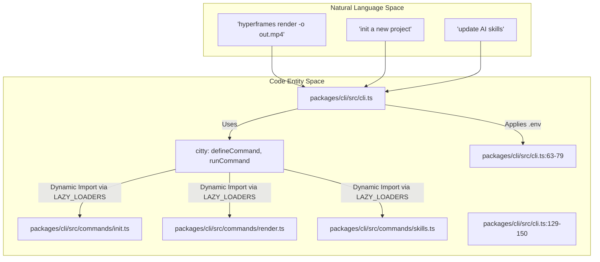
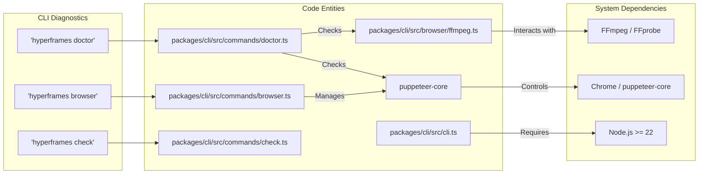

<!-- source: DeepWiki mcp.deepwiki.com · repo heygen-com/hyperframes · page 2 CLI Reference · fetched 2026-11-02 -->

# CLI Reference

Relevant source files

The following files were used as context for generating this wiki page:

- [.claude-plugin/marketplace.json](.claude-plugin/marketplace.json)
- [AGENTS.md](AGENTS.md)
- [CLAUDE.md](CLAUDE.md)
- [README.md](README.md)
- [docs/guides/skills.mdx](docs/guides/skills.mdx)
- [docs/packages/cli.mdx](docs/packages/cli.mdx)
- [docs/quickstart.mdx](docs/quickstart.mdx)
- [packages/cli/src/cli.lifecycle.test.ts](packages/cli/src/cli.lifecycle.test.ts)
- [packages/cli/src/cli.ts](packages/cli/src/cli.ts)
- [packages/cli/src/commands/coreSkillContent.test.ts](packages/cli/src/commands/coreSkillContent.test.ts)
- [packages/cli/src/commands/feedback.test.ts](packages/cli/src/commands/feedback.test.ts)
- [packages/cli/src/commands/feedback.ts](packages/cli/src/commands/feedback.ts)
- [packages/cli/src/commands/init.test.ts](packages/cli/src/commands/init.test.ts)
- [packages/cli/src/commands/init.ts](packages/cli/src/commands/init.ts)
- [packages/cli/src/commands/open.ts](packages/cli/src/commands/open.ts)
- [packages/cli/src/help.ts](packages/cli/src/help.ts)
- [packages/cli/src/templates/_shared/AGENTS.md](packages/cli/src/templates/_shared/AGENTS.md)
- [packages/cli/src/templates/_shared/CLAUDE.md](packages/cli/src/templates/_shared/CLAUDE.md)
- [packages/cli/src/utils/backgroundChecks.test.ts](packages/cli/src/utils/backgroundChecks.test.ts)
- [packages/cli/src/utils/projectShortcut.test.ts](packages/cli/src/utils/projectShortcut.test.ts)
- [packages/cli/src/utils/projectShortcut.ts](packages/cli/src/utils/projectShortcut.ts)
- [packages/cli/src/utils/submitFeedback.test.ts](packages/cli/src/utils/submitFeedback.test.ts)
- [packages/cli/src/utils/submitFeedback.ts](packages/cli/src/utils/submitFeedback.ts)
- [packages/studio-server/src/routes/thumbnail.file-race.test.ts](packages/studio-server/src/routes/thumbnail.file-race.test.ts)
- [packages/studio-server/src/routes/thumbnail.test.ts](packages/studio-server/src/routes/thumbnail.test.ts)
- [packages/studio-server/src/routes/thumbnail.ts](packages/studio-server/src/routes/thumbnail.ts)
- [packages/studio/src/hooks/gsapValueAtPlayhead.browser.test.ts](packages/studio/src/hooks/gsapValueAtPlayhead.browser.test.ts)
- [packages/studio/src/player/hooks/timelinePlayerSync.test.ts](packages/studio/src/player/hooks/timelinePlayerSync.test.ts)
- [packages/studio/src/player/hooks/timelinePlayerSync.ts](packages/studio/src/player/hooks/timelinePlayerSync.ts)
- [packages/studio/src/utils/gsapUndoRestore.browser.test.ts](packages/studio/src/utils/gsapUndoRestore.browser.test.ts)
- [packages/studio/tests/chromeTestUtils.browser.test.ts](packages/studio/tests/chromeTestUtils.browser.test.ts)
- [packages/studio/tests/chromeTestUtils.test.ts](packages/studio/tests/chromeTestUtils.test.ts)
- [packages/studio/tests/chromeTestUtils.ts](packages/studio/tests/chromeTestUtils.ts)
- [packages/studio/vite.browser.test.ts](packages/studio/vite.browser.test.ts)
- [packages/studio/vite.browser.ts](packages/studio/vite.browser.ts)
- [packages/studio/vite.browserVersion.test.ts](packages/studio/vite.browserVersion.test.ts)
- [scripts/ci/inline-gsap.mjs](scripts/ci/inline-gsap.mjs)
- [scripts/inline-gsap.test.mjs](scripts/inline-gsap.test.mjs)
- [skills-manifest.json](skills-manifest.json)
- [skills/hyperframes-cli/SKILL.md](skills/hyperframes-cli/SKILL.md)
- [skills/hyperframes-cli/references/lint-validate-inspect.md](skills/hyperframes-cli/references/lint-validate-inspect.md)
- [skills/hyperframes-cli/references/preview-render.md](skills/hyperframes-cli/references/preview-render.md)
- [skills/hyperframes/SKILL.md](skills/hyperframes/SKILL.md)

The `hyperframes` CLI serves as the primary entry point for creating, previewing, and rendering HTML video compositions, acting as a unified wrapper around core, producer, engine, and studio subsystems [docs/packages/cli.mdx:1-5](). Designed with an agent-friendly architecture, it supports automated coding agents (e.g., Claude Code, Cursor, Gemini) while providing robust ergonomics for human developers [skills/hyperframes-cli/SKILL.md:1-20]().

Sources: [docs/packages/cli.mdx:1-5](), [skills/hyperframes-cli/SKILL.md:1-20]()

## Command Architecture and Lazy Loading

The CLI binary is built on top of the `citty` framework [packages/cli/src/cli.ts:85](). To ensure rapid startup times (approx. 10ms for version checks), all subcommands and heavy dependencies are lazy-loaded via dynamic `import()` [packages/cli/src/cli.ts:46-61](), [packages/cli/src/cli.ts:129-150](). It also automatically discovers and parses `.env` files in the working directory to supply API keys for AI services [packages/cli/src/cli.ts:63-79]().

### Subcommand Registry Overview

The `hyperframes` CLI provides a comprehensive suite of commands categorized by their primary function. This table offers a high-level overview; detailed usage and flags for each command are covered in their respective child pages.

| Command Group | Representative Commands | Purpose |
|:---|:---|:---|
| **Project Setup** | `init`, `add`, `catalog` | Initialize new projects, add registry items, browse available components. |
| **Media Ingestion** | `capture`, `media-use`, `transcribe`, `tts`, `remove-background`, `media-treatment`, `beats`, `normalize-audio` | Bring external content into HyperFrames projects, process audio and video. |
| **Preview & Share** | `preview`, `present`, `play`, `publish`, `open`, `catch-up` | Visualize compositions, share outputs, manage Studio sessions. |
| **Diagnostics & Validation** | `lint`, `check`, `snapshot`, `keyframes`, `compare`, `grade-compare` | Identify and resolve issues in compositions, ensure quality and consistency. |
| **Terminal Editing** | `timeline`, `history` | Perform programmatic edits to composition timelines. |
| **Rendering** | `render`, `benchmark` | Generate final video files from compositions. |
| **Cloud Rendering** | `cloud`, `lambda`, `cloudrun` | Orchestrate renders on remote infrastructure. |
| **System Utilities** | `doctor`, `browser`, `upgrade`, `docs`, `info`, `compositions`, `clean` | Maintain the CLI environment, access documentation, manage project state. |
| **Integrations & Telemetry** | `auth`, `skills`, `usage`, `figma`, `events`, `telemetry`, `feedback` | Connect with external services, manage AI skills, provide feedback. |

Sources: [docs/packages/cli.mdx:23-33]()

**CLI Execution Flow**

Sources: [packages/cli/src/cli.ts:63-79](), [packages/cli/src/cli.ts:85](), [packages/cli/src/cli.ts:129-150](), [packages/cli/src/commands/init.ts:8](), [packages/cli/src/commands/render.ts](), [packages/cli/src/commands/skills.ts]()

## Agent-Friendly Design

The CLI is built with AI agents in mind, ensuring predictable and scriptable interactions:
- **Non-Interactive by Default**: Commands prioritize flags over prompts, making them suitable for automated environments [docs/packages/cli.mdx:67-73](). `init` and `catalog --human-friendly` are exceptions, offering interactive modes on TTYs [docs/packages/cli.mdx:69-71]().
- **Machine-Readable Output**: The `--json` flag is supported by almost every command, providing structured data for programmatic consumption [docs/packages/cli.mdx:46-47]().
- **Metadata Envelope**: JSON output includes a `_meta` field with CLI version, latest available version, and update status, allowing agents to detect outdated CLIs without additional calls [docs/packages/cli.mdx:48-65]().
- **Silent Updates**: The CLI manages its own updates in the background for owned installs (npm, bun, pnpm), notifying the user on the next run. For `npx` or unknown installers, it provides an update notice. These mechanisms are suppressed in CI or non-TTY environments [docs/packages/cli.mdx:74-86]().

Sources: [docs/packages/cli.mdx:46-86]()

## Diagnostics, Health, and Environment

The CLI includes commands to diagnose and manage its environment and dependencies, ensuring a stable rendering pipeline.

**System Health and Dependency Mapping**

Sources: [packages/cli/src/cli.ts:1-45](), [packages/cli/src/commands/doctor.ts](), [packages/cli/src/commands/browser.ts](), [packages/cli/src/commands/check.ts](), [packages/cli/src/browser/ffmpeg.ts]()

---

## Detailed Command References

For complete syntax, options, and architectural deep-dives, consult the child pages below:

- **[Project Initialization and Scaffolding](#2.1)** — Covers `hyperframes init` template resolution, local media ingestion/transcoding, Whisper transcription integration, `meta.json` generation, and block installs via `hyperframes add`.
- **[Preview Server and Studio Launch](#2.2)** — Details `hyperframes preview` and `play`, Vite-based Studio server orchestration, port selection, HMR wiring in `studioServer.ts`, and orphan process cleanup.
- **[Rendering Command](#2.3)** — Reference for `hyperframes render` configuration flags (fps, quality, format, workers, docker), render planning, segmented pipelines, and the producer HTTP API.
- **[AI and Media Commands](#2.4)** — Explores AI integrations including `transcribe`, `tts`, `remove-background`, `media-treatment`, `beats`, `normalize-audio`, `capture`, `figma`, and registry operations via `catalog`.
- **[Diagnostics, Validation and Check Gate](#2.5)** — Explains the composite audit pipeline combining `check`, `lint`, `validate`, `snapshot`, `layout`, `inspect`, and `doctor`.
- **[Telemetry, Canary and Update System](#2.6)** — Documents background telemetry transport, canary rollout registries, passive update checks, and CLI exit lifecycle flushing.

Sources: [docs/packages/cli.mdx:23-33]()

---

