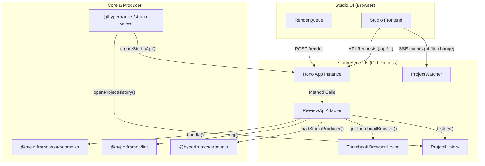
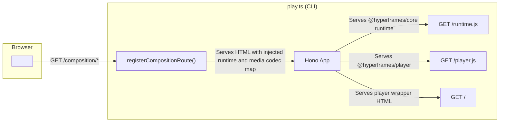

<!-- source: DeepWiki mcp.deepwiki.com · repo heygen-com/hyperframes · page 2.2 Preview Server and Studio Launch · fetched 2026-11-02 -->

# Preview Server and Studio Launch

Relevant source files

The following files were used as context for generating this wiki page:

- [packages/cli/src/commands/catch-up.test.ts](packages/cli/src/commands/catch-up.test.ts)
- [packages/cli/src/commands/catch-up.ts](packages/cli/src/commands/catch-up.ts)
- [packages/cli/src/commands/play.test.ts](packages/cli/src/commands/play.test.ts)
- [packages/cli/src/commands/play.ts](packages/cli/src/commands/play.ts)
- [packages/cli/src/commands/present.ts](packages/cli/src/commands/present.ts)
- [packages/cli/src/commands/preview.startFailure.test.ts](packages/cli/src/commands/preview.startFailure.test.ts)
- [packages/cli/src/commands/preview.test.ts](packages/cli/src/commands/preview.test.ts)
- [packages/cli/src/commands/preview.ts](packages/cli/src/commands/preview.ts)
- [packages/cli/src/commands/previewLifecycle.test.ts](packages/cli/src/commands/previewLifecycle.test.ts)
- [packages/cli/src/commands/previewLifecycle.ts](packages/cli/src/commands/previewLifecycle.ts)
- [packages/cli/src/commands/previewLifecycleOutput.test.ts](packages/cli/src/commands/previewLifecycleOutput.test.ts)
- [packages/cli/src/commands/previewLifecycleOutput.ts](packages/cli/src/commands/previewLifecycleOutput.ts)
- [packages/cli/src/commands/serverPort.test.ts](packages/cli/src/commands/serverPort.test.ts)
- [packages/cli/src/server/readBundleFile.ts](packages/cli/src/server/readBundleFile.ts)
- [packages/cli/src/server/runtimeSource.file-race.test.ts](packages/cli/src/server/runtimeSource.file-race.test.ts)
- [packages/cli/src/server/runtimeSource.ts](packages/cli/src/server/runtimeSource.ts)
- [packages/cli/src/server/studioRenderTelemetry.test.ts](packages/cli/src/server/studioRenderTelemetry.test.ts)
- [packages/cli/src/server/studioRenderTelemetry.ts](packages/cli/src/server/studioRenderTelemetry.ts)
- [packages/cli/src/server/studioServer.file-race.test.ts](packages/cli/src/server/studioServer.file-race.test.ts)
- [packages/cli/src/server/studioServer.test.ts](packages/cli/src/server/studioServer.test.ts)
- [packages/cli/src/server/studioServer.ts](packages/cli/src/server/studioServer.ts)
- [packages/cli/src/utils/appHistory.test.ts](packages/cli/src/utils/appHistory.test.ts)
- [packages/cli/src/utils/appHistory.ts](packages/cli/src/utils/appHistory.ts)
- [packages/cli/src/utils/compositionServer.test.ts](packages/cli/src/utils/compositionServer.test.ts)
- [packages/cli/src/utils/compositionServer.ts](packages/cli/src/utils/compositionServer.ts)
- [packages/cli/src/utils/openBrowser.test.ts](packages/cli/src/utils/openBrowser.test.ts)
- [packages/cli/src/utils/openBrowser.ts](packages/cli/src/utils/openBrowser.ts)
- [packages/cli/src/utils/port.test.ts](packages/cli/src/utils/port.test.ts)
- [packages/cli/src/utils/port.ts](packages/cli/src/utils/port.ts)
- [packages/cli/src/utils/staticProjectServer.charset.browser.test.ts](packages/cli/src/utils/staticProjectServer.charset.browser.test.ts)
- [packages/cli/src/utils/staticProjectServer.test.ts](packages/cli/src/utils/staticProjectServer.test.ts)
- [packages/cli/src/utils/staticProjectServer.ts](packages/cli/src/utils/staticProjectServer.ts)
- [packages/cli/src/utils/windowsAppData.ts](packages/cli/src/utils/windowsAppData.ts)
- [packages/core/src/compiler/pngColourTags.test.ts](packages/core/src/compiler/pngColourTags.test.ts)
- [packages/core/src/compiler/pngColourTags.ts](packages/core/src/compiler/pngColourTags.ts)
- [packages/studio-server/src/helpers/encoderOptions.test.ts](packages/studio-server/src/helpers/encoderOptions.test.ts)
- [packages/studio-server/src/helpers/encoderOptions.ts](packages/studio-server/src/helpers/encoderOptions.ts)
- [packages/studio-server/src/helpers/mime.ts](packages/studio-server/src/helpers/mime.ts)
- [packages/studio-server/src/index.ts](packages/studio-server/src/index.ts)
- [packages/studio-server/src/routes/render.test.ts](packages/studio-server/src/routes/render.test.ts)
- [packages/studio-server/src/routes/render.ts](packages/studio-server/src/routes/render.ts)
- [packages/studio-server/src/types.ts](packages/studio-server/src/types.ts)
- [packages/studio/src/utils/frameCapture.test.ts](packages/studio/src/utils/frameCapture.test.ts)
- [packages/studio/src/utils/frameCapture.ts](packages/studio/src/utils/frameCapture.ts)
- [packages/studio/src/utils/projectRouting.test.ts](packages/studio/src/utils/projectRouting.test.ts)
- [packages/studio/src/utils/projectRouting.ts](packages/studio/src/utils/projectRouting.ts)
- [packages/studio/vite.adapter.projects.test.ts](packages/studio/vite.adapter.projects.test.ts)
- [packages/studio/vite.adapter.ts](packages/studio/vite.adapter.ts)
- [packages/studio/vite.config.ts](packages/studio/vite.config.ts)
- [packages/studio/vite.thumbnail.test.ts](packages/studio/vite.thumbnail.test.ts)
- [packages/studio/vite.thumbnail.ts](packages/studio/vite.thumbnail.ts)

The `hyperframes preview` command initializes a local development environment that combines a **Vite-based Studio frontend** with a **Hono-based Studio API** (`studioServer.ts`) [packages/cli/src/server/studioServer.ts:1-6](). This system provides real-time visual editing, project linting, and in-browser rendering capabilities. The architecture is designed to handle different execution contexts, ranging from local standalone projects to full monorepo development [packages/cli/src/commands/preview.ts:125-140]().

### Preview Command Lifecycle

When `hyperframes preview` is executed, the CLI performs a sequence of environment checks and port scans to ensure a smooth launch. It first cleans up any orphaned `chrome-headless-shell` processes from previous crashed sessions [packages/cli/src/utils/orphanCleanup.ts:1-25]() and lints the project to surface any immediate findings [packages/cli/src/commands/preview.ts:51-56]().

The command then determines which execution mode of the Studio to launch:
1. **Monorepo Dev Mode**: If `isDevMode()` is true, it spawns the Studio using the monorepo source [packages/cli/src/commands/preview.ts:42-48]().
2. **Local Studio Mode**: If a project has `@hyperframes/studio` installed locally, it uses Vite for full HMR [packages/cli/src/commands/preview.ts:183-191]().
3. **Embedded Mode**: For most users, it starts an embedded server using pre-bundled assets within the CLI resolved via `resolveStudioBundle()` [packages/cli/src/server/studioServer.ts:125-147]().

Sources: [packages/cli/src/commands/preview.ts:42-191](), [packages/cli/src/server/studioServer.ts:125-147](), [packages/cli/src/utils/orphanCleanup.ts:1-25]()

---

### Port Selection and Instance Reuse

HyperFrames implements a robust port handling strategy to manage multiple preview instances and handle network edge cases [packages/cli/src/server/portUtils.ts:1-60]().

#### Port Utilities Logic
- **Multi-host testing**: The port scanner checks `127.0.0.1`, `0.0.0.0`, `::1`, and `::` sequentially to verify if a port is free [packages/cli/src/server/portUtils.ts:1-50]().
- **Instance Detection**: If a port is occupied, the CLI probes it to check if the running server matches the current project and build signature [packages/cli/src/server/portUtils.ts:100-157](). If they match, it reuses the active server rather than failing or spawning a duplicate [packages/cli/src/commands/preview.ts:136-146]().
- **Management**: Flags like `--list` and `--kill-all` allow users to scan or terminate active servers across the environment [packages/cli/src/commands/preview.ts:166-175]().

Sources: [packages/cli/src/server/portUtils.ts:1-161](), [packages/cli/src/commands/preview.ts:136-175]()

---

### Studio Server Architecture (`studioServer.ts`)

The `studioServer.ts` module provides the CLI-specific adapter for the shared Studio API module located in `@hyperframes/studio-server` [packages/cli/src/server/studioServer.ts:1-6](). It integrates file watching [packages/cli/src/server/fileWatcher.js:1-21](), project signatures [packages/studio-server/src/helpers/projectSignature.js:1-25](), and preview bundling routes [packages/studio-server/src/routes/preview.js:1-65]().

#### Code Entity Mapping: Studio Server

The following diagram illustrates how `StudioServer` wires Hono requests from the Studio UI to the underlying CLI adapters and producer subsystems [packages/cli/src/server/studioServer.ts:1-64]().

Sources: [packages/cli/src/server/studioServer.ts:1-64](), [packages/cli/src/server/fileWatcher.js:1-21](), [packages/studio-server/src/index.ts:1-78]()

#### Key Implementation Details
- **Thumbnail Browser Pool**: The server coordinates thumbnail generation via a shared browser lease manager, ensuring that thumbnail extraction and render tasks share optimized browser processes [packages/cli/src/server/studioServer.ts:60-80]().
- **Manual Edits**: It supports applying user edits stored in `.hyperframes/studio-manual-edits.json` via `createStudioManualEditsRenderBodyScript()` [packages/cli/src/server/studioServer.ts:45-46]().
- **Vite Integration**: During development in the monorepo, Vite's `devProjectApi` plugin bridges Hono requests to Node HTTP responses and manages project signature caches [packages/studio/vite.config.ts:65-141]().
- **Project History**: The `studioServer` integrates with the project history system from `@hyperframes/studio-server`, allowing for undo/redo functionality and tracking project changes. It uses `openProjectHistory` and `historyCache` to manage project history instances [packages/cli/src/server/studioServer.ts:65-69]().

Sources: [packages/cli/src/server/studioServer.ts:45-46](), [packages/cli/src/server/studioServer.ts:60-80](), [packages/cli/src/server/studioServer.ts:65-69](), [packages/studio/vite.config.ts:65-141]()

---

### Telemetry and Canary Integration

The preview server is a long-lived process that reacts dynamically to configuration and telemetry changes.

- **Posture Refresh**: The `refreshTelemetryPosture()` helper invalidates cached telemetry and config parameters at request boundaries, ensuring that external modifications (such as disabling telemetry via the CLI) take effect immediately [packages/cli/src/server/telemetryIdentity.ts:21-33]().
- **Canary Decisions**: Canary rollout flags are resolved and shared with the Studio session to maintain consistency between CLI commands and browser UI features [packages/cli/src/commands/preview.ts:1-50]().

Sources: [packages/cli/src/server/telemetryIdentity.ts:21-33](), [packages/cli/src/commands/preview.ts:1-50]()

---

### Lightweight Player Server (`play.ts`)

For workflows requiring a fast preview without the full Studio IDE overhead, the `hyperframes play` command boots a lightweight Hono server to serve compositions [packages/cli/src/commands/play.ts:1-60]().

Sources: [packages/cli/src/commands/play.ts:1-193]()

- **Runtime Injection**: It dynamically injects the Hyperframe runtime script into composition documents [packages/cli/src/commands/play.ts:135-162]().
- **Media Proxying**: Automatically transcodes browser-hostile video codecs (such as HEVC, ProRes, and AV1) into authoring-friendly web proxies using background transcoders [packages/cli/src/commands/play.ts:25-55](). The `resolveAutoProxy` utility determines if auto-proxying should be enabled based on project configuration and CLI flags [packages/cli/src/commands/play.ts:27-28]().
- **Player and Runtime Serving**: The `play` command serves the `@hyperframes/player` web component and the core HyperFrames runtime directly from the CLI's bundled assets [packages/cli/src/commands/play.ts:153-168]().

Sources: [packages/cli/src/commands/play.ts:25-162](), [packages/cli/src/commands/play.ts:27-28](), [packages/cli/src/commands/play.ts:153-168]()

---

