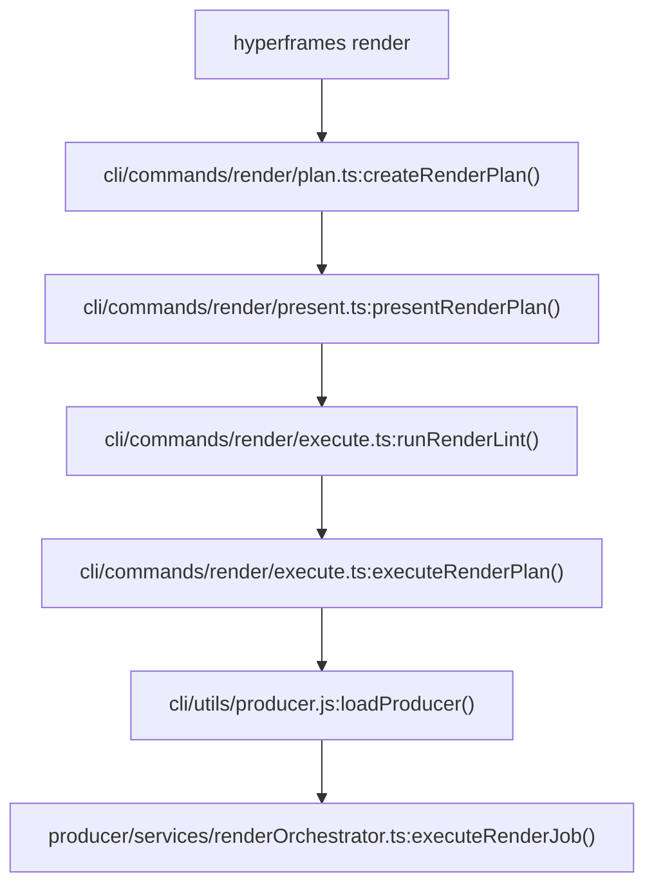
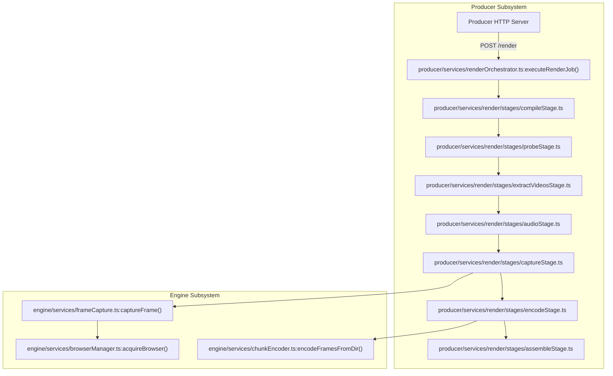

<!-- source: DeepWiki mcp.deepwiki.com · repo heygen-com/hyperframes · page 2.3 Rendering Command · fetched 2026-11-02 -->

# Rendering Command

Relevant source files

The following files were used as context for generating this wiki page:

- [docs/guides/rendering.mdx](docs/guides/rendering.mdx)
- [docs/packages/engine.mdx](docs/packages/engine.mdx)
- [docs/packages/producer.mdx](docs/packages/producer.mdx)
- [packages/cli/src/commands/cloudrun.ts](packages/cli/src/commands/cloudrun.ts)
- [packages/cli/src/commands/lambda.ts](packages/cli/src/commands/lambda.ts)
- [packages/cli/src/commands/lambda/render-batch.test.ts](packages/cli/src/commands/lambda/render-batch.test.ts)
- [packages/cli/src/commands/lambda/render-batch.ts](packages/cli/src/commands/lambda/render-batch.ts)
- [packages/cli/src/commands/lambda/render.test.ts](packages/cli/src/commands/lambda/render.test.ts)
- [packages/cli/src/commands/lambda/render.ts](packages/cli/src/commands/lambda/render.ts)
- [packages/cli/src/commands/render.test.ts](packages/cli/src/commands/render.test.ts)
- [packages/cli/src/commands/render.ts](packages/cli/src/commands/render.ts)
- [packages/cli/src/commands/render/execute.test.ts](packages/cli/src/commands/render/execute.test.ts)
- [packages/cli/src/commands/render/execute.ts](packages/cli/src/commands/render/execute.ts)
- [packages/cli/src/commands/render/plan.test.ts](packages/cli/src/commands/render/plan.test.ts)
- [packages/cli/src/commands/render/plan.ts](packages/cli/src/commands/render/plan.ts)
- [packages/cli/src/docs/rendering.md](packages/cli/src/docs/rendering.md)
- [packages/cli/src/telemetry/events.test.ts](packages/cli/src/telemetry/events.test.ts)
- [packages/cli/src/telemetry/events.ts](packages/cli/src/telemetry/events.ts)
- [packages/cli/src/telemetry/renderObservability.test.ts](packages/cli/src/telemetry/renderObservability.test.ts)
- [packages/cli/src/telemetry/renderObservability.ts](packages/cli/src/telemetry/renderObservability.ts)
- [packages/cli/src/utils/compositionFps.test.ts](packages/cli/src/utils/compositionFps.test.ts)
- [packages/cli/src/utils/compositionFps.ts](packages/cli/src/utils/compositionFps.ts)
- [packages/cli/src/utils/dockerRunArgs.test.ts](packages/cli/src/utils/dockerRunArgs.test.ts)
- [packages/cli/src/utils/dockerRunArgs.ts](packages/cli/src/utils/dockerRunArgs.ts)
- [packages/cli/src/utils/missingPackage.test.ts](packages/cli/src/utils/missingPackage.test.ts)
- [packages/cli/src/utils/missingPackage.ts](packages/cli/src/utils/missingPackage.ts)
- [packages/cli/src/utils/renderArgs.test.ts](packages/cli/src/utils/renderArgs.test.ts)
- [packages/cli/src/utils/renderArgs.ts](packages/cli/src/utils/renderArgs.ts)
- [packages/engine/src/config.test.ts](packages/engine/src/config.test.ts)
- [packages/engine/src/config.ts](packages/engine/src/config.ts)
- [packages/engine/src/index.ts](packages/engine/src/index.ts)
- [packages/engine/src/services/browserManager.test.ts](packages/engine/src/services/browserManager.test.ts)
- [packages/engine/src/services/browserManager.ts](packages/engine/src/services/browserManager.ts)
- [packages/engine/src/services/chunkEncoder.relativePaths.test.ts](packages/engine/src/services/chunkEncoder.relativePaths.test.ts)
- [packages/engine/src/services/frameCapture.test.ts](packages/engine/src/services/frameCapture.test.ts)
- [packages/engine/src/services/frameCapture.ts](packages/engine/src/services/frameCapture.ts)
- [packages/engine/src/types.ts](packages/engine/src/types.ts)
- [packages/producer/src/renderRequest.test.ts](packages/producer/src/renderRequest.test.ts)
- [packages/producer/src/renderRequest.ts](packages/producer/src/renderRequest.ts)
- [packages/producer/src/services/distributed/renderConfigValidation.ts](packages/producer/src/services/distributed/renderConfigValidation.ts)
- [packages/producer/src/services/render/observability.ts](packages/producer/src/services/render/observability.ts)
- [packages/producer/src/services/render/perfSummary.test.ts](packages/producer/src/services/render/perfSummary.test.ts)
- [packages/producer/src/services/render/perfSummary.ts](packages/producer/src/services/render/perfSummary.ts)
- [packages/producer/src/services/render/segmentManifest.test.ts](packages/producer/src/services/render/segmentManifest.test.ts)
- [packages/producer/src/services/render/segmentManifest.ts](packages/producer/src/services/render/segmentManifest.ts)
- [packages/producer/src/services/renderOrchestrator.deGateProbe.test.ts](packages/producer/src/services/renderOrchestrator.deGateProbe.test.ts)
- [packages/producer/src/services/renderOrchestrator.test.ts](packages/producer/src/services/renderOrchestrator.test.ts)
- [packages/producer/src/services/renderOrchestrator.ts](packages/producer/src/services/renderOrchestrator.ts)

The `hyperframes render` command is the primary entry point for transforming HTML-based compositions into high-fidelity video files. It orchestrates a multi-stage pipeline involving headless browser capture, audio processing, and FFmpeg encoding.

## Command Overview and Configuration Flags

The CLI uses the `citty` framework to define the `render` command [packages/cli/src/commands/render.ts:153-157](). It supports a comprehensive set of configuration flags handled through `packages/cli/src/commands/render.ts` and associated plan builders.

### Core Configuration Flags
| Flag | Type | Default | Description |
| :--- | :--- | :--- | :--- |
| `dir` | Positional | `.` | The project directory containing the composition [packages/cli/src/commands/render.ts:160-163](). |
| `--composition` | string | `index.html` | Render a specific composition file (e.g., `compositions/intro.html`) [packages/cli/src/commands/render.ts:164-171](). |
| `--output` | string | `renders/<name>.mp4` | Destination path for the rendered file [packages/cli/src/commands/render.ts:172-176](). |
| `--fps` | string | Composition root `data-fps` or `30` | Target frame rate (supports integers or rational strings like `30000/1001`) [packages/cli/src/commands/render.ts:177-184](). |
| `--quality` | string | `standard` | Preset: `draft`, `standard`, or `high`. |
| `--format` | string | `mp4` | Container: `mp4`, `webm`, `mov`, `gif`, `hls`, or `png-sequence` [packages/cli/src/commands/render.ts:156](). |
| `--workers` | string | `auto` | Parallel render workers. Each spawns a Chrome process. |

### Advanced Encoding and Capture Flags
*   **`--docker`**: Executes the render inside a container for deterministic environment parity [packages/cli/src/commands/render.ts:35]().
*   **`--variables`**: JSON string to override values declared in composition parameters [packages/cli/src/commands/render.ts:50-52]().
*   **`--variables-file`**: Load override variables from an external JSON file [packages/cli/src/commands/render.ts:54-56]().
*   **`--batch`**: Batch render one output per row in a JSON array file [packages/cli/src/commands/render.ts:58-60]().
*   **`--no-browser-gpu`**: Opt out of browser-side GPU acceleration [packages/cli/src/commands/render.ts:40]().
*   **`--frames-cache-dir`**: Relocate the frame cache directory off primary storage partitions [packages/cli/src/commands/render.ts:46-48]().

Sources: [packages/cli/src/commands/render.ts:153-2060]()

---

## Local vs. Docker Rendering Modes

HyperFrames provides two primary execution modes to balance speed, hardware utilization, and environment reproducibility.

### Local Mode (Default)
Local rendering uses the system's `ffmpeg` and a local Chromium or bundled `chrome-headless-shell` instance [packages/cli/src/commands/render.ts:123-127](). It is optimized for speed and allows host GPU acceleration.
*   **Browser GPU**: The CLI resolves the GPU mode via `resolveBrowserGpuForCli` [packages/cli/src/commands/render.ts:7]() and `resolveBrowserGpuMode` [packages/engine/src/services/browserManager.js:32](), supporting hardware ANGLE backends or software SwiftShader fallbacks [packages/engine/src/config.ts:43-53]().
*   **Upsampling**: Supports supersampling resolutions (e.g., 4K) via Chrome Device Pixel Ratio (DPR) scaling [packages/cli/src/commands/render.ts:20-22]().

### Docker Mode
Invoked via `--docker`, this mode guarantees deterministic rendering parity across heterogeneous developer and CI hosts [packages/cli/src/commands/render.ts:35]().
*   **Implementation**: The CLI builds container execution arguments using `buildDockerRunArgs` and `resolveDockerPlatform` [packages/cli/src/utils/dockerRunArgs.ts:1-10]().
*   **Container Image**: Relies on `Dockerfile.render`, which packages a pinned `chrome-headless-shell` build and standard system fonts.

Sources: [packages/cli/src/commands/render.ts:35](), [packages/cli/src/utils/dockerRunArgs.ts:1-10](), [packages/engine/src/config.ts:43-53](), [packages/engine/src/services/browserManager.js:32]()

---

## Render Plan, Lint, and Execution

The render lifecycle begins by generating a render plan, running optional pre-flight checks and linters, and executing the compiled pipeline stages.

### Plan and Execute Architecture

#### Diagram: CLI Render Plan to Execution Flow

Sources: [packages/cli/src/commands/render.ts:7-12](), [packages/cli/src/commands/render/plan.ts:1-40](), [packages/cli/src/commands/render/execute.ts:1-50](), [packages/cli/src/utils/producer.js:1-10]()

*   **`createRenderPlan`**: Validates input arguments, locates composition entry points, and resolves output path matrices [packages/cli/src/commands/render/plan.ts:1-40]().
*   **`runRenderLint`**: Inspects composition markup and script contracts before committing CPU cycles to video encoding [packages/cli/src/commands/render/execute.ts:1-35]().
*   **`executeRenderPlan`**: Invokes the producer runtime via `loadProducer()` to instantiate and run the render job [packages/cli/src/commands/render.ts:66]().

Sources: [packages/cli/src/commands/render.ts:7-12](), [packages/cli/src/commands/render/execute.ts:1-45]()

---

## Segmented and Long-Form Renders

For long-form compositions or memory-constrained environments, HyperFrames utilizes segmented rendering strategies.

*   **Segment Planning**: `resolveSegmentFrames` and `computeSegmentPlanHash` partition long timelines into discrete time windows [packages/producer/src/services/renderOrchestrator.ts:163-173]().
*   **Segmented Capture Stage**: `runCaptureSegmentedStage` delegates frame rendering across isolated segment directories managed by `segmentManifest.ts` [packages/producer/src/services/renderOrchestrator.ts:157](), [packages/producer/src/services/render/stages/captureSegmentedStage.ts:1-25]().
*   **Recycle Policy**: `resolveSegmentBrowserRecycle` manages browser instance recycling between segments to mitigate memory leaks during extended multi-minute renders [packages/producer/src/services/renderOrchestrator.ts:164]().

Sources: [packages/producer/src/services/renderOrchestrator.ts:157-173](), [packages/producer/src/services/render/stages/captureSegmentedStage.ts:1-30]()

---

## Producer HTTP API and Orchestration

The `@hyperframes/producer` package exposes programmatic render control via an internal HTTP server and orchestration service.

### Orchestration Pipeline Stages
The `executeRenderJob` function inside `renderOrchestrator.ts` sequences six distinct stages [packages/producer/src/services/renderOrchestrator.ts:5-22]():
1.  **Compile (`compileStage.ts`)**: Bundles and prepares HTML/CSS assets.
2.  **Probe (`probeStage.ts`)**: Browser-driven duration discovery and media reconciliation.
3.  **Extract Videos (`extractVideosStage.ts`)**: Pre-extracts underlying video elements via FFmpeg.
4.  **Audio (`audioStage.ts`)**: Mixes multi-track audio elements and applies audio groups [packages/producer/src/services/renderOrchestrator.ts:60]().
5.  **Capture (`captureStage.ts` / `captureSegmentedStage.ts`)**: Captures frames via Chromium BeginFrame or screenshot protocols [packages/producer/src/services/renderOrchestrator.ts:18-19]().
6.  **Encode & Assemble (`encodeStage.ts`, `assembleStage.ts`)**: Multiplexes frames and audio into final output containers [packages/producer/src/services/renderOrchestrator.ts:20-21]().

#### Diagram: Producer Orchestrator and Pipeline Execution

Sources: [packages/producer/src/services/renderOrchestrator.ts:5-22](), [packages/engine/src/services/frameCapture.ts:1-12](), [packages/engine/src/services/browserManager.ts:1-10](), [packages/engine/src/services/chunkEncoder.ts:1-10]()

Sources: [packages/producer/src/services/renderOrchestrator.ts:1-192](), [packages/engine/src/index.ts:1-35]()

---

## Output Formats and Quality Presets

HyperFrames supports multiple output containers and encoding profiles resolved via `renderFormat.js` and `chunkEncoder.ts` [packages/engine/src/index.ts:182-201]().

| Format | Extension | Transparency | Use Case |
| :--- | :--- | :--- | :--- |
| **MP4** | `.mp4` | No | Universal playback, H.264 pipeline [packages/cli/src/commands/render.ts:17](). |
| **WebM** | `.webm` | **Yes** | Transparent web overlays via VP9 [packages/cli/src/commands/render.ts:24](). |
| **MOV** | `.mov` | **Yes** | Professional NLE editing via ProRes 4444 [packages/cli/src/commands/render.ts:23](). |
| **GIF** | `.gif` | No | Looped animations for documentation and PRs [packages/cli/src/commands/render.ts:26-27](). |
| **PNG Sequence** | Directory | **Yes** | Raw RGBA frames for After Effects, Nuke, or Fusion [packages/cli/src/commands/render.ts:30-31](). |
| **HLS VOD** | Directory | No | Master playlist and MPEG-TS segments for adaptive streaming [packages/cli/src/commands/render.ts:34-36]().

### Quality Presets
The CLI maps `--quality` to CRF and encoder speed presets via `getEncoderPreset` [packages/engine/src/index.ts:193]().
*   **`draft`**: Optimized for speed with relaxed compression tolerances [packages/engine/src/config.ts:27]().
*   **`standard`**: Balanced quality and file size for general exports [packages/engine/src/config.ts:27]().
*   **`high`**: High-bitrate, slow-preset configuration for final mastering [packages/engine/src/config.ts:27]().

Sources: [packages/cli/src/commands/render.ts:17-36](), [packages/engine/src/config.ts:24-30](), [packages/engine/src/index.ts:182-201]()

---

