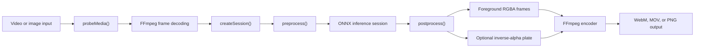
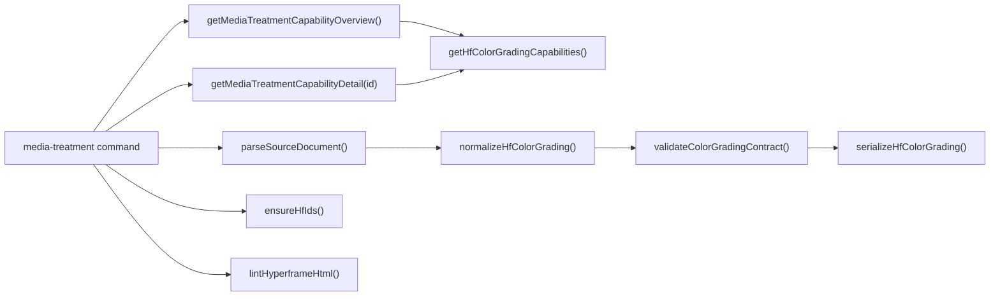
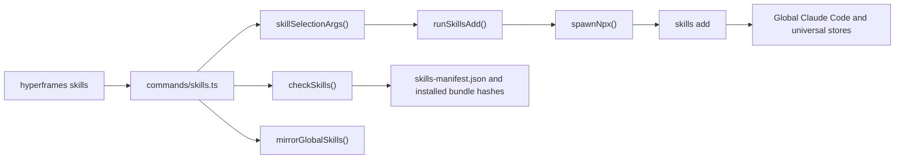
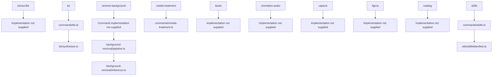
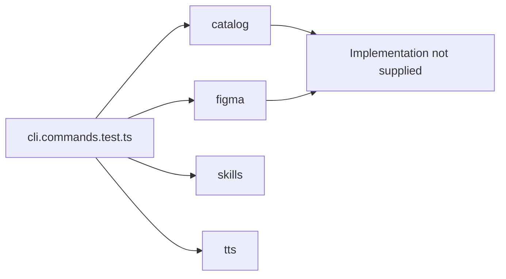

<!-- source: DeepWiki mcp.deepwiki.com · repo heygen-com/hyperframes · page 2.4 AI and Media Commands · fetched 2026-11-02 -->

# AI and Media Commands

Relevant source files

The following files were used as context for generating this wiki page:

- [packages/cli/src/audio/providers.ts](packages/cli/src/audio/providers.ts)
- [packages/cli/src/background-removal/dependency-compat.test.ts](packages/cli/src/background-removal/dependency-compat.test.ts)
- [packages/cli/src/background-removal/inference.test.ts](packages/cli/src/background-removal/inference.test.ts)
- [packages/cli/src/background-removal/inference.ts](packages/cli/src/background-removal/inference.ts)
- [packages/cli/src/background-removal/pipeline.rotation.test.ts](packages/cli/src/background-removal/pipeline.rotation.test.ts)
- [packages/cli/src/background-removal/pipeline.test.ts](packages/cli/src/background-removal/pipeline.test.ts)
- [packages/cli/src/background-removal/pipeline.ts](packages/cli/src/background-removal/pipeline.ts)
- [packages/cli/src/background-removal/pipeline.windowsHide.test.ts](packages/cli/src/background-removal/pipeline.windowsHide.test.ts)
- [packages/cli/src/cli.commands.test.ts](packages/cli/src/cli.commands.test.ts)
- [packages/cli/src/commands/auth/status-guidance.ts](packages/cli/src/commands/auth/status-guidance.ts)
- [packages/cli/src/commands/lambda/repoRoot.test.ts](packages/cli/src/commands/lambda/repoRoot.test.ts)
- [packages/cli/src/commands/lambda/repoRoot.ts](packages/cli/src/commands/lambda/repoRoot.ts)
- [packages/cli/src/commands/media-treatment.test.ts](packages/cli/src/commands/media-treatment.test.ts)
- [packages/cli/src/commands/media-treatment.ts](packages/cli/src/commands/media-treatment.ts)
- [packages/cli/src/commands/remove-background.ts](packages/cli/src/commands/remove-background.ts)
- [packages/cli/src/commands/skills.test.ts](packages/cli/src/commands/skills.test.ts)
- [packages/cli/src/commands/skills.ts](packages/cli/src/commands/skills.ts)
- [packages/cli/src/commands/tts.test.ts](packages/cli/src/commands/tts.test.ts)
- [packages/cli/src/commands/tts.ts](packages/cli/src/commands/tts.ts)
- [packages/cli/src/tts/manager.test.ts](packages/cli/src/tts/manager.test.ts)
- [packages/cli/src/tts/manager.ts](packages/cli/src/tts/manager.ts)
- [packages/cli/src/tts/python.test.ts](packages/cli/src/tts/python.test.ts)
- [packages/cli/src/tts/python.ts](packages/cli/src/tts/python.ts)
- [packages/cli/src/tts/synthesize.cache.test.ts](packages/cli/src/tts/synthesize.cache.test.ts)
- [packages/cli/src/tts/synthesize.test.ts](packages/cli/src/tts/synthesize.test.ts)
- [packages/cli/src/tts/synthesize.ts](packages/cli/src/tts/synthesize.ts)
- [packages/cli/src/utils/command-failure-tracking.test.ts](packages/cli/src/utils/command-failure-tracking.test.ts)
- [packages/cli/src/utils/command-failure-tracking.ts](packages/cli/src/utils/command-failure-tracking.ts)
- [packages/cli/src/utils/jsonFlag.test.ts](packages/cli/src/utils/jsonFlag.test.ts)
- [packages/cli/src/utils/jsonFlag.ts](packages/cli/src/utils/jsonFlag.ts)
- [packages/cli/src/utils/jsonFlag.windows.test.ts](packages/cli/src/utils/jsonFlag.windows.test.ts)
- [packages/cli/src/utils/reject-extra-positionals.test.ts](packages/cli/src/utils/reject-extra-positionals.test.ts)
- [packages/cli/src/utils/reject-extra-positionals.ts](packages/cli/src/utils/reject-extra-positionals.ts)
- [packages/cli/src/utils/reject-unknown-flags.test.ts](packages/cli/src/utils/reject-unknown-flags.test.ts)
- [packages/cli/src/utils/reject-unknown-flags.ts](packages/cli/src/utils/reject-unknown-flags.ts)
- [packages/cli/src/utils/skillsManifest.test.ts](packages/cli/src/utils/skillsManifest.test.ts)
- [packages/cli/src/utils/skillsManifest.ts](packages/cli/src/utils/skillsManifest.ts)
- [packages/cli/src/utils/skillsUpdateCheck.test.ts](packages/cli/src/utils/skillsUpdateCheck.test.ts)
- [packages/cli/src/utils/skillsUpdateCheck.ts](packages/cli/src/utils/skillsUpdateCheck.ts)
- [packages/cli/src/utils/variables.test.ts](packages/cli/src/utils/variables.test.ts)
- [packages/cli/src/utils/variables.ts](packages/cli/src/utils/variables.ts)
- [packages/cli/src/whisper/parakeet.test.ts](packages/cli/src/whisper/parakeet.test.ts)
- [packages/studio-server/src/routes/media.test.ts](packages/studio-server/src/routes/media.test.ts)
- [packages/studio-server/src/routes/media.ts](packages/studio-server/src/routes/media.ts)
- [skills/hyperframes/references/skill-lifecycle.md](skills/hyperframes/references/skill-lifecycle.md)
- [skills/media-use/references/grading.md](skills/media-use/references/grading.md)

## Purpose and scope

This page covers CLI commands for AI-assisted media workflows and related tooling. The available implementation details here cover `tts`, `remove-background`, `media-treatment`, and `skills` in depth. The requested `transcribe`, `beats`, `normalize-audio`, `capture`, `figma`, and `catalog` commands are included in the command map, but their implementation files were not provided, so this page does not infer their behavior. [packages/cli/src/commands/tts.ts:40-85]()

Sources: [packages/cli/src/commands/tts.ts:40-85]()

## Command map

The CLI command set includes the media and AI commands listed below. The provided command-registration test explicitly names `catalog`, `figma`, `skills`, and `tts`; the remaining command names are in this page’s stated scope, but their registration and implementation details are not available in the supplied files. [packages/cli/src/cli.commands.test.ts:20-29]()

| Command | Implementation detail available here |
|---|---|
| `transcribe` | Not available in the supplied file contents |
| `tts` | CLI argument handling and local Kokoro synthesis |
| `remove-background` | Frame inference and rendering pipeline |
| `media-treatment` | Capability discovery and HTML treatment operations |
| `beats` | Not available in the supplied file contents |
| `normalize-audio` | Not available in the supplied file contents |
| `capture` | Not available in the supplied file contents |
| `figma` | Command is named in the CLI command test; implementation not supplied |
| `catalog` | Command is named in the CLI command test; implementation not supplied |
| `skills` | Installation, update, and skill-freshness management |

Sources: [packages/cli/src/cli.commands.test.ts:20-29](), [packages/cli/src/commands/tts.ts:40-85](), [packages/cli/src/commands/skills.ts:121-153](), [packages/cli/src/commands/media-treatment.ts:41-91]()

## Text-to-speech (`hyperframes tts`)

### CLI input, validation, and output

The `tts` command accepts text as a positional argument or reads a `.txt` file. It also supports the compatibility alias `--text-file`, output-path aliases, voice and speed selection, language override, voice listing, and JSON output. [packages/cli/src/commands/tts.ts:40-85]()

The command rejects simultaneous positional text and `--text-file` input, empty text, and speeds outside `0.1`–`3.0`. It resolves the output path (defaulting to `speech.wav`), chooses the default voice when none is supplied, and infers the phonemizer language from the voice ID unless `--lang` overrides it. [packages/cli/src/commands/tts.ts:87-150]()

Synthesis is loaded dynamically from `../tts/synthesize.js`. In JSON mode, the command emits either a success object with voice, speed, language, duration, and output path, or a failure object with an error message. [packages/cli/src/commands/tts.ts:152-199]()

### Synthesis implementation

`synthesize()` uses Kokoro-82M through `kokoro-onnx`. It resolves default voice, speed, and language, checks for Python, and uses a cached Python script at `~/.cache/hyperframes/tts/synth-v4.py`. The script is written on demand and older versioned synthesis scripts are removed best-effort. [packages/cli/src/tts/synthesize.ts:115-143](), [packages/cli/src/tts/synthesize.ts:149-187]()

The embedded Python script constructs a `kokoro_onnx.Kokoro` model and calls `model.create()` with voice and speed. It passes `lang` only when the installed library’s `create()` signature supports that argument. If Kokoro raises the recognized voice-token-overflow `IndexError`, the script splits the text near a whitespace or sentence boundary and retries each half recursively, then joins the generated samples after checking their sample rates match. [packages/cli/src/tts/synthesize.ts:23-35](), [packages/cli/src/tts/synthesize.ts:57-105]()

The CLI returns synthesis metadata including sample rate, duration, output path, and whether the installed Kokoro version applied the requested language. For `zh`, the Python/espeak boundary maps the public language code to `cmn`. [packages/cli/src/tts/synthesize.ts:108-113](), [packages/cli/src/tts/synthesize.ts:149-168]()

### TTS data flow

**Diagram: CLI text input to synthesized audio**

```mermaid
flowchart LR
    UserInput["Text argument or .txt file"] --> TtsCommand["commands/tts.ts"]
    TtsCommand --> Validate["Input, speed, voice, and language validation"]
    Validate --> Synthesize["synthesize()"]
    Synthesize --> EnsureScript["ensureSynthScript()"]
    EnsureScript --> PythonScript["synth-v4.py"]
    PythonScript --> Kokoro["kokoro_onnx.Kokoro"]
    Kokoro --> SoundFile["soundfile.write()"]
    SoundFile --> Output["Audio file and synthesis metadata"]
```

Sources: [packages/cli/src/commands/tts.ts:87-199](), [packages/cli/src/tts/synthesize.ts:23-105](), [packages/cli/src/tts/synthesize.ts:115-187]()

## Background removal (`hyperframes remove-background`)

### Inference session

`createSession()` loads `sharp` and `onnxruntime-node` as optional packages, selects execution providers, ensures the model is available, and creates an ONNX inference session with graph optimization enabled. If provider initialization fails and the selected provider is not CPU, it retries on CPU. [packages/cli/src/background-removal/inference.ts:56-85]()

The session’s `process()` method preprocesses an RGB frame, runs inference, and postprocesses the output into a foreground RGBA buffer. When requested, it also produces an inverse-alpha background plate. The session reuses buffers across calls and exposes `close()` to release the ONNX session. [packages/cli/src/background-removal/inference.ts:28-48](), [packages/cli/src/background-removal/inference.ts:93-150]()

Preprocessing resizes each input to `320 × 320`, then normalizes its channels using the declared ImageNet means and standard deviations. If a provider loads but later fails during frame processing, the session retries once on CPU. [packages/cli/src/background-removal/inference.ts:13-20](), [packages/cli/src/background-removal/inference.ts:99-115](), [packages/cli/src/background-removal/inference.ts:153-185]()

### Rendering pipeline

The rendering pipeline decodes source frames with FFmpeg, performs inference per frame, and encodes the resulting RGBA frames with a second FFmpeg process. Supported output formats are WebM, MOV, and PNG; PNG is for a single-image input. An optional background output is an inverse-alpha plate, not an inpainted clean plate. [packages/cli/src/background-removal/pipeline.ts:2-15](), [packages/cli/src/background-removal/pipeline.ts:31-66]()

`inferInputKind()` and `inferOutputFormat()` validate input and output extensions. `probeMedia()` obtains media metadata through `@hyperframes/engine`; for video, it determines frame count from duration and frame rate, and checks rotation metadata so decoded dimensions can be transposed when necessary. [packages/cli/src/background-removal/pipeline.ts:84-111](), [packages/cli/src/background-removal/pipeline.ts:120-195]()

The pipeline defines `RenderOptions`, `ProgressEvent`, and `RenderResult` to carry paths, device/model and quality options, progress notifications, frame counts, duration, provider, and output format. [packages/cli/src/background-removal/pipeline.ts:31-82]()

### Background-removal data flow

**Diagram: source media through inference to encoded output**

Sources: [packages/cli/src/background-removal/pipeline.ts:2-15](), [packages/cli/src/background-removal/pipeline.ts:84-111](), [packages/cli/src/background-removal/pipeline.ts:174-195](), [packages/cli/src/background-removal/inference.ts:56-150](), [packages/cli/src/background-removal/inference.ts:153-185]()

## Media treatment (`hyperframes media-treatment`)

### Capability discovery

`getMediaTreatmentCapabilityOverview()` builds a compact capability overview from `getHfColorGradingCapabilities()`. It describes correction, grading, presets, finishing, effect families, palettes, animation, LUTs, and registry-owned overlays. `getMediaTreatmentCapabilityDetail(id)` resolves a requested effect, effect family, adjustment, finishing control, preset, or palette into focused descriptive and application data. [packages/cli/src/commands/media-treatment.ts:41-91](), [packages/cli/src/commands/media-treatment.ts:93-178]()

For animatable controls, the detail output includes the corresponding property and guidance for authoring a finite tween on a paused timeline registered in `window.__timelines`. It also documents that an authored CSS property can override the payload value for that control. [packages/cli/src/commands/media-treatment.ts:93-108]()

The command imports shared color-grading normalization and serialization utilities, the parser’s color-grading contract validation, asset-resolution helpers, mutable source-document parsing, `ensureHfIds`, and HTML linting. These imports define its integration points with core, parsers, Studio Server mutation utilities, and lint. [packages/cli/src/commands/media-treatment.ts:1-39]()

### Treatment data flow

**Diagram: capability lookup and HTML-treatment dependencies**

Sources: [packages/cli/src/commands/media-treatment.ts:1-39](), [packages/cli/src/commands/media-treatment.ts:41-91](), [packages/cli/src/commands/media-treatment.ts:93-178]()

## Skills (`hyperframes skills`)

### Installation behavior

The `skills` command provides install, check, and update workflows. Its documented examples include installing all HyperFrames skills, checking freshness, emitting machine-readable check output, updating core and already-installed skills, and requesting an on-demand skill. [packages/cli/src/commands/skills.ts:25-31]()

The installer invokes the upstream `skills add` command through `spawnNpx()`. It directs child output to standard error so installer chatter does not corrupt JSON output, applies a five-minute timeout, and sets Git environment variables to disable clone protection and skip LFS smudging for the text-focused skill install. [packages/cli/src/commands/skills.ts:57-95]()

The global install arguments select Claude Code and the universal agent store, use `--copy` and `--full-depth`, and confirm without prompting. `skillSelectionArgs()` turns a selection into repeated `--skill` arguments; `runSkillsAdd()` combines those arguments with the source and global-install options. [packages/cli/src/commands/skills.ts:97-140]()

Skill names are validated against a plain-name pattern before they are passed into the spawned command. The source is the HyperFrames GitHub repository, and the implementation notes that a full-depth clone is used so installation freshness agrees with the freshness check. [packages/cli/src/commands/skills.ts:142-153]()

### Freshness model

`skillsManifest.ts` fingerprints the entire skill bundle rather than only `SKILL.md`, so references and scripts contribute to freshness. The manifest contains a source and per-skill hash/file count; skill status is classified as `current`, `outdated`, or `missing`. [packages/cli/src/utils/skillsManifest.ts:1-16](), [packages/cli/src/utils/skillsManifest.ts:47-76]()

Core skills are identified by the `hyperframes` entry name, the `hyperframes-` prefix, or `media-use`. A pinned fallback list supports offline or rate-limited operation when the live manifest cannot be enumerated. Other skills, including optional integrations such as `figma`, are described as on-demand in the source comments. [packages/cli/src/utils/skillsManifest.ts:103-139]()

### Skills installation flow

**Diagram: command selection to global installation and reconciliation**

Sources: [packages/cli/src/commands/skills.ts:9-22](), [packages/cli/src/commands/skills.ts:57-95](), [packages/cli/src/commands/skills.ts:97-153](), [packages/cli/src/utils/skillsManifest.ts:1-16](), [packages/cli/src/utils/skillsManifest.ts:47-76]()

## Command names and code entities

The following diagram connects the natural-language command names in this page to code entities whose paths are present in the supplied files. Commands without supplied implementation files are shown as unresolved rather than mapped speculatively. [packages/cli/src/commands/tts.ts:40-44](), [packages/cli/src/commands/skills.ts:25-31](), [packages/cli/src/cli.commands.test.ts:20-29]()

**Diagram: command names mapped to known code entities**

Sources: [packages/cli/src/commands/tts.ts:40-44](), [packages/cli/src/tts/synthesize.ts:149-187](), [packages/cli/src/background-removal/pipeline.ts:2-15](), [packages/cli/src/background-removal/inference.ts:56-150](), [packages/cli/src/commands/media-treatment.ts:41-91](), [packages/cli/src/commands/skills.ts:25-31](), [packages/cli/src/utils/skillsManifest.ts:47-76](), [packages/cli/src/cli.commands.test.ts:20-29]()

## CLI registration references

The supplied command-registration test’s `LIST_COMMANDS` map includes `catalog`, `figma`, `skills`, and `tts`. It does not provide implementation details for `catalog` or `figma`, and it does not establish registration details for the other commands listed in this page. [packages/cli/src/cli.commands.test.ts:20-29]()

**Diagram: supplied command-test references**

Sources: [packages/cli/src/cli.commands.test.ts:20-29]()

## Scope limitations

The supplied file contents do not include implementation files for `transcribe`, `beats`, `normalize-audio`, `capture`, `figma`, or `catalog`. Their detailed behavior, data flow, and key functions therefore cannot be documented from the available evidence. The supplied `remove-background` files describe inference and rendering internals, but do not include the command wrapper itself. [packages/cli/src/background-removal/pipeline.ts:1-15](), [packages/cli/src/background-removal/inference.ts:1-12](), [packages/cli/src/cli.commands.test.ts:20-29]()

Sources: [packages/cli/src/background-removal/pipeline.ts:1-15](), [packages/cli/src/background-removal/inference.ts:1-12](), [packages/cli/src/cli.commands.test.ts:20-29]()

---

