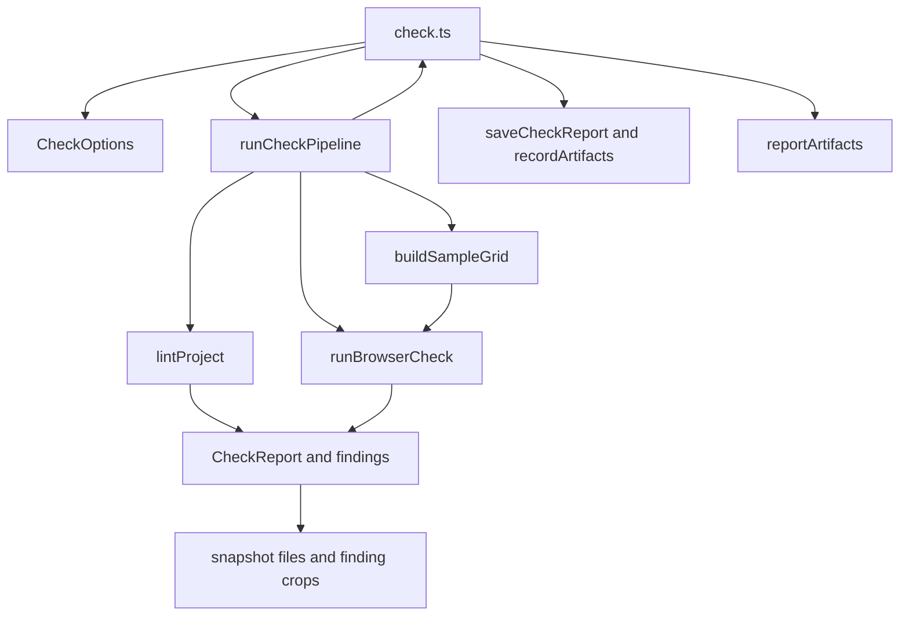
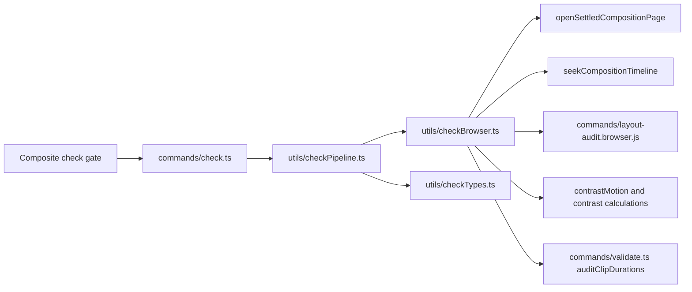
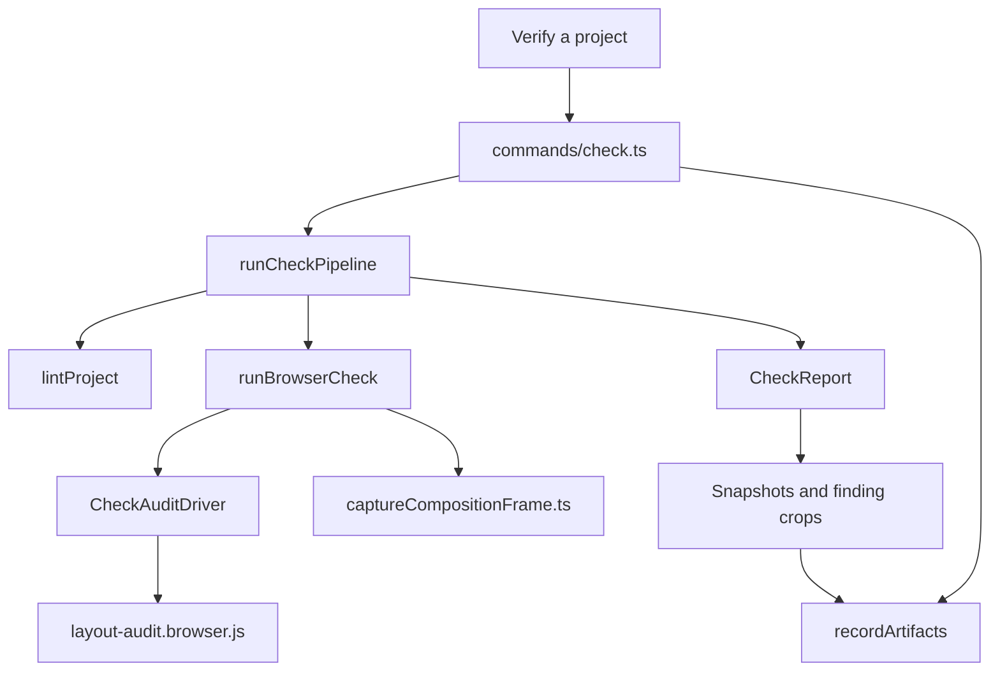

<!-- source: DeepWiki mcp.deepwiki.com · repo heygen-com/hyperframes · page 2.5 Diagnostics, Validation and Check Gate · fetched 2026-11-02 -->

# Diagnostics, Validation and Check Gate

Relevant source files

The following files were used as context for generating this wiki page:

- [docs/developers/harness-tool-context.mdx](docs/developers/harness-tool-context.mdx)
- [packages/cli/scripts/test-home.mjs](packages/cli/scripts/test-home.mjs)
- [packages/cli/src/audio/analysis/targets.test.ts](packages/cli/src/audio/analysis/targets.test.ts)
- [packages/cli/src/audio/analysis/targets.ts](packages/cli/src/audio/analysis/targets.ts)
- [packages/cli/src/browser/gpuPolicy.test.ts](packages/cli/src/browser/gpuPolicy.test.ts)
- [packages/cli/src/browser/gpuPolicy.ts](packages/cli/src/browser/gpuPolicy.ts)
- [packages/cli/src/browser/launch.boundedClose.test.ts](packages/cli/src/browser/launch.boundedClose.test.ts)
- [packages/cli/src/browser/launch.noListen.test.ts](packages/cli/src/browser/launch.noListen.test.ts)
- [packages/cli/src/browser/launch.pipeEof.test.ts](packages/cli/src/browser/launch.pipeEof.test.ts)
- [packages/cli/src/browser/launch.ts](packages/cli/src/browser/launch.ts)
- [packages/cli/src/browser/sandboxDenied.test.ts](packages/cli/src/browser/sandboxDenied.test.ts)
- [packages/cli/src/capture/captureCompositionFrame.browserFallback.test.ts](packages/cli/src/capture/captureCompositionFrame.browserFallback.test.ts)
- [packages/cli/src/capture/captureCompositionFrame.test.ts](packages/cli/src/capture/captureCompositionFrame.test.ts)
- [packages/cli/src/capture/captureCompositionFrame.ts](packages/cli/src/capture/captureCompositionFrame.ts)
- [packages/cli/src/capture/contactSheet.test.ts](packages/cli/src/capture/contactSheet.test.ts)
- [packages/cli/src/capture/contactSheet.ts](packages/cli/src/capture/contactSheet.ts)
- [packages/cli/src/capture/launchCaptureBrowser.signal.test.ts](packages/cli/src/capture/launchCaptureBrowser.signal.test.ts)
- [packages/cli/src/commands/check.test.ts](packages/cli/src/commands/check.test.ts)
- [packages/cli/src/commands/check.ts](packages/cli/src/commands/check.ts)
- [packages/cli/src/commands/checkArtifacts.test.ts](packages/cli/src/commands/checkArtifacts.test.ts)
- [packages/cli/src/commands/checkCapture.test.ts](packages/cli/src/commands/checkCapture.test.ts)
- [packages/cli/src/commands/clean.test.ts](packages/cli/src/commands/clean.test.ts)
- [packages/cli/src/commands/doctor.test.ts](packages/cli/src/commands/doctor.test.ts)
- [packages/cli/src/commands/doctor.ts](packages/cli/src/commands/doctor.ts)
- [packages/cli/src/commands/inspect.test.ts](packages/cli/src/commands/inspect.test.ts)
- [packages/cli/src/commands/inspect.ts](packages/cli/src/commands/inspect.ts)
- [packages/cli/src/commands/keyframes.regression.test.ts](packages/cli/src/commands/keyframes.regression.test.ts)
- [packages/cli/src/commands/keyframes.test.ts](packages/cli/src/commands/keyframes.test.ts)
- [packages/cli/src/commands/keyframes.ts](packages/cli/src/commands/keyframes.ts)
- [packages/cli/src/commands/layout-audit.browser.js](packages/cli/src/commands/layout-audit.browser.js)
- [packages/cli/src/commands/layout-audit.browser.test.ts](packages/cli/src/commands/layout-audit.browser.test.ts)
- [packages/cli/src/commands/layout-audit.chromium.test.ts](packages/cli/src/commands/layout-audit.chromium.test.ts)
- [packages/cli/src/commands/layout.test.ts](packages/cli/src/commands/layout.test.ts)
- [packages/cli/src/commands/layout.ts](packages/cli/src/commands/layout.ts)
- [packages/cli/src/commands/models.test.ts](packages/cli/src/commands/models.test.ts)
- [packages/cli/src/commands/models.ts](packages/cli/src/commands/models.ts)
- [packages/cli/src/commands/motion-signature.browser.chromium.test.ts](packages/cli/src/commands/motion-signature.browser.chromium.test.ts)
- [packages/cli/src/commands/motion-signature.browser.js](packages/cli/src/commands/motion-signature.browser.js)
- [packages/cli/src/commands/motionShot.test.ts](packages/cli/src/commands/motionShot.test.ts)
- [packages/cli/src/commands/motionShot.ts](packages/cli/src/commands/motionShot.ts)
- [packages/cli/src/commands/motionShotLayout.test.ts](packages/cli/src/commands/motionShotLayout.test.ts)
- [packages/cli/src/commands/motionShotLayout.ts](packages/cli/src/commands/motionShotLayout.ts)
- [packages/cli/src/commands/snapshot-contactSheet.test.ts](packages/cli/src/commands/snapshot-contactSheet.test.ts)
- [packages/cli/src/commands/snapshot.test.ts](packages/cli/src/commands/snapshot.test.ts)
- [packages/cli/src/commands/snapshot.ts](packages/cli/src/commands/snapshot.ts)
- [packages/cli/src/commands/snapshotSampling.test.ts](packages/cli/src/commands/snapshotSampling.test.ts)
- [packages/cli/src/commands/snapshotSampling.ts](packages/cli/src/commands/snapshotSampling.ts)
- [packages/cli/src/commands/timeline.ts](packages/cli/src/commands/timeline.ts)
- [packages/cli/src/commands/validate.media-fit.test.ts](packages/cli/src/commands/validate.media-fit.test.ts)
- [packages/cli/src/commands/validate.test.ts](packages/cli/src/commands/validate.test.ts)
- [packages/cli/src/commands/validate.ts](packages/cli/src/commands/validate.ts)
- [packages/cli/src/media-use/lib/test-home.test.mjs](packages/cli/src/media-use/lib/test-home.test.mjs)
- [packages/cli/src/registry/wordpiece.test.ts](packages/cli/src/registry/wordpiece.test.ts)
- [packages/cli/src/testHome.test.ts](packages/cli/src/testHome.test.ts)
- [packages/cli/src/timeline/a2Commands.ids.test.ts](packages/cli/src/timeline/a2Commands.ids.test.ts)
- [packages/cli/src/timeline/a2Commands.ts](packages/cli/src/timeline/a2Commands.ts)
- [packages/cli/src/timeline/a2MutationCommand.ts](packages/cli/src/timeline/a2MutationCommand.ts)
- [packages/cli/src/timeline/a2Mutations.ts](packages/cli/src/timeline/a2Mutations.ts)
- [packages/cli/src/timeline/a2Shared.ts](packages/cli/src/timeline/a2Shared.ts)
- [packages/cli/src/timeline/describeProject.inPoint.test.ts](packages/cli/src/timeline/describeProject.inPoint.test.ts)
- [packages/cli/src/timeline/describeProject.test.ts](packages/cli/src/timeline/describeProject.test.ts)
- [packages/cli/src/timeline/describeProject.ts](packages/cli/src/timeline/describeProject.ts)
- [packages/cli/src/timeline/formatTimeline.ts](packages/cli/src/timeline/formatTimeline.ts)
- [packages/cli/src/timeline/timeExpr.test.ts](packages/cli/src/timeline/timeExpr.test.ts)
- [packages/cli/src/timeline/timeline.e2e.test.ts](packages/cli/src/timeline/timeline.e2e.test.ts)
- [packages/cli/src/utils/artifactCapture.test.ts](packages/cli/src/utils/artifactCapture.test.ts)
- [packages/cli/src/utils/artifactCapture.ts](packages/cli/src/utils/artifactCapture.ts)
- [packages/cli/src/utils/checkBrowser.test.ts](packages/cli/src/utils/checkBrowser.test.ts)
- [packages/cli/src/utils/checkBrowser.ts](packages/cli/src/utils/checkBrowser.ts)
- [packages/cli/src/utils/checkFindingFrames.ts](packages/cli/src/utils/checkFindingFrames.ts)
- [packages/cli/src/utils/checkPipeline.ts](packages/cli/src/utils/checkPipeline.ts)
- [packages/cli/src/utils/checkSweep.chromium.test.ts](packages/cli/src/utils/checkSweep.chromium.test.ts)
- [packages/cli/src/utils/checkTypes.ts](packages/cli/src/utils/checkTypes.ts)
- [packages/cli/src/utils/layoutAudit.test.ts](packages/cli/src/utils/layoutAudit.test.ts)
- [packages/cli/src/utils/layoutAudit.ts](packages/cli/src/utils/layoutAudit.ts)
- [packages/cli/src/utils/motionAudit.test.ts](packages/cli/src/utils/motionAudit.test.ts)
- [packages/cli/src/utils/motionAudit.ts](packages/cli/src/utils/motionAudit.ts)
- [packages/cli/src/utils/optionalPackages.test.ts](packages/cli/src/utils/optionalPackages.test.ts)
- [packages/cli/src/utils/optionalPackages.ts](packages/cli/src/utils/optionalPackages.ts)
- [packages/cli/src/utils/sharpLoadFailure.test.ts](packages/cli/src/utils/sharpLoadFailure.test.ts)
- [packages/cli/src/utils/sharpLoadFailure.ts](packages/cli/src/utils/sharpLoadFailure.ts)
- [packages/cli/src/utils/toolContext.test.ts](packages/cli/src/utils/toolContext.test.ts)
- [packages/cli/src/utils/toolContext.ts](packages/cli/src/utils/toolContext.ts)
- [packages/cli/vitest.config.ts](packages/cli/vitest.config.ts)
- [packages/parsers/src/__goldens__/complex.parsed.json](packages/parsers/src/__goldens__/complex.parsed.json)
- [packages/parsers/src/__goldens__/minimal.parsed.json](packages/parsers/src/__goldens__/minimal.parsed.json)
- [packages/parsers/src/__goldens__/moderate.parsed.json](packages/parsers/src/__goldens__/moderate.parsed.json)
- [packages/producer/src/logger.test.ts](packages/producer/src/logger.test.ts)
- [packages/producer/src/logger.ts](packages/producer/src/logger.ts)
- [packages/studio-server/src/helpers/duplicateElement.test.ts](packages/studio-server/src/helpers/duplicateElement.test.ts)
- [packages/studio-server/src/helpers/duplicateElement.ts](packages/studio-server/src/helpers/duplicateElement.ts)
- [skills/hyperframes-cli/references/upgrade-info-misc.md](skills/hyperframes-cli/references/upgrade-info-misc.md)

## Purpose and scope

This page describes the CLI’s diagnostics layer: static linting, runtime validation, browser-based layout and contrast audits, snapshot capture, and the composite `check` gate. The available implementation detail is concentrated in `check.ts`, `checkPipeline.ts`, `checkBrowser.ts`, `checkTypes.ts`, `validate.ts`, `snapshot.ts`, and the browser-side layout audit script. [packages/cli/src/commands/check.ts:1-41]() [packages/cli/src/utils/checkPipeline.ts:1-91]() [packages/cli/src/utils/checkBrowser.ts:1-90]() [packages/cli/src/utils/checkTypes.ts:1-38]() [packages/cli/src/commands/validate.ts:1-27]() [packages/cli/src/commands/snapshot.ts:1-32]()

Sources: `packages/cli/src/commands/check.ts`; `packages/cli/src/utils/checkPipeline.ts`; `packages/cli/src/utils/checkBrowser.ts`; `packages/cli/src/utils/checkTypes.ts`; `packages/cli/src/commands/validate.ts`; `packages/cli/src/commands/snapshot.ts`

## Command roles and boundaries

The CLI exposes separate diagnostic workflows as well as the composite `check` command. The shown code establishes the check command’s pipeline and options, the browser-side audit machinery it uses, the media-duration audit exposed by `validate.ts`, and snapshot capture utilities; it does not provide the implementations of every command named in the page scope, so command-specific details for `inspect`, `keyframes`, `timeline`, `doctor`, and the standalone `lint` and `layout` commands are not inferred here. [packages/cli/src/commands/check.ts:27-41]() [packages/cli/src/utils/checkBrowser.ts:25-60]() [packages/cli/src/commands/validate.ts:99-149]() [packages/cli/src/commands/snapshot.ts:47-70]()

| Workflow | What the available implementation shows |
|---|---|
| `check` | Composite quality gate. Its options include static/runtime sampling, contrast, strictness, snapshots, optional finding frames and inspection, layout tuning, media proxy controls, and browser GPU mode. [packages/cli/src/commands/check.ts:160-178]() [packages/cli/src/utils/checkTypes.ts:15-38]() |
| `validate` | Includes a live-page audit for audio clips whose intrinsic media duration may be shorter than their declared `data-duration` slot. [packages/cli/src/commands/validate.ts:138-149]() |
| `snapshot` | Captures stills using browser-page seeking and screenshot helpers, and uses FFmpeg-related helpers for media-frame extraction. [packages/cli/src/commands/snapshot.ts:47-59]() [packages/cli/src/commands/snapshot.ts:134-159]() |
| Layout and contrast audits | Browser-side layout logic and browser orchestration are integrated into the check browser driver. [packages/cli/src/commands/layout-audit.browser.js:1-28]() [packages/cli/src/utils/checkBrowser.ts:25-45]() |
| `lint`, `layout`, `inspect`, `keyframes`, `timeline`, `doctor` | Their names appear in the requested command scope, but their implementations are not included in the supplied source excerpts; behavior is therefore not specified here. |

Sources: `packages/cli/src/commands/check.ts`; `packages/cli/src/utils/checkTypes.ts`; `packages/cli/src/commands/validate.ts`; `packages/cli/src/commands/snapshot.ts`; `packages/cli/src/utils/checkBrowser.ts`; `packages/cli/src/commands/layout-audit.browser.js`

## Composite `check` pipeline

`check.ts` defines the command entry point and default dependencies. The default pipeline dependency captures an artifact revision, calls `runCheckPipeline`, reports generated frame and finding images to the tool context, then attempts to save the report and associated artifacts; failure to record is warned about rather than replacing the check report. [packages/cli/src/commands/check.ts:54-89]()

`runCheckPipeline` is the orchestration layer. Its imports show the main subsystems it joins: linting, deadline and stop handling, snapshot-directory lifecycle, layout issue aggregation, motion evaluation, craft audit, HDR auto-promotion inspection, project media collection, and contrast calculations. [packages/cli/src/utils/checkPipeline.ts:1-62]()

The default check options enable nine samples, contrast, static-issue collapsing, and a 2-pixel tolerance; snapshots and strict mode default off, and the browser GPU mode defaults to `auto`. [packages/cli/src/utils/checkPipeline.ts:109-127]()

### Sampling and options

The check options type carries the user-facing sampling and audit controls: optional range, component selectors, explicit `at` times, transition sampling, issue cap, tolerance, timeout, contrast behavior, strictness, snapshots, finding frames, inspection, caption-zone and frame-check options, layout tuning, proxy override, and browser GPU mode. [packages/cli/src/utils/checkTypes.ts:15-60]()

The sample-grid builder receives a `CheckAuditDriver` and options, then constructs a `SampleGrid` whose categories include layout, user-picked, caption, frame, transition, and contrast samples. [packages/cli/src/utils/checkPipeline.ts:145-155]() [packages/cli/src/utils/checkPipeline.ts:205-208]()

Range validation rejects non-finite or reversed ranges and ranges outside the composition duration; when a range is supplied, layout samples are built relative to that interval and shifted back to global composition time. [packages/cli/src/utils/checkPipeline.ts:167-203]()

Contrast sampling is capped at five points, evenly strided across the merged grid when more than five candidates exist. [packages/cli/src/utils/checkPipeline.ts:129-136]()

### Report, exit status, and artifacts

`CheckFinding` represents an anchored finding with selector, source file, bounding box, time, code, severity, and message, with optional time range, text, fix hint, URL, and line. Contrast findings additionally carry foreground/background colors, measured and required ratios, suggested color, and large-text status. [packages/cli/src/utils/checkTypes.ts:77-124]()

The command writes a JSON report under `.hyperframes/artifacts/checks`, registers a check artifact with scope and options metadata, and registers snapshot artifacts for full frames and finding crops. [packages/cli/src/commands/check.ts:91-149]()

The command’s report and artifact paths are also sent through `reportArtifacts`, while `runCheckPipeline` imports telemetry functions for check reports, command failures, and lint runs. [packages/cli/src/commands/check.ts:63-76]() [packages/cli/src/utils/checkPipeline.ts:22-30]()

**Diagram: From check request to report and recorded artifacts**

Sources: `packages/cli/src/commands/check.ts`; `packages/cli/src/utils/checkPipeline.ts`; `packages/cli/src/utils/checkTypes.ts`

## Headless browser audits

`checkBrowser.ts` imports the managed-browser lifecycle, capture and seek helpers, the standalone validation duration audit, the layout browser script loader, motion and contrast utilities, and the static project server. Its result types distinguish browser findings, layout issues, contrast entries, frames, and other audit data. [packages/cli/src/utils/checkBrowser.ts:1-90]()

The shared audit seek configuration uses bridge/timeline fallback, double-animation-frame settling, and a bounded font wait. A separate dense-geometry configuration disables animation-frame settling, font waits, settle sleeps, video-frame waits, and WebGL draws for geometry-only reads. [packages/cli/src/capture/captureCompositionFrame.ts:30-60]()

The browser-page setup API accepts a render-ready timeout, GPU mode, abort signal, browser callbacks, navigation hooks, and an optional prelaunched browser. The settled-page result records whether the runtime failed to signal `__renderReady` before its timeout. [packages/cli/src/capture/captureCompositionFrame.ts:105-141]()

Before the timed render-ready wait begins, `preResolveHostileMediaProxies` can prepare browser-playable local video copies. The implementation’s documentation says proxy failure is treated as a warning because the default render can decode the original with FFmpeg. [packages/cli/src/utils/checkBrowser.ts:187-203]()

The browser audit imports `auditClipDurations` from `validate.ts`. That audit examines `audio[data-duration]` elements in the live page and compares media-duration information against declared clip slots; it exists because static lint cannot observe intrinsic media duration. [packages/cli/src/utils/checkBrowser.ts:25-30]() [packages/cli/src/commands/validate.ts:138-154]()

### Browser-side layout analysis

The browser audit script rounds geometry to two decimal places and computes overflow against container rectangles with configurable tolerances. [packages/cli/src/commands/layout-audit.browser.js:4-53]()

Selectors are chosen from element IDs, selected data attributes (`data-layout-name`, `data-composition-id`, or `data-start`), classes, or structural `nth-of-type` paths; a uniqueness check falls back to a structural selector when the preferred selector is ambiguous. [packages/cli/src/commands/layout-audit.browser.js:56-108]()

The layout audit recognizes authored-element opt-outs and allowances: ignore flags, allowed overflow, caption-zone allowance, and text-clip opt-out. It also handles color-grading canvases by mapping the stand-in back to the preceding authored element. [packages/cli/src/commands/layout-audit.browser.js:110-133]()

The script accounts for opacity through an element’s ancestor chain and detects effective clip paths before using probe points for paint and occlusion checks, avoiding false positives for elements clipped to an empty painted region. [packages/cli/src/commands/layout-audit.browser.js:135-169]()

The supplied tests exercise cases including degenerate composition-root bounds, unique data-attribute selectors, nowrap overflow, and explicit overflow allowance. [packages/cli/src/commands/layout-audit.browser.test.ts:34-66]() [packages/cli/src/commands/layout-audit.browser.test.ts:68-136]()

### Contrast and finding evidence

The browser orchestrator imports contrast preparation and motion-reading helpers, while the check pipeline imports contrast parsing, required-ratio calculation, and compliant foreground-color suggestions. [packages/cli/src/utils/checkBrowser.ts:37-45]() [packages/cli/src/utils/checkPipeline.ts:57-63]()

A contrast audit entry is anchored to an element and time and stores text, ratio, WCAG-AA status, text size class, and foreground/background values. The check report can turn such entries into findings with required ratio and suggested color. [packages/cli/src/utils/checkTypes.ts:108-124]()

Finding evidence has explicit data types for full frames, inspection targets, annotation boxes, and per-finding crop requests. The check command uses crop requests when associating saved finding images with report findings. [packages/cli/src/utils/checkTypes.ts:137-168]() [packages/cli/src/commands/check.ts:133-147]()

**Diagram: Natural-language audit concepts mapped to code entities**

Sources: `packages/cli/src/commands/check.ts`; `packages/cli/src/utils/checkPipeline.ts`; `packages/cli/src/utils/checkBrowser.ts`; `packages/cli/src/capture/captureCompositionFrame.ts`; `packages/cli/src/commands/layout-audit.browser.js`; `packages/cli/src/commands/validate.ts`; `packages/cli/src/utils/checkTypes.ts`

## `validate`: live media-duration checks

`auditClipDurations` evaluates the live page to inspect audio elements carrying `data-duration`. It waits for media metadata or an error, with a bounded wait, because a fixed page-settle delay may end before a slow audio resource has loaded metadata. [packages/cli/src/commands/validate.ts:107-135]() [packages/cli/src/commands/validate.ts:145-162]()

The command’s runtime helpers also expose composition duration lookup: it first reads a positive `window.__hf.duration`, then falls back to the composition root’s `data-duration`. [packages/cli/src/commands/validate.ts:99-105]()

For navigation timeouts, `navigationTimeoutHint` identifies Puppeteer navigation-timeout errors and returns guidance about blocking external scripts, local vendoring, and increasing the navigation timeout. [packages/cli/src/commands/validate.ts:54-66]()

Sources: `packages/cli/src/commands/validate.ts`; `packages/cli/src/utils/checkBrowser.ts`

## `snapshot`: deterministic frame evidence

The snapshot command imports the composition-page capture and seek helpers, FFmpeg utilities, project lint preflight utilities, and snapshot sampling functions. It defines a 30-second bound for a single-frame FFmpeg extraction and formats timestamps to three decimal places without preserving floating-point noise. [packages/cli/src/commands/snapshot.ts:47-59]() [packages/cli/src/commands/snapshot.ts:73-84]() [packages/cli/src/commands/snapshot.ts:134-159]()

`renderNotReadyError` attempts to retrieve an engine diagnostic and reports that no frame was saved when the composition did not become render-ready within the configured timeout. [packages/cli/src/commands/snapshot.ts:140-152]()

Snapshot helpers classify requested output paths as written or missing by resolving them against the project directory and checking that each file has nonzero size. [packages/cli/src/commands/snapshot.ts:162-177]()

The capture utilities provide screenshot-oriented seek options that extend audit settling with an image wait, plus helpers for crop regions and settled composition pages. [packages/cli/src/capture/captureCompositionFrame.ts:30-60]()

The snapshot tests verify that transparent PNG screenshots request `omitBackground`, that proxy configuration is forwarded, and that reference-video comparison extracts a frame at the requested timestamp. [packages/cli/src/commands/snapshot.test.ts:113-139]()

Sources: `packages/cli/src/commands/snapshot.ts`; `packages/cli/src/capture/captureCompositionFrame.ts`; `packages/cli/src/commands/snapshot.test.ts`

## Natural-language workflow and code-entity map

This map connects user-facing diagnostic goals to the concrete names visible in the implementation. The check command delegates to the pipeline; the pipeline’s browser work is separated into `runBrowserCheck`; capture and seek behavior is shared through `captureCompositionFrame.ts`; and the command records report and image artifacts through Studio Server history. [packages/cli/src/commands/check.ts:54-83]() [packages/cli/src/utils/checkPipeline.ts:1-62]() [packages/cli/src/utils/checkBrowser.ts:1-60]() [packages/cli/src/capture/captureCompositionFrame.ts:1-24]()

**Diagram: Diagnostic goal to implementation path**

Sources: `packages/cli/src/commands/check.ts`; `packages/cli/src/utils/checkPipeline.ts`; `packages/cli/src/utils/checkBrowser.ts`; `packages/cli/src/utils/checkTypes.ts`; `packages/cli/src/capture/captureCompositionFrame.ts`; `packages/cli/src/commands/layout-audit.browser.js`

## Operational behavior and limitations

The browser audit uses deadline and stop-signal abstractions, and the browser-side check imports managed-browser cleanup and stop-signal handling. This supports bounded execution and cleanup when a check is interrupted. [packages/cli/src/utils/checkPipeline.ts:1-13]() [packages/cli/src/utils/checkBrowser.ts:1-9]()

The check options distinguish project-wide static lint scope from runtime sampling scope: the `--range` argument is described as a runtime interval, while static lint remains project-wide. [packages/cli/src/commands/check.ts:160-172]()

Browser checks can be skipped or narrowed through options and report metadata; the saved check artifact records `browserSkipped`, scope, result status, and the options used. [packages/cli/src/commands/check.ts:102-118]()

Sources: `packages/cli/src/utils/checkPipeline.ts`; `packages/cli/src/utils/checkBrowser.ts`; `packages/cli/src/commands/check.ts`

## Summary

The diagnostic gate is organized around `runCheckPipeline`, with `check.ts` providing command parsing, report presentation, evidence handling, and artifact persistence. [packages/cli/src/commands/check.ts:27-41]() [packages/cli/src/utils/checkPipeline.ts:1-62]()

Its runtime path uses managed Chromium, shared composition seek helpers, browser-side layout analysis, contrast and motion helpers, and live media-duration validation. [packages/cli/src/utils/checkBrowser.ts:1-60]() [packages/cli/src/capture/captureCompositionFrame.ts:30-60]() [packages/cli/src/commands/validate.ts:138-154]()

Snapshot and finding evidence can be associated with a saved check report, while checks can also emit machine-readable JSON and register generated images with the tool context. [packages/cli/src/commands/check.ts:43-49]() [packages/cli/src/commands/check.ts:63-76]() [packages/cli/src/commands/check.ts:91-158]()

Sources: `packages/cli/src/commands/check.ts`; `packages/cli/src/utils/checkPipeline.ts`; `packages/cli/src/utils/checkBrowser.ts`; `packages/cli/src/capture/captureCompositionFrame.ts`; `packages/cli/src/commands/validate.ts`

---

