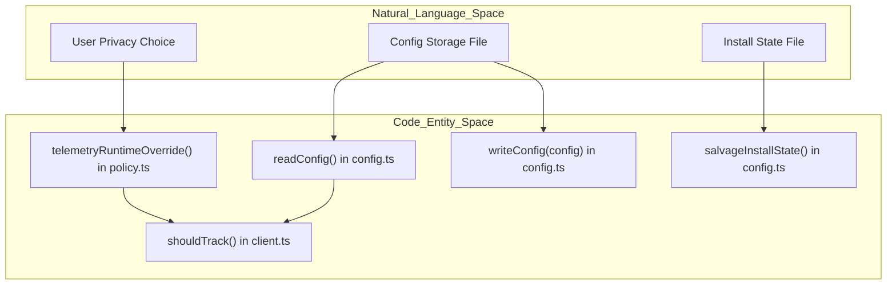
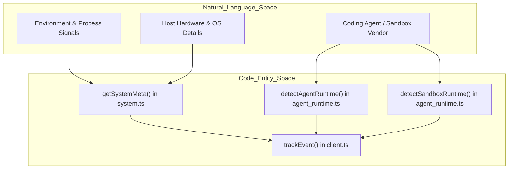
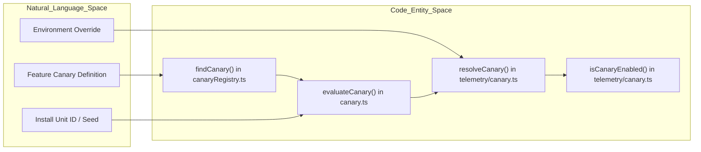
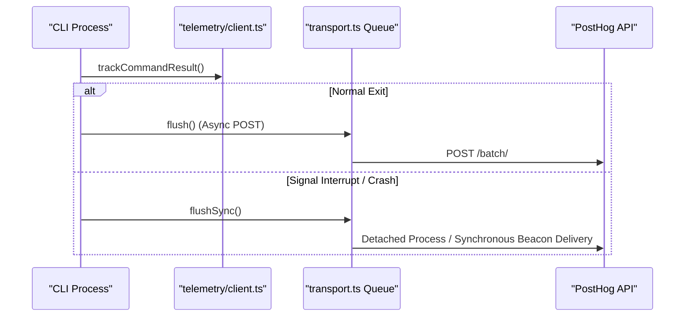

<!-- source: DeepWiki mcp.deepwiki.com · repo heygen-com/hyperframes · page 2.6 Telemetry, Canary and Update System · fetched 2026-11-02 -->

# Telemetry, Canary and Update System

Relevant source files

The following files were used as context for generating this wiki page:

- [docs/contributing/canary-rollouts.mdx](docs/contributing/canary-rollouts.mdx)
- [packages/cli/src/cli.lifecycle.test.ts](packages/cli/src/cli.lifecycle.test.ts)
- [packages/cli/src/commands/open.ts](packages/cli/src/commands/open.ts)
- [packages/cli/src/server/telemetryIdentity.test.ts](packages/cli/src/server/telemetryIdentity.test.ts)
- [packages/cli/src/server/telemetryIdentity.ts](packages/cli/src/server/telemetryIdentity.ts)
- [packages/cli/src/telemetry/agent_runtime.test.ts](packages/cli/src/telemetry/agent_runtime.test.ts)
- [packages/cli/src/telemetry/agent_runtime.ts](packages/cli/src/telemetry/agent_runtime.ts)
- [packages/cli/src/telemetry/canary.test.ts](packages/cli/src/telemetry/canary.test.ts)
- [packages/cli/src/telemetry/canary.ts](packages/cli/src/telemetry/canary.ts)
- [packages/cli/src/telemetry/client.test.ts](packages/cli/src/telemetry/client.test.ts)
- [packages/cli/src/telemetry/client.ts](packages/cli/src/telemetry/client.ts)
- [packages/cli/src/telemetry/config.test.ts](packages/cli/src/telemetry/config.test.ts)
- [packages/cli/src/telemetry/config.ts](packages/cli/src/telemetry/config.ts)
- [packages/cli/src/telemetry/feedback.test.ts](packages/cli/src/telemetry/feedback.test.ts)
- [packages/cli/src/telemetry/feedback.ts](packages/cli/src/telemetry/feedback.ts)
- [packages/cli/src/telemetry/system.test.ts](packages/cli/src/telemetry/system.test.ts)
- [packages/cli/src/telemetry/system.ts](packages/cli/src/telemetry/system.ts)
- [packages/cli/src/utils/backgroundChecks.test.ts](packages/cli/src/utils/backgroundChecks.test.ts)
- [packages/cli/src/utils/projectShortcut.test.ts](packages/cli/src/utils/projectShortcut.test.ts)
- [packages/cli/src/utils/projectShortcut.ts](packages/cli/src/utils/projectShortcut.ts)
- [packages/core/src/canary.test.ts](packages/core/src/canary.test.ts)
- [packages/core/src/canary.ts](packages/core/src/canary.ts)
- [packages/core/src/canaryRegistry.ts](packages/core/src/canaryRegistry.ts)
- [packages/studio-server/src/routes/thumbnail.file-race.test.ts](packages/studio-server/src/routes/thumbnail.file-race.test.ts)
- [packages/studio-server/src/routes/thumbnail.test.ts](packages/studio-server/src/routes/thumbnail.test.ts)
- [packages/studio-server/src/routes/thumbnail.ts](packages/studio-server/src/routes/thumbnail.ts)
- [packages/studio/src/hooks/gsapValueAtPlayhead.browser.test.ts](packages/studio/src/hooks/gsapValueAtPlayhead.browser.test.ts)
- [packages/studio/src/player/hooks/timelinePlayerSync.test.ts](packages/studio/src/player/hooks/timelinePlayerSync.test.ts)
- [packages/studio/src/player/hooks/timelinePlayerSync.ts](packages/studio/src/player/hooks/timelinePlayerSync.ts)
- [packages/studio/src/telemetry/canary.test.ts](packages/studio/src/telemetry/canary.test.ts)
- [packages/studio/src/telemetry/canary.ts](packages/studio/src/telemetry/canary.ts)
- [packages/studio/src/utils/gsapUndoRestore.browser.test.ts](packages/studio/src/utils/gsapUndoRestore.browser.test.ts)
- [packages/studio/src/utils/studioTelemetry.test.ts](packages/studio/src/utils/studioTelemetry.test.ts)
- [packages/studio/src/utils/studioTelemetry.ts](packages/studio/src/utils/studioTelemetry.ts)
- [packages/studio/tests/chromeTestUtils.browser.test.ts](packages/studio/tests/chromeTestUtils.browser.test.ts)
- [packages/studio/tests/chromeTestUtils.test.ts](packages/studio/tests/chromeTestUtils.test.ts)
- [packages/studio/tests/chromeTestUtils.ts](packages/studio/tests/chromeTestUtils.ts)
- [packages/studio/vite.browser.test.ts](packages/studio/vite.browser.test.ts)
- [packages/studio/vite.browser.ts](packages/studio/vite.browser.ts)
- [packages/studio/vite.browserVersion.test.ts](packages/studio/vite.browserVersion.test.ts)
- [scripts/ci/inline-gsap.mjs](scripts/ci/inline-gsap.mjs)
- [scripts/inline-gsap.test.mjs](scripts/inline-gsap.test.mjs)

This leaf page details the implementation of the background telemetry client integrated into the HyperFrames CLI and Studio, covering event collection, configuration management (`~/.hyperframes/`), system metadata enrichment, sandbox and agent runtime detection, the canary rollout registry, passive update checks, and the CLI exit lifecycle flush.

---

## Telemetry System Architecture and Configuration

The telemetry subsystem collects anonymized usage data from CLI commands and related workflows to track product usage and assist with debugging. It operates as a non-blocking background client that enriches each event with system metadata, respects user opt-out preferences, and reliably delivers events asynchronously or synchronously at process termination.

### Configuration Storage and Isolation

The CLI configuration and telemetry identifiers reside in the `~/.hyperframes/` home directory:
- `config.json`: Stores volatile options such as `telemetryEnabled`, `anonymousId`, disclosure flags, and update attempt timestamps. Managed via `readConfig()` and `writeConfig()` [packages/cli/src/telemetry/config.ts:1-130]().
- `install-state.json`: A decoupled file sharing `CONFIG_DIR` that houses three persistent installation markers: `markerAt`, `deParallelRouterTrialFired` (circuit-breaker state), and `bucketSeed` (canary bucketing unit) [packages/cli/src/telemetry/config.ts:19-74](). Decoupling `install-state.json` from `config.json` prevents cohort reshuffling or tripped circuit-breaker states when `config.json` is re-minted or reset.

Sources:
- [packages/cli/src/telemetry/config.ts:1-130]()
- [packages/cli/src/telemetry/client.ts:27-62]()

---

## Event Enrichment and Agent/Sandbox Runtime Detection

When telemetry is enabled, `trackEvent()` [packages/cli/src/telemetry/client.ts:69-136]() enriches every event payload before passing it to the transport queue.

### System Metadata Enrichment

The `getSystemMeta()` function collects static system and environment information once per CLI session [packages/cli/src/telemetry/system.ts:86-120]():
- OS release, CPU core count, CPU model, CPU speed, and total system memory in MB (`memory_total_mb`) [packages/cli/src/telemetry/system.ts:101-105]().
- Environment flags: `is_docker`, `is_ci`, `ci_name`, `is_wsl`, and `is_tty` [packages/cli/src/telemetry/system.ts:106-110]().
- Managed sandbox runtime classification (`sandbox_runtime`) via `detectSandboxRuntime()` (e.g., gvisor, firecracker, docker, kvm, wsl) [packages/cli/src/telemetry/agent_runtime.ts:22-22]().
- Coding agent vendor classification (`agent_runtime`) via `detectAgentRuntime()` (e.g., claude_code, codex, cursor, copilot_agent, replit, hermes, openclaw, pi, windsurf, cline, gemini_cli, crush) using environment variable existence checks without reading sensitive values like API keys [packages/cli/src/telemetry/agent_runtime.ts:6-165]().

Sources:
- [packages/cli/src/telemetry/client.ts:69-136]()
- [packages/cli/src/telemetry/system.ts:28-120]()
- [packages/cli/src/telemetry/agent_runtime.ts:1-153]()

---

## Canary Rollout Registry and Evaluation

Canary rollouts allow experimental features to be staged to a stable fraction of installs.

### Canary Implementation

- **Registry (`canaryRegistry.ts`)**: Every rollout is declared centrally in `CANARIES` with a `name`, `percentage` (0-100), `description`, `owner`, and `sunsetAfter` date [packages/core/src/canaryRegistry.ts:29-46]().
- **Evaluation (`canary.ts`)**: Canary bucketing is computed via a pure FNV-1a 32-bit hash combining the feature name and `unitId` (`bucketSeed` or `anonymousId`), mapped to a 0–99 bucket [packages/core/src/canary.ts:1-130]().
- **Overrides**: Environment variables matching `HF_CANARY_<FEATURE>` (upper-snake-case) take immediate precedence over percentage thresholds for local testing, CI overrides, or support sessions [packages/core/src/canaryRegistry.ts:89-92](), [packages/cli/src/telemetry/canary.ts:80-88]().
- **Opt-out Integration**: Opting out of telemetry opts out of canaries entirely (`telemetryActive()` check) [packages/cli/src/telemetry/canary.ts:34-51]().

Sources:
- [packages/core/src/canaryRegistry.ts:1-107]()
- [packages/core/src/canary.test.ts:1-172]()
- [packages/cli/src/telemetry/canary.ts:1-163]()
- [docs/contributing/canary-rollouts.mdx:1-107]()

---

## Passive Update Check System

The CLI runs a background daily update check against the npm registry endpoint (`https://registry.npmjs.org/hyperframes/latest`) to notify users of newer versions.

- **Execution**: Runs asynchronously during command execution.
- **Caching**: Timestamps (`lastUpdateAttemptAt`) are persisted in `config.json` to prevent network spam within 24-hour windows.
- **Opt-out & Suppression**: Automatically disabled in CI environments, development builds, or when `HYPERFRAMES_NO_UPDATE_CHECK=1` is present.
- **Output**: When an update is detected, a notice is printed to `stderr`, and version metadata (`version`, `latestVersion`, `updateAvailable`) is included in `--json` command outputs under `_meta`.

Sources:
- [packages/cli/src/telemetry/config.ts:116-125]()
- [packages/cli/src/utils/backgroundChecks.test.ts:1-100]()

---

## CLI Exit Lifecycle and Telemetry Flush

To ensure telemetry events and command results are recorded without blocking user workflows, the CLI manages a dedicated lifecycle flush mechanism.

- **Command Tracking**: Commands invoke `trackCommand()`, `trackCommandResult()`, and `trackCliError()` to record metrics and exit codes [packages/cli/src/cli.lifecycle.test.ts:33-146]().
- **Async Flush**: Upon normal completion, an asynchronous `flush()` submits queued events to the PostHog batch endpoint [packages/cli/src/telemetry/client.ts:25-25]().
- **Synchronous Flush (`flushSync`)**: On signal interruptions (`SIGINT`) or unexpected crashes, the CLI utilizes `flushSync()` to deliver events reliably before process termination [packages/cli/src/telemetry/client.ts:25-25](), [packages/cli/src/cli.lifecycle.test.ts:174-188]().

Sources:
- [packages/cli/src/telemetry/client.ts:25-26]()
- [packages/cli/src/cli.lifecycle.test.ts:33-188]()

---

Studio and browser-side tracking (`packages/studio/src/utils/studioTelemetry.ts`) share the same anonymized distinct IDs, policy checks, and canary cohort properties, ensuring consistent telemetry across both CLI and web UI surfaces [packages/studio/src/utils/studioTelemetry.test.ts:1-100]().

Sources:
- [packages/studio/src/utils/studioTelemetry.ts:1-190]()

---

