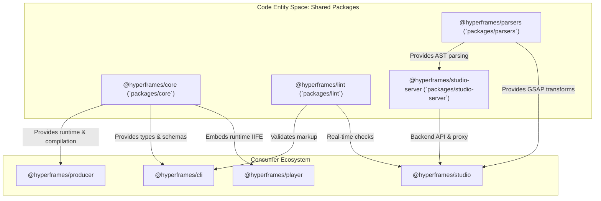

<!-- source: DeepWiki mcp.deepwiki.com · repo heygen-com/hyperframes · page 3 Core, Parsers and Lint Packages · fetched 2026-11-02 -->

# Core, Parsers and Lint Packages

<details>
<summary>Relevant source files</summary>

The following files were used as context for generating this wiki page:

- [packages/cli/src/commands/lambda/_dimensions.test.ts](packages/cli/src/commands/lambda/_dimensions.test.ts)
- [packages/cli/src/commands/lambda/_dimensions.ts](packages/cli/src/commands/lambda/_dimensions.ts)
- [packages/cli/src/utils/compositionViewport.test.ts](packages/cli/src/utils/compositionViewport.test.ts)
- [packages/cli/src/utils/compositionViewport.ts](packages/cli/src/utils/compositionViewport.ts)
- [packages/core/src/core.types.ts](packages/core/src/core.types.ts)
- [packages/core/src/index.test.ts](packages/core/src/index.test.ts)
- [packages/core/src/index.ts](packages/core/src/index.ts)
- [packages/core/src/runtime/player.test.ts](packages/core/src/runtime/player.test.ts)
- [packages/core/src/runtime/player.ts](packages/core/src/runtime/player.ts)
- [packages/lint/package.json](packages/lint/package.json)
- [packages/lint/src/rules/media.test.ts](packages/lint/src/rules/media.test.ts)
- [packages/lint/src/rules/media.ts](packages/lint/src/rules/media.ts)
- [packages/parsers/package.json](packages/parsers/package.json)
- [packages/parsers/src/mediaSrcMutation.test.ts](packages/parsers/src/mediaSrcMutation.test.ts)
- [packages/parsers/src/mediaSrcMutation.ts](packages/parsers/src/mediaSrcMutation.ts)
- [packages/parsers/src/outputResolutionCompatibility.test.ts](packages/parsers/src/outputResolutionCompatibility.test.ts)
- [packages/parsers/src/outputResolutionCompatibility.ts](packages/parsers/src/outputResolutionCompatibility.ts)
- [packages/parsers/src/types.ts](packages/parsers/src/types.ts)
- [packages/producer/src/services/render/shared.ts](packages/producer/src/services/render/shared.ts)
- [packages/producer/src/services/render/stages/compileStage.test.ts](packages/producer/src/services/render/stages/compileStage.test.ts)
- [packages/producer/src/services/render/stages/compileStage.ts](packages/producer/src/services/render/stages/compileStage.ts)
- [packages/producer/src/services/render/stages/probeStage.test.ts](packages/producer/src/services/render/stages/probeStage.test.ts)
- [packages/producer/src/services/render/stages/probeStage.ts](packages/producer/src/services/render/stages/probeStage.ts)
- [packages/studio-server/package.json](packages/studio-server/package.json)

</details>


The shared library packages within the HyperFrames monorepo—principally `@hyperframes/core`, `@hyperframes/parsers`, `@hyperframes/lint`, and `@hyperframes/studio-server`—provide the foundational building blocks, deterministic runtime contracts, AST manipulation tools, lint rules, and backend API routes used across the CLI, Studio, Producer, and Player.

This page provides a high-level parent overview of these shared packages. For in-depth technical details, refer to the respective child sections linked below.

---

## System Architecture

These core shared packages bridge Natural Language Space and Code Entity Space by defining canonical data structures, parsing AST tokens for GSAP animations, enforcing composition readiness rules, and handling server-side file and project operations.

### Subsystem Mapping

| Subsystem Package / Path | Primary Responsibility | Key Code Entities / Modules |
|--------------------------|------------------------|-----------------------------|
| **`@hyperframes/core`** [packages/core/package.json:1-42]() | Runtime IIFE, compiler timing, audio processing, registry schemas, and project core utilities. | `renderSeek`, `htmlBundler`, `registry`, `audioFx` |
| **`@hyperframes/parsers`** [packages/parsers/package.json:1-30]() | Acorn/recast GSAP parsing and writing, clip tweens, asset resolution, and color-grading contracts. | `colorGradingContract.ts`, AST transformers |
| **`@hyperframes/lint`** [packages/lint/package.json:1-30]() | Synchronous/asynchronous validation rules ensuring determinism, media integrity, and semantic correctness. | Lint rule sets, finding deduplication |
| **`@hyperframes/studio-server`** [packages/studio-server/package.json:1-30]() | Hono backend server for file management, proxy transcoding, history tracking, and mutation helpers. | `safePath.ts`, Hono route groups |

### Package Dependency and Subsystem Interaction



Sources:
- [packages/core/package.json:1-42]()
- [packages/parsers/package.json:1-30]()
- [packages/lint/package.json:1-30]()
- [packages/studio-server/package.json:1-30]()

### Natural Language Space to Code Entity Space Bridge

```mermaid
graph LR
  subgraph "Natural Language Space"
    NLCompile[""Composition Compilation""]
    NLLint[""Markup Validation""]
    NLRuntime[""Deterministic Seek""]
  end

  subgraph "Code Entity Space"
    CodeCompile["`compileForRender()`\n[packages/producer/src/services/render/stages/compileStage.ts:41-42]()"]
    CodeLint["`lintHyperframeHtml()`\n[packages/lint/src/rules/media.test.ts:2-2]()"]
    CodeRuntime["`createRuntimePlayer()`\n[packages/core/src/runtime/player.test.ts:2-2]()"]
  end

  NLCompile --> CodeCompile
  NLLint --> CodeLint
  NLRuntime --> CodeRuntime
```

Sources:
- [packages/producer/src/services/render/stages/compileStage.ts:41-42]()
- [packages/lint/src/rules/media.test.ts:2-2]()
- [packages/core/src/runtime/player.test.ts:2-2]()

---

## Sub-Topics and Child Pages

### 3.1 Runtime Engine
The HyperFrames runtime IIFE manages initialization lifecycle hooks, global objects (`window.__player`, `window.__timelines`, `window.__hf`), postMessage bridges, media synchronization, WebAudio transport, composition loading, and render-seek determinism.
- For details, see [Runtime Engine](#3.1).

Sources:
- [packages/core/package.json:1-42]()

### 3.2 HTML Compiler and Bundler
The compiler subsystem transforms authored HTML compositions into render-ready documents. It handles HTML bundling, timing compilation (`data-start`, `data-duration`), composition scoping, inline sub-compositions, composition assembly, script execution runs, and sub-composition path rewriting.
- For details, see [HTML Compiler and Bundler](#3.2).

Sources:
- [packages/core/package.json:1-42]()

### 3.3 Linting System
The `@hyperframes/lint` package provides rule sets targeting core mechanics, media integrity, GSAP adherence, captions, composition semantics, and font usage. It supports browser builds, project-wide linting, HEVC preview audits, and finding deduplication with precise source locations.
- For details, see [Linting System](#3.3).

Sources:
- [packages/lint/package.json:1-30]()

### 3.4 Registry and Schema System
The registry schema subsystem (`core/registry`) defines `ItemType`, `FileType`, and `RegistryItem` models alongside JSON schemas. It drives the installer, remote resolver fetching, and CLI block/component installations (`hyperframes add`).
- For details, see [Registry and Schema System](#3.4).

Sources:
- [packages/core/package.json:1-42]()

### 3.5 Parsers Package (GSAP and Contracts)
The `@hyperframes/parsers` package parses and writes GSAP animations using `acorn`/`recast`. It handles clip tweens, asset resolution, media duration contracts, composition contracts, color-grading contracts (`colorGradingContract.ts`), and `hf-id` assignment.
- For details, see [Parsers Package (GSAP and Contracts)](#3.5).

Sources:
- [packages/parsers/package.json:1-30]()

### 3.6 Audio, Color Grading and Media Effects
Defines audio FX graphs, worklets, audio groups, automation, carving, web audio routing, color-grading contracts, runtime LUT application, HDR tone mapping, and media grade analysis.
- For details, see [Audio, Color Grading and Media Effects](#3.6).

Sources:
- [packages/core/package.json:1-42]()

### 3.7 Studio Server (Hono Backend)
The `@hyperframes/studio-server` package provides the Hono backend application supporting file operations, preview routing, lint endpoints, render triggers, thumbnails, media proxy/transcoding, path safety (`safePath.ts`), and project history.
- For details, see [Studio Server (Hono Backend)](#3.7).

Sources:
- [packages/studio-server/package.json:1-30]()

---

