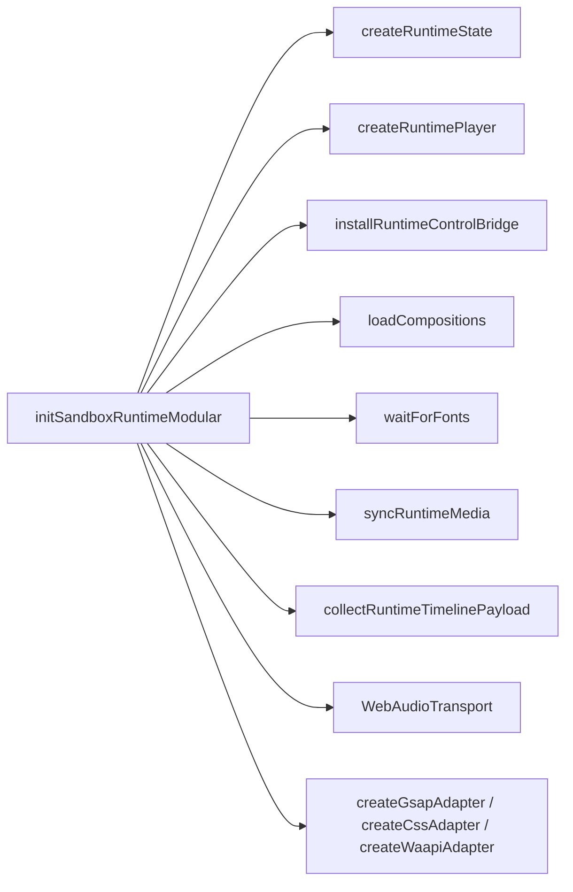
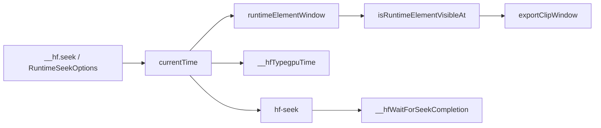
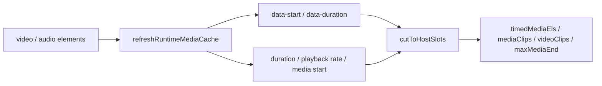
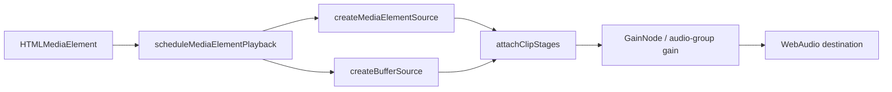
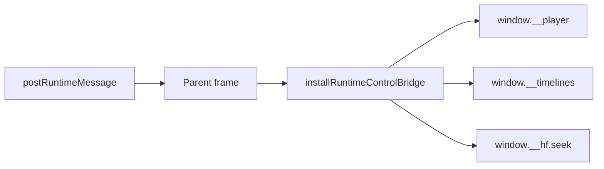
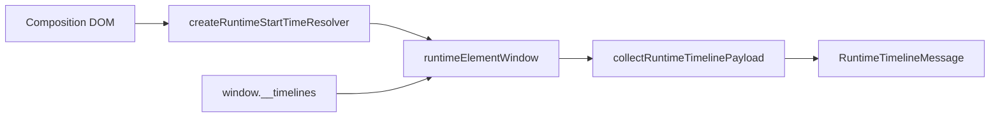
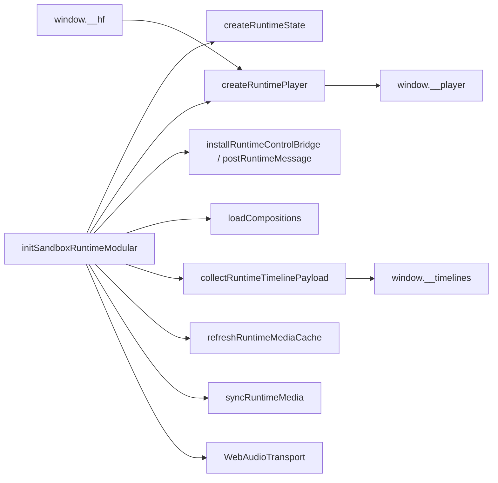

<!-- source: DeepWiki mcp.deepwiki.com · repo heygen-com/hyperframes · page 3.1 Runtime Engine · fetched 2026-11-02 -->

# Runtime Engine

Relevant source files

The following files were used as context for generating this wiki page:

- [docs/guides/frame-sources.md](docs/guides/frame-sources.md)
- [docs/guides/imported-film-html.md](docs/guides/imported-film-html.md)
- [docs/reference/audio-effects.mdx](docs/reference/audio-effects.mdx)
- [packages/cli/src/server/studioServer.pathSafety.test.ts](packages/cli/src/server/studioServer.pathSafety.test.ts)
- [packages/cli/src/server/studioServer.staticAssets.test.ts](packages/cli/src/server/studioServer.staticAssets.test.ts)
- [packages/cli/src/server/studioServerTestFixture.ts](packages/cli/src/server/studioServerTestFixture.ts)
- [packages/core/package-subpaths.json](packages/core/package-subpaths.json)
- [packages/core/src/audioGroups.test.ts](packages/core/src/audioGroups.test.ts)
- [packages/core/src/audioGroups.ts](packages/core/src/audioGroups.ts)
- [packages/core/src/runtime/audioFx.test.ts](packages/core/src/runtime/audioFx.test.ts)
- [packages/core/src/runtime/audioFx.ts](packages/core/src/runtime/audioFx.ts)
- [packages/core/src/runtime/entry.startupFailure.test.ts](packages/core/src/runtime/entry.startupFailure.test.ts)
- [packages/core/src/runtime/entry.test.ts](packages/core/src/runtime/entry.test.ts)
- [packages/core/src/runtime/entry.ts](packages/core/src/runtime/entry.ts)
- [packages/core/src/runtime/filmBridge.test.ts](packages/core/src/runtime/filmBridge.test.ts)
- [packages/core/src/runtime/filmBridge.ts](packages/core/src/runtime/filmBridge.ts)
- [packages/core/src/runtime/frameSources.test.ts](packages/core/src/runtime/frameSources.test.ts)
- [packages/core/src/runtime/frameSources.ts](packages/core/src/runtime/frameSources.ts)
- [packages/core/src/runtime/init.test.ts](packages/core/src/runtime/init.test.ts)
- [packages/core/src/runtime/init.timelineHidesClip.test.ts](packages/core/src/runtime/init.timelineHidesClip.test.ts)
- [packages/core/src/runtime/init.ts](packages/core/src/runtime/init.ts)
- [packages/core/src/runtime/init.videoPreseek.test.ts](packages/core/src/runtime/init.videoPreseek.test.ts)
- [packages/core/src/runtime/media.preseek.test.ts](packages/core/src/runtime/media.preseek.test.ts)
- [packages/core/src/runtime/media.test.ts](packages/core/src/runtime/media.test.ts)
- [packages/core/src/runtime/media.ts](packages/core/src/runtime/media.ts)
- [packages/core/src/runtime/mediaSteer.test.ts](packages/core/src/runtime/mediaSteer.test.ts)
- [packages/core/src/runtime/preloadMedia.test.ts](packages/core/src/runtime/preloadMedia.test.ts)
- [packages/core/src/runtime/preloadMedia.ts](packages/core/src/runtime/preloadMedia.ts)
- [packages/core/src/runtime/startResolver.test.ts](packages/core/src/runtime/startResolver.test.ts)
- [packages/core/src/runtime/startResolver.ts](packages/core/src/runtime/startResolver.ts)
- [packages/core/src/runtime/timedClipHide.ts](packages/core/src/runtime/timedClipHide.ts)
- [packages/core/src/runtime/timeline.test.ts](packages/core/src/runtime/timeline.test.ts)
- [packages/core/src/runtime/timeline.ts](packages/core/src/runtime/timeline.ts)
- [packages/core/src/runtime/webAudioTransport.test.ts](packages/core/src/runtime/webAudioTransport.test.ts)
- [packages/core/src/runtime/webAudioTransport.ts](packages/core/src/runtime/webAudioTransport.ts)
- [packages/core/src/runtime/window.d.ts](packages/core/src/runtime/window.d.ts)
- [packages/engine/src/services/fileServer.pathSafety.test.ts](packages/engine/src/services/fileServer.pathSafety.test.ts)
- [packages/engine/src/services/fileServer.test.ts](packages/engine/src/services/fileServer.test.ts)
- [packages/engine/src/services/fileServer.ts](packages/engine/src/services/fileServer.ts)
- [packages/engine/src/services/renderFrameVideoHold.browser.test.ts](packages/engine/src/services/renderFrameVideoHold.browser.test.ts)
- [packages/engine/src/services/renderFrameVideoHold.ts](packages/engine/src/services/renderFrameVideoHold.ts)
- [packages/parsers/src/referenceResolver.test.ts](packages/parsers/src/referenceResolver.test.ts)
- [packages/parsers/src/referenceResolver.ts](packages/parsers/src/referenceResolver.ts)
- [packages/producer/src/services/coreRuntimeBrowser.test.ts](packages/producer/src/services/coreRuntimeBrowser.test.ts)
- [packages/producer/src/services/fileServer.test.ts](packages/producer/src/services/fileServer.test.ts)
- [packages/producer/src/services/fileServer.ts](packages/producer/src/services/fileServer.ts)
- [packages/producer/src/services/render/wrappedMountTiming.integration.test.ts](packages/producer/src/services/render/wrappedMountTiming.integration.test.ts)
- [packages/sdk/src/session.film-scenes.test.ts](packages/sdk/src/session.film-scenes.test.ts)
- [skills/media-use/references/mixing.md](skills/media-use/references/mixing.md)

## Purpose and scope

The HyperFrames runtime is a browser-side system assembled by `packages/core/src/runtime/init.ts`. Its imports show the main responsibilities covered here: runtime state and player creation, composition loading, animation adapters, timeline and media handling, the control bridge, and WebAudio transport. [packages/core/src/runtime/init.ts:2-30]()[packages/core/src/runtime/init.ts:51-69]()[packages/core/src/runtime/init.ts:81-123]()[packages/core/src/runtime/init.ts:134-169]()

This page documents the runtime’s observable globals and the relationships between its modules. The supplied source excerpts establish those interfaces and dependencies, but do not include the implementation bodies for the full initialization sequence, bridge handlers, or seek loop; descriptions of those behaviors are therefore limited to what the provided code directly supports. [packages/core/src/runtime/init.ts:1-201]()[packages/core/src/runtime/window.d.ts:36-145]()

Sources: `packages/core/src/runtime/init.ts`, `packages/core/src/runtime/window.d.ts`

---

## Initialization and Global Namespace

`initSandboxRuntimeModular` is the modular runtime initializer imported by the runtime tests. The initializer module imports `createRuntimeState`, `createRuntimePlayer`, `loadCompositions`, and `installRuntimeControlBridge`, along with media, timeline, animation-adapter, and WebAudio components. [packages/core/src/runtime/init.ts:30-30]()[packages/core/src/runtime/init.ts:53-80]()[packages/core/src/runtime/init.ts:115-137]()[packages/core/src/runtime/init.test.ts:5-5]()

### Core Global Variables on `window`

The global declarations define the main integration surfaces available to code running in the composition page. [packages/core/src/runtime/window.d.ts:36-66]()

| Global | Declared role |
|---|---|
| `window.__player` | Optional `PlayerAPI` exposed to the page. [packages/core/src/runtime/window.d.ts:39-40]() |
| `window.__timelines` | Registry mapping composition IDs to runtime timelines. [packages/core/src/runtime/window.d.ts:39-39]() |
| `window.__hf` | Optional runtime API object. Its declared properties include color grading, seeking, duration metadata, paused-media leases, audio meters, and build-readiness promises. [packages/core/src/runtime/window.d.ts:57-91]() |
| `window.__renderReady` | Optional readiness flag declared for render mode. [packages/core/src/runtime/window.d.ts:93-97]() |
| `window.__playerReady` | Optional player readiness flag. [packages/core/src/runtime/window.d.ts:93-94]() |
| `window.__hfStartupError` | Optional startup-error string, documented as set when startup or readiness publishing throws. [packages/core/src/runtime/window.d.ts:95-96]() |
| `window.__hfRuntimeTeardown` | Optional runtime teardown callback. [packages/core/src/runtime/window.d.ts:97-97]() |
| `window.__hfWaitForSeekCompletion` | Optional promise-returning seek-completion hook. [packages/core/src/runtime/window.d.ts:135-139]() |
| `window.__hfReseekGpu` | Optional GPU reseek callback, documented for rerendering GPU adapters after injected video frames. [packages/core/src/runtime/window.d.ts:128-134]() |

The initializer’s imports connect those public surfaces to concrete modules: `createRuntimePlayer` creates the player, `createRuntimeState` creates runtime state, and `installRuntimeControlBridge` installs the control bridge. [packages/core/src/runtime/init.ts:30-30]()[packages/core/src/runtime/init.ts:115-116]()

### Initialization lifecycle: module-level view

The provided initializer excerpt is the import and dependency section, not the body of `initSandboxRuntimeModular`; it does not establish the exact execution order of startup steps. It does establish that initialization draws on composition loading, font readiness, caption overrides, position edits, player/state creation, media synchronization, analytics, and the animation adapters listed below. [packages/core/src/runtime/init.ts:51-80]()[packages/core/src/runtime/init.ts:81-123]()[packages/core/src/runtime/init.ts:134-169]()

**Diagram: Runtime initializer dependencies mapped to code entities**

Sources: `packages/core/src/runtime/init.ts:30-30`, `packages/core/src/runtime/init.ts:53-80`, `packages/core/src/runtime/init.ts:81-123`, `packages/core/src/runtime/init.ts:134-169`

### Animation adapter surface

The initializer imports adapters for CSS, GSAP, Anime.js, Lottie, Three.js, Mapbox, Leaflet, Google Maps, MapLibre, D3, TypeGPU, and WAAPI, as well as a frame-source adapter. These imports identify the supported adapter modules; the provided excerpt does not show their initialization or per-seek invocation. [packages/core/src/runtime/init.ts:53-69]()[packages/core/src/runtime/init.ts:82-82]()

The global type declarations also document time and completion hooks relevant to adapters: `__hfTypegpuTime` exposes a seek position, the `"hf-seek"` event can signal a time change, and `__hfWaitForSeekCompletion` can await work registered by seek listeners. [packages/core/src/runtime/window.d.ts:119-139]()

Sources: `packages/core/src/runtime/init.ts:53-69`, `packages/core/src/runtime/init.ts:82-82`, `packages/core/src/runtime/window.d.ts:119-139`

---

## Deterministic Rendering with `renderSeek`

The runtime types declare `RuntimeSeekOptions`, and `window.__hf.seek` is typed as a function accepting a time in seconds and optional seek options. The provided excerpts do not show the implementation of `renderSeek` or enough of `init.ts` to specify its complete execution order. [packages/core/src/runtime/types.ts:—]()[packages/core/src/runtime/window.d.ts:57-62]()

The declarations do establish two deterministic-rendering contracts:

- Export visibility can use frame-snapped clip windows, while interactive visibility uses authored timing in `isRuntimeElementVisibleAt`. [packages/core/src/runtime/timeline.ts:76-99]()
- GPU adapters can receive the current seek time through `__hfTypegpuTime` or the `"hf-seek"` event, and can expose seek-completion work through `__hfWaitForSeekCompletion`. [packages/core/src/runtime/window.d.ts:119-139]()

`runtimeElementWindow` derives a node’s start and end from the runtime start-time resolver and duration rules. Composition nodes may fall back to a registered child timeline’s live duration when there is no authored timing and the resolved duration is absent or nonpositive. [packages/core/src/runtime/timeline.ts:34-74]()

**Diagram: Seek-related time and visibility interfaces**

Sources: `packages/core/src/runtime/window.d.ts:57-62`, `packages/core/src/runtime/window.d.ts:119-139`, `packages/core/src/runtime/timeline.ts:34-99`

### Virtual time and render-mode claims

The supplied producer file-server excerpt says it injects a verified HyperFrame runtime and render-mode extension into `index.html`; its test file refers to a virtual-time shim and a bridge script. These excerpts do not provide the shim’s implementation or establish the exact APIs it overrides, so this page does not attribute specific clock or random-number behavior to it. [packages/producer/src/services/fileServer.ts:2-9]()[packages/producer/src/services/fileServer.test.ts:94-125]()

Sources: `packages/producer/src/services/fileServer.ts:2-9`, `packages/producer/src/services/fileServer.test.ts:94-125`

---

## Media Management and Synchronization

The runtime initializer imports `refreshRuntimeMediaCache` and `syncRuntimeMedia` from the media module, and imports `mediaElementTime` from the media clock module. [packages/core/src/runtime/init.ts:31-33]()[packages/core/src/runtime/init.ts:81-96]()

### Runtime media clip discovery

`refreshRuntimeMediaCache` scans `video` and `audio` elements by default and includes timed elements with `data-start`. It resolves start and duration, reads media start, playback rate, rate specification, loop state, and source duration, and returns timed elements, media clips, video clips, and the maximum media end. Callers can provide custom element lists and resolver callbacks. [packages/core/src/runtime/media.ts:91-120]()[packages/core/src/runtime/media.ts:121-151]()

The duration logic accounts for playback rate when deriving a missing duration from the source duration. It then applies host-slot cuts to the clip window. [packages/core/src/runtime/media.ts:129-148]()

| Runtime media field or value | Source behavior |
|---|---|
| `start` | Resolved from a caller callback or `data-start`. [packages/core/src/runtime/media.ts:124-128]() |
| `mediaStart` | Read from the media element through `readElementPlaybackStart`. [packages/core/src/runtime/media.ts:129-130]() |
| `playbackRate` and `rate` | Read from playback-rate helpers. [packages/core/src/runtime/media.ts:129-132]() |
| `duration` | Taken from a resolver or `data-duration`; if unavailable and source duration is known, derived using the rate specification and media start. [packages/core/src/runtime/media.ts:133-141]() |
| `end` | Computed from start and duration when duration is known; otherwise initialized to positive infinity before host-slot processing. [packages/core/src/runtime/media.ts:141-148]() |
| `volume` | Parsed from `data-volume` when constructing the clip. [packages/core/src/runtime/media.ts:149-151]() |

**Diagram: Media DOM to runtime cache**

Sources: `packages/core/src/runtime/media.ts:91-151`

### Media synchronization and seek barriers

The media module exports `syncRuntimeMedia`, and its dependencies include clip-visibility logic, media-clock calculation, seek-completion registration, and media-steering helpers. The supplied excerpt does not include the `syncRuntimeMedia` implementation body, so it does not support a detailed description of its drift-correction algorithm. [packages/core/src/runtime/media.ts:1-24]()

One explicit synchronization barrier handles videos that are seeking or loading their first frame. `holdSeekBarrierUntilVideoLands` registers a seek-completion promise and releases it on specified media events or after a five-second cap; it skips non-video elements, elements that are neither seeking nor loading, and injected render-frame videos. [packages/core/src/runtime/media.ts:36-65]()

Sources: `packages/core/src/runtime/media.ts:1-24`, `packages/core/src/runtime/media.ts:36-65`

### WebAudio transport

The initializer imports `WebAudioTransport` and route-classification helpers. [packages/core/src/runtime/init.ts:168-174]()

The transport module imports audio FX, automation, audio-group routing, level taps, media playback-rate helpers, and fade handling. It defines `startBoundedSource`, which starts a buffer source at a calculated offset and bounds playback to the remaining authored clip duration when a finite bound exists. [packages/core/src/runtime/webAudioTransport.ts:1-25]()[packages/core/src/runtime/webAudioTransport.ts:65-96]()

`attachClipStages` creates gain nodes, optionally inserts a fade node, connects the clip gain stage, and attaches the element FX chain and volume lane. [packages/core/src/runtime/webAudioTransport.ts:142-169]()

The tests distinguish two routes: a media-element source route that connects native media through WebAudio without decoding it, and a buffer-source route represented by `AudioBufferSourceNode` scheduling. The tests also verify that routed native media retains its own clock. [packages/core/src/runtime/webAudioTransport.test.ts:124-149]()

**Diagram: WebAudio transport components**

Sources: `packages/core/src/runtime/webAudioTransport.ts:1-25`, `packages/core/src/runtime/webAudioTransport.ts:65-96`, `packages/core/src/runtime/webAudioTransport.ts:142-169`, `packages/core/src/runtime/webAudioTransport.test.ts:124-149`

---

## PostMessage Bridge Protocol

The initializer imports `installRuntimeControlBridge`, `postRuntimeMessage`, and `setRuntimeProtocolFps` from `./bridge`. The provided materials do not include `bridge.ts`, so they do not establish the message schema, sender validation, or the exact set of command and event types. [packages/core/src/runtime/init.ts:30-30]()

The runtime window declarations expose related page-side surfaces: `__player` is typed as `PlayerAPI`, `__timelines` is a composition-ID registry, and `__hf.seek` is a seek function. These are declarations, not evidence of specific postMessage commands. [packages/core/src/runtime/window.d.ts:36-62]()

The producer file-server tests identify a bridge script and verify that virtual-time seeks are propagated into same-origin child frames. This supports the existence of that child-frame propagation path, but not a general runtime bridge protocol description. [packages/producer/src/services/fileServer.test.ts:121-125]()

**Diagram: Runtime control bridge entities**

Sources: `packages/core/src/runtime/init.ts:30-30`, `packages/core/src/runtime/window.d.ts:36-62`, `packages/producer/src/services/fileServer.test.ts:121-125`

---

## Composition Loading and Runtime Timeline Data

The initializer imports `loadCompositions` from `./compositionLoader`, plus font-waiting and post-font script helpers. The provided excerpt identifies those dependencies but does not include the loader implementation or establish its fetch, parsing, or DOM-mounting behavior. [packages/core/src/runtime/init.ts:134-137]()

`runtimeElementWindow` resolves an element’s start and duration, excludes nonvisual document nodes such as scripts and styles, and treats the root composition as having an unbounded end. For a composition element without authored timing, it can use the registered child timeline’s live duration. [packages/core/src/runtime/timeline.ts:34-74]()

`collectRuntimeTimelinePayload` is imported by the initializer. The timeline tests show that its payload includes clip and scene arrays, composition dimensions, duration, frame-rate information, and protocol/contract version metadata for an empty document. [packages/core/src/runtime/init.ts:117-123]()[packages/core/src/runtime/timeline.test.ts:39-54]()

The same tests show that timed DOM elements can be represented as clips, that `data-hf-id` can supply an ID when an element has no ordinary ID, and that authored track indices—including zero—are preserved. [packages/core/src/runtime/timeline.test.ts:56-73]()[packages/core/src/runtime/timeline.test.ts:75-133]()

**Diagram: Composition DOM and timeline payload entities**

Sources: `packages/core/src/runtime/init.ts:117-123`, `packages/core/src/runtime/timeline.ts:34-74`, `packages/core/src/runtime/timeline.test.ts:39-54`

---

## Relationships Between Core Runtime Entities

### Mapping system concepts to code entities

This map associates the runtime’s named interfaces with the modules that the supplied excerpts identify. It shows dependencies and API relationships, not a claim about runtime call order. [packages/core/src/runtime/init.ts:30-30]()[packages/core/src/runtime/init.ts:115-123]()[packages/core/src/runtime/init.ts:134-169]()[packages/core/src/runtime/window.d.ts:36-62]()

Sources: `packages/core/src/runtime/init.ts:30-30`, `packages/core/src/runtime/init.ts:115-123`, `packages/core/src/runtime/init.ts:134-169`, `packages/core/src/runtime/window.d.ts:36-62`

### Data flow from composition DOM to runtime timeline payload

The timeline module derives element windows from DOM elements and a start-time resolver. The exported `collectRuntimeTimelinePayload` is imported by the initializer, and tests demonstrate that it produces a structured timeline payload from timed elements. [packages/core/src/runtime/timeline.ts:34-99]()[packages/core/src/runtime/init.ts:117-123]()[packages/core/src/runtime/timeline.test.ts:113-133]()

Sources: `packages/core/src/runtime/timeline.ts:34-99`, `packages/core/src/runtime/init.ts:117-123`, `packages/core/src/runtime/timeline.test.ts:113-133`

---

## References

- `packages/core/src/runtime/init.ts` — runtime imports and subsystem dependencies. [packages/core/src/runtime/init.ts:1-201]()
- `packages/core/src/runtime/window.d.ts` — declared browser globals and runtime hooks. [packages/core/src/runtime/window.d.ts:36-145]()
- `packages/core/src/runtime/media.ts` — media cache construction and video seek barrier. [packages/core/src/runtime/media.ts:36-65]()[packages/core/src/runtime/media.ts:91-151]()
- `packages/core/src/runtime/timeline.ts` — runtime element windows and visibility behavior. [packages/core/src/runtime/timeline.ts:34-99]()
- `packages/core/src/runtime/webAudioTransport.ts` — bounded buffer scheduling and clip-stage wiring. [packages/core/src/runtime/webAudioTransport.ts:65-96]()[packages/core/src/runtime/webAudioTransport.ts:142-169]()
- `packages/core/src/runtime/webAudioTransport.test.ts` — tested WebAudio route behavior. [packages/core/src/runtime/webAudioTransport.test.ts:124-149]()
- `packages/producer/src/services/fileServer.ts` — render-mode runtime injection context. [packages/producer/src/services/fileServer.ts:2-9]()
- `packages/producer/src/services/fileServer.test.ts` — virtual-time shim and same-origin frame bridge test references. [packages/producer/src/services/fileServer.test.ts:94-125]()

---

