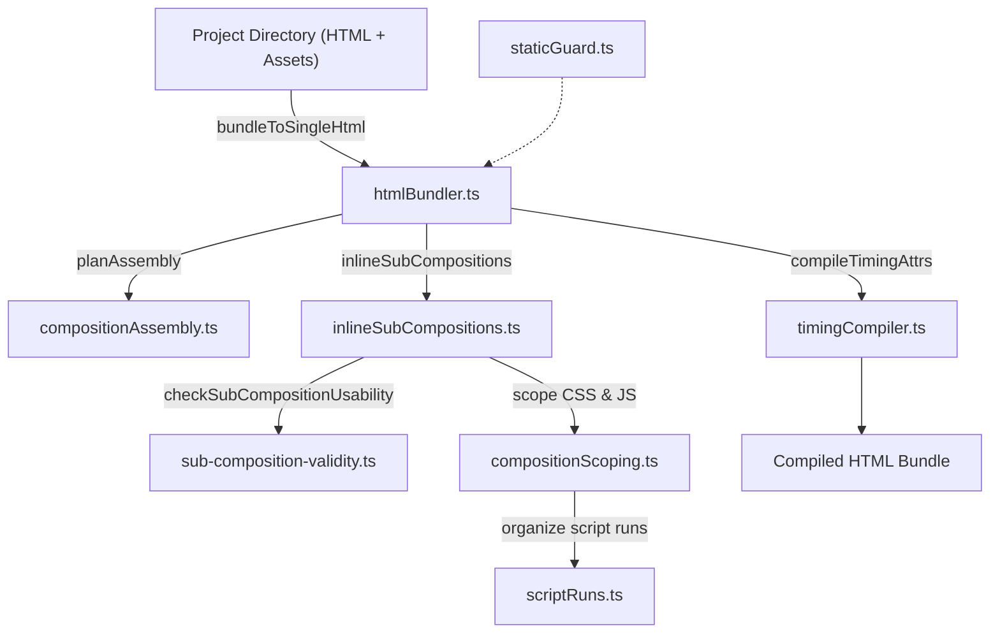
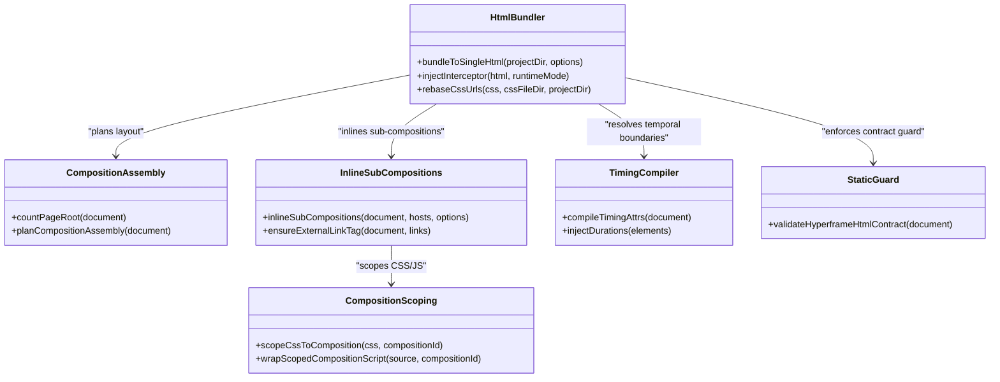

<!-- source: DeepWiki mcp.deepwiki.com · repo heygen-com/hyperframes · page 3.2 HTML Compiler and Bundler · fetched 2026-11-02 -->

# HTML Compiler and Bundler

Relevant source files

The following files were used as context for generating this wiki page:

- [packages/core/src/compiler/__goldens__/pageBuild.preview.html](packages/core/src/compiler/__goldens__/pageBuild.preview.html)
- [packages/core/src/compiler/__goldens__/pageBuild.render.html](packages/core/src/compiler/__goldens__/pageBuild.render.html)
- [packages/core/src/compiler/compositionScoping.test.ts](packages/core/src/compiler/compositionScoping.test.ts)
- [packages/core/src/compiler/compositionScoping.ts](packages/core/src/compiler/compositionScoping.ts)
- [packages/core/src/compiler/htmlBundler.test.ts](packages/core/src/compiler/htmlBundler.test.ts)
- [packages/core/src/compiler/htmlBundler.ts](packages/core/src/compiler/htmlBundler.ts)
- [packages/core/src/compiler/index.ts](packages/core/src/compiler/index.ts)
- [packages/core/src/compiler/inlineSubCompositions.test.ts](packages/core/src/compiler/inlineSubCompositions.test.ts)
- [packages/core/src/compiler/inlineSubCompositions.ts](packages/core/src/compiler/inlineSubCompositions.ts)
- [packages/core/src/runtime/afterFonts.ts](packages/core/src/runtime/afterFonts.ts)
- [packages/core/src/runtime/applyVariableBindings.test.ts](packages/core/src/runtime/applyVariableBindings.test.ts)
- [packages/core/src/runtime/applyVariableBindings.ts](packages/core/src/runtime/applyVariableBindings.ts)
- [packages/core/src/runtime/compositionLoader.test.ts](packages/core/src/runtime/compositionLoader.test.ts)
- [packages/core/src/runtime/compositionLoader.ts](packages/core/src/runtime/compositionLoader.ts)
- [packages/core/src/runtime/entry.afterFonts.test.ts](packages/core/src/runtime/entry.afterFonts.test.ts)
- [packages/core/src/runtime/init.swapScenes.test.ts](packages/core/src/runtime/init.swapScenes.test.ts)
- [packages/core/src/runtime/sceneWindow.ts](packages/core/src/runtime/sceneWindow.ts)
- [packages/producer/src/services/htmlCompiler.test.ts](packages/producer/src/services/htmlCompiler.test.ts)
- [packages/producer/src/services/htmlCompiler.ts](packages/producer/src/services/htmlCompiler.ts)

The `compiler/` subsystem within `@hyperframes/core` handles transforming modular, authored HTML compositions into deterministic, scoped, and self-contained HTML outputs. It orchestrates timing attribute resolution, recursive inlining of sub-compositions, composition assembly, script run sequencing, scoped CSS/JS isolation, asset path rewriting, and static validity checks. This subsystem is critical for both preview environments (such as Studio) and production rendering pipelines (such as Producer).

---

## System Overview

Given a project directory containing HTML compositions and associated media or assets, the compiler and bundler pipeline executes the following phases:

1. **Composition Parsing & Assembly**: Analyzes the root document structure and plans composition assembly hierarchies using `compositionAssembly.ts` [packages/core/src/compiler/compositionAssembly.ts:1-18]().
2. **Recursive Inlining**: Resolves and inlines sub-compositions via `data-composition-src` attributes using `inlineSubCompositions.ts` [packages/core/src/compiler/inlineSubCompositions.ts:1-72]().
3. **Scoping & Isolation**: Scopes CSS selectors, isolates script runs via `scriptRuns.ts` [packages/core/src/scriptRuns.ts](), and encapsulates instances using `compositionScoping.ts` [packages/core/src/compiler/compositionScoping.ts:1-164]().
4. **Timing Resolution**: Compiles authored timing attributes (`data-start` and `data-duration`) into normalized `data-end` bounds via `timingCompiler.ts` [packages/core/src/compiler/timingCompiler.ts:1-25]().
5. **Asset Rebasing & Validation**: Rewrites asset paths and enforces compile-time determinism invariants through `staticGuard.ts` [packages/core/src/compiler/staticGuard.ts:1-41]().

### Data Flow Diagram

**Legend:**
- `htmlBundler.ts`: Orchestrates the self-contained HTML bundle generation [packages/core/src/compiler/htmlBundler.ts:1-36]().
- `compositionAssembly.ts`: Plans hierarchical composition nesting and root counts [packages/core/src/compiler/compositionAssembly.ts:1-18]().
- `inlineSubCompositions.ts`: Recursively pulls in sub-composition fragments [packages/core/src/compiler/inlineSubCompositions.ts:1-72]().
- `compositionScoping.ts`: Isolates CSS and wraps inline script execution context [packages/core/src/compiler/compositionScoping.ts:1-164]().
- `scriptRuns.ts`: Manages script ordering, deferred font injection, and style runs [packages/core/src/compiler/scriptRuns.ts]().
- `timingCompiler.ts`: Converts start/duration attributes to absolute end bounds [packages/core/src/compiler/timingCompiler.ts:1-25]().

Sources: [packages/core/src/compiler/htmlBundler.ts:1-36](), [packages/core/src/compiler/compositionAssembly.ts:1-18](), [packages/core/src/compiler/inlineSubCompositions.ts:1-72](), [packages/core/src/compiler/compositionScoping.ts:1-164](), [packages/core/src/compiler/timingCompiler.ts:1-25]()

---

## Core Compiler Modules

### HTML Bundler (`htmlBundler.ts`)
The HTML Bundler serves as the primary entry point for compiling a multi-file project into a single, cohesive HTML document.
- **Key Function**: `bundleToSingleHtml(projectDir: string, options?: BundleOptions): Promise<string>` [packages/core/src/compiler/htmlBundler.ts:1-36]()
- **Responsibilities**: Reads entry compositions, coordinates recursive inlining, rebases relative asset URLs in CSS and HTML, manages file read caching via `AsyncLocalStorage`, and injects the runtime bootstrap script either inline or as an external source.

Sources: [packages/core/src/compiler/htmlBundler.ts:1-107]()

### Timing Compiler (`timingCompiler.ts`)
The Timing Compiler provides deterministic, browser-safe resolution of temporal layout attributes.
- **Key Function**: `compileTimingAttrs(document: Document)` [packages/core/src/compiler/timingCompiler.ts:1-25]()
- **Responsibilities**: Translates `data-start` and `data-duration` attributes into explicit `data-end` time markers, clamps durations against container limits, and prepares structured data arrays for the playback engine.

Sources: [packages/core/src/compiler/timingCompiler.ts:1-25]()

### Composition Assembly and Script Runs (`compositionAssembly.ts` & `scriptRuns.ts`)
- **Composition Assembly**: Computes composition tree depths, verifies page root counts, and determines asset boundaries [packages/core/src/compiler/compositionAssembly.ts:1-18]().
- **Script Runs**: Manages ordering semantics for inline scripts, groups style definitions, defers execution until custom fonts load via `deferScriptsUntilFonts()`, and handles script error boundaries [packages/core/src/compiler/scriptRuns.ts]().

Sources: [packages/core/src/compiler/compositionAssembly.ts:1-18](), [packages/core/src/compiler/scriptRuns.ts]()

---

## Sub-Composition Path Rewriting and Validity Checks

When sub-compositions reference nested assets or other compositions via relative paths (e.g., `../assets/clip.mp4`), those paths must be adjusted so they resolve correctly when mounted into the host DOM or compiled into a single flat document.

- **Path Rewriting**: The compiler and runtime loader adjust `src`, `href`, inline `style` url attributes, and CSS rules within `<style>` blocks to reflect their contextual base directories [packages/core/src/runtime/compositionLoader.ts:115-180]().
- **Usability Checks**: Before inlining, `checkSubCompositionUsability()` validates that referenced sub-composition files exist, are non-empty, and parse correctly as HTML fragments, preventing runtime crash loops [packages/core/src/compiler/inlineSubCompositions.ts:40-50]().

Sources: [packages/core/src/runtime/compositionLoader.ts:115-180](), [packages/core/src/compiler/inlineSubCompositions.ts:40-50]()

---

## Code Entity Mapping: Natural Language to Code Modules

Sources: [packages/core/src/compiler/htmlBundler.ts:1-40](), [packages/core/src/compiler/compositionAssembly.ts:1-18](), [packages/core/src/compiler/inlineSubCompositions.ts:1-72](), [packages/core/src/compiler/compositionScoping.ts:1-50](), [packages/core/src/compiler/timingCompiler.ts:1-25](), [packages/core/src/compiler/staticGuard.ts:1-41]()

---

## Implementation Details

### 1. Root Flattening and ID Normalization
Inlining sub-compositions in production rendering can strip the root `
` wrapper. To prevent authored CSS `#id` selectors from breaking, the compiler assigns a `data-hf-authored-id` attribute and rewrites CSS selectors accordingly [packages/core/src/compiler/compositionScoping.ts:32-40]().

Sources: [packages/core/src/compiler/compositionScoping.ts:32-40](), [packages/core/src/compiler/inlineSubCompositions.test.ts:107-135]()

### 2. Static Guard Validation
The `validateHyperframeHtmlContract()` function ensures that all compiled compositions contain required attributes (`data-composition-id`), valid timed element classifications (`class="clip"`), and runtime bootstrap markers before allowing preview or render passes to proceed [packages/core/src/compiler/staticGuard.ts:1-41]().

Sources: [packages/core/src/compiler/staticGuard.ts:1-41]()

---

### References to Code Files
- `htmlBundler.ts`: [packages/core/src/compiler/htmlBundler.ts:1-174]()
- `compositionAssembly.ts`: [packages/core/src/compiler/compositionAssembly.ts:1-18]()
- `inlineSubCompositions.ts`: [packages/core/src/compiler/inlineSubCompositions.ts:1-154]()
- `compositionScoping.ts`: [packages/core/src/compiler/compositionScoping.ts:1-164]()
- `timingCompiler.ts`: [packages/core/src/compiler/timingCompiler.ts:1-40]()
- `staticGuard.ts`: [packages/core/src/compiler/staticGuard.ts:1-41]()

---

