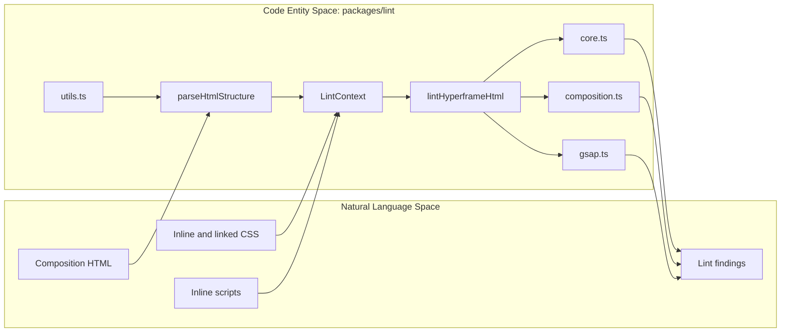
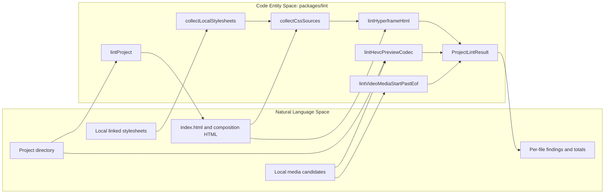

<!-- source: DeepWiki mcp.deepwiki.com · repo heygen-com/hyperframes · page 3.3 Linting System · fetched 2026-11-02 -->

# Linting System

Relevant source files

The following files were used as context for generating this wiki page:

- [docs/packages/lint.mdx](docs/packages/lint.mdx)
- [docs/reference/lint-rules.mdx](docs/reference/lint-rules.mdx)
- [packages/cli/src/commands/lint.test.ts](packages/cli/src/commands/lint.test.ts)
- [packages/cli/src/commands/lint.ts](packages/cli/src/commands/lint.ts)
- [packages/cli/src/utils/lintFormat.test.ts](packages/cli/src/utils/lintFormat.test.ts)
- [packages/cli/src/utils/lintFormat.ts](packages/cli/src/utils/lintFormat.ts)
- [packages/cli/src/utils/lintProject.test.ts](packages/cli/src/utils/lintProject.test.ts)
- [packages/cli/src/utils/lintProject.ts](packages/cli/src/utils/lintProject.ts)
- [packages/cli/src/utils/project.test.ts](packages/cli/src/utils/project.test.ts)
- [packages/cli/src/utils/project.ts](packages/cli/src/utils/project.ts)
- [packages/cli/src/utils/webmAlphaCheck.test.ts](packages/cli/src/utils/webmAlphaCheck.test.ts)
- [packages/cli/src/utils/webmAlphaCheck.ts](packages/cli/src/utils/webmAlphaCheck.ts)
- [packages/lint/src/context.ts](packages/lint/src/context.ts)
- [packages/lint/src/hevcPreviewLint.test.ts](packages/lint/src/hevcPreviewLint.test.ts)
- [packages/lint/src/hevcPreviewLint.ts](packages/lint/src/hevcPreviewLint.ts)
- [packages/lint/src/project.test.ts](packages/lint/src/project.test.ts)
- [packages/lint/src/project.ts](packages/lint/src/project.ts)
- [packages/lint/src/rules/captions.test.ts](packages/lint/src/rules/captions.test.ts)
- [packages/lint/src/rules/captions.ts](packages/lint/src/rules/captions.ts)
- [packages/lint/src/rules/composition.test.ts](packages/lint/src/rules/composition.test.ts)
- [packages/lint/src/rules/composition.ts](packages/lint/src/rules/composition.ts)
- [packages/lint/src/rules/core.test.ts](packages/lint/src/rules/core.test.ts)
- [packages/lint/src/rules/core.ts](packages/lint/src/rules/core.ts)
- [packages/lint/src/rules/fonts.test.ts](packages/lint/src/rules/fonts.test.ts)
- [packages/lint/src/rules/fonts.ts](packages/lint/src/rules/fonts.ts)
- [packages/lint/src/rules/gsap.test.ts](packages/lint/src/rules/gsap.test.ts)
- [packages/lint/src/rules/gsap.ts](packages/lint/src/rules/gsap.ts)
- [packages/lint/src/rules/structure.catalog.test.ts](packages/lint/src/rules/structure.catalog.test.ts)
- [packages/lint/src/rules/structure.test.ts](packages/lint/src/rules/structure.test.ts)
- [packages/lint/src/rules/structure.ts](packages/lint/src/rules/structure.ts)
- [packages/lint/src/sourceLocations.test.ts](packages/lint/src/sourceLocations.test.ts)
- [packages/lint/src/sourceLocations.ts](packages/lint/src/sourceLocations.ts)
- [packages/lint/src/utils.test.ts](packages/lint/src/utils.test.ts)
- [packages/lint/src/utils.ts](packages/lint/src/utils.ts)
- [packages/parsers/src/assetResolution.test.ts](packages/parsers/src/assetResolution.test.ts)
- [packages/parsers/src/assetResolution.ts](packages/parsers/src/assetResolution.ts)
- [registry/examples/product-promo/compositions/scene2-4-canvas.html](registry/examples/product-promo/compositions/scene2-4-canvas.html)
- [skills/hyperframes/references/format.md](skills/hyperframes/references/format.md)

## Purpose and scope

`@hyperframes/lint` checks HyperFrames HTML compositions and, through `lintProject`, project files for contract violations, asset issues, and authoring hazards. Findings have stable codes and severities; the CLI and other embedders can use them for reporting and render gates. The documented rule families include structure and timeline, composition contract, and other rule groups implemented under `packages/lint/src/rules/`.[docs/reference/lint-rules.mdx:7-17]()

Sources: [docs/reference/lint-rules.mdx:7-17]()

## Architecture and data flow

The linter has two entry points with different scopes: `lintHyperframeHtml` analyzes a single HTML document, while `lintProject` coordinates linting across a project and returns per-file results plus aggregate severity counts. Project linting also gathers CSS sources and invokes HEVC-specific checks.[packages/lint/src/project.ts:37-48]()[packages/lint/src/project.ts:84-89]()

### Document lint: natural-language concepts to code entities

The following diagram maps the single-document linting concepts to code entities visible in the lint package. The supplied source excerpt shows the HTML parsing utilities and project-level call to `lintHyperframeHtml`; it does not expose the internal rule-dispatch implementation.[packages/lint/src/utils.ts:63-139]()[packages/lint/src/project.ts:37-43]()

**Diagram: Document input to lint entities**

Sources: [packages/lint/src/utils.ts:63-139]()[packages/lint/src/rules/core.ts:1-25]()[packages/lint/src/rules/composition.ts:1-28]()[packages/lint/src/rules/gsap.ts:35-47]()[packages/lint/src/project.ts:37-43]()

### Project lint: natural-language concepts to code entities

Project linting reads the entry document and composition files, assembles relevant CSS and project context, then calls the single-document linter. `ProjectLintResult` represents the per-file results and aggregate error, warning, and info counts. The available project excerpt identifies the relevant functions and result type, but does not show the full `lintProject` body.[packages/lint/src/project.ts:52-69]()[packages/lint/src/project.ts:84-89]()[packages/lint/src/project.ts:157-180]()

**Diagram: Project-wide lint entities**

Sources: [packages/lint/src/project.ts:37-48]()[packages/lint/src/project.ts:84-89]()[packages/lint/src/project.ts:115-180]()

## Parsing and lint context

`parseHtmlStructure` uses `htmlparser2` to collect open tags and extract script and style blocks while retaining their source offsets. Its result includes `tags`, `scripts`, and `styles`; extracted blocks retain fields such as `contentStart`, `raw`, and `index` for later analysis.[packages/lint/src/utils.ts:4-25]()[packages/lint/src/utils.ts:63-139]()

Project linting collects CSS from three places: `<style>` elements, local linked stylesheets, and elements with inline `style` attributes. It recursively examines template contents so styles and links inside `<template>` elements are included. Local stylesheet paths are resolved relative to the composition file when applicable, with a project-root fallback in the supported case.[packages/lint/src/project.ts:71-81]()[packages/lint/src/project.ts:115-138]()[packages/lint/src/project.ts:157-180]()

Sources: [packages/lint/src/utils.ts:4-25]()[packages/lint/src/utils.ts:63-139]()[packages/lint/src/project.ts:71-81]()[packages/lint/src/project.ts:115-138]()[packages/lint/src/project.ts:157-180]()

## Rule sets

The rules report findings with stable codes. Documentation defines **Error** as a broken composition or render hazard that fails `hyperframes check` by default; **Warning** as a quality, determinism, or maintainability hazard that requires strict mode to fail `check`; and **Info** as a heads-up shown by verbose lint output.[docs/reference/lint-rules.mdx:7-17]()

| Rule area | Implementation or documentation pointer | Examples of checks |
|---|---|---|
| Core | `packages/lint/src/rules/core.ts` | Inline script syntax and CSS/selector-related checks. The module imports CSS parsing and selector parsing utilities, and defines syntax exemptions for JSON, import maps, modules, slideshow JSON, and GLSL script types.[packages/lint/src/rules/core.ts:1-33]() |
| Media | Rule family is part of the lint system; project lint also imports media-related utilities and HEVC checks.[packages/lint/src/project.ts:37-50]() | Project-level video start-time and HEVC preview codec checks.[packages/lint/src/project.ts:37-41]() |
| GSAP | `packages/lint/src/rules/gsap.ts` | Parses GSAP animation scripts using the Acorn parser from `@hyperframes/parsers/gsap-parser-acorn`; extracts animation timing, targets, properties, and related metadata.[packages/lint/src/rules/gsap.ts:22-33]()[packages/lint/src/rules/gsap.ts:118-164]() |
| Captions | Caption-specific lint rules are part of the documented lint rule directory.[docs/reference/lint-rules.mdx:7-7]() | Caption finding codes and guidance are documented in the lint-rules reference.[docs/reference/lint-rules.mdx:19-48]() |
| Composition | `packages/lint/src/rules/composition.ts` | Composition variables, timing contracts, asset paths, complexity guidance, and heavy-overlay checks. The shown module imports shared composition and media-duration parsers.[packages/lint/src/rules/composition.ts:1-28]()[packages/lint/src/rules/composition.ts:30-53]() |
| Fonts | The lint package includes a fonts rule module.[docs/reference/lint-rules.mdx:7-7]() | Font-specific behavior is not detailed in the supplied source excerpts. |
| Structure and timeline | Documented in the lint-rules reference.[docs/reference/lint-rules.mdx:19-63]() | Missing timeline timing, caption track classification, overlapping visibility windows, and clips extending beyond root duration.[docs/reference/lint-rules.mdx:26-63]() |

Sources: [packages/lint/src/rules/core.ts:1-33]()[packages/lint/src/rules/gsap.ts:22-33]()[packages/lint/src/rules/gsap.ts:118-164]()[packages/lint/src/rules/composition.ts:1-53]()[packages/lint/src/project.ts:37-50]()[docs/reference/lint-rules.mdx:7-17]()[docs/reference/lint-rules.mdx:19-63]()

### Core rules

The core module imports PostCSS and `postcss-selector-parser`, and defines script types exempt from inline syntax checks. Its selector helpers identify unescaped digit-leading IDs in CSS selectors and in recognized JavaScript selector calls; parsing failures are handled without treating an unparseable selector as a known target.[packages/lint/src/rules/core.ts:1-33]()[packages/lint/src/rules/core.ts:96-132]()

Tests establish that script syntax checks distinguish actual attributes from text that merely resembles attributes, skip scripts with a real `src`, and do not lint content embedded in an iframe’s `srcdoc` as part of the containing document.[packages/lint/src/rules/core.test.ts:40-77]()[packages/lint/src/rules/core.test.ts:104-142]()

Sources: [packages/lint/src/rules/core.ts:1-33]()[packages/lint/src/rules/core.ts:96-132]()[packages/lint/src/rules/core.test.ts:40-77]()[packages/lint/src/rules/core.test.ts:104-142]()

### Composition rules

The composition module imports parser contracts for composition attributes, clip timing, duration resolution, media duration, and composition variables. It defines warning thresholds for composition size and heavy overlay counts, plus helpers for counting physical and structural lines. The overlay rule’s configured threshold is 25 qualifying elements; its CSS pattern covers blur filters, non-`none` clip paths, and radial gradients.[packages/lint/src/rules/composition.ts:17-28]()[packages/lint/src/rules/composition.ts:30-53]()[packages/lint/src/rules/composition.ts:72-99]()

The module also identifies registry source files and registry-installed files, which allows rules to distinguish source blocks and installed content from ordinary composition files.[packages/lint/src/rules/composition.ts:110-119]() Tests verify that a file over 300 lines can produce `composition_file_too_large`, while a file at exactly 300 lines does not; inline style-block contents are excluded from structural-line counting.[packages/lint/src/rules/composition.test.ts:70-118]()

The canonical timing tests establish that deprecated timing attributes are reported when used inconsistently, while a `data-end` generated to match `data-duration` is not reported as stale.[packages/lint/src/rules/composition.test.ts:7-18]()[packages/lint/src/rules/composition.test.ts:40-67]()

Sources: [packages/lint/src/rules/composition.ts:17-28]()[packages/lint/src/rules/composition.ts:30-53]()[packages/lint/src/rules/composition.ts:72-119]()[packages/lint/src/rules/composition.test.ts:7-18]()[packages/lint/src/rules/composition.test.ts:40-118]()

### GSAP rules

The GSAP rule module lazily imports `parseGsapScriptAcorn` from `@hyperframes/parsers/gsap-parser-acorn`. Parsed animations are converted into windows with start and end times, target selectors, animated properties, and method metadata. `gsap.set` is modeled as zero-duration; repeated animations adjust effective duration, and infinite repeats receive an unbounded end time.[packages/lint/src/rules/gsap.ts:22-33]()[packages/lint/src/rules/gsap.ts:118-164]()

The module caches extracted windows by script content. It skips scripts without `gsap.timeline` and skips animations whose start cannot be resolved to a numeric position.[packages/lint/src/rules/gsap.ts:118-140]()

Tests cover undefined CSS variables in color tweens, checking both `fromTo()` endpoints, and accepting variables declared in style blocks, inline styles, composition variables, or with a `var()` fallback.[packages/lint/src/rules/gsap.test.ts:5-98]() They also cover timeline registration relative to asynchronous font loading.[packages/lint/src/rules/gsap.test.ts:100-165]()

Sources: [packages/lint/src/rules/gsap.ts:22-33]()[packages/lint/src/rules/gsap.ts:118-164]()[packages/lint/src/rules/gsap.test.ts:5-98]()[packages/lint/src/rules/gsap.test.ts:100-165]()

## Project-wide linting

`lintProject` is the project-level API exported from `packages/lint/src/project.ts`. Its result shape contains per-file records with a file path, a `HyperframeLintResult`, and a content hash, alongside aggregate error, warning, and info totals.[packages/lint/src/project.ts:84-89]()

Project linting prepares external context for each document. `collectCssSources` collects inline style blocks, local stylesheets, and inline style attributes; `collectExternalStyles` packages local stylesheet content with its file and root-relative path. `querySelectorAllIncludingTemplates` recursively searches template content for elements that would otherwise be absent from Linkedom’s normal query tree.[packages/lint/src/project.ts:71-81]()[packages/lint/src/project.ts:140-179]()

`contentDigest` computes a truncated SHA-256 digest of a file’s HTML. The source comments describe its purpose as distinguishing an edited file whose finding persists from a repeated lint of unchanged content; it is not used as a security boundary.[packages/lint/src/project.ts:91-100]()

The CLI utility re-exports `lintProject` and `shouldBlockRender` from `@hyperframes/lint`. It also provides `hasDefinitiveEntryMismatch`, which detects the `blank_root_with_standalone_composition` finding, and a helper that returns the suggested composition when present.[packages/cli/src/utils/lintProject.ts:1-23]()

Sources: [packages/lint/src/project.ts:71-100]()[packages/lint/src/project.ts:115-179]()[packages/cli/src/utils/lintProject.ts:1-23]()

## HEVC preview lint

Project lint imports `collectLocalVideoCandidates`, `lintHevcPreviewCodec`, and `lintVideoMediaStartPastEof` from `hevcPreviewLint.ts`. These checks are integrated at the project layer alongside the HTML linter and project shader linting. The supplied excerpt does not include the HEVC implementation details or its finding codes.[packages/lint/src/project.ts:37-43]()

Sources: [packages/lint/src/project.ts:37-43]()

## Findings, deduplication, and source locations

Findings are represented by the `HyperframeLintFinding` type in the project-lint interface, and per-file results are carried in `ProjectLintResult`. A short content digest is attached to each file result for comparison across runs.[packages/lint/src/project.ts:44-48]()[packages/lint/src/project.ts:84-100]()

The supplied source excerpts do not show the finding-deduplication implementation or the source-location resolver’s line/column mapping behavior. Those implementation details should be consulted in `packages/lint/src/sourceLocations.ts` and the lint engine sources; they are not inferred here.[packages/lint/src/project.ts:44-48]()

Sources: [packages/lint/src/project.ts:44-48]()[packages/lint/src/project.ts:84-100]()

## Summary of key entities

| Entity | Role |
|---|---|
| `lintHyperframeHtml` | Single-document HTML lint entry called by project lint.[packages/lint/src/project.ts:37-43]() |
| `lintProject` | Project-level lint API; returns per-file results and aggregate severity totals.[packages/lint/src/project.ts:84-89]() |
| `parseHtmlStructure` | Extracts HTML tags, script blocks, and style blocks while retaining source offsets.[packages/lint/src/utils.ts:63-139]() |
| `collectCssSources` | Gathers inline styles, local stylesheets, and inline style attributes for project linting.[packages/lint/src/project.ts:157-180]() |
| `extractGsapWindows` | Parses GSAP timelines and constructs animation windows for lint analysis.[packages/lint/src/rules/gsap.ts:118-164]() |
| `lintHevcPreviewCodec` | Project-level HEVC preview check imported by `project.ts`.[packages/lint/src/project.ts:37-43]() |
| `shouldBlockRender` | Re-exported through the CLI lint facade from `@hyperframes/lint`.[packages/cli/src/utils/lintProject.ts:1-3]() |
| `ProjectLintResult` | Per-file result list and aggregate error, warning, and info counts.[packages/lint/src/project.ts:84-89]() |

Sources: [packages/lint/src/utils.ts:63-139]()[packages/lint/src/project.ts:37-48]()[packages/lint/src/project.ts:84-100]()[packages/lint/src/project.ts:157-180]()[packages/lint/src/rules/gsap.ts:118-164]()[packages/cli/src/utils/lintProject.ts:1-3]()

## Finding severity and rule reference

The lint-rules reference is the detailed catalog of finding codes, severities, and suggested fixes. It documents the severity semantics and organizes checks by areas including structure and timeline and composition contract.[docs/reference/lint-rules.mdx:7-17]()[docs/reference/lint-rules.mdx:19-67]()

Examples in that reference include `timeline_element_missing_timing`, `caption_track_kind_missing`, `deprecated_data_end`, `deprecated_data_layer`, `invalid_parent_traversal_in_asset_path`, and `composition_heavy_overlay_count_high`, each with authoring guidance.[docs/reference/lint-rules.mdx:26-48]()[docs/reference/lint-rules.mdx:93-133]()

Sources: [docs/reference/lint-rules.mdx:7-17]()[docs/reference/lint-rules.mdx:19-67]()[docs/reference/lint-rules.mdx:93-133]()

## Summary

`@hyperframes/lint` separates document-level checks from project-level collection and probes. The project layer gathers local CSS and invokes HTML, shader, media-start, and HEVC-related checks; the rule modules analyze composition contracts and GSAP scripts using parser utilities. Findings are returned per file with aggregate severity totals, and the CLI exposes the lint API and render-blocking helper.[packages/lint/src/project.ts:37-48]()[packages/lint/src/project.ts:84-100]()[packages/lint/src/project.ts:157-180]()[packages/cli/src/utils/lintProject.ts:1-3]()

Sources: [packages/lint/src/project.ts:37-48]()[packages/lint/src/project.ts:84-100]()[packages/lint/src/project.ts:157-180]()[packages/cli/src/utils/lintProject.ts:1-3]()

---

