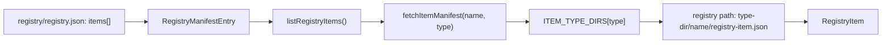
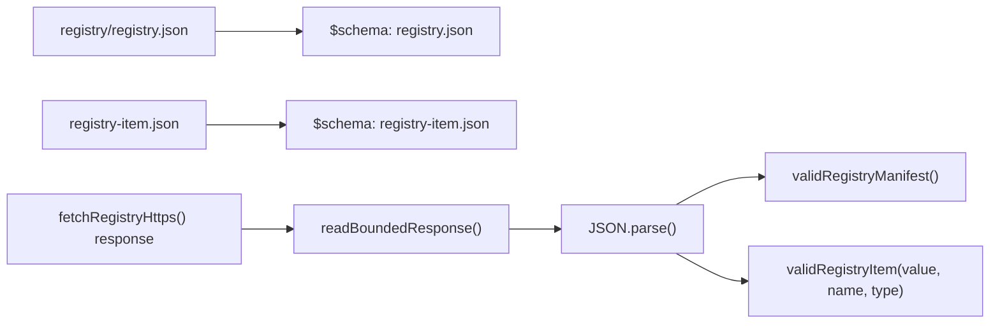
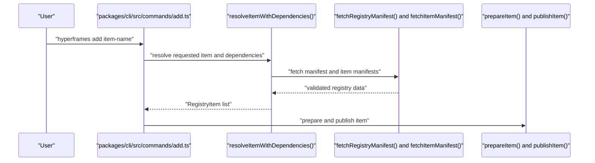
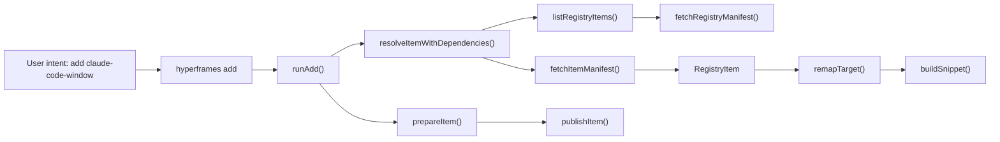

<!-- source: DeepWiki mcp.deepwiki.com · repo heygen-com/hyperframes · page 3.4 Registry and Schema System · fetched 2026-11-02 -->

# Registry and Schema System

Relevant source files

The following files were used as context for generating this wiki page:

- [docs/catalog/components/filmed-screen.mdx](docs/catalog/components/filmed-screen.mdx)
- [docs/catalog/components/motion-blur.mdx](docs/catalog/components/motion-blur.mdx)
- [docs/catalog/components/shutter-slam.mdx](docs/catalog/components/shutter-slam.mdx)
- [docs/docs.json](docs/docs.json)
- [docs/public/catalog-index.json](docs/public/catalog-index.json)
- [docs/public/catalog/components/filmed-screen.json](docs/public/catalog/components/filmed-screen.json)
- [docs/public/catalog/components/motion-blur.json](docs/public/catalog/components/motion-blur.json)
- [docs/public/catalog/components/shutter-slam.json](docs/public/catalog/components/shutter-slam.json)
- [docs/snippets/catalog-gallery-data.mdx](docs/snippets/catalog-gallery-data.mdx)
- [packages/cli/src/commands/add.test.ts](packages/cli/src/commands/add.test.ts)
- [packages/cli/src/commands/add.ts](packages/cli/src/commands/add.ts)
- [packages/cli/src/registry/boundedFile.test.ts](packages/cli/src/registry/boundedFile.test.ts)
- [packages/cli/src/registry/boundedFile.ts](packages/cli/src/registry/boundedFile.ts)
- [packages/cli/src/registry/compatibility.test.ts](packages/cli/src/registry/compatibility.test.ts)
- [packages/cli/src/registry/compatibility.ts](packages/cli/src/registry/compatibility.ts)
- [packages/cli/src/registry/index.ts](packages/cli/src/registry/index.ts)
- [packages/cli/src/registry/installer.test.ts](packages/cli/src/registry/installer.test.ts)
- [packages/cli/src/registry/installer.ts](packages/cli/src/registry/installer.ts)
- [packages/cli/src/registry/motionBlurShutter.browser.test.ts](packages/cli/src/registry/motionBlurShutter.browser.test.ts)
- [packages/cli/src/registry/publication.test.ts](packages/cli/src/registry/publication.test.ts)
- [packages/cli/src/registry/publication.ts](packages/cli/src/registry/publication.ts)
- [packages/cli/src/registry/remote.test.ts](packages/cli/src/registry/remote.test.ts)
- [packages/cli/src/registry/remote.ts](packages/cli/src/registry/remote.ts)
- [packages/cli/src/registry/resolver.test.ts](packages/cli/src/registry/resolver.test.ts)
- [packages/cli/src/registry/resolver.ts](packages/cli/src/registry/resolver.ts)
- [packages/cli/src/registry/transport.test.ts](packages/cli/src/registry/transport.test.ts)
- [packages/cli/src/registry/transport.ts](packages/cli/src/registry/transport.ts)
- [packages/cli/src/registry/variableDefaults.test.ts](packages/cli/src/registry/variableDefaults.test.ts)
- [packages/cli/src/registry/variableDefaults.ts](packages/cli/src/registry/variableDefaults.ts)
- [packages/cli/src/telemetry/lintRun.e2e.test.ts](packages/cli/src/telemetry/lintRun.e2e.test.ts)
- [packages/cli/src/templates/generators.ts](packages/cli/src/templates/generators.ts)
- [packages/cli/src/templates/remote.ts](packages/cli/src/templates/remote.ts)
- [packages/cli/src/utils/motionSpec.test.ts](packages/cli/src/utils/motionSpec.test.ts)
- [registry/blocks/gooey-split/gooey-split.html](registry/blocks/gooey-split/gooey-split.html)
- [registry/blocks/gooey-split/registry-item.json](registry/blocks/gooey-split/registry-item.json)
- [registry/catalog-artifact/local-vectors.bin](registry/catalog-artifact/local-vectors.bin)
- [registry/catalog-artifact/local-vectors.json](registry/catalog-artifact/local-vectors.json)
- [registry/components/motion-blur/demo.html](registry/components/motion-blur/demo.html)
- [registry/components/motion-blur/motion-blur.html](registry/components/motion-blur/motion-blur.html)
- [registry/components/motion-blur/registry-item.json](registry/components/motion-blur/registry-item.json)
- [registry/components/shutter-slam/demo.html](registry/components/shutter-slam/demo.html)
- [registry/components/shutter-slam/shutter-slam.html](registry/components/shutter-slam/shutter-slam.html)
- [registry/registry.json](registry/registry.json)
- [scripts/catalog-drift.test.ts](scripts/catalog-drift.test.ts)
- [scripts/catalog-drift.ts](scripts/catalog-drift.ts)
- [scripts/catalog-publication.test.mjs](scripts/catalog-publication.test.mjs)
- [scripts/catalog-vectors.mjs](scripts/catalog-vectors.mjs)
- [scripts/publish-catalog.mjs](scripts/publish-catalog.mjs)

The registry system connects named reusable items to manifests, remote files, and project installation. This page covers the item and file concepts visible to the CLI, remote manifest resolution and caching, and the `hyperframes add` workflow. The supplied source excerpts do not include the definitions of the core types, JSON Schema files, or installer implementation, so details of those implementations are not inferred here. [packages/cli/src/commands/add.ts:17-36](), [packages/cli/src/registry/remote.ts:7-18]()

Sources: [packages/cli/src/commands/add.ts:17-36](), [packages/cli/src/registry/remote.ts:7-18]()

---

## Data Model and Types

The CLI imports `RegistryItem` and `ITEM_TYPE_DIRS` from `@hyperframes/core`. Remote fetching also imports `ItemType`, `FileTarget`, and `RegistryManifest`, while the resolver uses `RegistryManifestEntry`. These types are the boundary between registry data and CLI behavior; the excerpts provided show their use, but not their core definitions. [packages/cli/src/commands/add.ts:17-22](), [packages/cli/src/registry/remote.ts:23-29](), [packages/cli/src/registry/resolver.ts:7-9]()

### Item Classification (`ItemType`)

The CLI and remote registry identify examples, blocks, and components using the string values `hyperframes:example`, `hyperframes:block`, and `hyperframes:component`. The top-level manifest excerpt lists examples and blocks; the CLI tests include fixtures for all three types. [registry/registry.json:5-40](), [packages/cli/src/commands/add.test.ts:30-42]()

| Item type | Observed use |
|---|---|
| `hyperframes:example` | Present in the top-level manifest and test fixtures. The `add.ts` target-remapping function leaves example targets unchanged; its comment says examples are installed by `init`, not `add`. [registry/registry.json:5-8](), [packages/cli/src/commands/add.test.ts:30-42](), [packages/cli/src/commands/add.ts:59-73]() |
| `hyperframes:block` | Listed in the registry manifest; `add` remaps its default `compositions/` target prefix and can generate a composition-mount snippet. [registry/registry.json:38-44](), [packages/cli/src/commands/add.ts:54-65](), [packages/cli/src/commands/add.ts:126-143]() |
| `hyperframes:component` | Present in CLI fixtures; `add` remaps its `compositions/components/` target prefix and generates a paste-location comment. [packages/cli/src/commands/add.test.ts:62-85](), [packages/cli/src/commands/add.ts:66-70](), [packages/cli/src/commands/add.ts:144-147]() |

### File Classification (`FileType`)

The CLI fixtures demonstrate file roles including `hyperframes:composition`, `hyperframes:snippet`, `hyperframes:style`, and `hyperframes:asset`. The `primaryInstalledTarget` function prefers a snippet file, then a composition file, then the first file in the item. These observed roles explain how the CLI selects the file referenced by its post-install snippet; they do not establish the complete set of `FileType` values. [packages/cli/src/commands/add.test.ts:45-85](), [packages/cli/src/commands/add.ts:96-110]()

| File type | Example or observed use |
|---|---|
| `hyperframes:composition` | A block composition is used as a fallback target; examples also use composition files. [packages/cli/src/commands/add.test.ts:53-59](), [packages/cli/src/commands/add.test.ts:145-154]() |
| `hyperframes:snippet` | Preferred by `primaryInstalledTarget`; a component fixture uses this role. [packages/cli/src/commands/add.ts:105-110](), [packages/cli/src/commands/add.test.ts:68-73]() |
| `hyperframes:style` | A component fixture includes a stylesheet with this role. [packages/cli/src/commands/add.test.ts:75-78](), [packages/cli/src/commands/add.test.ts:115-128]() |
| `hyperframes:asset` | A component fixture includes an image asset with this role. [packages/cli/src/commands/add.test.ts:80-83]() |

The item fixture illustrates the manifest shape consumed by `add`: schema reference, name, type, descriptive metadata, optional dimensions and duration, and a list of files with source paths, targets, and roles. It is a test fixture, not a complete schema specification. [packages/cli/src/commands/add.test.ts:45-60]()

### Registry Data Flow: Names to Code Entities

The registry manifest names items and assigns types. `ITEM_TYPE_DIRS` maps the requested type into the remote path layout, while `fetchItemManifest` retrieves the per-item manifest and the resolver turns manifests into items for callers. [registry/registry.json:5-40](), [packages/cli/src/registry/remote.ts:23-29](), [packages/cli/src/registry/remote.ts:150-161](), [packages/cli/src/registry/resolver.ts:31-40]()

**Diagram: Registry names and item types mapped to resolver entities**

Sources: [registry/registry.json:1-40](), [packages/cli/src/registry/remote.ts:12-18](), [packages/cli/src/registry/remote.ts:23-29](), [packages/cli/src/registry/remote.ts:150-161](), [packages/cli/src/registry/resolver.ts:31-40]()

---

## JSON Schema References and Validation

The top-level registry manifest includes a `$schema` reference to `https://hyperframes.heygen.com/schema/registry.json`. Test item fixtures include a `$schema` reference to `https://hyperframes.heygen.com/schema/registry-item.json`. The remote module imports `validRegistryManifest` and `validRegistryItem` and uses them to validate parsed JSON before returning it. The actual JSON Schema documents and the validator definitions were not included in the supplied contents, so their required fields and constraints cannot be detailed here. [registry/registry.json:1-5](), [packages/cli/src/commands/add.test.ts:45-49](), [packages/cli/src/registry/remote.ts:1-5](), [packages/cli/src/registry/remote.ts:104-113](), [packages/cli/src/registry/remote.ts:155-164]()

The remote fetch path checks HTTP success, bounds the response size, parses JSON, and applies the supplied validator. For item manifests, the validator additionally checks the fetched value against the requested name and type. [packages/cli/src/registry/remote.ts:104-113](), [packages/cli/src/registry/remote.ts:155-160]()

**Diagram: Manifest schema references and runtime validation**

Sources: [registry/registry.json:1-5](), [packages/cli/src/commands/add.test.ts:45-49](), [packages/cli/src/registry/remote.ts:1-5](), [packages/cli/src/registry/remote.ts:104-113](), [packages/cli/src/registry/remote.ts:155-160]()

---

## CLI Installation and Target Path Remapping

`hyperframes add` is presented as the command for adding blocks and components. Its examples include adding a named block, an effect component, items by tag, and specifying a project directory. The command imports core registry types, registry helpers, the dependency-aware resolver, compatibility checks, project configuration utilities, and clipboard support. [packages/cli/src/commands/add.ts:5-12](), [packages/cli/src/commands/add.ts:17-46]()

### Resolution and Installation Workflow

The resolver fetches the top-level manifest and resolves item names to typed registry entries. The `add` command imports `resolveItemWithDependencies`, as well as `prepareItem` and `publishItem` from its registry module; the installer implementation and the `runAdd` body were not included in the supplied excerpt, so the exact sequence of file preparation, writing, and result handling is not described here. [packages/cli/src/registry/resolver.ts:31-40](), [packages/cli/src/registry/resolver.ts:140-160](), [packages/cli/src/commands/add.ts:24-36]()

**Diagram: `hyperframes add` from command entry to registry resolution**

Sources: [packages/cli/src/commands/add.ts:5-12](), [packages/cli/src/commands/add.ts:24-36](), [packages/cli/src/registry/resolver.ts:31-40](), [packages/cli/src/registry/resolver.ts:140-160](), [packages/cli/src/registry/remote.ts:126-141](), [packages/cli/src/registry/remote.ts:150-164]()

### Target Path Remapping

Registry item file targets are project-relative. For blocks, `remapTarget` replaces the leading `compositions/` with the configured `paths.blocks` value. For components, it replaces `compositions/components/` with `paths.components`. Both configured paths have trailing slashes removed first. Examples pass through unchanged because the function documents that examples are installed by `init`, not `add`. [packages/cli/src/commands/add.ts:48-73]()

| Item type | Default target prefix | Replacement |
|---|---|---|
| `hyperframes:block` | `compositions/` | Configured `paths.blocks` |
| `hyperframes:component` | `compositions/components/` | Configured `paths.components` |
| Other types | None | Original target unchanged |

The code replaces only the matching prefix; targets without that prefix pass through unchanged. Tests define the default block and component path values and representative file targets. [packages/cli/src/commands/add.ts:59-73](), [packages/cli/src/commands/add.test.ts:53-85](), [packages/cli/src/commands/add.test.ts:205-207]()

### Post-install Snippet Generation

`primaryInstalledTarget` chooses a consumer-facing file in this order: snippet, composition, then first file. `buildSnippet` emits a mount `
` for blocks, including `data-composition-src` and `data-duration`, and adds dimensions when available. It can also include a composition ID and variable values. For components, it emits a comment directing the user to paste from the installed file. [packages/cli/src/commands/add.ts:96-110](), [packages/cli/src/commands/add.ts:126-148]()

Variable values are serialized as JSON and placed in a single-quoted `data-variable-values` attribute; embedded single quotes are escaped as `&#39;`. `compositionRootId` parses HTML and looks for `data-composition-id`, searching inside a `<template>` when present. [packages/cli/src/commands/add.ts:79-94](), [packages/cli/src/commands/add.ts:113-120]()

Sources: [packages/cli/src/commands/add.ts:48-73](), [packages/cli/src/commands/add.ts:79-94](), [packages/cli/src/commands/add.ts:96-148](), [packages/cli/src/commands/add.test.ts:53-85]()

---

## Architecture: Registry Resolution and Installation Workflow

The following diagram connects user-facing names and the `hyperframes add` command to the code entities involved in listing, resolving, fetching, and preparing registry items. It does not imply that the installer is implemented in `@hyperframes/core`; the CLI imports its preparation and publishing helpers from `packages/cli/src/registry/index.ts`. [packages/cli/src/commands/add.ts:24-36](), [packages/cli/src/registry/resolver.ts:31-40](), [packages/cli/src/registry/remote.ts:126-161]()

**Diagram: User command to registry code entities**

Sources: [packages/cli/src/commands/add.ts:5-12](), [packages/cli/src/commands/add.ts:24-36](), [packages/cli/src/commands/add.ts:54-73](), [packages/cli/src/commands/add.ts:126-148](), [packages/cli/src/registry/resolver.ts:31-40](), [packages/cli/src/registry/resolver.ts:140-160](), [packages/cli/src/registry/remote.ts:126-161]()

---

## Remote Fetching and Caching

`packages/cli/src/registry/remote.ts` defines the default registry URL as the GitHub-hosted `registry` directory. Its documented layout is a top-level `registry.json`, followed by per-type and per-name `registry-item.json` files and the files referenced by each item manifest. Type directories come from `ITEM_TYPE_DIRS`. [packages/cli/src/registry/remote.ts:7-18](), [packages/cli/src/registry/remote.ts:23-32]()

Top-level and per-item manifests use a cache under `~/.hyperframes/cache`. Cache entries include a fetch timestamp and data; the TTL is 24 hours. A fresh manifest can be returned without a network request. When a fetch fails, `fetchRegistryManifest` returns stale cached data if available, or `undefined` if no cached manifest exists. Item manifest fetching supports `skipCache` and `cacheOnly` options; the supplied excerpt shows fresh-cache handling and the start of the fetch path. [packages/cli/src/registry/remote.ts:37-52](), [packages/cli/src/registry/remote.ts:63-99](), [packages/cli/src/registry/remote.ts:126-141](), [packages/cli/src/registry/remote.ts:150-166]()

Remote JSON fetches use a 10-second timeout and a 10 MiB manifest limit. The response body is read with a byte limit, parsed as JSON, and validated before use. [packages/cli/src/registry/remote.ts:34-35](), [packages/cli/src/registry/remote.ts:104-113]()

The resolver limits bulk item-manifest loading to 32 concurrent requests. It skips failed item manifests and reports a summary warning; after a timeout, remaining requests are configured for cache-only fetching. [packages/cli/src/registry/resolver.ts:42-43](), [packages/cli/src/registry/resolver.ts:45-78]()

Sources: [packages/cli/src/registry/remote.ts:7-18](), [packages/cli/src/registry/remote.ts:23-35](), [packages/cli/src/registry/remote.ts:37-52](), [packages/cli/src/registry/remote.ts:63-99](), [packages/cli/src/registry/remote.ts:104-113](), [packages/cli/src/registry/remote.ts:126-166](), [packages/cli/src/registry/resolver.ts:42-78]()

---

## Registry Resolver and Dependencies

`listRegistryItems` fetches the registry manifest and returns its entries, optionally filtered by item type. If the registry manifest is unavailable, it returns an empty list. `loadAllItems` fetches full item manifests with bounded concurrency and skips failures with a warning. [packages/cli/src/registry/resolver.ts:27-40](), [packages/cli/src/registry/resolver.ts:42-78]()

`resolveItemWithDependencies` finds the requested item in the manifest and resolves its `registryDependencies` in topological order: dependencies first, requested item last. It tracks visiting and visited names for cycle detection and avoids returning shared dependencies more than once. The dependency traversal and its error cases are described in the resolver source; the supplied excerpt ends during its helper implementation. [packages/cli/src/registry/resolver.ts:125-160]()

`resolveItem` is a guard around the dependency-aware resolver. If the resolved list contains dependencies, it throws an error directing callers to use `resolveItemWithDependencies`, rather than silently returning an incomplete install. [packages/cli/src/registry/resolver.ts:80-109]()

Sources: [packages/cli/src/registry/resolver.ts:27-40](), [packages/cli/src/registry/resolver.ts:42-78](), [packages/cli/src/registry/resolver.ts:80-109](), [packages/cli/src/registry/resolver.ts:125-160]()

---

## Installer and Project Effects

The `add` command imports `prepareItem`, `publishItem`, and `PreparedItem` from `packages/cli/src/registry/index.ts`, and imports `recordProjectRegistryItems` and project configuration helpers from `packages/cli/src/utils/projectConfig.ts`. These imports establish the CLI’s integration points for preparing and recording registry installs. [packages/cli/src/commands/add.ts:24-30](), [packages/cli/src/commands/add.ts:38-43]()

The installer source itself was not included in the supplied contents. Consequently, this page does not assert its write-safety rules, overwrite policy, lock-file format, or hashing behavior. For those details, consult `packages/cli/src/registry/installer.ts` and its tests. The file is identified as part of the registry implementation in the provided file list, but no line-level source excerpt was provided. [packages/cli/src/commands/add.ts:24-30]()

Sources: [packages/cli/src/commands/add.ts:24-30](), [packages/cli/src/commands/add.ts:38-43]()

---

## Registry Contents and Catalog Data

The top-level manifest identifies the registry as `hyperframes` and contains named entries with item types. Its shown entries include examples such as `decision-tree` and `kinetic-type`, and blocks such as `ai-answer-rank` and `app-showcase`. [registry/registry.json:1-5](), [registry/registry.json:5-52]()

The generated catalog index is a separate discovery artifact: its entries expose fields such as `name`, `type`, `title`, `description`, `tags`, `href`, and optional preview image. For example, it identifies `agent-cursor` as a component and `ai-answer-rank` as a block. The catalog index is not the same structure as the registry’s top-level manifest. [docs/public/catalog-index.json:1-17](), [docs/public/catalog-index.json:19-35]()

Sources: [registry/registry.json:1-52](), [docs/public/catalog-index.json:1-35]()

---

## Summary of Registry Entities

| Entity | Role shown in the supplied source |
|---|---|
| `ItemType` | Type imported by remote fetching and resolver code; item values distinguish examples, blocks, and components in the observed manifest and fixtures. [packages/cli/src/registry/remote.ts:23-29](), [packages/cli/src/commands/add.test.ts:30-42]() |
| `FileTarget` | Type imported by remote fetching; fixtures show files carrying `path`, `target`, and `type`. [packages/cli/src/registry/remote.ts:23-29](), [packages/cli/src/commands/add.test.ts:53-59]() |
| `RegistryItem` | Per-item data type used by `add`, remote validation, and resolver functions. [packages/cli/src/commands/add.ts:17-22](), [packages/cli/src/registry/remote.ts:23-29](), [packages/cli/src/registry/resolver.ts:7-9]() |
| `RegistryManifestEntry` | Entry type returned by `listRegistryItems` and consumed by bulk loading. [packages/cli/src/registry/resolver.ts:7-9](), [packages/cli/src/registry/resolver.ts:31-40](), [packages/cli/src/registry/resolver.ts:50-53]() |
| `ITEM_TYPE_DIRS` | Supplies the remote directory for an item type when constructing a per-item manifest path. [packages/cli/src/registry/remote.ts:23-29](), [packages/cli/src/registry/remote.ts:155-161]() |
| `validRegistryManifest`, `validRegistryItem` | Runtime validators applied to parsed remote JSON. [packages/cli/src/registry/remote.ts:1-5](), [packages/cli/src/registry/remote.ts:104-113](), [packages/cli/src/registry/remote.ts:155-160]() |
| `remapTarget`, `buildSnippet` | CLI helpers for translating targets and generating consumer-facing markup. [packages/cli/src/commands/add.ts:54-73](), [packages/cli/src/commands/add.ts:126-148]() |

Sources: [packages/cli/src/commands/add.ts:17-30](), [packages/cli/src/commands/add.ts:54-73](), [packages/cli/src/commands/add.ts:126-148](), [packages/cli/src/registry/remote.ts:1-5](), [packages/cli/src/registry/remote.ts:23-29](), [packages/cli/src/registry/remote.ts:155-161](), [packages/cli/src/registry/resolver.ts:7-9]()

---

The registry workflow shown here separates discovery and resolution from project-specific installation decisions: remote manifests are validated and resolved into registry items, while the CLI applies configured target paths and generates snippets that help users integrate installed blocks or components. [packages/cli/src/registry/remote.ts:104-113](), [packages/cli/src/registry/resolver.ts:31-40](), [packages/cli/src/commands/add.ts:54-73](), [packages/cli/src/commands/add.ts:126-148]()

Sources: [packages/cli/src/registry/remote.ts:104-113](), [packages/cli/src/registry/resolver.ts:31-40](), [packages/cli/src/commands/add.ts:54-73](), [packages/cli/src/commands/add.ts:126-148]()

---

