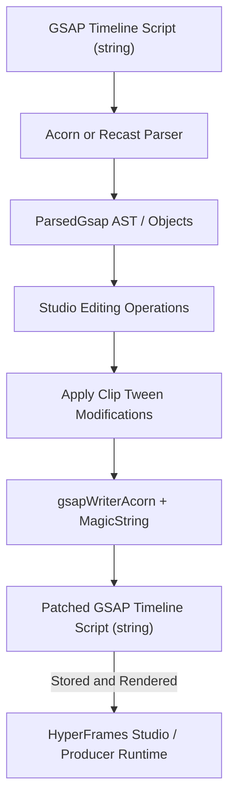
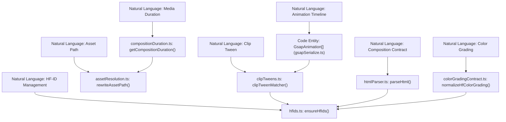

<!-- source: DeepWiki mcp.deepwiki.com · repo heygen-com/hyperframes · page 3.5 Parsers Package (GSAP and Contracts) · fetched 2026-11-02 -->

# Parsers Package (GSAP and Contracts) (Section 3.5)

<details>
<summary>Relevant source files</summary>

The following files were used as context for generating this wiki page:

- [docs/packages/parsers.mdx](docs/packages/parsers.mdx)
- [packages/cli/src/server/studioServer.stampOnOpen.test.ts](packages/cli/src/server/studioServer.stampOnOpen.test.ts)
- [packages/core/README.md](packages/core/README.md)
- [packages/core/src/generators/hyperframes.test.ts](packages/core/src/generators/hyperframes.test.ts)
- [packages/core/src/generators/hyperframes.ts](packages/core/src/generators/hyperframes.ts)
- [packages/core/src/generators/richTextHtml.ts](packages/core/src/generators/richTextHtml.ts)
- [packages/engine/README.md](packages/engine/README.md)
- [packages/parsers/src/compositionDuration.ts](packages/parsers/src/compositionDuration.ts)
- [packages/parsers/src/gsapConstants.ts](packages/parsers/src/gsapConstants.ts)
- [packages/parsers/src/gsapInline.test.ts](packages/parsers/src/gsapInline.test.ts)
- [packages/parsers/src/gsapInline.ts](packages/parsers/src/gsapInline.ts)
- [packages/parsers/src/gsapObjectArrayTiming.test.ts](packages/parsers/src/gsapObjectArrayTiming.test.ts)
- [packages/parsers/src/gsapObjectArrayTiming.ts](packages/parsers/src/gsapObjectArrayTiming.ts)
- [packages/parsers/src/gsapParser.inline.test.ts](packages/parsers/src/gsapParser.inline.test.ts)
- [packages/parsers/src/gsapParser.test.ts](packages/parsers/src/gsapParser.test.ts)
- [packages/parsers/src/gsapParser.ts](packages/parsers/src/gsapParser.ts)
- [packages/parsers/src/gsapParserAcorn.computed.test.ts](packages/parsers/src/gsapParserAcorn.computed.test.ts)
- [packages/parsers/src/gsapParserAcorn.full.test.ts](packages/parsers/src/gsapParserAcorn.full.test.ts)
- [packages/parsers/src/gsapParserAcorn.inline.test.ts](packages/parsers/src/gsapParserAcorn.inline.test.ts)
- [packages/parsers/src/gsapParserAcorn.ts](packages/parsers/src/gsapParserAcorn.ts)
- [packages/parsers/src/gsapSerialize.ts](packages/parsers/src/gsapSerialize.ts)
- [packages/parsers/src/gsapSimpleArrayKeyframes.test.ts](packages/parsers/src/gsapSimpleArrayKeyframes.test.ts)
- [packages/parsers/src/gsapUnroll.test.ts](packages/parsers/src/gsapUnroll.test.ts)
- [packages/parsers/src/gsapUnroll.ts](packages/parsers/src/gsapUnroll.ts)
- [packages/parsers/src/gsapWriter.acorn.test.ts](packages/parsers/src/gsapWriter.acorn.test.ts)
- [packages/parsers/src/gsapWriter.parity.test.ts](packages/parsers/src/gsapWriter.parity.test.ts)
- [packages/parsers/src/gsapWriterAcorn.inline.test.ts](packages/parsers/src/gsapWriterAcorn.inline.test.ts)
- [packages/parsers/src/gsapWriterAcorn.ts](packages/parsers/src/gsapWriterAcorn.ts)
- [packages/parsers/src/hfIdAssignment.ts](packages/parsers/src/hfIdAssignment.ts)
- [packages/parsers/src/hfIds.test.ts](packages/parsers/src/hfIds.test.ts)
- [packages/parsers/src/hfIds.ts](packages/parsers/src/hfIds.ts)
- [packages/parsers/src/htmlParser.test.ts](packages/parsers/src/htmlParser.test.ts)
- [packages/parsers/src/htmlParser.ts](packages/parsers/src/htmlParser.ts)
- [packages/parsers/src/timingMismatches.test.ts](packages/parsers/src/timingMismatches.test.ts)
- [packages/parsers/src/timingMismatches.ts](packages/parsers/src/timingMismatches.ts)
- [packages/producer/README.md](packages/producer/README.md)
- [packages/producer/src/server.test.ts](packages/producer/src/server.test.ts)
- [packages/producer/src/server.ts](packages/producer/src/server.ts)
- [packages/sdk/src/document.ts](packages/sdk/src/document.ts)
- [packages/sdk/src/session.template.test.ts](packages/sdk/src/session.template.test.ts)
- [packages/studio/src/hooks/gsapPositionDetection.ts](packages/studio/src/hooks/gsapPositionDetection.ts)
- [packages/studio/src/hooks/gsapValueAtPlayhead.test.ts](packages/studio/src/hooks/gsapValueAtPlayhead.test.ts)
- [packages/studio/src/hooks/gsapValueAtPlayhead.ts](packages/studio/src/hooks/gsapValueAtPlayhead.ts)
- [packages/studio/src/utils/clipboardLook.test.ts](packages/studio/src/utils/clipboardLook.test.ts)
- [packages/studio/src/utils/clipboardLook.ts](packages/studio/src/utils/clipboardLook.ts)

</details>


## Overview

The `@hyperframes/parsers` package is a foundational leaf package in the HyperFrames monorepo ecosystem, primarily responsible for parsing and writing GSAP (GreenSock Animation Platform) timelines using multiple AST-based techniques leveraging `acorn` and `recast`. It manages clip tween parsing, asset path resolution, media duration inference, composition and color-grading contracts validation, and `hf-id` assignment to DOM elements and animation entities. This package serves as key glue in static analysis and transformation of timeline animations and composition structures both in the Studio editor and rendering pipelines.

This documentation provides an in-depth technical overview of the key implementation areas, data flows, and critical functions/classes integral to the package's operation.

---

## Purpose and Scope

The `@hyperframes/parsers` package fulfills the following core roles:

- **GSAP Script Parsing and Writing**: Converts GSAP inline scripts in HTML compositions into structured, easily mutable ASTs, and regenerates performant source code with minimal formatting churn.

- **Clip Tween Identification and Manipulation**: Queries, validates, and modifies animation tweens that target elements marked as clips, supporting fine-grained timeline editing.

- **Asset Resolution and Media Duration**: Provides helpers to resolve asset URLs and infer media durations required to maintain composition timing consistency.

- **Composition and Color-Grading Contracts**: Validates and normalizes DOM contracts related to composition structure and color grading annotations, ensuring runtime-compatible specifications.

- **hf-id Assignment**: Automatically assigns globally unique "HyperFrames IDs" (`hf-id`) to elements and entities in the composition to ensure stable identity across editing and runtime.

The capabilities are exposed as reusable functions, types, and classes and are consumed by both the runtime core (`@hyperframes/core`), Studio editor server routes, the lint package, and the producer rendering pipeline.

---

## High-Level Architecture & Data Flow

The package boasts a modular architecture balancing two primary GSAP parsing implementations to support the gradual migration to a more flexible, isomorphic-friendly parsing mode:

1.  **Acorn-based Parsing (`gsapParserAcorn.ts`)**: A browser-safe, lightweight parser utilizing the Acorn JS parser to parse GSAP scripts into a custom AST shape optimized for editing in Studio's client environment.
    [packages/parsers/src/gsapParserAcorn.ts:1-10]()

2.  **Recast-based Parsing (`gsapParser.ts`)**: A Node.js-only, feature-complete parser backed by `recast` and Babel parser that supports complex GSAP AST transformations and printing. This is mainly for server-side use and heavy-duty mutation in Studio-server and linter pipelines.
    [packages/parsers/src/gsapParser.ts:1-10]()

Other major components include:

-   **Clip Tween Matchers & Queries** (`clipTweens.ts`): Utilities to detect and extract clip-related tween animations from parsed GSAP ASTs.
    [packages/parsers/src/gsapWriterAcorn.ts:43-45]()

-   **GSAP Writing with MagicString** (`gsapWriterAcorn.ts`): Provides browser-safe incremental source editing via MagicString to carefully patch GSAP tween calls with minimal disruption, driven by the Acorn parse tree.
    [packages/parsers/src/gsapWriterAcorn.ts:2-8]()

-   **Composition and Color-Grading Contracts** (`compositionContract.ts`, `colorGradingContract.ts`): Validate that DOM structures and CSS custom property annotations conform to HyperFrames' runtime expectations.

-   **HF-ID Handling** (`hfIds.ts`): Core logic for deterministic assignment and persistence of unique `hf-id` attributes to elements and key animation primitives to maintain referential stability.
    [packages/parsers/src/hfIds.ts:2-10]()

-   **Asset and Media Helpers** (`assetResolution.ts`, `mediaDuration.ts`): Assist in rewriting asset paths per project context and inferring durations for media elements.

The general flow usually begins with loading or receiving HTML or JS source content, parsing GSAP animation setups into structured forms, querying/mutating these animations or clip tweens, validating contracts, optionally rewriting source code, and finally outputting the result back to be consumed by higher-level packages like Studio or Producer.

### Core Package Interactions

-   `@hyperframes/core` imports types and common hooks from `@hyperframes/parsers` to normalize animation ASTs, serialize back to GSAP code, and validate contracts during compilation and runtime.
    [packages/core/README.md:1-10]()

-   Studio-server API routes heavily rely on `@hyperframes/parsers` for GSAP parse/write operations, to apply atomic mutations safely on timeline scripts.
    [packages/producer/src/server.ts:1-14]()

-   The lint package depends on parsers to analyze GSAP scripts and verify contract adherence and style rules.

---

## Key Modules and Functionality

### 1. GSAP Parsing and Serialization

#### gsapParser.ts (Recast-backed)

-   Exposes parsing via the `parseScript` function that uses Recast with Babel parser to generate an ESTree AST from GSAP inline scripts.
    [packages/parsers/src/gsapParser.ts:95-103]()

-   Implements a scope resolver `collectScopeBindings` that processes variable declarations to assist in resolving variable references to literal values, enabling precise target resolution.
    [packages/parsers/src/gsapParser.ts:105-119]()

-   Includes utilities like `selectorFromQueryCall` to extract CSS selectors from dynamic GSAP target references such as `root.querySelector(".myClass")` or `document.querySelectorAll(".sel")`.
    [packages/parsers/src/gsapParser.ts:189-191]()

-   Exported functions handle validation and extraction of animation sequences, easing, and properties.
    [packages/parsers/src/gsapParser.ts:41-54]()

#### gsapParserAcorn.ts (Acorn-backed)

-   Provides lightweight AST parsing for GSAP script strings targeted to client-side usage without code formatting churn.
    [packages/parsers/src/gsapParserAcorn.ts:2-9]()

-   Supports extraction of tween animations, timeline variables, and keyframe data.
    [packages/parsers/src/gsapParserAcorn.ts:14-20]()

-   Enables Studio's live editing and partial mutation workflows by supplying a stable parse tree representation.
    [packages/parsers/src/gsapParserAcorn.ts:2-9]()

#### gsapSerialize.ts

-   Common serialization helpers translating parsed animation objects (`GsapAnimation[]`) into GSAP timeline script strings and vice versa.
    [packages/parsers/src/gsapSerialize.ts:1-8]()

-   Facilities for keyframe merging, property grouping, easing normalization, and arc path calculations for motion path tweens.
    [packages/parsers/src/gsapSerialize.ts:128-148]()

#### gsapWriterAcorn.ts

-   Supports source code mutation by applying precise byte offset splices on original GSAP source strings using MagicString.
    [packages/parsers/src/gsapWriterAcorn.ts:2-8]()

-   Implements helpers such as `buildTweenStatementCode` to convert an animation object to a GSAP timeline statement string.
    [packages/parsers/src/gsapWriterAcorn.ts:70-102]()

-   Provides property addition, update, removal, and keyframe-level editing functions to support incremental updates in Studio.
    [packages/parsers/src/gsapWriterAcorn.ts:164-174]()

### 2. Clip Tweens (`clipTweens.ts`)

-   Defines matchers and queries to recognize tweens targeting clip elements.
    [packages/parsers/src/gsapParser.ts:65]()

-   Functions include `clipQueryRoot`, `clipTweenMatcher`, and `hasExplicitTime` to identify clip tween properties and timing attributes.
    [packages/parsers/src/gsapWriterAcorn.ts:43-45]()

### 3. Asset Resolution (`assetResolution.ts`)

-   Contains utilities for rewriting asset URLs to resolve relative paths relative to project contexts or external registries.

-   Ensures consistent asset lookup during composition bundling and rendering.

### 4. Media Duration (`mediaDuration.ts`)

-   Provides duration inference logic for media elements (audio, video) embedded in timelines.
    [packages/parsers/src/compositionDuration.ts:1-46]()

-   Supports media duration clamping to avoid timing overruns based on media file metadata or registry hints.

-   Includes fixtures and helpers for predictable duration resolution.

### 5. Composition Contract Validation (`compositionContract.ts`)

-   Validates structural contracts on composition elements, such as the presence of `data-composition-id`, and dimensional attributes.
    [packages/parsers/src/htmlParser.ts:22]()

-   Ensures HTML conforms to compositional constraints for runtime consumption.

### 6. Color Grading Contract (`colorGradingContract.ts`)

-   Defines the expected attribute conventions and animation keys for color grading applied via CSS custom properties or canvas LUT adjustments.

-   Normalizes and serializes color grading parameters.

### 7. HF-ID Management (`hfIds.ts`)

-   Implements deterministic and stable assignment of `hf-id` attributes to elements and GSAP animation objects in the DOM or timeline AST.
    [packages/parsers/src/hfIds.ts:2-10]()

-   Maintains idempotency and uniqueness per composition via hash functions and persistent state.
    [packages/parsers/src/hfIds.ts:2-10]()

---

## Example Data Flow: GSAP Parsing to Editing to Writing



-   The original GSAP timeline script embedded in a composition is parsed either with acorn (`gsapParserAcorn.ts`) on the client or recast (`gsapParser.ts`) on the server.
    [packages/parsers/src/gsapParserAcorn.ts:1-10](), [packages/parsers/src/gsapParser.ts:1-10]()

-   The result is an AST or rich object representation of the animation timeline.
    [packages/parsers/src/gsapParser.ts:35]()

-   Studio's user edits, like adding/removing keyframes on clip elements, mutate this AST.
    [packages/parsers/src/gsapWriterAcorn.ts:2-8]()

-   The mutated AST, or partial mutations, are turned back into source text via `gsapWriterAcorn.ts` leveraging MagicString for stable source patches.
    [packages/parsers/src/gsapWriterAcorn.ts:2-8]()

-   The updated source is saved and later executed by the runtime.

Sources: `packages/parsers/src/gsapParserAcorn.ts:1-185`(), `packages/parsers/src/gsapParser.ts:1-185`(), `packages/parsers/src/gsapWriterAcorn.ts:1-171`()

---

## Architecture Diagram Bridging Natural Language Concepts to Code Entities



-   This diagram connects system domain concepts (left) to precise source files and functions/classes (right) encoding those concepts.

Sources: `packages/parsers/src/gsapSerialize.ts:54-55`(), `packages/parsers/src/gsapWriterAcorn.ts:43-45`(), `packages/parsers/src/compositionDuration.ts:1-100`(), `packages/parsers/src/htmlParser.ts:181`(), `packages/parsers/src/hfIds.ts:20-25`()

---

## Detailed Explanation of Select Key Files

### gsapParserAcorn.ts

-   Utilizes the Acorn parser for a lightweight, browser-safe GSAP AST parse.
    [packages/parsers/src/gsapParserAcorn.ts:11-12]()

-   Defines `ParsedGsapAcornForWrite` types for compatibility with mutation helpers.
    [packages/parsers/src/gsapParserAcorn.ts:14-20]()

-   Functions parse GSAP timeline scripts and identify animations, keyframes, easing, and target element selectors.
    [packages/parsers/src/gsapParserAcorn.ts:56-62]()

-   Tokens and source locations are preserved to enable byte-level source patching.
    [packages/parsers/src/gsapParserAcorn.ts:60-61]()

-   Used for runtime editing in Studio to avoid heavy Node-specific libraries.
    [packages/parsers/src/gsapParserAcorn.ts:9]()

### gsapParser.ts (Recast-backed)

-   Uses Recast + Babel parser to generate fully editable ASTs for server and linting environments.
    [packages/parsers/src/gsapParser.ts:11-12]()

-   Supports detailed resolution of element variables and scoping to map GSAP tweens on DOM elements.
    [packages/parsers/src/gsapParser.ts:105-119]()

-   Enables extraction of variable-bound CSS selectors for indirect targets, handling complex program structures.
    [packages/parsers/src/gsapParser.ts:189-191]()

### gsapWriterAcorn.ts

-   Implements `MagicString`-based granular code replacement to modify GSAP timeline scripts in place.
    [packages/parsers/src/gsapWriterAcorn.ts:9]()

-   Supports adding, updating, removing animation properties and keyframes with minimal source disruption.
    [packages/parsers/src/gsapWriterAcorn.ts:164-174]()

-   Converts `GsapAnimation` objects back to concise timeline method call strings (e.g. `tl.to()`, `gsap.set()`).
    [packages/parsers/src/gsapWriterAcorn.ts:70-102]()

-   Preserves non-mutated code, essential for stable source control diffs and collaborative editing.
    [packages/parsers/src/gsapWriterAcorn.ts:2-8]()

### clipTweens.ts

-   Provides predicates and query roots to identify clip tween animations.
    [packages/parsers/src/gsapParser.ts:65]()

-   Essential for workflows that manipulate clip timings (e.g., split clip, scale, move keyframes).
    [packages/parsers/src/gsapWriterAcorn.ts:43-45]()

### assetResolution.ts

-   Contains functions to convert asset references in compositions respecting base paths, project structure, and CDNs.

-   Used during bundling and rendering to translate asset paths relative to deployment context.

### mediaDuration.ts

-   Implements heuristics and lookups to determine duration of audio/video files used in compositions.
    [packages/parsers/src/compositionDuration.ts:1-46]()

-   Helps clamping media durations to composition length to prevent overflow errors.
    [packages/parsers/src/compositionDuration.ts:1-46]()

### compositionContract.ts & colorGradingContract.ts

-   Enforce required data-attributes and CSS custom property contracts for compositions and color grading features.
    [packages/parsers/src/htmlParser.ts:22]()

-   Validate element hierarchy, presence of `data-composition-id`, and structure of color grading annotations.

### hfIds.ts

-   Core of `hf-id` management assigning unique IDs to elements and animation snippets for stable referencing.
    [packages/parsers/src/hfIds.ts:2-10]()

-   Uses hash and namespace strategies to ensure consistency across edits and runtime.
    [packages/parsers/src/hfIds.ts:2-10]()

---

## Example: `ensureHfIds` Usage

The function `ensureHfIds` is used to traverse a composition or animation AST and assign or verify the existence of stable `hf-id` attributes for elements and keyframe entities.

```ts
import { ensureHfIds } from "@hyperframes/parsers/hf-ids";

const updatedHtml = ensureHfIds(htmlSource);
```

-   This ensures that each composition node can be precisely updated or referenced without collision.
    [packages/parsers/src/hfIds.ts:2-10]()

-   Used by Studio-server routes to guarantee persistent identities during file mutations.
    [packages/sdk/src/document.ts:12-13]()

Sources: `packages/parsers/src/hfIds.ts:20-25`(), `packages/sdk/src/document.ts:12-13`()

---

## Integration with Studio and Producer

-   Studio's file mutation API routes invoke `@hyperframes/parsers` functions to parse GSAP timelines, perform safe mutations, and serialize outputs with minimal source disruption.
    [packages/producer/src/server.ts:1-14]()

-   Producer invokes these parsers for compiling timelines and validating contract adherence before video rendering.
    [packages/producer/README.md:1-4]()

-   The interplay between Acorn-based parsing (client-side) and Recast-based parsing (server-side) enables both fast and fully featured editing across environments.
    [packages/parsers/src/gsapParserAcorn.ts:1-10](), [packages/parsers/src/gsapParser.ts:1-10]()

---

# Summary

The `@hyperframes/parsers` package serves as the core AST parsing, serialization, and contract-validation layer for GSAP animation timelines, asset and media handling, composition contracts, and the essential identity stable `hf-id` scheme in HyperFrames. It provides both browser-safe and Node.js-local parsing implementations to support the varying runtime contexts of Studio, Producer, and other tooling. With finely controlled source mutation via MagicString and comprehensive data-flow helpers, this package enables the declarative animation editing workflows fundamental to HyperFrames' design.

---

## Sources

-   `packages/parsers/src/gsapParserAcorn.ts:1-185`
-   `packages/parsers/src/gsapParser.ts:1-185`
-   `packages/parsers/src/gsapWriterAcorn.ts:1-174`
-   `packages/parsers/src/gsapSerialize.ts:1-162`
-   `packages/parsers/src/gsapParser.test.ts:1-188`
-   `packages/parsers/src/hfIds.ts:1-198`
-   `packages/parsers/src/htmlParser.ts:1-205`
-   `packages/producer/src/server.ts:1-181`
-   `packages/producer/README.md:1-104`
-   `packages/parsers/src/gsapParserAcorn.ts:1-10`
-   `packages/parsers/src/gsapParser.ts:1-10`
-   `packages/parsers/src/gsapWriterAcorn.ts:2-8`
-   `packages/parsers/src/gsapWriterAcorn.ts:43-45`
-   `packages/parsers/src/hfIds.ts:2-10`
-   `packages/parsers/src/gsapParserAcorn.ts:95-103`
-   `packages/parsers/src/gsapParser.ts:105-119`
-   `packages/parsers/src/gsapParser.ts:189-191`
-   `packages/parsers/src/gsapParser.ts:41-54`
-   `packages/parsers/src/gsapParserAcorn.ts:14-20`
-   `packages/parsers/src/gsapParserAcorn.ts:56-62`
-   `packages/parsers/src/gsapParserAcorn.ts:60-61`
-   `packages/parsers/src/gsapParserAcorn.ts:9`
-   `packages/parsers/src/gsapSerialize.ts:1-8`
-   `packages/parsers/src/gsapSerialize.ts:128-148`
-   `packages/parsers/src/gsapWriterAcorn.ts:70-102`
-   `packages/parsers/src/gsapParser.ts:65`
-   `packages/parsers/src/compositionDuration.ts:1-100`
-   `packages/parsers/src/htmlParser.ts:22`
-   `packages/parsers/src/hfIds.ts:20-25`
-   `packages/sdk/src/document.ts:12-13`
-   `packages/producer/src/server.ts:1-14`
-   `packages/producer/README.md:1-4`
-   `packages/parsers/src/gsapSerialize.ts:54-55`
-   `packages/parsers/src/htmlParser.ts:181`

---

