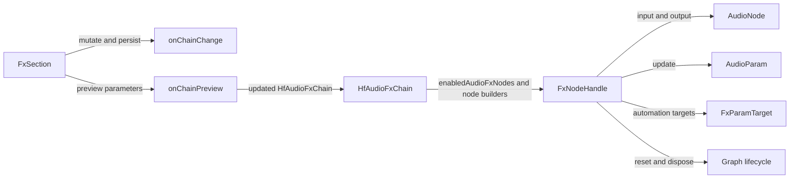
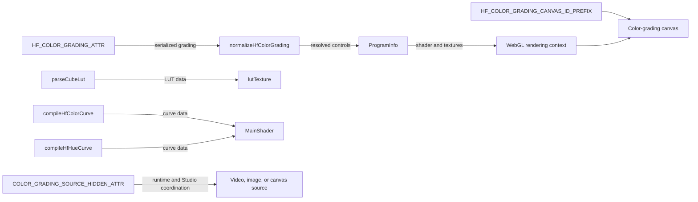
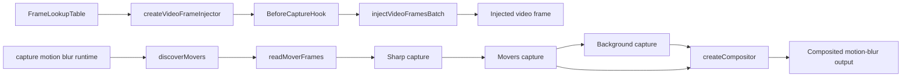

<!-- source: DeepWiki mcp.deepwiki.com · repo heygen-com/hyperframes · page 3.6 Audio, Color Grading and Media Effects · fetched 2026-11-02 -->

# Audio, Color Grading and Media Effects

Relevant source files

The following files were used as context for generating this wiki page:

- [.oxlintrc.json](.oxlintrc.json)
- [packages/cli/src/browser/colorGradingShaderStages.browser.test.ts](packages/cli/src/browser/colorGradingShaderStages.browser.test.ts)
- [packages/cli/src/utils/checkMotionBlur.page.test.ts](packages/cli/src/utils/checkMotionBlur.page.test.ts)
- [packages/cli/src/utils/checkMotionBlur.test.ts](packages/cli/src/utils/checkMotionBlur.test.ts)
- [packages/cli/src/utils/checkMotionBlur.ts](packages/cli/src/utils/checkMotionBlur.ts)
- [packages/core/src/audio/audioFxGraph.test.ts](packages/core/src/audio/audioFxGraph.test.ts)
- [packages/core/src/audio/audioFxGraph.ts](packages/core/src/audio/audioFxGraph.ts)
- [packages/core/src/audio/audioFxTail.test.ts](packages/core/src/audio/audioFxTail.test.ts)
- [packages/core/src/audio/audioFxTail.ts](packages/core/src/audio/audioFxTail.ts)
- [packages/core/src/audio/audioFxWorklets.test.ts](packages/core/src/audio/audioFxWorklets.test.ts)
- [packages/core/src/audio/audioFxWorklets.ts](packages/core/src/audio/audioFxWorklets.ts)
- [packages/core/src/audioCarve.test.ts](packages/core/src/audioCarve.test.ts)
- [packages/core/src/audioCarve.ts](packages/core/src/audioCarve.ts)
- [packages/core/src/audioFx.test.ts](packages/core/src/audioFx.test.ts)
- [packages/core/src/audioFx.ts](packages/core/src/audioFx.ts)
- [packages/core/src/colorGrading.test.ts](packages/core/src/colorGrading.test.ts)
- [packages/core/src/colorGrading.ts](packages/core/src/colorGrading.ts)
- [packages/core/src/colorGradingCurves.test.ts](packages/core/src/colorGradingCurves.test.ts)
- [packages/core/src/colorGradingCurves.ts](packages/core/src/colorGradingCurves.ts)
- [packages/core/src/colorLuts.test.ts](packages/core/src/colorLuts.test.ts)
- [packages/core/src/colorLuts.ts](packages/core/src/colorLuts.ts)
- [packages/core/src/compiler/standaloneEntry.test.ts](packages/core/src/compiler/standaloneEntry.test.ts)
- [packages/core/src/compiler/standaloneEntry.ts](packages/core/src/compiler/standaloneEntry.ts)
- [packages/core/src/htmlInCanvasDefects.test.ts](packages/core/src/htmlInCanvasDefects.test.ts)
- [packages/core/src/htmlInCanvasDefects.ts](packages/core/src/htmlInCanvasDefects.ts)
- [packages/core/src/pageMotionBlur.ts](packages/core/src/pageMotionBlur.ts)
- [packages/core/src/runtime/captureMotionBlur/composite.test.ts](packages/core/src/runtime/captureMotionBlur/composite.test.ts)
- [packages/core/src/runtime/captureMotionBlur/composite.ts](packages/core/src/runtime/captureMotionBlur/composite.ts)
- [packages/core/src/runtime/captureMotionBlur/discover.test.ts](packages/core/src/runtime/captureMotionBlur/discover.test.ts)
- [packages/core/src/runtime/captureMotionBlur/discover.ts](packages/core/src/runtime/captureMotionBlur/discover.ts)
- [packages/core/src/runtime/captureMotionBlur/filterPlan.test.ts](packages/core/src/runtime/captureMotionBlur/filterPlan.test.ts)
- [packages/core/src/runtime/captureMotionBlur/filterPlan.ts](packages/core/src/runtime/captureMotionBlur/filterPlan.ts)
- [packages/core/src/runtime/captureMotionBlur/filterTier.ts](packages/core/src/runtime/captureMotionBlur/filterTier.ts)
- [packages/core/src/runtime/captureMotionBlur/frames.ts](packages/core/src/runtime/captureMotionBlur/frames.ts)
- [packages/core/src/runtime/captureMotionBlur/index.test.ts](packages/core/src/runtime/captureMotionBlur/index.test.ts)
- [packages/core/src/runtime/captureMotionBlur/index.ts](packages/core/src/runtime/captureMotionBlur/index.ts)
- [packages/core/src/runtime/captureMotionBlur/ink.test.ts](packages/core/src/runtime/captureMotionBlur/ink.test.ts)
- [packages/core/src/runtime/captureMotionBlur/ink.ts](packages/core/src/runtime/captureMotionBlur/ink.ts)
- [packages/core/src/runtime/captureMotionBlur/pose.test.ts](packages/core/src/runtime/captureMotionBlur/pose.test.ts)
- [packages/core/src/runtime/captureMotionBlur/pose.ts](packages/core/src/runtime/captureMotionBlur/pose.ts)
- [packages/core/src/runtime/captureMotionBlur/tier.ts](packages/core/src/runtime/captureMotionBlur/tier.ts)
- [packages/core/src/runtime/colorGrading.test.ts](packages/core/src/runtime/colorGrading.test.ts)
- [packages/core/src/runtime/colorGrading.ts](packages/core/src/runtime/colorGrading.ts)
- [packages/core/stubs/audio-fx-runtime-entry.ts](packages/core/stubs/audio-fx-runtime-entry.ts)
- [packages/engine/src/services/audioFxRender.test.ts](packages/engine/src/services/audioFxRender.test.ts)
- [packages/engine/src/services/audioFxWarmup.test.ts](packages/engine/src/services/audioFxWarmup.test.ts)
- [packages/engine/src/services/audioFxWarmup.ts](packages/engine/src/services/audioFxWarmup.ts)
- [packages/engine/src/services/captureMotionBlur.pixels.browser.test.ts](packages/engine/src/services/captureMotionBlur.pixels.browser.test.ts)
- [packages/engine/src/services/frameCapture-gpuCompletion.test.ts](packages/engine/src/services/frameCapture-gpuCompletion.test.ts)
- [packages/engine/src/services/frameCapture-motionBlur.test.ts](packages/engine/src/services/frameCapture-motionBlur.test.ts)
- [packages/engine/src/services/frameCapture-verificationPage.test.ts](packages/engine/src/services/frameCapture-verificationPage.test.ts)
- [packages/engine/src/services/motionBlur.test.ts](packages/engine/src/services/motionBlur.test.ts)
- [packages/engine/src/services/motionBlur.ts](packages/engine/src/services/motionBlur.ts)
- [packages/engine/src/services/pageMotionBlur.test.ts](packages/engine/src/services/pageMotionBlur.test.ts)
- [packages/engine/src/services/pageMotionBlur.ts](packages/engine/src/services/pageMotionBlur.ts)
- [packages/engine/src/services/screenshotService.test.ts](packages/engine/src/services/screenshotService.test.ts)
- [packages/engine/src/services/screenshotService.ts](packages/engine/src/services/screenshotService.ts)
- [packages/engine/src/services/videoFrameInjector.test.ts](packages/engine/src/services/videoFrameInjector.test.ts)
- [packages/engine/src/services/videoFrameInjector.ts](packages/engine/src/services/videoFrameInjector.ts)
- [packages/parsers/src/colorGradingContract.docs.test.ts](packages/parsers/src/colorGradingContract.docs.test.ts)
- [packages/parsers/src/colorGradingContract.test.ts](packages/parsers/src/colorGradingContract.test.ts)
- [packages/parsers/src/colorGradingContract.ts](packages/parsers/src/colorGradingContract.ts)
- [packages/producer/src/services/render/lateVisibleImageGrading.integration.test.ts](packages/producer/src/services/render/lateVisibleImageGrading.integration.test.ts)
- [packages/producer/src/services/render/motionBlurVideo.integration.test.ts](packages/producer/src/services/render/motionBlurVideo.integration.test.ts)
- [packages/studio/src/components/editor/audioFxSummary.test.ts](packages/studio/src/components/editor/audioFxSummary.test.ts)
- [packages/studio/src/components/editor/audioFxSummary.ts](packages/studio/src/components/editor/audioFxSummary.ts)
- [packages/studio/src/components/editor/propertyPanelAudioFxGroup.test.tsx](packages/studio/src/components/editor/propertyPanelAudioFxGroup.test.tsx)
- [packages/studio/src/components/editor/propertyPanelAudioFxGroup.tsx](packages/studio/src/components/editor/propertyPanelAudioFxGroup.tsx)
- [packages/studio/src/components/editor/propertyPanelFxControls.tsx](packages/studio/src/components/editor/propertyPanelFxControls.tsx)
- [packages/studio/src/components/editor/propertyPanelFxSection.test.tsx](packages/studio/src/components/editor/propertyPanelFxSection.test.tsx)
- [packages/studio/src/components/editor/propertyPanelFxSection.tsx](packages/studio/src/components/editor/propertyPanelFxSection.tsx)

## Purpose and scope

This page describes the available implementation evidence for audio FX graphs and Studio controls, color-grading data and runtime rendering, video-frame injection during capture, and capture motion blur. Details that require files not included in the supplied source excerpts—such as the audio worklet implementation, full audio-group runtime, HDR tone-mapping path, and media-grade analysis—are identified as areas where the implementation cannot be established from these excerpts. [packages/core/src/audio/audioFxGraph.ts:1-19]()

Sources: `packages/core/src/audio/audioFxGraph.ts`

---

## 1. Audio Effects Subsystem

The audio FX graph is a Web Audio graph built from a serialized FX chain. Each graph node exposes an `update` method so parameter changes can update the running graph rather than rebuild it. The graph contract also allows nodes to expose automation targets and a `reset` hook for discontinuities such as seeks. [packages/core/src/audio/audioFxGraph.ts:1-8]()[packages/core/src/audio/audioFxGraph.ts:63-87]()

The provided graph excerpt shows deterministic reverb-impulse synthesis and an LFO source with a settable phase. It imports `audioFxWorkletsReady` and `ensureAudioFxWorklets`, but the worklet-loading behavior and the rest of the node builders are not included in the excerpt. [packages/core/src/audio/audioFxGraph.ts:19-19]()[packages/core/src/audio/audioFxGraph.ts:21-61]()[packages/core/src/audio/audioFxGraph.ts:105-148]()

Sources: `packages/core/src/audio/audioFxGraph.ts`

### Chain model and Studio editing

The Studio `FxSection` receives a chain and callbacks for persisted changes, previews, automation, and carve settings. Adding an effect appends a node with an ID, enabled state, and default parameters; if the effect has a profile, it seeds the node through that profile. Jobs are also represented as nodes appended to the chain. [packages/studio/src/components/editor/propertyPanelFxSection.tsx:82-112]()[packages/studio/src/components/editor/propertyPanelFxSection.tsx:57-77]()

Previewing a parameter change constructs a chain with updated parameters for the selected node and passes it to `onChainPreview`. Applying a preset uses the stored chain, clears audition state, and persists the resulting nodes. [packages/studio/src/components/editor/propertyPanelFxSection.tsx:137-145]()[packages/studio/src/components/editor/propertyPanelFxSection.tsx:147-170]()

Sources: `packages/studio/src/components/editor/propertyPanelFxSection.tsx`

### Graph node behavior and automation targets

`FxNodeHandle` defines the interface between a chain node builder and the running graph: `input`, `output`, `update`, optional `automation` targets, optional `reset`, and `dispose`. An automation target pairs an `AudioParam` with an optional value-mapping function, allowing a control value to drive one or more parameters or to be converted between units. [packages/core/src/audio/audioFxGraph.ts:63-87]()

The graph builder receives clip-relative elapsed time. The excerpt explains that this value is used when rebuilding a graph mid-play so an LFO can resume at a phase based on elapsed time rather than restart at phase zero. The LFO uses a looping one-second buffer and computes its start offset from elapsed time and speed. [packages/core/src/audio/audioFxGraph.ts:89-98]()[packages/core/src/audio/audioFxGraph.ts:105-147]()

Sources: `packages/core/src/audio/audioFxGraph.ts`

### Reverb determinism

`synthesizeReverbImpulse` creates a decaying-noise impulse buffer. Its pseudo-random seed is derived from the size and damping parameters, and the resulting samples are normalized to unit energy. The comments specify that both engines share this impulse so preview and render can convolve the same response. [packages/core/src/audio/audioFxGraph.ts:21-61]()

Sources: `packages/core/src/audio/audioFxGraph.ts`

### Carve and audio groups

The FX section treats carve as a separate module rather than an entry in the ordinary effect chain. It only shows carve controls when a source is available or a carve already exists, and suppresses the control when the selected voice is already being carved against by another track. [packages/studio/src/components/editor/propertyPanelFxSection.tsx:1-7]()[packages/studio/src/components/editor/propertyPanelFxSection.tsx:114-123]()

The supplied Studio test excerpt demonstrates a selected `<hf-audio-group>` with an `fx-chain` attribute and a member carrying `data-audio-group`, `data-start`, and `data-duration`. It establishes that the group is presented to `AudioFxGroup` as an editable selection, but does not show the group’s runtime routing implementation. [packages/studio/src/components/editor/propertyPanelAudioFxGroup.test.tsx:106-134]()

Sources: `packages/studio/src/components/editor/propertyPanelFxSection.tsx`, `packages/studio/src/components/editor/propertyPanelAudioFxGroup.test.tsx`

### Audio FX data flow: Studio controls to graph contract

This diagram connects Studio’s `FxSection` and its chain callbacks to the graph interface shown in the supplied core excerpt. The excerpt does not include the call site that connects a persisted Studio chain to a particular graph builder. [packages/studio/src/components/editor/propertyPanelFxSection.tsx:82-112]()[packages/studio/src/components/editor/propertyPanelFxSection.tsx:129-145]()[packages/core/src/audio/audioFxGraph.ts:63-87]()

**Diagram: Audio FX editing and graph interface**

Sources: `packages/studio/src/components/editor/propertyPanelFxSection.tsx`, `packages/core/src/audio/audioFxGraph.ts`

---

## 2. Color Grading Contract and Runtime Application

### Contract and data model

The core color-grading module defines `data-color-grading` as the media attribute and imports contract constants and types from `@hyperframes/parsers/color-grading-contract`. It also defines runtime/studio coordination attributes for hiding the graded source while its pixels render on a grading canvas and for recording authored inline opacity. [packages/core/src/colorGrading.ts:1-19]()[packages/core/src/colorGrading.ts:28-45]()

The data model includes adjustments, tonal wheels, RGB curves, hue curves, secondary corrections, details, and effects. The excerpt shows effect parameters including blur, bloom, chromatic aberration, tape-style effects, and several stylized rendering controls. [packages/core/src/colorGrading.ts:67-115]()[packages/core/src/colorGrading.ts:118-156]()[packages/core/src/colorGrading.ts:158-233]()

Sources: `packages/core/src/colorGrading.ts`

### Runtime renderer and LUT support

The runtime imports normalization and activity helpers, curve compilers, and cube-LUT parsing and packing functions. Its renderer state includes WebGL textures for the source, LUT, and advanced processing, shader programs, and optional effect targets. [packages/core/src/runtime/colorGrading.ts:1-54]()[packages/core/src/runtime/colorGrading.ts:75-85]()[packages/core/src/runtime/colorGrading.ts:87-131]()[packages/core/src/runtime/colorGrading.ts:145-205]()

The shader uniform contract includes LUT enablement, size, texture size, domain bounds, and intensity, as well as controls for adjustments, details, effects, wheels, curves, and secondary corrections. This establishes the available runtime inputs, but the supplied excerpt does not include the rendering functions that bind and apply them. [packages/core/src/runtime/colorGrading.ts:87-131]()

The core color-grading contract exports `HF_COLOR_GRADING_CANVAS_ID_PREFIX` for grading canvases and `HF_COLOR_GRADING_ATTR` for the serialized media attribute. [packages/core/src/colorGrading.ts:28-45]()

Sources: `packages/core/src/runtime/colorGrading.ts`, `packages/core/src/colorGrading.ts`

### Runtime color-grading data flow: contract names to renderer entities

This diagram maps the named attribute and runtime helpers to the WebGL state entities visible in the supplied excerpts. It does not imply an exact shader-stage ordering, which is not shown in those excerpts. [packages/core/src/colorGrading.ts:28-45]()[packages/core/src/runtime/colorGrading.ts:1-54]()[packages/core/src/runtime/colorGrading.ts:75-131]()

**Diagram: Color-grading contract and runtime**

Sources: `packages/core/src/colorGrading.ts`, `packages/core/src/runtime/colorGrading.ts`

---

## 3. Video Frames, Capture Motion Blur, and Media Effects

### Video-frame injection during capture

`createVideoFrameInjector` creates a `BeforeCaptureHook` when a frame lookup table is available; it returns `null` when no lookup is provided. The injector’s purpose is to replace native `<video>` elements with pre-extracted frame images during rendering. [packages/engine/src/services/videoFrameInjector.ts:1-8]()[packages/engine/src/services/videoFrameInjector.ts:170-179]()

The frame source cache is a two-bound LRU: entry count and byte budget can each trigger eviction. It reads frames from disk, converts them into data URIs, coalesces concurrent reads for the same path, and can return a resolved served URL without using the cache. [packages/engine/src/services/videoFrameInjector.ts:49-65]()[packages/engine/src/services/videoFrameInjector.ts:67-76]()[packages/engine/src/services/videoFrameInjector.ts:116-153]()

At capture time, the injector delegates frame updates to `injectVideoFramesBatch` and visibility synchronization to `syncVideoFrameVisibility`. The screenshot service uses `HeadlessExperimental.beginFrame` for atomic layout/paint/composite capture when that path is used; it caches the last screenshot buffer for frames reported without visual damage. [packages/engine/src/services/videoFrameInjector.ts:10-23]()[packages/engine/src/services/screenshotService.ts:101-115]()[packages/engine/src/services/screenshotService.ts:144-179]()

Sources: `packages/engine/src/services/videoFrameInjector.ts`, `packages/engine/src/services/screenshotService.ts`

### Capture motion blur

The capture-motion-blur runtime reads settings from the composition root, checks whether the renderer or browser supports the feature, and creates a compositor for the composition dimensions and device-pixel ratio. Its documented per-frame process samples mover poses across the shutter, captures the sharp composition and movers, captures the background with movers hidden, and composites the movers along their paths. [packages/core/src/runtime/captureMotionBlur/index.ts:1-11]()[packages/core/src/runtime/captureMotionBlur/index.ts:93-115]()[packages/core/src/runtime/captureMotionBlur/index.ts:125-163]()

The runtime defines capture phases for the sharp frame, movers, and background. It also documents preview and render pose-read counts and a failure threshold that turns blur off for the session. [packages/core/src/runtime/captureMotionBlur/index.ts:69-91]()

The supplied excerpts do not establish an HDR tone-mapping implementation or a media-grade analysis/scopes subsystem. Those topics are therefore not described here as implemented behavior. [packages/core/src/runtime/colorGrading.ts:1-54]()[packages/core/src/runtime/captureMotionBlur/index.ts:1-11]()

Sources: `packages/core/src/runtime/captureMotionBlur/index.ts`, `packages/core/src/runtime/colorGrading.ts`

### Capture and media-effects flow

This diagram connects the capture hook and frame injection service to capture motion blur’s compositing stages. It shows their code-level responsibilities without asserting a call relationship between the two systems that is not present in the supplied excerpts. [packages/engine/src/services/videoFrameInjector.ts:170-179]()[packages/engine/src/services/videoFrameInjector.ts:10-15]()[packages/core/src/runtime/captureMotionBlur/index.ts:69-82]()[packages/core/src/runtime/captureMotionBlur/index.ts:149-163]()

**Diagram: Capture frame preparation and motion-blur compositing**

Sources: `packages/engine/src/services/videoFrameInjector.ts`, `packages/core/src/runtime/captureMotionBlur/index.ts`

---

## 4. Implementation boundaries in the supplied excerpts

| Area | What the supplied excerpts establish |
|---|---|
| Audio graph | Chain-node handle contract, automation targets, deterministic reverb-impulse synthesis, and elapsed-time-aware LFO construction. [packages/core/src/audio/audioFxGraph.ts:21-61]()[packages/core/src/audio/audioFxGraph.ts:63-87]()[packages/core/src/audio/audioFxGraph.ts:89-147]() |
| Studio FX controls | Chain mutation and preview callbacks, preset application, effect/job append behavior, and carve visibility rules. [packages/studio/src/components/editor/propertyPanelFxSection.tsx:57-77]()[packages/studio/src/components/editor/propertyPanelFxSection.tsx:114-170]() |
| Audio groups | A Studio test fixture with `<hf-audio-group>`, `data-audio-group`, `data-start`, and `data-duration`; the group runtime is not included. [packages/studio/src/components/editor/propertyPanelAudioFxGroup.test.tsx:106-134]() |
| Color grading | Attribute names, data-model families, normalization and LUT-related imports, and WebGL program/uniform state. [packages/core/src/colorGrading.ts:28-45]()[packages/core/src/colorGrading.ts:67-115]()[packages/core/src/runtime/colorGrading.ts:1-54]()[packages/core/src/runtime/colorGrading.ts:75-131]() |
| Video capture | Pre-extracted frame injection, bounded LRU data-URI caching, and BeginFrame screenshot capture behavior. [packages/engine/src/services/videoFrameInjector.ts:49-65]()[packages/engine/src/services/videoFrameInjector.ts:116-153]()[packages/engine/src/services/screenshotService.ts:101-115]()[packages/engine/src/services/screenshotService.ts:144-179]() |
| Motion blur | Capture settings, support checks, mover sampling and compositing responsibilities. [packages/core/src/runtime/captureMotionBlur/index.ts:1-11]()[packages/core/src/runtime/captureMotionBlur/index.ts:93-115]()[packages/core/src/runtime/captureMotionBlur/index.ts:149-163]() |
| HDR tone mapping and media-grade analysis | Not established by the supplied excerpts. [packages/core/src/runtime/colorGrading.ts:1-54]() |

Sources: `packages/core/src/audio/audioFxGraph.ts`, `packages/studio/src/components/editor/propertyPanelFxSection.tsx`, `packages/studio/src/components/editor/propertyPanelAudioFxGroup.test.tsx`, `packages/core/src/colorGrading.ts`, `packages/core/src/runtime/colorGrading.ts`, `packages/engine/src/services/videoFrameInjector.ts`, `packages/engine/src/services/screenshotService.ts`, `packages/core/src/runtime/captureMotionBlur/index.ts`

---

