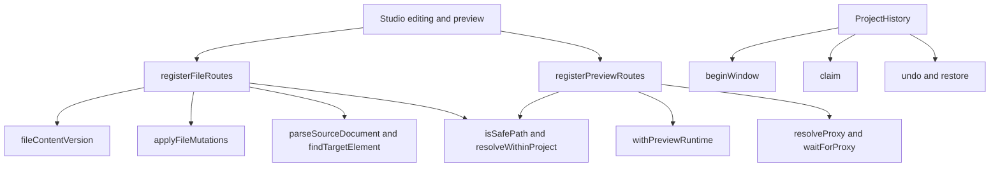
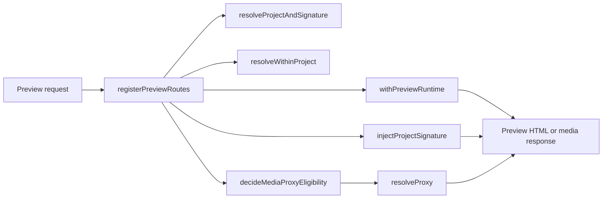

<!-- source: DeepWiki mcp.deepwiki.com · repo heygen-com/hyperframes · page 3.7 Studio Server (Hono Backend) · fetched 2026-11-02 -->

# Studio Server (Hono Backend)

<details>
<summary>Relevant source files</summary>

The following files were used as context for generating this wiki page:

- [packages/cli/src/commands/clean.ts](packages/cli/src/commands/clean.ts)
- [packages/cli/src/commands/history.test.ts](packages/cli/src/commands/history.test.ts)
- [packages/cli/src/commands/history.ts](packages/cli/src/commands/history.ts)
- [packages/cli/src/server/fileWatcher.atomic.test.ts](packages/cli/src/server/fileWatcher.atomic.test.ts)
- [packages/cli/src/server/fileWatcher.fs.test.ts](packages/cli/src/server/fileWatcher.fs.test.ts)
- [packages/cli/src/server/fileWatcher.test.ts](packages/cli/src/server/fileWatcher.test.ts)
- [packages/cli/src/server/fileWatcher.ts](packages/cli/src/server/fileWatcher.ts)
- [packages/cli/src/server/studioServer.folderReplacement.test.ts](packages/cli/src/server/studioServer.folderReplacement.test.ts)
- [packages/cli/src/utils/checkSnapshotDirectory.test.ts](packages/cli/src/utils/checkSnapshotDirectory.test.ts)
- [packages/cli/src/utils/checkSnapshotDirectory.ts](packages/cli/src/utils/checkSnapshotDirectory.ts)
- [packages/cli/src/utils/historyOwner.test.ts](packages/cli/src/utils/historyOwner.test.ts)
- [packages/cli/src/utils/historyOwner.ts](packages/cli/src/utils/historyOwner.ts)
- [packages/cli/src/utils/unifiedDiff.test.ts](packages/cli/src/utils/unifiedDiff.test.ts)
- [packages/cli/src/utils/unifiedDiff.ts](packages/cli/src/utils/unifiedDiff.ts)
- [packages/core/src/compiler/htmlDocument.test.ts](packages/core/src/compiler/htmlDocument.test.ts)
- [packages/core/src/compiler/htmlDocument.ts](packages/core/src/compiler/htmlDocument.ts)
- [packages/core/src/previewProxyBox.test.ts](packages/core/src/previewProxyBox.test.ts)
- [packages/core/src/previewProxyBox.ts](packages/core/src/previewProxyBox.ts)
- [packages/core/src/projectFolders.ts](packages/core/src/projectFolders.ts)
- [packages/core/src/runtime/mediaProxy.test.ts](packages/core/src/runtime/mediaProxy.test.ts)
- [packages/core/src/runtime/mediaProxy.ts](packages/core/src/runtime/mediaProxy.ts)
- [packages/core/src/safePath.eisdir.test.ts](packages/core/src/safePath.eisdir.test.ts)
- [packages/core/src/safePath.test.ts](packages/core/src/safePath.test.ts)
- [packages/core/src/safePath.ts](packages/core/src/safePath.ts)
- [packages/engine/src/utils/ffprobe.test.ts](packages/engine/src/utils/ffprobe.test.ts)
- [packages/engine/src/utils/ffprobe.ts](packages/engine/src/utils/ffprobe.ts)
- [packages/lint/src/hyperframeLinter.ts](packages/lint/src/hyperframeLinter.ts)
- [packages/lint/src/rules/rootPaths.test.ts](packages/lint/src/rules/rootPaths.test.ts)
- [packages/lint/src/rules/rootPaths.ts](packages/lint/src/rules/rootPaths.ts)
- [packages/lint/src/types.ts](packages/lint/src/types.ts)
- [packages/parsers/package-subpaths.json](packages/parsers/package-subpaths.json)
- [packages/parsers/src/index.ts](packages/parsers/src/index.ts)
- [packages/parsers/tsup.config.ts](packages/parsers/tsup.config.ts)
- [packages/producer/src/services/render/renderDirOwner.sandbox.test.ts](packages/producer/src/services/render/renderDirOwner.sandbox.test.ts)
- [packages/producer/src/services/render/renderDirOwner.ts](packages/producer/src/services/render/renderDirOwner.ts)
- [packages/studio-server/src/helpers/applyFileMutations.test.ts](packages/studio-server/src/helpers/applyFileMutations.test.ts)
- [packages/studio-server/src/helpers/applyFileMutations.ts](packages/studio-server/src/helpers/applyFileMutations.ts)
- [packages/studio-server/src/helpers/compositionInsertion.test.ts](packages/studio-server/src/helpers/compositionInsertion.test.ts)
- [packages/studio-server/src/helpers/compositionInsertion.ts](packages/studio-server/src/helpers/compositionInsertion.ts)
- [packages/studio-server/src/helpers/fileVersion.test.ts](packages/studio-server/src/helpers/fileVersion.test.ts)
- [packages/studio-server/src/helpers/fileVersion.ts](packages/studio-server/src/helpers/fileVersion.ts)
- [packages/studio-server/src/helpers/gsapCoreScript.test.ts](packages/studio-server/src/helpers/gsapCoreScript.test.ts)
- [packages/studio-server/src/helpers/gsapCoreScript.ts](packages/studio-server/src/helpers/gsapCoreScript.ts)
- [packages/studio-server/src/helpers/hfIdPersist.noFollow.test.ts](packages/studio-server/src/helpers/hfIdPersist.noFollow.test.ts)
- [packages/studio-server/src/helpers/hfIdPersist.test.ts](packages/studio-server/src/helpers/hfIdPersist.test.ts)
- [packages/studio-server/src/helpers/hfIdPersist.ts](packages/studio-server/src/helpers/hfIdPersist.ts)
- [packages/studio-server/src/helpers/mediaCodecMap.test.ts](packages/studio-server/src/helpers/mediaCodecMap.test.ts)
- [packages/studio-server/src/helpers/mediaCodecMap.ts](packages/studio-server/src/helpers/mediaCodecMap.ts)
- [packages/studio-server/src/helpers/mediaMetadata.test.ts](packages/studio-server/src/helpers/mediaMetadata.test.ts)
- [packages/studio-server/src/helpers/mediaMetadata.ts](packages/studio-server/src/helpers/mediaMetadata.ts)
- [packages/studio-server/src/helpers/mediaProxyPreview.test.ts](packages/studio-server/src/helpers/mediaProxyPreview.test.ts)
- [packages/studio-server/src/helpers/mediaProxyPreview.ts](packages/studio-server/src/helpers/mediaProxyPreview.ts)
- [packages/studio-server/src/helpers/projectDirMissing.ts](packages/studio-server/src/helpers/projectDirMissing.ts)
- [packages/studio-server/src/helpers/projectSignature.test.ts](packages/studio-server/src/helpers/projectSignature.test.ts)
- [packages/studio-server/src/helpers/projectSignature.ts](packages/studio-server/src/helpers/projectSignature.ts)
- [packages/studio-server/src/helpers/proxyCacheKey.ts](packages/studio-server/src/helpers/proxyCacheKey.ts)
- [packages/studio-server/src/helpers/proxyLock.ts](packages/studio-server/src/helpers/proxyLock.ts)
- [packages/studio-server/src/helpers/proxyTranscoder.test.ts](packages/studio-server/src/helpers/proxyTranscoder.test.ts)
- [packages/studio-server/src/helpers/proxyTranscoder.ts](packages/studio-server/src/helpers/proxyTranscoder.ts)
- [packages/studio-server/src/helpers/rootImportMap.test.ts](packages/studio-server/src/helpers/rootImportMap.test.ts)
- [packages/studio-server/src/helpers/rootImportMap.ts](packages/studio-server/src/helpers/rootImportMap.ts)
- [packages/studio-server/src/helpers/rootPaths.test.ts](packages/studio-server/src/helpers/rootPaths.test.ts)
- [packages/studio-server/src/helpers/rootPaths.ts](packages/studio-server/src/helpers/rootPaths.ts)
- [packages/studio-server/src/helpers/safePath.test.ts](packages/studio-server/src/helpers/safePath.test.ts)
- [packages/studio-server/src/helpers/safePath.ts](packages/studio-server/src/helpers/safePath.ts)
- [packages/studio-server/src/helpers/sourceMutation.test.ts](packages/studio-server/src/helpers/sourceMutation.test.ts)
- [packages/studio-server/src/helpers/sourceMutation.ts](packages/studio-server/src/helpers/sourceMutation.ts)
- [packages/studio-server/src/helpers/sourceMutationSplitAndGroup.test.ts](packages/studio-server/src/helpers/sourceMutationSplitAndGroup.test.ts)
- [packages/studio-server/src/helpers/subComposition.test.ts](packages/studio-server/src/helpers/subComposition.test.ts)
- [packages/studio-server/src/helpers/subComposition.ts](packages/studio-server/src/helpers/subComposition.ts)
- [packages/studio-server/src/history/historyId.ts](packages/studio-server/src/history/historyId.ts)
- [packages/studio-server/src/history/historyLog.ts](packages/studio-server/src/history/historyLog.ts)
- [packages/studio-server/src/history/index.ts](packages/studio-server/src/history/index.ts)
- [packages/studio-server/src/history/ownerLock.test.ts](packages/studio-server/src/history/ownerLock.test.ts)
- [packages/studio-server/src/history/ownerLock.ts](packages/studio-server/src/history/ownerLock.ts)
- [packages/studio-server/src/history/projectHistory.test.ts](packages/studio-server/src/history/projectHistory.test.ts)
- [packages/studio-server/src/history/projectHistory.ts](packages/studio-server/src/history/projectHistory.ts)
- [packages/studio-server/src/history/reclaimUncopied.test.ts](packages/studio-server/src/history/reclaimUncopied.test.ts)
- [packages/studio-server/src/history/reclaimUncopied.ts](packages/studio-server/src/history/reclaimUncopied.ts)
- [packages/studio-server/src/history/snapshotRuns.test.ts](packages/studio-server/src/history/snapshotRuns.test.ts)
- [packages/studio-server/src/history/snapshotRuns.ts](packages/studio-server/src/history/snapshotRuns.ts)
- [packages/studio-server/src/history/uncopied.test.ts](packages/studio-server/src/history/uncopied.test.ts)
- [packages/studio-server/src/history/uncopied.ts](packages/studio-server/src/history/uncopied.ts)
- [packages/studio-server/src/history/undoUncopied.test.ts](packages/studio-server/src/history/undoUncopied.test.ts)
- [packages/studio-server/src/history/videoState.ts](packages/studio-server/src/history/videoState.ts)
- [packages/studio-server/src/routes/files.patchRace.test.ts](packages/studio-server/src/routes/files.patchRace.test.ts)
- [packages/studio-server/src/routes/files.pathSafety.test.ts](packages/studio-server/src/routes/files.pathSafety.test.ts)
- [packages/studio-server/src/routes/files.test.ts](packages/studio-server/src/routes/files.test.ts)
- [packages/studio-server/src/routes/files.ts](packages/studio-server/src/routes/files.ts)
- [packages/studio-server/src/routes/history.test.ts](packages/studio-server/src/routes/history.test.ts)
- [packages/studio-server/src/routes/history.ts](packages/studio-server/src/routes/history.ts)
- [packages/studio-server/src/routes/lint.test.ts](packages/studio-server/src/routes/lint.test.ts)
- [packages/studio-server/src/routes/lint.ts](packages/studio-server/src/routes/lint.ts)
- [packages/studio-server/src/routes/preview.freshAfterWrite.test.ts](packages/studio-server/src/routes/preview.freshAfterWrite.test.ts)
- [packages/studio-server/src/routes/preview.test.ts](packages/studio-server/src/routes/preview.test.ts)
- [packages/studio-server/src/routes/preview.ts](packages/studio-server/src/routes/preview.ts)
- [packages/studio-server/src/routes/projects.test.ts](packages/studio-server/src/routes/projects.test.ts)
- [packages/studio-server/src/routes/projects.ts](packages/studio-server/src/routes/projects.ts)
- [packages/studio-server/src/routes/registry.ts](packages/studio-server/src/routes/registry.ts)
- [packages/studio/src/components/feedback/projectProvenance.ts](packages/studio/src/components/feedback/projectProvenance.ts)
- [packages/studio/src/hooks/useFileTree.test.tsx](packages/studio/src/hooks/useFileTree.test.tsx)
- [packages/studio/src/hooks/useFileTree.ts](packages/studio/src/hooks/useFileTree.ts)
- [packages/studio/src/hooks/useGroupCommits.test.ts](packages/studio/src/hooks/useGroupCommits.test.ts)
- [packages/studio/src/hooks/useGroupCommits.ts](packages/studio/src/hooks/useGroupCommits.ts)
- [packages/studio/src/player/components/clipPeakMap.test.ts](packages/studio/src/player/components/clipPeakMap.test.ts)
- [packages/studio/src/utils/mediaTypes.test.ts](packages/studio/src/utils/mediaTypes.test.ts)
- [packages/studio/src/utils/mediaTypes.ts](packages/studio/src/utils/mediaTypes.ts)
- [packages/studio/src/utils/razorSplitTransaction.test.ts](packages/studio/src/utils/razorSplitTransaction.test.ts)
- [packages/studio/src/utils/razorSplitTransaction.ts](packages/studio/src/utils/razorSplitTransaction.ts)
- [scripts/package-size-budgets.json](scripts/package-size-budgets.json)

</details>


## 1. Purpose and Scope

`@hyperframes/studio-server` provides a Hono-based backend for Studio and preview workflows. Its scope includes project file operations and mutations, preview generation, and project-history and media-proxy support; the package is also identified in the repository’s package-size budgets. [packages/studio-server/src/routes/files.ts:5-12]()[packages/studio-server/src/routes/preview.ts:1-16]()[scripts/package-size-budgets.json:54-57]()

The implementation excerpts available here show the file and preview routes, shared path and mutation helpers, the proxy transcoder, and the project-history API. They do not include the route implementations or package entry point for every route group listed in the package’s scope, so those groups are identified below without inferring their endpoint behavior. [packages/studio-server/src/routes/files.ts:1-12]()[packages/studio-server/src/routes/preview.ts:1-16]()[packages/studio-server/src/helpers/proxyTranscoder.ts:33-42]()[packages/studio-server/src/history/projectHistory.ts:68-92]()

Sources: `packages/studio-server/src/routes/files.ts:1-12`, `packages/studio-server/src/routes/preview.ts:1-16`, `packages/studio-server/src/helpers/proxyTranscoder.ts:33-42`, `packages/studio-server/src/history/projectHistory.ts:68-92`, `scripts/package-size-budgets.json:54-57`

---

## 2. Route Groups and Responsibilities

The server’s route modules are organized around project capabilities. The available excerpts directly show `registerFileRoutes` and `registerPreviewRoutes` being used to register Hono handlers; route files for lint, render, thumbnail, media, registry, and history are named in the package scope, but their implementations are not included in the excerpts. [packages/studio-server/src/routes/files.test.ts:127-138]()[packages/studio-server/src/routes/preview.test.ts:111-116]()

| Route group | What can be established from the available source |
|---|---|
| Files | `files.ts` imports filesystem, path-safety, file-version, mutation, and media-validation helpers. Its tests register the routes and exercise composition insertion with expected-version checks and a write token. [packages/studio-server/src/routes/files.ts:13-53]()[packages/studio-server/src/routes/files.test.ts:127-167]() |
| Preview | `preview.ts` imports compiler/runtime helpers, project-path checks, project-signature helpers, and media-proxy/transcoding helpers. Tests register the preview routes and request project preview HTML. [packages/studio-server/src/routes/preview.ts:8-21]()[packages/studio-server/src/routes/preview.ts:38-80]()[packages/studio-server/src/routes/preview.test.ts:94-103]() |
| Lint, render, thumbnail, media, registry, history | These are within the package’s stated scope, but their route implementations are not present in the provided excerpts. The history subsystem itself is documented separately below. [packages/studio-server/src/history/projectHistory.ts:137-179]() |

Sources: `packages/studio-server/src/routes/files.ts:13-53`, `packages/studio-server/src/routes/files.test.ts:127-167`, `packages/studio-server/src/routes/preview.ts:8-80`, `packages/studio-server/src/routes/preview.test.ts:94-116`, `packages/studio-server/src/history/projectHistory.ts:137-179`

### 2.1. Files

`files.ts` is a Hono route module. Its imports show the concerns it brings together: filesystem operations, URL-path parsing, upload validation, path containment, file-version receipts, backup journaling, mutation validation, HTML source mutation, and GSAP parsing/writing. [packages/studio-server/src/routes/files.ts:5-61]()

The route module imports `applyFileMutations` and `FileChangedError`, as well as `snapshotBeforeWrite` and `backupPathForResponse`; it also imports `createWriteToken`, `fileContentVersion`, and `recordFileWriteReceipt`. These dependencies indicate that the file API is designed around guarded mutations and write tracking rather than uncoordinated text replacement. [packages/studio-server/src/routes/files.ts:46-58]()

The route tests demonstrate a concrete compare-and-set workflow for composition insertion: the request supplies `expectedVersion`, the route responds with the resulting source and version, and a subsequent request with the stale version returns `409` without changing the committed source. A `X-Hyperframes-Write-Token` is recorded with the write receipt. [packages/studio-server/src/routes/files.test.ts:127-167]()

Sources: `packages/studio-server/src/routes/files.ts:5-61`, `packages/studio-server/src/routes/files.test.ts:127-167`

### 2.2. Preview

`preview.ts` imports compiler helpers for runtime insertion and HTML transformation, path-safety and MIME helpers, sub-composition support, project-signature functions, and media-proxy helpers. The excerpt defines `withPreviewRuntime`, which strips embedded runtime scripts and inserts a runtime tag, and helpers that inject a project-signature meta tag into the document. [packages/studio-server/src/routes/preview.ts:8-21]()[packages/studio-server/src/routes/preview.ts:38-63]()[packages/studio-server/src/routes/preview.ts:100-117]()[packages/studio-server/src/routes/preview.ts:148-152]()

Preview tests exercise the route registration and verify behaviors including project preview requests, project-root import-map paths, and root-relative asset paths. These tests provide evidence that preview responses adapt project HTML and resource paths for serving through the preview endpoint. [packages/studio-server/src/routes/preview.test.ts:94-103]()[packages/studio-server/src/routes/preview.test.ts:111-154]()[packages/studio-server/src/routes/preview.test.ts:156-179]()

Sources: `packages/studio-server/src/routes/preview.ts:8-21`, `packages/studio-server/src/routes/preview.ts:38-63`, `packages/studio-server/src/routes/preview.ts:100-117`, `packages/studio-server/src/routes/preview.ts:148-152`, `packages/studio-server/src/routes/preview.test.ts:94-103`, `packages/studio-server/src/routes/preview.test.ts:111-179`

### 2.3. Lint, Render, Thumbnail, Media, Registry, and History

The package scope includes lint, render, thumbnail, media, registry, and history route groups. Their route-handler implementations are not available in the provided source excerpts, so endpoint paths, request formats, and response behavior for those groups cannot be documented here without speculation. The available history API and media-proxy helper behavior are covered in sections 6 and 7. [packages/studio-server/src/history/projectHistory.ts:137-179]()[packages/studio-server/src/helpers/proxyTranscoder.ts:33-42]()

Sources: `packages/studio-server/src/history/projectHistory.ts:137-179`, `packages/studio-server/src/helpers/proxyTranscoder.ts:33-42`

---

## 3. Adapter Boundary

The route modules use a `StudioApiAdapter` type. The file and preview route tests construct adapters with project resolution, linting, runtime URL, render-directory, and render-start operations, which demonstrates how these route tests supply host-specific services. The interface definition itself is not included in the available excerpts, so the test fixture should not be treated as a complete interface specification. [packages/studio-server/src/routes/files.ts:30-31]()[packages/studio-server/src/routes/preview.ts:38-38]()[packages/studio-server/src/routes/files.test.ts:56-71]()[packages/studio-server/src/routes/preview.test.ts:64-83]()

| Adapter member shown in test fixtures | Role evidenced by the fixture |
|---|---|
| `listProjects()` | Returns a project list; test fixtures return an empty list. [packages/studio-server/src/routes/files.test.ts:56-61]() |
| `resolveProject(id)` | Resolves an ID to a project directory. [packages/studio-server/src/routes/files.test.ts:56-61]() |
| `bundle()` | Test fixture provides a bundling callback that returns `null`. [packages/studio-server/src/routes/files.test.ts:60-63]() |
| `lint()` | Test fixture returns an empty findings list. [packages/studio-server/src/routes/files.test.ts:60-63]() |
| `runtimeUrl` | Supplies the runtime script URL used by preview-related test behavior. [packages/studio-server/src/routes/files.test.ts:61-66]()[packages/studio-server/src/routes/preview.test.ts:69-75]() |
| `rendersDir()` and `startRender()` | Test fixture provides a render directory and a sample job result. [packages/studio-server/src/routes/files.test.ts:63-69]() |

Sources: `packages/studio-server/src/routes/files.ts:30-31`, `packages/studio-server/src/routes/preview.ts:38-38`, `packages/studio-server/src/routes/files.test.ts:56-71`, `packages/studio-server/src/routes/preview.test.ts:64-83`

---

## 4. Path Safety

The file routes import `isSafePath`, `resolveWithinProject`, `pinWithinProject`, `mkdirWithinProject`, and `walkDir` from `helpers/safePath.ts`. The preview routes import `resolveWithinProject` and project-root checks from the same helper area. This establishes path containment as a shared dependency of file and preview operations; the helper implementation is not included in the provided excerpts, so its full algorithm is not detailed here. [packages/studio-server/src/routes/files.ts:36-45]()[packages/studio-server/src/routes/preview.ts:38-44]()

The file route module also includes a specific explanation of dangling-symlink handling. It describes a check that distinguishes a dangling symlink inside the project from a path that is lexically outside the project or an in-project symlink targeting outside it, to avoid revealing whether an out-of-project path exists. [packages/studio-server/src/routes/files.ts:160-179]()

Sources: `packages/studio-server/src/routes/files.ts:36-45`, `packages/studio-server/src/routes/files.ts:160-179`, `packages/studio-server/src/routes/preview.ts:38-44`

---

## 5. Mutation Helpers

### 5.1. HTML Source Mutations

`sourceMutation.ts` parses source through `parseSourceDocument`. It first calls `ensureHfIds`, detects whether the input has a document shell, then parses either the full document or a wrapped fragment using `linkedom`. It records authored `data-hf-id` values so later target resolution can distinguish IDs present in the original source. [packages/studio-server/src/helpers/sourceMutation.ts:26-42]()

`findTargetElement` resolves targets in priority order: `hfId`, element `id`, then CSS selector and optional selector index. Selector queries also search through nested `<template>` elements, which the helper calls out as necessary because `querySelectorAll` does not traverse template content in `linkedom`. [packages/studio-server/src/helpers/sourceMutation.ts:74-90]()[packages/studio-server/src/helpers/sourceMutation.ts:100-145]()

`removeElementsFromHtml` parses once, resolves each requested target, removes matched elements with `removeElementWithGsapCascade`, and serializes only if something changed. This lets a batch of removals share one parse/serialization pass. [packages/studio-server/src/helpers/sourceMutation.ts:147-169]()

Sources: `packages/studio-server/src/helpers/sourceMutation.ts:26-42`, `packages/studio-server/src/helpers/sourceMutation.ts:74-90`, `packages/studio-server/src/helpers/sourceMutation.ts:100-145`, `packages/studio-server/src/helpers/sourceMutation.ts:147-169`

### 5.2. File Versions and Mutation Coordination

`files.ts` imports `fileContentVersion`, `createWriteToken`, and `recordFileWriteReceipt`, along with `applyFileMutations` and `FileChangedError`. Together with the versioned composition-insertion test, these support a compare-and-set mutation model: a mutation is tied to the source version it expects, and stale requests are rejected rather than silently overwriting a newer result. [packages/studio-server/src/routes/files.ts:49-58]()[packages/studio-server/src/routes/files.test.ts:138-167]()

For GSAP source edits, the route module imports the Acorn parser and a broad set of Acorn writer operations. It also defines a lazy `loadGsapParser()` for the Recast writer path; the comments state that Acorn is used for reads and Recast remains the default write path until the migration gate graduates. [packages/studio-server/src/routes/files.ts:59-93]()[packages/studio-server/src/routes/files.ts:122-135]()

Sources: `packages/studio-server/src/routes/files.ts:49-58`, `packages/studio-server/src/routes/files.test.ts:138-167`, `packages/studio-server/src/routes/files.ts:59-93`, `packages/studio-server/src/routes/files.ts:122-135`

---

## 6. Project History

`projectHistory.ts` exposes a `ProjectHistory` API with operations for change windows, claims, watcher notifications, listing, undo/redo stepping, targeted undo, restore, read-only `peek`, checkout, pinning, checkpoints, flush, and close. The default history root is outside project directories at `~/.cache/hyperframes/history`. [packages/studio-server/src/history/projectHistory.ts:68-69]()[packages/studio-server/src/history/projectHistory.ts:137-179]()

### 6.1. Change Grouping and Attribution

`beginWindow(who, label, options)` groups writes during a window into an entry associated with the specified actor and label. Its interface documentation notes that overlapping writers or operations can commit the work accumulated so far before the window closes. [packages/studio-server/src/history/projectHistory.ts:137-145]()

`claim(who, label, paths, options)` supports writers that record a change after writing. Its options include `coalesceKey`, `idleMs`, and per-path `overwrote` versions; the interface documentation describes same-key claims merging until a different key, an idle period, an operation, a window, or another write. [packages/studio-server/src/history/projectHistory.ts:94-100]()[packages/studio-server/src/history/projectHistory.ts:147-156]()

`noteChange(path)` records that a watcher observed a project-relative or absolute path change. `checkpoint()` and `flush()` commit pending writes and open change groupings, according to the API documentation. [packages/studio-server/src/history/projectHistory.ts:157-159]()[packages/studio-server/src/history/projectHistory.ts:174-176]()

### 6.2. Undo, Restore, and Conflicts

History supports undo modes `just-this`, `back-to-before`, and `keep-later-edits`. `step()` moves backward or forward for an actor, while `undo()` targets an entry and can return a conflict containing files and newer entries. `restore()` returns project files to the state immediately after a specified entry or the `START` point. [packages/studio-server/src/history/projectHistory.ts:115-118]()[packages/studio-server/src/history/projectHistory.ts:125-127]()[packages/studio-server/src/history/projectHistory.ts:160-169]()

### 6.3. Persistence and Ownership

The history implementation imports a blob store, history log operations, project identity helpers, an ownership lock, file-version helpers, and project-signature helpers. Its options include a history root, grouping windows, a storage budget, ownership wait settings, undo scope, and hooks for errors and closed windows. This shows the components and configuration surface involved; implementation details beyond the shown API and imports are not available in the excerpts. [packages/studio-server/src/history/projectHistory.ts:17-45]()[packages/studio-server/src/history/projectHistory.ts:71-92]()

Sources: `packages/studio-server/src/history/projectHistory.ts:17-45`, `packages/studio-server/src/history/projectHistory.ts:68-92`, `packages/studio-server/src/history/projectHistory.ts:94-118`, `packages/studio-server/src/history/projectHistory.ts:125-179`

---

## 7. Media Proxy and Transcoding

`proxyTranscoder.ts` describes a cache-backed authoring proxy for browser-hostile local video sources, including HEVC and ProRes. Its module documentation explicitly distinguishes preview/play/static project use from rendering: the proxy is for authoring routes and the render path continues to use the original file. Concurrent callers for a cache key share an FFmpeg child process; aborting one caller detaches that caller, and the job is dropped or killed when no callers remain. [packages/studio-server/src/helpers/proxyTranscoder.ts:33-42]()

The transcoder uses `.transcode-cache` and a proxy-parameter version (`v7`). It bounds configurable concurrency and queue size, has a stall timeout, and divides long sources into 15-second pieces. The module also defines errors for unavailable FFmpeg, missing HDR filters, queue capacity, sources outside the project, and wait timeouts. [packages/studio-server/src/helpers/proxyTranscoder.ts:44-78]()[packages/studio-server/src/helpers/proxyTranscoder.ts:80-132]()

`waitForProxy()` bounds an individual caller’s wait without cancelling a shared in-flight job. Source canonicalization rejects a requested source outside the project before resolving the project root and source through real paths. [packages/studio-server/src/helpers/proxyTranscoder.ts:134-152]()[packages/studio-server/src/helpers/proxyTranscoder.ts:163-178]()

The preview route imports proxy eligibility and variant selection helpers, request recording, proxy resolution and retry helpers, progress copying, and error types. These imports connect preview serving with codec-aware proxy selection and transcoding; the route’s complete request/response behavior is not shown in the excerpts. [packages/studio-server/src/routes/preview.ts:71-96]()

Sources: `packages/studio-server/src/helpers/proxyTranscoder.ts:33-42`, `packages/studio-server/src/helpers/proxyTranscoder.ts:44-78`, `packages/studio-server/src/helpers/proxyTranscoder.ts:80-152`, `packages/studio-server/src/helpers/proxyTranscoder.ts:163-178`, `packages/studio-server/src/routes/preview.ts:71-96`

---

## 8. Natural-Language Features to Code Entities

This diagram maps the server capabilities described in this page to concrete symbols and files available in the excerpts. It includes the two visible route registration functions and the helper APIs they import or expose. [packages/studio-server/src/routes/files.ts:30-58]()[packages/studio-server/src/routes/preview.ts:38-80]()[packages/studio-server/src/helpers/sourceMutation.ts:28-42]()[packages/studio-server/src/history/projectHistory.ts:137-179]()

**Diagram: Studio capabilities mapped to route and helper symbols**



Sources: `packages/studio-server/src/routes/files.ts:30-58`, `packages/studio-server/src/routes/preview.ts:38-80`, `packages/studio-server/src/helpers/sourceMutation.ts:28-42`, `packages/studio-server/src/history/projectHistory.ts:137-179`

---

## 9. Data Flow: Versioned File Mutation

The test for composition insertion demonstrates a request carrying `sourcePath`, `start`, `track`, and `expectedVersion`, plus a write token in `X-Hyperframes-Write-Token`. It verifies the returned content and version, confirms the receipt includes the token and prior version, and checks that a stale retry returns `409` without changing the file. [packages/studio-server/src/routes/files.test.ts:127-167]()

**Diagram: Composition insertion and stale-write rejection**

```mermaid
sequenceDiagram
  participant StudioUI as "Studio UI"
  participant HonoTestApp as "Hono app"
  participant FileRoutes as "registerFileRoutes"
  participant ProjectFile as "index.html"

  StudioUI->>HonoTestApp: "POST insert-composition with expectedVersion and write token"
  HonoTestApp->>FileRoutes: "Dispatch request"
  FileRoutes->>ProjectFile: "Read and compare expected source version"
  FileRoutes->>ProjectFile: "Write inserted composition"
  FileRoutes-->>StudioUI: "Return after content, new version, and write receipt"
  StudioUI->>HonoTestApp: "Retry using stale expectedVersion"
  HonoTestApp->>FileRoutes: "Dispatch stale request"
  FileRoutes-->>StudioUI: "409; committed source remains unchanged"
```

Sources: `packages/studio-server/src/routes/files.test.ts:127-167`

---

## 10. Natural-Language Preview Flow to Code Entities

The preview route imports project resolution and signature helpers, project path checks, runtime/compiler transformations, and proxy-transcoding utilities. The diagram maps those named entities to the preview response flow without assuming details of route behavior outside the shown code. [packages/studio-server/src/routes/preview.ts:8-21]()[packages/studio-server/src/routes/preview.ts:38-80]()[packages/studio-server/src/routes/preview.ts:100-117]()[packages/studio-server/src/routes/preview.ts:148-152]()

**Diagram: Preview preparation mapped to helper names**



Sources: `packages/studio-server/src/routes/preview.ts:8-21`, `packages/studio-server/src/routes/preview.ts:38-80`, `packages/studio-server/src/routes/preview.ts:100-117`, `packages/studio-server/src/routes/preview.ts:148-152`

---

## 11. Implementation Notes and Limits of the Available Excerpts

The available code includes detailed imports and behavior for `files.ts`, `preview.ts`, `sourceMutation.ts`, `proxyTranscoder.ts`, and `projectHistory.ts`. It does not include the `StudioApiAdapter` definition, the package’s route-registration entry point, or the implementations for the lint, render, thumbnail, media, registry, and history HTTP route modules. Accordingly, this page documents those unshown route groups only as part of the package’s stated scope and avoids specifying their endpoints or internal behavior. [packages/studio-server/src/routes/files.ts:30-58]()[packages/studio-server/src/routes/preview.ts:38-80]()[packages/studio-server/src/helpers/sourceMutation.ts:19-42]()[packages/studio-server/src/helpers/proxyTranscoder.ts:33-42]()[packages/studio-server/src/history/projectHistory.ts:137-179]()

Sources: `packages/studio-server/src/routes/files.ts:30-58`, `packages/studio-server/src/routes/preview.ts:38-80`, `packages/studio-server/src/helpers/sourceMutation.ts:19-42`, `packages/studio-server/src/helpers/proxyTranscoder.ts:33-42`, `packages/studio-server/src/history/projectHistory.ts:137-179`

---

