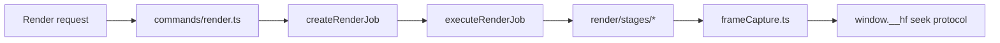
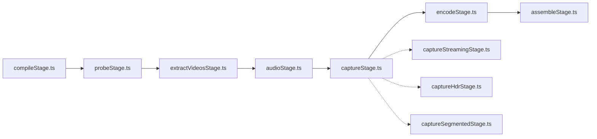
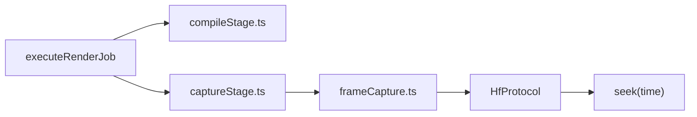

<!-- source: DeepWiki mcp.deepwiki.com · repo heygen-com/hyperframes · page 4 Producer Package · fetched 2026-11-02 -->

# Producer Package

Relevant source files

The following files were used as context for generating this wiki page:

- [docs/guides/rendering.mdx](docs/guides/rendering.mdx)
- [docs/packages/engine.mdx](docs/packages/engine.mdx)
- [docs/packages/producer.mdx](docs/packages/producer.mdx)
- [packages/cli/src/commands/render.test.ts](packages/cli/src/commands/render.test.ts)
- [packages/cli/src/commands/render.ts](packages/cli/src/commands/render.ts)
- [packages/cli/src/docs/rendering.md](packages/cli/src/docs/rendering.md)
- [packages/cli/src/telemetry/events.test.ts](packages/cli/src/telemetry/events.test.ts)
- [packages/cli/src/telemetry/events.ts](packages/cli/src/telemetry/events.ts)
- [packages/cli/src/telemetry/renderObservability.test.ts](packages/cli/src/telemetry/renderObservability.test.ts)
- [packages/cli/src/telemetry/renderObservability.ts](packages/cli/src/telemetry/renderObservability.ts)
- [packages/cli/src/utils/dockerRunArgs.test.ts](packages/cli/src/utils/dockerRunArgs.test.ts)
- [packages/cli/src/utils/dockerRunArgs.ts](packages/cli/src/utils/dockerRunArgs.ts)
- [packages/engine/src/config.test.ts](packages/engine/src/config.test.ts)
- [packages/engine/src/config.ts](packages/engine/src/config.ts)
- [packages/engine/src/index.ts](packages/engine/src/index.ts)
- [packages/engine/src/services/browserManager.test.ts](packages/engine/src/services/browserManager.test.ts)
- [packages/engine/src/services/browserManager.ts](packages/engine/src/services/browserManager.ts)
- [packages/engine/src/services/chunkEncoder.relativePaths.test.ts](packages/engine/src/services/chunkEncoder.relativePaths.test.ts)
- [packages/engine/src/services/frameCapture.test.ts](packages/engine/src/services/frameCapture.test.ts)
- [packages/engine/src/services/frameCapture.ts](packages/engine/src/services/frameCapture.ts)
- [packages/engine/src/types.ts](packages/engine/src/types.ts)
- [packages/producer/src/services/render/observability.ts](packages/producer/src/services/render/observability.ts)
- [packages/producer/src/services/render/perfSummary.test.ts](packages/producer/src/services/render/perfSummary.test.ts)
- [packages/producer/src/services/render/perfSummary.ts](packages/producer/src/services/render/perfSummary.ts)
- [packages/producer/src/services/renderOrchestrator.deGateProbe.test.ts](packages/producer/src/services/renderOrchestrator.deGateProbe.test.ts)
- [packages/producer/src/services/renderOrchestrator.test.ts](packages/producer/src/services/renderOrchestrator.test.ts)
- [packages/producer/src/services/renderOrchestrator.ts](packages/producer/src/services/renderOrchestrator.ts)

## Purpose and scope

`@hyperframes/producer` coordinates render jobs between composition preparation and the rendering engine. Its in-process entry point, `executeRenderJob`, composes pipeline stages; the package also has separate distributed-rendering primitives, allowing stage functions to be reused without the orchestrator’s cleanup and observability scaffolding. This parent page maps those responsibilities and links to deeper subsystem documentation. [packages/producer/src/services/renderOrchestrator.ts:4-10]()

Sources: [packages/producer/src/services/renderOrchestrator.ts:4-10]()

## Overview

A render can be initiated through the CLI or the Producer’s server-facing interfaces. The CLI’s `render` command is defined in `packages/cli/src/commands/render.ts`; the Producer’s job entry point is `executeRenderJob`. The orchestrator hands work through preparation, media processing, frame capture, encoding, and assembly stages, while the engine supplies rendering capabilities such as deterministic frame capture through the `window.__hf` seek protocol. [packages/cli/src/commands/render.ts:153-168]()[packages/producer/src/services/renderOrchestrator.ts:4-22]()[packages/engine/src/services/frameCapture.ts:2-9]()

For details on the job lifecycle and stages, see [Render Orchestrator and Pipeline Stages](#4.1). For the producer-side composition preparation step, see [HTML Compilation and Deterministic Fonts](#4.2).

Sources: [packages/cli/src/commands/render.ts:153-168](), [packages/producer/src/services/renderOrchestrator.ts:4-22](), [packages/engine/src/services/frameCapture.ts:2-9]()

## System architecture

### Render request to engine work

This diagram connects the user-facing render concept to the code entities shown in the available package sources.

The CLI’s producer-loading seam shows it creates a render job and invokes `executeRenderJob`; the orchestrator identifies the stage modules, and the engine capture service documents its use of the page seek protocol. [packages/cli/src/commands/render.test.ts:102-145]()[packages/producer/src/services/renderOrchestrator.ts:4-22]()[packages/engine/src/services/frameCapture.ts:2-9]()

Sources: [packages/cli/src/commands/render.test.ts:102-145](), [packages/producer/src/services/renderOrchestrator.ts:4-22](), [packages/engine/src/services/frameCapture.ts:2-9]()

### Pipeline stage map

The orchestrator documents the pipeline as compile and probe, video extraction, audio, capture, encode, and assemble. Capture has distinct stage modules for standard, streaming, HDR, and segmented paths. The engine exposes frame capture and encoding services that support this work. [packages/producer/src/services/renderOrchestrator.ts:12-22]()[packages/engine/src/index.ts:117-149]()[packages/engine/src/index.ts:181-211]()

**Diagram: Pipeline stages and code modules**

Sources: [packages/producer/src/services/renderOrchestrator.ts:12-22](), [packages/producer/src/services/renderOrchestrator.ts:157-157]()

## Key subsystems

### 1. Render orchestrator and pipeline stages

`executeRenderJob` is the in-process pipeline entry point. The orchestrator’s documented responsibilities include coordinating stages, tracking resources for cleanup, recording stage timings, and producing diagnostic context on failure. Capture routing includes standard, streaming, HDR, and segmented implementations. For details, see [Render Orchestrator and Pipeline Stages](#4.1). [packages/producer/src/services/renderOrchestrator.ts:4-32]()[packages/producer/src/services/renderOrchestrator.ts:157-162]()

Sources: [packages/producer/src/services/renderOrchestrator.ts:4-32](), [packages/producer/src/services/renderOrchestrator.ts:157-162]()

### 2. HTML compilation and deterministic fonts

Composition compilation is the first pipeline stage, before probing and media processing. The Producer’s `htmlCompiler.ts` is covered in the child page, which details compilation passes, media-duration resolution, sub-compositions, and font handling. For details, see [HTML Compilation and Deterministic Fonts](#4.2). [packages/producer/src/services/renderOrchestrator.ts:12-15]()

Sources: [packages/producer/src/services/renderOrchestrator.ts:12-15]()

### 3. HTTP server and render queue

The HTTP server and queue are the server-facing entry points for Producer jobs. Their endpoints, concurrency control, progress streaming, and Studio integration are documented separately. For details, see [Producer HTTP Server and Render Queue](#4.3).

Sources: [packages/producer/src/services/renderOrchestrator.ts:4-10]()

### 4. Distributed rendering

The orchestrator notes that stage primitives are reusable by the distributed render path, which does not need the in-process orchestrator’s cleanup and observability scaffolding. The distributed plan, chunk execution, assembly, and cloud adapters are covered in [Distributed Rendering](#4.4). [packages/producer/src/services/renderOrchestrator.ts:6-10]()

Sources: [packages/producer/src/services/renderOrchestrator.ts:6-10]()

### 5. Regression and parity harnesses

Regression and parity harnesses validate rendering behavior across the in-process and distributed paths. Their fixtures, plan hashing, and pixel-parity checks are covered in [Regression and Parity Harnesses](#4.5).

Sources: [packages/producer/src/services/renderOrchestrator.ts:6-10]()

## Producer and engine boundary

The engine’s `HfProtocol` contract defines the page-facing boundary: a renderable page exposes `duration` and deterministic `seek(time)`, with optional media and transition metadata. Producer orchestrates the job around that contract; the engine handles browser capture and related execution services. For more on capture and execution, see the Engine Package pages. [packages/engine/src/types.ts:107-139]()[packages/engine/src/services/frameCapture.ts:2-9]()

**Diagram: Producer orchestration to engine protocol**

The Producer orchestrator identifies `compileStage.ts` and capture stage modules; the engine capture service uses the `window.__hf` seek protocol, whose `HfProtocol` type defines `seek(time)`. [packages/producer/src/services/renderOrchestrator.ts:12-22]()[packages/engine/src/services/frameCapture.ts:2-9]()[packages/engine/src/types.ts:107-139]()

Sources: [packages/producer/src/services/renderOrchestrator.ts:12-22](), [packages/engine/src/services/frameCapture.ts:2-9](), [packages/engine/src/types.ts:107-139]()

## Child pages

- [Render Orchestrator and Pipeline Stages](#4.1) — Job lifecycle, pipeline stages, capture paths, progress, and observability.
- [HTML Compilation and Deterministic Fonts](#4.2) — Producer-side compilation, timing resolution, assets, and font handling.
- [Producer HTTP Server and Render Queue](#4.3) — HTTP routes, queueing, progress streaming, and Studio integration.
- [Distributed Rendering](#4.4) — Plans, chunk execution, assembly, artifacts, and cloud adapters.
- [Regression and Parity Harnesses](#4.5) — Regression fixtures and render-parity validation.

Sources: [packages/producer/src/services/renderOrchestrator.ts:4-22]()

---

