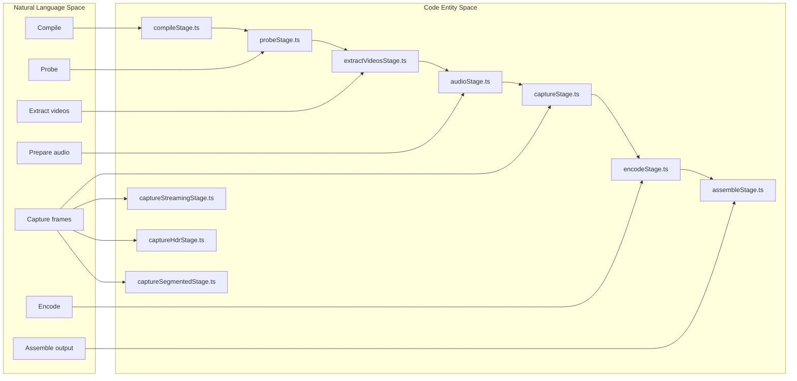
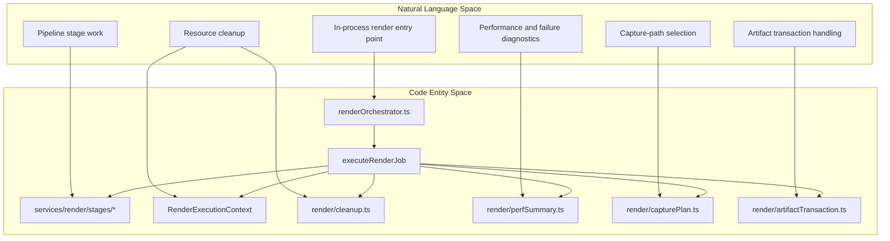

<!-- source: DeepWiki mcp.deepwiki.com · repo heygen-com/hyperframes · page 4.1 Render Orchestrator and Pipeline Stages · fetched 2026-11-02 -->

# Render Orchestrator and Pipeline Stages

Relevant source files

The following files were used as context for generating this wiki page:

- [docs/guides/rendering.mdx](docs/guides/rendering.mdx)
- [docs/packages/engine.mdx](docs/packages/engine.mdx)
- [docs/packages/producer.mdx](docs/packages/producer.mdx)
- [packages/cli/src/capture/assetCataloger.test.ts](packages/cli/src/capture/assetCataloger.test.ts)
- [packages/cli/src/capture/assetCataloger.ts](packages/cli/src/capture/assetCataloger.ts)
- [packages/cli/src/capture/tokenExtractor.ts](packages/cli/src/capture/tokenExtractor.ts)
- [packages/cli/src/commands/render.test.ts](packages/cli/src/commands/render.test.ts)
- [packages/cli/src/commands/render.ts](packages/cli/src/commands/render.ts)
- [packages/cli/src/docs/rendering.md](packages/cli/src/docs/rendering.md)
- [packages/cli/src/telemetry/events.test.ts](packages/cli/src/telemetry/events.test.ts)
- [packages/cli/src/telemetry/events.ts](packages/cli/src/telemetry/events.ts)
- [packages/cli/src/telemetry/renderObservability.test.ts](packages/cli/src/telemetry/renderObservability.test.ts)
- [packages/cli/src/telemetry/renderObservability.ts](packages/cli/src/telemetry/renderObservability.ts)
- [packages/cli/src/utils/dockerRunArgs.test.ts](packages/cli/src/utils/dockerRunArgs.test.ts)
- [packages/cli/src/utils/dockerRunArgs.ts](packages/cli/src/utils/dockerRunArgs.ts)
- [packages/core/src/media/gif.test.ts](packages/core/src/media/gif.test.ts)
- [packages/core/src/media/gif.ts](packages/core/src/media/gif.ts)
- [packages/engine/src/config.test.ts](packages/engine/src/config.test.ts)
- [packages/engine/src/config.ts](packages/engine/src/config.ts)
- [packages/engine/src/index.ts](packages/engine/src/index.ts)
- [packages/engine/src/services/browserManager.test.ts](packages/engine/src/services/browserManager.test.ts)
- [packages/engine/src/services/browserManager.ts](packages/engine/src/services/browserManager.ts)
- [packages/engine/src/services/captureFailure.test.ts](packages/engine/src/services/captureFailure.test.ts)
- [packages/engine/src/services/captureFailure.ts](packages/engine/src/services/captureFailure.ts)
- [packages/engine/src/services/chunkEncoder.percentDir.test.ts](packages/engine/src/services/chunkEncoder.percentDir.test.ts)
- [packages/engine/src/services/chunkEncoder.relativePaths.test.ts](packages/engine/src/services/chunkEncoder.relativePaths.test.ts)
- [packages/engine/src/services/extractedFrameIndex.ts](packages/engine/src/services/extractedFrameIndex.ts)
- [packages/engine/src/services/frameCapture.test.ts](packages/engine/src/services/frameCapture.test.ts)
- [packages/engine/src/services/frameCapture.ts](packages/engine/src/services/frameCapture.ts)
- [packages/engine/src/services/parallelCoordinator-peerAbort.test.ts](packages/engine/src/services/parallelCoordinator-peerAbort.test.ts)
- [packages/engine/src/services/parallelCoordinator.test.ts](packages/engine/src/services/parallelCoordinator.test.ts)
- [packages/engine/src/services/parallelCoordinator.ts](packages/engine/src/services/parallelCoordinator.ts)
- [packages/engine/src/types.ts](packages/engine/src/types.ts)
- [packages/producer/src/services/animatedGifPrep.test.ts](packages/producer/src/services/animatedGifPrep.test.ts)
- [packages/producer/src/services/animatedGifPrep.ts](packages/producer/src/services/animatedGifPrep.ts)
- [packages/producer/src/services/distributed/renderChunk.verifyInWorker.test.ts](packages/producer/src/services/distributed/renderChunk.verifyInWorker.test.ts)
- [packages/producer/src/services/render/captureCost.ts](packages/producer/src/services/render/captureCost.ts)
- [packages/producer/src/services/render/captureStageError.test.ts](packages/producer/src/services/render/captureStageError.test.ts)
- [packages/producer/src/services/render/captureStageError.ts](packages/producer/src/services/render/captureStageError.ts)
- [packages/producer/src/services/render/observability.ts](packages/producer/src/services/render/observability.ts)
- [packages/producer/src/services/render/perfSummary.test.ts](packages/producer/src/services/render/perfSummary.test.ts)
- [packages/producer/src/services/render/perfSummary.ts](packages/producer/src/services/render/perfSummary.ts)
- [packages/producer/src/services/render/segmentPlan.test.ts](packages/producer/src/services/render/segmentPlan.test.ts)
- [packages/producer/src/services/render/segmentPlan.ts](packages/producer/src/services/render/segmentPlan.ts)
- [packages/producer/src/services/render/segmentQueue.test.ts](packages/producer/src/services/render/segmentQueue.test.ts)
- [packages/producer/src/services/render/segmentQueue.ts](packages/producer/src/services/render/segmentQueue.ts)
- [packages/producer/src/services/render/stages/captureSegmentedStage.test.ts](packages/producer/src/services/render/stages/captureSegmentedStage.test.ts)
- [packages/producer/src/services/render/stages/captureSegmentedStage.ts](packages/producer/src/services/render/stages/captureSegmentedStage.ts)
- [packages/producer/src/services/render/stages/captureStage.test.ts](packages/producer/src/services/render/stages/captureStage.test.ts)
- [packages/producer/src/services/render/stages/captureStage.ts](packages/producer/src/services/render/stages/captureStage.ts)
- [packages/producer/src/services/render/stages/captureStreamingStage.test.ts](packages/producer/src/services/render/stages/captureStreamingStage.test.ts)
- [packages/producer/src/services/render/stages/captureStreamingStage.ts](packages/producer/src/services/render/stages/captureStreamingStage.ts)
- [packages/producer/src/services/render/stages/encodeStage.test.ts](packages/producer/src/services/render/stages/encodeStage.test.ts)
- [packages/producer/src/services/render/stages/encodeStage.ts](packages/producer/src/services/render/stages/encodeStage.ts)
- [packages/producer/src/services/render/stages/gifEncodeArgs.test.ts](packages/producer/src/services/render/stages/gifEncodeArgs.test.ts)
- [packages/producer/src/services/render/stages/gifEncodeArgs.ts](packages/producer/src/services/render/stages/gifEncodeArgs.ts)
- [packages/producer/src/services/renderOrchestrator.deGateProbe.test.ts](packages/producer/src/services/renderOrchestrator.deGateProbe.test.ts)
- [packages/producer/src/services/renderOrchestrator.test.ts](packages/producer/src/services/renderOrchestrator.test.ts)
- [packages/producer/src/services/renderOrchestrator.ts](packages/producer/src/services/renderOrchestrator.ts)
- [packages/producer/tests/long-form/README.md](packages/producer/tests/long-form/README.md)
- [packages/producer/tests/long-form/gen.mjs](packages/producer/tests/long-form/gen.mjs)

## Purpose and scope

This page describes the producer’s in-process render pipeline: how `executeRenderJob` composes stages, how capture can use parallel or streaming paths, and what the available code shows about progress, cleanup, and performance diagnostics. The orchestrator identifies compile, probe, extract-videos, audio, capture, encode, and assemble as pipeline stages; probe is grouped with compile in the performance summary. [packages/producer/src/services/renderOrchestrator.ts:4-32]()

Sources: [packages/producer/src/services/renderOrchestrator.ts:4-32]()

## 1. Render pipeline overview

`renderOrchestrator.ts` describes `executeRenderJob` as the in-process entry point that composes the pipeline’s stages. It separates stage implementations into `services/render/stages/`, with the stated goal of letting pure-function primitives be reused by distributed rendering without bringing along the orchestrator’s cleanup and observability scaffolding. [packages/producer/src/services/renderOrchestrator.ts:4-10]()

The stage order is compile, probe, extract videos, audio, capture, encode, and assemble. Probe is labeled Stage 1b and is grouped with Stage 1 in the performance summary. Capture has multiple stage modules, including streaming, HDR, and segmented capture. [packages/producer/src/services/renderOrchestrator.ts:12-22,157-163]()

| Pipeline phase | Stage module(s) identified by the orchestrator | What the provided code establishes |
|---|---|---|
| Compile | `compileStage.ts` | The orchestrator lists this as Stage 1. [packages/producer/src/services/renderOrchestrator.ts:12-15]() |
| Probe | `probeStage.ts` | Browser-driven duration discovery and media reconciliation; grouped with compile in the performance summary. [packages/producer/src/services/renderOrchestrator.ts:13-15]() |
| Extract videos | `extractVideosStage.ts` | Listed as Stage 2. [packages/producer/src/services/renderOrchestrator.ts:16-16]() |
| Audio | `audioStage.ts` | Listed as Stage 3. [packages/producer/src/services/renderOrchestrator.ts:17-17]() |
| Capture | `captureStage.ts`, `captureStreamingStage.ts`, `captureHdrStage.ts`, `captureSegmentedStage.ts` | Listed as Stage 4, with segmented capture also imported by the orchestrator. [packages/producer/src/services/renderOrchestrator.ts:18-20,157-157]() |
| Encode | `encodeStage.ts` | Listed as Stage 5. [packages/producer/src/services/renderOrchestrator.ts:21-21]() |
| Assemble | `assembleStage.ts` | Listed as Stage 6. [packages/producer/src/services/renderOrchestrator.ts:22-22]() |

The following diagram maps the pipeline’s user-facing phases to module names present in the orchestrator. The listed order is the orchestrator’s documented stage order; it does not imply that every render takes the same capture or encoding route. [packages/producer/src/services/renderOrchestrator.ts:6-22,157-163]()

**Diagram: Pipeline phases and stage modules**

Sources: [packages/producer/src/services/renderOrchestrator.ts:6-22,157-163]()

### 1.1 Orchestration boundary

The orchestrator’s module documentation defines a boundary between stage work and cross-cutting render-job responsibilities. Stage modules provide reusable primitives; the orchestrator owns cleanup and observability scaffolding. It tracks resources spawned by stages in `try/finally`, with the stated intent of avoiding leaked Chrome processes or FFmpeg subprocesses when a stage fails. [packages/producer/src/services/renderOrchestrator.ts:6-10,24-32]()

The file imports `RenderExecutionContext`, `ArtifactTransaction` helpers, work-directory creation, capture planning, segment-manifest helpers, and performance-summary helpers. These imports show the concerns managed alongside the stages, but the excerpts provided do not show the full `executeRenderJob` body or the exact calls between those helpers. [packages/producer/src/services/renderOrchestrator.ts:141-173,177-184]()

**Diagram: Orchestrator responsibilities mapped to code entities**

Sources: [packages/producer/src/services/renderOrchestrator.ts:6-10,24-32,136-156,141-146,177-184]()

## 2. `renderOrchestrator.ts` implementation

### 2.1 `executeRenderJob`

`executeRenderJob` is documented as the in-process entry point for composing the pipeline’s stages. The provided excerpt does not include its implementation body, so exact stage-call signatures, state transitions, and per-stage callback call sites cannot be established from the available code. [packages/producer/src/services/renderOrchestrator.ts:4-10]()

The orchestrator’s imports show the supporting services it brings together: file-server management, render configuration and format helpers, memory sampling, error-detail construction, event publication, execution context, artifact transactions, capture planning, segmented-render planning, and performance-summary construction. [packages/producer/src/services/renderOrchestrator.ts:117-184]()

Sources: [packages/producer/src/services/renderOrchestrator.ts:4-10,117-184]()

### 2.2 Resource and error management

The orchestrator’s module documentation says resources spawned by stages—such as a file server, capture sessions, streaming encoders, and raw HDR frame files—are tracked in `try/finally` so mid-pipeline failures do not leak Chrome processes or FFmpeg subprocesses. [packages/producer/src/services/renderOrchestrator.ts:24-27]()

The orchestrator imports `closeFileServerSafely`, capture-session creation and closure functions, `buildRenderErrorDetails`, and `publishRenderFailure`. These are identifiable cleanup and failure-reporting dependencies; the supplied excerpt does not show the exact cleanup sequence or error-wrapping behavior at each call site. [packages/producer/src/services/renderOrchestrator.ts:70-72,117-123,138-140]()

The engine describes its error conventions as operation-dependent: browser and capture orchestration services throw, FFmpeg wrappers return result objects, and cleanup functions avoid throwing so they do not mask an earlier failure. This distinction matters when tracing failures across producer and engine boundaries. [packages/engine/src/index.ts:8-30]()

Sources: [packages/producer/src/services/renderOrchestrator.ts:24-27,70-72,117-123,138-140](), [packages/engine/src/index.ts:8-30]()

### 2.3 Performance instrumentation and capture planning

The orchestrator imports `buildRenderPerfSummary`, worker-deduplication and page-error aggregators, and `worstSubTimelineWaitOutcome` from `perfSummary.ts`. Its module documentation states that every stage records timing into `perfStages` and that failures produce a diagnostic summary including browser-console tail, memory peaks, capture attempts, and HDR diagnostics. [packages/producer/src/services/renderOrchestrator.ts:29-32,177-184]()

Capture behavior is mediated by helpers including `createCapturePlan`, `capturePathForPlanKind`, `replanAfterFailure`, and `streamingCaptureFailure`. The orchestrator also imports segmented-render planning and manifest validation helpers. These dependencies establish that capture routing, retry/replanning, and segmented-render bookkeeping are orchestrator concerns; the visible excerpt does not expose their complete decision logic. [packages/producer/src/services/renderOrchestrator.ts:149-173]()

Sources: [packages/producer/src/services/renderOrchestrator.ts:29-32,149-184]()

### 2.4 Capture concurrency and worker coordination

The producer imports engine functions for distributing frames, executing parallel capture, and merging worker frames. The engine’s `parallelCoordinator.ts` defines `WorkerTask` ranges and strides, `WorkerResult` diagnostics, and `ParallelProgress` updates including total and captured frame counts, active workers, per-worker progress, lifecycle transitions, and landed-frame information. [packages/producer/src/services/renderOrchestrator.ts:79-85](), [packages/engine/src/services/parallelCoordinator.ts:42-109]()

Worker sizing in the engine considers CPU and memory constraints; the coordinator documents per-worker memory and heap budgets, worker limits, and a minimum frame threshold. The orchestrator also imports worker-sizing and capture-cost helpers, but its full worker-selection logic is not included in the excerpt. [packages/engine/src/services/parallelCoordinator.ts:122-173](), [packages/producer/src/services/renderOrchestrator.ts:187-191]()

Sources: [packages/producer/src/services/renderOrchestrator.ts:79-85,187-191](), [packages/engine/src/services/parallelCoordinator.ts:42-109,122-173]()

## 3. Pipeline stage details

The orchestrator’s stage list establishes the module names and ordering below. With the exception of the streaming-capture behavior described in detail, the stage implementations themselves were not included in the provided file contents; descriptions therefore remain limited to what the orchestrator names or explicitly documents. [packages/producer/src/services/renderOrchestrator.ts:12-22]()

### 3.1 Compile and probe

`compileStage.ts` is Stage 1. `probeStage.ts` is Stage 1b; the orchestrator describes it as browser-driven duration discovery and media reconciliation and groups it with Stage 1 in the performance summary. [packages/producer/src/services/renderOrchestrator.ts:12-15]()

Sources: [packages/producer/src/services/renderOrchestrator.ts:12-15]()

### 3.2 Extract videos and audio

`extractVideosStage.ts` is Stage 2, followed by `audioStage.ts` as Stage 3. The provided orchestrator excerpt identifies these stages but does not show their function signatures or internal data transformations. [packages/producer/src/services/renderOrchestrator.ts:16-17]()

Sources: [packages/producer/src/services/renderOrchestrator.ts:16-17]()

### 3.3 Capture routes: parallel, streaming, HDR, and segmented

The orchestrator lists standard capture, streaming capture, and HDR capture modules under Stage 4, and imports `runCaptureSegmentedStage` separately. Its capture-related imports include engine APIs for parallel work distribution and execution. [packages/producer/src/services/renderOrchestrator.ts:18-20,79-85,157-157]()

The streaming stage documents a fused capture-and-encode path: frame buffers are piped directly to FFmpeg stdin through `spawnStreamingEncoder`, avoiding disk frame writes and the separate encode stage for eligible renders. The stage notes that this path is gated upstream, is disabled for PNG sequences and distributed mode, and can return an unsuccessful result so the sequencer falls back to disk capture. [packages/producer/src/services/render/stages/captureStreamingStage.ts:3-20]()

The streaming stage also documents per-frame job progress updates, encoder closure and result inspection within the stage, and defensive cleanup in its own `finally`. It defines a no-frame-progress watchdog and a typed parallel-capture stall error to support fail-fast handling and retries. [packages/producer/src/services/render/stages/captureStreamingStage.ts:22-34,87-141]()

Sources: [packages/producer/src/services/renderOrchestrator.ts:18-20,79-85,157-157](), [packages/producer/src/services/render/stages/captureStreamingStage.ts:3-34,87-141]()

### 3.4 Encode and assemble

`encodeStage.ts` is listed as Stage 5 and `assembleStage.ts` as Stage 6. The streaming route is an exception to a strictly separate capture/encode boundary because its stage fuses capture with FFmpeg encoding and skips the separate Stage 5 encode step for eligible renders. [packages/producer/src/services/renderOrchestrator.ts:21-22](), [packages/producer/src/services/render/stages/captureStreamingStage.ts:3-8]()

Sources: [packages/producer/src/services/renderOrchestrator.ts:21-22](), [packages/producer/src/services/render/stages/captureStreamingStage.ts:3-8]()

## 4. Render job state and progress

### 4.1 `RenderJob`

The CLI imports `RenderJob` and `RenderPerfSummary` from `@hyperframes/producer`, and the orchestrator imports `updateJobStatus` and uses `RenderJob` in the streaming-stage interface. The provided contents do not include the `RenderJob` definition, so its complete field list and lifecycle-state values cannot be specified here. [packages/cli/src/commands/render.ts:138-138](), [packages/producer/src/services/renderOrchestrator.ts:136-136](), [packages/producer/src/services/render/stages/captureStreamingStage.ts:75-75]()

The streaming stage documentation specifically states that `job.framesRendered` is updated per frame and that streaming-frame progress goes through `reportFrameProgress`. This is a concrete example of progress being updated within a stage, in addition to orchestration-level stage progress. [packages/producer/src/services/render/stages/captureStreamingStage.ts:22-30]()

Sources: [packages/cli/src/commands/render.ts:138-138](), [packages/producer/src/services/renderOrchestrator.ts:136-136](), [packages/producer/src/services/render/stages/captureStreamingStage.ts:22-30,75-75]()

### 4.2 Progress callbacks

The streaming-stage module imports `ProgressCallback` and `RenderJob` types from `renderOrchestrator.ts`, and imports `reportFrameProgress`, `reportEncodeProgress`, and `reportWorkerStartup` from shared render helpers. Its documentation says `reportFrameProgress` is used for streaming-frame updates. [packages/producer/src/services/render/stages/captureStreamingStage.ts:75-75,83-83]()

The full `ProgressCallback` definition and the orchestrator’s callback invocation sites are not present in the supplied excerpt. The precise callback contract and whether callers receive a snapshot or the mutable job object therefore cannot be confirmed from the visible code. [packages/producer/src/services/renderOrchestrator.ts:1-191]()

Sources: [packages/producer/src/services/render/stages/captureStreamingStage.ts:75-75,83-83](), [packages/producer/src/services/renderOrchestrator.ts:1-191]()

## 5. Observability, performance summaries, and artifacts

### 5.1 Observability

The orchestrator describes its observability as recording timing for each stage and collecting diagnostic context on failure, including browser-console tail, memory peaks, capture attempts, and HDR diagnostics. It imports a memory sampler, error-detail builder, render-failure publisher, and performance-summary helpers. [packages/producer/src/services/renderOrchestrator.ts:29-32,136-140,177-184]()

The CLI telemetry payload type includes render-job and composition identifiers, phase/status fields, browser diagnostic counts, capture-mode and worker fields, extract-video counters, and initialization measurements. This shows the categories that can be represented in render observability telemetry; it does not establish that every field is populated for every render. [packages/cli/src/telemetry/events.ts:40-128]()

Sources: [packages/producer/src/services/renderOrchestrator.ts:29-32,136-140,177-184](), [packages/cli/src/telemetry/events.ts:40-128]()

### 5.2 Performance summaries

The orchestrator imports `buildRenderPerfSummary` and helpers for worker deduplication performance, worker page errors, and worst sub-timeline wait outcome. Its module documentation states that stage timings are recorded into `perfStages` and grouped into a diagnostic summary on failure. [packages/producer/src/services/renderOrchestrator.ts:29-32,177-184]()

The supplied excerpt does not include the `RenderPerfSummary` type or the implementation of `buildRenderPerfSummary`; field names and aggregation formulas beyond the explicitly imported helpers are not asserted here. [packages/producer/src/services/renderOrchestrator.ts:177-184]()

Sources: [packages/producer/src/services/renderOrchestrator.ts:29-32,177-184]()

### 5.3 Artifact and segment handling

The orchestrator imports `ArtifactTransaction`, artifact expectation construction and commit helpers, plus segment-manifest operations for hashing, validation, reading, and writing. These imports indicate that artifact transactions and segment manifests are part of the render service’s supporting machinery; the provided excerpt does not show transaction semantics or commit/rollback behavior. [packages/producer/src/services/renderOrchestrator.ts:141-146,165-173]()

Sources: [packages/producer/src/services/renderOrchestrator.ts:141-146,165-173]()

## Summary

`renderOrchestrator.ts` documents the in-process render entry point and the ordered pipeline of compile, probe, extract videos, audio, capture, encode, and assemble. Its stated responsibilities include cleanup and observability around reusable stage modules. [packages/producer/src/services/renderOrchestrator.ts:4-32]()

Capture is not a single fixed route: the orchestrator identifies streaming, HDR, and segmented capture modules, while the streaming stage explicitly fuses frame capture with encoding for eligible single-machine renders. Parallel capture is coordinated using engine worker tasks and progress structures. [packages/producer/src/services/renderOrchestrator.ts:18-20,79-85,157-157](), [packages/producer/src/services/render/stages/captureStreamingStage.ts:3-20](), [packages/engine/src/services/parallelCoordinator.ts:42-109]()

Sources: [packages/producer/src/services/renderOrchestrator.ts:4-32,79-85,157-157](), [packages/producer/src/services/render/stages/captureStreamingStage.ts:3-20](), [packages/engine/src/services/parallelCoordinator.ts:42-109]()

---

