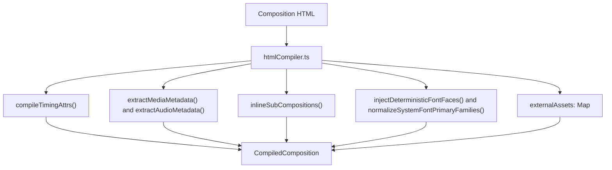
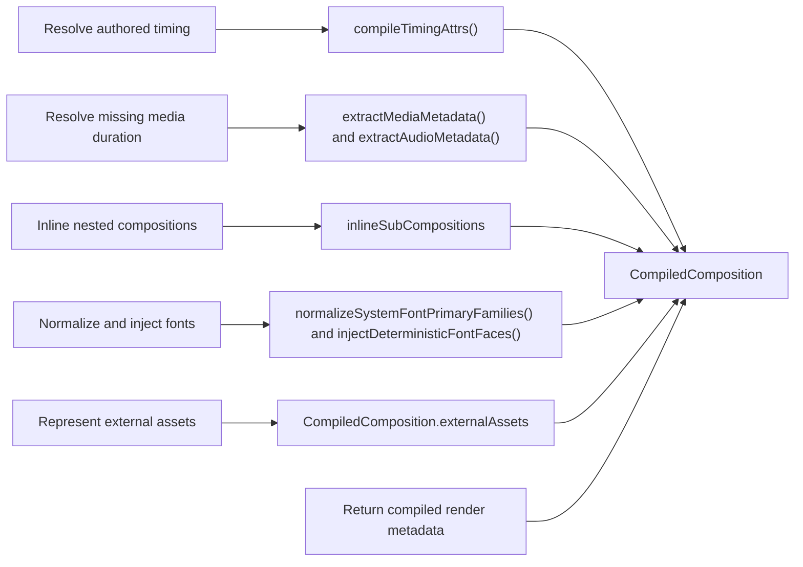
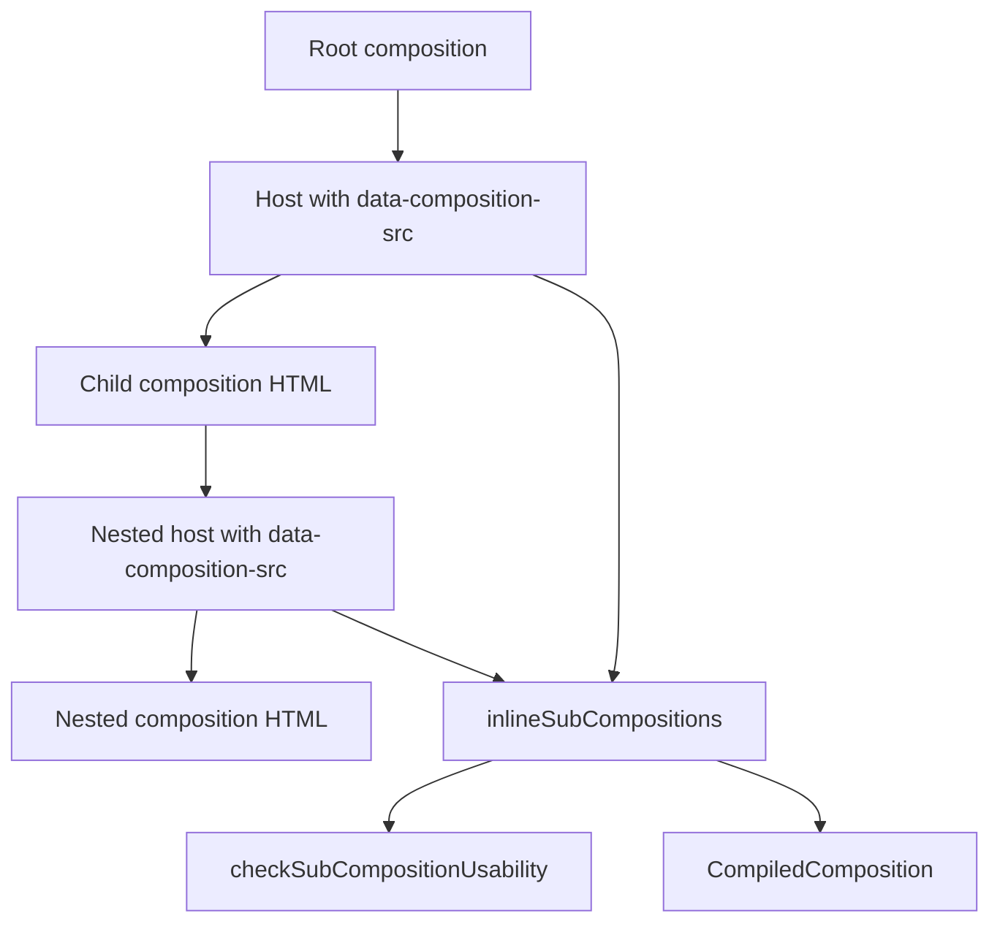

<!-- source: DeepWiki mcp.deepwiki.com · repo heygen-com/hyperframes · page 4.2 HTML Compilation and Deterministic Fonts · fetched 2026-11-02 -->

# HTML Compilation and Deterministic Fonts

Relevant source files

The following files were used as context for generating this wiki page:

- [packages/cli/src/commands/lambda/_dimensions.test.ts](packages/cli/src/commands/lambda/_dimensions.test.ts)
- [packages/cli/src/commands/lambda/_dimensions.ts](packages/cli/src/commands/lambda/_dimensions.ts)
- [packages/cli/src/utils/compositionViewport.test.ts](packages/cli/src/utils/compositionViewport.test.ts)
- [packages/cli/src/utils/compositionViewport.ts](packages/cli/src/utils/compositionViewport.ts)
- [packages/core/src/compiler/__goldens__/pageBuild.preview.html](packages/core/src/compiler/__goldens__/pageBuild.preview.html)
- [packages/core/src/compiler/__goldens__/pageBuild.render.html](packages/core/src/compiler/__goldens__/pageBuild.render.html)
- [packages/core/src/compiler/compositionScoping.test.ts](packages/core/src/compiler/compositionScoping.test.ts)
- [packages/core/src/compiler/compositionScoping.ts](packages/core/src/compiler/compositionScoping.ts)
- [packages/core/src/compiler/htmlBundler.test.ts](packages/core/src/compiler/htmlBundler.test.ts)
- [packages/core/src/compiler/htmlBundler.ts](packages/core/src/compiler/htmlBundler.ts)
- [packages/core/src/compiler/index.ts](packages/core/src/compiler/index.ts)
- [packages/core/src/compiler/inlineSubCompositions.test.ts](packages/core/src/compiler/inlineSubCompositions.test.ts)
- [packages/core/src/compiler/inlineSubCompositions.ts](packages/core/src/compiler/inlineSubCompositions.ts)
- [packages/core/src/core.types.ts](packages/core/src/core.types.ts)
- [packages/core/src/index.test.ts](packages/core/src/index.test.ts)
- [packages/core/src/index.ts](packages/core/src/index.ts)
- [packages/core/src/runtime/afterFonts.ts](packages/core/src/runtime/afterFonts.ts)
- [packages/core/src/runtime/applyVariableBindings.test.ts](packages/core/src/runtime/applyVariableBindings.test.ts)
- [packages/core/src/runtime/applyVariableBindings.ts](packages/core/src/runtime/applyVariableBindings.ts)
- [packages/core/src/runtime/compositionLoader.test.ts](packages/core/src/runtime/compositionLoader.test.ts)
- [packages/core/src/runtime/compositionLoader.ts](packages/core/src/runtime/compositionLoader.ts)
- [packages/core/src/runtime/entry.afterFonts.test.ts](packages/core/src/runtime/entry.afterFonts.test.ts)
- [packages/core/src/runtime/init.swapScenes.test.ts](packages/core/src/runtime/init.swapScenes.test.ts)
- [packages/core/src/runtime/player.test.ts](packages/core/src/runtime/player.test.ts)
- [packages/core/src/runtime/player.ts](packages/core/src/runtime/player.ts)
- [packages/core/src/runtime/sceneWindow.ts](packages/core/src/runtime/sceneWindow.ts)
- [packages/lint/src/rules/media.test.ts](packages/lint/src/rules/media.test.ts)
- [packages/lint/src/rules/media.ts](packages/lint/src/rules/media.ts)
- [packages/parsers/src/mediaSrcMutation.test.ts](packages/parsers/src/mediaSrcMutation.test.ts)
- [packages/parsers/src/mediaSrcMutation.ts](packages/parsers/src/mediaSrcMutation.ts)
- [packages/parsers/src/outputResolutionCompatibility.test.ts](packages/parsers/src/outputResolutionCompatibility.test.ts)
- [packages/parsers/src/outputResolutionCompatibility.ts](packages/parsers/src/outputResolutionCompatibility.ts)
- [packages/parsers/src/types.ts](packages/parsers/src/types.ts)
- [packages/producer/src/services/htmlCompiler.test.ts](packages/producer/src/services/htmlCompiler.test.ts)
- [packages/producer/src/services/htmlCompiler.ts](packages/producer/src/services/htmlCompiler.ts)
- [packages/producer/src/services/render/shared.ts](packages/producer/src/services/render/shared.ts)
- [packages/producer/src/services/render/stages/compileStage.test.ts](packages/producer/src/services/render/stages/compileStage.test.ts)
- [packages/producer/src/services/render/stages/compileStage.ts](packages/producer/src/services/render/stages/compileStage.ts)
- [packages/producer/src/services/render/stages/probeStage.test.ts](packages/producer/src/services/render/stages/probeStage.test.ts)
- [packages/producer/src/services/render/stages/probeStage.ts](packages/producer/src/services/render/stages/probeStage.ts)

This page covers the Producer-side HTML compiler in `packages/producer/src/services/htmlCompiler.ts`: timing compilation and media-duration resolution, recursive sub-composition handling, deterministic font support, external assets, and the `CompiledComposition` result. The compiler imports shared timing and composition-compilation utilities from `@hyperframes/core`, font helpers from `@hyperframes/core/fonts/embed`, and media probing utilities from `@hyperframes/engine`. [packages/producer/src/services/htmlCompiler.ts:1-108]()

Sources: [packages/producer/src/services/htmlCompiler.ts:1-108]()

---

## Purpose and Scope

The Producer compiler prepares composition HTML and render metadata for downstream rendering. Its documented timing workflow has two phases: a static pass using `compileTimingAttrs()` and media probing for elements without `data-duration`. It also handles nested compositions referenced by `data-composition-src`. [packages/producer/src/services/htmlCompiler.ts:4-11]()

The exported `CompiledComposition` interface gathers the compiled HTML, media collections, composition resolution state, external assets, dimensions, duration, and render-related hints. [packages/producer/src/services/htmlCompiler.ts:114-134]()

Sources: [packages/producer/src/services/htmlCompiler.ts:4-11](), [packages/producer/src/services/htmlCompiler.ts:114-134]()

---

## Two-Phase Compilation Pipeline

### 1. Static Timing Pass

The compiler imports `compileTimingAttrs()` from `@hyperframes/core`; the module documentation identifies it as the first phase. That pass derives `data-end` from `data-start` and `data-duration`. The same module also imports `extractResolvedMedia`, `injectDurations`, and `clampDurations` for timing and resolved-media processing. [packages/producer/src/services/htmlCompiler.ts:6-8](), [packages/producer/src/services/htmlCompiler.ts:19-38]()

### 2. Media Duration Resolution

The module documentation describes the second phase as `ffprobe` resolution for elements without `data-duration`. The implementation imports `extractMediaMetadata` and `extractAudioMetadata` from Producer utilities, and imports `withMediaProbeSlot` to coordinate access to media probing. [packages/producer/src/services/htmlCompiler.ts:6-8](), [packages/producer/src/services/htmlCompiler.ts:75-76](), [packages/producer/src/services/htmlCompiler.ts:106-108]()

The compiler’s related timing imports include `readMediaStart`, `parseStrictFiniteTimingNumber`, and `resolveNaturalMediaTimelineDurationFromValues`. These support parsing and resolving timing values alongside the static and probed duration paths. [packages/producer/src/services/htmlCompiler.ts:19-38]()

Sources: [packages/producer/src/services/htmlCompiler.ts:6-8](), [packages/producer/src/services/htmlCompiler.ts:19-38](), [packages/producer/src/services/htmlCompiler.ts:75-76](), [packages/producer/src/services/htmlCompiler.ts:106-108]()

---

### Recursive Sub-composition Inlining and Asset Handling

The compiler’s module documentation states that it handles `data-composition-src` references and recursively extracts nested media from sub-sub-compositions. It imports the shared `inlineSubCompositions` implementation from `@hyperframes/core/compiler`, along with `checkSubCompositionUsability` for checking sub-composition documents. [packages/producer/src/services/htmlCompiler.ts:10-11](), [packages/producer/src/services/htmlCompiler.ts:43-70]()

The shared inlining module describes itself as the common implementation used by both the core bundler and Producer compiler. It imports asset-path rewriting helpers and composition-scoping functions used in the transformation. [packages/core/src/compiler/inlineSubCompositions.ts:10-18](), [packages/core/src/compiler/inlineSubCompositions.ts:20-35]()

For sub-composition validity parsing, Producer adapts `linkedom`’s `parseHTML()` result to the `ParsableDocumentLike` contract. [packages/producer/src/services/htmlCompiler.ts:138-141]()

The compiler imports path and asset helpers including `rewriteAssetPath`, `rewriteAssetPaths`, `rewriteCssAssetUrls`, `rewriteInlineStyleAssetUrls`, `isPathInside`, and `toExternalAssetKey`. These are the code-level dependencies for path rewriting and external-asset key handling. [packages/producer/src/services/htmlCompiler.ts:14-17](), [packages/producer/src/services/htmlCompiler.ts:19-38](), [packages/producer/src/services/htmlCompiler.ts:72-77]()

Sources: [packages/producer/src/services/htmlCompiler.ts:10-11](), [packages/producer/src/services/htmlCompiler.ts:14-17](), [packages/producer/src/services/htmlCompiler.ts:19-38](), [packages/producer/src/services/htmlCompiler.ts:43-77](), [packages/producer/src/services/htmlCompiler.ts:138-141](), [packages/core/src/compiler/inlineSubCompositions.ts:10-35]()

---

### Deterministic Font Injection

The Producer compiler imports `injectDeterministicFontFaces` and `normalizeSystemFontPrimaryFamilies` from `@hyperframes/core/fonts/embed`. Those names identify the font-injection and system-font normalization helpers used by the compiler; the available `htmlCompiler.ts` excerpt does not show their call sites or the embedding and subsetting implementation. [packages/producer/src/services/htmlCompiler.ts:98-101]()

The shared compiler utilities also include font-related operations such as `deferScriptsUntilFonts`, `dedupeFontFaceRules`, and `headStyleRuns`. Their use in font handling is visible in the Producer import list, while the shared sub-composition inliner imports `dedupeFontFaceRules` as part of its compilation utilities. [packages/producer/src/services/htmlCompiler.ts:43-66](), [packages/core/src/compiler/inlineSubCompositions.ts:4-9]()

The available files establish that font injection and system-font normalization are part of the compiler dependency surface. They do not expose the font asset catalogue, subset-selection algorithm, or the exact CSS rewrite behavior, so those implementation details are not specified here. [packages/producer/src/services/htmlCompiler.ts:98-101]()

Sources: [packages/producer/src/services/htmlCompiler.ts:43-66](), [packages/producer/src/services/htmlCompiler.ts:98-101](), [packages/core/src/compiler/inlineSubCompositions.ts:4-9]()

---

## Compilation Flow

### Diagram: Producer Compiler Calls and Output Type

This diagram associates the compiler’s named code dependencies with the declared `CompiledComposition` output. The module documents the static-timing and probing phases and imports the sub-composition and font helpers; the output interface declares the HTML, media, asset, and render metadata fields. [packages/producer/src/services/htmlCompiler.ts:4-11](), [packages/producer/src/services/htmlCompiler.ts:43-108](), [packages/producer/src/services/htmlCompiler.ts:114-134]()

Sources: [packages/producer/src/services/htmlCompiler.ts:4-11](), [packages/producer/src/services/htmlCompiler.ts:43-108](), [packages/producer/src/services/htmlCompiler.ts:114-134]()

---

### Diagram: Natural-Language Responsibilities to Code Entities

The diagram maps the responsibilities named by the compiler documentation and imports to the corresponding function names and output fields. [packages/producer/src/services/htmlCompiler.ts:4-11](), [packages/producer/src/services/htmlCompiler.ts:19-38](), [packages/producer/src/services/htmlCompiler.ts:43-108](), [packages/producer/src/services/htmlCompiler.ts:114-134]()

Sources: [packages/producer/src/services/htmlCompiler.ts:4-11](), [packages/producer/src/services/htmlCompiler.ts:19-38](), [packages/producer/src/services/htmlCompiler.ts:43-108](), [packages/producer/src/services/htmlCompiler.ts:114-134]()

---

## Timing Resolution Details

`compileTimingAttrs()` is the named core utility for the static pass. The compiler also imports `injectDurations`, `extractResolvedMedia`, and `clampDurations`, plus helpers for reading media starts and parsing timing numbers. [packages/producer/src/services/htmlCompiler.ts:19-38]()

Media probing is connected through `extractMediaMetadata` and `extractAudioMetadata`; `withMediaProbeSlot` is imported from Producer’s media-probe concurrency utility. [packages/producer/src/services/htmlCompiler.ts:75-76](), [packages/producer/src/services/htmlCompiler.ts:106-108]()

The producer-side probe stage imports `recompileWithResolutions`, `resolveCompositionDurations`, and `discoverMediaFromBrowser` from `htmlCompiler.ts`. Its input includes a `CompiledComposition`, and its documentation says the stage may replace the compiled result after browser-resolved durations are available. [packages/producer/src/services/render/stages/probeStage.ts:59-66](), [packages/producer/src/services/render/stages/probeStage.ts:100-103](), [packages/producer/src/services/render/stages/probeStage.ts:11-16]()

Sources: [packages/producer/src/services/htmlCompiler.ts:19-38](), [packages/producer/src/services/htmlCompiler.ts:75-76](), [packages/producer/src/services/htmlCompiler.ts:106-108](), [packages/producer/src/services/render/stages/probeStage.ts:11-16](), [packages/producer/src/services/render/stages/probeStage.ts:59-66](), [packages/producer/src/services/render/stages/probeStage.ts:100-103]()

---

## Sub-composition Recursion Mechanism

Producer imports `checkSubCompositionUsability` and adapts parsed HTML to its document-like contract through `parseSubCompHtmlForValidity()`. [packages/producer/src/services/htmlCompiler.ts:67-70](), [packages/producer/src/services/htmlCompiler.ts:138-141]()

The shared `inlineSubCompositions` module is explicitly intended to provide the same inlining transformation to the preview bundler and Producer render compiler. Its imports include path rewriting and composition-scoping functions. [packages/core/src/compiler/inlineSubCompositions.ts:10-18](), [packages/core/src/compiler/inlineSubCompositions.ts:20-35]()

### Diagram: Nested Composition Path

The compiler documentation states that nested media is recursively extracted from sub-sub-compositions; Producer imports the shared inliner and sub-composition validity checker. [packages/producer/src/services/htmlCompiler.ts:10-11](), [packages/producer/src/services/htmlCompiler.ts:43-70]()

Sources: [packages/producer/src/services/htmlCompiler.ts:10-11](), [packages/producer/src/services/htmlCompiler.ts:43-70](), [packages/core/src/compiler/inlineSubCompositions.ts:10-18]()

---

## Deterministic Font Injection and Subsetting

The Producer compiler’s visible font integration consists of the imports `injectDeterministicFontFaces` and `normalizeSystemFontPrimaryFamilies` from `@hyperframes/core/fonts/embed`. [packages/producer/src/services/htmlCompiler.ts:98-101]()

The shared compiler also exposes font-related operations in the Producer import list, including `deferScriptsUntilFonts` and `dedupeFontFaceRules`. The import names indicate that font readiness and duplicate font-face handling participate in the compiler’s broader HTML processing. [packages/producer/src/services/htmlCompiler.ts:43-66]()

The available source excerpt does not include the font module’s implementation, so it does not support more specific claims about font subsetting, font-family mapping rules, font formats, or generated CSS. [packages/producer/src/services/htmlCompiler.ts:98-101]()

### Diagram: Font Integration Points

The diagram shows the named font-related dependencies in the compiler’s import surface. It does not assert internal call order: the available `htmlCompiler.ts` excerpt lists the helpers but does not show where they are invoked. [packages/producer/src/services/htmlCompiler.ts:43-66](), [packages/producer/src/services/htmlCompiler.ts:98-101]()

Sources: [packages/producer/src/services/htmlCompiler.ts:43-66](), [packages/producer/src/services/htmlCompiler.ts:98-101]()

---

## External Asset Handling

`CompiledComposition.externalAssets` is a `Map<string, string>` whose documented contract maps paths used in HTML to absolute filesystem paths for assets resolving outside `projectDir`. [packages/producer/src/services/htmlCompiler.ts:123-124]()

Producer imports `isPathInside` and `toExternalAssetKey` from its path utilities, as well as core asset-path rewriting helpers. The module also imports `collectExternalAssets` from its own test-facing API surface, but the provided implementation excerpt does not show the function body or the complete rewrite sequence. [packages/producer/src/services/htmlCompiler.ts:19-38](), [packages/producer/src/services/htmlCompiler.ts:72-77]()

| Property | Type | Contract |
|---|---|---|
| `externalAssets` | `Map<string, string>` | HTML path to absolute filesystem path for assets outside `projectDir`. |
| `html` | `string` | Compiled HTML string returned with the composition metadata. |

The `externalAssets` contract is documented on the interface; the available excerpt does not specify the exact serving mechanism used downstream. [packages/producer/src/services/htmlCompiler.ts:114-124]()

Sources: [packages/producer/src/services/htmlCompiler.ts:19-38](), [packages/producer/src/services/htmlCompiler.ts:72-77](), [packages/producer/src/services/htmlCompiler.ts:114-124]()

---

## `CompiledComposition` Type Definition

`CompiledComposition` is the Producer compiler’s output interface. It combines HTML with media collections and render metadata. [packages/producer/src/services/htmlCompiler.ts:114-134]()

| Field | Type | Meaning |
|---|---|---|
| `html` | `string` | Compiled HTML. |
| `subCompositions` | `Map<string, string>` | Sub-composition content keyed by string identifiers. |
| `videos` | `VideoElement[]` | Video media records. |
| `audios` | `AudioElement[]` | Audio media records. |
| `images` | `ImageElement[]` | Image media records. |
| `droppedMediaIds` | `Set<string>` | Media IDs recorded as dropped. |
| `masterFxChain` | `string \| undefined` | Optional master FX chain representation. |
| `unresolvedCompositions` | `UnresolvedElement[]` | Unresolved composition elements. |
| `externalAssets` | `Map<string, string>` | Paths used in HTML mapped to absolute paths for assets outside the project directory. |
| `width`, `height` | `number` | Composition dimensions. |
| `staticDuration` | `number` | Static composition duration. |
| `renderModeHints` | `RenderModeHints` | Render-mode hints. |
| `hasShaderTransitions` | `boolean` | Shader-transition usage flag. |
| `usesThreeDTransforms` | `boolean` | Indicates CSS 3D rendering-context use, as described by the interface comment. |
| `hasAncestorBackgroundImage` | `boolean` | Indicates whether ancestors of the composition root carry a background image. |

These fields and the `externalAssets` comment are declared directly on `CompiledComposition`. [packages/producer/src/services/htmlCompiler.ts:114-134]()

Sources: [packages/producer/src/services/htmlCompiler.ts:114-134]()

---

## Additional Features and Implementation Notes

`prepareCompositionScripts()` parses HTML with `linkedom`, adds `COMPOSITION_SOURCE_URL` sourceURL comments to eligible inline scripts that do not already end in a sourceURL comment, and calls `deferScriptsUntilFonts()` before serializing the document. [packages/producer/src/services/htmlCompiler.ts:143-161]()

`injectSdkPositionEditsRenderScript()` returns the input unchanged unless the HTML contains `data-hf-edit-base-x` or `data-hf-edit-base-y`; when present, it inserts the position-edits runtime script before the closing body tag, or appends it if no closing body tag is found. [packages/producer/src/services/htmlCompiler.ts:163-170]()

The compiler imports helpers for detecting render media, hidden video IDs, animated GIF preparation, HEIF image preparation, render-mode hints, shader transitions, and CSS 3D use. The available excerpt establishes these dependencies but does not show their implementation or call sites. [packages/producer/src/services/htmlCompiler.ts:77-89](), [packages/producer/src/services/htmlCompiler.ts:102-108]()

Sources: [packages/producer/src/services/htmlCompiler.ts:143-170](), [packages/producer/src/services/htmlCompiler.ts:77-89](), [packages/producer/src/services/htmlCompiler.ts:102-108]()

---

## Summary

The Producer HTML compiler documents a two-phase timing strategy: compile authored timing attributes statically, then probe media without authored durations. It also imports shared recursive sub-composition inlining and validity utilities, font normalization and injection helpers, and path utilities for external assets. Its output contract is `CompiledComposition`, which packages HTML, media lists, unresolved compositions, external asset mappings, dimensions, duration, and rendering hints. [packages/producer/src/services/htmlCompiler.ts:4-11](), [packages/producer/src/services/htmlCompiler.ts:43-108](), [packages/producer/src/services/htmlCompiler.ts:114-134]()

Sources: [packages/producer/src/services/htmlCompiler.ts:4-11](), [packages/producer/src/services/htmlCompiler.ts:43-108](), [packages/producer/src/services/htmlCompiler.ts:114-134]()

---

