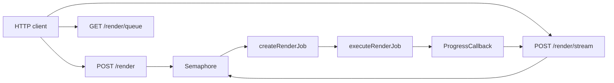
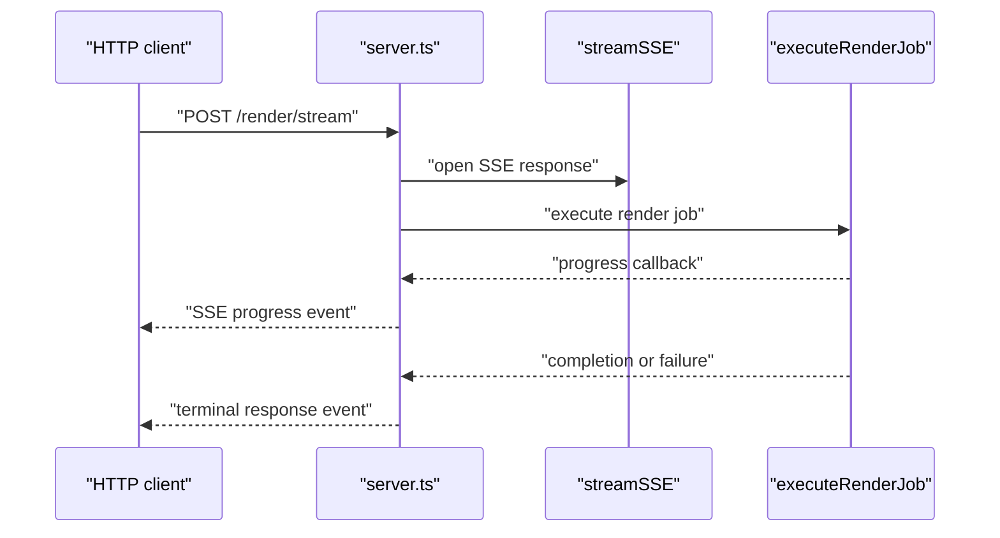
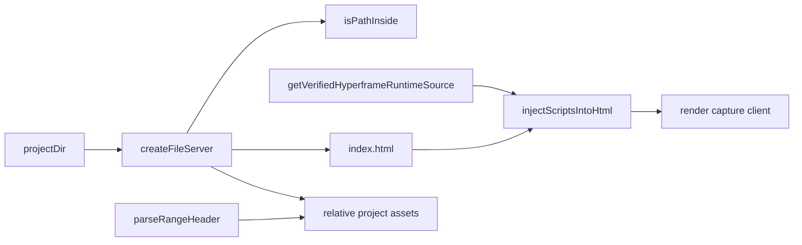
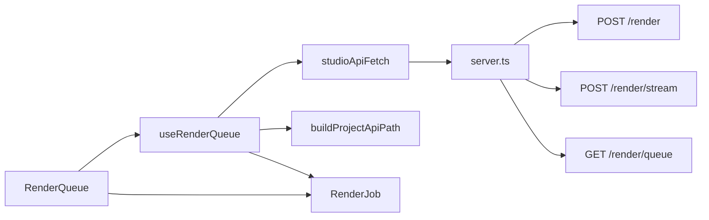

<!-- source: DeepWiki mcp.deepwiki.com · repo heygen-com/hyperframes · page 4.3 Producer HTTP Server and Render Queue · fetched 2026-11-02 -->

# Producer HTTP Server and Render Queue

Relevant source files

The following files were used as context for generating this wiki page:

- [packages/cli/src/server/studioServer.pathSafety.test.ts](packages/cli/src/server/studioServer.pathSafety.test.ts)
- [packages/cli/src/server/studioServer.stampOnOpen.test.ts](packages/cli/src/server/studioServer.stampOnOpen.test.ts)
- [packages/cli/src/server/studioServer.staticAssets.test.ts](packages/cli/src/server/studioServer.staticAssets.test.ts)
- [packages/cli/src/server/studioServerTestFixture.ts](packages/cli/src/server/studioServerTestFixture.ts)
- [packages/core/README.md](packages/core/README.md)
- [packages/core/src/generators/hyperframes.test.ts](packages/core/src/generators/hyperframes.test.ts)
- [packages/core/src/generators/hyperframes.ts](packages/core/src/generators/hyperframes.ts)
- [packages/core/src/generators/richTextHtml.ts](packages/core/src/generators/richTextHtml.ts)
- [packages/core/src/runtime/entry.startupFailure.test.ts](packages/core/src/runtime/entry.startupFailure.test.ts)
- [packages/core/src/runtime/entry.test.ts](packages/core/src/runtime/entry.test.ts)
- [packages/core/src/runtime/entry.ts](packages/core/src/runtime/entry.ts)
- [packages/core/src/runtime/preloadMedia.test.ts](packages/core/src/runtime/preloadMedia.test.ts)
- [packages/core/src/runtime/preloadMedia.ts](packages/core/src/runtime/preloadMedia.ts)
- [packages/core/src/runtime/window.d.ts](packages/core/src/runtime/window.d.ts)
- [packages/engine/README.md](packages/engine/README.md)
- [packages/engine/src/services/fileServer.pathSafety.test.ts](packages/engine/src/services/fileServer.pathSafety.test.ts)
- [packages/engine/src/services/fileServer.test.ts](packages/engine/src/services/fileServer.test.ts)
- [packages/engine/src/services/fileServer.ts](packages/engine/src/services/fileServer.ts)
- [packages/engine/src/services/renderFrameVideoHold.browser.test.ts](packages/engine/src/services/renderFrameVideoHold.browser.test.ts)
- [packages/engine/src/services/renderFrameVideoHold.ts](packages/engine/src/services/renderFrameVideoHold.ts)
- [packages/parsers/src/hfIdAssignment.ts](packages/parsers/src/hfIdAssignment.ts)
- [packages/parsers/src/hfIds.test.ts](packages/parsers/src/hfIds.test.ts)
- [packages/parsers/src/hfIds.ts](packages/parsers/src/hfIds.ts)
- [packages/parsers/src/htmlParser.test.ts](packages/parsers/src/htmlParser.test.ts)
- [packages/parsers/src/htmlParser.ts](packages/parsers/src/htmlParser.ts)
- [packages/producer/README.md](packages/producer/README.md)
- [packages/producer/src/server.test.ts](packages/producer/src/server.test.ts)
- [packages/producer/src/server.ts](packages/producer/src/server.ts)
- [packages/producer/src/services/fileServer.test.ts](packages/producer/src/services/fileServer.test.ts)
- [packages/producer/src/services/fileServer.ts](packages/producer/src/services/fileServer.ts)
- [packages/sdk/src/document.ts](packages/sdk/src/document.ts)
- [packages/sdk/src/session.template.test.ts](packages/sdk/src/session.template.test.ts)
- [packages/studio/src/components/renders/GpuEncodingToggle.tsx](packages/studio/src/components/renders/GpuEncodingToggle.tsx)
- [packages/studio/src/components/renders/RenderQueue.test.tsx](packages/studio/src/components/renders/RenderQueue.test.tsx)
- [packages/studio/src/components/renders/RenderQueue.tsx](packages/studio/src/components/renders/RenderQueue.tsx)
- [packages/studio/src/components/renders/RenderQueueItem.tsx](packages/studio/src/components/renders/RenderQueueItem.tsx)
- [packages/studio/src/components/renders/RenderQueuePanel.tsx](packages/studio/src/components/renders/RenderQueuePanel.tsx)
- [packages/studio/src/components/renders/renderSettings.ts](packages/studio/src/components/renders/renderSettings.ts)
- [packages/studio/src/components/renders/useRenderQueue.ts](packages/studio/src/components/renders/useRenderQueue.ts)
- [packages/studio/src/components/renders/useRenderQueueComposition.test.tsx](packages/studio/src/components/renders/useRenderQueueComposition.test.tsx)
- [packages/studio/src/components/ui/Menu.test.tsx](packages/studio/src/components/ui/Menu.test.tsx)
- [packages/studio/src/components/ui/Menu.tsx](packages/studio/src/components/ui/Menu.tsx)
- [packages/studio/src/components/ui/Popover.tsx](packages/studio/src/components/ui/Popover.tsx)
- [packages/studio/src/components/ui/Select.tsx](packages/studio/src/components/ui/Select.tsx)
- [packages/studio/src/components/ui/valueControls.test.tsx](packages/studio/src/components/ui/valueControls.test.tsx)
- [packages/studio/src/player/components/BeatStrip.test.tsx](packages/studio/src/player/components/BeatStrip.test.tsx)
- [packages/studio/src/player/components/BeatStrip.tsx](packages/studio/src/player/components/BeatStrip.tsx)
- [packages/studio/src/player/components/ShortcutsPanel.test.tsx](packages/studio/src/player/components/ShortcutsPanel.test.tsx)
- [packages/studio/src/player/components/ShortcutsPanel.tsx](packages/studio/src/player/components/ShortcutsPanel.tsx)
- [packages/studio/src/player/components/SpeedMenu.tsx](packages/studio/src/player/components/SpeedMenu.tsx)
- [packages/studio/tests/e2e/render-selects.mjs](packages/studio/tests/e2e/render-selects.mjs)

## Purpose and scope

`packages/producer/src/server.ts` exposes the producer’s HTTP interface for render requests, progress streaming, queue status, linting, health checks, and output downloads. It also defines server configuration, render-input types, and helpers that filter public failure metadata. This page covers the server’s documented API surface, the available queue and file-serving contracts, and Studio’s render-queue client integration. [packages/producer/src/server.ts:1-14]()[packages/producer/src/server.ts:58-71]()[packages/producer/src/server.ts:81-180]()

Sources: `packages/producer/src/server.ts:1-14`, `packages/producer/src/server.ts:58-71`, `packages/producer/src/server.ts:81-180`

---

## HTTP server and REST endpoints

The server imports Hono and its Node adapter, along with `streamSSE`, and documents six routes: `POST /render`, `POST /render/stream`, `GET /render/queue`, `POST /lint`, `GET /health`, and `GET /outputs/:token`. Its options allow callers to configure the port, logger, request-ID function, renders directory, output URL prefix, artifact token TTL, and maximum concurrent renders. The documented defaults include port `9847`, output URL prefix `/outputs`, artifact TTL 15 minutes, and two simultaneous renders. [packages/producer/src/server.ts:7-14]()[packages/producer/src/server.ts:29-31]()[packages/producer/src/server.ts:58-76]()

| Method and route | Documented role |
|---|---|
| `POST /render` | Blocking render request; returns JSON. [packages/producer/src/server.ts:7-9]() |
| `POST /render/stream` | Render request with SSE progress streaming. [packages/producer/src/server.ts:8-10]() |
| `GET /render/queue` | Reports current render queue status. [packages/producer/src/server.ts:9-10]() |
| `POST /lint` | Runs HyperFrames lint. [packages/producer/src/server.ts:11-12]() |
| `GET /health` | Health check. [packages/producer/src/server.ts:12-13]() |
| `GET /outputs/:token` | Downloads an MP4 artifact by token. [packages/producer/src/server.ts:13-14]() |

The `RenderInput` interface describes the server’s normalized rendering options: a project directory, optional output path, frame rate, quality, optional container format, capture and motion-blur settings, dynamic range, worker and duration limits, encoder options, GPU/debug settings, strictness, entry file, composition variables, and optional output resolution. It also carries an `outputResolutionAspectAgnostic` flag for presets normalized from aliases such as `1080p` or `4k`. [packages/producer/src/server.ts:81-121]()

`HandlerOptions` separates request handling configuration from `ServerOptions`, which adds the listening port. The server imports `createRenderRequest` and `renderConfigFromRequest` for request/config conversion, `createRenderJob` and `executeRenderJob` for render execution, and `prepareHyperframeLintBody` and `runHyperframeLint` for lint handling. [packages/producer/src/server.ts:29-53]()[packages/producer/src/server.ts:58-76]()

Sources: `packages/producer/src/server.ts:7-14`, `packages/producer/src/server.ts:29-53`, `packages/producer/src/server.ts:58-76`, `packages/producer/src/server.ts:81-121`

---

## Request and execution components

The server’s imports identify the principal boundaries used by its HTTP layer: request conversion, render-job orchestration, lint preparation and execution, health-worker management, path resolution, logging, and concurrency control. The server also imports `streamSSE` for its streaming route and Node file-stream utilities for output delivery. [packages/producer/src/server.ts:16-53]()

### Render input and configuration

`RenderInput` is the server-side render option shape. Its `variables` field carries composition-variable overrides into render configuration; its resolution fields distinguish a concrete `CanvasResolution` from an aspect-agnostic preset that should be adapted to the composition orientation. The comments explicitly describe these fields’ intent. [packages/producer/src/server.ts:81-121]()

The imported `createRenderRequest` and `renderConfigFromRequest` functions mark the request-to-render-configuration boundary. The server also imports `createRenderJob` and `executeRenderJob`, plus the `RenderJob`, `RenderConfig`, and `ProgressCallback` types used by that execution boundary. [packages/producer/src/server.ts:33-40]()[packages/producer/src/server.ts:53-53]()

### Server configuration and defaults

| Option | Default or purpose |
|---|---|
| `port` | `9847`. [packages/producer/src/server.ts:73-76]() |
| `rendersDir` | Uses `PRODUCER_RENDERS_DIR` or `/tmp` by default. [packages/producer/src/server.ts:63-64]() |
| `outputUrlPrefix` | `/outputs`. [packages/producer/src/server.ts:65-66]() |
| `artifactTtlMs` | 15 minutes. [packages/producer/src/server.ts:67-68]() |
| `maxConcurrentRenders` | `2`; queued requests are documented as FIFO. [packages/producer/src/server.ts:69-70]() |
| `logger` | Console-based `defaultLogger` unless supplied. [packages/producer/src/server.ts:58-60]() |
| `getRequestId` | Uses the `x-request-id` header or a random UUID by default. [packages/producer/src/server.ts:61-62]() |

Sources: `packages/producer/src/server.ts:16-53`, `packages/producer/src/server.ts:58-76`, `packages/producer/src/server.ts:81-121`

---

## Render queue and concurrency contract

The server imports `Semaphore` from `utils/semaphore.js`. Its public option documents a default maximum of two concurrent renders and says excess requests wait FIFO. The route inventory identifies `GET /render/queue` as the queue-status endpoint. These declarations establish the queue’s purpose and configuration contract; the supplied server excerpt does not show the route handler or the semaphore’s internal implementation. [packages/producer/src/server.ts:9-10]()[packages/producer/src/server.ts:45-45]()[packages/producer/src/server.ts:69-70]()

### Queue-related code map

Sources: `packages/producer/src/server.ts:7-10`, `packages/producer/src/server.ts:33-45`, `packages/producer/src/server.ts:69-70`

The diagram maps the documented route names and imported code entities. The available excerpt establishes the semaphore import, render-job functions, and progress callback type, but does not expose the handlers’ call sequence or queue-status response schema. [packages/producer/src/server.ts:33-45]()

Sources: `packages/producer/src/server.ts:33-45`

---

## SSE progress and request lifecycle

The route list describes `/render/stream` as an SSE streaming render, and the server imports Hono’s `streamSSE` helper. The server defines `SSE_KEEPALIVE_MS` as 30,000 milliseconds and imports the `ProgressCallback` type alongside render-job execution functions. These declarations identify the streaming mechanism and progress-related interfaces. [packages/producer/src/server.ts:9-10]()[packages/producer/src/server.ts:30-30]()[packages/producer/src/server.ts:33-40]()[packages/producer/src/server.ts:129-130]()

Sources: `packages/producer/src/server.ts:9-10`, `packages/producer/src/server.ts:30-40`, `packages/producer/src/server.ts:129-130`

The sequence illustrates the documented purpose of the streaming route and the imported SSE and job-execution APIs; the available excerpt does not show event names, payload schema, cancellation behavior, or the concrete handler implementation. [packages/producer/src/server.ts:7-14]()[packages/producer/src/server.ts:29-40]()

Sources: `packages/producer/src/server.ts:7-14`, `packages/producer/src/server.ts:29-40`

---

## Public render failure metadata

The server allows only a bounded set of producer error codes to cross the JSON/SSE boundary. `extractSafeRenderErrorCode` checks that the error is an object with a string `code` included in `SAFE_RENDER_ERROR_CODES`; it does not derive a code from the error message. The allowlist includes media and video extraction failures, encoder interruption, render timing/stall errors, and HEIF conversion/tool errors. [packages/producer/src/server.ts:131-152]()

`extractSafeRenderErrorMetadata` builds additive public metadata only when a safe code is present. It can pass through a recognized `owner` value (`user` or `system`), a boolean `retryable` value, and `publicMetadata` when that value is a plain object. The interface names the public fields `errorCode`, `errorOwner`, `retryable`, and `errorMetadata`; its comment assigns schema validation and policy decisions to callers. [packages/producer/src/server.ts:154-180]()

| Public field | Extraction rule |
|---|---|
| `errorCode` | Must be a string in the server’s safe-code allowlist. [packages/producer/src/server.ts:131-152]() |
| `errorOwner` | Included only for `user` or `system`. [packages/producer/src/server.ts:171-177]() |
| `retryable` | Included only when boolean. [packages/producer/src/server.ts:171-177]() |
| `errorMetadata` | Included only when `publicMetadata` passes `isPlainObject`. [packages/producer/src/server.ts:173-179]() |

Sources: `packages/producer/src/server.ts:131-180`

---

## Output delivery and token configuration

The route inventory documents `GET /outputs/:token` as the MP4 download endpoint. Server options include a renders directory, an output URL prefix, and an artifact TTL; the server imports filesystem operations including `createReadStream`, which is consistent with file delivery. The supplied excerpt does not show token creation, expiry enforcement, or the output route’s validation logic, so those details are not specified here. [packages/producer/src/server.ts:13-14]()[packages/producer/src/server.ts:16-25]()[packages/producer/src/server.ts:63-68]()

Sources: `packages/producer/src/server.ts:13-14`, `packages/producer/src/server.ts:16-25`, `packages/producer/src/server.ts:63-68`

---

## Project file server for rendering

`services/fileServer.ts` describes a lightweight server that serves a project directory for render mode. Its stated responsibility is to inject the verified HyperFrames runtime and render-mode extension into `index.html` so Puppeteer can load compositions and resolve relative assets. The implementation imports Hono, Node’s server adapter, compiler script-injection helpers, the verified runtime loader, and the early runtime stub. [packages/producer/src/services/fileServer.ts:2-34]()

`isPathInside` resolves both candidate and parent paths, optionally resolves symlinks, and checks containment using a separator boundary. Its documented purpose is to reject traversal attempts before a file is opened; the prefix check avoids treating a sibling such as `/foo-other` as nested under `/foo`. [packages/producer/src/services/fileServer.ts:55-90]()

The file server defines MIME mappings for HTML, scripts, styles, common image/video/audio formats, and font files. It also exposes `parseRangeHeader` for single byte-range requests; the documented range forms are closed, open-ended, and suffix ranges, while multi-range requests are treated as absent. [packages/producer/src/services/fileServer.ts:92-120]()[packages/producer/src/services/fileServer.ts:122-156]()

### File-serving relationship to render capture

Sources: `packages/producer/src/services/fileServer.ts:2-34`, `packages/producer/src/services/fileServer.ts:55-90`, `packages/producer/src/services/fileServer.ts:122-156`

The file server is intended to make project HTML and relative resources available to the render browser, while injecting render-time scripts into the entry HTML. `isPathInside` and `parseRangeHeader` provide path-containment and range-parsing helpers. [packages/producer/src/services/fileServer.ts:2-9]()[packages/producer/src/services/fileServer.ts:55-90]()[packages/producer/src/services/fileServer.ts:141-156]()

Sources: `packages/producer/src/services/fileServer.ts:2-9`, `packages/producer/src/services/fileServer.ts:55-90`, `packages/producer/src/services/fileServer.ts:141-156`

---

## Studio RenderQueue integration

Studio’s `useRenderQueue` hook maintains a `RenderJob[]` collection. Its job type includes an ID, status (`rendering`, `complete`, `failed`, or `cancelled`), progress, optional stage and error, filename, creation time, and optional duration. Render-start options include fps, quality, format, resolution, GPU selection, GIF loop, an optional composition path, and composition-variable overrides. [packages/studio/src/components/renders/useRenderQueue.ts:13-49]()

The hook receives a project ID and a ref to the active composition path. It keeps render jobs and load/action errors in React state, and stores an `EventSource` reference and active job ID in refs. The shown code also tracks render settings for jobs started in the current tab. [packages/studio/src/components/renders/useRenderQueue.ts:77-107]()

`loadRenders` fetches the project’s `/renders` API path using `studioApiFetch`, handles non-OK responses as history-load errors, and maps server history entries into Studio job records. It filters out IDs already in state and IDs hidden for that project. [packages/studio/src/components/renders/useRenderQueue.ts:128-156]()

### RenderQueue component contract

`RenderQueue` receives the job list, project ID, delete/cancel/clear callbacks, a render-start callback, rendering state, history/action errors, composition dimensions, and FFmpeg status/recheck controls. Its `StartRenderHandler` accepts format, quality, resolution, fps, optional GPU, and optional GIF-loop settings. [packages/studio/src/components/renders/RenderQueue.tsx:28-70]()

The component derives composition orientation from authored dimensions and maps user-facing `auto`, `1080p`, and `4k` scale choices to resolution presets. It checks whether a preset has the same aspect ratio, avoids downscaling, and requires an integer scale factor before treating the scale as applicable. [packages/studio/src/components/renders/RenderQueue.tsx:72-149]()

| Studio entity | Responsibility shown in the supplied code |
|---|---|
| `useRenderQueue` | Owns job/history state, active `EventSource` references, render-start options, and server-history loading. [packages/studio/src/components/renders/useRenderQueue.ts:29-49]()[packages/studio/src/components/renders/useRenderQueue.ts:77-128]() |
| `RenderQueue` | Receives jobs and callbacks, exposes render settings, and resolves resolution presets from composition dimensions. [packages/studio/src/components/renders/RenderQueue.tsx:28-70]()[packages/studio/src/components/renders/RenderQueue.tsx:72-149]() |
| `RenderJob` | Shared UI job shape for status, progress, stage/error, filename, and timing. [packages/studio/src/components/renders/useRenderQueue.ts:13-22]() |

Sources: `packages/studio/src/components/renders/useRenderQueue.ts:13-49`, `packages/studio/src/components/renders/useRenderQueue.ts:77-107`, `packages/studio/src/components/renders/useRenderQueue.ts:128-156`, `packages/studio/src/components/renders/RenderQueue.tsx:28-70`, `packages/studio/src/components/renders/RenderQueue.tsx:72-149`

### Studio-to-producer code map

Sources: `packages/studio/src/components/renders/RenderQueue.tsx:13-49`, `packages/studio/src/components/renders/useRenderQueue.ts:13-22`, `packages/studio/src/components/renders/useRenderQueue.ts:1-12`, `packages/studio/src/components/renders/useRenderQueue.ts:128-156`, `packages/producer/src/server.ts:7-14`

This map associates Studio’s render UI and hook with the producer route names and shared render-job concepts. The shown Studio excerpt confirms project history loading and the `EventSource` reference, but does not include the hook’s render-start or SSE event-handler implementation. [packages/studio/src/components/renders/useRenderQueue.ts:101-107]()[packages/studio/src/components/renders/useRenderQueue.ts:128-156]()[packages/producer/src/server.ts:7-14]()

Sources: `packages/studio/src/components/renders/useRenderQueue.ts:101-107`, `packages/studio/src/components/renders/useRenderQueue.ts:128-156`, `packages/producer/src/server.ts:7-14`

---

## Summary

- `server.ts` documents HTTP routes for blocking render, SSE render, queue status, lint, health, and output download. [packages/producer/src/server.ts:7-14]()
- `HandlerOptions` defines the render directory, output URL prefix, artifact TTL, and concurrency limit; the default concurrency is two with FIFO waiting documented. [packages/producer/src/server.ts:58-76]()
- The server imports `Semaphore`, render request conversion, render-job execution, lint services, and SSE support as its primary HTTP-layer dependencies. [packages/producer/src/server.ts:29-53]()
- Safe render failures are restricted to an allowlist of codes, with optional owner, retryability, and public metadata fields. [packages/producer/src/server.ts:131-180]()
- The project file server injects render runtime scripts and provides path-containment and single-range parsing helpers. [packages/producer/src/services/fileServer.ts:2-9]()[packages/producer/src/services/fileServer.ts:55-90]()[packages/producer/src/services/fileServer.ts:141-156]()
- Studio’s `useRenderQueue` maintains render-job and history state, while `RenderQueue` supplies render controls and resolution selection based on composition dimensions. [packages/studio/src/components/renders/useRenderQueue.ts:13-22]()[packages/studio/src/components/renders/useRenderQueue.ts:128-156]()[packages/studio/src/components/renders/RenderQueue.tsx:28-70]()[packages/studio/src/components/renders/RenderQueue.tsx:72-149]()

Sources: `packages/producer/src/server.ts:7-14`, `packages/producer/src/server.ts:29-76`, `packages/producer/src/server.ts:131-180`, `packages/producer/src/services/fileServer.ts:2-9`, `packages/producer/src/services/fileServer.ts:55-90`, `packages/producer/src/services/fileServer.ts:141-156`, `packages/studio/src/components/renders/useRenderQueue.ts:13-22`, `packages/studio/src/components/renders/useRenderQueue.ts:128-156`, `packages/studio/src/components/renders/RenderQueue.tsx:28-70`, `packages/studio/src/components/renders/RenderQueue.tsx:72-149`

---

