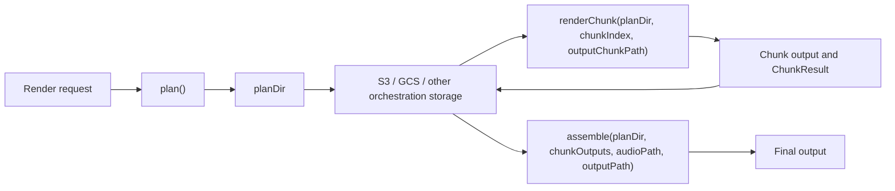
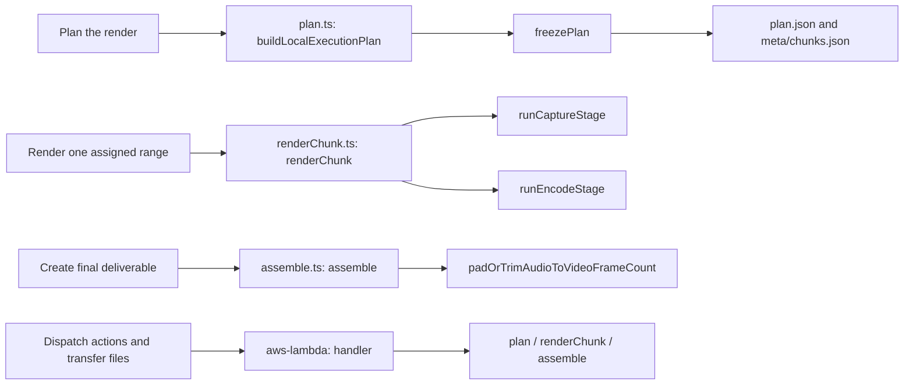
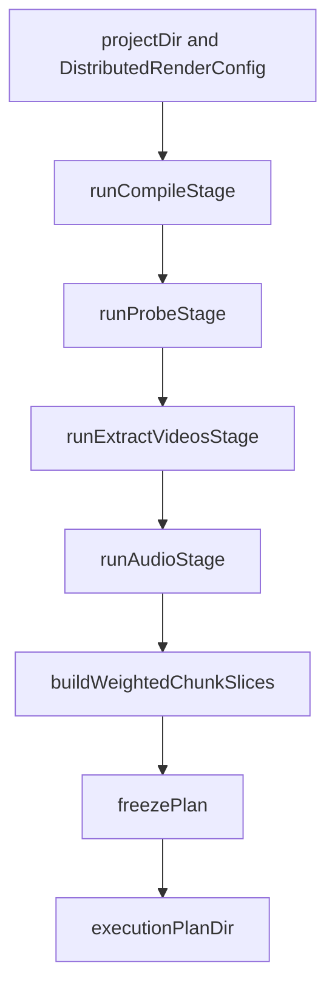
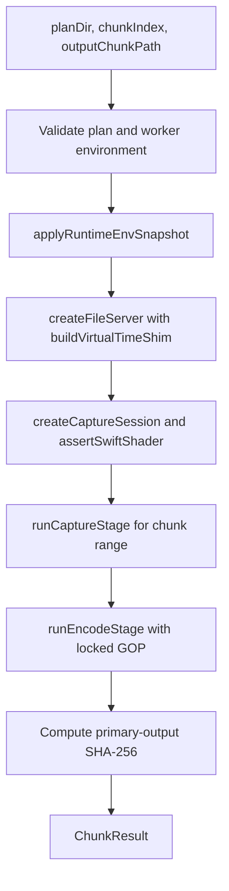
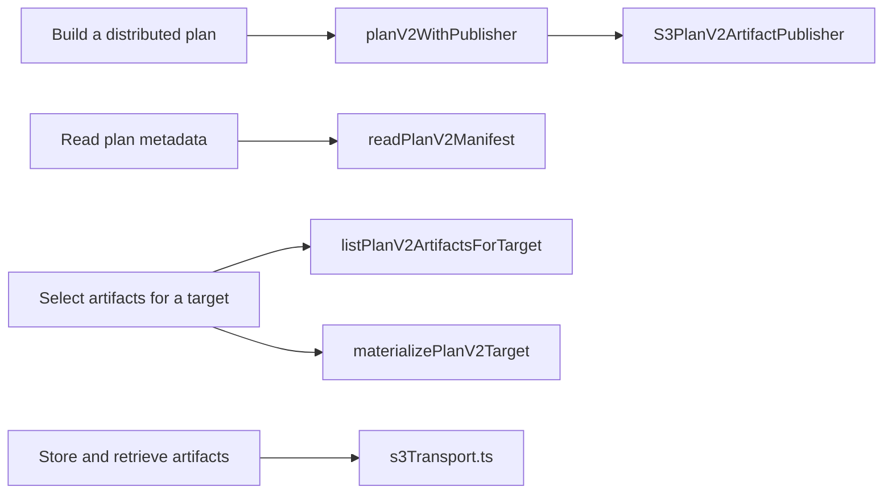

<!-- source: DeepWiki mcp.deepwiki.com · repo heygen-com/hyperframes · page 4.4 Distributed Rendering · fetched 2026-11-02 -->

# Distributed Rendering

Relevant source files

The following files were used as context for generating this wiki page:

- [examples/aws-lambda/template.yaml](examples/aws-lambda/template.yaml)
- [packages/aws-lambda/src/cdk/HyperframesRenderStack.snapshot.test.ts](packages/aws-lambda/src/cdk/HyperframesRenderStack.snapshot.test.ts)
- [packages/aws-lambda/src/cdk/HyperframesRenderStack.ts](packages/aws-lambda/src/cdk/HyperframesRenderStack.ts)
- [packages/aws-lambda/src/events.ts](packages/aws-lambda/src/events.ts)
- [packages/aws-lambda/src/handler.test.ts](packages/aws-lambda/src/handler.test.ts)
- [packages/aws-lambda/src/handler.ts](packages/aws-lambda/src/handler.ts)
- [packages/engine/src/services/chunkEncoder.test.ts](packages/engine/src/services/chunkEncoder.test.ts)
- [packages/engine/src/services/chunkEncoder.ts](packages/engine/src/services/chunkEncoder.ts)
- [packages/engine/src/services/streamingEncoder.test.ts](packages/engine/src/services/streamingEncoder.test.ts)
- [packages/engine/src/services/streamingEncoder.ts](packages/engine/src/services/streamingEncoder.ts)
- [packages/engine/src/utils/gpuEncoder.test.ts](packages/engine/src/utils/gpuEncoder.test.ts)
- [packages/engine/src/utils/gpuEncoder.ts](packages/engine/src/utils/gpuEncoder.ts)
- [packages/engine/src/utils/hdr.test.ts](packages/engine/src/utils/hdr.test.ts)
- [packages/engine/src/utils/hdr.ts](packages/engine/src/utils/hdr.ts)
- [packages/engine/src/utils/runFfmpeg.test.ts](packages/engine/src/utils/runFfmpeg.test.ts)
- [packages/engine/src/utils/runFfmpeg.ts](packages/engine/src/utils/runFfmpeg.ts)
- [packages/engine/src/utils/sdrCaptureColor.ts](packages/engine/src/utils/sdrCaptureColor.ts)
- [packages/gcp-cloud-run/src/server.test.ts](packages/gcp-cloud-run/src/server.test.ts)
- [packages/gcp-cloud-run/src/server.ts](packages/gcp-cloud-run/src/server.ts)
- [packages/producer/src/distributed.ts](packages/producer/src/distributed.ts)
- [packages/producer/src/index.ts](packages/producer/src/index.ts)
- [packages/producer/src/services/distributed/assemble.test.ts](packages/producer/src/services/distributed/assemble.test.ts)
- [packages/producer/src/services/distributed/assemble.ts](packages/producer/src/services/distributed/assemble.ts)
- [packages/producer/src/services/distributed/chunkAudio.test.ts](packages/producer/src/services/distributed/chunkAudio.test.ts)
- [packages/producer/src/services/distributed/chunkAudio.ts](packages/producer/src/services/distributed/chunkAudio.ts)
- [packages/producer/src/services/distributed/chunkFrames.ts](packages/producer/src/services/distributed/chunkFrames.ts)
- [packages/producer/src/services/distributed/mp4Stitch.ts](packages/producer/src/services/distributed/mp4Stitch.ts)
- [packages/producer/src/services/distributed/plan.test.ts](packages/producer/src/services/distributed/plan.test.ts)
- [packages/producer/src/services/distributed/plan.ts](packages/producer/src/services/distributed/plan.ts)
- [packages/producer/src/services/distributed/planV2.test.ts](packages/producer/src/services/distributed/planV2.test.ts)
- [packages/producer/src/services/distributed/planV2.ts](packages/producer/src/services/distributed/planV2.ts)
- [packages/producer/src/services/distributed/publicExports.test.ts](packages/producer/src/services/distributed/publicExports.test.ts)
- [packages/producer/src/services/distributed/renderChunk.test.ts](packages/producer/src/services/distributed/renderChunk.test.ts)
- [packages/producer/src/services/distributed/renderChunk.ts](packages/producer/src/services/distributed/renderChunk.ts)
- [packages/producer/src/services/distributed/renderChunkFallback.test.ts](packages/producer/src/services/distributed/renderChunkFallback.test.ts)
- [packages/producer/src/services/distributed/shared.ts](packages/producer/src/services/distributed/shared.ts)
- [packages/producer/src/services/distributed/videoMetadata.test.ts](packages/producer/src/services/distributed/videoMetadata.test.ts)
- [packages/producer/src/services/render/audioPadTrim.integration.test.ts](packages/producer/src/services/render/audioPadTrim.integration.test.ts)
- [packages/producer/src/services/render/audioPadTrim.test.ts](packages/producer/src/services/render/audioPadTrim.test.ts)
- [packages/producer/src/services/render/audioPadTrim.ts](packages/producer/src/services/render/audioPadTrim.ts)
- [packages/producer/src/services/render/runtimeEnvSnapshot.test.ts](packages/producer/src/services/render/runtimeEnvSnapshot.test.ts)
- [packages/producer/src/services/render/runtimeEnvSnapshot.ts](packages/producer/src/services/render/runtimeEnvSnapshot.ts)
- [packages/producer/src/services/render/stages/assembleStage.test.ts](packages/producer/src/services/render/stages/assembleStage.test.ts)
- [packages/producer/src/services/render/stages/assembleStage.ts](packages/producer/src/services/render/stages/assembleStage.ts)
- [packages/producer/src/services/render/stages/freezePlan.ts](packages/producer/src/services/render/stages/freezePlan.ts)

## Purpose and scope

Distributed rendering splits a video render into a planning activity, independently executable chunk-render activities, and an assembly activity. This page covers the local execution-plan format, content-addressed Plan v2 support, chunk determinism and encoding, assembly, protocol and size-related code, and the cloud-adapter boundary. The producer primitives operate on local paths; adapters handle transport and orchestration. [packages/producer/src/services/distributed/plan.ts:3-27]() [packages/producer/src/services/distributed/renderChunk.ts:1-14]() [packages/producer/src/services/distributed/assemble.ts:1-19]()

Sources: [packages/producer/src/services/distributed/plan.ts:3-27]() [packages/producer/src/services/distributed/renderChunk.ts:1-14]() [packages/producer/src/services/distributed/assemble.ts:1-19]()

---

## 1. Distributed Render Pipeline Overview

The distributed pipeline exposes three core activities: `plan` prepares a self-contained execution directory, `renderChunk` renders one chunk from that plan, and `assemble` joins the outputs into a deliverable. Planning composes compile, probe, video extraction, audio, and freeze stages; chunk rendering and assembly then consume the frozen plan. [packages/producer/src/services/distributed/plan.ts:3-23]() [packages/producer/src/services/distributed/renderChunk.ts:1-14]() [packages/producer/src/services/distributed/assemble.ts:1-19]()

The producer-side activities do not perform cloud networking: `renderChunk` and `assemble` work on local paths, and their callers move inputs and outputs through orchestration-level storage. The plan representation can be used through the legacy v1 `plan()` wrapper or a v2 manifest/CAS publisher. [packages/producer/src/services/distributed/plan.ts:20-23]() [packages/producer/src/services/distributed/renderChunk.ts:11-14]() [packages/producer/src/services/distributed/assemble.ts:18-19]()

### High-level data flow

**Diagram: Distributed activities and storage boundary**

The diagram shows the activity and transport boundary: `plan()` constructs the plan locally; chunk workers and assembly operate on local materialized paths; the adapter is responsible for moving data to and from storage. [packages/producer/src/services/distributed/plan.ts:5-23]() [packages/producer/src/services/distributed/renderChunk.ts:4-14]() [packages/producer/src/services/distributed/assemble.ts:4-19]() [packages/aws-lambda/src/handler.ts:4-11]()

Sources: [packages/producer/src/services/distributed/plan.ts:5-23]() [packages/producer/src/services/distributed/renderChunk.ts:4-14]() [packages/producer/src/services/distributed/assemble.ts:4-19]() [packages/aws-lambda/src/handler.ts:4-11]()

### Natural-language to code-entity map

This diagram pairs pipeline roles with the identifiers to search for in the codebase. [packages/producer/src/services/distributed/plan.ts:3-23]() [packages/producer/src/services/distributed/renderChunk.ts:1-14]() [packages/producer/src/services/distributed/assemble.ts:1-19]() [packages/aws-lambda/src/handler.ts:123-157]()

**Diagram: Pipeline roles mapped to implementation entities**

Sources: [packages/producer/src/services/distributed/plan.ts:3-23]() [packages/producer/src/services/distributed/renderChunk.ts:70-80]() [packages/producer/src/services/distributed/assemble.ts:4-19]() [packages/aws-lambda/src/handler.ts:4-11]()

---

## 2. Planning Stage (`plan.ts`)

### Responsibilities and plan directory

`buildLocalExecutionPlan(projectDir, config, executionPlanDir)` composes the existing render stages into a local execution directory for downstream chunk workers. The documented layout includes `plan.json`, compiled output, extracted video-frame sequences, optional mixed audio, and metadata for composition, encoder configuration, and chunk slices. [packages/producer/src/services/distributed/plan.ts:3-23]()

| Plan path | Role |
|---|---|
| `plan.json` | Plan-level metadata and plan hash. [packages/producer/src/services/distributed/assemble.ts:73-86]() |
| `compiled/` | Self-contained output from compilation. [packages/producer/src/services/distributed/plan.ts:10-13]() |
| `video-frames/` | Dereferenced per-video JPEG sequences. [packages/producer/src/services/distributed/plan.ts:10-15]() |
| `audio.m4a` | Present when the composition has audio. [packages/producer/src/services/distributed/plan.ts:13-18]() |
| `meta/composition.json` | Composition metadata. [packages/producer/src/services/distributed/plan.ts:16-18]() |
| `meta/encoder.json` | Locked render configuration. [packages/producer/src/services/distributed/plan.ts:16-18]() |
| `meta/chunks.json` | Chunk-slice metadata. [packages/producer/src/services/distributed/plan.ts:16-18]() |

`plan.ts` imports and composes `runCompileStage`, `runProbeStage`, `runExtractVideosStage`, and `runAudioStage`, then uses `freezePlan` and plan-hash utilities to write the frozen representation. It also imports chunk-weighting and plan-size measurement helpers. [packages/producer/src/services/distributed/plan.ts:65-97]() [packages/producer/src/services/distributed/plan.ts:111-117]()

### Configuration and validation

`DistributedRenderConfig` requires integer distributed frame rate, width, height, and output format; the interface also defines codec, quality, rate-control, source-video frame format, and output-resolution options. The comments specify that HDR mp4 is unsupported in distributed mode and that a codec passed with a non-mp4 format is rejected during planning. [packages/producer/src/services/distributed/plan.ts:119-153]() [packages/producer/src/services/distributed/plan.ts:155-178]()

The planner imports validation functions for distributed duration, GPU encoding, and system fonts. Its module documentation states that banned configurations are rejected at plan time so workers do not need to handle them. [packages/producer/src/services/distributed/plan.ts:25-27]() [packages/producer/src/services/distributed/plan.ts:94-98]()

Chunk sizing is supported by `buildWeightedChunkSlices`, `planFrameWeights`, and `withChunkCaptureCost`; frame-cost measurement is available through `measurePlanSecondsPerFrame`. The provided excerpt does not expose the complete chunk-sizing implementation or its exact defaults. [packages/producer/src/services/distributed/plan.ts:65-70]()

### Planning flow

**Diagram: `plan.ts` stage composition**

The planner imports these stages and helpers as the components used to construct and freeze the local execution plan. [packages/producer/src/services/distributed/plan.ts:65-87]() [packages/producer/src/services/distributed/plan.ts:111-117]()

Sources: [packages/producer/src/services/distributed/plan.ts:3-27]() [packages/producer/src/services/distributed/plan.ts:65-117]() [packages/producer/src/services/distributed/plan.ts:119-178]() [packages/producer/src/services/distributed/assemble.ts:73-86]()

---

## 3. Chunk Rendering Stage (`renderChunk.ts`)

### `renderChunk` contract

`renderChunk(planDir, chunkIndex, outputChunkPath)` validates the plan against the worker environment, captures the requested frame range, and produces either one encoded video chunk or a directory of PNG frames. The operation is local-path-only; callers are responsible for transferring the output to orchestration storage. [packages/producer/src/services/distributed/renderChunk.ts:1-14]()

`ChunkResult` reports the output path and kind, encoded frame count, optional frame range, SHA-256, and duration. Its contract states that retries for the same `(planDir, chunkIndex)` must return the same output hash. [packages/producer/src/services/distributed/renderChunk.ts:151-177]()

### Determinism and validation

The module documents several determinism requirements:

- The worker applies the `meta/encoder.json.runtimeEnv` snapshot before starting the file server. [packages/producer/src/services/distributed/renderChunk.ts:16-20]()
- Chrome uses software GPU mode, verified by `assertSwiftShader`; a non-software backend produces the non-retryable `BROWSER_GPU_NOT_SOFTWARE` failure. [packages/producer/src/services/distributed/renderChunk.ts:21-23]()
- The file server uses `buildVirtualTimeShim({ seedRandomFromFrame: true })` so random values are seeded per frame. [packages/producer/src/services/distributed/renderChunk.ts:24-27]()
- The worker does not prime `lastFrameCache`; every frame seeks fresh DOM. [packages/producer/src/services/distributed/renderChunk.ts:28-29]()
- Chunk encoding enables `lockGopForChunkConcat` and sets the GOP size to the number of frames in the chunk. [packages/producer/src/services/distributed/renderChunk.ts:30-31]()

The implementation imports plan validation and capture/encode components including `recomputePlanHashFromPlanDir`, `runCaptureStage`, `runEncodeStage`, and `readPlanProtocolV1`. [packages/producer/src/services/distributed/renderChunk.ts:70-107]()

### Chunk rendering flow

**Diagram: `renderChunk` validation, capture, and output**

The diagram summarizes the module’s documented contracts and imported stage helpers. It does not imply cloud transport: the caller handles that after `renderChunk` returns. [packages/producer/src/services/distributed/renderChunk.ts:11-14]() [packages/producer/src/services/distributed/renderChunk.ts:16-35]() [packages/producer/src/services/distributed/renderChunk.ts:70-94]() [packages/producer/src/services/distributed/renderChunk.ts:151-177]()

Sources: [packages/producer/src/services/distributed/renderChunk.ts:1-35]() [packages/producer/src/services/distributed/renderChunk.ts:70-121]() [packages/producer/src/services/distributed/renderChunk.ts:151-177]()

---

## 4. Plan Version 2: Content-Addressed Artifacts (`planV2.ts`)

The planning module documents two ways to use the execution-plan representation: the legacy v1 `plan()` wrapper and a v2 manifest/CAS publisher. The distributed package and AWS handler import Plan v2 operations for manifest reading, target materialization, artifact listing, and publisher-backed planning. [packages/producer/src/services/distributed/plan.ts:20-23]() [packages/aws-lambda/src/handler.ts:19-45]()

The adapter’s imports expose the Plan v2 boundary: `planV2WithPublisher`, `readPlanV2Manifest`, `listPlanV2ArtifactsForTarget`, and `materializePlanV2Target`. The supplied excerpts do not include the Plan v2 implementation, so details such as manifest schema, digest calculation, and target validation are not specified here. [packages/aws-lambda/src/handler.ts:19-45]()

### Natural-language to code-entity map

**Diagram: Plan v2 concepts mapped to visible API identifiers**

The AWS handler imports these producer and transport entities; the diagram identifies the adapter-facing code symbols without asserting unshown manifest internals. [packages/aws-lambda/src/handler.ts:19-45]() [packages/aws-lambda/src/handler.ts:65-76]()

Sources: [packages/producer/src/services/distributed/plan.ts:20-23]() [packages/aws-lambda/src/handler.ts:19-45]() [packages/aws-lambda/src/handler.ts:65-76]()

---

## 5. Cloud Execution Adapters

Producer activities are local-path primitives. Cloud adapters connect orchestration events and remote storage to those primitives, then return compact activity results. [packages/producer/src/services/distributed/renderChunk.ts:11-14]() [packages/producer/src/services/distributed/assemble.ts:18-19]() [packages/aws-lambda/src/handler.ts:4-11]()

### AWS Lambda adapter

`handler` dispatches on the event’s `Action` and routes `plan`, `audio`, `renderChunk`, and `assemble` to corresponding handlers. It unwraps Step Functions event envelopes, validates protocol shape and S3 URIs, primes the runtime environment, and logs structured start and error events. [packages/aws-lambda/src/handler.ts:118-171]()

The handler imports producer primitives including `plan`, `renderChunk`, `assemble`, and Plan v2 operations. Its transport imports include S3 download and upload helpers, tar/untar helpers, verified downloads, and concurrent mapping. The module description characterizes the handler as glue: parse event, transfer files, call a producer primitive, transfer results, and return JSON. [packages/aws-lambda/src/handler.ts:4-11]() [packages/aws-lambda/src/handler.ts:19-45]() [packages/aws-lambda/src/handler.ts:65-76]()

`HandlerDeps` provides test injection points for S3, Lambda account concurrency lookup, producer primitives, a temporary-directory root, and Chrome resolution behavior. [packages/aws-lambda/src/handler.ts:89-116]()

### GCP Cloud Run adapter

The provided file list identifies `packages/gcp-cloud-run/src/server.ts`, but its contents are not included in the supplied excerpts. Consequently, this page does not specify its routes, GCS transport, or workflow behavior.

Sources: [packages/aws-lambda/src/handler.ts:4-11]() [packages/aws-lambda/src/handler.ts:19-45]() [packages/aws-lambda/src/handler.ts:65-76]() [packages/aws-lambda/src/handler.ts:89-116]() [packages/aws-lambda/src/handler.ts:118-171]()

---

## 6. Idempotency, Size Caps, and Protocol

### Idempotency and retry safety

The plan module states that identical inputs produce the same execution-plan hash. Chunk rendering makes the retry contract explicit: the same `(planDir, chunkIndex)` must produce the same SHA-256 output hash. [packages/producer/src/services/distributed/plan.ts:20-23]() [packages/producer/src/services/distributed/renderChunk.ts:151-155]()

These contracts rely on deterministic worker conditions, including runtime-environment restoration, software GPU verification, frame-seeded randomness, fresh DOM seeks, and locked GOP encoding. [packages/producer/src/services/distributed/renderChunk.ts:16-35]()

### Chunk concatenation

`renderChunk` sets `lockGopForChunkConcat: true` and a GOP size equal to the chunk’s frame count. `resolveLockedGopSize` rejects a requested lock without a positive finite GOP size. The encoder exposes `appendLockedGopArgs` and closed-GOP codec parameters for chunk concatenation. [packages/producer/src/services/distributed/renderChunk.ts:30-31]() [packages/engine/src/services/chunkEncoder.ts:174-197]() [packages/engine/src/services/chunkEncoder.ts:199-202]()

`assemble` uses FFmpeg concat with stream copy for mp4, mov, and webm; PNG-sequence output is assembled by merging frame directories and globally renumbering frames. The module documents that locked chunk GOPs make the video chunks suitable for this path. [packages/producer/src/services/distributed/assemble.ts:1-16]()

### Audio duration correction

The plan audio is mixed against the declared composition duration, while the assembled video duration is determined by the sum of chunk frame counts. Before muxing, assembly uses `padOrTrimAudioToVideoFrameCount` to target `frameCount / fps`; the helper pads, trims, or copies based on the duration difference. [packages/producer/src/services/render/audioPadTrim.ts:3-20]() [packages/producer/src/services/render/audioPadTrim.ts:142-177]() [packages/producer/src/services/distributed/assemble.ts:13-16]() [packages/producer/src/services/distributed/assemble.ts:49-53]()

### Protocol and size-related code

`plan.ts` imports `PLAN_PROTOCOL_V1`; `renderChunk.ts` and `assemble.ts` import `readPlanProtocolV1` and `DISTRIBUTED_RENDER_CAPABILITIES`. The AWS handler validates protocol shape before dispatching an event. The excerpts establish that protocol-aware code exists, but do not include its supported-version rules or compatibility behavior. [packages/producer/src/services/distributed/plan.ts:111-117]() [packages/producer/src/services/distributed/renderChunk.ts:103-107]() [packages/producer/src/services/distributed/assemble.ts:55-59]() [packages/aws-lambda/src/handler.ts:129-132]()

The planner imports `measurePlanSizeBreakdown` and associated size types. The supplied excerpts do not show a numerical size cap or the error behavior when a plan exceeds one, so no specific cap is stated here. [packages/producer/src/services/distributed/plan.ts:111-117]()

Sources: [packages/producer/src/services/distributed/plan.ts:20-23]() [packages/producer/src/services/distributed/plan.ts:111-117]() [packages/producer/src/services/distributed/renderChunk.ts:16-35]() [packages/producer/src/services/distributed/renderChunk.ts:151-155]() [packages/producer/src/services/distributed/assemble.ts:1-16]() [packages/producer/src/services/distributed/assemble.ts:49-59]() [packages/producer/src/services/render/audioPadTrim.ts:3-20]() [packages/producer/src/services/render/audioPadTrim.ts:142-177]() [packages/engine/src/services/chunkEncoder.ts:174-202]() [packages/aws-lambda/src/handler.ts:129-132]()

---

## 7. Tests and Regression Coverage

`plan.test.ts` describes coverage for a golden plan-directory layout, deterministic plan hashes across repeated calls, and chunking helpers. It uses a fixture with declared duration so the probe stage can avoid launching a browser. [packages/producer/src/services/distributed/plan.test.ts:3-15]()

`renderChunk.test.ts` identifies the byte-identical retry contract as a load-bearing test: it creates a plan, renders the same chunk to two output paths, and compares the output bytes. The test may soft-skip when Chrome headless shell is unavailable; the file notes that CI runs the real check in `Dockerfile.test`. [packages/producer/src/services/distributed/renderChunk.test.ts:3-19]()

`audioPadTrim.test.ts` covers the pure pad/trim plan builder and a wrapper whose probes and FFmpeg operations can be injected, avoiding real FFmpeg and ffprobe invocations in those tests. [packages/producer/src/services/render/audioPadTrim.test.ts:1-14]()

Sources: [packages/producer/src/services/distributed/plan.test.ts:3-15]() [packages/producer/src/services/distributed/renderChunk.test.ts:3-19]() [packages/producer/src/services/render/audioPadTrim.test.ts:1-14]()

---

## Summary

The distributed producer path separates plan construction, chunk rendering, and final assembly. The planner freezes a local execution directory; workers validate and render assigned chunks under deterministic conditions; assembly concatenates chunks and corrects audio duration against the resulting frame count. [packages/producer/src/services/distributed/plan.ts:3-23]() [packages/producer/src/services/distributed/renderChunk.ts:1-35]() [packages/producer/src/services/distributed/assemble.ts:1-19]() [packages/producer/src/services/render/audioPadTrim.ts:3-20]()

The cloud boundary is deliberately separate from these local-path primitives. The AWS Lambda handler dispatches events and uses S3 transport helpers, while Plan v2 support is exposed through publisher, manifest, artifact-listing, and materialization APIs. [packages/producer/src/services/distributed/renderChunk.ts:11-14]() [packages/producer/src/services/distributed/assemble.ts:18-19]() [packages/aws-lambda/src/handler.ts:19-45]() [packages/aws-lambda/src/handler.ts:65-76]()

Sources: [packages/producer/src/services/distributed/plan.ts:3-23]() [packages/producer/src/services/distributed/renderChunk.ts:1-35]() [packages/producer/src/services/distributed/assemble.ts:1-19]() [packages/producer/src/services/render/audioPadTrim.ts:3-20]() [packages/aws-lambda/src/handler.ts:19-45]() [packages/aws-lambda/src/handler.ts:65-76]()

---

