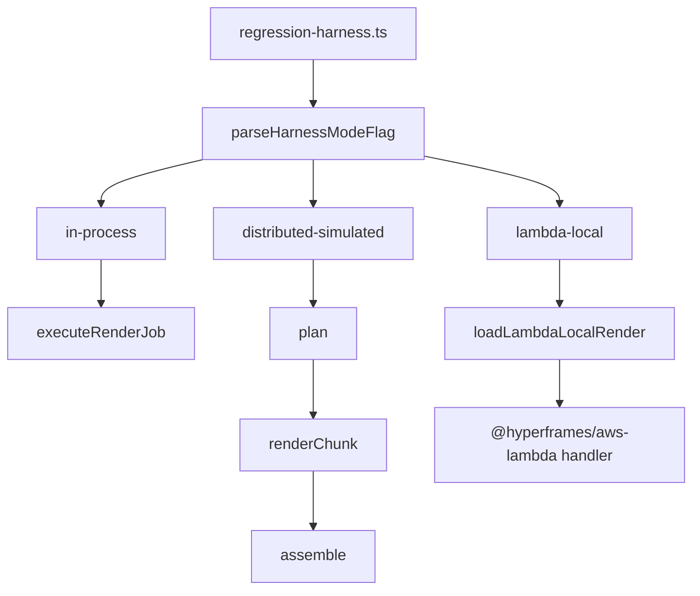
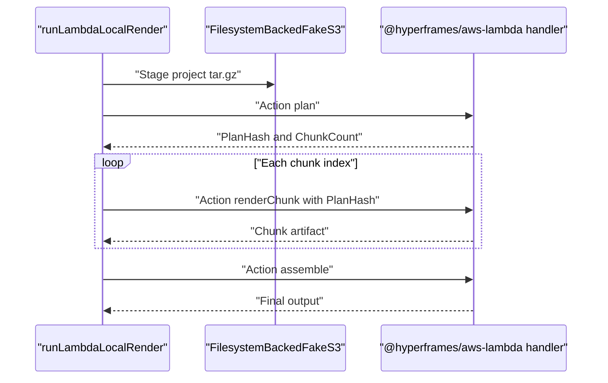
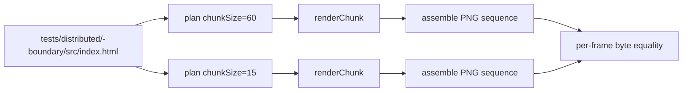
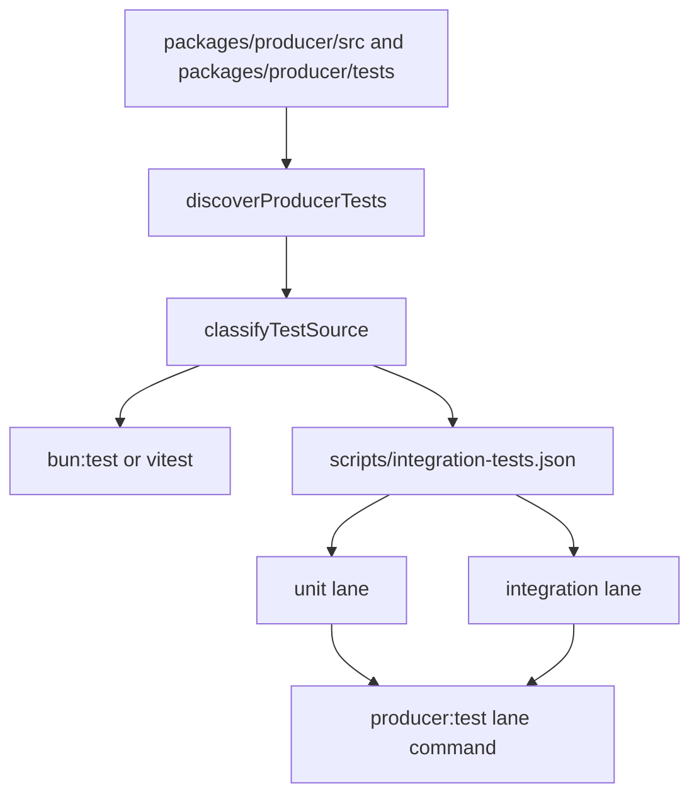
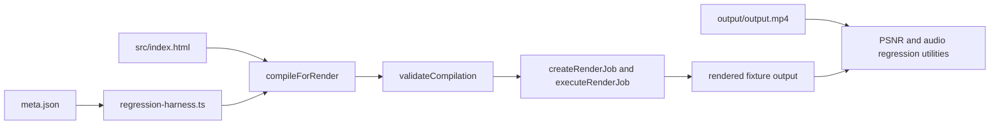
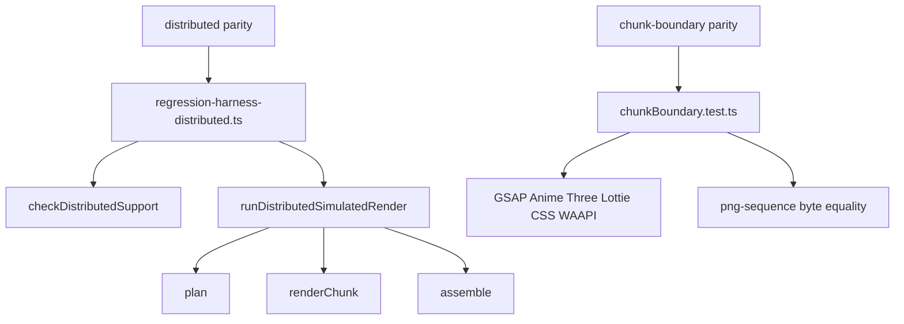

<!-- source: DeepWiki mcp.deepwiki.com · repo heygen-com/hyperframes · page 4.5 Regression and Parity Harnesses · fetched 2026-11-02 -->

# Regression and Parity Harnesses

Relevant source files

The following files were used as context for generating this wiki page:

- [packages/producer/scripts/integration-tests.json](packages/producer/scripts/integration-tests.json)
- [packages/producer/scripts/test-classification.mjs](packages/producer/scripts/test-classification.mjs)
- [packages/producer/scripts/test-classification.test.mjs](packages/producer/scripts/test-classification.test.mjs)
- [packages/producer/src/regression-harness-distributed.test.ts](packages/producer/src/regression-harness-distributed.test.ts)
- [packages/producer/src/regression-harness-distributed.ts](packages/producer/src/regression-harness-distributed.ts)
- [packages/producer/src/regression-harness-lambda-local-types.ts](packages/producer/src/regression-harness-lambda-local-types.ts)
- [packages/producer/src/regression-harness-lambda-local.ts](packages/producer/src/regression-harness-lambda-local.ts)
- [packages/producer/src/regression-harness-parse.test.ts](packages/producer/src/regression-harness-parse.test.ts)
- [packages/producer/src/regression-harness.ts](packages/producer/src/regression-harness.ts)
- [packages/producer/src/services/distributed/__test_utils__/hostChromeFailures.ts](packages/producer/src/services/distributed/__test_utils__/hostChromeFailures.ts)
- [packages/producer/src/services/distributed/chunkBoundary.test.ts](packages/producer/src/services/distributed/chunkBoundary.test.ts)
- [packages/producer/src/services/fileServer.listenError.test.ts](packages/producer/src/services/fileServer.listenError.test.ts)
- [packages/producer/src/services/htmlCompiler.mediaType.test.ts](packages/producer/src/services/htmlCompiler.mediaType.test.ts)
- [packages/producer/src/services/htmlCompiler.probeCount.test.ts](packages/producer/src/services/htmlCompiler.probeCount.test.ts)
- [packages/producer/src/services/htmlCompiler.variableMedia.test.ts](packages/producer/src/services/htmlCompiler.variableMedia.test.ts)
- [packages/producer/src/services/render/variableMountMedia.integration.test.ts](packages/producer/src/services/render/variableMountMedia.integration.test.ts)
- [packages/producer/tests/README.md](packages/producer/tests/README.md)
- [packages/producer/tests/distributed/anime-boundary/src/index.html](packages/producer/tests/distributed/anime-boundary/src/index.html)
- [packages/producer/tests/distributed/css-boundary/src/index.html](packages/producer/tests/distributed/css-boundary/src/index.html)
- [packages/producer/tests/distributed/gsap-boundary/src/index.html](packages/producer/tests/distributed/gsap-boundary/src/index.html)
- [packages/producer/tests/distributed/lottie-boundary/src/index.html](packages/producer/tests/distributed/lottie-boundary/src/index.html)
- [packages/producer/tests/distributed/mp4-h264-sdr/meta.json](packages/producer/tests/distributed/mp4-h264-sdr/meta.json)
- [packages/producer/tests/distributed/mp4-h264-sdr/src/index.html](packages/producer/tests/distributed/mp4-h264-sdr/src/index.html)
- [packages/producer/tests/distributed/three-boundary/src/index.html](packages/producer/tests/distributed/three-boundary/src/index.html)
- [packages/producer/tests/distributed/waapi-boundary/src/index.html](packages/producer/tests/distributed/waapi-boundary/src/index.html)
- [packages/producer/tests/distributed/webm-vp9/meta.json](packages/producer/tests/distributed/webm-vp9/meta.json)
- [packages/producer/tests/distributed/webm-vp9/output/compiled.html](packages/producer/tests/distributed/webm-vp9/output/compiled.html)
- [packages/producer/tests/distributed/webm-vp9/output/output.webm](packages/producer/tests/distributed/webm-vp9/output/output.webm)
- [packages/producer/tests/distributed/webm-vp9/src/index.html](packages/producer/tests/distributed/webm-vp9/src/index.html)
- [packages/producer/tsconfig.json](packages/producer/tsconfig.json)
- [scripts/creator-editing-capabilities.test.mjs](scripts/creator-editing-capabilities.test.mjs)
- [scripts/test-reachability.json](scripts/test-reachability.json)

## Purpose and scope

This page covers the producer package’s regression fixtures, render-mode harnesses, distributed parity checks, and producer test-lane selection. The regression harness compares fixture renders with checked-in baselines; distributed-specific tests separately exercise chunk boundaries and distributed rendering behavior. [packages/producer/tests/README.md:1-7]()

The provided files document fixture layout, harness modes, test classification, and parity checks. They do not show the contents of `Dockerfile.test` or a regression-fixture shard planner, so this page does not assume details about Docker image construction or fixture shard scheduling. [packages/producer/tests/README.md:40-72]()[packages/producer/scripts/test-classification.mjs:8-20]()

Sources: `packages/producer/tests/README.md`; `packages/producer/scripts/test-classification.mjs`

## 1. Regression harness

`packages/producer/src/regression-harness.ts` imports the producer render pipeline (`createRenderJob`, `executeRenderJob`), HTML compilation and compilation validation, FFprobe metadata helpers, and audio regression utilities. It also imports the distributed harness interface and mode helpers. [packages/producer/src/regression-harness.ts:19-35]()

The file defines fixture metadata in `TestMetadata`. Its quality thresholds include video PSNR, permitted frame failures, audio correlation, audio lag windows, and an optional residual-audio RMS threshold. `renderConfig` includes an FPS value, optional output format and codec, worker count, HDR and capture-path settings, render-time variables, and distributed chunk scheduling options. FPS is normalized to the structured `Fps` form for downstream use. [packages/producer/src/regression-harness.ts:69-152]()

| Metadata/configuration field | Role in the harness |
|---|---|
| `minPsnr` | Per-fixture minimum video similarity threshold. [packages/producer/src/regression-harness.ts:69-76]() |
| `maxFrameFailures` | Per-fixture allowance for frame comparison failures. [packages/producer/src/regression-harness.ts:69-76]() |
| `minAudioCorrelation`, `maxAudioLagWindows` | Audio correlation and alignment thresholds. [packages/producer/src/regression-harness.ts:69-76]() |
| `maxAudioResidualRmsDb` | Optional residual-RMS check; omitted values skip this check. [packages/producer/src/regression-harness.ts:77-85]() |
| `renderConfig.fps` | Integer or rational frame rate normalized into `Fps`. [packages/producer/src/regression-harness.ts:86-94]() |
| `renderConfig.format` | Output type, including video containers or `png-sequence`; the latter uses per-frame byte comparison rather than PSNR. [packages/producer/src/regression-harness.ts:95-103]() |
| `renderConfig.codec` | Optional H.264/H.265 selection; the file documents its use for distributed-simulated MP4 rendering. [packages/producer/src/regression-harness.ts:105-114]() |
| `renderConfig.captureMode`, `experimentalFastCapture` | Capture-path selection and the experimental fast-capture option. [packages/producer/src/regression-harness.ts:119-130]() |
| `renderConfig.variables` | Runtime variable overrides corresponding to render-time variable injection. [packages/producer/src/regression-harness.ts:132-138]() |
| `renderConfig.chunkSize`, `maxParallelChunks` | Distributed-simulated chunk sizing and parallelism controls. [packages/producer/src/regression-harness.ts:140-150]() |

The harness imports `compileForRender()` and `validateCompilation()` alongside render-job creation and execution. Its audio comparison dependencies are `buildRmsEnvelope()`, `compareAudioEnvelopes()`, and `computeAudioResidualRmsDb()`. [packages/producer/src/regression-harness.ts:19-27]()

Sources: `packages/producer/src/regression-harness.ts`

## 2. Harness modes and dispatch

The harness exposes three modes: `in-process`, `distributed-simulated`, and `lambda-local`. In-process uses `executeRenderJob()`. Distributed-simulated runs `plan()` → `renderChunk()` for each chunk → `assemble()` in the current process. Lambda-local drives the AWS Lambda handler with filesystem-backed fake S3 rather than invoking a real AWS deployment. [packages/producer/src/regression-harness-distributed.ts:4-15]()[packages/producer/src/regression-harness-distributed.ts:45-58]()[packages/producer/src/regression-harness-lambda-local.ts:1-23]()

The main harness imports distributed-mode parsing, support checks, PSNR threshold resolution, and simulated rendering from `regression-harness-distributed.ts`. Lambda-local is deliberately loaded dynamically: the source explains that its static AWS Lambda imports would create build and module-loading problems in the Docker test workspace. The loader uses a variable import path and a separate type-only interface. [packages/producer/src/regression-harness.ts:29-35]()[packages/producer/src/regression-harness.ts:37-65]()

### Mode flow: names to implementation entities

**Diagram: Harness mode dispatch**

Sources: `packages/producer/src/regression-harness.ts:19-35`; `packages/producer/src/regression-harness.ts:58-65`; `packages/producer/src/regression-harness-distributed.ts:4-15`; `packages/producer/src/regression-harness-distributed.ts:45-58`; `packages/producer/src/regression-harness-lambda-local.ts:1-23`

## 3. Distributed rendering parity

`regression-harness-distributed.ts` describes distributed-simulated mode as an in-process driver for the distributed pipeline. It uses the same plan, chunk rendering, and assembly stages as the distributed path, but without Temporal or Lambda. The harness compares against the same fixture baseline and uses the fixture’s `minPsnr`; an absolute 10 dB floor guards against pathological near-black output when a fixture threshold is unusually permissive. [packages/producer/src/regression-harness-distributed.ts:10-25]()[packages/producer/src/regression-harness-distributed.ts:60-69]()

`checkDistributedSupport()` rejects non-integer FPS, FPS values outside the supported distributed set, and HDR fixtures. The function returns a structured reason for unsupported configurations, allowing the caller to skip rather than attempt an invalid distributed render. [packages/producer/src/regression-harness-distributed.ts:74-113]()

The fixture README describes the distributed-simulated eligibility gates and says unsupported fixtures are logged and counted as passing (skipped). It also specifies that distributed mode does not update golden baselines: in-process rendering remains the baseline source of truth. [packages/producer/tests/README.md:90-115]()

### Plan-hash and Lambda-local boundary

Lambda-local mode exercises the AWS Lambda handler’s event dispatch and artifact boundaries using fake S3 rooted in a local directory. It stages the project as a tarball, builds handler dependencies, submits a plan event, then submits chunk events carrying the returned `PlanHash`. The source comments identify event JSON, S3 key conventions, and plan-hash boundary checks as behaviors this mode is intended to cover. [packages/producer/src/regression-harness-lambda-local.ts:11-16]()[packages/producer/src/regression-harness-lambda-local.ts:60-83]()[packages/producer/src/regression-harness-lambda-local.ts:133-181]()

The displayed files establish that `PlanHash` is passed from the plan response into render-chunk events; they do not include the implementation that computes or validates the hash. [packages/producer/src/regression-harness-lambda-local.ts:157-181]()

**Diagram: Lambda-local plan and artifact flow**

Sources: `packages/producer/src/regression-harness-lambda-local.ts:60-83`; `packages/producer/src/regression-harness-lambda-local.ts:133-181`; `packages/producer/src/regression-harness-lambda-local.ts:1-16`

### Distributed chunk-boundary parity

`chunkBoundary.test.ts` tests whether a single-chunk render and a four-chunk render produce byte-identical frames. It uses PNG sequences because chunk size changes encoded-video keyframe placement, while PNG assembly merges frame directories without re-encoding. The test covers GSAP, Anime.js, Three.js, Lottie, CSS, and WAAPI adapter fixtures. [packages/producer/src/services/distributed/chunkBoundary.test.ts:1-20]()[packages/producer/src/services/distributed/chunkBoundary.test.ts:33-41]()

For each adapter, the test calls `plan()`, renders each planned chunk with `renderChunk()`, and assembles the result. It compares chunk sizes of 60 and 15 frames, checks an expected frame count of 60, and soft-skips recognized host Chrome failures because the Docker harness covers the contract. [packages/producer/src/services/distributed/chunkBoundary.test.ts:58-103]()[packages/producer/src/services/distributed/chunkBoundary.test.ts:105-155]()

**Diagram: Chunk-boundary test entities**

Sources: `packages/producer/src/services/distributed/chunkBoundary.test.ts:1-20`; `packages/producer/src/services/distributed/chunkBoundary.test.ts:33-41`; `packages/producer/src/services/distributed/chunkBoundary.test.ts:58-103`; `packages/producer/src/services/distributed/chunkBoundary.test.ts:148-155`

## 4. Fixture layout

Producer regression fixtures live under `packages/producer/tests`. Each fixture has metadata, a source composition, and checked-in output baselines. The README identifies `output/compiled.html` as a compiled-HTML snapshot and `output/output.mp4` as the rendered-video baseline. [packages/producer/tests/README.md:1-20]()

| Path | Purpose |
|---|---|
| `<fixture>/meta.json` | Fixture name, tags, thresholds, and render configuration. [packages/producer/tests/README.md:11-29]() |
| `<fixture>/src/index.html` | Composition entry point. [packages/producer/tests/README.md:11-20]() |
| `<fixture>/src/assets/` | Optional locally referenced media. [packages/producer/tests/README.md:11-20]() |
| `<fixture>/output/compiled.html` | Golden compiled HTML snapshot. [packages/producer/tests/README.md:17-20]() |
| `<fixture>/output/output.mp4` | Golden rendered video baseline; fixtures may use other supported output formats. [packages/producer/tests/README.md:17-20]()[packages/producer/src/regression-harness.ts:95-103]() |

The README says baseline generation should occur inside Docker to avoid host Chrome and FFmpeg version drift. It documents `docker:test:update` for generating one fixture or all baselines, and `docker:test` for running fixtures, including a sequential option. [packages/producer/tests/README.md:40-72]()

Distributed-specific fixtures are placed under `tests/distributed/<name>/`. The README says these fixtures require a `chunkSize` that produces multiple chunks to exercise seams. Separately, adapter boundary fixtures are owned by `chunkBoundary.test.ts` and intentionally omit `meta.json`, so that test—not the general regression fixture discovery—owns their planning, rendering, and assembly. [packages/producer/tests/README.md:139-164]()[packages/producer/src/services/distributed/chunkBoundary.test.ts:14-20]()

Sources: `packages/producer/tests/README.md`; `packages/producer/src/regression-harness.ts:95-103`; `packages/producer/src/services/distributed/chunkBoundary.test.ts:14-20`

## 5. Producer test classification and CI lanes

Producer source and fixture tests are discovered under `src` and `tests`. `discoverProducerTests()` recursively collects `*.test.ts` files, records paths relative to the producer root, classifies each test, verifies that integration-manifest entries still exist, and sorts the result. [packages/producer/scripts/test-classification.mjs:14-20]()[packages/producer/scripts/test-classification.mjs:37-55]()

`classifyTestSource()` assigns the runner based on imports: a test must import exactly one of `bun:test` or `vitest`, otherwise classification throws. It assigns the lane using `scripts/integration-tests.json`: listed files are integration tests; other discovered tests are unit tests. [packages/producer/scripts/test-classification.mjs:8-12]()[packages/producer/scripts/test-classification.mjs:23-35]()

The integration manifest includes regression-harness PSNR and audio tests, distributed service tests, and other tests that need integration capabilities. The classification tests verify uniqueness, runner classification, current discovery coverage, and that `.integration.test.ts` files are assigned to the integration lane. [packages/producer/scripts/integration-tests.json:1-46]()[packages/producer/scripts/test-classification.test.mjs:10-18]()[packages/producer/scripts/test-classification.test.mjs:48-80]()

The reachability manifest records the producer test runner mapping for both CI lanes and pins hashes for runner, classifier, workflow, and package scripts. The supplied content establishes lane-based execution mapping, but does not show a fixture-level regression shard planner or a shard-scheduling algorithm. [scripts/test-reachability.json:41-59]()

**Diagram: Test discovery to CI lane**

Sources: `packages/producer/scripts/test-classification.mjs:8-20`; `packages/producer/scripts/test-classification.mjs:23-55`; `packages/producer/scripts/integration-tests.json:1-46`; `scripts/test-reachability.json:41-59`

## 6. Docker test environment and pixel/audio validation

The fixture README instructs maintainers to build `Dockerfile.test` before running or updating regression baselines. It explains that baselines should be generated inside Docker because host Chrome and FFmpeg versions vary. The supplied files do not include the Dockerfile contents, so its base image, installed dependencies, and build steps cannot be specified here. [packages/producer/tests/README.md:40-59]()

The harness metadata defines video and audio criteria. Video checks use `minPsnr` and `maxFrameFailures`; audio checks use minimum correlation and maximum lag windows, with an optional residual-RMS threshold. For `png-sequence`, the harness metadata documents per-frame byte equality instead of PSNR comparison. [packages/producer/src/regression-harness.ts:69-103]()

The distributed harness applies the fixture’s PSNR threshold to distributed output and enforces a 10 dB pathology floor for distributed-simulated mode. The distributed documentation distinguishes this baseline gate from the separate distributed-versus-in-process contract, which is not used as the per-fixture baseline threshold. [packages/producer/src/regression-harness-distributed.ts:17-25]()[packages/producer/src/regression-harness-distributed.ts:60-69]()

Sources: `packages/producer/tests/README.md:40-59`; `packages/producer/src/regression-harness.ts:69-103`; `packages/producer/src/regression-harness-distributed.ts:17-25`; `packages/producer/src/regression-harness-distributed.ts:60-69`

## 7. Code-entity map

**Diagram: Fixture regression path**

Sources: `packages/producer/tests/README.md:9-29`; `packages/producer/src/regression-harness.ts:19-27`; `packages/producer/src/regression-harness.ts:69-103`

**Diagram: Natural-language parity concepts to code entities**

Sources: `packages/producer/src/regression-harness-distributed.ts:1-15`; `packages/producer/src/regression-harness-distributed.ts:74-113`; `packages/producer/src/services/distributed/chunkBoundary.test.ts:14-20`; `packages/producer/src/services/distributed/chunkBoundary.test.ts:58-103`

## Summary

The producer regression system combines fixture baselines and metadata-driven quality thresholds with multiple rendering paths. `regression-harness.ts` connects compilation, render orchestration, and audio analysis; distributed-simulated and lambda-local modes exercise distributed pipeline and handler boundaries. Distributed chunk-boundary tests add a per-adapter pixel-equivalence check, while producer test classification separates unit and integration lanes using runner imports and a manifest. [packages/producer/src/regression-harness.ts:19-35]()[packages/producer/src/regression-harness-distributed.ts:45-69]()[packages/producer/src/regression-harness-lambda-local.ts:11-16]()[packages/producer/src/services/distributed/chunkBoundary.test.ts:1-20]()[packages/producer/scripts/test-classification.mjs:23-55]()

Sources: `packages/producer/src/regression-harness.ts`; `packages/producer/src/regression-harness-distributed.ts`; `packages/producer/src/regression-harness-lambda-local.ts`; `packages/producer/src/services/distributed/chunkBoundary.test.ts`; `packages/producer/scripts/test-classification.mjs`

---

