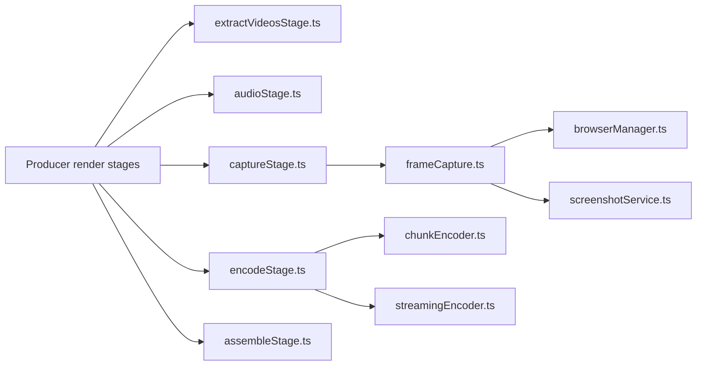
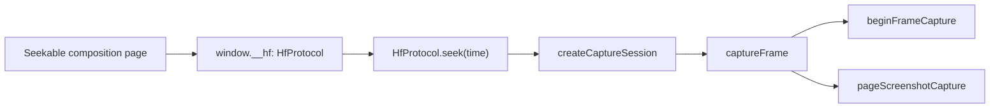

<!-- source: DeepWiki mcp.deepwiki.com · repo heygen-com/hyperframes · page 5 Engine Package · fetched 2026-11-02 -->

# Engine Package

Relevant source files

The following files were used as context for generating this wiki page:

- [docs/guides/rendering.mdx](docs/guides/rendering.mdx)
- [docs/packages/engine.mdx](docs/packages/engine.mdx)
- [docs/packages/producer.mdx](docs/packages/producer.mdx)
- [packages/cli/src/commands/render.test.ts](packages/cli/src/commands/render.test.ts)
- [packages/cli/src/commands/render.ts](packages/cli/src/commands/render.ts)
- [packages/cli/src/docs/rendering.md](packages/cli/src/docs/rendering.md)
- [packages/cli/src/telemetry/events.test.ts](packages/cli/src/telemetry/events.test.ts)
- [packages/cli/src/telemetry/events.ts](packages/cli/src/telemetry/events.ts)
- [packages/cli/src/telemetry/renderObservability.test.ts](packages/cli/src/telemetry/renderObservability.test.ts)
- [packages/cli/src/telemetry/renderObservability.ts](packages/cli/src/telemetry/renderObservability.ts)
- [packages/cli/src/utils/dockerRunArgs.test.ts](packages/cli/src/utils/dockerRunArgs.test.ts)
- [packages/cli/src/utils/dockerRunArgs.ts](packages/cli/src/utils/dockerRunArgs.ts)
- [packages/engine/src/config.test.ts](packages/engine/src/config.test.ts)
- [packages/engine/src/config.ts](packages/engine/src/config.ts)
- [packages/engine/src/index.ts](packages/engine/src/index.ts)
- [packages/engine/src/services/browserManager.test.ts](packages/engine/src/services/browserManager.test.ts)
- [packages/engine/src/services/browserManager.ts](packages/engine/src/services/browserManager.ts)
- [packages/engine/src/services/chunkEncoder.relativePaths.test.ts](packages/engine/src/services/chunkEncoder.relativePaths.test.ts)
- [packages/engine/src/services/frameCapture.test.ts](packages/engine/src/services/frameCapture.test.ts)
- [packages/engine/src/services/frameCapture.ts](packages/engine/src/services/frameCapture.ts)
- [packages/engine/src/types.ts](packages/engine/src/types.ts)
- [packages/producer/src/services/render/observability.ts](packages/producer/src/services/render/observability.ts)
- [packages/producer/src/services/render/perfSummary.test.ts](packages/producer/src/services/render/perfSummary.test.ts)
- [packages/producer/src/services/render/perfSummary.ts](packages/producer/src/services/render/perfSummary.ts)
- [packages/producer/src/services/renderOrchestrator.deGateProbe.test.ts](packages/producer/src/services/renderOrchestrator.deGateProbe.test.ts)
- [packages/producer/src/services/renderOrchestrator.test.ts](packages/producer/src/services/renderOrchestrator.test.ts)
- [packages/producer/src/services/renderOrchestrator.ts](packages/producer/src/services/renderOrchestrator.ts)

## Purpose and Scope

`@hyperframes/engine` is HyperFrames’ seekable-page rendering engine: it provides the browser and media-processing services used to capture composition frames, prepare video and audio media, and encode render output. Its page contract is framework-agnostic: a page exposes `window.__hf` and a deterministic `seek(time)` operation, allowing the engine to capture it without depending on a particular animation framework. [packages/engine/src/index.ts:1-6]() [packages/engine/src/types.ts:107-138]()

This page introduces how the engine fits into rendering and links to child pages for implementation details. The producer composes engine services into render stages, including video extraction, audio processing, capture, and encoding. [packages/producer/src/services/renderOrchestrator.ts:6-22]() For details, see [Frame Capture and Browser Management](#5.1), [Video Frame Extraction and Audio Mixing](#5.2), and [Encoding Pipeline](#5.3).

Sources: [packages/engine/src/index.ts:1-6](), [packages/engine/src/types.ts:107-138](), [packages/producer/src/services/renderOrchestrator.ts:6-22]()

---

## Core Responsibilities

### Deterministic Frame Capture via Puppeteer

The engine’s `frameCapture` service uses Puppeteer to navigate to a composition, wait for its `window.__hf` protocol, and capture frames through Chrome’s BeginFrame API or a screenshot fallback. The browser-management layer handles Chrome acquisition and release, including pooled browser leases and GPU-mode resolution. [packages/engine/src/services/frameCapture.ts:2-9]() [packages/engine/src/services/frameCapture.ts:56-80]() [packages/engine/src/index.ts:82-106]()

The producer uses these engine services in its capture stage; capture is one part of a broader pipeline that also prepares media and encodes output. [packages/producer/src/services/renderOrchestrator.ts:12-22]() For details, see [Frame Capture and Browser Management](#5.1).

Sources: [packages/engine/src/services/frameCapture.ts:2-9](), [packages/engine/src/services/frameCapture.ts:56-80](), [packages/engine/src/index.ts:82-106](), [packages/producer/src/services/renderOrchestrator.ts:12-22]()

### Video Frame Extraction and Audio Mixing

The engine’s `HfProtocol` can describe media elements for engine-managed processing. Its protocol types document that video frames and audio tracks are pre-extracted and handled separately from browser playback. [packages/engine/src/types.ts:58-82]() The producer places video extraction and audio processing before frame capture in its render-stage sequence. [packages/producer/src/services/renderOrchestrator.ts:12-22]()

For details on extraction, frame lookup and injection, and audio processing, see [Video Frame Extraction and Audio Mixing](#5.2).

Sources: [packages/engine/src/types.ts:58-82](), [packages/producer/src/services/renderOrchestrator.ts:12-22]()

### Parallel Worker Coordination

The engine exports `executeParallelCapture` and `mergeWorkerFrames`, which the producer imports for parallel capture work. [packages/producer/src/services/renderOrchestrator.ts:78-85]() Parallel worker behavior and capture coordination are covered in [Frame Capture and Browser Management](#5.1).

Sources: [packages/producer/src/services/renderOrchestrator.ts:78-85]()

### Encoding Pipeline

The engine’s public API exports chunked encoding helpers such as `buildEncoderArgs`, `encodeFramesFromDir`, and `encodeFramesChunkedConcat`, along with streaming encoding through `spawnStreamingEncoder` and `createFrameReorderBuffer`. [packages/engine/src/index.ts:181-211]() In the producer pipeline, encoding follows capture and precedes assembly. [packages/producer/src/services/renderOrchestrator.ts:16-22]()

For details on codec selection, encoding modes, and output handling, see [Encoding Pipeline](#5.3).

Sources: [packages/engine/src/index.ts:181-211](), [packages/producer/src/services/renderOrchestrator.ts:16-22]()

---

## System Architecture Diagram

**From render stages to engine services**

The diagram maps the producer’s named render stages to engine services exported by the engine package. The producer stage names are listed by `renderOrchestrator.ts`; engine capture, browser, screenshot, chunk-encoding, and streaming-encoding exports are listed in `index.ts`. [packages/producer/src/services/renderOrchestrator.ts:12-22]() [packages/engine/src/index.ts:82-106]() [packages/engine/src/index.ts:162-179]() [packages/engine/src/index.ts:181-211]()

Sources: [packages/producer/src/services/renderOrchestrator.ts:12-22](), [packages/engine/src/index.ts:82-106](), [packages/engine/src/index.ts:162-179](), [packages/engine/src/index.ts:181-211]()

**From page contract to capture operations**

The composition-to-engine contract is `HfProtocol`: it exposes duration and a deterministic `seek(time)` method, which the engine uses before capture. The engine exports session and frame-capture functions, while its screenshot service exports BeginFrame and screenshot capture paths. [packages/engine/src/types.ts:107-138]() [packages/engine/src/index.ts:117-149]() [packages/engine/src/index.ts:162-179]()

Sources: [packages/engine/src/types.ts:107-138](), [packages/engine/src/index.ts:117-149](), [packages/engine/src/index.ts:162-179]()

---

## Key Code Entities and Their Roles

| Area | Code entities | Role |
|---|---|---|
| Engine API | `packages/engine/src/index.ts` | Public exports for configuration, browser management, capture, screenshot, encoding, and streaming services. [packages/engine/src/index.ts:49-64]() [packages/engine/src/index.ts:82-106]() [packages/engine/src/index.ts:117-211]() |
| Page contract | `HfProtocol`, `HfMediaElement`, `HfSeekOptions` | Defines the seekable page interface and optional media and seek controls. [packages/engine/src/types.ts:58-82]() [packages/engine/src/types.ts:107-139]() |
| Browser management | `acquireBrowser`, `releaseBrowser`, `BrowserLeasePool`, `resolveBrowserGpuMode` | Browser lifecycle, leasing, and GPU-mode-related exports. [packages/engine/src/index.ts:82-106]() |
| Frame capture | `createCaptureSession`, `initializeSession`, `captureFrame`, `closeCaptureSession` | Capture-session lifecycle and frame operations. [packages/engine/src/index.ts:117-149]() |
| Screenshot capture | `beginFrameCapture`, `pageScreenshotCapture` | BeginFrame and screenshot capture exports. [packages/engine/src/index.ts:162-179]() |
| Encoding | `buildEncoderArgs`, `encodeFramesChunkedConcat`, `spawnStreamingEncoder`, `createFrameReorderBuffer` | Chunked and streaming encoding APIs. [packages/engine/src/index.ts:181-211]() |
| Producer integration | `executeRenderJob` pipeline stages | Connects engine-backed extraction, audio, capture, and encoding work to the render pipeline. [packages/producer/src/services/renderOrchestrator.ts:6-22]() |

Sources: [packages/engine/src/index.ts:49-64](), [packages/engine/src/index.ts:82-106](), [packages/engine/src/index.ts:117-211](), [packages/engine/src/types.ts:58-139](), [packages/producer/src/services/renderOrchestrator.ts:6-22]()

---

## Subsystems Overview and Child Pages

The engine’s services support a staged render workflow: media preparation feeds capture, and captured frames are passed to encoding and assembly. The producer’s orchestrator identifies these stages and tracks stage-created resources for cleanup. [packages/producer/src/services/renderOrchestrator.ts:6-27]()

Sources: [packages/producer/src/services/renderOrchestrator.ts:6-27]()

### Frame Capture and Browser Management

This subsystem combines `frameCapture` with browser lifecycle and screenshot services. The engine API exposes browser acquisition and release, capture-session operations, and BeginFrame and screenshot functions. [packages/engine/src/index.ts:82-106]() [packages/engine/src/index.ts:117-179]()

For details, see [Frame Capture and Browser Management](#5.1).

Sources: [packages/engine/src/index.ts:82-106](), [packages/engine/src/index.ts:117-179]()

### Video Frame Extraction and Audio Mixing

The page protocol’s optional `media` field describes video and audio elements for engine-managed processing. The producer pipeline places video extraction and audio processing before capture. [packages/engine/src/types.ts:58-82]() [packages/producer/src/services/renderOrchestrator.ts:12-22]()

For details, see [Video Frame Extraction and Audio Mixing](#5.2).

Sources: [packages/engine/src/types.ts:58-82](), [packages/producer/src/services/renderOrchestrator.ts:12-22]()

### Encoding Pipeline

The engine exposes both chunked encoder functions and streaming encoder APIs. The producer invokes encoding after capture and before assembly. [packages/engine/src/index.ts:181-211]() [packages/producer/src/services/renderOrchestrator.ts:16-22]()

For details, see [Encoding Pipeline](#5.3).

Sources: [packages/engine/src/index.ts:181-211](), [packages/producer/src/services/renderOrchestrator.ts:16-22]()

---

## Summary

`@hyperframes/engine` supplies the seekable-page capture and media-processing layer used by HyperFrames rendering. Its public API covers browser management, frame capture, screenshot capture, and chunked or streaming encoding; the producer organizes these capabilities into a larger staged pipeline. [packages/engine/src/index.ts:82-211]() [packages/producer/src/services/renderOrchestrator.ts:12-22]()

Continue to [Frame Capture and Browser Management](#5.1), [Video Frame Extraction and Audio Mixing](#5.2), and [Encoding Pipeline](#5.3) for subsystem details.

Sources: [packages/engine/src/index.ts:82-211](), [packages/producer/src/services/renderOrchestrator.ts:12-22]()

---

