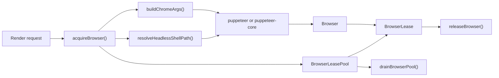
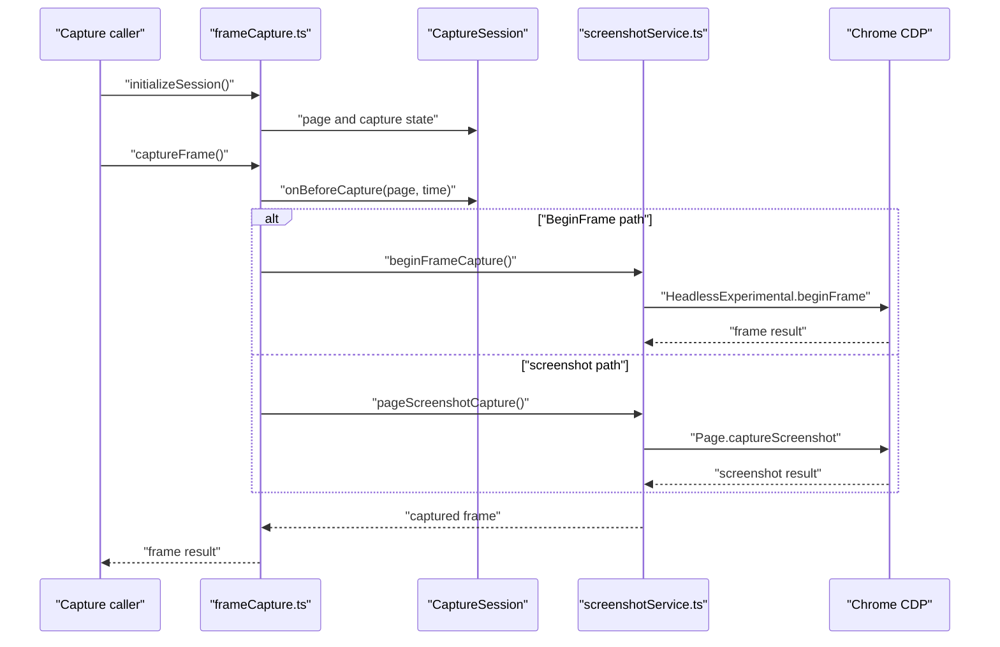
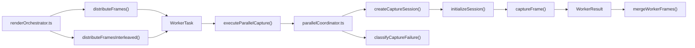

<!-- source: DeepWiki mcp.deepwiki.com · repo heygen-com/hyperframes · page 5.1 Frame Capture and Browser Management · fetched 2026-11-02 -->

# Frame Capture and Browser Management

Relevant source files

The following files were used as context for generating this wiki page:

- [docs/guides/rendering.mdx](docs/guides/rendering.mdx)
- [docs/packages/engine.mdx](docs/packages/engine.mdx)
- [docs/packages/producer.mdx](docs/packages/producer.mdx)
- [packages/cli/src/browser/colorGradingShaderStages.browser.test.ts](packages/cli/src/browser/colorGradingShaderStages.browser.test.ts)
- [packages/cli/src/browser/downloadStall.fixture.ts](packages/cli/src/browser/downloadStall.fixture.ts)
- [packages/cli/src/browser/downloadStall.process.test.ts](packages/cli/src/browser/downloadStall.process.test.ts)
- [packages/cli/src/browser/ffmpeg.test.ts](packages/cli/src/browser/ffmpeg.test.ts)
- [packages/cli/src/browser/ffmpeg.ts](packages/cli/src/browser/ffmpeg.ts)
- [packages/cli/src/browser/installInChild.test.ts](packages/cli/src/browser/installInChild.test.ts)
- [packages/cli/src/browser/installInChild.ts](packages/cli/src/browser/installInChild.ts)
- [packages/cli/src/browser/installProtocol.ts](packages/cli/src/browser/installProtocol.ts)
- [packages/cli/src/browser/installRun.ts](packages/cli/src/browser/installRun.ts)
- [packages/cli/src/browser/manager.test.ts](packages/cli/src/browser/manager.test.ts)
- [packages/cli/src/browser/manager.ts](packages/cli/src/browser/manager.ts)
- [packages/cli/src/browser/preflight.test.ts](packages/cli/src/browser/preflight.test.ts)
- [packages/cli/src/browser/preflight.ts](packages/cli/src/browser/preflight.ts)
- [packages/cli/src/commands/browser.ts](packages/cli/src/commands/browser.ts)
- [packages/cli/src/commands/render.test.ts](packages/cli/src/commands/render.test.ts)
- [packages/cli/src/commands/render.ts](packages/cli/src/commands/render.ts)
- [packages/cli/src/docs/rendering.md](packages/cli/src/docs/rendering.md)
- [packages/cli/src/renderSetupWorker.priority.test.ts](packages/cli/src/renderSetupWorker.priority.test.ts)
- [packages/cli/src/renderSetupWorker.ts](packages/cli/src/renderSetupWorker.ts)
- [packages/cli/src/server/studioServer.lintProcess.test.ts](packages/cli/src/server/studioServer.lintProcess.test.ts)
- [packages/cli/src/server/studioServer.renderBrowser.test.ts](packages/cli/src/server/studioServer.renderBrowser.test.ts)
- [packages/cli/src/telemetry/events.test.ts](packages/cli/src/telemetry/events.test.ts)
- [packages/cli/src/telemetry/events.ts](packages/cli/src/telemetry/events.ts)
- [packages/cli/src/telemetry/renderObservability.test.ts](packages/cli/src/telemetry/renderObservability.test.ts)
- [packages/cli/src/telemetry/renderObservability.ts](packages/cli/src/telemetry/renderObservability.ts)
- [packages/cli/src/utils/dockerRunArgs.test.ts](packages/cli/src/utils/dockerRunArgs.test.ts)
- [packages/cli/src/utils/dockerRunArgs.ts](packages/cli/src/utils/dockerRunArgs.ts)
- [packages/core/src/colorGrading.test.ts](packages/core/src/colorGrading.test.ts)
- [packages/core/src/colorGrading.ts](packages/core/src/colorGrading.ts)
- [packages/core/src/colorGradingCurves.test.ts](packages/core/src/colorGradingCurves.test.ts)
- [packages/core/src/colorGradingCurves.ts](packages/core/src/colorGradingCurves.ts)
- [packages/core/src/colorLuts.test.ts](packages/core/src/colorLuts.test.ts)
- [packages/core/src/colorLuts.ts](packages/core/src/colorLuts.ts)
- [packages/core/src/runtime/colorGrading.test.ts](packages/core/src/runtime/colorGrading.test.ts)
- [packages/core/src/runtime/colorGrading.ts](packages/core/src/runtime/colorGrading.ts)
- [packages/engine/src/config.test.ts](packages/engine/src/config.test.ts)
- [packages/engine/src/config.ts](packages/engine/src/config.ts)
- [packages/engine/src/index.ts](packages/engine/src/index.ts)
- [packages/engine/src/services/browserManager.test.ts](packages/engine/src/services/browserManager.test.ts)
- [packages/engine/src/services/browserManager.ts](packages/engine/src/services/browserManager.ts)
- [packages/engine/src/services/captureFailure.test.ts](packages/engine/src/services/captureFailure.test.ts)
- [packages/engine/src/services/captureFailure.ts](packages/engine/src/services/captureFailure.ts)
- [packages/engine/src/services/chunkEncoder.relativePaths.test.ts](packages/engine/src/services/chunkEncoder.relativePaths.test.ts)
- [packages/engine/src/services/frameCapture-gpuCompletion.test.ts](packages/engine/src/services/frameCapture-gpuCompletion.test.ts)
- [packages/engine/src/services/frameCapture-verificationPage.test.ts](packages/engine/src/services/frameCapture-verificationPage.test.ts)
- [packages/engine/src/services/frameCapture.test.ts](packages/engine/src/services/frameCapture.test.ts)
- [packages/engine/src/services/frameCapture.ts](packages/engine/src/services/frameCapture.ts)
- [packages/engine/src/services/parallelCoordinator-peerAbort.test.ts](packages/engine/src/services/parallelCoordinator-peerAbort.test.ts)
- [packages/engine/src/services/parallelCoordinator.test.ts](packages/engine/src/services/parallelCoordinator.test.ts)
- [packages/engine/src/services/parallelCoordinator.ts](packages/engine/src/services/parallelCoordinator.ts)
- [packages/engine/src/services/screenshotService.test.ts](packages/engine/src/services/screenshotService.test.ts)
- [packages/engine/src/services/screenshotService.ts](packages/engine/src/services/screenshotService.ts)
- [packages/engine/src/services/videoFrameInjector.test.ts](packages/engine/src/services/videoFrameInjector.test.ts)
- [packages/engine/src/services/videoFrameInjector.ts](packages/engine/src/services/videoFrameInjector.ts)
- [packages/engine/src/types.ts](packages/engine/src/types.ts)
- [packages/parsers/src/colorGradingContract.docs.test.ts](packages/parsers/src/colorGradingContract.docs.test.ts)
- [packages/parsers/src/colorGradingContract.test.ts](packages/parsers/src/colorGradingContract.test.ts)
- [packages/parsers/src/colorGradingContract.ts](packages/parsers/src/colorGradingContract.ts)
- [packages/producer/src/services/distributed/renderChunk.verifyInWorker.test.ts](packages/producer/src/services/distributed/renderChunk.verifyInWorker.test.ts)
- [packages/producer/src/services/render/captureCost.ts](packages/producer/src/services/render/captureCost.ts)
- [packages/producer/src/services/render/captureStageError.test.ts](packages/producer/src/services/render/captureStageError.test.ts)
- [packages/producer/src/services/render/captureStageError.ts](packages/producer/src/services/render/captureStageError.ts)
- [packages/producer/src/services/render/lateVisibleImageGrading.integration.test.ts](packages/producer/src/services/render/lateVisibleImageGrading.integration.test.ts)
- [packages/producer/src/services/render/motionBlurVideo.integration.test.ts](packages/producer/src/services/render/motionBlurVideo.integration.test.ts)
- [packages/producer/src/services/render/observability.ts](packages/producer/src/services/render/observability.ts)
- [packages/producer/src/services/render/perfSummary.test.ts](packages/producer/src/services/render/perfSummary.test.ts)
- [packages/producer/src/services/render/perfSummary.ts](packages/producer/src/services/render/perfSummary.ts)
- [packages/producer/src/services/render/stages/captureStage.test.ts](packages/producer/src/services/render/stages/captureStage.test.ts)
- [packages/producer/src/services/render/stages/captureStage.ts](packages/producer/src/services/render/stages/captureStage.ts)
- [packages/producer/src/services/render/stages/captureStreamingStage.test.ts](packages/producer/src/services/render/stages/captureStreamingStage.test.ts)
- [packages/producer/src/services/render/stages/captureStreamingStage.ts](packages/producer/src/services/render/stages/captureStreamingStage.ts)
- [packages/producer/src/services/renderOrchestrator.deGateProbe.test.ts](packages/producer/src/services/renderOrchestrator.deGateProbe.test.ts)
- [packages/producer/src/services/renderOrchestrator.test.ts](packages/producer/src/services/renderOrchestrator.test.ts)
- [packages/producer/src/services/renderOrchestrator.ts](packages/producer/src/services/renderOrchestrator.ts)

## Purpose and scope

This page documents the engine’s browser lifecycle, deterministic frame-capture entry points, GPU and capture-mode concerns, and parallel worker coordination. The capture service uses Puppeteer to control pages that implement HyperFrames’ `window.__hf` seek protocol; the engine exposes the session, capture, browser-management, and failure-classification APIs through its public index. [packages/engine/src/services/frameCapture.ts:2-9](), [packages/engine/src/index.ts:82-106,117-179]()

Sources: [packages/engine/src/services/frameCapture.ts:2-9](), [packages/engine/src/index.ts:82-106,117-179]()

## Browser lifecycle and pooling

### Browser management

`browserManager.ts` owns Puppeteer browser lifecycle responsibilities: executable resolution, Chrome launch arguments, and pooled acquisition and release. The engine exports `acquireBrowser`, `releaseBrowser`, `drainBrowserPool`, `closeBrowserPool`, `resolveHeadlessShellPath`, `resolveBrowserGpuMode`, and `buildChromeArgs`, along with the `BrowserLease` and `CaptureMode` types. A `CaptureSession` can retain the exact `BrowserLease` associated with its browser acquisition. [packages/engine/src/services/browserManager.ts:2-7,35-48](), [packages/engine/src/services/frameCapture.ts:56-70,150-155](), [packages/engine/src/index.ts:82-106]()

The manager loads `puppeteer` when available and otherwise attempts `puppeteer-core`; it throws if neither module is available. Its launch options also take account of whether the host handles `SIGINT`, so Puppeteer does not exit before host-owned cancellation cleanup can run. [packages/engine/src/services/browserManager.ts:50-59,80-90]()

`EngineConfig` exposes browser-related controls including `chromePath`, `disableGpu`, `browserGpuMode`, `allowSoftwareWebGpu`, `enableBrowserPool`, browser and protocol timeouts, and `forceScreenshot`. The documented GPU modes are `software`, `hardware`, and `auto`; `auto` probes WebGL availability and can fall back to software rendering. [packages/engine/src/config.ts:42-66]()

### GPU probing

The browser manager’s WebGL probe launches a short-lived headless browser, opens a page, and reads WebGL vendor and renderer information from a canvas. The probe has a 15-second timeout and closes the probe browser in a `finally` block, including when the read fails. [packages/engine/src/services/browserManager.ts:61-65,93-106,108-144,146-174]()

The manager recognizes renderer names associated with software WebGL, including SwiftShader, llvmpipe, lavapipe, softpipe, and software rasterizers. The browser manager also exports `compositionRequiresWebGpu`, `assertWebGpuAdapterAvailable`, and `usesSoftwareWebGpu`; the frame-capture module imports these helpers as part of session setup and capture-mode handling. [packages/engine/src/services/browserManager.ts:67-78](), [packages/engine/src/index.ts:82-106](), [packages/engine/src/services/frameCapture.ts:56-70]()

### Browser acquisition: system names mapped to code entities

**Diagram: browser launch and lease entities** [packages/engine/src/services/browserManager.ts:35-48,50-59,80-90](), [packages/engine/src/index.ts:82-106]()

Sources: [packages/engine/src/services/browserManager.ts:35-48,50-59,80-90](), [packages/engine/src/index.ts:82-106]()

## Capture modes and screenshot services

### BeginFrame and screenshot entry points

The capture service documents two frame-acquisition paths: Chrome’s CDP BeginFrame API and a `Page.captureScreenshot` fallback. `screenshotService.ts` supplies `beginFrameCapture`, `pageScreenshotCapture`, and `getCdpSession`; the engine exports these functions as part of its screenshot/BeginFrame API. [packages/engine/src/services/frameCapture.ts:2-9,71-80](), [packages/engine/src/index.ts:162-179]()

The browser manager contains a BeginFrame capability probe, and the engine’s browser-manager tests exercise it by navigating to a probe page, creating a CDP session, enabling `HeadlessExperimental`, issuing `HeadlessExperimental.beginFrame`, and checking that the returned screenshot data is a PNG. The tests also cover unsupported or empty results and bounded behavior when a CDP call does not resolve. [packages/engine/src/services/browserManager.test.ts:36-69,71-109,140-164]()

The capture configuration includes `forceScreenshot`, documented as skipping BeginFrame even on Linux. The `frameCapture.ts` service imports both BeginFrame and screenshot functions, as well as helpers for alpha capture, transparent backgrounds, and capture-beyond-viewport behavior. [packages/engine/src/config.ts:63-66](), [packages/engine/src/services/frameCapture.ts:71-80]()

### Capture service entities mapped to code

**Diagram: page seek through screenshot services** [packages/engine/src/services/frameCapture.ts:2-9,71-80,128-148,150-163](), [packages/engine/src/index.ts:117-149,162-179]()

Sources: [packages/engine/src/services/frameCapture.ts:2-9,71-80,128-148,150-163](), [packages/engine/src/index.ts:117-149,162-179]()

## Capture sessions and frame flow

### `CaptureSession`

`CaptureSession` represents a browser and page acquisition, together with the options and state needed by capture. Its declared fields include `browser`, optional `browserLease`, `page`, `options`, `serverUrl`, `outputDir`, WebGPU requirement and software-WebGPU state, a pre-capture hook, and initialization state. [packages/engine/src/services/frameCapture.ts:150-163]()

The session type also includes state for static-frame deduplication, Chrome memory sampling, motion-blur plans, and motion-blur frame classification. Static-frame deduplication can reuse the previous frame buffer for eligible frames predicted to match their predecessor; the interface documents that the prediction uses `window.__timelines` and is anchor-verified. [packages/engine/src/services/frameCapture.ts:165-188]()

`BeforeCaptureHook` runs after seeking and before the screenshot. It receives the Puppeteer `Page`, the requested time, and an optional held video time for motion-blur samples; it can also expose a `fresh` factory when its state can be copied for a second page. [packages/engine/src/services/frameCapture.ts:128-138]()

### Frame-capture API

The engine exports `createCaptureSession`, `initializeSession`, `closeCaptureSession`, `captureFrame`, `captureFrameToBuffer`, pipelined buffer-capture functions, and `writeCapturedFrame`. It also exports diagnostics and reuse helpers such as `getCompositionDuration`, `getCapturePerfSummary`, and `prepareCaptureSessionForReuse`. [packages/engine/src/index.ts:117-149]()

The engine’s error convention distinguishes orchestration services from cleanup: browser launch, session initialization, frame capture, and CDP operations propagate errors, while teardown and resource-release functions are documented to swallow cleanup errors so they do not mask the original failure. [packages/engine/src/index.ts:8-25]()

Sources: [packages/engine/src/services/frameCapture.ts:128-188](), [packages/engine/src/index.ts:8-25,117-149]()

## DrawElement capture and HDR capture

### DrawElement

`frameCapture.ts` imports the DrawElement capture path from `drawElementService.ts`, including GPU renderer classification and backend detection, canvas injection, frame capture, mode resolution, accelerated-canvas instrumentation, and worker-encode initialization and cleanup. It also imports `produceDrawElementFrame` and `produceDrawElementFrameBatch` for producing frames through that service. [packages/engine/src/services/frameCapture.ts:82-93]()

The engine exports DrawElement verification and recovery APIs alongside the normal frame-capture functions. The producer’s render orchestration imports DrawElement-related error classification and diagnostic helpers, indicating that this path participates in producer-level capture error handling. [packages/engine/src/index.ts:117-149](), [packages/producer/src/services/renderOrchestrator.ts:94-110]()

### HDR capture boundary

The producer orchestration groups capture stages into standard, streaming, and HDR capture modules. Its stage listing identifies `captureStage.ts`, `captureStreamingStage.ts`, and `captureHdrStage.ts`; the same orchestrator tracks raw HDR frame files among resources that must be cleaned up in its `try/finally` lifecycle. [packages/producer/src/services/renderOrchestrator.ts:16-27]()

Sources: [packages/engine/src/services/frameCapture.ts:82-93](), [packages/engine/src/index.ts:117-149](), [packages/producer/src/services/renderOrchestrator.ts:16-27,94-110]()

## Capture failure classification and diagnostics

The engine exports `CaptureFailure`, `classifyCaptureFailure`, `isFatalCaptureFailure`, and `CaptureWorkerDiagnostic`. `frameCapture.ts` also re-exports `isMemoryExhaustionError` and `isTransientBrowserError`, and the producer imports capture-failure classifiers and helper predicates for retry and diagnostic decisions. [packages/engine/src/index.ts:150-160](), [packages/engine/src/services/frameCapture.ts:119-124](), [packages/producer/src/services/renderOrchestrator.ts:101-110]()

Parallel worker results can carry an error string, diagnostic lines, page-error lines, and a structured `CaptureFailure`. Worker phase diagnostics identify browser launch, browser probe, session initialization, frame capture, and frame encoding as distinct lifecycle phases. [packages/engine/src/services/parallelCoordinator.ts:65-85,104-120]()

The producer’s orchestration comments describe failure summaries that can include a browser-console tail, memory peaks, capture attempts, and HDR diagnostics. The render observability payload includes capture mode, worker count, GPU mode, protocol and navigation timeouts, transient retries, memory-exhaustion detection, and Chrome memory measurements. [packages/producer/src/services/renderOrchestrator.ts:24-32](), [packages/cli/src/telemetry/events.ts:40-70,103-114]()

Sources: [packages/engine/src/index.ts:150-160](), [packages/engine/src/services/frameCapture.ts:119-124](), [packages/engine/src/services/parallelCoordinator.ts:65-85,104-120](), [packages/producer/src/services/renderOrchestrator.ts:24-32,101-110](), [packages/cli/src/telemetry/events.ts:40-70,103-114]()

## Parallel worker coordination

### Worker tasks and results

`parallelCoordinator.ts` coordinates capture across Puppeteer sessions and documents automatic worker-count detection based on CPU and memory. `WorkerTask` specifies a worker ID, frame range, output directory, and optional output-frame offset and frame stride. The offset changes output-file numbering without changing absolute frame-time calculation; the stride supports interleaved assignment. [packages/engine/src/services/parallelCoordinator.ts:1-6,42-63]()

A `WorkerResult` records the worker’s captured-frame count, range, duration, optional performance summary, errors, diagnostics, page-error lines, and structured failure. `ParallelProgress` reports the total and captured frames, active workers, per-worker progress, and optionally the latest worker phase or a landed frame file. [packages/engine/src/services/parallelCoordinator.ts:65-102]()

Each worker gets its own browser, according to the coordinator’s comments. The coordinator imports session creation, initialization, closure, and frame-capture functions from `frameCapture.ts`; it also imports `classifyCaptureFailure` and fatal-failure checks for worker outcomes. [packages/engine/src/services/parallelCoordinator.ts:15-40,175-175]()

### Worker sizing

The coordinator defines system-memory and parent-heap budgets for auto-sizing, a minimum of one worker, an absolute maximum of 24 workers, and a CPU-derived safe maximum with a floor of 6 and ceiling of 16. These constants are part of the sizing policy; the configuration supports concurrency as a number or `"auto"`, cores per worker, and minimum parallel-frame thresholds. [packages/engine/src/services/parallelCoordinator.ts:140-173](), [packages/engine/src/config.ts:32-40]()

### Frame distribution and capture flow

The producer imports `distributeFrames`, `distributeFramesInterleaved`, `executeParallelCapture`, and `mergeWorkerFrames` from the engine. The parallel coordinator defines the worker task and result contracts used to represent that work. [packages/producer/src/services/renderOrchestrator.ts:79-85](), [packages/engine/src/services/parallelCoordinator.ts:42-85]()

**Diagram: parallel capture entities mapped to code** [packages/engine/src/services/parallelCoordinator.ts:15-40,42-102,140-173](), [packages/producer/src/services/renderOrchestrator.ts:79-85]()

Sources: [packages/engine/src/services/parallelCoordinator.ts:15-40,42-102,140-173](), [packages/producer/src/services/renderOrchestrator.ts:79-85]()

### Disk and streaming capture

The streaming capture stage describes a fused capture-and-encode path: frame buffers are piped directly to the streaming encoder, avoiding disk writes and the separate encode stage. The stage is gated upstream; the documented exclusions include PNG sequences, certain parallel renders, and distributed mode. If starting the streaming encoder fails for a non-abort reason, the stage reports failure so the sequencer can fall back to disk capture. [packages/producer/src/services/render/stages/captureStreamingStage.ts:3-20]()

For parallel streaming, the stage documents a no-frame-progress watchdog and distinct `drain` and `pool` stall variants. These errors retain worker-phase information and are intended to prompt retry on a fresh screenshot session. [packages/producer/src/services/render/stages/captureStreamingStage.ts:87-99,105-141]()

Sources: [packages/producer/src/services/render/stages/captureStreamingStage.ts:3-20,87-99,105-141]()

## Summary of public capture entities

| Concern | Code entities | Role |
|---|---|---|
| Browser lifecycle | `acquireBrowser`, `releaseBrowser`, `BrowserLeasePool` | Acquire and release browser leases and manage the browser pool. [packages/engine/src/index.ts:82-106]() |
| Browser configuration and GPU | `resolveBrowserGpuMode`, `buildChromeArgs`, `compositionRequiresWebGpu`, `assertWebGpuAdapterAvailable` | Resolve browser mode and expose launch and WebGPU checks. [packages/engine/src/index.ts:82-106]() |
| Capture session | `CaptureSession`, `createCaptureSession`, `initializeSession`, `closeCaptureSession` | Represent and manage the Puppeteer capture session. [packages/engine/src/services/frameCapture.ts:150-163](), [packages/engine/src/index.ts:117-149]() |
| Frame capture | `captureFrame`, `captureFrameToBuffer`, `writeCapturedFrame` | Capture and persist frames through the engine API. [packages/engine/src/index.ts:117-149]() |
| Screenshot acquisition | `beginFrameCapture`, `pageScreenshotCapture`, `getCdpSession` | Expose the CDP BeginFrame and screenshot services. [packages/engine/src/index.ts:162-179]() |
| DrawElement | `captureDrawElementFrame`, `produceDrawElementFrame`, `produceDrawElementFrameBatch` | Provide DrawElement capture operations. [packages/engine/src/services/frameCapture.ts:82-93]() |
| Failure handling | `classifyCaptureFailure`, `isFatalCaptureFailure`, `isTransientBrowserError` | Classify capture and browser failures. [packages/engine/src/index.ts:150-156](), [packages/engine/src/index.ts:139-149]() |
| Parallel capture | `WorkerTask`, `WorkerResult`, `executeParallelCapture`, `mergeWorkerFrames` | Model and execute parallel capture work. [packages/engine/src/services/parallelCoordinator.ts:42-85](), [packages/producer/src/services/renderOrchestrator.ts:79-85]() |

Sources: [packages/engine/src/index.ts:82-106,117-179](), [packages/engine/src/services/frameCapture.ts:82-93,139-163](), [packages/engine/src/services/parallelCoordinator.ts:42-85](), [packages/producer/src/services/renderOrchestrator.ts:79-85]()

## Producer integration and cleanup

The producer’s `executeRenderJob` composes pipeline stages, including capture, streaming capture, and HDR capture. Its orchestration layer tracks stage-created resources and uses `try/finally` so a mid-pipeline failure does not leave Chrome processes or FFmpeg subprocesses running. [packages/producer/src/services/renderOrchestrator.ts:3-27]()

The producer imports the engine’s session lifecycle and parallel-capture APIs, as well as GPU-mode resolution, screenshot clamping, capture-failure classification, and browser-timeout augmentation helpers. This connects engine capture primitives to producer-level routing, retries, diagnostics, and render cleanup. [packages/producer/src/services/renderOrchestrator.ts:64-112]()

Sources: [packages/producer/src/services/renderOrchestrator.ts:3-27,64-112]()

---

