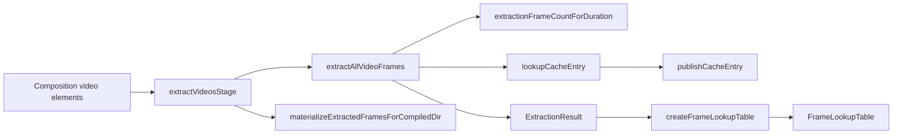
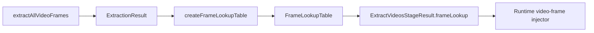
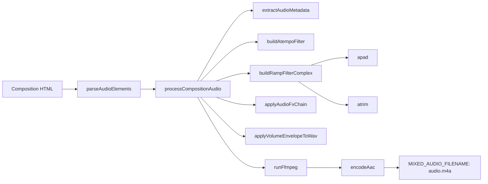
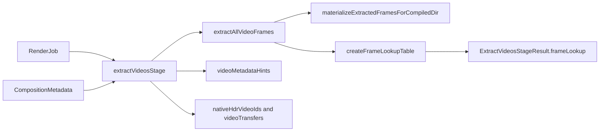

<!-- source: DeepWiki mcp.deepwiki.com · repo heygen-com/hyperframes · page 5.2 Video Frame Extraction and Audio Mixing · fetched 2026-11-02 -->

# Video Frame Extraction and Audio Mixing

<details>
<summary>Relevant source files</summary>

The following files were used as context for generating this wiki page:

- [packages/cli/src/ui/renderDiagnostic.test.ts](packages/cli/src/ui/renderDiagnostic.test.ts)
- [packages/core/src/previewProxyBox.test.ts](packages/core/src/previewProxyBox.test.ts)
- [packages/core/src/previewProxyBox.ts](packages/core/src/previewProxyBox.ts)
- [packages/core/src/runtime/mediaProxy.test.ts](packages/core/src/runtime/mediaProxy.test.ts)
- [packages/core/src/runtime/mediaProxy.ts](packages/core/src/runtime/mediaProxy.ts)
- [packages/engine/src/services/aacEncode.test.ts](packages/engine/src/services/aacEncode.test.ts)
- [packages/engine/src/services/aacEncode.ts](packages/engine/src/services/aacEncode.ts)
- [packages/engine/src/services/audioFxRender.ts](packages/engine/src/services/audioFxRender.ts)
- [packages/engine/src/services/audioMixer.test.ts](packages/engine/src/services/audioMixer.test.ts)
- [packages/engine/src/services/audioMixer.ts](packages/engine/src/services/audioMixer.ts)
- [packages/engine/src/services/audioMixer.types.ts](packages/engine/src/services/audioMixer.types.ts)
- [packages/engine/src/services/audioVolumeEnvelope.test.ts](packages/engine/src/services/audioVolumeEnvelope.test.ts)
- [packages/engine/src/services/audioVolumeEnvelope.ts](packages/engine/src/services/audioVolumeEnvelope.ts)
- [packages/engine/src/services/captureWarning.test.ts](packages/engine/src/services/captureWarning.test.ts)
- [packages/engine/src/services/captureWarning.ts](packages/engine/src/services/captureWarning.ts)
- [packages/engine/src/services/extractionCache.recovery.test.ts](packages/engine/src/services/extractionCache.recovery.test.ts)
- [packages/engine/src/services/extractionCache.test.ts](packages/engine/src/services/extractionCache.test.ts)
- [packages/engine/src/services/extractionCache.ts](packages/engine/src/services/extractionCache.ts)
- [packages/engine/src/services/videoFrameExtractor.downloadCache.test.ts](packages/engine/src/services/videoFrameExtractor.downloadCache.test.ts)
- [packages/engine/src/services/videoFrameExtractor.errorClassification.test.ts](packages/engine/src/services/videoFrameExtractor.errorClassification.test.ts)
- [packages/engine/src/services/videoFrameExtractor.test.ts](packages/engine/src/services/videoFrameExtractor.test.ts)
- [packages/engine/src/services/videoFrameExtractor.ts](packages/engine/src/services/videoFrameExtractor.ts)
- [packages/engine/src/utils/ffprobe.test.ts](packages/engine/src/utils/ffprobe.test.ts)
- [packages/engine/src/utils/ffprobe.ts](packages/engine/src/utils/ffprobe.ts)
- [packages/engine/src/utils/notMediaPayload.test.ts](packages/engine/src/utils/notMediaPayload.test.ts)
- [packages/engine/src/utils/notMediaPayload.ts](packages/engine/src/utils/notMediaPayload.ts)
- [packages/parsers/package-subpaths.json](packages/parsers/package-subpaths.json)
- [packages/parsers/src/index.ts](packages/parsers/src/index.ts)
- [packages/parsers/tsup.config.ts](packages/parsers/tsup.config.ts)
- [packages/producer/src/server.extractionFailureMetadata.test.ts](packages/producer/src/server.extractionFailureMetadata.test.ts)
- [packages/producer/src/server.notMediaErrorCode.test.ts](packages/producer/src/server.notMediaErrorCode.test.ts)
- [packages/producer/src/services/distributed/plan.masterBus.test.ts](packages/producer/src/services/distributed/plan.masterBus.test.ts)
- [packages/producer/src/services/render/extractionFailureMetadata.ts](packages/producer/src/services/render/extractionFailureMetadata.ts)
- [packages/producer/src/services/render/stages/audioStage.test.ts](packages/producer/src/services/render/stages/audioStage.test.ts)
- [packages/producer/src/services/render/stages/audioStage.ts](packages/producer/src/services/render/stages/audioStage.ts)
- [packages/producer/src/services/render/stages/extractVideosStage.test.ts](packages/producer/src/services/render/stages/extractVideosStage.test.ts)
- [packages/producer/src/services/render/stages/extractVideosStage.timelineBound.test.ts](packages/producer/src/services/render/stages/extractVideosStage.timelineBound.test.ts)
- [packages/producer/src/services/render/stages/extractVideosStage.ts](packages/producer/src/services/render/stages/extractVideosStage.ts)
- [packages/producer/src/services/render/videoFrameCoverage.test.ts](packages/producer/src/services/render/videoFrameCoverage.test.ts)
- [packages/producer/src/services/render/videoFrameCoverage.ts](packages/producer/src/services/render/videoFrameCoverage.ts)
- [packages/producer/src/services/renderOrchestrator.masterBus.test.ts](packages/producer/src/services/renderOrchestrator.masterBus.test.ts)
- [packages/studio-server/src/helpers/mediaCodecMap.test.ts](packages/studio-server/src/helpers/mediaCodecMap.test.ts)
- [packages/studio-server/src/helpers/mediaCodecMap.ts](packages/studio-server/src/helpers/mediaCodecMap.ts)
- [packages/studio-server/src/helpers/mediaMetadata.test.ts](packages/studio-server/src/helpers/mediaMetadata.test.ts)
- [packages/studio-server/src/helpers/mediaMetadata.ts](packages/studio-server/src/helpers/mediaMetadata.ts)
- [packages/studio-server/src/helpers/mediaProxyPreview.test.ts](packages/studio-server/src/helpers/mediaProxyPreview.test.ts)
- [packages/studio-server/src/helpers/mediaProxyPreview.ts](packages/studio-server/src/helpers/mediaProxyPreview.ts)
- [packages/studio-server/src/helpers/proxyCacheKey.ts](packages/studio-server/src/helpers/proxyCacheKey.ts)
- [packages/studio-server/src/helpers/proxyLock.ts](packages/studio-server/src/helpers/proxyLock.ts)
- [packages/studio-server/src/helpers/proxyTranscoder.test.ts](packages/studio-server/src/helpers/proxyTranscoder.test.ts)
- [packages/studio-server/src/helpers/proxyTranscoder.ts](packages/studio-server/src/helpers/proxyTranscoder.ts)
- [scripts/package-size-budgets.json](scripts/package-size-budgets.json)

</details>


## Purpose and scope

This page describes the engine’s FFmpeg-based video-frame extraction and audio-mixing services, their cache and render-stage handoff, and the timing and media-processing details visible in the supplied code. The producer’s `extractVideosStage` calls the engine extractor and returns a `FrameLookupTable` for runtime injection; the audio mixer exposes `processCompositionAudio` and writes the shared output name `audio.m4a`. [packages/producer/src/services/render/stages/extractVideosStage.ts:33-57,96-101]() [packages/engine/src/services/audioMixer.ts:72-76,1-36]()

Sources: `packages/producer/src/services/render/stages/extractVideosStage.ts`, `packages/engine/src/services/audioMixer.ts`

## 1. Video Frame Extraction (`videoFrameExtractor.ts`)

### Purpose and scope

`videoFrameExtractor.ts` pre-extracts video frames with FFmpeg so capture can use images in place of live video elements. The module imports HTML parsing, media timing helpers, `ffprobe` metadata and frame utilities, FFmpeg execution, and the extraction-cache API. [packages/engine/src/services/videoFrameExtractor.ts:3-7,9-90]()

Its public format guard accepts only `auto`, `jpg`, or `png`. `ExtractedFrames` records the source and output paths, frame pattern, FPS, frame count, metadata, and an indexed map of frame paths; it can also carry a deferred range and an `ownedByLookup` flag. That flag distinguishes render-owned output directories from cache entries that must not be removed by an individual render. [packages/engine/src/services/videoFrameExtractor.ts:94-123,125-137]()

Sources: `packages/engine/src/services/videoFrameExtractor.ts`

### Timing model and frame-count calculation

The extractor’s `VideoElement` input describes a video’s timeline start and end, source `mediaStart`, optional playback-rate specification, looping, audio presence, and optional hidden state. The module imports shared timing helpers such as `sourceTimeAt`, `timeAtSourceTime`, `readMediaStart`, and clip-window predicates rather than treating timeline time and source-media time as interchangeable. [packages/engine/src/services/videoFrameExtractor.ts:18-41,94-104]()

`extractionFrameCountForDuration(durationSeconds, fps, isVFR)` is specifically documented as the shared count calculation for extraction-window slicing and producer coverage accounting. Its implementation converts the serialized decimal duration to integer microseconds and represents frame-rate arithmetic rationally; this avoids boundary errors from binary floating-point rounding. It returns zero for invalid or non-positive duration and rejects invalid frame-rate inputs. [packages/engine/src/services/videoFrameExtractor.ts:139-191]()

The accompanying tests exercise extraction-window behavior for constant playback rate, ramped rates, clips beginning before the timeline, and rebasing a clip to a resolved window. These tests demonstrate that the extraction window accounts for the source span consumed by the authored timeline slot. [packages/engine/src/services/videoFrameExtractor.test.ts:116-193]()

Sources: `packages/engine/src/services/videoFrameExtractor.ts`, `packages/engine/src/services/videoFrameExtractor.test.ts`

### Extraction and render handoff

The producer’s `extractVideosStage` imports `extractAllVideoFrames`, `createFrameLookupTable`, extraction-window helpers, retry and error-classification helpers, and media metadata functions from `@hyperframes/engine`. Its result includes the extraction result, a nullable `FrameLookupTable`, video readiness skip IDs, metadata hints, HDR information, extraction duration, and a candidate failure to enforce. [packages/producer/src/services/render/stages/extractVideosStage.ts:33-57,96-121]()

The stage’s declared contract is that `extractAllVideoFrames` supplies the extraction result, or `null` when there are no videos, and the frame lookup is null when no frames were extracted. The stage also documents a `materializeSymlinks` option: the default preserves the in-process renderer’s symlink behavior, while distributed planning can request real files so the plan directory remains self-contained across storage transfers. [packages/producer/src/services/render/stages/extractVideosStage.ts:21-29,74-101]()

The supplied code does not include the implementation of the runtime injector or the `FrameLookupTable` class. Consequently, this page describes the stage’s lookup-table handoff but does not assume an injector method name or DOM-patching implementation. [packages/producer/src/services/render/stages/extractVideosStage.ts:96-101]()

Sources: `packages/producer/src/services/render/stages/extractVideosStage.ts`

### Video extraction: natural-language-to-code map

This diagram connects the rendering concepts to the code symbols used at the producer/engine boundary. The producer imports the extraction and lookup functions from `@hyperframes/engine`; the extractor itself imports the cache operations. [packages/producer/src/services/render/stages/extractVideosStage.ts:33-57]() [packages/engine/src/services/videoFrameExtractor.ts:77-90]()

**Diagram: Extraction responsibilities mapped to code entities**



Sources: `packages/producer/src/services/render/stages/extractVideosStage.ts:33-57,63-101`, `packages/engine/src/services/videoFrameExtractor.ts:77-90,139-191`

## 2. Extraction cache (`extractionCache.ts`)

### Cache identity and entry lifecycle

The extraction cache avoids repeating frame extraction for the same source and extraction parameters. Its documented key is a SHA-256 hash of a stable JSON encoding containing source identity, file size, media start, duration, FPS, format, and optional transform. Identity can use a path and modification time or a content SHA-256; non-finite duration is normalized to `-1`. [packages/engine/src/services/extractionCache.ts:1-11,72-94,145-169]()

Cache directories use the `hfcache-v8-` schema prefix and the first 16 hexadecimal characters of the key digest. Extraction is published through a unique partial directory: completion is marked with `.hf-complete`, then the directory is atomically renamed. Cache hits touch the sentinel as an LRU timestamp; garbage collection also removes stale partial directories. [packages/engine/src/services/extractionCache.ts:13-32,55-68]()

`readKeyStat` returns the source modification time and size, or `null` if the source is missing. `readContentSha256` streams a file to compute its digest and returns `null` on failure. These helpers let callers avoid treating missing files as a valid cache identity. [packages/engine/src/services/extractionCache.ts:116-143]()

A cache lookup returns both the entry information and a `hit` boolean. The entry is considered a hit only if it exists and has the completion sentinel; the returned entry is also useful on a miss because the caller can derive a partial directory and publish after extraction. [packages/engine/src/services/extractionCache.ts:103-109]()

Sources: `packages/engine/src/services/extractionCache.ts`

### Cache: natural-language-to-code map

`videoFrameExtractor.ts` imports the cache lookup, partial-directory, publish, rehydration, touch, and garbage-collection functions. This diagram shows the cache contract without assuming that concurrent same-key extraction is deduplicated: the cache module explicitly allows duplicate work while ensuring readers only serve complete entries. [packages/engine/src/services/videoFrameExtractor.ts:77-90]() [packages/engine/src/services/extractionCache.ts:19-25]()

**Diagram: Cache key, lookup, and publication**

```mermaid
flowchart TD
  Input["CacheKeyInput"] --> Blob["canonicalKeyBlob"]
  Blob --> Hash["computeCacheKey"]
  Hash --> Dir["cacheEntryDirName"]
  Dir --> Lookup["lookupCacheEntry"]
  Lookup -->| "hit" | Rehydrate["rehydrateCacheEntry"]
  Lookup -->| "miss" | Partial["partialCacheEntryDir"]
  Partial --> Frames["FFmpeg frame extraction"]
  Frames --> Publish["publishCacheEntry"]
  Publish --> Sentinel["COMPLETE_SENTINEL"]
  Sentinel --> Rehydrate
```

Sources: `packages/engine/src/services/extractionCache.ts:55-68,72-109,145-177`, `packages/engine/src/services/videoFrameExtractor.ts:77-90`

## 3. Frame lookup and runtime injection

### Producer handoff

`extractVideosStage` declares `frameLookup` as a `FrameLookupTable | null` and documents it as the lookup table for the runtime video-frame injector. The stage also imports `createFrameLookupTable` from the engine. [packages/producer/src/services/render/stages/extractVideosStage.ts:33-57,96-101]()

The available files do not show the `FrameLookupTable` definition or the injector’s call sites. Therefore, details such as lookup method names, timestamp-to-index rounding, loop behavior at injection time, or the specific DOM replacement mechanism cannot be established from the supplied source excerpts. The supported integration boundary is: extraction produces frames, the producer stage creates or returns a lookup table, and the stage result exposes that table to downstream rendering. [packages/producer/src/services/render/stages/extractVideosStage.ts:43-57,96-101]()

Sources: `packages/producer/src/services/render/stages/extractVideosStage.ts`

### Lookup-table handoff: natural-language-to-code map

**Diagram: Extracted frames to the stage’s lookup-table result**



Sources: `packages/producer/src/services/render/stages/extractVideosStage.ts:33-57,96-101`

## 4. Audio mixing (`audioMixer.ts`)

### Purpose and entry points

`audioMixer.ts` imports HTML parsing, audio metadata probing, URL input and download helpers, FFmpeg execution, AAC encoding, audio FX rendering, automation and fade utilities, and the video extractor’s media-source resolution helpers. It exports `AudioElement` and `MixResult` types from `audioMixer.types.ts`. [packages/engine/src/services/audioMixer.ts:1-36,72-72]()

The shared output name is `audio.m4a`. The file comment explains that an MP4-family container records AAC priming as an edit list, unlike raw `.aac`, which can play approximately 21 ms late. The video mux, distributed plan, and PNG-sequence sidecar share this filename. [packages/engine/src/services/audioMixer.ts:74-76]()

`safePathSegment` converts author-controlled audio-group IDs into filesystem-safe segments and appends a positional suffix to prevent collisions after sanitization. This protects intermediate-path construction from separators, traversal-like strings, and distinct IDs that sanitize to the same readable value. [packages/engine/src/services/audioMixer.ts:82-100]()

Sources: `packages/engine/src/services/audioMixer.ts`

### Multi-track extraction, trimming, and mixing

The mixer imports `extractAudioMetadata`, `runFfmpeg`, and `encodeAac`, as well as helpers for resolving source media, parsing fades and automation, audio groups, FX chains, and gain. These imports identify the cooperating subsystems used by the mixer; the supplied excerpt does not show the body of `processCompositionAudio`, so exact per-track command construction and mix-filter details are not asserted here. [packages/engine/src/services/audioMixer.ts:8-27,36-70]()

The audio mixer tests establish that the mix filter graph is written to a temporary file and passed to FFmpeg by a file-valued filter option, rather than embedding a command whose length scales with track count. The test mock captures the filter script while the FFmpeg process is running, since production removes the temporary file after the process exits. [packages/engine/src/services/audioMixer.test.ts:7-13,14-37]()

The test suite imports `parseAudioElements` and `processCompositionAudio` and exercises parsing of `<audio>`, audible video, and `<source>` children. It also verifies that a relative `data-start` can be resolved against another element and that explicit `data-end` takes precedence over `data-duration`. [packages/engine/src/services/audioMixer.test.ts:87-89,103-149]()

Sources: `packages/engine/src/services/audioMixer.ts`, `packages/engine/src/services/audioMixer.test.ts`

### Playback-rate chains and pad-trim behavior

For constant playback rates, `buildAtempoFilter` normalizes the rate and decomposes values outside FFmpeg’s single-stage `atempo` range into chained stages. Rates close to 1 need no tempo filter. [packages/engine/src/services/audioMixer.ts:106-121]()

For a ramped rate lane, `buildRampFilterComplex` divides the composition duration into slices of at most 0.25 seconds, with a maximum of 240 slices. For each slice it derives source-time bounds via `sourceTimeAt`, trims that source interval, resets timestamps, applies a pitch-preserving tempo chain when needed, pads with `apad`, resets timestamps again, and trims to the composition slice duration. It then concatenates the slices, applying an optional tail filter after concatenation. [packages/engine/src/services/audioMixer.ts:123-157]()

`preparedAudioOutputArgs` is the next visible preparation helper. The supplied excerpt shows it normalizing mono input to stereo through a channel filter or setting `-ac 2`; its remaining implementation is not included, so further output-argument behavior is not described. [packages/engine/src/services/audioMixer.ts:159-168]()

Sources: `packages/engine/src/services/audioMixer.ts`

### Audio FX and envelope processing

The mixer imports `applyAudioFxChain`, `applyVolumeEnvelopeToWav`, audio automation parsers and resolvers, gain helpers, and `chainTailSeconds`. These are the named integration points for FX, volume automation, gain, and effect-tail handling. [packages/engine/src/services/audioMixer.ts:11-12,36-55,68-70]()

`audioFxRender.ts` documents that its FX processing runs in an `OfflineAudioContext` inside the headless browser and uses the same graph builders as Studio preview. Its WAV reader supports the mixer’s 16-bit PCM and 32-bit float formats and refuses unsupported formats rather than interpreting them as audio. [packages/engine/src/services/audioFxRender.ts:1-13,55-59,144-177]()

Sources: `packages/engine/src/services/audioMixer.ts`, `packages/engine/src/services/audioFxRender.ts`

### Audio mixing: natural-language-to-code map

**Diagram: Audio track preparation and named mixer dependencies**



Sources: `packages/engine/src/services/audioMixer.ts:8-27,36-70,72-76,106-168`

## 5. Producer render-stage integration

### Video extraction stage

The producer stage imports the engine’s `extractAllVideoFrames`, `createFrameLookupTable`, extraction-window helpers, retry and error-classification functions, and video/audio identity helpers. It accepts the project directory, compiled directory, render job, engine configuration, composition metadata, abort signal, and extraction options. [packages/producer/src/services/render/stages/extractVideosStage.ts:33-94]()

The stage result includes the extraction result and frame lookup alongside metadata and HDR-related values. Its contract says `extractionResult` is null when the composition has no videos, and `frameLookup` is null when no frames were extracted. The stage also reports `videoExtractMs` and a candidate failure to enforce. [packages/producer/src/services/render/stages/extractVideosStage.ts:96-121]()

Sources: `packages/producer/src/services/render/stages/extractVideosStage.ts`

### Render-stage media flow

**Diagram: Producer video extraction handoff**



Sources: `packages/producer/src/services/render/stages/extractVideosStage.ts:33-57,63-101,103-121`

## 6. Key entities

| Concern | Code entity | Role |
|---|---|---|
| Video extraction input | `VideoElement` | Video source, timeline window, source offset, playback rate, loop, audio, and visibility fields. [packages/engine/src/services/videoFrameExtractor.ts:94-104]() |
| Extraction output | `ExtractedFrames` | Output directory and frame sequence metadata, paths, and ownership flag. [packages/engine/src/services/videoFrameExtractor.ts:106-123]() |
| Frame count | `extractionFrameCountForDuration` | Shared duration/FPS calculation with rational arithmetic for frame boundaries. [packages/engine/src/services/videoFrameExtractor.ts:139-191]() |
| Cache identity | `CacheKeyInput`, `computeCacheKey` | Defines and hashes source and extraction parameters. [packages/engine/src/services/extractionCache.ts:72-94,145-169]() |
| Cache completion | `COMPLETE_SENTINEL`, `publishCacheEntry` | Marks a fully populated cache entry for readers. [packages/engine/src/services/extractionCache.ts:19-25,55-56]() |
| Producer extraction | `extractVideosStage` | Calls the engine extraction pipeline and returns the extraction and lookup results. [packages/producer/src/services/render/stages/extractVideosStage.ts:33-57,96-101]() |
| Audio mix output | `MIXED_AUDIO_FILENAME` | Shared output filename `audio.m4a`. [packages/engine/src/services/audioMixer.ts:74-76]() |
| Ramp processing | `buildRampFilterComplex` | Creates tempo-adjusted slices using `atrim`, `apad`, and `concat`. [packages/engine/src/services/audioMixer.ts:123-157]() |

Sources: `packages/engine/src/services/videoFrameExtractor.ts`, `packages/engine/src/services/extractionCache.ts`, `packages/engine/src/services/audioMixer.ts`, `packages/producer/src/services/render/stages/extractVideosStage.ts`

## Summary

Video rendering uses FFmpeg pre-extraction and a cache keyed by source identity and extraction parameters. The producer stage consumes the engine extraction result and exposes a `FrameLookupTable` for downstream frame injection. Audio processing has separate mixer and FX-rendering paths; the visible ramp filter implementation trims source slices, applies tempo adjustment, pads and trims each slice to its timeline duration, then concatenates the result. [packages/engine/src/services/videoFrameExtractor.ts:3-7,77-90]() [packages/engine/src/services/extractionCache.ts:1-25,145-177]() [packages/producer/src/services/render/stages/extractVideosStage.ts:33-57,96-101]() [packages/engine/src/services/audioMixer.ts:123-157]()

Sources: `packages/engine/src/services/videoFrameExtractor.ts`, `packages/engine/src/services/extractionCache.ts`, `packages/producer/src/services/render/stages/extractVideosStage.ts`, `packages/engine/src/services/audioMixer.ts`

---

**Sources:**  
- `packages/engine/src/services/videoFrameExtractor.ts:3-7,18-41,77-123,125-191`  
- `packages/engine/src/services/extractionCache.ts:1-32,35-109,116-177`  
- `packages/engine/src/services/audioMixer.ts:1-76,82-168`  
- `packages/engine/src/services/audioMixer.test.ts:7-37,87-149`  
- `packages/engine/src/services/audioFxRender.ts:1-13,55-59,144-177`  
- `packages/producer/src/services/render/stages/extractVideosStage.ts:21-29,33-57,63-121`

---

